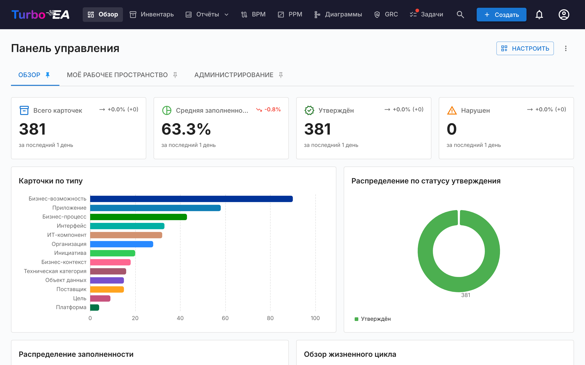
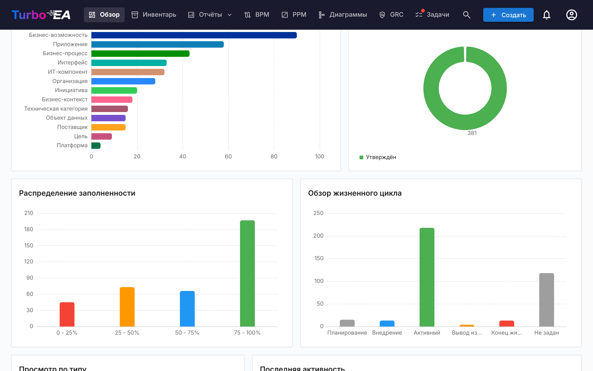
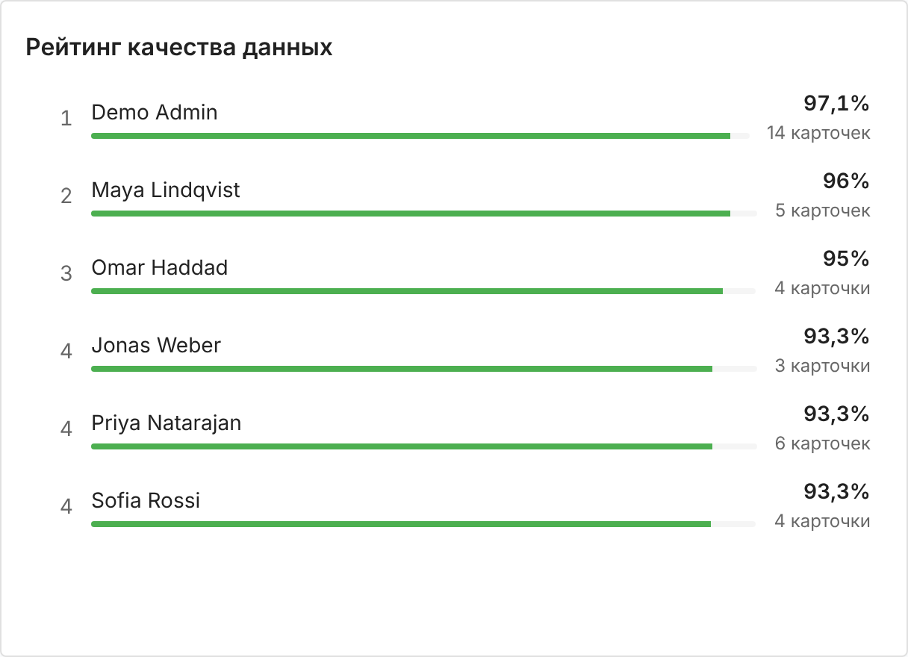
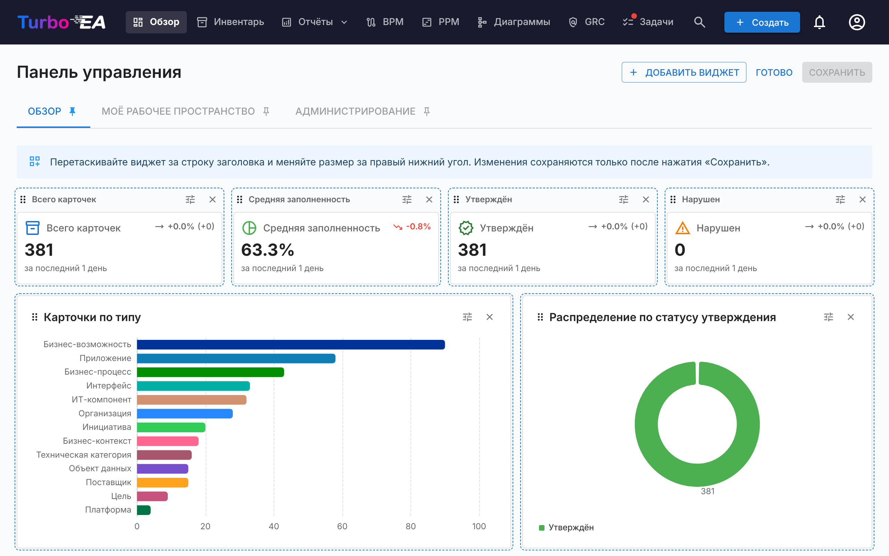

# Панель управления

Панель управления — это первый экран, который вы видите после входа в систему. Она предоставляет **краткий обзор** состояния всей корпоративной архитектуры.

## Верхняя панель навигации

В верхней части экрана расположена **основная панель навигации** со следующими элементами:

- **Turbo EA** (логотип): Нажмите, чтобы вернуться на панель управления из любого раздела
- **Панель управления**: Обзор состояния архитектуры
- **Реестр**: Полный перечень всех карточек
- **Отчёты**: Визуальные и аналитические отчёты
- **BPM**: Управление бизнес-процессами (если включено)
- **Диаграммы**: Редактор визуальных архитектурных диаграмм
- **Поставка EA**: Управление архитектурными инициативами
- **Задачи**: Ожидающие задачи и назначенные опросы
- **Поиск карточек**: Панель быстрого поиска с автодополнением
- **+ Создать**: Кнопка быстрого создания новых карточек
- **Колокольчик уведомлений**: Системные оповещения и [уведомления](notifications.md)
- **Значок профиля**: Выбор языка, переключение темы, настройки уведомлений и доступ к администрированию
- **Поддержать**: Фиолетово-розовая кнопка рядом с номером версии в меню профиля открывает диалог с объяснением, почему важно спонсорство, со ссылкой на блог и вариантами разового или ежемесячного взноса через GitHub Sponsors

## Панели управления и виджеты

Главная страница состоит из **панелей управления**, которые отображаются вкладками в верхней части страницы. В Turbo EA есть три встроенные панели:

| Панель управления | Что показывает |
|-------------------|----------------|
| **Обзор** | Состояние всего ландшафта: плитки KPI, диаграммы, типы карточек для просмотра и последняя активность |
| **Моё рабочее пространство** | Всё, что назначено вам: избранное, роли, задачи, опросы, ваши недавние изменения (см. [Вкладка «Рабочее пространство»](#workspace-tab)) |
| **Администрирование** | Активность пользователей, охват заинтересованных лиц, ожидающие утверждения и каталог заинтересованных лиц (см. [Вкладка «Администрирование»](#admin-tab-stakeholder-directory)) |

Каждая панель управления — это сетка из **виджетов**. Вы видите только те виджеты, которые разрешает ваша роль: виджеты «Обзора» требуют разрешения `reports.ea_dashboard`, виджеты администрирования — `admin.users`; вкладка исчезает, если ни один из её виджетов вам не виден. Администраторы могут изменять встроенные панели и добавлять собственные (см. [Настройка панелей управления](#customizing-dashboards)).

Нажмите значок **булавки** на вкладке, чтобы сделать её панелью, которая открывается при входе в Turbo EA.

## Плитки KPI

Ряд плиток в верхней части панели «Обзор» показывает главные показатели ландшафта:

- **Всего карточек**: количество всех компонентов, зарегистрированных на платформе
- **Среднее качество данных**: средняя полнота всех карточек — нажмите, чтобы открыть [отчёт о качестве данных](reports.md)
- **Утверждено** и **Нарушено**: сколько карточек имеют каждый статус утверждения

Каждая плитка показывает **стрелку тренда**, сравнивающую сегодняшнее значение со значением в начале окна сравнения — 30 дней или меньше, пока история ещё накапливается. Подпись под плитками указывает фактически использованное окно. Снимки делаются ежедневно в 02:00 UTC. Тренды описывают весь ландшафт, поэтому показываются только пользователям, которые могут читать все карточки; пользователь, чья роль скрывает часть карточек, видит значение без стрелки.

## Диаграммы и списки

Под плитками панель «Обзор» показывает:

- **Карточки по типу**: доля каждого типа карточек в вашем ландшафте
- **Статус утверждения**: сколько карточек утверждено, находится на рассмотрении, нарушено или отклонено
- **Распределение полноты**: сколько карточек попадает в каждый интервал качества данных
- **Обзор жизненного цикла**: сколько карточек находится в каждой фазе жизненного цикла
- **Просмотр по типу**: каждый тип карточек с их количеством — нажмите на один из них, чтобы открыть [Инвентарь](inventory.md), предварительно отфильтрованный по этому типу
- **Недавняя активность**: лента последних изменений — кто что и когда редактировал
- **Рейтинг качества данных**: люди, которые поддерживают полноту своих карточек (см. ниже)

Нажатие на столбец или сектор диаграммы открывает то, что за ним стоит: [Инвентарь](inventory.md), отфильтрованный по этим карточкам, для типа карточки или статуса утверждения; отчёт о жизненном цикле для фазы жизненного цикла; отчёт о качестве данных для интервала полноты.

### Рейтинг качества данных

**Рейтинг качества данных** ранжирует людей, у которых есть роль заинтересованной стороны на карточках. По умолчанию он ранжирует их по **среднему качеству данных** их карточек; переключите на **число карточек**, чтобы увидеть, у кого их больше всего. В каждой строке показаны место человека, его имя, полоса цвета уровня качества данных его среднего значения, среднее значение и число карточек, которые за ним закреплены. Люди с одинаковым показателем делят место.

Человек появляется в рейтинге, когда за ним закреплено **минимальное число карточек** (по умолчанию три), поэтому одна идеальная карточка не выводит на первое место. Карточка учитывается один раз на человека, сколько бы ролей он на ней ни имел, и учитываются только активные карточки. По умолчанию учитываются только роли, влияющие на качество данных — пассивная роль, например *Observer*, никогда не даёт места; в настройках виджета рейтинг можно ограничить некоторыми типами карточек или ролями либо учитывать все роли. Деактивированные пользователи не отображаются. Рейтинг рассчитывается для вас: карточка, которую вам нельзя видеть, ничего не добавляет к числу карточек и не меняет среднее, поэтому два читателя с разными правами могут видеть разные цифры. Показываются только имена, никогда адреса электронной почты.

Для рейтинга нужно разрешение `reports.ea_dashboard`, как и для остальной панели «Обзор», а на панели может быть несколько рейтингов — например, по одному на тип карточек.

## Вкладка «Рабочее пространство» { #workspace-tab }

Панель **Моё рабочее пространство** собирает всё, что назначено вам: избранное, сохранённые отчёты, задачи, ожидающие опросы, созданные вами карточки, недавнюю активность по вашим карточкам и раздел **Карточки, где у меня есть роль**. Каждый из этих элементов — виджет, поэтому администратор может переставить их или поместить на другую панель.

Последний раздел группирует карточки по роли заинтересованного лица, которую вы занимаете (Application Owner, Business Owner и т. д.), и перечисляет карточки под каждой ролью. Если ваша роль даёт разрешение `stakeholders.view` (по умолчанию роли admin, member и viewer), небольшой значок **поиска человека** рядом с заголовком раздела позволяет направить его на **другого человека**: выберите пользователя в автодополнении, и раздел перезагрузится с ролями и карточками этого пользователя. Заголовок изменится на «Роли, занимаемые {name}». Нажмите небольшой значок закрытия, чтобы вернуться к своим ролям. Удобно, чтобы одним щелчком ответить на вопрос «чем владеет этот человек?».

## Вкладка «Администрирование» — Каталог заинтересованных лиц { #admin-tab-stakeholder-directory }

Панель **Администрирование** показывается ролям с `admin.users`. Помимо плиток KPI (активные пользователи, карточки без заинтересованных лиц, просроченные задачи, зависшие утверждения, общее качество) и списков (основные участники, охват заинтересованных лиц, неактивные пользователи, конвейер утверждений, системная активность, неназначенные задачи), она завершается виджетом **Каталог заинтересованных лиц**. Он перечисляет каждый тип карточек, у которого есть хотя бы одно заинтересованное лицо, с количеством различных держателей. Разверните тип карточки, чтобы увидеть его роли, а внутри каждой роли — пользователей, которые её занимают, с количеством карточек, которые они охватывают. Нажмите на чип пользователя, чтобы развернуть список его карточек прямо на месте — название каждой карточки само является ссылкой на страницу сведений о карточке. Всё дерево (тип карточки → роль → пользователь → карточки) возвращается одним запросом, поэтому навигация мгновенна.

**Фильтр по имени** в верхней части виджета сужает дерево до пользователей, чьё имя или e-mail совпадает с введённым; подходящие типы карточек разворачиваются автоматически, чтобы совпадения были видны без дополнительного щелчка. Используйте его, чтобы за секунду ответить на вопрос «где в организации встречается Алиса?».

Помимо каталога, небольшое **всплывающее окно при наведении** открывается, когда курсор останавливается на имени заинтересованного лица в другом месте приложения — на вкладке «Заинтересованные лица» карточки, на владельце риска в реестре рисков или на странице сведений о риске — и показывает полный портфель этого пользователя, сгруппированный по ролям. Нажмите на любую карточку во всплывающем окне, чтобы перейти к ней. Всплывающее окно запрашивает данные один раз на пользователя за сеанс.

## Настройка панелей управления { #customizing-dashboards }

Пользователи, чья роль даёт `admin.dashboards` (**Управление панелями управления главной страницы** — по умолчанию роль Admin), могут изменять любую панель и создавать новые. Все остальные видят панели такими, как они настроены.

### Режим настройки

Нажмите **Настроить** рядом с вкладками панелей, чтобы редактировать текущую панель. Компоновка имеет ширину 12 столбцов; в более узком окне виджеты перестраиваются в шесть столбцов, а на телефоне — в один, в порядке их расположения. В режиме настройки:

- **Перемещайте** виджет, перетаскивая его за ручку; сетка имеет ширину 12 столбцов, остальные виджеты уступают место.
- **Меняйте размер** виджета за правый край, нижний край или угол, мышью или касанием (на телефоне или планшете в вертикальном положении раскладка доступна только для чтения). Соседний виджет подстраивается при перетаскивании: он сужается, когда сосед увеличивается, и снова расширяется, когда сосед уменьшается; если сузиться дальше нельзя, он переходит на следующую строку. Строки ниже сами сдвигаются вниз и возвращаются обратно. Виджет привязывается к сетке при перетаскивании, а в режиме настройки под последним виджетом страница оставляет четыре пустые строки, чтобы нижнюю строку можно было вытянуть выше; сначала прокрутите страницу так, чтобы ручка оказалась хорошо внутри окна.
- **Удаляйте** виджет кнопкой закрытия.
- **Настраивайте** плитку KPI, диаграмму, ленту активности или рейтинг качества данных кнопкой с шестерёнкой.
- **Отменяйте** и **повторяйте** действия: **Отменить** и **Повторить** пошагово проходят по изменениям, сделанным с момента открытия режима настройки (по одному перемещению, изменению размера, добавлению, удалению или настройке) — двумя кнопками на панели инструментов или сочетаниями Ctrl+Z / Ctrl+Shift+Z (⌘ на Mac). **Отменить изменения** по-прежнему сбрасывает их все сразу.

Нажмите **Сохранить**, чтобы сохранить изменения для всех, или **Отменить изменения**, чтобы вернуться к панели в прежнем виде.

### Добавление и восстановление виджетов

**Добавить виджет** открывает боковую панель со списком всех виджетов, сгруппированных как **KPI**, **Диаграммы**, **Обзор**, **Моё рабочее пространство** и **Администрирование**. Нажмите на один из них, чтобы добавить его на панель; плитка KPI или диаграмма сначала открывает свою настройку. Каждый встроенный виджет остаётся в каталоге, поэтому случайно удалённый виджет — например, **Недавняя активность** — восстанавливается повторным добавлением. Виджеты, которые могут встречаться на панели только один раз, отображаются серым и помечаются как уже добавленные, если они там есть.

Виджет сохраняет собственное разрешение, где бы он ни находился: виджет администрирования, добавленный на панель «Обзор», по-прежнему показывается только пользователям с `admin.users`.

### Настройка плитки KPI

Плитка KPI показывает либо одну из встроенных метрик (всего карточек, качество данных, открытые задачи и т. д.), либо определённое вами значение:

- **Тип карточки** (необязательно): считать только карточки одного типа, при необходимости с ограничением по подтипу, статусу утверждения, фазе жизненного цикла или [фильтрам](#filters), описанным ниже.
- **Показатель**: **Количество** карточек, **Сумма** или **Среднее** числового поля, поля стоимости или процента этого типа либо [меры](#measures), или **Доля** — суженное количество в процентах от тех же карточек без фильтров (например, доля утверждённых приложений).
- **Рост — это**: **Хорошо** или **Плохо** — определяет, показывается ли восходящий тренд зелёным или красным.
- **Спарклайн**: рисует под числом последние 30 ежедневных значений плитки.
- **Дополнительный показатель**: для суженного количества показывает рядом с числом **из N** (количество без фильтров) или **долю от общего**.

Новая плитка KPI записывает своё первое значение в момент сохранения панели, поэтому её тренд начинается на следующий день. Сумма или среднее поля стоимости показываются только пользователям, которым разрешено видеть стоимость, учитывают только карточки, действующие в текущем финансовом году (правило отчёта о стоимости), и указывают этот год под значением.

Плитки, питаемые отчётом модуля (открытые риски, просроченные риски, оценка соответствия, инициативы под угрозой, процессы без диаграммы), попадают в каталог, когда модуль включён и у вас есть его разрешение; тренд они не показывают, потому что отчёты модулей не хранят историю.

### Настройка диаграммы

Диаграмма группирует карточки по одному **измерению** и оценивает каждую группу **показателем**:

| Измерение | Группирует карточки по |
|-----------|------------------------|
| **Тип карточки** | Типу карточки |
| **Подтип** | Подтипу выбранного типа карточки |
| **Статус утверждения** | Утверждено, на рассмотрении, нарушено, отклонено |
| **Фаза жизненного цикла** | Текущей фазе жизненного цикла |
| **Качество данных** | Интервалу качества данных (0–25 %, 25–50 %, …) |
| **Месяц создания** | Месяцу создания карточки |
| **Поле** | Любому полю с одиночным выбором или «да/нет» выбранного типа карточки |
| **Каждая карточка** | Одна группа на каждую карточку выбранного типа — например, древовидная диаграмма стоимости на приложение или приложения с наибольшим числом ИТ-компонентов. Сохраняются самые крупные группы (**Показываемые категории (не более)**, по умолчанию двадцать, до двухсот), остальные сворачиваются в *Прочее* — или исключаются из среднего или доли, которые нельзя суммировать. В этом случае виджет сообщает об этом под диаграммой: «Показаны 20 крупнейших карточек; ещё 37 входят в «Прочее»». Щелчок по карточке открывает её |
| **Связанная карточка** | Карточка на другом конце типа связи — приложения по организациям, ИТ-компоненты по поставщикам, стоимость по бизнес-возможностям. Карточка, связанная с несколькими связанными карточками, учитывается в каждой; карточки без связей попадают в *Нет*; сохраняются двадцать крупнейших групп, остальные объединяются в *Прочее* |
| **Охват EOL** | Есть ли у приложения или ИТ-компонента ссылка на endoflife.date, дата окончания срока службы, указанная вручную, или ни того ни другого |
| **Месяц ввода в эксплуатацию** / **Месяц окончания жизненного цикла** | Месяц, на который приходится дата активности или окончания жизненного цикла карточки, в пределах 18 месяцев: шесть назад и одиннадцать вперёд — вводы в эксплуатацию по месяцам или календарь окончания жизненного цикла |

Меню измерений сгруппировано: **Карточка**, **Даты**, **Поля**, **Связанные карточки** и **Состояние**.

#### Меры

Показатель — это **Количество карточек**, **Сумма** или **Среднее** числового поля, поля стоимости или процента либо одной из этих мер: **связи заданного типа** у каждой карточки (сколько ИТ-компонентов использует приложение) или её оценка **качества данных**. **Доля** показывает для каждой группы суженное количество в процентах от количества без фильтров. Предлагаются только те типы карточек, которые вы можете читать, а поля стоимости — только пользователям, которым разрешено видеть стоимость; стоимость учитывает только карточки, действующие в текущем финансовом году, и диаграмма указывает этот год.

#### Фильтры

Помимо статуса утверждения и фазы жизненного цикла, диаграмму или KPI можно сузить до карточек, которые **изолированы** (нет ни одной связи), **устарели** (не обновлялись 90 дней), **без заинтересованных сторон**, с **отсутствующим** окончанием срока службы, либо которые **имеют** или **не имеют** связь заданного типа — по тем же определениям, что и фильтры Инвентаря и отчёт о качестве данных.

| Диаграмма | Лучше всего подходит для |
|-----------|--------------------------|
| **Горизонтальные столбцы** / **Столбцы** | Сравнения групп по горизонтали или по вертикали |
| **Столбцы с накоплением** | Два измерения в виде столбцов с накоплением и легендой — тип карточки по фазе жизненного цикла, уровень возможности по статусу утверждения |
| **Линия** | Тренда во времени, например числа карточек, созданных за месяц |
| **Круговая** / **Кольцевая** | Долей целого |
| **Спидометр** | Показателя относительно цели: доли (утверждённые приложения), среднего качества данных, процентного поля или оценки соответствия на шкале 0–100, либо количества или суммы относительно **Цели**. Два порога (**Предупреждение выше**, **Хорошо выше**) делят шкалу на красную, янтарную и зелёную зоны, которые меняются местами, когда рост — это плохо; в каталоге есть два готовых спидометра: **Качество данных** и **Утверждённые приложения** |
| **Тепловая карта** | Двух измерений одновременно — например, фазы жизненного цикла и статуса утверждения; **Показывать значения на диаграмме** выводит число в каждой ячейке |
| **Древовидная карта** | Долей при большом числе групп; **Показывать значения на диаграмме** выводит число на каждой плитке |
| **Диаграмма Санкея** | Потока типа связи между соединяемыми им карточками, с выбранным вами измерением на каждом конце |

Диаграмма Санкея принимает тип связи и группирует **каждый конец** отдельно: по типу карточки, подтипу, статусу утверждения, фазе жизненного цикла, качеству данных, полю типа этого конца или по **самим карточкам** — Организация → Приложение показывает, какие организации используют какие приложения; на каждом конце сохраняются двадцать крупнейших карточек, остальные объединяются в *Прочее*; в этом случае виджет сообщает об этом под диаграммой, а **Показываемые категории (не более)** повышает предел. Щелчок по узлу карточки открывает карточку.

Диаграммы могут также отображать отчёт модуля: риски по уровню или статусу, оценки соответствия по нормативным требованиям, состояние графика PPM и зрелость BPM попадают в каталог, когда модуль включён и у вас есть его разрешение. Теги пока нельзя использовать как измерение или фильтр.

В семействе **Диаграммы** каталога есть четыре готовые диаграммы, каждая из которых предлагается, когда в вашей метамодели есть нужные элементы: **Приложения по организациям**, **Календарь окончания жизненного цикла**, **Устаревшие карточки по типам** и диаграмма Санкея **Организация → Приложение**.

Включите переход по щелчку, чтобы читатели могли открыть [Инвентарь](inventory.md) или отчёт, стоящий за столбцом или сектором (столбчатые диаграммы, в том числе с накоплением, линейные, круговые, кольцевые диаграммы и древовидные карты, а также узлы карточек диаграммы Санкея). **Показывать значения на диаграмме** выводит число на каждом столбце, плитке или в ячейке (столбчатые диаграммы, в том числе с накоплением, древовидные карты и тепловые карты). Предпросмотр в диалоговом окне показывает диаграмму в том виде, в каком она будет отображаться.

### Управление панелями управления

Меню **⋮** рядом с вкладками действует на текущую панель:

| Действие | Что делает |
|----------|------------|
| **Новая панель управления** | Создаёт пустую панель, готовую к наполнению виджетами |
| **Дублировать** | Копирует панель со всеми её виджетами — быстрый старт для варианта встроенной панели |
| **Настройки** | Название, описание, значок и **Доступ**: роли, которым разрешено видеть панель. Оставьте доступ пустым, чтобы показать её всем; встроенная панель Admin поставляется с доступом, ограниченным ролями, которым разрешено управлять пользователями (при новой установке — роль Admin). Под полем перечислены права, необходимые виджетам панели: роль без них ничего там не увидит, независимо от настройки доступа. Пользователи с `admin.dashboards` всегда видят все панели |
| **Скрыть** / **Показать** | Убирает панель с вкладок всех остальных, не удаляя её |
| **Переместить влево** / **Переместить вправо** | Меняет порядок вкладок |
| **Сбросить к значениям по умолчанию** | Только встроенные панели: восстанавливает виджеты и компоновку, поставляемые с Turbo EA и, для панели «Админ», роли, перечисленные в её доступе |
| **Удалить** | Только пользовательские панели: удаляет панель для всех |

Обновление Turbo EA никогда не перезаписывает изменённую вами панель. Когда выпуск улучшает встроенную панель, **Сбросить к значениям по умолчанию** приносит новую версию.

Каждое изменение панели — создание, редактирование, дублирование, сброс или удаление, включая добавленные или удалённые виджеты — фиксируется в [журнале аудита](../admin/audit-log.md#administrative-actions). Панели переносятся вместе с [переносом рабочего пространства](../admin/workspace-transfer.md).
