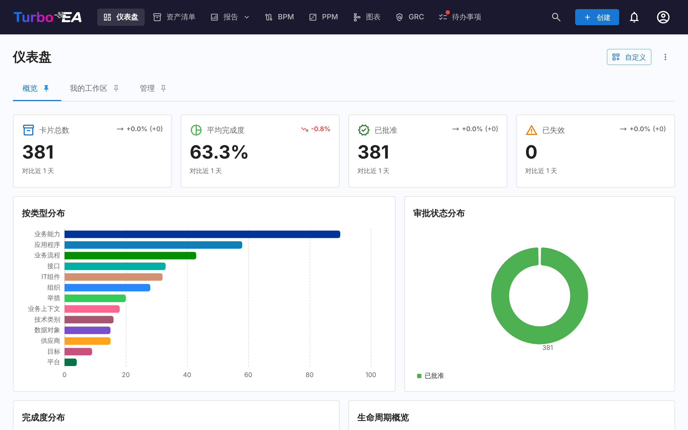
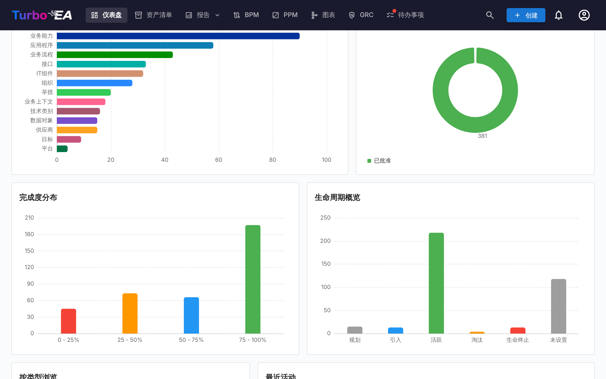
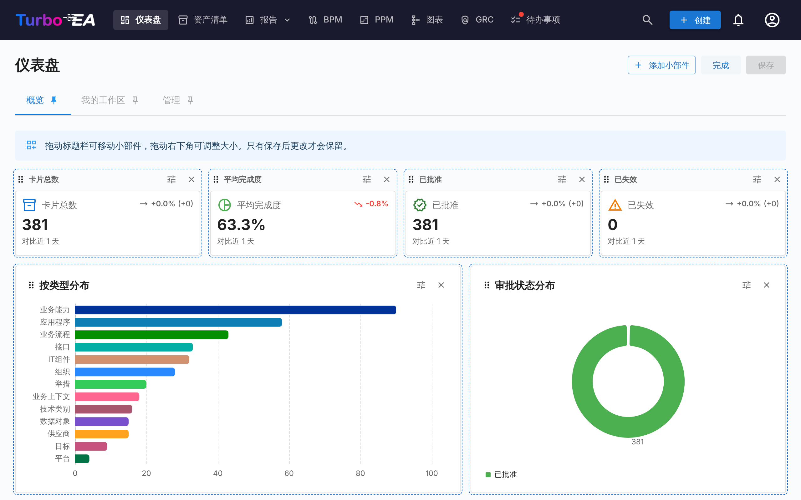

# 仪表盘

仪表盘是登录后看到的第一个界面。它提供整个企业架构状态的**快速概览**。

## 顶部导航栏

在屏幕顶部，您会看到包含以下元素的**主导航栏**：

- **Turbo EA**（logo）：点击可从任何页面返回仪表盘
- **仪表盘**：架构状态概览
- **清单**：所有卡片的完整列表
- **报告**：可视化和分析报告
- **BPM**：业务流程管理（如果已启用）
- **图表**：可视化架构图表编辑器
- **EA 交付**：架构项目管理
- **待办**：待处理任务和分配的问卷
- **搜索卡片**：带自动补全的快速搜索栏
- **+ 创建**：快速创建新卡片的按钮
- **通知铃铛**：系统提醒和[通知](notifications.md)
- **个人头像**：语言选择、主题切换、通知偏好和管理入口
- **赞助**：个人菜单中版本号旁边的紫粉色按钮会打开一个对话框，说明赞助的意义，并提供博客链接以及通过 GitHub Sponsors 进行一次性或每月赞助的选项

## 仪表盘和小部件

主页由**仪表盘**组成，以标签页形式显示在页面顶部。Turbo EA 自带三个仪表盘：

| 仪表盘 | 显示内容 |
|--------|----------|
| **概览** | 整个架构全景的状态：KPI 磁贴、图表、可浏览的卡片类型以及最新动态 |
| **我的工作区** | 分配给您的一切——收藏、角色、待办、调查以及您最近的更改（参见[「工作区」标签页](#workspace-tab)） |
| **管理** | 用户活动、干系人覆盖情况、待处理的审批以及干系人目录（参见[「管理」标签页](#admin-tab-stakeholder-directory)） |

每个仪表盘都是由**小部件**组成的网格。您只能看到所在角色允许的小部件——概览小部件需要 `reports.ea_dashboard` 权限，管理小部件需要 `admin.users`——如果某个标签页的小部件对您都不可见，该标签页将不会显示。管理员可以修改内置仪表盘并添加自己的仪表盘（参见[自定义仪表盘](#customizing-dashboards)）。

点击标签页上的**图钉**图标，可将其设为打开 Turbo EA 时默认进入的仪表盘。

## KPI 磁贴

概览仪表盘顶部的一排磁贴显示整个全景的核心数字：

- **卡片总数**：平台中登记的所有组件数量
- **平均数据质量**：所有卡片的平均完整度——点击可打开[数据质量报告](reports.md)
- **已批准**和**已变更**：处于各审批状态的卡片数量

每个磁贴都显示一个**趋势箭头**，将今天的值与对比窗口起点的值进行比较——30 天，历史数据仍在收集时则更短。磁贴下方的说明文字会标明实际使用的窗口。快照每天 02:00 UTC 生成。趋势描述的是整个全景，因此只向能够读取所有卡片的用户显示；如果某用户的角色隐藏了部分卡片，则只会看到数值而没有箭头。

## 图表和列表

在磁贴下方，概览仪表盘显示：

- **按类型分布的卡片**：各卡片类型在您的全景中所占比例
- **审批状态**：已批准、待审批、已变更或已拒绝的卡片数量
- **完整度分布**：各数据质量区间内的卡片数量
- **生命周期概览**：处于各生命周期阶段的卡片数量
- **按类型浏览**：每种卡片类型及其数量——点击其中一项，可打开按该类型预先筛选的[清单](inventory.md)
- **最近动态**：最新更改的动态流——谁在何时编辑了什么

点击图表中的某个条形或扇区会打开其背后的内容：对于卡片类型或审批状态，打开按这些卡片筛选的[清单](inventory.md)；对于生命周期阶段，打开生命周期报告；对于完整度区间，打开数据质量报告。

## 「工作区」标签页 { #workspace-tab }

**我的工作区**仪表盘汇集了分配给您的一切：收藏、已保存的报告、待办事项、待处理的调查、您创建的卡片、您的卡片上的最近动态，以及**我担任角色的卡片**部分。其中每一项都是一个小部件，因此管理员可以重新排列它们，或将它们放到其他仪表盘上。

最后一部分按您所担任的干系人角色（Application Owner、Business Owner 等）对卡片分组，并在每个角色下列出卡片。如果您的角色拥有 `stakeholders.view` 权限（默认情况下为 admin、member 和 viewer 角色），则部分标题旁会出现一个小的**人员搜索**图标，可让您将其指向**其他人**——从自动补全中选择一个用户，该部分便会重新加载并显示该用户的角色和卡片。标题会变为「{name} 担任的角色」。点击小的关闭图标即可返回您自己的角色。便于一键回答「这个人负责什么？」。

## 「管理」标签页 —— 干系人目录 { #admin-tab-stakeholder-directory }

**管理**仪表盘向拥有 `admin.users` 的角色显示。除了它的 KPI 磁贴（活跃用户、没有干系人的卡片、逾期待办、停滞的审批、整体质量）和列表（主要贡献者、干系人覆盖情况、闲置用户、审批流水线、系统活动、未分配的待办）之外，它最后还有一个**干系人目录**小部件。它列出每个至少有一名干系人的卡片类型，并显示不同持有者的数量。展开某个卡片类型可查看其角色，在每个角色内可看到担任该角色的用户及其负责的卡片数量。点击用户标签可就地展开其卡片列表——每个卡片名称本身就是指向卡片详情页的链接。整个树（卡片类型 → 角色 → 用户 → 卡片）通过一次往返即可返回，因此导航是即时的。

小部件顶部的**名称筛选**会将树缩小到名称或电子邮件与输入内容匹配的用户；匹配的卡片类型会自动展开，无需额外点击即可看到匹配结果。用它可以在一秒内回答「Alice 在组织中出现在哪里？」。

除目录之外，当光标在应用中的其他位置停留在干系人姓名上时——在卡片的「干系人」标签页上、风险登记册中的风险所有者上或风险详情页上——会弹出一个小的**悬停气泡**，显示该用户按角色分组的完整干系人组合。点击气泡中的任意卡片即可跳转到该卡片。每位用户每个会话中，气泡只获取一次数据。

## 自定义仪表盘 { #customizing-dashboards }

所在角色拥有 `admin.dashboards`（**管理主页仪表盘**——默认授予 Admin 角色）的用户可以修改每个仪表盘并创建新的仪表盘。其他人看到的是已配置好的仪表盘。

### 自定义模式

点击仪表盘标签页旁的**自定义**，即可编辑当前仪表盘。布局宽 12 列；窗口较窄时，小部件会按布局顺序重排为六列，在手机上则为一列。在自定义模式下：

- 拖动小部件的手柄即可**移动**它；网格宽 12 列，其他小部件会让出位置。
- 从右边缘、下边缘或角上**调整**小部件的大小，可用鼠标或触摸（在竖持的手机或平板上，布局为只读）。相邻的小部件会在拖动时随之调整：邻居变大时它变窄，邻居缩小时它再变宽；如果无法再变窄，则移到下一行。下方的行会自动下移并再回升。小部件在拖动时会吸附到网格，在自定义模式下，页面在最后一个小部件下方保留四个空行，以便把最底行拖得更高；请先滚动页面，直到手柄完全位于窗口内部。
- 使用关闭按钮**移除**小部件。
- 使用齿轮按钮**配置** KPI 磁贴、图表或动态流。
- **撤销**和**重做**：可逐步回退或恢复自打开「自定义」以来所做的更改（每次一步移动、调整大小、添加、移除或配置）——使用工具栏上的两个按钮，或按 Ctrl+Z / Ctrl+Shift+Z（Mac 上为 ⌘）。**放弃更改**仍会一次性丢弃全部更改。

点击**保存**，即为所有人保留更改；点击**放弃更改**，则恢复到原来的仪表盘。

### 添加和恢复小部件

**添加小部件**会打开一个抽屉，列出所有小部件，按**KPI**、**图表**、**概览**、**我的工作区**和**管理**分组。点击其中一个即可将其添加到仪表盘；KPI 磁贴或图表会先打开其配置。每个内置小部件都保留在目录中，因此误删的小部件——例如**最近动态**——只需再次添加即可恢复。在仪表盘上只能出现一次的小部件，在已存在时会显示为灰色并标记为已添加。

无论小部件被放在哪里，它都保留自己的权限：添加到概览仪表盘的管理小部件仍然只向拥有 `admin.users` 的用户显示。

### 配置 KPI 磁贴

KPI 磁贴显示某个内置指标（卡片总数、数据质量、未完成待办等）或您自行定义的数值：

- **卡片类型**（可选）：只统计某一类型的卡片，还可进一步限定为某个子类型、审批状态、生命周期阶段或下文的[筛选条件](#filters)。
- **度量**：卡片的**数量**，该类型的某个数字、成本或百分比字段（或某个[指标](#measures)）的**总和**或**平均值**，或**占比**——缩小范围后的数量占相同卡片（不含筛选条件）的百分比（例如已批准应用的占比）。
- **上升为**：**好**或**差**——决定上升趋势显示为绿色还是红色。
- **迷你趋势图**：在数字下方绘制该磁贴最近 30 个每日数值。
- **次要数值**：对于缩小范围后的数量，在数字旁显示**共 N**（未筛选的数量）或**占总数的比例**。

新的 KPI 磁贴在保存仪表盘的那一刻记录其第一个值，因此其趋势从次日开始。成本字段的总和或平均值只向有权查看成本的用户显示，只统计在当前财年处于有效状态的卡片（成本报告所用的规则），并在数值下方注明该财年。

由模块报告提供数据的磁贴（未关闭风险、逾期风险、合规得分、有风险的举措、无图表的流程）会在模块已启用且您拥有其权限时列入目录；它们不显示趋势，因为模块报告不保留历史记录。

### 配置图表

图表按一个**维度**对卡片分组，并用**度量**衡量每个分组：

| 维度 | 按以下方式对卡片分组 |
|------|----------------------|
| **卡片类型** | 卡片类型 |
| **子类型** | 所选卡片类型的子类型 |
| **审批状态** | 已批准、待审批、已变更、已拒绝 |
| **生命周期阶段** | 当前的生命周期阶段 |
| **数据质量** | 数据质量区间（0–25 %、25–50 %……） |
| **创建月份** | 卡片创建的月份 |
| **某个字段** | 所选卡片类型的任意单选或是/否字段 |
| **每张卡片** | 所选类型的每张卡片各为一组——例如每个应用成本的矩形树图，或拥有最多 IT 组件的应用。保留最大的分组（**显示的类别数（最多）**，默认二十个，最多二百个），其余合并为*其他*——对于无法求和的平均值或占比，则直接舍去。出现这种情况时，组件会在图表下方提示：「显示最大的 20 张卡片；另有 37 张归入「其他」」。点击某张卡片即可打开它 |
| **相关卡片** | 某种关系类型另一端的卡片——每个组织的应用、每个提供商的 IT 组件、每项业务能力的成本。链接到多张相关卡片的卡片会在每一张下都计数；没有相关卡片的归入*无*；保留最大的二十个分组，其余合并为*其他* |
| **EOL 覆盖情况** | 应用或 IT 组件是否有 endoflife.date 链接、手动录入的生命终止日期，或两者都没有 |
| **上线月份** / **生命周期结束月份** | 卡片的活跃日期或生命周期结束日期所在的月份，覆盖 18 个月：向前六个月、向后十一个月——每月上线数量，或生命周期结束日历 |

维度菜单已分组：**卡片**、**日期**、**字段**、**相关卡片**和**健康度**。

#### 指标

度量可以是**卡片数量**，某个数字、成本或百分比字段的**总和**或**平均值**，或下列指标之一：每张卡片上**某类型的关系数量**（一个应用使用了多少 IT 组件）或其**数据质量**得分。**占比**按分组显示缩小范围后的数量占未筛选数量的百分比。仅提供您有权读取的卡片类型，成本字段仅向有权查看成本的用户提供；成本只统计在当前财年处于有效状态的卡片，图表会注明该财年。

#### 筛选条件

除审批状态和生命周期阶段外，图表或 KPI 还可限定为：**孤立**（完全没有关系）、**陈旧**（90 天未更新）、**无干系人**、生命终止**缺失**，或者**具有**或**缺少**某种类型的关系的卡片——其定义与清单筛选器和数据质量报告所用的相同。

| 图表 | 最适合 |
|------|--------|
| **条形图** / **柱状图** | 横向或纵向比较各分组 |
| **堆叠柱状图** | 以带图例的堆叠条形展示两个维度——按生命周期阶段划分的卡片类型、按审批状态划分的能力层级 |
| **折线图** | 随时间变化的趋势，例如每月创建的卡片 |
| **饼图** / **环形图** | 整体中的占比 |
| **仪表图** | 一个比率与目标的对比：占比（已批准的应用程序）、平均数据质量、百分比字段或 0–100 刻度盘上的合规得分，或与**目标**对比的数量或总和。两个阈值（**高于此值预警**、**高于此值为良好**）将刻度盘分为红、琥珀和绿三个区间，当上升为坏时则反转；目录中提供两个现成的仪表图：**数据质量**和**已批准的应用程序** |
| **热力图** | 同时展示两个维度——例如生命周期阶段与审批状态；**在图表上显示数值** 会在每个单元格中显示数值 |
| **矩形树图** | 分组很多时的占比；**在图表上显示数值** 会在每个方块上显示数值 |
| **桑基图** | 某种关系类型在其所连接的卡片之间的流向，两端可各自选择一个维度 |

桑基图以一种关系类型为基础，并对**每一端**分别分组：按卡片类型、子类型、审批状态、生命周期阶段、数据质量、该端类型的某个字段，或**卡片本身**——组织 → 应用显示哪些组织使用哪些应用，每一端各保留最大的二十张卡片，其余合并为*其他*；出现这种情况时，组件会在图表下方提示，并可通过**显示的类别数（最多）**提高上限。点击卡片节点会打开该卡片。

图表还可以绘制模块报告：按级别或状态划分的风险、按法规划分的合规得分、PPM 进度健康度和 BPM 成熟度，会在模块已启用且您拥有其权限时列入目录。标签暂时还不能用作维度或筛选条件。

目录的**图表**系列中有四个现成图表，当您的元模型具备所需要素时才会提供：**每个组织的应用**、**生命周期结束日历**、**按类型统计的过期卡片**，以及**组织 → 应用**桑基图。

开启点击钻取，读者即可打开条形或扇区背后的[清单](inventory.md)或报告（条形图、柱状图、堆叠柱状图、折线图、饼图、环形图和矩形树图，以及桑基图的卡片节点）。**在图表上显示数值** 会在每个条形、柱、方块或单元格上显示数值（条形图、柱状图、堆叠柱状图、矩形树图和热力图）。对话框中的预览会显示图表最终呈现的样子。

### 管理仪表盘

标签页旁的 **⋮** 菜单作用于当前仪表盘：

| 操作 | 作用 |
|------|------|
| **新建仪表盘** | 创建一个空仪表盘，可随时添加小部件 |
| **复制** | 复制仪表盘及其所有小部件——是基于内置仪表盘创建变体的快捷起点 |
| **设置** | 名称、描述、图标和**访问权限**：允许查看该仪表盘的角色。访问权限留空则向所有人显示；内置的管理仪表盘默认将访问权限设为可管理用户的角色（全新安装时为 Admin 角色）。字段下方会列出该仪表盘的小组件所需的权限：没有这些权限的角色在此看不到任何内容，无论访问权限如何设置。拥有 `admin.dashboards` 的用户始终可以看到每个仪表盘 |
| **隐藏** / **显示** | 将仪表盘从其他所有人的标签页中移除，但不删除它 |
| **左移** / **右移** | 更改标签页的顺序 |
| **重置为默认** | 仅限内置仪表盘：恢复 Turbo EA 自带的小部件和布局，对于管理员仪表盘，还会恢复其访问权限所列的角色 |
| **删除** | 仅限自定义仪表盘：为所有人删除该仪表盘 |

升级 Turbo EA 绝不会覆盖您修改过的仪表盘。当新版本改进了某个内置仪表盘时，**重置为默认**会带来新版本。

对仪表盘的每次更改——创建、编辑、复制、重置或删除，包括添加或移除了哪些小部件——都会记录在[审计日志](../admin/audit-log.md#administrative-actions)中。仪表盘会随[工作区传输](../admin/workspace-transfer.md)一起迁移。
