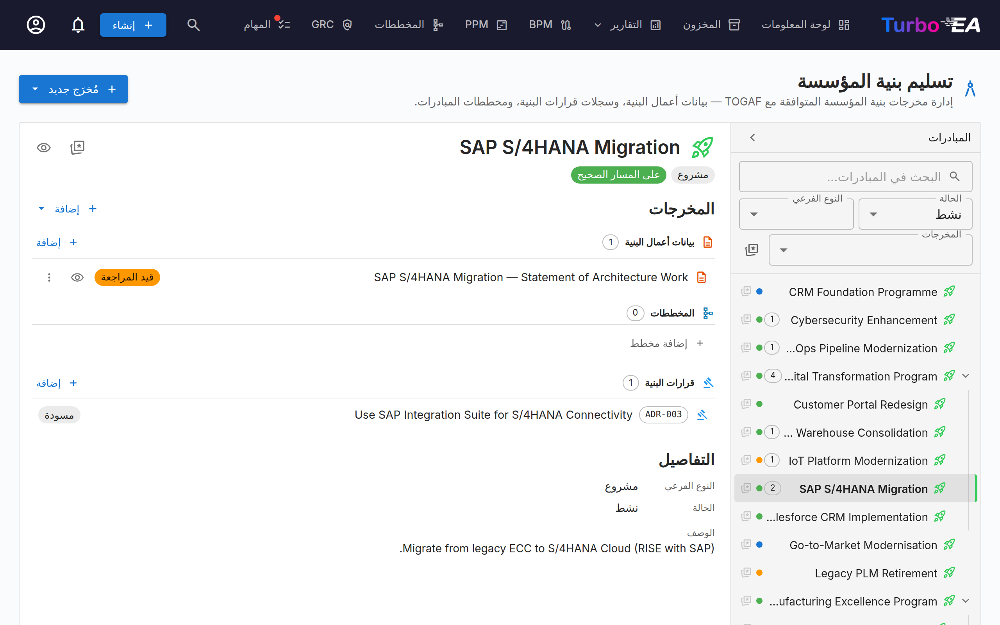
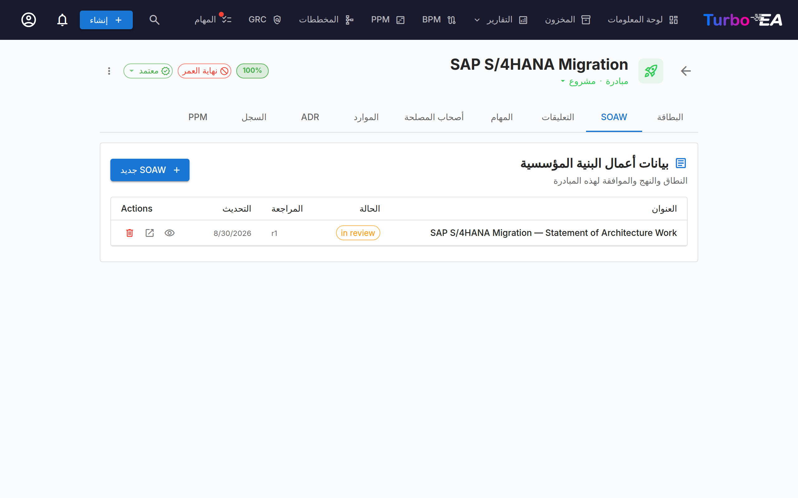
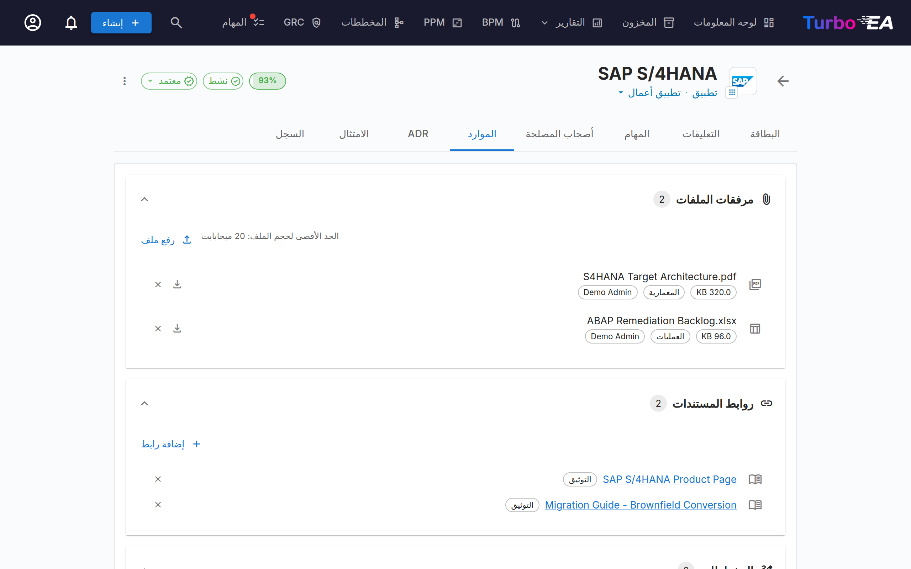

# تسليم هندسة المؤسسة

تدير وحدة **تسليم هندسة المؤسسة** **مبادرات الهندسة المعمارية ومخرجاتها** — المخططات، وبيانات عمل الهندسة المعمارية (SoAW)، وسجلات قرارات الهندسة المعمارية (ADR). وهي توفّر عرضًا واحدًا لكل مشاريع الهندسة المعمارية الجارية ومخرجاتها.

عند تفعيل PPM — وهو التهيئة المعتادة — يعيش تسليم هندسة المؤسسة **داخل وحدة PPM**: افتح **PPM** في التنقّل العلوي وانتقل إلى علامة تبويب **تسليم هندسة المؤسسة** (`/ppm?tab=ea-delivery`). وعند تعطيل PPM، يظهر **تسليم هندسة المؤسسة** كعنصر تنقّل مخصّص على المستوى الأعلى يرتبط بـ `/reports/ea-delivery`. يستمر عنوان URL القديم `/ea-delivery` في العمل كإعادة توجيه في كلتا الحالتين، فتظل الإشارات المرجعية الموجودة قابلة للحل.

## مساحة عمل المبادرات

تسليم هندسة المؤسسة **مساحة عمل من جزأين** (دون علامات تبويب داخلية):

- **الشريط الجانبي الأيسر** — شجرة مُزاحة وقابلة للترشيح لكل مبادرة (مع مبادراتها الفرعية المتداخلة تحتها). ابحث بالاسم، أو رشّح حسب الحالة / النوع الفرعي / المخرجات، أو ثبّت المفضّلات.
- **مساحة العمل اليمنى** — المخرجات والمبادرات الفرعية وتفاصيل المبادرة التي تختارها على اليسار. اختر صفًا آخر، وتُعاد مساحة العمل العرض.

التحديد جزء من عنوان URL (`?initiative=<id>`)، فيمكنك الارتباط العميق بمبادرة بعينها أو تحديث الصفحة دون فقدان مكانك.

يتيح لك زر أساسي واحد **+ New artefact ▾** أعلى الصفحة إنشاء SoAW أو مخطط أو ADR جديد — مربوطًا مسبقًا بالمبادرة التي اخترتها (أو غير مربوط إن لم يكن لديك تحديد بعد). كما تكشف مجموعات المخرجات الفارغة داخل مساحة العمل عن زر **+ Add …** كي يكون الإنشاء دائمًا على بُعد نقرة واحدة.

يُظهر كل صف في الشجرة:

| العنصر | المعنى |
|---------|---------|
| **الاسم** | اسم المبادرة |
| **شريحة العدّ** | إجمالي عدد المخرجات المرتبطة (SoAW + المخططات + سجلات ADR) |
| **نقطة الحالة** | نقطة ملوّنة لـ على المسار / في خطر / خارج المسار / معلّق / مكتمل |
| **النجمة** | مفتاح تبديل المفضّلة — تصعد المفضّلات إلى الأعلى |

يظهر صف **المخرجات غير المربوطة** الاصطناعي أعلى الشجرة عند وجود سجلات SoAW أو مخططات أو سجلات ADR لم تُربط بعد بمبادرة. افتحه لإعادة ربطها.

### من يرى ماذا

تُفتح صفحة تسليم هندسة المؤسسة لأي دور يملك **عرض مستندات SoAW** (`soaw.view`) أو **عرض سجلات قرارات البنية** (`adr.view`). ثم يتبع كل نوع من المخرجات إذنه الخاص:

| المُخرَج | يُدرج بالإذن | يُنشأ بالإذن |
|----------|-------------|--------------|
| **SoAW** | `soaw.view` | `soaw.manage` |
| **المخطط** | `diagrams.view` | `diagrams.manage` (مطلوب أيضًا لربط مخطط أو فك ربطه) |
| **ADR** | `adr.view` | `adr.manage` |

تُستبعد من مساحة العمل أي مجموعة لا يحق لك عرضها، ولا يعرض **+ مُخرَج جديد** و**+ إضافة …** سوى الأنواع التي يحق لك إنشاؤها — فالدور الذي يستطيع القراءة فقط لا يرى أيًا من الزرين. وهكذا يحصل الدور الذي يملك `adr.view` وحده على الصفحة التي تعرض قرارات كل مبادرة ولا شيء عن SoAW.

## بيان عمل الهندسة المعمارية (SoAW)

**بيان عمل الهندسة المعمارية (SoAW)** مستند رسمي معرّف بمعيار [TOGAF](https://pubs.opengroup.org/togaf-standard/) (إطار The Open Group لهندسة المؤسسة). وهو يحدّد النطاق والنهج والمخرجات والحوكمة لمهمة هندسة معمارية. في TOGAF، يُنتَج SoAW أثناء **المرحلة التمهيدية** و**المرحلة A (رؤية الهندسة المعمارية)** ويعمل اتفاقًا بين فريق الهندسة المعمارية وأصحاب المصلحة فيه.

يوفّر Turbo EA محرّر SoAW مدمجًا بقوالب أقسام متوائمة مع TOGAF، وتحرير نص منسّق، وقدرات تصدير — كي تتمكن من تأليف مستندات SoAW وإدارتها مباشرةً إلى جانب بيانات هندستك المعمارية.

### إنشاء SoAW

1. اختر المبادرة على اليسار (اختياري — يمكنك أيضًا إنشاء SoAW غير مربوط).
2. انقر **+ New artefact ▾** أعلى الصفحة (أو زر **+ Add** داخل قسم *Deliverables*) واختر **New Statement of Architecture Work**.
3. أدخل عنوان المستند.
4. يفتح المحرّر بـ**قوالب أقسام جاهزة** مبنية على معيار TOGAF.

### محرّر SoAW {: #the-soaw-editor }

يوفّر المحرّر:

- **تحرير نص منسّق** — شريط أدوات تنسيق كامل (العناوين، الغامق، المائل، القوائم، الروابط) مدعوم بمحرّر TipTap
- **الروابط** — يتحوّل أي عنوان URL تكتبه أو تلصقه إلى رابط أثناء الكتابة، ويُفتح كل رابط في المستند في علامة تبويب جديدة. أما العناوين في المستندات المكتوبة قبل دعم الروابط فتُحوَّل إلى روابط عند العرض
- **قوالب الأقسام** — أقسام معرّفة مسبقًا تتبع معايير TOGAF (مثل وصف المشكلة، الأهداف، النهج، أصحاب المصلحة، القيود، خطة العمل)
- **جداول قابلة للتحرير المضمّن** — أضِف الجداول وحرّرها داخل أي قسم
- **الإشارات** — اكتب **@** في نص قسم للإشارة إلى بطاقة أو قرار (راجع [النقاش والإشارات والسجل](#soaw-collaboration))
- **الصور** — أدرج لقطة شاشة أو مخططًا في نص قسم (راجع [الصور](#soaw-pictures))
- **سجل إصدارات المستند** — جدول يملؤه المؤلفون يدويًا (الإصدار، التاريخ، المراجِع، الوصف). وهو جزء من المستند وليس عرض [السجل](#soaw-collaboration)
- **سير عمل الحالة** — تتقدّم المستندات عبر مراحل معرّفة:

| الحالة | المعنى |
|--------|---------|
| **Draft** | قيد الكتابة، غير جاهز للمراجعة بعد |
| **In Review** | مُرسَل للتوقيع — مقفل إلى أن تُسحب التوقيعات |
| **Approved** | تمت مراجعته وقبوله |
| **Signed** | موقّع رسميًا |

### الصور {: #soaw-pictures }

يمكن لنص القسم أن يحتوي على صور، كما هو الحال في نص القرار. انقر **إدراج صورة** في شريط أدوات القسم واختر ملفًا، أو الصق صورة من الحافظة، أو اسحب ملف صورة وأفلته على القسم. اسحب زاوية الصورة لتغيير حجمها (تُحفظ نسبها)، وحدّدها لمحاذاتها لليسار أو توسيطها أو محاذاتها لليمين من شريط الأدوات. تُقبل صيغ PNG وJPEG وGIF وWebP بحد أقصى 5 ميغابايت لكل صورة؛ ولا تُقبل SVG.

تظهر الصور في المعاينة، وفي نسخة PDF / النسخة المطبوعة، وفي التصدير إلى Word، وفي [السجل](#soaw-collaboration)، حيث يُعلِّم **التغييرات** الصورة المضافة أو المحذوفة بـ *[صورة]*. وتحتفظ المراجعة والإصدار المستعاد بصورهما. ولا يُحتفظ إلا بالصور المرفوعة إلى SoAW: أما الصورة التي ترتبط بموقع ويب آخر فتُزال عند حفظ المستند. ولا تقبل التعليقات في النقاش الصور، وتختفي عناصر التحكم في الصور عندما يكون المسؤول قد [أوقف رفع الملفات](../admin/resources.md#when-file-uploads-are-disabled). يرد الوصف الكامل في دليل GRC: [الصور](grc.md#decision-pictures).

### سير عمل التوقيع

انطلاقًا من مسودة SoAW أو من SoAW معتمد، يمكنك طلب التوقيعات من أصحاب المصلحة. انقر **Request Signatures**، ثم استخدم حقل البحث للعثور على الموقّعين وإضافتهم بالاسم أو البريد الإلكتروني. يتتبع النظام مَن وقّع ويرسل إشعارات إلى الموقّعين المعلّقين.

يكون SoAW قيد المراجعة **مقفلًا**، كي يوقّع الموقّعون بالضبط على ما أُرسل إليهم: لا يمكن تغيير سوى مبادرته. لتحرير المحتوى، انقر **Recall Signatures**، فيعود إلى مسودة. والموقّع الذي ينقر **Reject** يعيده كذلك إلى مسودة، برقم المراجعة نفسه. لا يمكن حذف SoAW إلا إذا كان مسودة.

### المراجعات

يكون SoAW الموقّع للقراءة فقط. انقر **New Revision** لبدء مسودة جديدة انطلاقًا منه، بالاسم نفسه ورقم المراجعة التالي. لا توجد إلا مراجعة مفتوحة واحدة في كل مرة: ما دامت مراجعة قيد الإعداد، يشير SoAW الموقّع إلى ذلك ويعرض **Open the revision** بدلًا من بدء مراجعة أخرى. لا يمكن مراجعة سوى أحدث مراجعة، ولا يغيّر الرفض رقم المراجعة.

تعرض المراجعة السابقة شريطًا يربط بالمراجعة الحالية، ويسرد شريط **Revisions** على كل مراجعة جميعَ المراجعات. وتعرض قوائم SoAW — مخرجات المبادرة، وعلامة تبويب SoAW، وتقرير تسليم هندسة المؤسسة — المراجعة الحالية لكل مستند وأي مراجعة قيد الإعداد.

### النقاش والإشارات والسجل {: #soaw-collaboration }

لمستند SoAW النقاش والإشارات والسجل نفسها التي للقرار: النقاش في لوحة بجانب محرّره ومعاينته، والسجل خلف زر **السجل** في أعلى الصفحة. ويرد وصف السلوك المشترك مرة واحدة في دليل GRC: [النقاش](grc.md#decision-discussion) و[الإشارات](grc.md#decision-mentions) و[السجل](grc.md#decision-history) و[القيود المعروفة](grc.md#collaboration-limits). أما ما يختلف في SoAW:

- **من يمكنه النشر.** يتطلب النشر والردّ والتحديد كمحلول وإعادة الفتح الإذن `soaw.comment`، الذي يملكه الأعضاء والمسؤولون افتراضيًا ولا يملكه المشاهدون؛ وتخضع قراءة النقاش للإذن `soaw.view`. ويستطيع الموقّعون على SoAW التعليق عليه دائمًا. ويمكن لأي شخص يستطيع تحرير مستندات SoAW (`soaw.manage`) حذف أي تعليق.
- **الأقسام.** تُربط سلسلة النقاش بأحد أقسام SoAW نفسه عبر شريحة قسم، أو لا تُربط بأي قسم (سلسلة نقاش عامة). ولأن لمستند SoAW أقسامًا كثيرة، يعرض مربع الكتابة شريحة لكل قسم سبق النقاش فيه وللقسم المختار؛ ويفتح **المزيد…** قائمة قابلة للبحث بالأقسام الأخرى. وتصفّي الشرائح في أعلى النقاش النقاشَ حسب القسم، كما في القرار. وتعرض سلسلة النقاش المرتبطة بقسم مخصّص أُزيل لاحقًا العبارة *قسم محذوف*. ويحمل كل قسم أيقونة الدردشة نفسها بجانب عنوانه كما في القرار، في المحرّر والمعاينة، مع عدد سلاسل النقاش المفتوحة حين يوجد نقاش؛ انقر عليها لفتح النقاش الخاص بذلك القسم مع تحديد القسم مسبقًا لتعليق جديد.
- **الرفض.** يمكن لأي موقّع يملك إذن التوقيع (`soaw.sign`) — أو إذن التحرير — رفض SoAW، كما في القرارات؛ وكان الرفض حتى الآن يتطلب إذن التحرير. ويفتح السبب سلسلة نقاش **سبب الرفض** في النقاش.
- **الإشارات.** ليس لمستند SoAW بطاقات مرتبطة، لذا عندما لا يُكتب شيء بعد **@** تُسرد البطاقات أبجديًا؛ وفي التعليق يأتي الموقّعون على SoAW أولًا بين الأشخاص. ويعمل **استعراض…** كما في القرار.
- **ملاحظة التوقيع.** يفتح **توقيع** الآن مربع حوار يستطيع فيه الموقّع إضافة ملاحظة اختيارية؛ وتظهر في النقاش بوصفها **ملاحظة التوقيع** وفي السجل.
- **السجل.** تحتوي النسخة على اسم SoAW ومعلومات المستند وجدول سجل إصدارات المستند وكل الأقسام؛ ولا تُعدّ المبادرة جزءًا من النسخة. يسجّل السجل ما يحدث للمستند؛ أما جدول سجل إصدارات المستند داخل المستند فلا يسجّل إلا ما يكتبه مؤلفوه فيه. ويظل SoAW في الحالة **معتمد** قابلًا للتحرير، لذا تُحفظ عمليات حفظه نسخًا كما في المسودة، ويمكن استعادة نسخة سابقة فيه.

### المعاينة والتصدير

- **وضع المعاينة** — عرض للقراءة فقط لمستند SoAW الكامل
- **تصدير DOCX** — نزّل SoAW مستندَ Word منسّقًا للمشاركة دون اتصال أو الطباعة
- **تصدير PDF** — يفتح عرضًا جاهزًا للطباعة في تبويب جديد؛ استخدم *حفظ بصيغة PDF* في المتصفح. اسمح بالنوافذ المنبثقة لهذا الموقع إذا لم يُفتح شيء.

### علامة تبويب SoAW على بطاقات المبادرة

تُبرز المبادرات أيضًا علامة تبويب **SoAW** مخصّصة مباشرةً على صفحة تفاصيل بطاقتها. تسرد العلامة المراجعة الحالية لكل SoAW مرتبط بتلك المبادرة، إضافة إلى أي مراجعة قيد الإعداد (العنوان، شريحة الحالة، رقم المراجعة، تاريخ آخر تعديل) مع زر **+ New SoAW** يحدّد مسبقًا المبادرة الحالية — كي تتمكن من تأليف SoAW أو القفز إليه دون مغادرة البطاقة التي تعمل عليها. يعيد الإنشاء استخدام النافذة نفسها المستخدمة في صفحة تسليم هندسة المؤسسة، ويظهر المستند الجديد في كلا المكانين. تظهر علامة التبويب للأدوار التي تملك **عرض مستندات SoAW** (`soaw.view`)؛ ويتطلب الزر **+ New SoAW** وإجراء حذف المسودة الإذن **إنشاء مستندات SoAW وتحريرها** (`soaw.manage`)، سواء أكنت قادرًا على تحرير المبادرة نفسها أم لا.

## سجلات قرارات الهندسة المعمارية (ADR)

يلتقط **سجل قرار الهندسة المعمارية (ADR)** قرار هندسة معمارية مهمًا إلى جانب سياقه وعواقبه والبدائل التي جرى النظر فيها. تُبرز مساحة عمل تسليم هندسة المؤسسة سجلات ADR التي تكون **مرتبطة بالمبادرة المختارة** مضمّنةً، تحت قسم تسليم *Architecture Decisions*، كي تتمكن من قراءتها وفتحها دون مغادرة عرض المبادرة. استخدم الزر المنقسم **+ New artefact ▾** (أو زر **+ Add** على القسم) لإنشاء ADR جديد مربوط مسبقًا بالمبادرة المختارة.

يعيش **السجل الرئيسي لـ ADR** — حيث يُرشَّح كل ADR عبر المشهد بأكمله ويُبحَث ويُوقَّع ويُراجَع ويُعايَن — في وحدة GRC على **GRC ← الحوكمة ← [القرارات](grc.md#governance)**. انظر دليل GRC لمعرفة دورة حياة ADR الكاملة (أعمدة الشبكة، الشريط الجانبي للترشيح، سير عمل التوقيع، المراجعات، المعاينة).

## علامة تبويب الموارد

تتضمن البطاقات الآن علامة تبويب **Resources** توحّد:

- **قرارات الهندسة المعمارية** — لم تعد سجلات ADR تُعرض هنا. صار لكل بطاقة علامة تبويب **ADR** خاصة بها؛ راجع [تفاصيل البطاقة](card-details.md) لمعرفة ما تعرضه وكيفية ربط القرارات أو إنشائها أو إلغاء ربطها من بطاقة.
- **مرفقات الملفات** — ارفع الملفات وأدِرها (المستندات وجداول البيانات والعروض التقديمية وملفات OpenDocument وملفات Office القديمة والصور والأرشيفات ورسائل Outlook والبريد الإلكتروني وCSV وMarkdown وJSON وXML، حتى 20 ميغابايت). عند الرفع، اختر **فئة مستند** من: الهندسة المعمارية، الأمن، الامتثال، العمليات، ملاحظات الاجتماعات، التصميم، أو أخرى. تظهر الفئة كشريحة بجوار كل ملف.
- **روابط المستندات** — مراجع مستندات قائمة على عناوين URL. عند إضافة رابط، اختر **نوع رابط** من: التوثيق، الأمن، الامتثال، الهندسة المعمارية، العمليات، الدعم، أو أخرى. يظهر نوع الرابط كشريحة بجوار كل رابط، وتتغيّر الأيقونة حسب النوع المختار.
