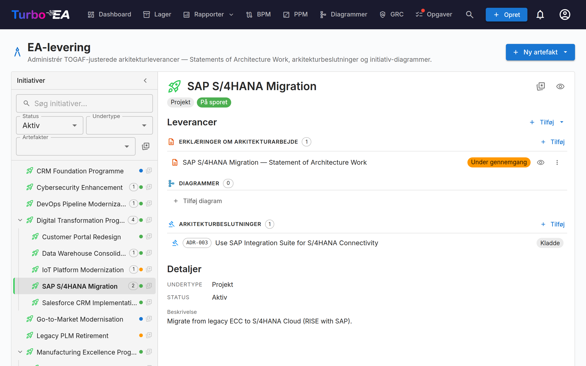
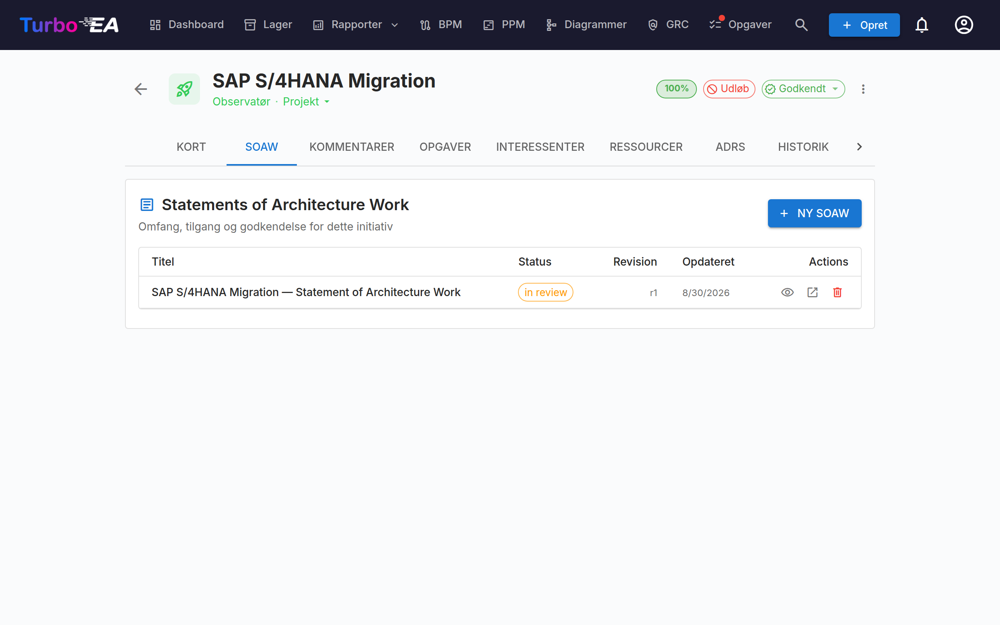
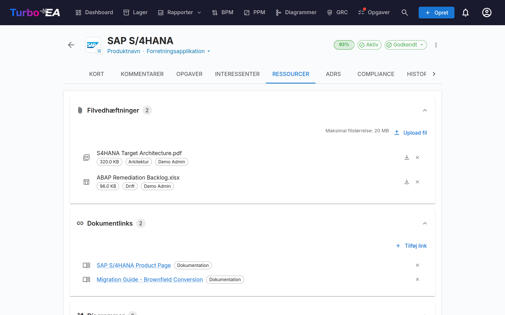

# EA Delivery

**EA Delivery**-modulet håndterer **arkitekturinitiativer og deres artefakter** — diagrammer, Statements of Architecture Work (SoAW) og Architecture Decision Records (ADR). Det giver et samlet overblik over alle igangværende arkitekturprojekter og deres leverancer.

Når PPM er aktiveret — den typiske konfiguration — lever EA Delivery **inde i PPM-modulet**: åbn **PPM** i topnavigationen, og skift til fanen **EA Delivery** (`/ppm?tab=ea-delivery`). Når PPM er deaktiveret, vises **EA Delivery** som et dedikeret topniveau-nav-element, der linker til `/reports/ea-delivery`. Den ældre URL `/ea-delivery` virker fortsat som en omdirigering uanset, så eksisterende bogmærker stadig fungerer.

## Initiativ-arbejdsområde

EA Delivery er et **to-rude-arbejdsområde** (ingen interne faner):

- **Venstre sidepanel** — et indrykket, filterbart træ over hvert initiativ (med deres underordnede initiativer indlejret nedenfor). Søg efter navn, filtrer efter Status / Subtype / Artefacts, eller fastgør favoritter.
- **Højre arbejdsområde** — leverancerne, underordnede initiativer og detaljer for det initiativ, du vælger til venstre. Vælg en anden række, og arbejdsområdet gengives.

Valget er en del af URL'en (`?initiative=<id>`), så du kan deep-linke til et specifikt initiativ eller opdatere siden uden at miste din placering.

En enkelt primær knap **+ New artefact ▾** øverst på siden lader dig oprette en ny SoAW, et diagram eller en ADR — på forhånd linket til det valgte initiativ (eller ulinket, hvis du endnu ikke har et valg). Tomme leverancegrupper inde i arbejdsområdet eksponerer også en **+ Add …**-knap, så oprettelse altid er ét klik væk.

Hver trærække viser:

| Element | Betydning |
|---------|-----------|
| **Navn** | Initiativnavn |
| **Tæller-chip** | Samlet antal linkede artefakter (SoAW + diagrammer + ADR'er) |
| **Status-prik** | Farvet prik for On Track / At Risk / Off Track / On Hold / Completed |
| **Stjerne** | Favorit-til/fra — favoritter bobler til toppen |

Den syntetiske række **Unlinked artefacts** øverst i træet vises, når der er SoAW'er, diagrammer eller ADR'er, som endnu ikke er linket til et initiativ. Åbn den for at gen-linke dem.

## Statement of Architecture Work (SoAW)

En **Statement of Architecture Work (SoAW)** er et formelt dokument defineret af [TOGAF-standarden](https://pubs.opengroup.org/togaf-standard/) (The Open Group Architecture Framework). Den fastlægger omfanget, tilgangen, leverancerne og styringen for et arkitekturengagement. I TOGAF produceres SoAW'en under **Preliminary Phase** og **Phase A (Architecture Vision)** og fungerer som en aftale mellem arkitekturteamet og dets interessenter.

Turbo EA tilbyder en indbygget SoAW-editor med TOGAF-tilpassede sektions­skabeloner, rich text-redigering og eksportmuligheder — så du kan forfatte og administrere SoAW-dokumenter direkte sammen med dine arkitekturdata.

### Oprettelse af en SoAW

1. Vælg initiativet til venstre (valgfrit — du kan også oprette en ulinket SoAW).
2. Klik på **+ New artefact ▾** øverst på siden (eller knappen **+ Add** inde i sektionen *Deliverables*), og vælg **New Statement of Architecture Work**.
3. Indtast dokumentets titel.
4. Editoren åbnes med **forudbyggede sektions­skabeloner** baseret på TOGAF-standarden.

### SoAW-editoren

Editoren tilbyder:

- **Rich text-redigering** — Komplet formateringsværktøjslinje (overskrifter, fed, kursiv, lister, links) drevet af TipTap-editoren
- **Links** — En URL, du skriver eller indsætter, bliver til et link, mens du skriver, og hvert link i et dokument åbner i en ny fane. Adresser i dokumenter skrevet før links blev understøttet, linkes når dokumentet vises
- **Sektions­skabeloner** — Foruddefinerede sektioner, der følger TOGAF-standarder (f.eks. Problembeskrivelse, Mål, Tilgang, Interessenter, Begrænsninger, Arbejdsplan)
- **Indlejret redigerbare tabeller** — Tilføj og rediger tabeller inden for en sektion
- **Omtaler** — skriv **@** i en sektions tekst for at omtale et kort eller en beslutning (se [Diskussion, omtaler og historik](#soaw-collaboration))
- **Dokumentets versionshistorik** — en tabel, som forfatterne udfylder i hånden (version, dato, revideret af, beskrivelse). Den er en del af dokumentet og er ikke visningen [Historik](#soaw-collaboration)
- **Status­arbejdsproces** — Dokumenter bevæger sig gennem definerede stadier:

| Status | Betydning |
|--------|-----------|
| **Draft** | Under skrivning, endnu ikke klar til gennemgang |
| **In Review** | Sendt til underskrift — låst, indtil underskrifterne tilbagekaldes |
| **Approved** | Gennemgået og accepteret |
| **Signed** | Formelt underskrevet |

### Underskrifts­arbejdsproces

Fra en kladde eller en godkendt SoAW kan du anmode om underskrifter fra interessenter. Klik på **Request Signatures**, og brug derefter søgefeltet til at finde og tilføje underskrivere efter navn eller e-mail. Systemet sporer, hvem der har underskrevet, og sender notifikationer til afventende underskrivere.

En SoAW under gennemgang er **låst**, så underskriverne underskriver præcis det, de fik tilsendt: kun dens initiativ kan stadig ændres. Klik på **Recall Signatures** for at redigere indholdet; det sender den tilbage til kladde. En underskriver, der klikker på **Reject**, sender den også tilbage til kladde, under samme revisionsnummer. Kun en SoAW i kladde kan slettes.

### Revisioner

En underskrevet SoAW er skrivebeskyttet. Klik på **New Revision** for at starte en ny kladde ud fra den, under samme navn med det næste revisionsnummer. Der er én åben revision ad gangen: mens en revision er under udarbejdelse, oplyser den underskrevne SoAW det og tilbyder **Open the revision** i stedet for at starte en ny. Kun den seneste revision kan revideres, og en afvisning ændrer ikke revisionsnummeret.

En tidligere revision viser et banner med et link til den aktuelle, og **Revisions**-båndet på hver revision viser dem alle. Lister over SoAW'er — initiativets leverancer, SoAW-fanen, EA Delivery-rapporten — viser den aktuelle revision af hvert dokument og enhver revision under udarbejdelse.

### Diskussion, omtaler og historik {: #soaw-collaboration }

En SoAW har samme diskussion, omtaler og historik som en beslutning: diskussionen i et panel ved siden af dens editor og forhåndsvisning, historikken bag knappen **Historik** øverst på siden. Den fælles adfærd er beskrevet ét sted, i GRC-vejledningen: [Diskussion](grc.md#decision-discussion), [Omtaler](grc.md#decision-mentions), [Historik](grc.md#decision-history) og [Kendte begrænsninger](grc.md#collaboration-limits). Det, der er anderledes for en SoAW:

- **Hvem der kan skrive.** At skrive, svare, løse og genåbne kræver tilladelsen `soaw.comment`, som medlemmer og administratorer har som standard, og læsere ikke har; læsning af diskussionen følger `soaw.view`. SoAW'ens underskrivere kan altid kommentere den. Alle, der kan redigere SoAW'er (`soaw.manage`), kan slette enhver kommentar.
- **Sektioner.** En tråd knyttes med en sektionschip til en af SoAW'ens egne sektioner eller til ingen (en generel tråd). En SoAW har mange sektioner, så indtastningsfeltet viser en chip for hver sektion, der allerede er diskuteret, og for den valgte; **Flere…** åbner en søgbar liste over de øvrige. Chipsene øverst i diskussionen filtrerer den efter sektion, som for en beslutning. En tråd knyttet til en brugerdefineret sektion, der siden er fjernet, viser *Fjernet afsnit*. Hver sektion har det samme chatikon ved siden af sin overskrift som en beslutnings, i editoren og forhåndsvisningen, med antallet af åbne tråde, når der er diskussion; klik på det for at åbne diskussionen om den sektion med sektionen allerede valgt til en ny kommentar.
- **Afvisning.** Enhver underskriver med underskriftstilladelsen (`soaw.sign`) — eller redigeringstilladelsen — kan afvise en SoAW, som for beslutninger; hidtil krævede afvisning redigeringstilladelsen. Begrundelsen åbner en tråd **Begrundelse for afvisning** i diskussionen.
- **Omtaler.** En SoAW har ingen tilknyttede kort, så når der ikke er skrevet noget efter **@**, vises kortene alfabetisk; i en kommentar kommer SoAW'ens underskrivere først blandt personerne. **Gennemse…** virker som for en beslutning.
- **Note til underskrift.** **Underskriv** åbner nu en dialog, hvor underskriveren kan tilføje en valgfri note; den vises i diskussionen som en **Note til underskrift** og i historikken.
- **Historik.** En version indeholder SoAW'ens navn, dens dokumentoplysninger, dens tabel Dokumentets versionshistorik og hver sektion; initiativet er ikke en del af en version. Historikken registrerer, hvad der sker med dokumentet; tabellen Dokumentets versionshistorik i dokumentet indeholder kun det, forfatterne skriver i den. En SoAW med status **Godkendt** kan stadig redigeres, så ligesom for en kladde gemmes dens lagringer som versioner, og en tidligere version kan gendannes i den.

### Preview og eksport

- **Preview-tilstand** — Skrivebeskyttet visning af det komplette SoAW-dokument
- **DOCX-eksport** — Download SoAW'en som et formateret Word-dokument til offline-deling eller udskrift
- **PDF-eksport** — Åbner en printklar visning i en ny fane; brug browserens *Gem som PDF*. Tillad pop op-vinduer for dette websted, hvis intet åbnes.

### SoAW-fane på initiativkort

Initiativer eksponerer også en dedikeret **SoAW**-fane direkte på deres kortdetaljeside. Fanen viser den aktuelle revision af hver SoAW linket til det initiativ samt enhver revision under udarbejdelse (titel, statuschip, revisionsnummer, sidst-ændret-dato) med en **+ New SoAW**-knap, der på forhånd vælger det aktuelle initiativ — så du kan forfatte eller hoppe til en SoAW uden at forlade det kort, du arbejder på. Oprettelse genbruger den samme dialog som EA Delivery-siden, og det nye dokument vises begge steder. Synligheden af fanen følger de almindelige kort-tilladelsesregler.

## Architecture Decision Records (ADR)

En **Architecture Decision Record (ADR)** fanger en vigtig arkitekturbeslutning sammen med dens kontekst, konsekvenser og overvejede alternativer. EA Delivery-arbejdsområdet viser ADR'er, der er **linket til det valgte initiativ** inline, under leverancesektionen *Architecture Decisions*, så du kan læse og åbne dem uden at forlade initiativvisningen. Brug split-knappen **+ New artefact ▾** (eller knappen **+ Add** på sektionen) til at oprette en ny ADR på forhånd linket til det valgte initiativ.

Det **centrale ADR-register** — hvor hver ADR på tværs af landskabet filtreres, søges, underskrives, revideres og forhåndsvises — bor i GRC-modulet under **GRC → Governance → [Decisions](grc.md#governance)**. Se GRC-guiden for hele ADR-livscyklussen (gitterkolonner, filtersidepanel, underskrifts­arbejdsproces, revisioner, forhåndsvisning).

## Resources-fane

Kort indeholder nu en **Resources**-fane, der konsoliderer:

- **Architecture Decisions** — ADR'er vises ikke længere her. Hvert kort har nu sin egen **ADRs**-fane; se [Kortdetaljer](card-details.md) for hvad den viser, og hvordan du tilknytter, opretter eller frakobler beslutninger fra et kort.
- **Filvedhæftninger** — Upload og administrer filer (dokumenter, regneark, præsentationer, OpenDocument- og ældre Office-filer, billeder, arkiver, Outlook- og e-mailbeskeder, CSV, Markdown, JSON og XML — op til 20 MB). Når du uploader, skal du vælge en **dokumentkategori** fra: Architecture, Security, Compliance, Operations, Meeting Notes, Design eller Other. Kategorien vises som en chip ved siden af hver fil.
- **Dokumentlinks** — URL-baserede dokumentreferencer. Når du tilføjer et link, skal du vælge en **linktype** fra: Documentation, Security, Compliance, Architecture, Operations, Support eller Other. Linktypen vises som en chip ved siden af hvert link, og ikonet skifter baseret på den valgte type.
