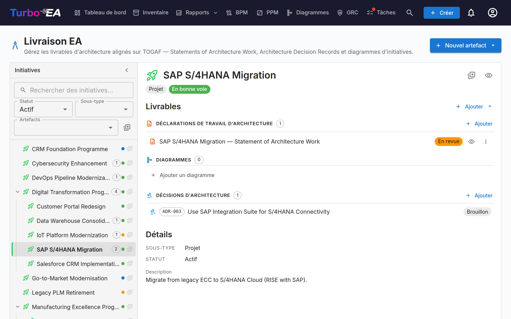
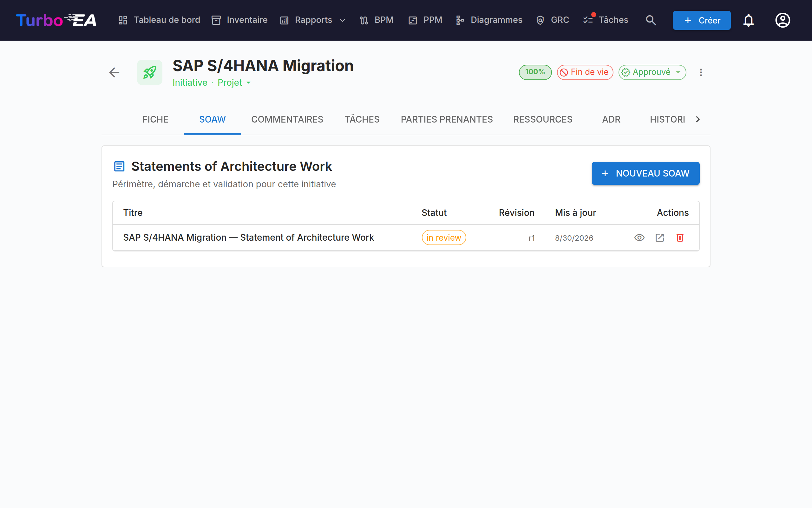
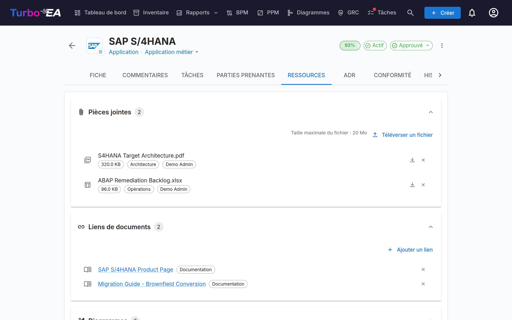

# EA Delivery

Le module **EA Delivery** gère les **initiatives d'architecture et leurs artefacts** — diagrammes, Statements of Architecture Work (SoAW) et Architecture Decision Records (ADR). Il fournit une vue unique de tous les projets d'architecture en cours et de leurs livrables.

Lorsque PPM est activé — la configuration habituelle — EA Delivery vit **à l'intérieur du module PPM** : ouvrez **PPM** dans la barre de navigation et basculez sur l'onglet **EA Delivery** (`/ppm?tab=ea-delivery`). Lorsque PPM est désactivé, **EA Delivery** apparaît comme un élément de navigation de premier niveau dédié, liant à `/reports/ea-delivery`. L'ancienne URL `/ea-delivery` continue à fonctionner comme redirection dans les deux cas, de sorte que les marque-pages existants restent valides.

## Espace de travail des initiatives

EA Delivery est un **espace de travail à deux volets** (sans onglets internes) :

- **Barre latérale gauche** — un arbre indenté et filtrable de toutes les initiatives (avec les initiatives enfants imbriquées). Recherchez par nom, filtrez par Statut / Sous-type / Artefacts ou marquez vos favoris.
- **Espace de travail à droite** — les livrables, initiatives enfants et détails de l'initiative sélectionnée à gauche. Sélectionner une autre ligne actualise l'espace de travail.

La sélection fait partie de l'URL (`?initiative=<id>`), ce qui permet de partager un lien direct vers une initiative ou de rafraîchir la page sans perdre le contexte.

Un bouton primaire **+ Nouvel artefact ▾** en haut de la page permet de créer un nouveau SoAW, diagramme ou ADR — automatiquement lié à l'initiative sélectionnée (ou non lié si aucune sélection n'est active). Les groupes de livrables vides dans l'espace de travail exposent également un bouton **+ Ajouter …**, pour que la création soit toujours à un clic.

Chaque ligne de l'arbre affiche :

| Élément | Signification |
|---------|---------------|
| **Nom** | Nom de l'initiative |
| **Pastille de comptage** | Nombre total d'artefacts liés (SoAW + diagrammes + ADRs) |
| **Point de statut** | Pastille colorée pour En bonne voie / À risque / Hors piste / En attente / Terminé |
| **Étoile** | Bascule "favori" — les favoris remontent en haut |

La ligne synthétique **Artefacts non liés** en haut de l'arbre apparaît s'il existe des SoAWs, diagrammes ou ADRs qui ne sont pas encore liés à une initiative. Ouvrez-la pour les rattacher.

### Qui voit quoi

EA Delivery s'ouvre pour tout rôle qui détient **Voir les documents SoAW** (`soaw.view`) ou **Voir les décisions d'architecture** (`adr.view`). Chaque type d'artefact suit ensuite sa propre permission :

| Artefact | Listé avec | Créé avec |
|----------|-------------|--------------|
| **SoAW** | `soaw.view` | `soaw.manage` |
| **Diagramme** | `diagrams.view` | `diagrams.manage` (également nécessaire pour lier ou délier un diagramme) |
| **ADR** | `adr.view` | `adr.manage` |

Un groupe que vous n'avez pas le droit de voir est absent de l'espace de travail, et **+ Nouvel artefact** et **+ Ajouter …** ne proposent que les types que vous pouvez créer — un rôle en lecture seule ne voit aucun des deux boutons. Ainsi, un rôle qui n'a que `adr.view` obtient la page avec les décisions de chaque initiative et rien sur les SoAW.

## Statement of Architecture Work (SoAW)

Un **Statement of Architecture Work (SoAW)** est un document formel défini par le [standard TOGAF](https://pubs.opengroup.org/togaf-standard/) (The Open Group Architecture Framework). Il établit la portée, l'approche, les livrables et la gouvernance d'un engagement d'architecture. Dans TOGAF, le SoAW est produit pendant la **Phase préliminaire** et la **Phase A (Vision de l'architecture)** et sert d'accord entre l'équipe d'architecture et ses parties prenantes.

Turbo EA fournit un éditeur SoAW intégré avec des modèles de sections alignés sur TOGAF, l'édition de texte riche et des capacités d'export -- vous permettant de rédiger et gérer des documents SoAW directement aux côtés de vos données d'architecture.

### Création d'un SoAW

1. Sélectionnez l'initiative à gauche (facultatif — vous pouvez aussi créer un SoAW non lié).
2. Cliquez sur **+ Nouvel artefact ▾** en haut de la page (ou sur **+ Ajouter** dans la section *Livrables*) et choisissez **Nouveau Statement of Architecture Work**.
3. Entrez le titre du document.
4. L'éditeur s'ouvre avec des **modèles de sections préconstruits** basés sur le standard TOGAF.

### L'éditeur SoAW

L'éditeur offre :

- **Édition de texte riche** -- Barre d'outils de mise en forme complète (titres, gras, italique, listes, liens) propulsée par l'éditeur TipTap
- **Liens** -- Une URL saisie ou collée devient un lien au fil de la frappe, et chaque lien d'un document s'ouvre dans un nouvel onglet. Les adresses des documents rédigés avant la prise en charge des liens sont converties en liens à l'affichage
- **Modèles de sections** -- Sections prédéfinies suivant les standards TOGAF (par ex. Description du problème, Objectifs, Approche, Parties prenantes, Contraintes, Plan de travail)
- **Tableaux éditables en ligne** -- Ajoutez et éditez des tableaux dans n'importe quelle section
- **Mentions** -- tapez **@** dans le texte d'une section pour mentionner une fiche ou une décision (voir [Discussion, mentions et historique](#soaw-collaboration))
- **Historique des versions du document** -- un tableau que les auteurs remplissent à la main (version, date, révisé par, description). Il fait partie du document et n'est pas la vue [Historique](#soaw-collaboration)
- **Workflow de statut** -- Les documents progressent à travers des étapes définies :

| Statut | Signification |
|--------|---------------|
| **Brouillon** | En cours de rédaction, pas encore prêt pour examen |
| **En revue** | Envoyé pour signature — verrouillé jusqu'au rappel des signatures |
| **Approuvé** | Examiné et accepté |
| **Signé** | Formellement validé |

### Workflow de signature

À partir d'un SoAW en brouillon ou approuvé, vous pouvez demander des signatures aux parties prenantes. Cliquez sur **Demander des signatures** puis utilisez le champ de recherche pour trouver et ajouter des signataires par nom ou e-mail. Le système suit qui a signé et envoie des notifications aux signataires en attente.

Un SoAW en revue est **verrouillé**, afin que les signataires signent exactement ce qui leur a été envoyé : seule son initiative peut encore changer. Pour modifier le contenu, cliquez sur **Rappeler les signatures**, ce qui le remet en brouillon. Un signataire qui clique sur **Rejeter** le remet également en brouillon, sous le même numéro de révision. Seul un SoAW en brouillon peut être supprimé.

### Révisions

Un SoAW signé est en lecture seule. Cliquez sur **Nouvelle révision** pour démarrer un nouveau brouillon à partir de celui-ci, sous le même nom avec le numéro de révision suivant. Il n'y a qu'une révision ouverte à la fois : tant qu'une révision est en cours de rédaction, le SoAW signé l'indique et propose **Ouvrir la révision** au lieu d'en démarrer une autre. Seule la dernière révision peut être révisée, et un rejet ne change pas le numéro de révision.

Une révision antérieure affiche un bandeau avec un lien vers la révision actuelle, et la barre **Révisions** de chaque révision les liste toutes. Les listes de SoAW — les livrables de l'initiative, l'onglet SoAW, le rapport EA Delivery — affichent la révision actuelle de chaque document et toute révision en cours de rédaction.

### Discussion, mentions et historique {: #soaw-collaboration }

Un SoAW dispose de la même discussion, des mêmes mentions et du même historique qu'une décision : la discussion dans un panneau à côté de son éditeur et de son aperçu, l'historique derrière le bouton **Historique** en haut de la page. Le comportement commun est décrit une seule fois, dans le guide GRC : [Discussion](grc.md#decision-discussion), [Mentions](grc.md#decision-mentions), [Historique](grc.md#decision-history) et [Limites connues](grc.md#collaboration-limits). Ce qui diffère pour un SoAW :

- **Qui peut publier.** Publier, répondre, résoudre et rouvrir requièrent la permission `soaw.comment`, que les membres et les administrateurs détiennent par défaut et les lecteurs non ; la lecture de la discussion suit `soaw.view`. Les signataires du SoAW peuvent toujours le commenter. Toute personne pouvant modifier les SoAW (`soaw.manage`) peut supprimer n'importe quel commentaire.
- **Sections.** Un fil est rattaché à l'une des sections propres au SoAW par une puce de section, ou à aucune (un fil général). Un SoAW a de nombreuses sections : la zone de saisie affiche donc une puce pour chaque section déjà discutée et pour celle qui est choisie ; **Plus…** ouvre une liste des autres avec recherche. Les puces en haut de la discussion la filtrent par section, comme pour une décision. Un fil rattaché à une section personnalisée supprimée depuis affiche *Section supprimée*. Chaque section porte à côté de son titre la même icône de bulle que celle d'une décision, dans l'éditeur et dans l'aperçu, avec le nombre de fils ouverts lorsqu'il y a une discussion ; cliquez dessus pour ouvrir la discussion sur cette section, avec la section déjà sélectionnée pour un nouveau commentaire.
- **Rejet.** Tout signataire qui détient la permission de signer (`soaw.sign`) — ou la permission de modification — peut rejeter un SoAW, comme pour les décisions ; jusqu'ici, rejeter nécessitait la permission de modification. Le motif ouvre un fil **Motif du rejet** dans la discussion.
- **Mentions.** Un SoAW n'a pas de fiches liées : lorsque rien n'est saisi après **@**, les fiches sont donc listées par ordre alphabétique ; dans un commentaire, les signataires du SoAW viennent en premier parmi les personnes. **Parcourir…** fonctionne comme pour une décision.
- **Note de signature.** **Signer** ouvre désormais une boîte de dialogue où le signataire peut ajouter une note facultative ; elle apparaît dans la discussion comme **Note de signature** et dans l'Historique.
- **Historique.** Une version contient le nom du SoAW, ses informations de document, son tableau Historique des versions du document et chaque section ; l'initiative ne fait pas partie d'une version. L'Historique consigne ce qui arrive au document ; le tableau Historique des versions du document, dans le document, ne consigne que ce que ses auteurs y écrivent. Un SoAW au statut **Approuvé** peut encore être modifié : comme pour un brouillon, ses enregistrements sont donc conservés comme versions et une version antérieure peut y être restaurée.

### Aperçu et export

- **Mode aperçu** -- Vue en lecture seule du document SoAW complet
- **Export DOCX** -- Téléchargez le SoAW sous forme de document Word formaté pour le partage hors ligne ou l'impression
- **Export PDF** -- Ouvre une vue prête à imprimer dans un nouvel onglet ; utilisez *Enregistrer au format PDF* du navigateur. Autorisez les fenêtres pop-up pour ce site si rien ne s'ouvre.

### Onglet SoAW sur les fiches d'initiative

Les initiatives exposent également un onglet **SoAW** dédié directement sur leur page de détail. L'onglet liste la révision actuelle de chaque SoAW lié à cette initiative, plus toute révision en cours de rédaction (titre, puce de statut, numéro de révision, date de dernière modification) avec un bouton **+ Nouveau SoAW** qui pré-sélectionne l'initiative en cours — vous pouvez ainsi rédiger ou ouvrir un SoAW sans quitter la fiche sur laquelle vous travaillez. La création réutilise le même dialogue que la page EA Delivery, et le nouveau document apparaît aux deux endroits. L'onglet est affiché aux rôles qui détiennent **Voir les documents SoAW** (`soaw.view`) ; le bouton **+ Nouveau SoAW** et l'action de suppression d'un brouillon nécessitent **Créer et modifier les documents SoAW** (`soaw.manage`), que vous puissiez ou non modifier l'initiative elle-même.

## Architecture Decision Records (ADR)

Un **Architecture Decision Record (ADR)** consigne une décision d'architecture importante, accompagnée de son contexte, de ses conséquences et des alternatives envisagées. L'espace de travail EA Delivery affiche les ADR **liés à l'initiative sélectionnée** en ligne, sous la section de livrables *Décisions d'Architecture* — vous pouvez ainsi les lire et les ouvrir sans quitter la vue de l'initiative. Utilisez la split-button **+ Nouvel artefact ▾** (ou **+ Ajouter** dans la section) pour créer un nouvel ADR pré-lié à l'initiative sélectionnée.

Le **registre principal des ADR** — où chaque ADR à l'échelle du paysage est filtré, recherché, signé, révisé et prévisualisé — vit dans le module GRC sous **GRC → Gouvernance → [Décisions](grc.md#governance)**. Consultez le guide GRC pour le cycle de vie complet des ADR (colonnes de la grille, barre latérale de filtres, workflow de signature, révisions, aperçu).

## Onglet Ressources

Les fiches incluent désormais un onglet **Ressources** qui regroupe :

- **Décisions d'architecture** — les ADR ne sont plus listées ici. Chaque fiche dispose désormais de son propre onglet **ADR** ; voir [Détail d'une fiche](card-details.md) pour ce qu'il affiche et comment lier, créer ou dissocier des décisions depuis une fiche.
- **Pièces jointes** -- Téléchargez et gérez des fichiers (documents, feuilles de calcul, présentations, fichiers OpenDocument et Office hérités, images, archives, messages Outlook et e-mails, CSV, Markdown, JSON et XML — jusqu'à 20 Mo). Lors du téléchargement, sélectionnez une **catégorie de document** parmi : Architecture, Sécurité, Conformité, Opérations, Notes de réunion, Design ou Autre. La catégorie s'affiche sous forme de puce à côté de chaque fichier.
- **Liens de documents** -- Références de documents basées sur des URL. Lors de l'ajout d'un lien, sélectionnez un **type de lien** parmi : Documentation, Sécurité, Conformité, Architecture, Opérations, Support ou Autre. Le type de lien s'affiche sous forme de puce à côté de chaque lien, et l'icône change en fonction du type sélectionné.
