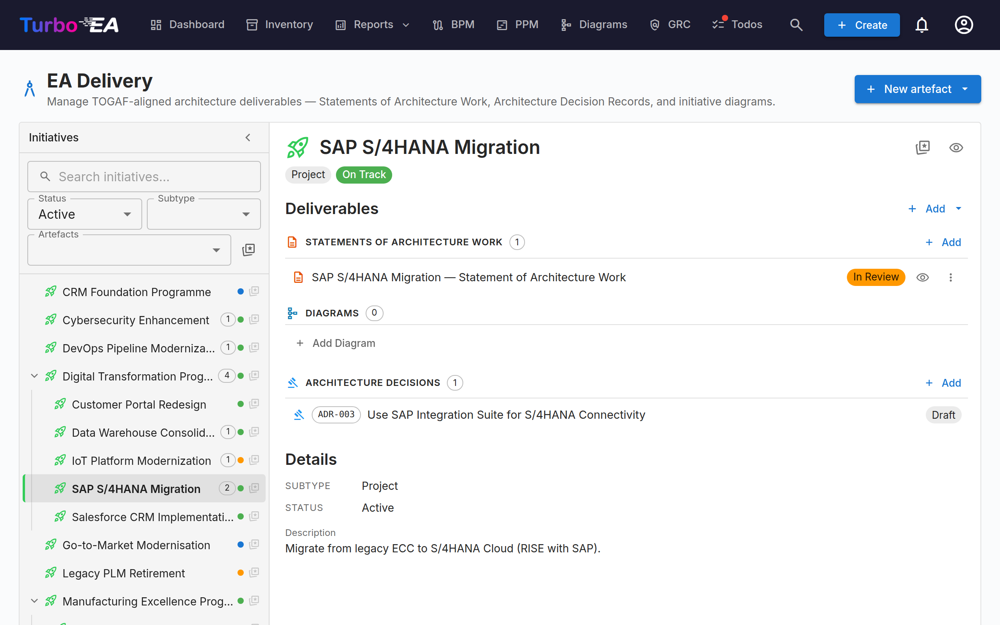
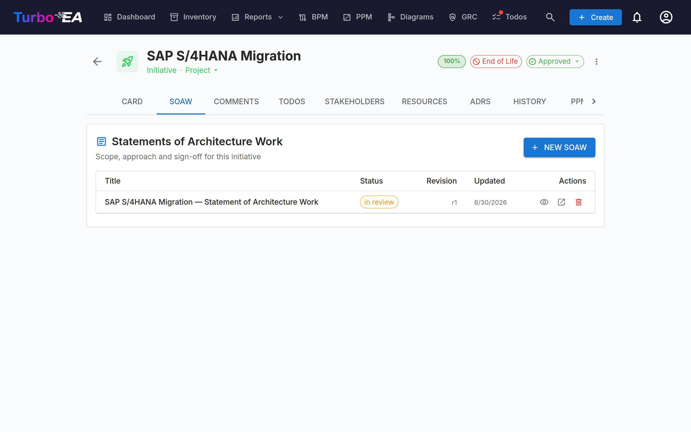
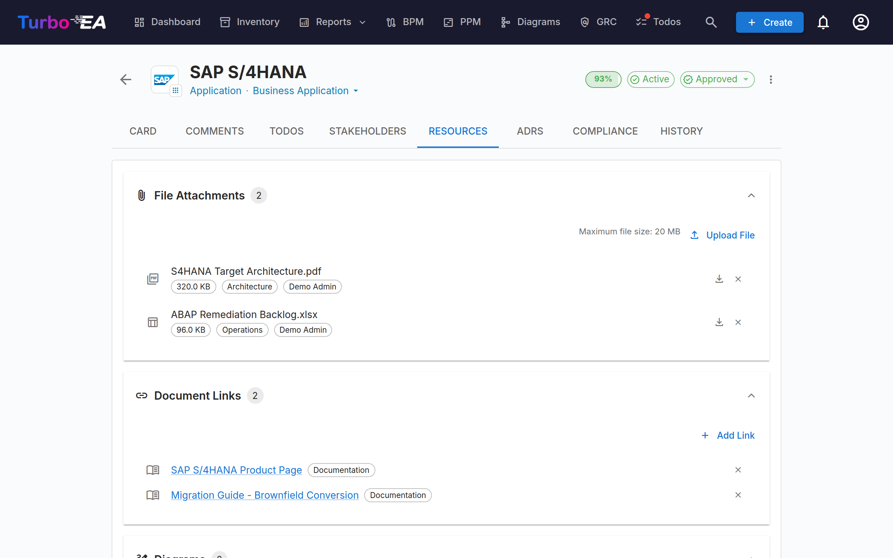

# EA Delivery

The **EA Delivery** module manages **architecture initiatives and their artifacts** — diagrams, Statements of Architecture Work (SoAW), and Architecture Decision Records (ADR). It provides a single view of all ongoing architecture projects and their deliverables.

When PPM is enabled — the typical configuration — EA Delivery lives **inside the PPM module**: open **PPM** in the top nav and switch to the **EA Delivery** tab (`/ppm?tab=ea-delivery`). When PPM is disabled, **EA Delivery** appears as a dedicated top-level nav item linking to `/reports/ea-delivery`. The legacy `/ea-delivery` URL keeps working as a redirect either way, so existing bookmarks still resolve.

## Initiatives workspace

EA Delivery is a **two-pane workspace** (no internal tabs):

- **Left sidebar** — an indented, filterable tree of every initiative (with their child initiatives nested below). Search by name, filter by Status / Subtype / Artefacts, or pin favourites.
- **Right workspace** — the deliverables, child initiatives, and details for the initiative you select on the left. Pick another row, and the workspace re-renders.

The selection is part of the URL (`?initiative=<id>`), so you can deep-link to a specific initiative or refresh the page without losing your place.

A single primary **+ New artefact ▾** button at the top of the page lets you create a new SoAW, Diagram, or ADR — pre-linked to the initiative you have selected (or unlinked if you have no selection yet). Empty deliverable groups inside the workspace also expose a **+ Add …** button so creation is always one click away.

Each tree row shows:

| Element | Meaning |
|---------|---------|
| **Name** | Initiative name |
| **Count chip** | Total number of linked artefacts (SoAW + Diagrams + ADRs) |
| **Status dot** | Coloured dot for On Track / At Risk / Off Track / On Hold / Completed |
| **Star** | Favourite toggle — favourites bubble to the top |

The synthetic **Unlinked artefacts** row at the top of the tree appears when there are SoAWs, diagrams, or ADRs that aren't yet linked to an initiative. Open it to relink them.

### Who sees what

EA Delivery opens for any role that holds **View SoAW documents** (`soaw.view`) or **View architecture decision records** (`adr.view`). Each kind of artefact then follows its own permission:

| Artefact | Listed with | Created with |
|----------|-------------|--------------|
| **SoAW** | `soaw.view` | `soaw.manage` |
| **Diagram** | `diagrams.view` | `diagrams.manage` (also needed to link or unlink a diagram) |
| **ADR** | `adr.view` | `adr.manage` |

A group you may not view is left out of the workspace, and **+ New artefact** and **+ Add …** offer only the kinds you may create — a role that can only read sees neither button. So a role with `adr.view` alone gets the page with the decisions of each initiative and nothing about SoAWs.

## Statement of Architecture Work (SoAW)

A **Statement of Architecture Work (SoAW)** is a formal document defined by the [TOGAF standard](https://pubs.opengroup.org/togaf-standard/) (The Open Group Architecture Framework). It establishes the scope, approach, deliverables, and governance for an architecture engagement. In TOGAF, the SoAW is produced during the **Preliminary Phase** and **Phase A (Architecture Vision)** and serves as an agreement between the architecture team and its stakeholders.

Turbo EA provides a built-in SoAW editor with TOGAF-aligned section templates, rich text editing, and export capabilities — so you can author and manage SoAW documents directly alongside your architecture data.

### Creating a SoAW

1. Select the initiative on the left (optional — you can also create an unlinked SoAW).
2. Click **+ New artefact ▾** at the top of the page (or the **+ Add** button inside the *Deliverables* section) and choose **New Statement of Architecture Work**.
3. Enter the document title.
4. The editor opens with **pre-built section templates** based on the TOGAF standard.

### The SoAW Editor

The editor provides:

- **Rich text editing** — Full formatting toolbar (headings, bold, italic, lists, links) powered by the TipTap editor
- **Links** — A URL you type or paste becomes a link as you type, and every link in a document opens in a new tab. Addresses in documents written before links were supported are linked when the document is displayed
- **Section templates** — Pre-defined sections following TOGAF standards (e.g., Problem Description, Objectives, Approach, Stakeholders, Constraints, Work Plan)
- **Inline editable tables** — Add and edit tables within any section
- **Mentions** — type **@** in a section's text to mention a card or a decision (see [Discussion, mentions and history](#soaw-collaboration))
- **Document Version History** — a table the authors fill in by hand (version, date, revised by, description). It is part of the document and is not the [History](#soaw-collaboration) view
- **Status workflow** — Documents progress through defined stages:

| Status | Meaning |
|--------|---------|
| **Draft** | Being written, not yet ready for review |
| **In Review** | Sent for signature — locked until the signatures are recalled |
| **Approved** | Reviewed and accepted |
| **Signed** | Formally signed off |

### Sign-off Workflow

From a draft or an approved SoAW, you can request sign-offs from stakeholders. Click **Request Signatures**, then use the search field to find and add signatories by name or email. The system tracks who has signed and sends notifications to pending signers.

A SoAW in review is **locked**, so signatories sign exactly what they were sent: only its initiative can still change. To edit the content, click **Recall Signatures**, which returns it to draft. A signatory who clicks **Reject** also returns it to draft, under the same revision number. Only a draft SoAW can be deleted.

### Revisions

A signed SoAW is read-only. Click **New Revision** to start a new draft from it, under the same name with the next revision number. There is one open revision at a time: while a revision is being drafted, the signed SoAW says so and offers **Open the revision** instead of starting another. Only the latest revision can be revised, and a rejection does not change the revision number.

An earlier revision shows a banner linking to the current one, and the **Revisions** strip on every revision lists them all. Lists of SoAWs — the initiative's deliverables, the SoAW tab, the EA Delivery report — show the current revision of each document and any revision being drafted.

### Discussion, mentions and history {: #soaw-collaboration }

A SoAW has the same discussion, mentions and history as a decision: the discussion in a panel beside its editor and preview, the history behind the **History** button at the top of the page. The behaviour they share is described once, in the GRC guide: [Discussion](grc.md#decision-discussion), [Mentions](grc.md#decision-mentions), [History](grc.md#decision-history) and [Known limits](grc.md#collaboration-limits). What differs for a SoAW:

- **Who can post.** Posting, replying, resolving and reopening need the `soaw.comment` permission, which members and admins hold by default and viewers do not; reading the discussion follows `soaw.view`. The SoAW's signatories can always comment on it. Anyone who can edit SoAWs (`soaw.manage`) can delete any comment.
- **Sections.** A thread is tagged to one of the SoAW's own sections with a section chip, or to none (a general thread). A SoAW has many sections, so the composer shows a chip for each section already discussed and for the chosen one; **More…** opens a searchable list of the others. The chips at the top of the discussion filter it by section, as for a decision. A thread tagged to a custom section that has since been removed shows *Removed section*. Each section carries the same chat icon beside its heading as a decision's, on the editor and the preview, with the open-thread count when there is discussion; click it to open the discussion on that section with the section already selected for a new comment.
- **Rejecting.** Any signatory who holds the sign permission (`soaw.sign`) — or the edit permission — may reject a SoAW, as for decisions; until now rejecting needed the edit permission. The reason opens a **Rejection reason** thread in the discussion.
- **Mentions.** A SoAW has no linked cards, so with nothing typed after **@** the cards are listed alphabetically; in a comment, the SoAW's signatories come first among the people. **Browse…** works as for a decision.
- **Signing note.** **Sign** now opens a dialog where the signatory can add an optional note; it appears in the discussion as a **Signing note** and in the History.
- **History.** A version holds the SoAW's name, its document information, its Document Version History table and every section; the initiative is not part of a version. The History records what happens to the document; the Document Version History table in the document records only what its authors write in it. A SoAW in the **Approved** status can still be edited, so, as for a draft, its saves are kept as versions and an earlier version can be restored into it.

### Preview and Export

- **Preview mode** — Read-only view of the complete SoAW document
- **DOCX export** — Download the SoAW as a formatted Word document for offline sharing or printing
- **PDF export** — Opens a print-ready view in a new tab; use the browser's *Save as PDF*. Allow pop-ups for this site if nothing opens.

### SoAW Tab on Initiative Cards

Initiatives also expose a dedicated **SoAW** tab directly on their card detail page. The tab lists the current revision of every SoAW linked to that initiative, plus any revision being drafted (title, status chip, revision number, last-modified date) with a **+ New SoAW** button that pre-selects the current initiative — so you can author or jump to a SoAW without leaving the card you're working on. Creation reuses the same dialog as the EA Delivery page, and the new document appears in both places. The tab is shown to roles that hold **View SoAW documents** (`soaw.view`); the **+ New SoAW** button and the delete action on a draft need **Create and edit SoAW documents** (`soaw.manage`), whether or not you can edit the initiative itself.

## Architecture Decision Records (ADR)

An **Architecture Decision Record (ADR)** captures an important architecture decision along with its context, consequences, and alternatives considered. The EA Delivery workspace surfaces ADRs that are **linked to the selected initiative** inline, under the *Architecture Decisions* deliverable section, so you can read and open them without leaving the initiative view. Use the **+ New artefact ▾** split-button (or the **+ Add** button on the section) to create a new ADR pre-linked to the selected initiative.

The **master ADR registry** — where every ADR across the landscape is filtered, searched, signed off, revised and previewed — lives in the GRC module at **GRC → Governance → [Decisions](grc.md#governance)**. See the GRC guide for the full ADR lifecycle (grid columns, filter sidebar, sign-off workflow, revisions, preview).

## Resources Tab

Cards now include a **Resources** tab that consolidates:

- **Architecture Decisions** — ADRs are no longer listed here. Every card now has its own **ADRs** tab; see [Card Details](card-details.md) for what it shows and how to link, create, or unlink decisions from a card.
- **File Attachments** — Upload and manage files (documents, spreadsheets, presentations, OpenDocument and legacy Office files, images, archives, Outlook and e-mail messages, CSV, Markdown, JSON and XML — up to 20 MB). When uploading, select a **document category** from: Architecture, Security, Compliance, Operations, Meeting Notes, Design, or Other. The category appears as a chip next to each file.
- **Document Links** — URL-based document references. When adding a link, select a **link type** from: Documentation, Security, Compliance, Architecture, Operations, Support, or Other. The link type appears as a chip next to each link, and the icon changes based on the selected type.
