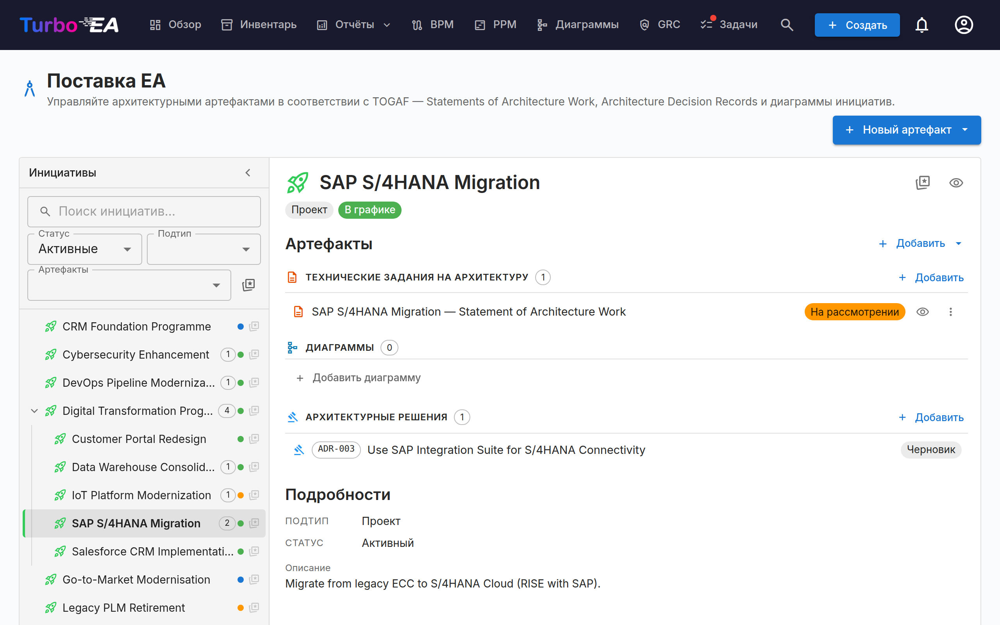
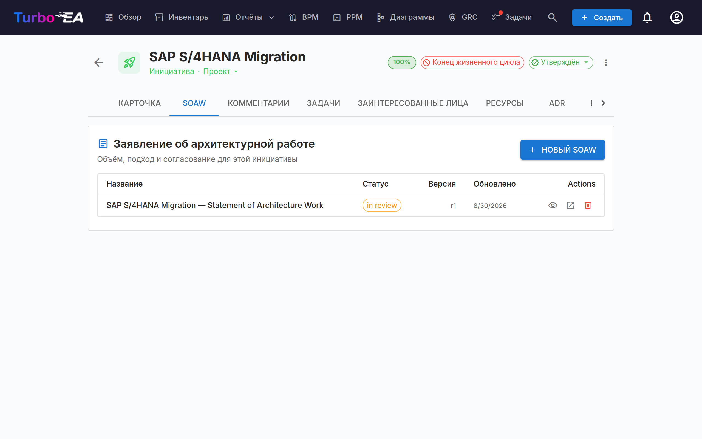
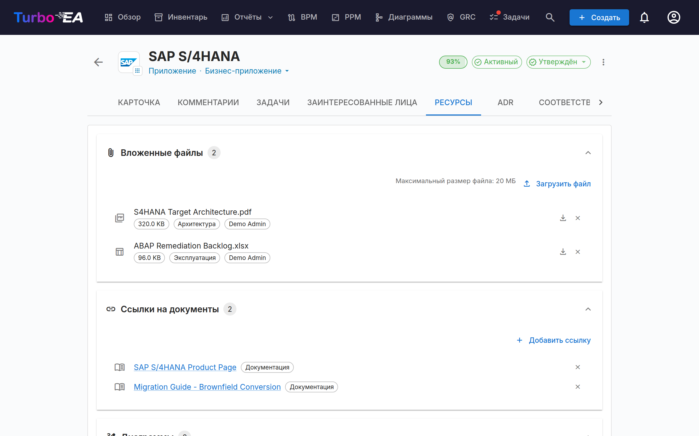

# Поставка EA

Модуль **Поставка EA** управляет **архитектурными инициативами и их артефактами** — диаграммами, Заявлениями об архитектурной работе (SoAW) и Записями об архитектурных решениях (ADR). Он предоставляет единое представление всех текущих архитектурных проектов и их результатов.

Когда PPM включён — обычная конфигурация — Поставка EA живёт **внутри модуля PPM**: откройте **PPM** в верхней навигации и переключитесь на вкладку **EA Delivery** (`/ppm?tab=ea-delivery`). Когда PPM отключён, **Поставка EA** появляется как отдельный пункт верхней навигации, ведущий на `/reports/ea-delivery`. Унаследованный URL `/ea-delivery` в обоих случаях по-прежнему работает как перенаправление, поэтому существующие закладки продолжают резолвиться.

## Рабочее пространство инициатив

Поставка EA — это **двухпанельное рабочее пространство** (без внутренних вкладок):

- **Левая боковая панель** — отступная, фильтруемая иерархия всех инициатив (с дочерними инициативами во вложенных уровнях). Поиск по имени, фильтры по Статусу / Подтипу / Артефактам, отметка избранных.
- **Правая рабочая область** — артефакты, дочерние инициативы и подробности выбранной слева инициативы. При выборе другой строки рабочая область перерисовывается.

Выбор отражается в URL (`?initiative=<id>`), поэтому можно поделиться прямой ссылкой на инициативу или перезагрузить страницу, не теряя контекста.

Единственная основная кнопка **+ Новый артефакт ▾** в верхней части страницы позволяет создать новый SoAW, диаграмму или ADR — автоматически связанные с выбранной инициативой (или несвязанные, если ничего не выбрано). Пустые группы артефактов в рабочей области также показывают кнопку **+ Добавить …**, чтобы создание было доступно одним щелчком.

Каждая строка дерева отображает:

| Элемент | Значение |
|---------|----------|
| **Название** | Название инициативы |
| **Чип-счётчик** | Общее число связанных артефактов (SoAW + диаграммы + ADR) |
| **Точка статуса** | Цветная точка для В графике / Под угрозой / Не в графике / Приостановлено / Завершено |
| **Звезда** | Переключатель «избранное» — избранные поднимаются наверх |

Синтетическая строка **Несвязанные артефакты** в верхней части дерева появляется, когда есть SoAW, диаграммы или ADR, ещё не связанные с инициативой. Откройте её, чтобы привязать их снова.

## Заявление об архитектурной работе (SoAW)

**Заявление об архитектурной работе (SoAW)** — это формальный документ, определённый стандартом [TOGAF](https://pubs.opengroup.org/togaf-standard/) (The Open Group Architecture Framework). Оно устанавливает объём, подход, результаты и управление для архитектурного проекта. В TOGAF документ SoAW создаётся на **Предварительной фазе** и **Фазе A (Архитектурное видение)** и служит соглашением между командой архитекторов и заинтересованными сторонами.

Turbo EA предоставляет встроенный редактор SoAW с шаблонами секций, соответствующими TOGAF, редактированием форматированного текста и возможностями экспорта — чтобы вы могли создавать и управлять документами SoAW непосредственно рядом с вашими архитектурными данными.

### Создание SoAW

1. Выберите инициативу слева (необязательно — можно создать и несвязанный SoAW).
2. Нажмите **+ Новый артефакт ▾** в верхней части страницы (или кнопку **+ Добавить** в разделе *Артефакты*) и выберите **Новое Statement of Architecture Work**.
3. Введите заголовок документа.
4. Откроется редактор с **готовыми шаблонами секций** на основе стандарта TOGAF.

### Редактор SoAW {: #the-soaw-editor }

Редактор предоставляет:

- **Редактирование форматированного текста** — полная панель форматирования (заголовки, жирный, курсив, списки, ссылки) на базе редактора TipTap
- **Ссылки** — введённый или вставленный URL становится ссылкой по мере ввода, и каждая ссылка в документе открывается в новой вкладке. Адреса в документах, написанных до появления поддержки ссылок, превращаются в ссылки при отображении
- **Шаблоны секций** — предопределённые секции в соответствии со стандартами TOGAF (например, Описание проблемы, Цели, Подход, Заинтересованные стороны, Ограничения, План работ)
- **Редактируемые таблицы** — добавление и редактирование таблиц в любой секции
- **Упоминания** — введите **@** в тексте секции, чтобы упомянуть карточку или решение (см. [Обсуждение, упоминания и история](#soaw-collaboration))
- **История версий документа** — таблица, которую авторы заполняют вручную (версия, дата, кем изменено, описание). Она является частью документа и не совпадает с вкладкой [История](#soaw-collaboration)
- **Рабочий процесс статусов** — документы проходят через определённые стадии:

| Статус | Значение |
|--------|----------|
| **Черновик** | Составляется, ещё не готов к проверке |
| **На рассмотрении** | Отправлен на подпись — заблокирован, пока подписи не отозваны |
| **Утверждён** | Проверен и принят |
| **Подписан** | Формально подписан |

### Процесс подписания

Из черновика или утверждённого SoAW вы можете запросить подписи у заинтересованных сторон. Нажмите **Запросить подписи**, затем используйте поле поиска для нахождения и добавления подписантов по имени или электронной почте. Система отслеживает, кто подписал, и отправляет уведомления ожидающим подписантам.

SoAW на рассмотрении **заблокирован**, поэтому подписанты подписывают ровно то, что им отправили: изменить можно только его инициативу. Чтобы отредактировать содержимое, нажмите **Отозвать подписи** — документ вернётся в черновик. Подписант, нажавший **Отклонить**, также возвращает его в черновик с тем же номером редакции. Удалить можно только SoAW в статусе черновика.

### Редакции

Подписанный SoAW доступен только для чтения. Нажмите **Новая редакция**, чтобы начать на его основе новый черновик с тем же названием и следующим номером редакции. Одновременно может существовать только одна открытая редакция: пока редакция готовится, подписанный SoAW сообщает об этом и вместо создания ещё одной предлагает **Открыть редакцию**. Пересмотреть можно только последнюю редакцию, а отклонение не меняет номер редакции.

Более ранняя редакция показывает баннер со ссылкой на текущую, а полоса **Редакции** на каждой редакции перечисляет их все. Списки SoAW — результаты инициативы, вкладка SoAW, отчёт Поставка EA — показывают текущую редакцию каждого документа и любую готовящуюся редакцию.

### Обсуждение, упоминания и история {: #soaw-collaboration }

У SoAW те же обсуждение, упоминания и история, что и у решения, — на панели **Обсуждение и история** в его редакторе и предпросмотре. Общее поведение описано один раз, в руководстве по GRC: [Обсуждение](grc.md#decision-discussion), [Упоминания](grc.md#decision-mentions), [История](grc.md#decision-history) и [Известные ограничения](grc.md#collaboration-limits). Чем отличается SoAW:

- **Кто может публиковать.** Для публикации, ответа, отметки как решённого и повторного открытия нужно разрешение `soaw.comment`, которое по умолчанию есть у участников и администраторов и нет у наблюдателей; чтение обсуждения определяется `soaw.view`. Подписанты SoAW всегда могут его комментировать. Любой, кто может редактировать SoAW (`soaw.manage`), может удалить любой комментарий.
- **Разделы.** Ветка привязывается к одному из собственных разделов SoAW или к разделу *Общее*. Ветка, привязанная к пользовательскому разделу, который с тех пор удалён, показывает *Удалённый раздел*.
- **Отклонение.** Любой подписант с разрешением на подпись (`soaw.sign`) — или на редактирование — может отклонить SoAW, как и решение; раньше для отклонения требовалось разрешение на редактирование. Причина открывает в обсуждении ветку **Причина отклонения**.
- **Примечание к подписи.** **Подписать** теперь открывает диалог, в котором подписант может добавить необязательное примечание; оно появляется в обсуждении как **Примечание к подписи** и на вкладке «История».
- **История.** Версия содержит название SoAW, сведения о документе, его таблицу «История версий документа» и все разделы; инициатива в версию не входит. Вкладка «История» фиксирует, что происходит с документом; таблица «История версий документа» в самом документе содержит только то, что в неё записали авторы. SoAW в статусе **Утверждён** по-прежнему можно редактировать, поэтому, как и у черновика, его сохранения хранятся как версии, и в него можно восстановить более раннюю версию.

### Предварительный просмотр и экспорт

- **Режим предварительного просмотра** — представление документа SoAW только для чтения
- **Экспорт в DOCX** — скачайте SoAW в виде форматированного документа Word для офлайн-распространения или печати
- **Экспорт в PDF** — открывает готовое к печати представление в новой вкладке; используйте *Сохранить как PDF* в браузере. Если ничего не открывается, разрешите всплывающие окна для этого сайта.

### Вкладка SoAW на карточках инициатив

Инициативы также показывают отдельную вкладку **SoAW** прямо на странице деталей карточки. Вкладка перечисляет текущую редакцию каждого SoAW, связанного с этой инициативой, а также любую готовящуюся редакцию (название, чип статуса, номер ревизии, дата последнего изменения), и содержит кнопку **+ Новый SoAW**, которая предварительно выбирает текущую инициативу — так вы можете создавать SoAW или переходить к нему, не покидая карточку, с которой работаете. Создание использует тот же диалог, что и страница Поставка EA, и новый документ появляется в обоих местах. Видимость вкладки подчиняется стандартным правилам прав на карточки.

## Записи об архитектурных решениях (ADR)

**Запись об архитектурном решении (ADR)** фиксирует важное архитектурное решение вместе с его контекстом, последствиями и рассмотренными альтернативами. Рабочее пространство «Поставка EA» показывает ADR, **привязанные к выбранной инициативе**, прямо в разделе результатов *Архитектурные решения* — поэтому вы можете читать и открывать их, не покидая вид инициативы. Используйте сплит-кнопку **+ Новый артефакт ▾** (или **+ Добавить** в разделе), чтобы создать новый ADR, предварительно привязанный к выбранной инициативе.

**Главный реестр ADR** — где все ADR в ландшафте фильтруются, ищутся, подписываются, ревизируются и просматриваются — живёт в модуле GRC: **GRC → Управление → [Решения](grc.md#governance)**. Полный жизненный цикл ADR (столбцы сетки, боковая панель фильтров, процесс подписания, ревизии, предварительный просмотр) описан в руководстве по GRC.

## Вкладка «Ресурсы»

Карточки включают вкладку **Ресурсы**, которая объединяет:

- **Архитектурные решения** — записи ADR здесь больше не перечисляются. Теперь у каждой карточки есть собственная вкладка **ADR**; о том, что она показывает и как привязать, создать или отвязать решение с карточки, см. [Детали карточки](card-details.md).
- **Вложенные файлы** — загружайте и управляйте файлами (документы, таблицы, презентации, файлы OpenDocument и прежних версий Office, изображения, архивы, сообщения Outlook и электронной почты, CSV, Markdown, JSON и XML — до 20 МБ). При загрузке выберите **категорию документа** из: Архитектура, Безопасность, Соответствие, Операции, Протоколы встреч, Дизайн или Прочее. Категория отображается в виде чипа рядом с каждым файлом.
- **Ссылки на документы** — ссылки на документы по URL. При добавлении ссылки выберите **тип ссылки** из: Документация, Безопасность, Соответствие, Архитектура, Операции, Поддержка или Прочее. Тип ссылки отображается в виде чипа рядом с каждой ссылкой, а иконка меняется в зависимости от выбранного типа.
