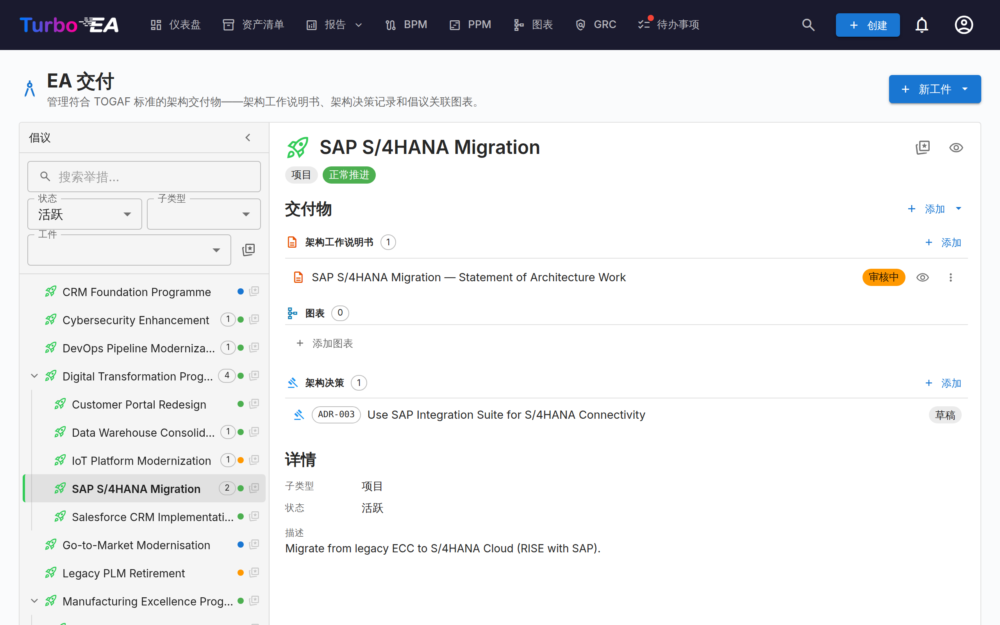
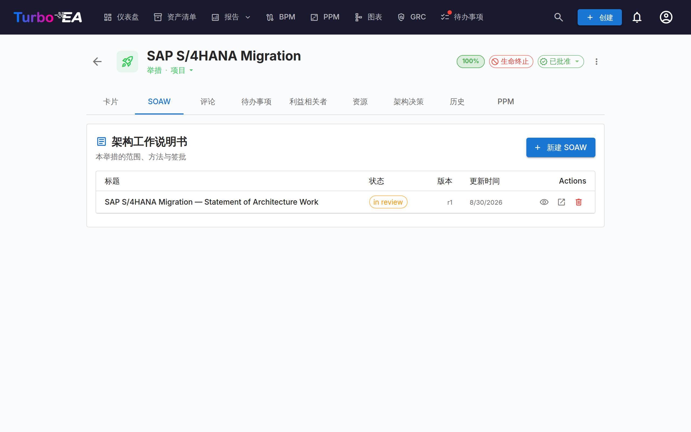
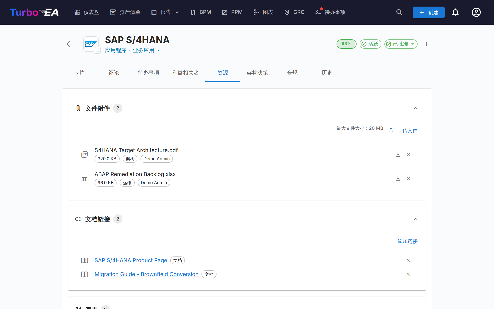

# EA 交付

**EA 交付**模块管理**架构项目及其工件** —— 图表、架构工作说明书（SoAW）和架构决策记录（ADR）。它提供所有正在进行的架构项目及其交付物的统一视图。

当启用 PPM（典型配置）时，EA 交付**位于 PPM 模块内**：在顶部导航中打开 **PPM**，并切换到 **EA Delivery** 标签页（`/ppm?tab=ea-delivery`）。当禁用 PPM 时，**EA 交付**会作为一个独立的顶级导航项出现，链接到 `/reports/ea-delivery`。无论哪种情况，旧的 `/ea-delivery` 链接都仍以重定向方式工作，因此现有书签仍可解析。

## 举措工作区

EA 交付是一个**双栏工作区**（无内部标签页）：

- **左侧边栏** — 所有举措的可筛选缩进树（包括嵌套的子举措）。可以按名称搜索、按状态/子类型/工件筛选，或标记收藏。
- **右侧工作区** — 在左侧选中的举措对应的交付物、子举措和详情。选择其他行时，工作区会重新渲染。

选中状态会写入 URL（`?initiative=<id>`），因此您可以分享指向特定举措的直接链接，或刷新页面而不丢失上下文。

页面顶部有一个统一的主操作按钮 **+ 新工件 ▾**，用于创建新的 SoAW、图表或 ADR — 自动关联到所选举措（若没有选择，则保持未关联）。工作区中空的交付物分组也提供 **+ 添加 …** 按钮，确保创建始终一击可达。

每行显示：

| 元素 | 含义 |
|------|------|
| **名称** | 举措名称 |
| **数量徽标** | 关联工件总数（SoAW + 图表 + ADR） |
| **状态点** | 用于「正常 / 有风险 / 偏离 / 暂停 / 已完成」的彩色圆点 |
| **星标** | 收藏切换按钮 — 收藏会浮到顶部 |

当存在尚未关联到任何举措的 SoAW、图表或 ADR 时，树顶部会出现「未关联的工件」合成行。打开它即可重新关联。

## 架构工作说明书（SoAW）

**架构工作说明书（SoAW）** 是 [TOGAF 标准](https://pubs.opengroup.org/togaf-standard/)（开放组架构框架）定义的正式文档。它确定了架构参与的范围、方法、交付物和治理。在 TOGAF 中，SoAW 在**准备阶段**和**阶段 A（架构愿景）** 期间产生，作为架构团队与其干系人之间的协议。

Turbo EA 提供内置的 SoAW 编辑器，具有 TOGAF 对齐的章节模板、富文本编辑和导出功能 —— 因此您可以直接在架构数据旁边编写和管理 SoAW 文档。

### 创建 SoAW

1. 在左侧选中举措（可选 — 也可以创建未关联的 SoAW）。
2. 点击页面顶部的 **+ 新工件 ▾**（或在「交付物」分组中的 **+ 添加** 按钮），然后选择「新建架构工作说明书」。
3. 输入文档标题。
4. 编辑器打开并显示基于 TOGAF 标准的**预构建章节模板**。

### SoAW 编辑器 {: #the-soaw-editor }

编辑器提供：

- **富文本编辑** —— 完整的格式工具栏（标题、粗体、斜体、列表、链接）由 TipTap 编辑器驱动
- **链接** —— 输入或粘贴的网址会在输入时自动变成链接，文档中的每个链接都会在新标签页中打开。在支持链接之前撰写的文档中的网址会在显示时转换为链接
- **章节模板** —— 遵循 TOGAF 标准的预定义章节（例如问题描述、目标、方法、干系人、约束、工作计划）
- **行内可编辑表格** —— 在任何章节中添加和编辑表格
- **提及** —— 在章节正文中输入 **@** 即可提及卡片或决策（参见[讨论、提及与历史](#soaw-collaboration)）
- **文档版本历史** —— 由作者手动填写的表格（版本、日期、修订人、说明）。它是文档的一部分，并不是[历史](#soaw-collaboration)视图
- **状态工作流** —— 文档通过定义的阶段进展：

| 状态 | 含义 |
|------|------|
| **草稿** | 正在编写，尚未准备好审核 |
| **审核中** | 已发送签署——在撤回签名之前保持锁定 |
| **已批准** | 已审核并接受 |
| **已签署** | 正式签署确认 |

### 签署工作流

对于草稿或已批准的 SoAW，您可以请求干系人签署。点击**请求签署**，然后使用搜索字段按姓名或电子邮件查找并添加签署人。系统跟踪谁已签署并向待签署人发送通知。

审核中的 SoAW 处于**锁定**状态，因此签署人签署的正是发送给他们的内容：只有其所属举措仍可更改。要编辑内容，请点击**撤回签名**，文档将退回草稿。签署人点击**拒绝**同样会将其退回草稿，修订号保持不变。只有草稿状态的 SoAW 才能删除。

### 修订版

已签署的 SoAW 为只读。点击**新建修订版**即可基于它创建新草稿，名称不变，修订号递增。同一时间只能有一个起草中的修订版：当某个修订版正在起草时，已签署的 SoAW 会给出提示，并提供**打开修订版**而不是再新建一个。只有最新修订版才能被修订，拒绝不会改变修订号。

早期修订版会显示一个链接到当前修订版的横幅，每个修订版上的**修订版**条带会列出全部修订版。SoAW 列表——举措的交付物、SoAW 标签页、EA 交付报告——显示每个文档的当前修订版以及任何正在起草的修订版。

### 讨论、提及与历史 {: #soaw-collaboration }

SoAW 拥有与决策相同的讨论、提及和历史功能：讨论位于其编辑器和预览旁的面板中，历史则通过页面顶部的**历史**按钮打开。两者共有的行为在 GRC 指南中统一说明：[讨论](grc.md#decision-discussion)、[提及](grc.md#decision-mentions)、[历史](grc.md#decision-history)和[已知限制](grc.md#collaboration-limits)。SoAW 的不同之处如下：

- **谁可以发表。** 发表、回复、解决和重新打开需要 `soaw.comment` 权限，成员和管理员默认拥有，查看者则没有；阅读讨论遵循 `soaw.view`。SoAW 的签署人始终可以对其发表评论。任何可以编辑 SoAW 的人（`soaw.manage`）都可以删除任何评论。
- **章节。** 主题可以通过章节标签关联到 SoAW 自身的某个章节，也可以不关联任何章节（即常规主题）。SoAW 的章节很多，因此输入框只为已有讨论的章节和当前所选章节各显示一个标签；**更多…** 会打开其余章节的可搜索列表。讨论顶部的标签可按章节筛选讨论，与决策相同。关联到之后被删除的自定义章节的主题会显示*已移除的章节*。有主题的章节会在其标题旁显示与决策相同的讨论标记，在编辑器和预览中均可见；点击它即可打开该章节的讨论。
- **拒绝。** 与决策一样，任何拥有签署权限（`soaw.sign`）——或编辑权限——的签署人都可以拒绝 SoAW；此前拒绝需要编辑权限。拒绝原因会在讨论中开启一个**拒绝原因**主题。
- **提及。** SoAW 没有关联卡片，因此在 **@** 之后未输入任何内容时，卡片按字母顺序列出；在评论中，SoAW 的签署人在人员中排在最前。**浏览…** 的用法与决策相同。
- **签署备注。** **签署**现在会打开一个对话框，签署人可在其中添加可选备注；备注会以**签署备注**的形式出现在讨论中，并显示在历史中。
- **历史。** 一个版本包含 SoAW 的名称、文档信息、文档版本历史表格以及所有章节；举措不属于版本的一部分。历史记录文档发生的事情；文档中的文档版本历史表格只记录作者在其中写下的内容。处于**已批准**状态的 SoAW 仍可编辑，因此与草稿一样，其保存会作为版本保留，并且可以将早期版本恢复到其中。

### 预览和导出

- **预览模式** —— 完整 SoAW 文档的只读视图
- **DOCX 导出** —— 将 SoAW 下载为格式化的 Word 文档，用于离线共享或打印
- **PDF 导出** —— 在新标签页中打开可打印视图；使用浏览器的*另存为 PDF*。如果没有任何内容打开，请允许此站点的弹出窗口。

### 举措卡片上的 SoAW 标签页

举措还会在其卡片详情页上直接显示一个专属的 **SoAW** 标签页。该标签页列出与该举措关联的每个 SoAW 的当前修订版，以及任何正在起草的修订版（标题、状态徽标、修订号、最后修改日期），并提供一个 **+ 新建 SoAW** 按钮，预先选中当前举措——这样你可以在不离开当前卡片的情况下编写或跳转到某个 SoAW。创建复用 EA 交付页面相同的对话框，新文档会在两处同时出现。标签页的可见性遵循标准卡片权限规则。

## 架构决策记录（ADR）

**架构决策记录（ADR）** 记录重要的架构决策及其背景、后果和已考虑的替代方案。EA 交付工作区会在所选举措下的*架构决策*交付物分组中以内联方式列出**与该举措关联的 ADR**——您可以在不离开举措视图的情况下阅读和打开它们。使用页面顶部的拆分按钮 **+ 新工件 ▾**（或分组中的 **+ 添加** 按钮）创建一个预先关联到所选举措的新 ADR。

**ADR 主登记册**——可在其中跨整个景观对所有 ADR 进行筛选、搜索、签署、修订与预览——位于 GRC 模块下的 **GRC → 治理 → [决策](grc.md#governance)**。完整的 ADR 生命周期（网格列、筛选侧栏、签署工作流、修订、预览）请参见 GRC 指南。

## 资源选项卡

卡片现在包含一个**资源**选项卡，整合了以下内容：

- **架构决策** —— ADR 不再在此处列出。现在每张卡片都有独立的 **架构决策** 标签页；有关它显示的内容以及如何从卡片关联、创建或取消关联决策，请参见[卡片详情](card-details.md)。
- **文件附件** —— 上传和管理文件（文档、表格、演示文稿、OpenDocument 和早期 Office 文件、图片、压缩包、Outlook 和电子邮件、CSV、Markdown、JSON 和 XML，最大 20 MB）。上传时，从以下选项中选择**文档类别**：架构、安全、合规、运维、会议纪要、设计或其他。类别以标签形式显示在每个文件旁边。
- **文档链接** —— 基于 URL 的文档引用。添加链接时，从以下选项中选择**链接类型**：文档、安全、合规、架构、运维、支持或其他。链接类型以标签形式显示在每个链接旁边，图标会根据所选类型变化。
