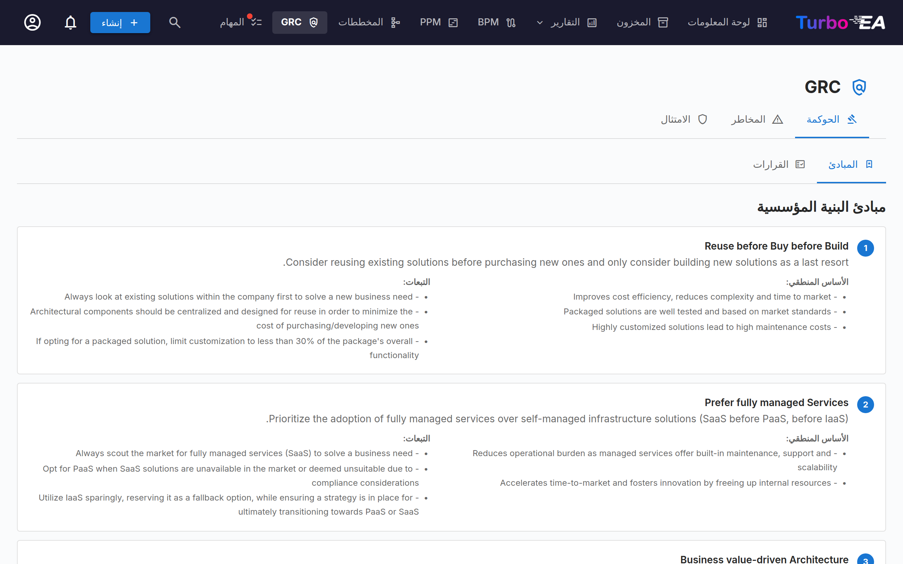
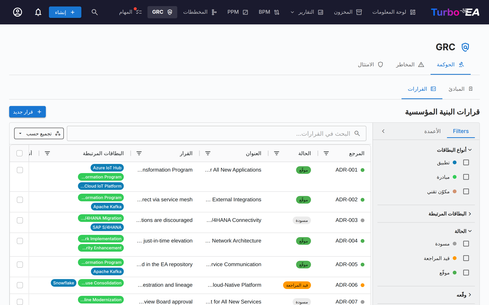
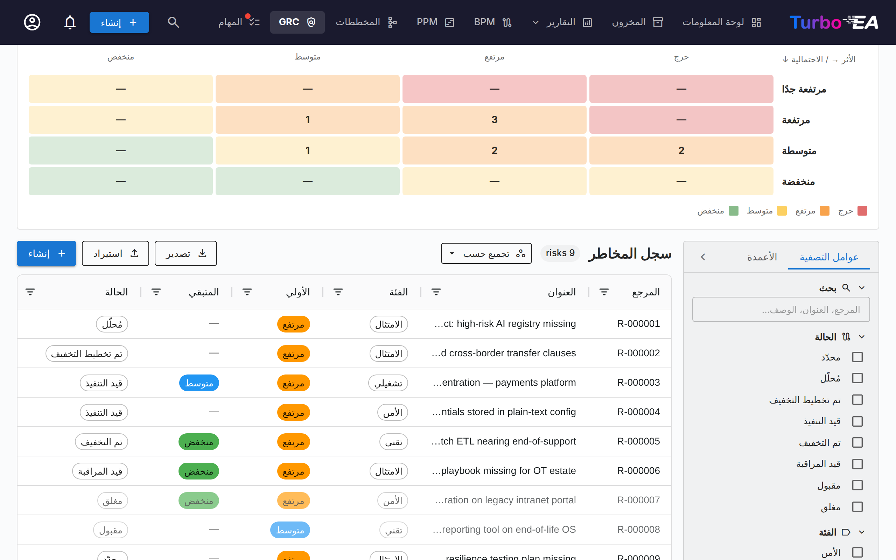
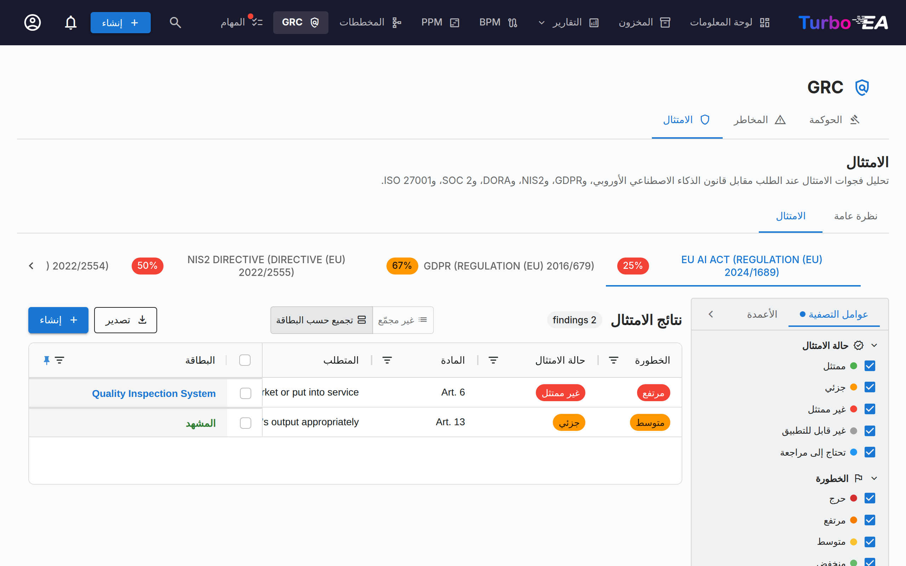

# GRC

تجمع وحدة **GRC** الحوكمة والمخاطر والامتثال في مساحة عمل واحدة على المسار `/grc`. وهي توحّد العمل الذي كان موزّعًا سابقًا عبر تسليم هندسة المؤسسة وTurboLens كي يقف المهندس ومالك المخاطر ومراجع الامتثال على أرضية مشتركة.

!!! note
    يمكن للمسؤول تفعيل وحدة GRC أو تعطيلها في [الإعدادات](../admin/settings.md). عند التعطيل، يُخفى تنقّل GRC وميزاتها.

تضم GRC ثلاث علامات تبويب:

- **الحوكمة** — مبادئ هندسة المؤسسة وسجلات قرارات الهندسة المعمارية (ADRs).
- **المخاطر** — [سجل المخاطر](risks.md) ضمن TOGAF المرحلة G.
- **الامتثال** — ماسح تحليل فجوات اللوائح حسب الطلب الذي كان موجودًا في TurboLens.

يمكنك الارتباط العميق بأي علامة تبويب عبر `/grc?tab=governance` أو `/grc?tab=risk` أو `/grc?tab=compliance`.

## الحوكمة

تنقسم علامة تبويب الحوكمة إلى **علامتَي تبويب فرعيتين**، قابلتين للارتباط العميق عبر `/grc?tab=governance&sub=principles` (الافتراضية) و`/grc?tab=governance&sub=decisions`:

### المبادئ

متصفّح للقراءة فقط لمبادئ هندسة المؤسسة المنشورة في النموذج الفوقي (البيان، المبرر، التضمينات). حرّر الكتالوج من **الإدارة ← النموذج الفوقي ← المبادئ**.

### القرارات

علامة التبويب الفرعية للقرارات هي **السجل الرئيسي لسجلات قرارات الهندسة المعمارية (ADRs)** — كل ADR عبر المشهد بأكمله، بصرف النظر عن المبادرة المرتبط بها. وهي تحل محل علامة تبويب «تسليم هندسة المؤسسة ← القرارات» القديمة التي حُلّت عند ظهور GRC.

توثّق سجلات ADR قرارات الهندسة المعمارية المهمة إلى جانب سياقها وعواقبها والبدائل التي جرى النظر فيها. تصل القرارات الصادرة عن معالج TurboLens Architect إلى هنا كمسودات كي يصادق عليها المراجعون.

يجيب السجل أولًا عن سؤال واحد: **ما القرارات السارية اليوم؟** لكل قرار موقّع [حالة سريان](#standing) يستنتجها Turbo EA من تواريخه ومراجعاته والقرارات الأخرى التي تؤثّر فيه، ولا تسرد الشبكة إلا المراجعة الحالية لكل قرار ما لم تطلب المراجعات السابقة.

يمكن أيضًا **تجميع** الجدول **حسب الحالة** أو **حسب حالة السريان** عبر زر *تجميع حسب* بجوار مربع البحث: تنطوي كل حالة أو حالة سريان تحت عنوان خاص بها، وتُحدد خانة الاختيار في العنوان المجموعة كاملة لتصديرها دفعة واحدة.

#### الحالة وحالة السريان {: #standing }

للقرار حالتان منفصلتان:

- **الحالة** هي سير عمل التوقيع، وهي ما تتصرّف بناءً عليه: **مسودة** ← **قيد المراجعة** (طُلبت التوقيعات) ← **موقّع**. أما القرار المتَّخذ خارج Turbo EA و[المسجَّل بوصفه متَّخذًا](#recording-a-past-decision) فيعرض **مُسجَّل** بدلًا من موقّع.
- **حالة السريان** تبيّن وضع القرار الموقّع أو المسجَّل اليوم. وهي مستنتَجة — لا تُضبط يدويًا أبدًا — ولا حالة سريان للمسودة أو للقرار قيد المراجعة (*لم يُوقَّع بعد*).

| حالة السريان | المعنى |
|--------------|--------|
| **مجدول** | موقّع، لكن تاريخ *ساري المفعول من* لم يحن بعد |
| **سارٍ** | موقّع ونافذ |
| **سارٍ (معدَّل)** | سارٍ، وقرار موقّع آخر يعدّله؛ ولم يُدمج التعديل بعد في [مراجعة موحَّدة](#amendments-and-consolidated-revisions) |
| **مستبدَل** | سرت مراجعة لاحقة للقرار نفسه، أو قرار يستبدله |
| **ملغى** | سرى قرار موقّع يلغيه |
| **منتهي الصلاحية** | انقضى تاريخ *صالح حتى* (ويظل ساريًا حتى نهاية ذلك اليوم) |

توضّح صفحة القرار السبب بشريط — *استُبدل هذا القرار بـ …*، *يسري هذا القرار بتاريخ …*، *تسري المراجعة 3 بتاريخ …* — مع رابط إلى القرار المعني.

#### أعمدة الشبكة

تعكس شبكة ADR تخطيط شبكة المخزون:

| العمود | الوصف |
|--------|-------------|
| **رقم المرجع** | رقم مرجعي مُولَّد تلقائيًا (ADR-001, ADR-002, …) مع نقطة حالة؛ وتضيف المراجعة التالية للأولى رقمها (ADR-012 · مراجعة 2) |
| **الحالة** | شريحة ملوّنة — مسودة، أو قيد المراجعة، أو موقّع، أو مُسجَّل |
| **حالة السريان** | وضع القرار الموقّع اليوم — راجع [الحالة وحالة السريان](#standing)؛ فارغة إلى أن يُوقَّع |
| **العنوان** | عنوان ADR |
| **القرار** | مقتطف نصي من القرار |
| **البطاقات المرتبطة** | كبسولات ملوّنة تطابق لون نوع كل بطاقة مرتبطة |
| **أنشأه** | مؤلف ADR |
| **أُنشئ** | تاريخ الإنشاء |
| **عُدِّل** | تاريخ آخر تعديل |
| **وُقِّع** | تاريخ توقيع ADR |
| **وقّعه** | كبسولة لكل موقّع قام بالتوقيع |
| **تاريخ اتخاذ القرار** / **ساري المفعول من** / **صالح حتى** | [تواريخ](#decision-dates) القرار |
| **متخذو القرار** | الأشخاص الذين اتخذوا القرار |

لكل عمود **مرشّح في الترويسة** — مرشّحات نصية للأعمدة النصية ومرشّحات تواريخ لأعمدة التواريخ — ولكل منها زر **إعادة تعيين** خاص به. وبمجرد تفعيل أي مرشّح عمود، يظهر زر **مسح عوامل تصفية الأعمدة** في شريط أدوات الشبكة لمسحها كلها دفعة واحدة. يُحفظ عرض الأعمدة وترتيبها وفرزها والمرشّحات المفعّلة لكل متصفح.

#### الشريط الجانبي للترشيح

يحتوي الشريط الجانبي الدائم على علامتي تبويب:

- **المرشّحات** — مرشّحات وجهية على قائمة ADR:
    - **سارٍ** — نقرة واحدة تعرض القرارات السارية اليوم فقط (سارٍ وسارٍ (معدَّل))؛ انقر مرة أخرى لإلغائه
    - **عرض المراجعات السابقة** — معطّل افتراضيًا، فيظهر كل قرار مرة واحدة بمراجعته الحالية (إضافة إلى أي مراجعة قيد الإعداد). فعّله لسرد المراجعات السابقة أيضًا؛ ويتبع زر **تصدير** المفتاح نفسه
    - **أنواع البطاقات** — مربعات اختيار بنقاط ملوّنة تُرشّح حسب أنواع البطاقات المرتبطة
    - **البطاقات المرتبطة** — الترشيح حسب بطاقات مرتبطة محددة
    - **الحالة** — مسودة / قيد المراجعة / موقّع (يُحتسب القرار المسجَّل موقّعًا)
    - **حالة السريان** — مجدول / سارٍ / سارٍ (معدَّل) / مستبدَل / ملغى / منتهي الصلاحية / لم يُوقَّع بعد
    - **وقّعه** — الترشيح حسب الموقّع
    - **تاريخ الإنشاء** / **تاريخ التعديل** / **تاريخ التوقيع** / **تاريخ اتخاذ القرار** — نطاقات تواريخ من/إلى (يطابق **تاريخ اتخاذ القرار** تاريخ *تاريخ اتخاذ القرار* للقرار الموقّع أو المسجَّل)
- **الأعمدة** — اختيار أعمدة الشبكة الظاهرة. يُعرض **رقم المرجع** و**العنوان** دائمًا؛ ويستعيد زر **إعادة تعيين** المجموعة الافتراضية. يُحفظ اختيارك لكل متصفح.

استخدم شريط بحث **المرشّح السريع** للبحث النصي الكامل عبر كل سجلات ADR. انقر بالزر الأيمن على أي صف للحصول على قائمة سياق (**تحرير**، **معاينة**، **تكرار**، **حذف**).

#### تصدير القرارات واستيرادها {: #decisions-import }

**تصدير** (بجانب **+ قرار جديد**) ينزّل القرارات التي يعرضها الشريط الجانبي للمرشحات حالياً كملف `.xlsx`، بصف واحد لكل مراجعة قرار. الأعمدة بالترتيب: `reference_number`، و`title`، و`status`، و`revision_number`، والأقسام الأربعة (`context`، و`decision`، و`consequences`، و`alternatives_considered`) كنص عادي، و`cards` و`related_decisions` (مفصولة بفاصلة منقوطة)، و`author`، و`signatories`، و`signed_at`، و`created_at`، و`updated_at`، ثم بيانات السجل الخاصة — `standing` (كمفتاح مثل `in_force`)، و`decided_on`، و`effective_from`، و`valid_until`، و`decision_makers`، و`participants`، والروابط المصنّفة `replaces` و`amends` و`revokes` و`consolidates` كمراجع. لا يُنقل التنسيق مثل الخط الغامق أو الروابط إلى جدول البيانات. ولمشاركة قرارات بتنسيقها الكامل، حدّد صفوفاً في الشبكة واستخدم زر **Export** الخاص بالشبكة، الذي يكتب مستند Word.

**استيراد** ينشئ القرارات دفعة واحدة من ملف `.xlsx`. انقر **تنزيل القالب** للحصول على مصنّف أولي، واملأ قراراً واحداً في كل صف، ثم ارفعه:

- يصبح كل صف قراراً جديداً بحالة **مسودة** مع مرجع `ADR-NNN` التالي. لا تُستورد الحالة والتوقيعات أبداً — فالقرار يُوقَّع عبر **سير عمل التوقيع** — وتحذّر المعاينة من أي صف تكون قيمة `status` فيه غير مسودة (draft).
- الصف الذي ينتمي `reference_number` الخاص به إلى قرار موجود **يُتخطّى**: فالاستيراد لا يغيّر قراراً موجوداً أبداً، لذا فإن إعادة استيراد ملف مُصدَّر لا تغيّر شيئاً.
- `title` إلزامي. في أعمدة الأقسام الأربعة، يبدأ السطر الفارغ فقرة جديدة، وتتحول الأسطر التي تبدأ بـ `- ` إلى قائمة نقطية، وتلك التي تبدأ بـ `1. ` إلى قائمة مرقّمة.
- يربط `cards` البطاقات بالاسم المطابق تماماً من بين البطاقات التي يمكنك رؤيتها؛ والبطاقة التي لا يمكن العثور عليها، أو التي يشترك في اسمها عدة بطاقات، تُتخطّى مع تحذير ويُستورد القرار مع ذلك.
- يسرد `related_decisions` المراجع، سواء لقرارات موجودة أو لصفوف أخرى في الملف نفسه (حتى الصفوف اللاحقة)؛ ويصبح كل منها رابط **يرتبط بـ**. والمرجع الذي له عدة مراجعات يُربط بمراجعته الحالية.
- يُتجاهل كل عمود آخر — بما في ذلك حالة السريان والتواريخ والأشخاص والروابط المصنّفة: فالاستيراد ينشئ مسودات، ولا ينشئ أبدًا قرارات موقّعة أو مسجَّلة.
- يحتوي التصدير على صف واحد لكل مراجعة، لذا قد يحمل الملف عدة صفوف لمرجع واحد (مراجعة مفتوحة، أو مراجعات سابقة عند تفعيل **عرض المراجعات السابقة**). على المثيل الذي جاء منه الملف تُتخطّى جميعها؛ وفي غيره لا يُستورد إلا الصف ذو أعلى `revision_number` (الصف الأخير عندما تتساوى الأرقام أو تغيب)، ويُتخطّى كل صف آخر مع التحذير *تم تخطي مراجعة سابقة لـ ADR-012*. وأي إدخال في `related_decisions` يذكر ذلك المرجع يُربط بالصف المستورَد.

تعرض المعاينة عدد الصفوف التي ستُنشأ وتُتخطّى وتفشل، مع سرد كل خطأ وتحذير حسب الصف؛ ولا يُكتب شيء حتى تؤكد. يتطلب الاستيراد الإذن `adr.manage`.

#### إنشاء ADR

يمكن إنشاء سجلات ADR من ثلاثة أماكن — كلها تفتح المحرّر نفسه وتغذّي السجل نفسه:

1. **GRC ← الحوكمة ← القرارات**: انقر **+ New ADR**، واملأ العنوان واختياريًا اربط بطاقات (بما في ذلك المبادرات).
2. **مساحة عمل تسليم هندسة المؤسسة**: اختر مبادرة، ثم انقر **+ New artefact ▾** في رأس الصفحة (أو **+ Add** في قسم تسليم *Architecture Decisions*) واختر **New Architecture Decision** — تُربط المبادرة مسبقًا.
3. **البطاقة ← علامة تبويب Resources**: انقر **Create ADR** — تُربط البطاقة الحالية مسبقًا.

في كل حالة، يمكنك البحث عن بطاقات إضافية وربطها أثناء الإنشاء. تُربط المبادرات عبر آلية ربط البطاقات نفسها كأي بطاقة أخرى، فيمكن لـ ADR أن يشير إلى عدة مبادرات. يفتح المحرّر بأقسام لـ**Context** و**Decision** و**Consequences** و**Alternatives Considered**.

#### محرّر ADR

يوفّر المحرّر:

- تحرير نص منسّق لكل قسم (Context، Decision، Consequences، Alternatives Considered)
- **الإشارات** — اكتب **@** في قسم للإشارة إلى بطاقة أو قرار آخر (راجع [الإشارات](#decision-mentions))
- **النقاش** — لوحة بجوار المستند تضم نقاشه (راجع [النقاش](#decision-discussion))
- **السجل** — زر في أعلى الصفحة يفتح الخط الزمني للقرار ونسخه المحفوظة (راجع [السجل](#decision-history))
- ربط البطاقات — اربط ADR بالبطاقات ذات الصلة (تطبيقات، مكوّنات تقنية، مبادرات، …). تُربط المبادرات عبر ميزة ربط البطاقات القياسية، لا عبر حقل مخصّص، فيمكن لـ ADR أن يشير إلى عدة مبادرات
- **التواريخ** — *تاريخ اتخاذ القرار* و*ساري المفعول من* و*صالح حتى* الاختياري (راجع [التواريخ](#decision-dates))
- **الأشخاص** — *متخذو القرار* و*المشاركون* (راجع [الأشخاص](#decision-people))
- **هذا القرار…** — روابط مصنّفة بقرارات أخرى (راجع [الروابط بين القرارات](#decision-links))
- **ملخص التغييرات** — في المراجعة فقط: ما الذي تغيّر في هذه المراجعة، ولماذا
- **الملفات** — مستندات مرفقة بالقرار (راجع [الملفات](#decision-files))

#### التواريخ {: #decision-dates }

- **تاريخ اتخاذ القرار** — اليوم الذي اتُّخذ فيه القرار. لا يمكن أن يكون في المستقبل.
- **ساري المفعول من** — اليوم الذي يسري فيه القرار. وحتى ذلك الحين يكون القرار الموقّع **مجدولًا**.
- **صالح حتى** — اختياري، لقرار محدد المدة مثل الإعفاء. في اليوم التالي له يصبح القرار **منتهي الصلاحية**. ولا يمكن أن يسبق *ساري المفعول من*، ولا أن يكون قد انقضى عند إرسال القرار للمراجعة.

إذا تُرك *تاريخ اتخاذ القرار* و*ساري المفعول من* فارغين، فإنهما يأخذان تاريخ التوقيع الأخير. وتجديد قرار منتهي الصلاحية هو مراجعة جديدة أو قرار جديد، يُوقَّع مثل أي قرار آخر.

#### الأشخاص {: #decision-people }

**متخذو القرار** هم الأشخاص الذين اتخذوا القرار؛ و**المشاركون** هم الأشخاص الذين شاركوا فيه. اختر مستخدمًا في Turbo EA، أو اكتب اسمًا واضغط Enter لشخص ليس لديه حساب. ويُسجَّل الاثنان بمعزل عن **الموقّعين** الذين يعتمدون السجل في Turbo EA. وعند طلب التوقيعات، يضيف زر **إضافة متخذي القرار** في النافذة بنقرة واحدة كل متخذ قرار هو مستخدم في Turbo EA إلى الموقّعين.

#### الروابط بين القرارات {: #decision-links }

يربط قسم **هذا القرار…** القرارَ بقرارات أخرى. اختر نوع الرابط والقرار، وأضف اختياريًا ملاحظة لحالة جزئية — مثل *القسم 3 فقط*:

| الرابط | يظهر على القرار الآخر بوصفه | الأثر بعد توقيع هذا القرار وسريانه |
|--------|-----------------------------|------------------------------------|
| **يستبدل** | استُبدل بـ | يصبح القرار الآخر **مستبدَلًا** |
| **يعدّل** | عُدِّل بواسطة | يصبح القرار الآخر **سارٍ (معدَّل)** |
| **يلغي** | أُلغي بواسطة | يصبح القرار الآخر **ملغى** |
| **يرتبط بـ** | مرتبط بـ | لا أثر — إحالة مرجعية |

تظهر الروابط على القرارين كليهما وتشير إلى المراجعة الحالية للقرار. وهي تؤثّر في القرار بأكمله، بجميع مراجعاته، ولا تؤثّر إلا بعد توقيع القرار الذي يحملها وسريانه: فالمسودة التي تلغي قرارًا آخر لا تغيّر شيئًا حتى تُوقَّع، والقرار ذو تاريخ *ساري المفعول من* لاحق يؤثّر في ذلك التاريخ (ويذكر القرار الآخر *سيُلغى هذا القرار بواسطة … بتاريخ …*). لا يمكن ربط قرار بإحدى مراجعاته، ويجب أن يكون كل قرار يرتبط به موقّعًا قبل إرساله للمراجعة أو تسجيله.

#### إلغاء قرار أو استبداله

لا يُسحب القرار الموقّع يدويًا أبدًا: بل يلغيه أو يستبدله قرار موقّع آخر، فيحتفظ السجل بمن قرّر ذلك ومتى. افتح القرار الموقّع واستخدم قائمة **مراجعة**:

- **مراجعة هذا القرار** — مراجعة جديدة للقرار نفسه، بالمرجع نفسه (راجع [المراجعات](#revisions)).
- **استبدال بقرار جديد** — مسودة جديدة بعنوان *يستبدل: …* تحمل مسبقًا رابط **يستبدل** والبطاقات المرتبطة نفسها.
- **إلغاء** — مسودة جديدة بعنوان *إلغاء ADR-012 — …* تحمل مسبقًا رابط **يلغي** والبطاقات المرتبطة نفسها.

أكمل المسودة الجديدة وأرسلها عبر سير عمل التوقيع مثل أي قرار آخر. لا تُعرض القائمة على مراجعة سابقة (افتح المراجعة الحالية) ولا على قرار أُلغي أو استُبدل بالفعل. وعندما يستبدل قرار موقّع قرارًا آخر أو يعدّله أو يلغيه، يتلقّى مؤلف ذلك القرار إشعار **تغيّرت حالة سريان ADR**.

#### التعديلات والمراجعات الموحَّدة {: #amendments-and-consolidated-revisions }

يظل القرار الذي يعدّله قرار آخر ساريًا، وتسرد صفحته القرارات المعدِّلة. ولتقديم نص حالي واحد للقرّاء، انقر **إنشاء مراجعة موحَّدة** على ذلك الشريط: تبدأ مراجعة للقرار المعدَّل تذكر القرار المعدِّل (*يدمج تعديل …*). أدمج التعديل في النص، وصِفه في **ملخص التغييرات**، وأرسل المراجعة للتوقيع. وبعد توقيعها وسريانها يعود القرار **ساريًا**، ويعرض القرار المعدِّل *التعديل الذي أجراه هذا القرار مدمج في …*. كما يتوقف احتساب التعديل عندما يُلغى القرار المعدِّل أو يُستبدل أو تنتهي صلاحيته — لكن ليس عندما يُراجَع فحسب: إذ تحتفظ مراجعته بالتعديل، ويذكر الشريط المراجعة الحالية للقرار المعدِّل.

#### الملفات {: #decision-files }

يرفق قسم **الملفات** مستندات بالقرار — محضر موقّع، أو تحليل داعم. تقبل الملفات الصيغ نفسها التي تقبلها [مرفقات البطاقات](card-details.md#resources-tab)، بحد أقصى 20 ميغابايت لكل ملف، ولا يمكن رفعها إلا ما دام رفع الملفات مفعّلًا (أما حذف ملف فممكن دائمًا). ولا يمكن إضافتها وحذفها إلا في مسودة محفوظة: فبمجرد إرسال القرار للمراجعة تُقفل معه. وتنقل المراجعة ملفات قرارها.

#### سير عمل التوقيع {: #sign-off-workflow }

تدعم سجلات ADR عملية توقيع رسمية:

1. أنشئ ADR في حالة **Draft**.
2. انقر **Request Signatures** وابحث عن الموقّعين بالاسم أو البريد الإلكتروني (أو انقر **إضافة متخذي القرار**). لا يمكن طلب التوقيعات إلا من مسودة.
3. ينتقل ADR إلى **In Review** — يتلقّى كل موقّع إشعارًا ومهمة.
4. يراجع الموقّعون وينقرون **Sign**.
5. بمجرد توقيع كل موقّع، ينتقل ADR تلقائيًا إلى **Signed**.

**القرار قيد المراجعة مقفل**، كي يوقّع الموقّعون بالضبط على ما أُرسل إليهم: النص والتواريخ والأشخاص والروابط والملفات ولوحات الإضافات للقراءة فقط، ولا يمكن تغيير سوى البطاقات المرتبطة. لتحريره، انقر **سحب التوقيعات**، فيعود إلى مسودة. والموقّع الذي ينقر **رفض** يعيده كذلك إلى مسودة، برقم المراجعة نفسه.

تُقفل سجلات ADR الموقّعة ولا يمكن تحريرها — لإجراء تغييرات، أنشئ مراجعة جديدة.

#### تسجيل قرار سابق {: #recording-a-past-decision }

يمكن إدخال قرار اتُّخذ خارج Turbo EA — في اجتماع لمجلس الإدارة قبل وجود السجل مثلًا — بوصفه متَّخذًا دون جمع توقيعات. اكتبه كمسودة، وحدّد متخذ قرار واحدًا على الأقل، ثم انقر **تسجيل بوصفه متَّخذًا** وأدخل **تاريخ اتخاذ القرار** (ليس في المستقبل) وكذلك تاريخ **ساري المفعول من** إن كان مختلفًا (وهو افتراضيًا تاريخ اتخاذ القرار).

يُقفل القرار بعد ذلك مثل القرار الموقّع ويحصل على حالة سريانه، لكن حالته تظهر **مُسجَّل**، وتذكر صفحته *سجّله … بتاريخ …، ولم يُوقَّع في Turbo EA*. يتطلب التسجيل الإذن `adr.record`، الذي لا يملكه افتراضيًا إلا دور Admin، ويظهر كل تسجيل في [سجل الأمان والإدارة](../admin/audit-log.md) بوصفه `admin.adr.recorded`. ويمكن كذلك تسجيل مسودة مراجعة، ما دام تاريخ اتخاذها لا يسبق تاريخ المراجعة السابقة.

#### المراجعات {: #revisions }

افتح ADR موقّعًا واختر **مراجعة ← مراجعة هذا القرار** لإنشاء مسودة جديدة مبنية على النسخة الموقّعة. تحتفظ المراجعة بمرجع القرار وتأخذ رقم المراجعة التالي — **ADR-012 · مراجعة 2** — وترث المحتوى والبطاقات المرتبطة وروابط **يرتبط بـ** والأشخاص والملفات وتاريخ *صالح حتى*. ولا ترث تاريخَي اتخاذ القرار والسريان، ولا الموقّعين، ولا ملخص التغييرات، ولا روابط الاستبدال / التعديل / الإلغاء، التي تبقى على المراجعة التي أنشأتها. تحتفظ كل مراجعة بمسار توقيعها الخاص.

- **مراجعة مفتوحة واحدة في كل مرة.** ما دامت مراجعة قيد الإعداد، تشير المراجعة الحالية إلى ذلك، وتفتح قائمة **مراجعة** تلك المسودة بدلًا من بدء مراجعة أخرى.
- **المراجعة الحالية هي السارية.** بمجرد توقيع مراجعة وسريانها، تصبح المراجعات السابقة **مستبدَلة** وتعرض شريطًا يربط بالمراجعة الحالية. ويسرد شريط **المراجعات** على كل مراجعة السلسلة بأكملها ويميّز المراجعة الحالية.
- **لا يمكن مراجعة سوى المراجعة الحالية**، ولا يمكن ذلك بعد إلغاء القرار أو استبداله. أما القرار المنتهي الصلاحية أو المعدَّل فلا تزال مراجعته ممكنة.
- **لا يُحتسب الرفض مراجعةً**: لا يتغير رقم المراجعة إلا عند إنشاء مراجعة جديدة.
- تحتفظ القرارات التي رُوجعت قبل الإصدار 2.199.0 بأرقام المراجع التي صدرت بها، وتظل تُعرض كقرار واحد بشريط مراجعات واحد.

#### المعاينة

انقر على أيقونة المعاينة لعرض نسخة من ADR للقراءة فقط ومنسّقة — مفيدة للمراجعة قبل التوقيع.

من المعاينة، انقر على **PDF** لفتح نسخة جاهزة للطباعة في تبويب جديد — البيانات الوصفية والتواريخ، والأقسام الأربعة، والأشخاص، والبطاقات المرتبطة، والروابط بقرارات أخرى، وأسماء الملفات، وأقسام الإضافات، وكتلة التوقيعات (أو سطر التسجيل)، مع المعتمِد وتاريخ الطباعة في التذييل. يوفّر المحرّر زر **PDF** نفسه إضافة إلى **Word** الذي ينزّل القرار بصيغة `.docx` ما دام غير موقّع؛ وكلاهما يصدّر الحالة الحالية للمحرّر بما فيها التعديلات غير المحفوظة.

#### النقاش {: #decision-discussion }

لكل قرار **نقاش** خاص به، بحيث يمكن حسم القرار داخل Turbo EA بدلًا من سلسلة محادثة منفصلة. افتحه بزر النقاش في محرّر القرار أو معاينته: على الشاشة العريضة يُفتح لوحةً بجوار المستند، وعلى الشاشة الأضيق درجًا جانبيًا. ويعرض عنوان اللوحة عدد سلاسل النقاش المفتوحة. أما [سجل](#decision-history) القرار فليس في هذه اللوحة: بل يُفتح من زر **السجل** في أعلى الصفحة.

- **سلاسل النقاش والردود.** اكتب في المربع أعلى اللوحة وانقر **نشر** (أو اضغط Ctrl+Enter، أو Cmd+Enter على Mac) لبدء سلسلة نقاش. لربطها بقسم، انقر إحدى شرائح الأقسام فوق المربع — *السياق* أو *القرار* أو *البدائل التي تم النظر فيها* أو *التبعات*؛ وانقر الشريحة المختارة مرة أخرى لإلغاء الربط. وسلسلة النقاش التي لا قسم لها سلسلة عامة. تقبل كل سلسلة نقاش ردودًا بمستوى واحد؛ وتحتفظ سلسلة النقاش بالقسم الذي بدأت به، وتظهر شريحة قسمها في أعلاها.
- **التصفية حسب القسم.** ما إن يصبح لسلسلة نقاش قسم، يسرد صف من الشرائح في أعلى النقاش كل قسم فيه سلاسل نقاش مع عددها (*القرار (2)*)، وشريحة **عام** عندما تكون بعض السلاسل بلا قسم. انقر شريحة لعرض سلاسلها فقط؛ وفعّل عدة شرائح لرؤية سلاسل أي منها، وانقر إحداها مرة أخرى لإيقافها، أو انقر **مسح**. والنقر على شريحة القسم الخاصة بسلسلة نقاش يفعّل تصفيتها. وتعمل التصفية سواء أكانت السلاسل المحلولة مطويّة أم لا، ومع عرض المراجعات السابقة، ولا تحسب إلا السلاسل المعروضة. ولا تُحفظ عند مغادرة المستند، وتُعرض دائمًا سلسلة النقاش المفتوحة من إشعار.
- **النقاش على قسم.** يعرض كل قسم أيقونة دردشة صغيرة بجانب عنوانه، في المحرّر والمعاينة، للأشخاص الذين يمكنهم التعليق (أما من يمكنهم القراءة فقط فلا يرونها إلا على الأقسام التي فيها سلاسل نقاش): عدد سلاسل النقاش المفتوحة حين يكون في القسم نقاش، أو أيقونة باهتة بعد حلّها كلها. انقر عليها لفتح النقاش مصفّى على ذلك القسم، مع فتح السلاسل المحلولة حين لا تكون أي منها مفتوحة، ومع تحديد القسم مسبقًا لتعليق جديد (لا تُطبع الأيقونة ولا تُصدَّر أبدًا).
- **التحديد كمحلول وإعادة الفتح.** انقر **تحديد كمحلول** عند حسم سلسلة النقاش، و**إعادة فتح** إن لم تُحسم. وتُطوى السلاسل المحلولة خلف **عرض N سلسلة محلولة**.
- **من يمكنه النشر.** تتبع قراءة النقاش من يستطيع فتح القرار (`adr.view`). ويتطلب النشر والردّ والتحديد كمحلول وإعادة الفتح الإذن `adr.comment`، الذي يملكه الأعضاء والمسؤولون افتراضيًا ولا يملكه المشاهدون؛ ويمكن للمسؤول تغييره لكل دور. ويستطيع الموقّعون على القرار التعليق عليه دائمًا، بمن فيهم من طُلب منهم توقيعه في جولة مراجعة سابقة سُحبت أو رُفضت.
- **أثناء المراجعة وبعد التوقيع.** يشمل [قفل المراجعة](#sign-off-workflow) المحتوى لا المحادثة: يظل النقاش مفتوحًا ما دام القرار قيد المراجعة وبعد توقيعه.
- **ملاحظات المراجعة.** عندما يرفض موقّع قرارًا، يفتح السبب سلسلة نقاش موسومة بـ **سبب الرفض** (*لم يُذكر سبب* إذا تركه الموقّع فارغًا)، يُردّ عليها وتُحدَّد كمحلولة مثل أي سلسلة أخرى. ويمكن للموقّع إضافة ملاحظة اختيارية عند التوقيع؛ وتظهر في النقاش بوصفها **ملاحظة التوقيع**. ولم يعد أي منهما يضيع عند سحب التوقيعات، ويظهر كلاهما أيضًا في [السجل](#decision-history).
- **سلاسل النقاش المفتوحة قبل المراجعة.** تُحذّر **طلب التوقيعات** و**توقيع** و**رفض** عندما لا تزال في القرار سلاسل نقاش مفتوحة (*توجد سلسلتا نقاش مفتوحتان (2) في هذا المستند.*). وهو تحذير فقط: لا يُمنع أي شيء.
- **الإشعارات.** يُشعِر التعليق الجديد مؤلف القرار وموقّعيه ومتخذي القرار والمشاركين فيه ممن هم مستخدمون في Turbo EA، ومن علّقوا سابقًا — ولا يُشعِر أبدًا ناشر التعليق نفسه. اكتب **@** في تعليق للإشارة إلى زميل: فيتلقى إشعار إشارة بدلًا من ذلك. ولا يُشعَر من تشير إليه إذا كان لا يستطيع فتح القرار، وتُعلمك اللوحة بذلك (*لم يتلقَّ … إشعارًا: لا يمكنهم فتح هذا المستند.*). لا تتضمن الإشعارات نص التعليق، والنقر على أحدها يفتح معاينة القرار مع اللوحة على سلسلة النقاش تلك. راجع [الإشعارات](notifications.md#notification-types).
- **التحرير والحذف.** يمكنك تحرير تعليقاتك؛ ويُوسَم التعليق المحرَّر بـ *(معدّل)*. ويمكنك حذف تعليقاتك، ويمكن لأي شخص يستطيع تحرير القرار (`adr.manage`) حذف أي تعليق؛ ويتقلّص التعليق المحذوف في مكانه إلى سطر صغير واحد يضم كاتبه وتاريخه والعبارة *تم حذف التعليق*. ويؤدي حذف التعليق الأول في سلسلة نقاش إلى إغلاق السلسلة: تبقى الردود الموجودة فيها، لكن لا يمكن لأحد الردّ عليها أو تحديدها كمحلولة أو إعادة فتحها. لا يمكن تحرير سبب الرفض ولا ملاحظة التوقيع ولا حذفهما: بل يُحدَّد الرفض كمحلول بدلًا من ذلك.
- **المراجعات السابقة.** تنتمي سلسلة النقاش إلى المراجعة التي بدأت فيها. فعّل **عرض النقاش في المراجعات السابقة** لقراءة سلاسل النقاش في المراجعات السابقة للقرار، مجمّعة حسب المراجعة.

#### الإشارات {: #decision-mentions }

أثناء كتابة قرار، اكتب **@** في أي من أقسامه الأربعة للإشارة إلى **بطاقة** أو **قرار** آخر. تسرد نافذة منبثقة البطاقات والقرارات المطابقة أثناء الكتابة؛ استخدم مفاتيح الأسهم وEnter (أو انقر) لاختيار أحدها، وEscape لإغلاقها. وفي التعليق، يعرض **@** أيضًا **الأشخاص**. ويبيّن كل عنصر ماهيته: تعرض البطاقة لون نوعها وأيقونته، ونوعها، ونوعها الفرعي، والبطاقة التي تندرج تحتها (*تطبيق · خدمة مصغّرة · ضمن Finance Suite*، إذا كان يحق لك رؤية تلك البطاقة)؛ ويعرض القرار مرجعه (*ADR-012 · Rev 2*) وعنوانه ووضعه؛ ويعرض الشخص اسمًا وعنوان بريد إلكتروني. تظهر الإشارة شريحةً تحمل الاسم الحالي لما تشير إليه — اسم البطاقة، ومرجع القرار وعنوانه — لذا لا تغيّر إعادة تسمية بطاقة النص أبدًا. انقر على شريحة بطاقة أو قرار لفتحها.

- **ما يأتي أولًا.** عندما لا يُكتب شيء بعد **@**، تأتي البطاقات المرتبطة بالقرار أولًا، ثم البطاقات الأخرى بالترتيب الأبجدي؛ وفي التعليق يأتي الموقّعون على القرار ومتخذو القرار والمشاركون فيه أولًا بين الأشخاص. وأثناء الكتابة تأتي أفضل النتائج المطابقة أولًا كما في كل مكان آخر في Turbo EA، وبين النتائج المتساوية في المطابقة تتقدّم البطاقات المرتبطة وأشخاص القرار.
- **الاستعراض.** يفتح العنصر الأخير في النافذة المنبثقة، **استعراض…**، وزر **إشارة…** (**@**) في شريط أدوات المحرّر مربع حوار يضم أدوات الاختيار القياسية: **البطاقات** (منتقي البطاقات المستخدم في بقية Turbo EA، بقائمة أنواعه وتسلسله الهرمي وبحثه)، و**القرارات** (قائمة قابلة للبحث)، وفي التعليق **الأشخاص**. اختر ما تحتاجه من أي علامة تبويب وانقر **إدراج**: تُدرج إشارة واحدة لكل اختيار، بالترتيب الذي اخترتها به، مفصولة بمسافات — بدلًا مما كتبته بعد **@** عندما يكون مربع الحوار قد فُتح من النافذة المنبثقة. ولا يُدرج **إلغاء** أي شيء.
- يرى القارئ الذي لا يحق له رؤية بطاقة مُشار إليها **بطاقة مقيّدة** بدلًا من اسمها، في كل الواجهات — المحرّر، والمعاينة، وتصديرَي PDF وWord، والجدول، والسجل، والنقاش. ويرى القارئ الذي لا يستطيع فتح القرارات **قرار مقيّد**. ويحتفظ حفظ النص بهذه الإشارات كما هي، حتى عندما لا يستطيع من يحفظه رؤيتها.
- تظهر البطاقة المُشار إليها التي حُذفت لاحقًا بوصفها **بطاقة محذوفة** (والقرار المحذوف **قرار محذوف**)، لأن النص لا يخزّن الأسماء.
- لا تربط الإشارة البطاقة. عندما يشير النص إلى بطاقات غير مرتبطة، يسردها المحرّر تحت *مُشار إليها في النص لكنها غير مرتبطة:*، ولكل منها زر **ربط هذه البطاقة**. ويستخدم ربط البطاقات في المحرّر منتقي البطاقات نفسه المستخدم في بقية Turbo EA.
- **مُشار إليها في.** تسرد [علامة تبويب ADR](card-details.md#adrs-tab) في البطاقة ومعاينة القرار، تحت **مُشار إليها في**، القرارات ومستندات SoAW التي يشير نصها إلى تلك البطاقة أو ذلك القرار، وتلك التي يشير إليه نقاشها (مع العلامة *في النقاش*). ولا تعرض القائمة إلا المستندات التي يمكنك فتحها.

#### السجل {: #decision-history }

يفتح زر **السجل** في أعلى محرّر القرار أو معاينته، بجانب شريط المراجعات عندما يكون للقرار عدة مراجعات، عرضًا واحدًا عريضًا: الخط الزمني على اليمين، والنسخة المختارة على اليسار. يسجّل الخط الزمني ما حدث للقرار، الأحدث أولًا: الإنشاء، والحفظ، والإرسال للمراجعة، وكل توقيع (مع ملاحظته)، والرفض (مع السبب)، وسحب التوقيعات، والتوقيع الكامل، والتسجيل بوصفه متَّخذًا، وبدء مراجعة جديدة، واستعادة نسخة سابقة. ويرى هذا الخط الزمني كل من يستطيع فتح القرار. تُحفظ أحداث المراجعة — الإرسال للمراجعة، والتوقيع، والسحب، والرفض — اعتبارًا من الإصدار 2.200.0؛ وقبل ذلك كانت تُعرض مباشرةً لكنها لم تُخزَّن قط. وتبدأ القرارات التي كانت موجودة قبل ذلك الإصدار بخط زمني يُعاد بناؤه مما كان مخزّنًا: الإنشاء، والمراجعة، والإرسال للمراجعة (للقرار الذي كان قيد المراجعة عند الترقية، مع الموقّعين الذين أُرسل إليهم)، وكل توقيع، والتوقيع، والتسجيل.

السجل ليس جدول **سجل إصدارات المستند** الذي يُحفظ يدويًا في [بيان عمل الهندسة المعمارية](delivery.md#the-soaw-editor)، والذي يسجّل ما يختار المؤلفون كتابته فيه.

- **النسخ.** تُحفظ نسخة في كل مرة تُحفظ فيها مسودة مع تغييرات. وتتضمن العنوان والأقسام الأربعة والتواريخ وملخص التغييرات والأشخاص؛ ولا تُعدّ الروابط والبطاقات المرتبطة والملفات جزءًا من النسخة. وتُميَّز في الخط الزمني الخطوات التي تحمل نسخة؛ ويختار من يستطيعون تحرير القرار وموقّعوه إحداها لعرضها على اليسار، وتكون أحدث نسخة مختارة عند فتح العرض. أما القرّاء الآخرون فيرون الخط الزمني بدون النسخ (*تظهر النسخ المحفوظة للمحرّرين والموقّعين فقط.*). وعلى الشاشة الضيقة يعرض العرض الخط الزمني أولًا، ثم النسخة المختارة مع زر **رجوع**.
- **التغييرات.** فوق النسخة المختارة، تعرضها **النسخة** كما حُفظت، وتعرض **التغييرات** ما تغيّر بينها وبين النسخة التي قبلها، كلمةً بكلمة لكل قسم، مع التواريخ والأشخاص الذين تغيّروا؛ واختر أي نسخة أخرى تحت **مقارنة مع**. ولا يمكن مقارنة إلا النسخ المحمّلة بالفعل في الخط الزمني: عندما لا تكون النسخة السابقة للنسخة المختارة محمّلة بعد، تشير **التغييرات** إلى ذلك، ويجلبها **تحميل المزيد**. ويُبلَّغ عن تغيير التنسيق وحده بالعبارة *التنسيق فقط: الكلمات هي نفسها.*
- **الاستعادة.** في المسودة، يستطيع من يملك تحرير القرار استعادة النسخة المختارة بزر **استعادة هذه النسخة**. والاستعادة إلى الأمام فقط: يحلّ نص النسخة وتواريخها وأشخاصها محلّ ما في المسودة ويُحفظ ذلك نسخةً جديدة، وتبقى حالة المسودة قبل الاستعادة في السجل. لا تتم استعادة الروابط والبطاقات المرتبطة والملفات. وعندما يحتوي المحرّر على تعديلات غير محفوظة، ينبّه التأكيد إلى أنه سيتم تجاهلها. وبعد الاستعادة، تعرض الصفحة القرار المستعاد ويُغلق العرض. ولا يمكن الاستعادة في قرار قيد المراجعة أو موقّع.

#### القيود المعروفة {: #collaboration-limits }

- تظهر البطاقة المحذوفة بوصفها **بطاقة محذوفة** حيثما أُشير إليها: لا يخزّن النص الأسماء، لذا لا يمكن عرض الاسم القديم.
- لا يزال شخصان يحفظان المسودة نفسها يستبدل أحدهما عمل الآخر: آخر حفظ هو الذي يسري. ويحتفظ السجل بعمليتَي الحفظ كلتيهما، لذا يمكن العثور على الصياغة المستبدَلة واستعادتها.
- لا يُعدّ النقاش جزءًا من تصدير PDF أو Word أو جداول البيانات، ولا من النسخة المطبوعة.
- لا يستطيع الدور الذي يمكنه فتح القرارات من دون وصول إلى المخزون البحث عن البطاقات في النافذة المنبثقة للإشارات (*لا يسمح دورك بالبحث في البطاقات؛ لا يزال بإمكانك الإشارة إلى القرارات.*).
- يفقد النص المنسوخ من مستند إلى آخر شرائح **مقيّد** فيه: لا يمكن الاحتفاظ بالإشارة المقيّدة إلا في المستند الذي كُتبت فيه.
- لا يمكن إعادة بناء من طُلب منهم التوقيع في جولة مراجعة رُفضت أو سُحبت قبل الإصدار 2.200.0، لذا لا يُعدّ هؤلاء الأشخاص موقّعين على تلك المراجعة. أما الجولة التي كانت لا تزال مفتوحة عند الترقية فتحتفظ بموقّعيها.

## المخاطر

تُضمّن **سجل المخاطر** ضمن TOGAF المرحلة G. دورة الحياة الكاملة وسير عمل الحالة ومفاتيح تبديل المصفوفة وسلوك الملكية موثّقة في [دليل سجل المخاطر](risks.md). أبرز النقاط:

- يوجد السجل على المسار `/grc?tab=risk` (كان موجودًا سابقًا ضمن تسليم هندسة المؤسسة).
- يمكن إنشاء المخاطر يدويًا أو **ترقيتها** من نتيجة امتثال ضمن علامة تبويب الامتثال.
- الترقية عديمة الأثر الجانبي — بمجرد ترقية نتيجة ما يتحوّل زرّها إلى **Open risk R-000123**.

## الامتثال

علامة تبويب الامتثال سجل ثنائي المصدر — يمكن **تأليف** النتائج **يدويًا** بواسطة مراجع **أو** إنتاجها عبر **فحص بالذكاء الاصطناعي** حسب الطلب مقابل أي من اللوائح المُفعَّلة (تُشحَن EU AI Act وGDPR وNIS2 وDORA وSOC 2 وISO 27001 مُفعَّلة افتراضيًا). يتشارك كلا نوعَي النتائج دورة الحياة نفسها، ويمكن ترقيتهما إلى مخاطرة، ويمكن اتخاذ إجراءات جماعية عليهما من الشبكة. انظر [دليل الامتثال](compliance.md) لمعرفة دورة الحياة الكاملة، ونافذة الإنشاء اليدوي، وسير عمل الفحص، وكاشف EU AI Act الدلالي، وحلقة الترقية إلى مخاطرة.

تظهر علامة تبويب الامتثال نفسها أيضًا على تفاصيل البطاقة (تُخفى تلقائيًا عندما لا تكون للبطاقة نتائج مرتبطة) كي يستطيع مالك التطبيق فرز نتائجه دون مغادرة البطاقة.

## الأذونات

| الإذن | الأدوار الافتراضية |
|------------|---------------|
| `grc.view` | admin، bpm_admin، member، viewer |
| `grc.manage` | admin، bpm_admin، member |
| `adr.view` / `adr.manage` / `adr.sign` | `adr.view`: admin، bpm_admin، member، viewer؛ `adr.manage` و`adr.sign`: admin، bpm_admin، member |
| `adr.record` | admin — [تسجيل قرار سابق بوصفه متَّخذًا](#recording-a-past-decision) |
| `adr.comment` | admin، bpm_admin، member — النشر في [نقاش](#decision-discussion) القرار؛ ويستطيع الموقّعون على القرار التعليق عليه دائمًا |
| `risks.view` / `risks.manage` | انظر [سجل المخاطر § الأذونات](risks.md) |
| `compliance.view` / `compliance.manage` | انظر [TurboLens § الأمن والامتثال](turbolens.md) |

يتحكّم `grc.view` في ظهور مسار GRC نفسه — فبدونه يُخفى مدخل التنقّل العلوي. كما تطبّق كل علامة تبويب إضافيًا الإذن الخاص بمجالها كي يستطيع المُشاهِد قراءة السجل دون القدرة على تشغيل فحص LLM، على سبيل المثال.
