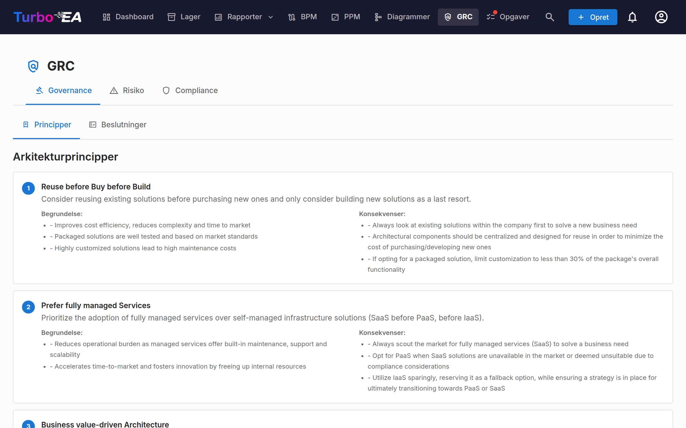
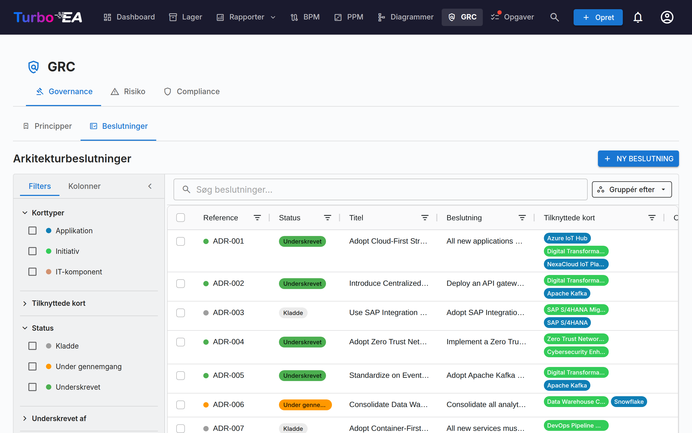
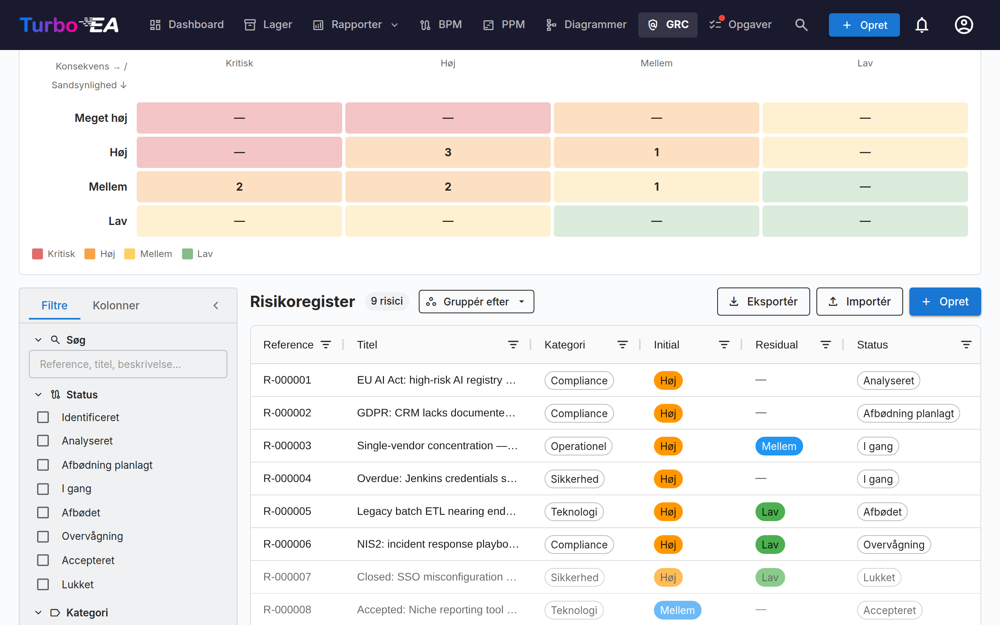
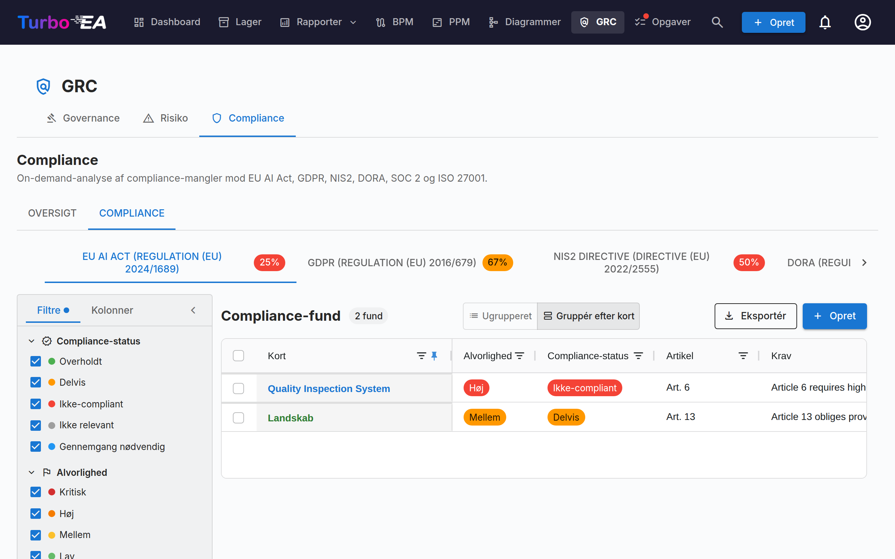

# GRC

**GRC**-modulet samler Governance, Risk og Compliance i ét arbejdsområde på `/grc`. Det konsoliderer arbejde, der tidligere var spredt på tværs af EA Delivery og TurboLens, så en arkitekt, en risikoejer og en compliance-reviewer kan stå på fælles grund.

!!! note
    GRC-modulet kan slås til eller fra af en administrator i [Indstillinger](../admin/settings.md). Når det er slået fra, skjules GRC-navigation og -funktioner.

GRC har tre faner:

- **Governance** — EA-principper og Architecture Decision Records (ADR'er).
- **Risk** — TOGAF Fase G [Risikoregistret](risks.md).
- **Compliance** — den on-demand regulerings-mangelanalyse-scanner, der tidligere lå i TurboLens.

Du kan deep-linke en hvilken som helst fane via `/grc?tab=governance`, `/grc?tab=risk` eller `/grc?tab=compliance`.

## Governance

Governance-fanen er opdelt i to **underfaner**, deep-linkbar via `/grc?tab=governance&sub=principles` (standard) og `/grc?tab=governance&sub=decisions`:

### Principles

Skrivebeskyttet browser over EA-principper offentliggjort i metamodellen (statement, rationale, implications). Rediger kataloget fra **Administration → Metamodel → Principles**.

### Decisions

Decisions-underfanen er **hovedregistret over Architecture Decision Records (ADR'er)** — hver ADR på tværs af landskabet, uanset hvilket initiativ den er linket til. Den erstatter den gamle EA Delivery → Decisions-fane, der blev opløst, da GRC blev introduceret.

ADR'er dokumenterer vigtige arkitekturbeslutninger sammen med deres kontekst, konsekvenser og overvejede alternativer. Beslutninger udsendt af TurboLens Architect-guiden lander her som kladder, så reviewere kan underskrive.

Registret besvarer først ét spørgsmål: **hvilke beslutninger er gældende i dag?** Hver underskrevet beslutning har en [gyldighed](#standing), som Turbo EA udleder af dens datoer, dens revisioner og de andre beslutninger, der virker på den, og gitteret viser kun den aktuelle revision af hver beslutning, medmindre du beder om de tidligere.

Tabellen kan også **grupperes efter status** eller **efter gyldighed** via knappen *Gruppér efter* ved siden af søgefeltet: hver status eller gyldighed foldes sammen under sin egen overskrift, og afkrydsningsfeltet i overskriften vælger hele gruppen til en samlet eksport.

#### Status og gyldighed {: #standing }

En beslutning har to separate tilstande:

- **Status** er underskriftsforløbet, og det er den, du handler på: **Kladde** → **Under gennemgang** (underskrifter anmodet) → **Underskrevet**. En beslutning truffet uden for Turbo EA og [registreret som truffet](#recording-a-past-decision) viser **Registreret** i stedet for Underskrevet.
- **Gyldighed** angiver, hvor en underskrevet eller registreret beslutning står i dag. Den udledes — sættes aldrig manuelt — og en kladde eller en beslutning under gennemgang har ingen (*Endnu ikke underskrevet*).

| Gyldighed | Betydning |
|-----------|-----------|
| **Planlagt** | Underskrevet, men datoen *Gældende fra* er endnu ikke nået |
| **Gældende** | Underskrevet og trådt i kraft |
| **Gældende (ændret)** | Gældende, og en anden underskrevet beslutning ændrer den; ændringen er endnu ikke indarbejdet i en [konsolideret revision](#amendments-and-consolidated-revisions) |
| **Erstattet** | En senere revision af samme beslutning, eller en beslutning, der erstatter den, er trådt i kraft |
| **Ophævet** | En underskrevet beslutning, der ophæver den, er trådt i kraft |
| **Udløbet** | Datoen *Gyldig indtil* er passeret (den er gældende til og med den dag) |

Beslutningens side forklarer hvorfor med et banner — *Denne beslutning er erstattet af …*, *Denne beslutning træder i kraft den …*, *Revision 3 træder i kraft den …* — med et link til den pågældende beslutning.

#### Gitterkolonner

ADR-gitteret afspejler Inventar-gitter-layoutet:

| Kolonne | Beskrivelse |
|---------|-------------|
| **Reference #** | Autogenereret referencenummer (ADR-001, ADR-002, …) med en statusprik; en revision efter den første tilføjer sit nummer (ADR-012 · Rev 2) |
| **Status** | Farvet chip — Kladde, Under gennemgang, Underskrevet eller Registreret |
| **Gyldighed** | Hvor en underskrevet beslutning står i dag — se [Status og gyldighed](#standing); tom, indtil den er underskrevet |
| **Title** | ADR-titel |
| **Decision** | Uddrag af beslutningen i ren tekst |
| **Linked Cards** | Farvede piller, der matcher hver linket korts type-farve |
| **Created By** | ADR'ens forfatter |
| **Created** | Oprettelsesdato |
| **Modified** | Sidst-ændret-dato |
| **Signed** | Datoen ADR'en blev underskrevet |
| **Signed By** | Én pille pr. underskriver, der har underskrevet |
| **Truffet den** / **Gældende fra** / **Gyldig indtil** | Beslutningens [datoer](#decision-dates) |
| **Beslutningstagere** | De personer, der traf beslutningen |

Hver kolonne har et **kolonnefilter** — tekstfiltre på tekstkolonner, datofiltre på datokolonnerne — hver med sin egen **Reset**-knap. Så snart et kolonnefilter er aktivt, vises knappen **Ryd kolonnefiltre** i gitterets værktøjslinje, som rydder dem alle på én gang. Kolonnebredder, rækkefølge, sortering og aktive filtre huskes pr. browser.

#### Filtersidepanel

Det vedvarende sidepanel til venstre har to faner:

- **Filtre** — facetfiltre over ADR-listen:
    - **Gældende** — ét klik viser kun de beslutninger, der er gældende i dag (Gældende og Gældende (ændret)); klik igen for at rydde det
    - **Vis tidligere revisioner** — slået fra som standard, så hver beslutning vises én gang, som sin aktuelle revision (plus en revision under udarbejdelse). Slå det til for også at vise de tidligere revisioner; knappen **Eksportér** følger samme kontakt
    - **Card Types** — afkrydsningsfelter med farvede prikker, der filtrerer efter linkede korttyper
    - **Linked Cards** — filtrér efter specifikke linkede kort
    - **Status** — Kladde / Under gennemgang / Underskrevet (en registreret beslutning tæller som underskrevet)
    - **Gyldighed** — Planlagt / Gældende / Gældende (ændret) / Erstattet / Ophævet / Udløbet / Endnu ikke underskrevet
    - **Signed By** — filtrér efter underskriver
    - **Date Created** / **Date Modified** / **Date Signed** / **Beslutningsdato** — fra/til-datointervaller (**Beslutningsdato** matcher datoen *Truffet den* for en underskrevet eller registreret beslutning)
- **Kolonner** — vælg, hvilke gitterkolonner der er synlige. **Reference #** og **Title** vises altid; **Nulstil** gendanner standardsættet. Dit valg huskes pr. browser.

Brug **quick filter**-søgelinjen til fuldtekstsøgning på tværs af alle ADR'er. Højreklik på enhver række for en kontekstmenu (**Edit**, **Preview**, **Duplicate**, **Delete**).

#### Eksport og import af beslutninger {: #decisions-import }

**Eksportér** (ved siden af **+ Ny beslutning**) downloader de beslutninger, som filtersidepanelet aktuelt viser, som en `.xlsx`-fil, én række pr. beslutningsrevision. Kolonnerne, i rækkefølge: `reference_number`, `title`, `status`, `revision_number`, de fire sektioner (`context`, `decision`, `consequences`, `alternatives_considered`) som ren tekst, `cards` og `related_decisions` (adskilt af semikolon), `author`, `signatories`, `signed_at`, `created_at`, `updated_at`, derefter registrets egne oplysninger — `standing` (som en nøgle såsom `in_force`), `decided_on`, `effective_from`, `valid_until`, `decision_makers`, `participants` og de typede tilknytninger `replaces`, `amends`, `revokes` og `consolidates` som referencer. Formatering som fed skrift eller links overføres ikke til regnearket. Hvis du vil dele fuldt formaterede beslutninger, skal du markere rækker i gitteret og bruge gitterets egen **Export**-knap, som skriver et Word-dokument.

**Importér** opretter beslutninger samlet fra en `.xlsx`-fil. Klik på **Download skabelon** for at få en startprojektmappe, udfyld én beslutning pr. række, og upload den:

- Hver række bliver til en ny **kladde**-beslutning med den næste `ADR-NNN`-reference. Status og underskrifter importeres aldrig — en beslutning underskrives via **underskriftsarbejdsprocessen** — og forhåndsvisningen advarer om en række, hvis `status` er andet end kladde (draft).
- En række, hvis `reference_number` allerede tilhører en beslutning, **springes over**: importen ændrer aldrig en eksisterende beslutning, så en genimport af en eksport ændrer ingenting.
- `title` er obligatorisk. I de fire sektionskolonner starter en tom linje et nyt afsnit, linjer, der begynder med `- `, bliver til en punktliste, og linjer, der begynder med `1. `, til en nummereret liste.
- `cards` kobler kort via det præcise navn blandt de kort, du kan se; et kort, der ikke kan findes, eller hvis navn deles af flere kort, springes over med en advarsel, og beslutningen importeres alligevel.
- `related_decisions` angiver referencer, enten til eksisterende beslutninger eller til andre rækker i samme fil (også senere rækker); hver bliver en **Relaterer til**-tilknytning. En reference med flere revisioner tilknyttes sin aktuelle revision.
- Alle andre kolonner — også gyldighed, datoer, personer og de typede tilknytninger — ignoreres: en import opretter kladder, aldrig underskrevne eller registrerede beslutninger.
- En eksport har én række pr. revision, så en fil kan indeholde flere rækker for én reference (en åben revision eller tidligere revisioner, når **Vis tidligere revisioner** er slået til). På den instans, filen kom fra, springes de alle over; andre steder importeres kun rækken med det højeste `revision_number` (den sidste række, når numrene er ens eller mangler), og hver anden række springes over med advarslen *Tidligere revision af ADR-012 sprunget over*. En `related_decisions`-post, der nævner den reference, tilknyttes den importerede række.

Forhåndsvisningen viser, hvor mange rækker der bliver oprettet, sprunget over og fejler, med hver fejl og advarsel listet pr. række; intet skrives, før du bekræfter. Import kræver tilladelsen `adr.manage`.

#### Oprettelse af en ADR

ADR'er kan oprettes fra tre steder — alle åbner den samme editor og fodrer det samme register:

1. **GRC → Governance → Decisions**: klik på **+ New ADR**, udfyld titlen og link eventuelt kort (inklusive initiativer).
2. **EA Delivery-arbejdsområde**: vælg et initiativ, klik derefter på **+ New artefact ▾** i sidehovedet (eller **+ Add** i leverancesektionen *Architecture Decisions*), og vælg **New Architecture Decision** — initiativet er på forhånd linket.
3. **Card → Resources-fane**: klik på **Create ADR** — det aktuelle kort er på forhånd linket.

I alle tilfælde kan du søge og linke yderligere kort under oprettelsen. Initiativer linkes via samme kort-linking-mekanisme som ethvert andet kort, så en ADR kan referere til flere initiativer. Editoren åbnes med sektioner for **Context**, **Decision**, **Consequences** og **Alternatives Considered**.

#### ADR-editoren

Editoren tilbyder:

- Rich text-redigering for hver sektion (Context, Decision, Consequences, Alternatives Considered)
- **Omtaler** — skriv **@** i en sektion for at omtale et kort eller en anden beslutning (se [Omtaler](#decision-mentions))
- **Diskussion** — et panel ved siden af dokumentet med dets diskussion (se [Diskussion](#decision-discussion))
- **Historik** — en knap øverst på siden, der åbner beslutningens tidslinje og dens gemte versioner (se [Historik](#decision-history))
- Kort-linking — forbind ADR'en til relevante kort (applikationer, IT-komponenter, initiativer, …). Initiativer linkes via standard kort-linking-funktionen, ikke et dedikeret felt, så en ADR kan referere til flere initiativer
- **Datoer** — *Truffet den*, *Gældende fra* og en valgfri *Gyldig indtil* (se [Datoer](#decision-dates))
- **Personer** — *Beslutningstagere* og *Deltagere* (se [Personer](#decision-people))
- **Denne beslutning…** — typede tilknytninger til andre beslutninger (se [Tilknytninger mellem beslutninger](#decision-links))
- **Ændringsoversigt** — kun på en revision: hvad der er ændret i denne revision, og hvorfor
- **Filer** — dokumenter vedhæftet beslutningen (se [Filer](#decision-files))

#### Datoer {: #decision-dates }

- **Truffet den** — den dag, beslutningen blev truffet. Den kan ikke ligge i fremtiden.
- **Gældende fra** — den dag, den træder i kraft. Indtil da er en underskrevet beslutning **Planlagt**.
- **Gyldig indtil** — valgfri, for en tidsbegrænset beslutning såsom en dispensation. Dagen efter er beslutningen **Udløbet**. Den kan ikke ligge før *Gældende fra* og må ikke allerede være passeret, når beslutningen sendes til gennemgang.

Står *Truffet den* og *Gældende fra* tomme, får de datoen for den sidste underskrift. En fornyelse af en udløbet beslutning er en ny revision eller en ny beslutning, der underskrives som enhver anden.

#### Personer {: #decision-people }

**Beslutningstagere** er de personer, der traf beslutningen; **Deltagere** er de personer, der deltog i den. Vælg en Turbo EA-bruger, eller skriv et navn og tryk Enter for en person uden konto. Begge registreres adskilt fra **underskriverne**, som godkender registreringen i Turbo EA. Når du anmoder om underskrifter, tilføjer **Tilføj beslutningstagere** i dialogen med ét klik alle beslutningstagere, der er Turbo EA-brugere, til underskriverne.

#### Tilknytninger mellem beslutninger {: #decision-links }

Sektionen **Denne beslutning…** tilknytter en beslutning til andre. Vælg typen af tilknytning og beslutningen, og tilføj eventuelt en note for et delvist tilfælde — for eksempel *kun afsnit 3*:

| Tilknytning | Vises på den anden beslutning som | Virkning, når denne beslutning er underskrevet og trådt i kraft |
|-------------|-----------------------------------|----------------------------------------------------------------|
| **Erstatter** | Erstattet af | Den anden beslutning bliver **Erstattet** |
| **Ændrer** | Ændret af | Den anden beslutning bliver **Gældende (ændret)** |
| **Ophæver** | Ophævet af | Den anden beslutning bliver **Ophævet** |
| **Relaterer til** | Relateret til | Ingen — en krydshenvisning |

Tilknytninger vises på begge beslutninger og peger på beslutningens aktuelle revision. De virker på hele beslutningen, alle dens revisioner inklusive, og først når beslutningen, der bærer dem, er underskrevet og trådt i kraft: en kladde, der ophæver en anden, ændrer intet, før den er underskrevet, og en med en senere *Gældende fra* virker fra den dato (den anden beslutning siger *Denne beslutning ophæves af … den …*). En beslutning kan ikke tilknyttes en af sine egne revisioner, og hver beslutning, den tilknyttes, skal være underskrevet, før den sendes til gennemgang eller registreres.

#### Ophævelse eller erstatning af en beslutning

En underskrevet beslutning trækkes aldrig tilbage manuelt: den ophæves eller erstattes af en anden underskrevet beslutning, så registret bevarer, hvem der besluttede det og hvornår. Åbn den underskrevne beslutning, og brug menuen **Revidér**:

- **Revidér denne beslutning** — en ny revision af samme beslutning under samme reference (se [Revisioner](#revisions)).
- **Erstat med en ny beslutning** — en ny kladde med titlen *Erstatter: …*, der allerede har en **Erstatter**-tilknytning og de samme tilknyttede kort.
- **Ophæv** — en ny kladde med titlen *Ophævelse af ADR-012 — …*, der allerede har en **Ophæver**-tilknytning og de samme tilknyttede kort.

Færdiggør den nye kladde, og send den gennem underskriftsforløbet som enhver anden beslutning. Menuen tilbydes ikke på en tidligere revision (åbn den aktuelle) eller på en beslutning, der allerede er ophævet eller erstattet. Når en underskrevet beslutning erstatter, ændrer eller ophæver en anden, modtager forfatteren af den beslutning notifikationen **ADR-gyldighed ændret**.

#### Ændringer og konsoliderede revisioner {: #amendments-and-consolidated-revisions }

En beslutning, som en anden ændrer, forbliver gældende, og dens side viser de ændrende beslutninger. For at give læserne én aktuel tekst skal du klikke på **Opret konsolideret revision** i det banner: det starter en revision af den ændrede beslutning, som nævner den ændrende beslutning (*Konsoliderer ændringen fra …*). Indarbejd ændringen i teksten, beskriv den i **Ændringsoversigt**, og send revisionen til underskrift. Når den er underskrevet og trådt i kraft, er beslutningen **Gældende** igen, og den ændrende beslutning viser *Ændringen fra denne beslutning er konsolideret i …*. En ændring holder også op med at tælle, når den ændrende beslutning ophæves, erstattes eller udløber — men ikke, når den blot revideres: dens revision bevarer ændringen, og banneret nævner den ændrende beslutnings aktuelle revision.

#### Filer {: #decision-files }

Sektionen **Filer** vedhæfter dokumenter til en beslutning — et underskrevet referat, en understøttende analyse. Filer accepterer de samme formater som [kortvedhæftninger](card-details.md#resources-tab), op til 20 MB hver, og kan kun uploades, mens filupload er aktiveret (det er altid muligt at slette en). De kan kun tilføjes og slettes på en gemt kladde: når beslutningen er sendt til gennemgang, låses de sammen med den. En revision overtager sin beslutnings filer.

#### Underskrifts­arbejdsproces

ADR'er understøtter en formel underskriftsproces:

1. Opret ADR'en med status **Draft**.
2. Klik på **Request Signatures**, og søg efter underskrivere efter navn eller e-mail (eller klik på **Tilføj beslutningstagere**). Der kan kun anmodes om underskrifter fra en kladde.
3. ADR'en flyttes til **In Review** — hver underskriver modtager en notifikation og en opgave.
4. Underskrivere gennemgår og klikker på **Sign**.
5. Når hver underskriver har underskrevet, flytter ADR'en automatisk til **Signed**.

**En beslutning under gennemgang er låst**, så underskriverne underskriver præcis det, de fik tilsendt: teksten, datoerne, personerne, tilknytningerne, filerne og udvidelsespanelerne er skrivebeskyttede, og kun de tilknyttede kort kan stadig ændres. Klik på **Tilbagekald underskrifter** for at redigere den; det sender den tilbage til kladde. En underskriver, der klikker på **Afvis**, sender den også tilbage til kladde, under samme revisionsnummer.

Underskrevne ADR'er er låst og kan ikke redigeres — for at lave ændringer skal du oprette en ny revision.

#### Registrering af en tidligere beslutning {: #recording-a-past-decision }

En beslutning truffet uden for Turbo EA — for eksempel på et bestyrelsesmøde, før registret fandtes — kan indføres som truffet uden at indsamle underskrifter. Skriv den som en kladde, angiv mindst én beslutningstager, klik derefter på **Registrér som truffet**, og angiv datoen **Truffet den** (ikke i fremtiden) og, hvis den afviger, datoen **Gældende fra** (som standard beslutningsdatoen).

Beslutningen låses derefter som en underskrevet og får sin gyldighed, men dens status er **Registreret**, og dens side siger *Registreret af … den …, ikke underskrevet i Turbo EA*. Registrering kræver tilladelsen `adr.record`, som kun Admin-rollen har som standard, og hver registrering vises i [sikkerheds- og administrationsloggen](../admin/audit-log.md) som `admin.adr.recorded`. En revisionskladde kan også registreres, så længe dens beslutningsdato ikke ligger før den forrige revisions.

#### Revisioner {: #revisions }

Åbn en underskrevet ADR, og vælg **Revidér → Revidér denne beslutning** for at oprette en ny kladde baseret på den underskrevne version. Revisionen beholder beslutningens reference og får det næste revisionsnummer — **ADR-012 · Rev 2** — og arver indholdet, de tilknyttede kort, **Relaterer til**-tilknytningerne, personerne, filerne og datoen *Gyldig indtil*. Den arver ikke beslutnings- og ikrafttrædelsesdatoerne, underskriverne, ændringsoversigten eller erstatter- / ændrer- / ophæver-tilknytningerne, som bliver på den revision, der oprettede dem. Hver revision har sit eget underskriftsspor.

- **Én åben revision ad gangen.** Mens en revision er under udarbejdelse, oplyser den aktuelle revision det, og menuen **Revidér** åbner den kladde i stedet for at starte en ny.
- **Den aktuelle revision er den gældende.** Når en revision er underskrevet og trådt i kraft, er de tidligere **Erstattet** og viser et banner med et link til den aktuelle. **Revisioner**-båndet på hver revision viser hele kæden og markerer den aktuelle.
- **Kun den aktuelle revision kan revideres**, og ikke længere, når beslutningen er ophævet eller erstattet. En udløbet eller ændret beslutning kan stadig revideres.
- **En afvisning tæller ikke som en revision**: revisionsnummeret ændres kun, når en ny revision oprettes.
- Beslutninger, der er revideret før version 2.199.0, beholder de referencenumre, de fik, og vises stadig som én beslutning med ét revisionsbånd.

#### Preview

Klik på preview-ikonet for at se en skrivebeskyttet, formateret version af ADR'en — nyttig til gennemgang før underskrift.

Fra forhåndsvisningen klik på **PDF** for at åbne en printklar kopi i en ny fane — metadata og datoer, de fire sektioner, personer, tilknyttede kort, tilknytninger til andre beslutninger, filnavne, udvidelsessektioner og signaturblokken (eller registreringslinjen), med godkender og udskriftsdato i sidefoden. Editoren har den samme **PDF**-knap samt **Word**, der downloader beslutningen som `.docx`, indtil den er underskrevet; begge eksporterer editorens aktuelle tilstand, ugemte ændringer inklusive.

#### Diskussion {: #decision-discussion }

Hver beslutning har sin egen **Diskussion**, så en beslutning kan afklares i Turbo EA i stedet for i en separat chattråd. Åbn den med diskussionsknappen i beslutningens editor eller forhåndsvisning: på en bred skærm åbnes den som et panel ved siden af dokumentet, på en smallere som en skuffe. Panelets titel viser, hvor mange tråde der er åbne. Beslutningens [Historik](#decision-history) er ikke i dette panel: den åbnes fra knappen **Historik** øverst på siden.

- **Tråde og svar.** Skriv i feltet øverst i panelet, og klik på **Send** (eller tryk Ctrl+Enter, Cmd+Enter på en Mac) for at starte en tråd. For at knytte den til en sektion skal du klikke på en af sektionschipsene over feltet — *Kontekst*, *Beslutning*, *Overvejede alternativer* eller *Konsekvenser*; klik på den valgte chip igen for at fjerne tilknytningen. En tråd uden sektion er en generel tråd. Hver tråd kan modtage svar, ét niveau dybt; en tråd beholder den sektion, den blev startet med, og dens sektionschip vises øverst i tråden.
- **Filtrering efter sektion.** Så snart en tråd har en sektion, viser en række chips øverst i diskussionen hver sektion, der har tråde, med hvor mange (*Beslutning (2)*), og en chip **Generelt**, når nogle tråde ikke har nogen sektion. Klik på en chip for kun at vise dens tråde; slå flere til for at se trådene fra dem alle, klik på en igen for at slå den fra, eller klik på **Ryd**. Et klik på en tråds egen sektionschip slår dens filter til. Filteret virker, uanset om de løste tråde er foldet sammen eller ej, og når de tidligere revisioner vises, og tæller kun de viste tråde. Det bevares ikke, når du forlader dokumentet, og en tråd, der åbnes fra en notifikation, vises altid.
- **Diskussion om en sektion.** Hver sektion viser et lille chatikon ved siden af sin overskrift, i editoren og forhåndsvisningen, for personer, der må kommentere (personer, der kun må læse, ser det kun på sektioner med tråde): antallet af åbne tråde, når sektionen har diskussion, eller et nedtonet ikon, når de alle er løst. Klik på det for at åbne diskussionen filtreret til den sektion, med de løste tråde foldet ud, når ingen af dem er åbne, og med sektionen allerede valgt til en ny kommentar (ikonet bliver aldrig udskrevet eller eksporteret).
- **Løs og genåbn.** Klik på **Løs**, når en tråd er afklaret, og på **Genåbn**, hvis den ikke er. Løste tråde foldes sammen bag **Vis N løste tråde**.
- **Hvem der kan skrive.** Læsning af diskussionen følger, hvem der kan åbne beslutningen (`adr.view`). At skrive, svare, løse og genåbne kræver tilladelsen `adr.comment`, som medlemmer og administratorer har som standard, og læsere ikke har; en administrator kan ændre den pr. rolle. Beslutningens underskrivere kan altid kommentere den, herunder de personer, der blev bedt om at underskrive den i en tidligere gennemgangsrunde, som blev tilbagekaldt eller afvist.
- **Under gennemgang og efter underskrift.** [Låsen under gennemgang](#underskriftsarbejdsproces) omfatter indholdet, ikke samtalen: diskussionen forbliver åben, mens beslutningen er under gennemgang, og efter at den er underskrevet.
- **Gennemgangsnoter.** Når en underskriver afviser en beslutning, åbner begrundelsen en tråd markeret **Begrundelse for afvisning** (*Ingen begrundelse angivet*, når underskriveren lod den stå tom), som besvares og løses som enhver anden. En underskriver kan tilføje en valgfri note ved underskrift; den vises i diskussionen som en **Note til underskrift**. Ingen af dem går længere tabt, når underskrifter tilbagekaldes, og begge vises også i [Historik](#decision-history).
- **Åbne tråde før gennemgang.** **Anmod om underskrifter**, **Underskriv** og **Afvis** advarer, når beslutningen stadig har åbne tråde (*2 åbne diskussionstråde på dette dokument.*). Det er kun en advarsel: intet blokeres.
- **Notifikationer.** En ny kommentar giver besked til beslutningens forfatter, dens underskrivere, dens beslutningstagere og deltagere, der er Turbo EA-brugere, og de personer, der har kommenteret før — aldrig til den, der skrev den. Skriv **@** i en kommentar for at omtale en kollega: vedkommende modtager i stedet en notifikation om omtalen. En person, du omtaler, og som ikke kan åbne beslutningen, får ikke besked, og panelet fortæller dig det (*… fik ikke besked: de kan ikke åbne dette dokument.*). Notifikationer indeholder ingen kommentartekst, og et klik på en åbner beslutningens forhåndsvisning med panelet ved den pågældende tråd. Se [Notifikationer](notifications.md#notifikationstyper).
- **Redigering og sletning.** Du kan redigere dine egne kommentarer; en redigeret kommentar markeres *(redigeret)*. Du kan slette dine egne kommentarer, og alle, der kan redigere beslutningen (`adr.manage`), kan slette enhver kommentar; en slettet kommentar skrumper på sin plads ind til én lille linje med dens forfatter, dens dato og *Kommentar slettet*. Sletning af den første kommentar i en tråd lukker tråden: de svar, der allerede er der, bliver, men ingen kan svare i den, løse den eller genåbne den. En begrundelse for afvisning og en note til underskrift kan ikke redigeres eller slettes: en afvisning løses i stedet.
- **Tidligere revisioner.** En tråd hører til den revision, den blev startet på. Slå **Vis diskussion om tidligere revisioner** til for at læse trådene fra beslutningens tidligere revisioner, grupperet efter revision.

#### Omtaler {: #decision-mentions }

Mens du skriver en beslutning, kan du skrive **@** i en af dens fire sektioner for at omtale et **kort** eller en anden **beslutning**. Et popup viser matchende kort og beslutninger, mens du skriver; brug piletasterne og Enter (eller klik) for at vælge et, og Escape for at lukke det. I en kommentar tilbyder **@** også **personer**. Hver post viser, hvad den er: et kort viser sin types farve og ikon, sin type, sin undertype og det kort, det ligger under (*Application · Microservice · i Finance Suite*, når du må se det kort); en beslutning viser sin reference (*ADR-012 · Rev 2*), sin titel og sin status; en person viser et navn og en e-mailadresse. En omtale vises som en chip med det aktuelle navn på det, den peger på — et korts navn, en beslutnings reference og titel — så omdøbning af et kort aldrig ændrer teksten. Klik på en kort- eller beslutningschip for at åbne den.

- **Hvad der kommer først.** Når der ikke er skrevet noget efter **@**, kommer de kort, der er tilknyttet beslutningen, først, derefter de øvrige kort i alfabetisk rækkefølge; i en kommentar kommer beslutningens underskrivere, beslutningstagere og deltagere først blandt personerne. Mens du skriver, kommer de bedste resultater først som alle andre steder i Turbo EA, og blandt lige gode resultater står de tilknyttede kort og beslutningens personer forrest.
- **Gennemse.** Den sidste post i popuppet, **Gennemse…**, og knappen **Omtal…** (**@**) i editorens værktøjslinje åbner en dialog med standardvælgerne: **Kort** (kortvælgeren fra resten af Turbo EA med dens typeliste, hierarki og søgning), **Beslutninger** (en søgbar liste) og, i en kommentar, **Personer**. Vælg så mange, du har brug for, på en hvilken som helst fane, og klik på **Indsæt**: der indsættes én omtale pr. valg, i den rækkefølge du valgte dem, adskilt af mellemrum — i stedet for det, du skrev efter **@**, når dialogen blev åbnet fra popuppet. **Annullér** indsætter intet.
- En læser, der ikke må se et omtalt kort, ser **Begrænset kort** i stedet for dets navn, overalt — i editoren, forhåndsvisningen, PDF- og Word-eksporterne, gitteret, historikken og diskussionen. En læser, der ikke kan åbne beslutninger, ser **Begrænset beslutning**. Når teksten gemmes, bevares sådanne omtaler, som de er, selv når den, der gemmer, ikke kan se dem.
- Et omtalt kort, der siden er slettet, vises som **Slettet kort** (en slettet beslutning som **Slettet beslutning**), da teksten ikke gemmer navne.
- En omtale tilknytter ikke kortet. Når teksten omtaler kort, der ikke er tilknyttet, viser editoren dem under *Omtalt i teksten, men ikke tilknyttet:*, hver med en knap **Tilknyt dette kort**. Tilknytning af kort i editoren bruger samme kortvælger som resten af Turbo EA.
- **Omtalt i.** Et korts [ADRs-fane](card-details.md#adrs-fane) og en beslutnings forhåndsvisning viser under **Omtalt i** de beslutninger og SoAW'er, hvis tekst omtaler det kort eller den beslutning, og dem, hvis diskussion gør det (markeret *i diskussionen*). Listen viser kun dokumenter, du kan åbne.

#### Historik {: #decision-history }

Knappen **Historik** øverst i beslutningens editor eller forhåndsvisning, ved siden af revisionsbjælken når beslutningen har flere revisioner, åbner én bred visning: tidslinjen til venstre, den valgte version til højre. Tidslinjen registrerer, hvad der er sket med beslutningen, nyeste først: oprettet, gemt, sendt til gennemgang, hver underskrift (med dens note), afvist (med begrundelsen), underskrifter tilbagekaldt, fuldt underskrevet, registreret som truffet, en revision påbegyndt, en tidligere version gendannet. Alle, der kan åbne beslutningen, ser denne tidslinje. Gennemgangshændelser — sendt til gennemgang, underskrevet, tilbagekaldt, afvist — gemmes fra version 2.200.0; før blev de vist live, men aldrig gemt. Beslutninger, der fandtes før den version, starter med en tidslinje genopbygget ud fra det, der var gemt: oprettet, revideret, sendt til gennemgang (for en beslutning, der var under gennemgang ved opgraderingen, med de underskrivere, den blev sendt til), hver underskrift, underskrevet og registreret.

Historikken er ikke den håndførte tabel **Dokumentets versionshistorik** i en [Statement of Architecture Work](delivery.md#soaw-editoren), som registrerer det, forfatterne vælger at skrive i den.

- **Versioner.** En version gemmes, hver gang en kladde gemmes med ændringer. Den indeholder titlen, de fire sektioner, datoerne, ændringsresuméet og personerne; links, tilknyttede kort og filer er ikke en del af en version. De trin, der indeholder en version, er markeret i tidslinjen; de personer, der kan redigere beslutningen, og dens underskrivere vælger et for at vise det til højre, og den nyeste version er valgt, når visningen åbnes. Andre læsere ser tidslinjen uden versionerne (*Gemte versioner vises kun for redaktører og underskrivere.*). På en smal skærm viser visningen først tidslinjen, derefter den valgte version med en knap **Tilbage**.
- **Ændringer.** Over den valgte version viser **Version** den, som den blev gemt, og **Ændringer** viser, hvad der er ændret mellem den og den forrige version, ord for ord pr. sektion, sammen med de datoer og personer, der er ændret; vælg en vilkårlig anden version under **Sammenlign med**. Kun de versioner, der allerede er indlæst i tidslinjen, kan sammenlignes: når versionen før den valgte endnu ikke er indlæst, siger **Ændringer** det, og **Indlæs flere** henter den ind. En ændring alene af formatering rapporteres som *Kun formatering: ordene er de samme.*
- **Gendan.** På en kladde kan en person, der kan redigere beslutningen, gendanne den valgte version med **Gendan denne version**. Gendannelse virker kun fremad: versionens tekst, datoer og personer erstatter kladdens og gemmes som en ny version, og kladdens tilstand før gendannelsen forbliver i historikken. Links, tilknyttede kort og filer gendannes ikke. Når editoren har ikke-gemte ændringer, siger bekræftelsen, at de vil blive kasseret. Efter gendannelsen viser siden den gendannede beslutning, og visningen lukkes. En beslutning under gennemgang eller en underskrevet beslutning kan ikke gendannes.

#### Kendte begrænsninger {: #collaboration-limits }

- Et slettet kort vises som **Slettet kort** overalt, hvor det blev omtalt: teksten gemmer ingen navne, så det gamle navn kan ikke vises.
- To personer, der gemmer den samme kladde, overskriver stadig hinanden: den sidste lagring vinder. Historikken bevarer begge lagringer, så den overskrevne formulering kan findes og gendannes.
- Diskussionen er ikke en del af PDF-, Word- eller regnearkseksporterne og heller ikke af den udskrevne kopi.
- En rolle, der kan åbne beslutninger, men ikke har adgang til inventaret, kan ikke søge efter kort i omtale-popuppet (*Din rolle kan ikke søge i kort; du kan stadig omtale beslutninger.*).
- Tekst kopieret fra ét dokument til et andet mister sine **Begrænset**-chips: en begrænset omtale kan kun bevares i det dokument, den blev skrevet i.
- Hvem der blev bedt om at underskrive i en gennemgangsrunde, der blev afvist eller tilbagekaldt før version 2.200.0, kan ikke rekonstrueres, så disse personer tæller ikke som underskrivere af den revision. En runde, der stadig var åben ved opgraderingen, beholder sine underskrivere.

## Risk

Indlejrer TOGAF Fase G **Risikoregistret**. Den fulde livscyklus, status­arbejdsproces, matrix-skifter og ejerskabsadfærd er dokumenteret i [Risikoregister-guiden](risks.md). De mest relevante punkter:

- Registret lever på `/grc?tab=risk` (det plejede at bo under EA Delivery).
- Risici kan oprettes manuelt eller **promoveres** fra et compliance-fund under Compliance-fanen.
- Promovering er idempotent — når et fund er blevet promoveret, skifter dets knap til **Open risk R-000123**.

## Compliance

Compliance-fanen er et dobbelt-kilde-register — fund kan **forfattes manuelt** af en reviewer **eller** produceres af en on-demand **AI-scanning** mod en hvilken som helst af de aktiverede reguleringer (EU AI Act, GDPR, NIS2, DORA, SOC 2, ISO 27001 leveres aktiveret som standard). Begge typer fund deler samme livscyklus, kan promoveres til en risiko og er masse-handlingsbare fra gitteret. Se [Compliance-guiden](compliance.md) for den fulde livscyklus, dialogen til manuel oprettelse, scanningsarbejdsprocessen, EU AI Act's semantiske detektor og promovering-til-risiko-løkken.

Den samme Compliance-fane vises også på Kortdetalje (auto-skjules, når kortet ikke har linkede fund), så en Application-ejer kan triagere sine egne fund uden at forlade kortet.

## Tilladelser

| Tilladelse | Standardroller |
|------------|----------------|
| `grc.view` | admin, bpm_admin, member, viewer |
| `grc.manage` | admin, bpm_admin, member |
| `adr.view` / `adr.manage` / `adr.sign` | `adr.view`: admin, bpm_admin, member, viewer; `adr.manage` og `adr.sign`: admin, bpm_admin, member |
| `adr.record` | admin — [registrér en tidligere beslutning som truffet](#recording-a-past-decision) |
| `adr.comment` | admin, bpm_admin, member — skriv i en beslutnings [diskussion](#decision-discussion); en beslutnings underskrivere kan altid kommentere den |
| `risks.view` / `risks.manage` | se [Risikoregister § Tilladelser](risks.md) |
| `compliance.view` / `compliance.manage` | se [TurboLens § Security & Compliance](turbolens.md) |

`grc.view` styrer synligheden af selve GRC-ruten — uden den er topnavigations­elementet skjult. Hver fane håndhæver desuden sin domænespecifikke tilladelse, så en viewer kan læse registret uden at kunne udløse en LLM-scanning, for eksempel.
