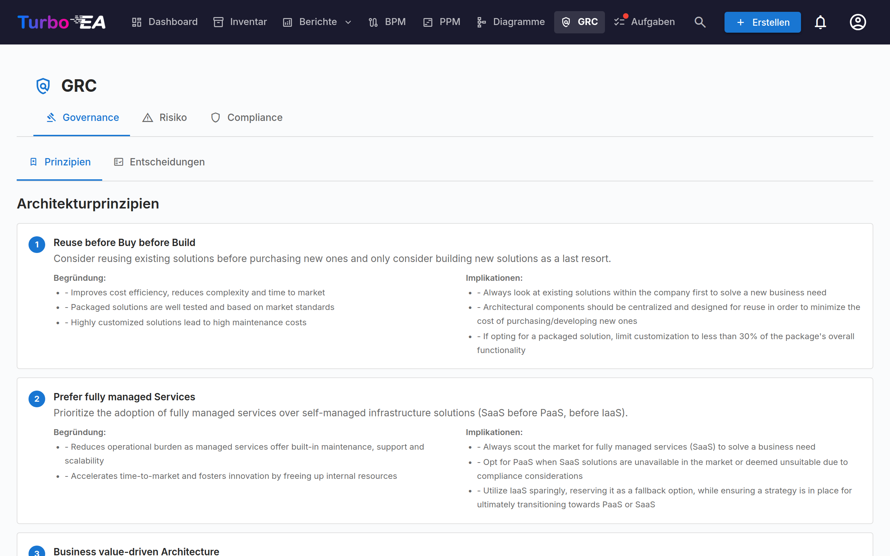
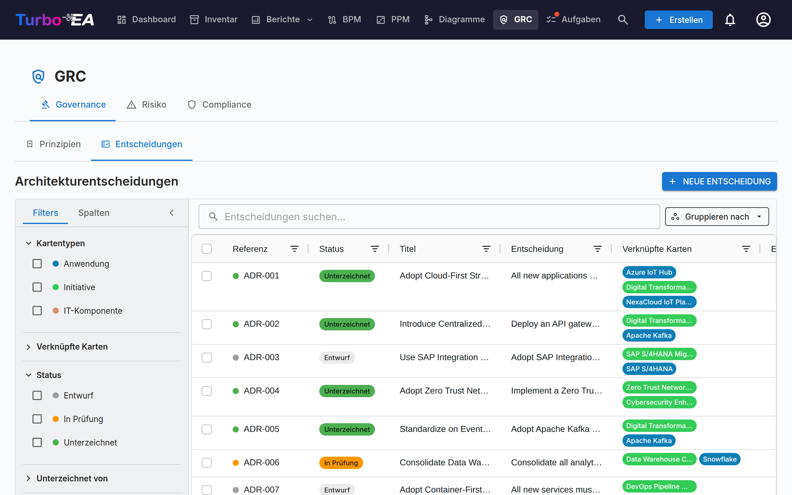
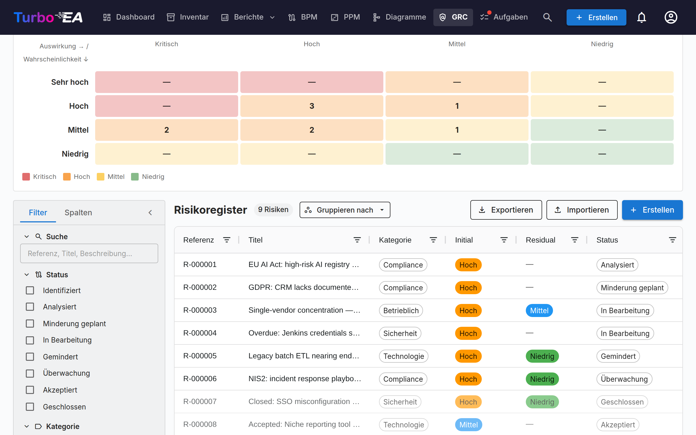
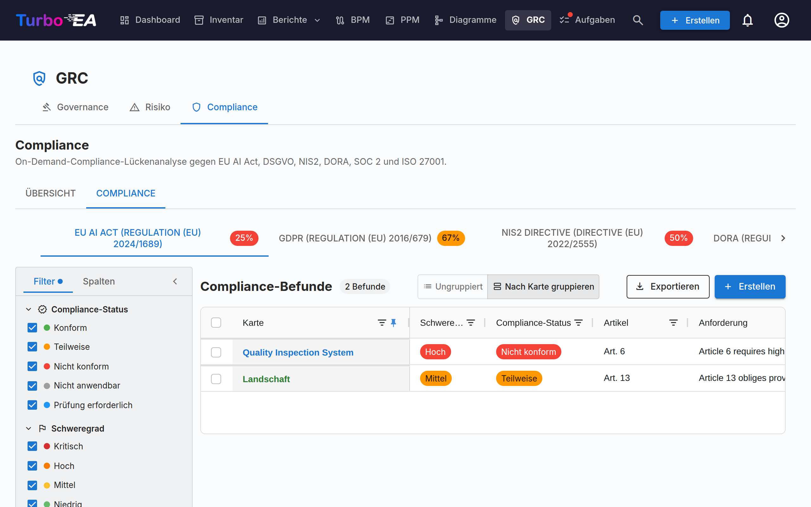

# GRC

Das **GRC**-Modul vereint Governance, Risk und Compliance in einem gemeinsamen Arbeitsbereich unter `/grc`. Es bündelt Aufgaben, die zuvor zwischen EA-Bereitstellung und TurboLens verteilt waren, sodass Architektin, Risikoeigentümer und Compliance-Prüferin auf gemeinsamem Boden arbeiten.

!!! note
    Das GRC-Modul kann von einem Administrator in den [Einstellungen](../admin/settings.md) aktiviert oder deaktiviert werden. Wenn deaktiviert, sind GRC-Navigation und -Funktionen ausgeblendet.

GRC hat drei Reiter:

Du kannst jeden Reiter direkt verlinken: `/grc?tab=governance`, `/grc?tab=risk` oder `/grc?tab=compliance`.

## Governance

Der Governance-Reiter teilt sich in zwei **Unter-Reiter** auf, deep-linkbar über `/grc?tab=governance&sub=principles` (Standard) und `/grc?tab=governance&sub=decisions`:

### Prinzipien

Schreibgeschützter Browser für die im Metamodell veröffentlichten EA-Prinzipien (Aussage, Begründung, Auswirkungen). Den Katalog bearbeitest du unter **Administration → Metamodell → Prinzipien**.

### Entscheidungen

Der Entscheidungen-Unter-Reiter ist das **zentrale Register der Architecture Decision Records (ADRs)** — jedes ADR im gesamten Landscape, unabhängig davon, mit welcher Initiative es verknüpft ist. Er löst den alten EA-Delivery-Reiter «Entscheidungen» ab, der mit dem GRC-Modul abgeschafft wurde.

ADRs dokumentieren wichtige Architekturentscheidungen samt Kontext, Konsequenzen und erwogenen Alternativen. Vom TurboLens-Architect-Wizard erzeugte Entscheidungen landen hier als Entwürfe für Reviewer.

Das Register beantwortet zuerst eine Frage: **Welche Entscheidungen sind heute in Kraft?** Jede unterzeichnete Entscheidung hat eine [Geltung](#standing), die Turbo EA aus ihren Daten, ihren Revisionen und den anderen Entscheidungen ableitet, die auf sie einwirken, und das Raster listet nur die aktuelle Revision jeder Entscheidung auf, es sei denn, Sie fordern die früheren an.

Das Raster lässt sich über die Schaltfläche *Gruppieren nach* neben dem Suchfeld auch **nach Status** oder **nach Geltung gruppieren**: Jeder Status bzw. jede Geltung klappt unter einer eigenen Überschrift zusammen (nach Status gruppiert, erhält jedes Prüfergebnis eine eigene Gruppe), und das Kontrollkästchen in der Überschrift wählt die ganze Gruppe für einen Sammelexport aus.

#### Status und Geltung {: #standing }

Eine Entscheidung hat zwei getrennte Zustände:

- **Status** ist der Abzeichnungsworkflow, und auf ihn reagieren Sie: **Entwurf** → **In Überprüfung** (Unterschriften angefordert) → **Unterschrieben**. Eine außerhalb von Turbo EA getroffene und [als entschieden erfasste](#recording-a-past-decision) Entscheidung zeigt statt Unterschrieben **Erfasst** an.
- **Geltung** gibt an, wo eine unterzeichnete oder erfasste Entscheidung heute steht. Sie wird abgeleitet — nie von Hand gesetzt —, und ein Entwurf oder eine Entscheidung in Überprüfung hat keine (*Noch nicht unterzeichnet*).

Ein Entwurf kann außerdem ein **Prüfergebnis** tragen, das angibt, wie seine letzte Prüfung ohne Unterschrift endete. Es erscheint anstelle von *Entwurf* im Status-Chip, und ein Banner an der Entscheidung nennt, wer es wann und warum getan hat (*Abgelehnt von Ada Lovelace am 27. Nov. 2026: …*):

| Ergebnis | Bedeutung |
|----------|-----------|
| **Änderungen angefordert** | Ein Unterzeichner hat die Entscheidung zur Überarbeitung zurückgegeben. Sie ist ein bearbeitbarer Entwurf; die Markierung verschwindet, wenn erneut Unterschriften angefordert werden |
| **Abgelehnt** | Ein Unterzeichner hat die Entscheidung abgelehnt. Sie ist **geschlossen** |
| **Zurückgezogen** | Die Autorenseite hat die Entscheidung zurückgezogen. Sie ist **geschlossen** |

Eine **geschlossene** Entscheidung bleibt gespeichert, ist aber wie eine in Überprüfung gesperrt: Nur ihre verknüpften Karten und [Diagramme](#decision-diagrams) lassen sich noch ändern, und sie kann von ihrem Autor weder zur Prüfung gesendet noch erfasst, wiederhergestellt oder gelöscht werden (zum Löschen ist die Berechtigung `adr.delete` nötig). Um wieder daran zu arbeiten, klicken Sie auf **Wieder öffnen**; sie wird dann zu einem normalen Entwurf. Das Register blendet geschlossene Entscheidungen aus, bis **Geschlossene anzeigen** aktiviert ist. Ein Entwurf, dessen letzte Prüfung vor Version 2.221.0 abgelehnt wurde — als eine Ablehnung eine Entscheidung noch auf Entwurf zurücksetzte —, zeigt **Änderungen angefordert**.

Der Lebenszyklus ist fest vorgegeben: die drei Status, die sechs Geltungen und die drei Ergebnisse sind in jedem Arbeitsbereich gleich und lassen sich weder durch einen Administrator noch durch eine Erweiterung konfigurieren.

| Geltung | Bedeutung |
|---------|-----------|
| **Geplant** | Unterzeichnet, aber das Datum *Wirksam ab* ist noch nicht erreicht |
| **In Kraft** | Unterzeichnet und wirksam |
| **In Kraft (geändert)** | In Kraft, und eine andere unterzeichnete Entscheidung ändert sie; die Änderung ist noch nicht in eine [konsolidierte Revision](#amendments-and-consolidated-revisions) eingearbeitet |
| **Ersetzt** | Eine spätere Revision derselben Entscheidung oder eine Entscheidung, die sie ersetzt, ist wirksam geworden |
| **Widerrufen** | Eine unterzeichnete Entscheidung, die sie widerruft, ist wirksam geworden |
| **Abgelaufen** | Ihr Datum *Gültig bis* ist überschritten (sie gilt bis einschließlich dieses Tages) |

Die Seite der Entscheidung nennt den Grund in einem Banner — *Diese Entscheidung wurde durch … ersetzt.*, *Diese Entscheidung tritt am … in Kraft.*, *Revision 3 tritt am … in Kraft.* — mit einem Link zur betreffenden Entscheidung.

#### Tabellenspalten

Das ADR-Grid orientiert sich am Layout des Inventar-Grids:

| Spalte | Beschreibung |
|--------|-------------|
| **Referenznr.** | Automatisch generierte Referenznummer (ADR-001, ADR-002, …) mit Statuspunkt; eine Revision nach der ersten fügt ihre Nummer hinzu (ADR-012 · Rev. 2) |
| **Status** | Farbiger Chip — Entwurf, In Überprüfung, Unterschrieben oder Erfasst bzw. das Prüfergebnis (Änderungen angefordert, Abgelehnt, Zurückgezogen) eines Entwurfs, der eines hat |
| **Geltung** | Wo eine unterzeichnete Entscheidung heute steht — siehe [Status und Geltung](#standing); leer, bis sie unterzeichnet ist |
| **Titel** | ADR-Titel |
| **Entscheidung** | Klartext-Auszug der Entscheidung |
| **Verknüpfte Karten** | Farbige Pillen passend zur Farbe des jeweiligen Kartentyps |
| **Erstellt von** | Autor des ADR |
| **Erstellt** | Erstellungsdatum |
| **Geändert** | Datum der letzten Änderung |
| **Unterschrieben** | Datum der Unterschrift |
| **Unterschrieben von** | Eine Pille je Unterzeichner, der unterschrieben hat |
| **Entschieden am** / **Wirksam ab** / **Gültig bis** | Die [Daten](#decision-dates) der Entscheidung |
| **Entscheidungsträger** | Die Personen, die die Entscheidung getroffen haben |

Jede Spalte besitzt einen **Spaltenfilter** — Textfilter auf Textspalten, Datumsfilter auf den Datumsspalten — jeweils mit eigener **Zurücksetzen**-Schaltfläche. Sobald ein Spaltenfilter aktiv ist, erscheint in der Werkzeugleiste des Grids die Schaltfläche **Spaltenfilter löschen**, die alle auf einmal entfernt. Spaltenbreiten, Reihenfolge, Sortierung und aktive Filter werden pro Browser gespeichert.

#### Filterseitenleiste

Die dauerhafte Seitenleiste links hat zwei Registerkarten:

- **Filter** — Facettenfilter über die ADR-Liste:
    - **In Kraft** — ein Klick zeigt nur die heute geltenden Entscheidungen (In Kraft und In Kraft (geändert)); ein erneuter Klick hebt den Filter auf
    - **Frühere Revisionen anzeigen** — standardmäßig aus, sodass jede Entscheidung einmal erscheint, als ihre aktuelle Revision (zuzüglich einer Revision, die gerade entworfen wird). Schalten Sie es ein, um auch die früheren Revisionen aufzulisten; die Schaltfläche **Exportieren** folgt demselben Schalter
    - **Geschlossene anzeigen** — standardmäßig aus, sodass abgelehnte und zurückgezogene Entscheidungen nicht stören. Schalten Sie es ein, um sie ebenfalls aufzulisten
    - **Kartentypen** — Kontrollkästchen mit farbigen Punkten zum Filtern nach verknüpften Kartentypen
    - **Verknüpfte Karten** — nach bestimmten verknüpften Karten filtern
    - **Status** — Entwurf / In Überprüfung / Unterschrieben (eine erfasste Entscheidung zählt als unterschrieben)
    - **Geltung** — Geplant / In Kraft / In Kraft (geändert) / Ersetzt / Widerrufen / Abgelaufen / Noch nicht unterzeichnet
    - **Ergebnis** — Änderungen angefordert / Abgelehnt / Zurückgezogen / Kein Ergebnis. Die Auswahl von **Abgelehnt** oder **Zurückgezogen** listet diese Entscheidungen auch dann, wenn **Geschlossene anzeigen** aus ist
    - **Unterschrieben von** — nach Unterzeichner filtern
    - **Erstellungs-/Änderungs-/Unterschriftsdatum** / **Entscheidungsdatum** — Von/Bis-Datumsbereiche (**Entscheidungsdatum** bezieht sich auf das Datum *Entschieden am* einer unterzeichneten oder erfassten Entscheidung)
- **Spalten** — auswählen, welche Spalten des Grids sichtbar sind. **Referenznr.** und **Titel** werden immer angezeigt; **Zurücksetzen** stellt die Standardauswahl wieder her. Die Auswahl wird pro Browser gespeichert.

Verwende die **Schnellfilter**-Suchleiste für die Volltextsuche über alle ADRs. Rechtsklick auf eine Zeile öffnet ein Kontextmenü (**Bearbeiten**, **Vorschau**, **Duplizieren**, **Löschen** sowie **Wieder öffnen** bei einer geschlossenen Entscheidung für Inhaber von `adr.manage`). **Löschen** wird bei einem Entwurf angeboten, bei einer geschlossenen Entscheidung nur Inhabern von `adr.delete`.

#### Entscheidungen exportieren und importieren {: #decisions-import }

**Exportieren** (neben **+ Neue Entscheidung**) lädt die Entscheidungen, die die Filterseitenleiste gerade anzeigt, als `.xlsx`-Datei herunter, eine Zeile pro Revision einer Entscheidung. Die Spalten in dieser Reihenfolge: `reference_number`, `title`, `status`, `revision_number`, die vier Abschnitte (`context`, `decision`, `consequences`, `alternatives_considered`) als reiner Text, `cards` und `related_decisions` (durch Semikolon getrennt), `author`, `signatories`, `signed_at`, `created_at`, `updated_at`, dann die eigenen Angaben des Registers — `standing` (als Schlüssel wie `in_force`), `decided_on`, `effective_from`, `valid_until`, `decision_makers`, `participants` sowie die typisierten Verknüpfungen `replaces`, `amends`, `revokes` und `consolidates` als Referenzen. Formatierungen wie Fettdruck oder Links werden nicht in die Tabelle übernommen, und eine Tabelle in einem Abschnitt wird mit einer Zeile pro Tabellenzeile ausgegeben, die Zellen durch ` | ` getrennt. Um voll formatierte Entscheidungen weiterzugeben, wählen Sie Zeilen im Raster aus und verwenden Sie die **Export**-Schaltfläche des Rasters, die ein Word-Dokument schreibt.

**Importieren** legt Entscheidungen gesammelt aus einer `.xlsx`-Datei an. Klicken Sie auf **Vorlage herunterladen**, um eine Beispielarbeitsmappe zu erhalten, füllen Sie pro Zeile eine Entscheidung aus und laden Sie die Datei hoch:

- Jede Zeile wird zu einer neuen Entscheidung im **Entwurf** mit der nächsten `ADR-NNN`-Referenz. Status und Unterschriften werden nie importiert — eine Entscheidung wird über den **Abzeichnungsworkflow** unterschrieben — und die Vorschau warnt vor einer Zeile, deren `status` nicht „draft“ ist.
- Eine Zeile, deren `reference_number` bereits zu einer Entscheidung gehört, wird **übersprungen**: Der Import ändert nie eine vorhandene Entscheidung, sodass ein erneuter Import eines Exports nichts ändert.
- `title` ist erforderlich. In den vier Abschnittsspalten beginnt eine Leerzeile einen neuen Absatz, Zeilen mit `- ` am Anfang werden zu einer Aufzählung und Zeilen mit `1. ` zu einer nummerierten Liste.
- `cards` verknüpft Karten über den exakten Namen unter den Karten, die Sie sehen können; eine Karte, die nicht gefunden wird oder deren Name von mehreren Karten geteilt wird, wird mit einer Warnung übersprungen, und die Entscheidung wird trotzdem importiert.
- `related_decisions` listet Referenzen auf, entweder vorhandener Entscheidungen oder anderer Zeilen derselben Datei (auch späterer Zeilen); jede wird zu einer Verknüpfung **Bezieht sich auf**. Eine Referenz mit mehreren Revisionen verweist auf ihre aktuelle Revision.
- Alle anderen Spalten — einschließlich Geltung, Daten, Personen und typisierter Verknüpfungen — werden ignoriert: Ein Import legt Entwürfe an, nie unterzeichnete oder erfasste Entscheidungen.
- Ein Export enthält eine Zeile pro Revision, sodass eine Datei mehrere Zeilen für eine Referenz enthalten kann (eine offene Revision oder frühere Revisionen, wenn **Frühere Revisionen anzeigen** eingeschaltet ist). Auf der Instanz, aus der sie stammt, werden alle übersprungen; anderswo wird nur die Zeile mit der höchsten `revision_number` importiert (die letzte Zeile, wenn die Nummern gleich sind oder fehlen), und jede andere Zeile wird mit der Warnung *Frühere Revision von ADR-012 übersprungen* übersprungen. Ein Eintrag in `related_decisions`, der diese Referenz nennt, verweist auf die importierte Zeile.

Die Vorschau zeigt, wie viele Zeilen erstellt, übersprungen werden und fehlschlagen, mit jedem Fehler und jeder Warnung pro Zeile; nichts wird geschrieben, bis Sie bestätigen. Der Import erfordert die Berechtigung `adr.manage`.

#### Ein ADR erstellen

ADRs lassen sich von drei Stellen aus erstellen — alle öffnen denselben Editor und speisen dasselbe Register:

1. **GRC → Governance → Entscheidungen**: Klick auf **+ Neues ADR**, Titel ausfüllen und optional Karten (inkl. Initiativen) verknüpfen.
2. **EA-Delivery-Arbeitsbereich**: Initiative auswählen, dann **+ Neues Artefakt ▾** im Seitenkopf (oder **+ Hinzufügen** im Abschnitt *Architekturentscheidungen*) klicken und **Neue Architekturentscheidung** wählen — die Initiative wird vorab verknüpft.
3. **Karte → Reiter «Ressourcen»**: Klick auf **ADR erstellen** — die aktuelle Karte ist vorab verknüpft.

In allen Fällen können während der Erstellung weitere Karten gesucht und verknüpft werden. Initiativen werden über denselben Kartenverknüpfungsmechanismus wie jede andere Karte angebunden, sodass ein ADR mehrere Initiativen referenzieren kann. Der Editor öffnet sich mit Abschnitten für **Kontext**, **Entscheidung**, **Konsequenzen** und **Erwogene Alternativen**.

#### Der ADR-Editor

Der Editor bietet:

- Rich-Text-Bearbeitung für jeden Abschnitt (Kontext, Entscheidung, Konsequenzen, Erwogene Alternativen): Fett, Kursiv, Unterstrichen, Durchgestrichen, **Inline-Code**, eine **Überschrift** und eine **Unterüberschrift**, Aufzählungen und nummerierte Listen, Zitate, ein **Codeblock** für einen Befehl oder einen Konfigurationsauszug (in eigenen Zeilen in einer Festbreitenschrift) und Trennlinien
- **Links** — markierten Text mit einer Webseite oder einer E-Mail-Adresse verlinken (siehe [Links im Text](#decision-text-links))
- **Tabellen** — eine Tabelle in einen Abschnitt einfügen und bearbeiten (siehe [Tabellen](#decision-tables))
- **Erwähnungen** — geben Sie **@** in einem Abschnitt ein, um eine Karte oder eine andere Entscheidung zu erwähnen (siehe [Erwähnungen](#decision-mentions))
- **Bilder** — fügen Sie einen Screenshot oder ein Diagramm in einen Abschnitt ein (siehe [Bilder](#decision-pictures))
- **Diskussion** — ein Bereich neben dem Dokument mit seiner Diskussion (siehe [Diskussion](#decision-discussion))
- **Verlauf** — eine Schaltfläche oben auf der Seite, die die Zeitleiste der Entscheidung und ihre gespeicherten Versionen öffnet (siehe [Verlauf](#decision-history))
- Kartenverknüpfung — verbinde das ADR mit relevanten Karten (Anwendungen, IT-Komponenten, Initiativen, …). Initiativen werden über die Standard-Kartenverknüpfung verknüpft, nicht über ein eigenes Feld, sodass ein ADR mehrere Initiativen referenzieren kann
- **Daten** — *Entschieden am*, *Wirksam ab* und optional *Gültig bis* (siehe [Daten](#decision-dates))
- **Personen** — die *Entscheidungsträger* und *Beteiligten* (siehe [Personen](#decision-people))
- **Diese Entscheidung…** — typisierte Verknüpfungen zu anderen Entscheidungen (siehe [Verknüpfungen zwischen Entscheidungen](#decision-links))
- **Änderungszusammenfassung** — nur bei einer Revision: was sich in dieser Revision geändert hat und warum
- **Dateien** — an die Entscheidung angehängte Dokumente (siehe [Dateien](#decision-files))
- **Diagramme** — an die Entscheidung angehängte Diagramme aus dem Modul Diagramme (siehe [Diagramme](#decision-diagrams))

#### Bilder {: #decision-pictures }

Jeder der vier Abschnitte kann Bilder enthalten — einen Screenshot, ein exportiertes Diagramm, ein Foto eines Whiteboards. Klicken Sie in der Symbolleiste des Abschnitts auf **Bild einfügen** und wählen Sie eine Datei, fügen Sie ein Bild aus der Zwischenablage ein oder ziehen Sie eine Bilddatei auf den Abschnitt. Das Bild wird beim Einfügen hochgeladen und erscheint in einer eigenen Zeile.

- **Größe ändern.** Ziehen Sie an der Ecke eines Bildes, um seine Größe zu ändern: Seine Proportionen bleiben erhalten.
- **Ausrichten.** Wählen Sie das Bild aus und klicken Sie in der Symbolleiste auf **Linksbündig**, **Zentriert** oder **Rechtsbündig**.
- **Formate.** PNG, JPEG, GIF und WebP, bis zu 5 MB pro Bild. Ein größeres Bild wird abgelehnt, nicht verkleinert. SVG wird nicht akzeptiert.
- **Wo es erscheint.** Bilder erscheinen in der [Vorschau](#preview), in der PDF-/Druckfassung und im Word-Export. Im [Verlauf](#decision-history) zeigt eine Version ihre Bilder, und **Änderungen** markiert ein hinzugefügtes oder entferntes Bild als *[Bild]*. Eine Revision, ein Duplikat und eine wiederhergestellte Version behalten die Bilder des Textes, aus dem sie stammen.
- **Nur hier hochgeladene Bilder.** Eine Entscheidung behält nur Bilder, die zu Entscheidungen hochgeladen wurden. Ein Bild, das auf eine andere Website verweist, oder eines, das aus einem SoAW kopiert wurde, wird beim Speichern der Entscheidung entfernt.
- **Kommentare** in der [Diskussion](#decision-discussion) nehmen keine Bilder auf.
- **Wenn Datei-Uploads deaktiviert sind.** Die Schaltfläche **Bild einfügen** sowie das Einfügen und Ziehen von Bildern verschwinden, wenn ein Administrator [Datei-Uploads deaktiviert](../admin/resources.md#when-file-uploads-are-disabled) hat. Bilder, die bereits im Text stehen, bleiben sichtbar.

#### Links im Text {: #decision-text-links }

Markieren Sie einige Wörter und klicken Sie in der Symbolleiste des Abschnitts auf **Link** oder drücken Sie **Strg+K** (**Cmd+K** auf einem Mac), um sie zu verlinken. Geben Sie die **Adresse** ein und klicken Sie auf **Anwenden**. Ist nichts markiert, fragt der Dialog zusätzlich nach dem **Angezeigten Text**; bleibt er leer, wird die Adresse selbst angezeigt. Eine Webadresse oder E-Mail-Adresse, die in den Text getippt oder eingefügt wird, wird von selbst zu einem Link.

- **Was ein Link sein kann.** Webadressen (`http://`, `https://`) und E-Mail-Adressen (`mailto:`). Eine Adresse ohne Schema wird ergänzt: `example.com` wird zu `https://example.com` und `ann@example.com` zu einem E-Mail-Link. Alles andere — ein anderes Schema oder eine Adresse innerhalb von Turbo EA wie `/cards/…` — wird mit *Geben Sie eine Webadresse (https://…) oder eine E-Mail-Adresse ein* abgelehnt.
- **Einen Link bearbeiten oder entfernen.** Setzen Sie den Cursor in den Link und klicken Sie erneut auf **Link** oder drücken Sie Strg/Cmd+K: Der Dialog öffnet sich mit der eingetragenen Adresse und bietet außerdem **Link entfernen** und **In neuem Tab öffnen** an.
- **Einem Link folgen.** Während Sie bearbeiten, setzt ein Klick auf einen Link den Cursor hinein, sodass er sich wie jeder andere Text bearbeiten lässt; **Strg+Klick** (**Cmd+Klick** auf einem Mac) öffnet ihn in einem neuen Tab. In der Vorschau, im Verlauf und in einer gesperrten oder unterzeichneten Entscheidung öffnet ein Klick ihn in einem neuen Tab.
- **Strg/Cmd+K.** In einem Abschnitt, den Sie bearbeiten, öffnet das Tastenkürzel den Link-Dialog statt der [globalen Suche](inventory.md); überall sonst öffnet es weiterhin die Suche.
- **Kommentare** in der [Diskussion](#decision-discussion) nehmen Links auf dieselbe Weise auf.
- **Wo sie erscheinen.** Links bleiben in der Vorschau, in der PDF-/Druckfassung und im Word-Export anklickbar. Im [Verlauf](#decision-history) meldet **Änderungen** eine geänderte Linkadresse als Änderung.

#### Tabellen {: #decision-tables }

Jeder der vier Abschnitte kann Tabellen enthalten. Klicken Sie in der Symbolleiste des Abschnitts auf **Tabelle** und wählen Sie **Tabelle einfügen**: Eine Tabelle mit drei Zeilen und drei Spalten wird eingefügt, ihre erste Zeile ist eine Kopfzeile. Eine Zelle enthält Text wie der Rest des Abschnitts: Formatierung, Links, Erwähnungen und Bilder funktionieren darin.

Die Aktionen einer Tabelle erreichen Sie auf drei Wegen, und jede wirkt auf die Zelle mit dem Cursor oder auf die Zellen, die Sie markiert haben:

- **Das Menü Tabelle der Symbolleiste** — steht der Cursor in einer Tabelle, listet **Tabelle** jede der unten genannten Aktionen auf.
- **Rechtsklick** in eine Zelle — dieselben Aktionen öffnen sich am Mauszeiger.
- **Die Griffe** rund um die Tabelle — ein Griff neben einer Zeile oder über einer Spalte öffnet die Aktionen für diese Zeile oder Spalte, und ein **+** fügt eine ein (siehe *Griffe* unten).

Die Aktionen:

- **Zeile auswählen** und **Spalte auswählen** markieren die ganze Zeile oder Spalte des Cursors oder jeder markierten Zelle.
- **Zeile oberhalb einfügen**, **Zeile unterhalb einfügen**, **Spalte davor einfügen** und **Spalte danach einfügen**. **Zeile oberhalb einfügen** ist in der Kopfzeile nicht verfügbar: Eine neue Zeile kommt immer darunter.
- **Zeile nach oben verschieben**, **Zeile nach unten verschieben**, **Spalte nach vorne verschieben** und **Spalte nach hinten verschieben** verschieben die Zeile oder Spalte um eine Position und lassen sie markiert. Ein Verschieben ist nicht verfügbar am Rand der Tabelle, über die Kopfzeile hinweg, wenn mehr als eine Zeile oder Spalte markiert ist, und in einer Tabelle, in der eine verbundene Zelle mehrere Zeilen (bei Zeilen) oder mehrere Spalten (bei Spalten) umfasst.
- **Zeile löschen** und **Spalte löschen** löschen jede Zeile oder Spalte der Auswahl und nennen ihre Anzahl (*2 Zeilen löschen*). Eine Tabelle behält mindestens eine Zeile und eine Spalte: Sind alle Zeilen markiert, ist **Zeile löschen** nicht verfügbar, und sind alle Spalten markiert, ist es **Spalte löschen** nicht.
- **Kopfzeile** schaltet die Kopfzeilenformatierung der ersten Zeile ein oder aus.
- **Zellen verbinden** verbindet die Zellen, die Sie durch Ziehen darüber markiert haben, und **Zelle teilen** teilt eine verbundene Zelle wieder auf.
- **Tabelle löschen**.

Davor und danach, vorne und hinten folgen der Leserichtung: In einer Sprache, die von rechts nach links geschrieben wird, ist die Spalte davor die rechte.

**Griffe.** Während Sie bearbeiten, hat die Tabelle einen schmalen Rand, der ihre Griffe trägt. Sie erscheinen für die Zelle unter dem Mauszeiger und, während Sie im Abschnitt arbeiten, für die Zelle mit dem Cursor:

- **Ein Zeilengriff** neben der Zeile und **ein Spaltengriff** über der Spalte. Ein Klick markiert die Zeile oder Spalte und öffnet ihre Aktionen: für eine Zeile **Zeile oberhalb einfügen**, **Zeile unterhalb einfügen**, **Zeile nach oben verschieben**, **Zeile nach unten verschieben**, **Zeile löschen** und, in der ersten Zeile, **Kopfzeile**; für eine Spalte **Spalte davor einfügen**, **Spalte danach einfügen**, **Spalte nach vorne verschieben**, **Spalte nach hinten verschieben** und **Spalte löschen**. Ein Rechtsklick auf einen Griff bewirkt dasselbe. Bei einer verbundenen Zelle steht der Griff für jede Zeile oder Spalte, die die Zelle umfasst, und sein Menü sagt das (*2 Zeilen löschen*).
- **Ein +** am unteren Rand einer Zeile fügt darunter eine Zeile ein, und **ein +** am hinteren Rand einer Spalte fügt danach eine Spalte ein. Die letzte Zeile und die letzte Spalte haben stattdessen die Leisten.
- **Eine Leiste** unter der letzten Zeile fügt am Ende eine Zeile hinzu, und **eine Leiste** nach der letzten Spalte fügt am Ende eine Spalte hinzu.

Eine so hinzugefügte Zeile oder Spalte setzt den Cursor in ihre erste Zelle, und ein einziges Rückgängigmachen entfernt sie. Auf einem Touchscreen sind die Griffe größer und erscheinen für die Zelle, die Sie angetippt haben.

**Das Rechtsklickmenü.** Ein Rechtsklick in eine Zelle öffnet die Aktionen der Tabelle am Mauszeiger. Liegt der Klick innerhalb von Zellen, die Sie markiert haben, bleibt die Markierung erhalten, sodass die Aktionen für alle gelten; anderswo springt der Cursor zuerst in die angeklickte Zelle.

- **Umschalt+Rechtsklick** öffnet stattdessen das eigene Menü des Browsers, für seine Rechtschreibvorschläge oder **Einfügen**.
- Ein Rechtsklick auf einen **Link** oder ein **Bild** in einer Zelle öffnet ebenfalls das Menü des Browsers, um es zu öffnen oder zu kopieren.
- Auf einem Touchscreen markiert langes Drücken wie gewohnt Text; verwenden Sie dort die Griffe.
- Mit der Tastatur öffnet **Umschalt+F10** oder die **Menütaste** dasselbe Menü für die Zelle mit dem Cursor.

**Tastatur.** **Tab** springt in die nächste Zelle und **Umschalt+Tab** in die vorherige; Tab in der letzten Zelle fügt eine Zeile hinzu. Über das Menü **Tabelle** der Symbolleiste ist jede Aktion per Tastatur erreichbar; die Griffe sind für Maus und Touch gedacht und nicht Teil der Tab-Reihenfolge.

**Breiten und breite Tabellen.** Ziehen Sie die Grenze zwischen zwei Spalten, um ihre Breite zu ändern. Eine Tabelle, die breiter als der Abschnitt ist, lässt sich seitlich scrollen; der Griff einer Zeile scrollt dann mit der ersten Spalte aus dem Blick, während das Rechtsklickmenü und das Menü **Tabelle** der Symbolleiste weiterhin jede Aktion erreichen.

Eine gesperrte oder unterschriebene Entscheidung zeigt ihre Tabellen ohne Griffe, und ein Rechtsklick dort öffnet das Menü des Browsers.

- **Wo sie erscheinen.** Tabellen erscheinen in der [Vorschau](#preview) und im [Verlauf](#decision-history), wo **Änderungen** jede Tabellenzeile als eine Zeile liest, die Zellen durch ` | ` getrennt. In der PDF-/Druckfassung behält eine Tabelle die Proportionen ihrer Spalten und passt sich der Seitenbreite an. Der Word-Export schreibt eine echte Word-Tabelle, mit ihren verbundenen Zellen und Spaltenbreiten und einer Kopfzeile, die oben auf jeder Seite wiederholt wird.
- **Kommentare** in der [Diskussion](#decision-discussion) nehmen keine Tabellen auf: Eine in einen Kommentar eingefügte Tabelle wird zum Text ihrer Zellen.

#### Daten {: #decision-dates }

- **Entschieden am** — der Tag, an dem die Entscheidung getroffen wurde. Er darf nicht in der Zukunft liegen.
- **Wirksam ab** — der Tag, an dem sie wirksam wird. Bis dahin ist eine unterzeichnete Entscheidung **Geplant**.
- **Gültig bis** — optional, für eine befristete Entscheidung wie eine Ausnahmegenehmigung. Am Tag danach ist die Entscheidung **Abgelaufen**. Das Datum darf nicht vor *Wirksam ab* liegen und nicht bereits verstrichen sein, wenn die Entscheidung zur Prüfung gesendet wird.

Bleiben *Entschieden am* und *Wirksam ab* leer, übernehmen sie das Datum der letzten Unterschrift. Die Verlängerung einer abgelaufenen Entscheidung ist eine neue Revision oder eine neue Entscheidung, die wie jede andere unterzeichnet wird.

#### Personen {: #decision-people }

**Entscheidungsträger** sind die Personen, die die Entscheidung getroffen haben; **Beteiligte** sind die Personen, die daran mitgewirkt haben. Wählen Sie einen Turbo EA-Benutzer, oder geben Sie für jemanden ohne Konto einen Namen ein und drücken Sie Enter. Beide werden getrennt von den **Unterzeichnern** erfasst, die den Eintrag in Turbo EA genehmigen. Wenn Sie Unterschriften anfordern, fügt **Entscheidungsträger hinzufügen** im Dialog mit einem Klick jeden Entscheidungsträger, der Turbo EA-Benutzer ist, zu den Unterzeichnern hinzu.

#### Verknüpfungen zwischen Entscheidungen {: #decision-links }

Der Abschnitt **Diese Entscheidung…** einer Entscheidung verknüpft sie mit anderen. Wählen Sie die Art der Verknüpfung und die Entscheidung, und fügen Sie für einen Teilfall optional eine Anmerkung hinzu — zum Beispiel *nur Abschnitt 3*:

| Verknüpfung | Auf der anderen Entscheidung angezeigt als | Wirkung, sobald diese Entscheidung unterzeichnet und wirksam ist |
|-------------|--------------------------------------------|------------------------------------------------------------------|
| **Ersetzt** | Ersetzt durch | Die andere Entscheidung erhält die Geltung **Ersetzt** |
| **Ändert** | Geändert durch | Die andere Entscheidung erhält die Geltung **In Kraft (geändert)** |
| **Widerruft** | Widerrufen durch | Die andere Entscheidung erhält die Geltung **Widerrufen** |
| **Bezieht sich auf** | Verwandt mit | Keine — ein Querverweis |

Verknüpfungen werden auf beiden Entscheidungen angezeigt und verweisen auf die aktuelle Revision der Entscheidung. Sie wirken auf die gesamte Entscheidung, alle ihre Revisionen eingeschlossen, und erst, wenn die Entscheidung, die sie trägt, unterzeichnet und wirksam ist: Ein Entwurf, der eine andere widerruft, ändert nichts, bis er unterzeichnet ist, und einer mit einem späteren *Wirksam ab* wirkt an diesem Datum (die andere Entscheidung meldet *Diese Entscheidung wird am … durch … widerrufen.*). Eine Entscheidung kann nicht mit einer ihrer eigenen Revisionen verknüpft werden, und jede Entscheidung, mit der sie verknüpft ist, muss unterzeichnet sein, bevor sie zur Prüfung gesendet oder erfasst wird.

Dies sind Verknüpfungen zwischen Entscheidungen; zu Links auf Webseiten im Text eines Abschnitts siehe [Links im Text](#decision-text-links).

#### Eine Entscheidung widerrufen oder ersetzen {: #revoking-or-replacing-a-decision }

Eine unterzeichnete Entscheidung wird nie von Hand außer Kraft gesetzt: Sie wird durch eine andere unterzeichnete Entscheidung widerrufen oder ersetzt, sodass das Register festhält, wer sie wann getroffen hat. Öffnen Sie die unterzeichnete Entscheidung und verwenden Sie das Menü **Überarbeiten**:

- **Diese Entscheidung überarbeiten** — eine neue Revision derselben Entscheidung unter derselben Referenz (siehe [Revisionen](#revisionen)).
- **Durch eine neue Entscheidung ersetzen** — ein neuer Entwurf mit dem Titel *Ersetzt: …*, der bereits eine Verknüpfung **Ersetzt** und dieselben verknüpften Karten trägt.
- **Widerrufen** — ein neuer Entwurf mit dem Titel *Widerruf von ADR-012 — …*, der bereits eine Verknüpfung **Widerruft** und dieselben verknüpften Karten trägt.

Vervollständigen Sie den neuen Entwurf und durchlaufen Sie wie bei jeder anderen Entscheidung die Abzeichnung. Das Menü wird nicht auf einer früheren Revision angeboten (öffnen Sie die aktuelle) und auch nicht auf einer Entscheidung, die bereits widerrufen oder ersetzt wurde. Wenn eine unterzeichnete Entscheidung eine andere ersetzt, ändert oder widerruft, erhält der Autor dieser Entscheidung eine Benachrichtigung **ADR-Geltung geändert**.

#### Änderungen und konsolidierte Revisionen {: #amendments-and-consolidated-revisions }

Eine Entscheidung, die durch eine andere geändert wird, bleibt in Kraft, und ihre Seite listet die ändernden Entscheidungen auf. Um den Lesern einen einzigen aktuellen Text zu geben, klicken Sie in diesem Banner auf **Konsolidierte Revision erstellen**: Damit beginnt eine Revision der geänderten Entscheidung, die die ändernde Entscheidung nennt (*Konsolidiert die Änderung durch …*). Arbeiten Sie die Änderung in den Text ein, beschreiben Sie sie in der **Änderungszusammenfassung** und senden Sie die Revision zur Abzeichnung. Sobald sie unterzeichnet und wirksam ist, ist die Entscheidung wieder **In Kraft**, und die ändernde Entscheidung zeigt *Die durch diese Entscheidung vorgenommene Änderung ist in … konsolidiert.* an. Eine Änderung zählt auch nicht mehr, sobald die ändernde Entscheidung widerrufen, ersetzt wird oder abläuft — aber nicht, wenn sie lediglich überarbeitet wird: Ihre Revision behält die Änderung bei, und das Banner nennt die aktuelle Revision der ändernden Entscheidung.

#### Dateien {: #decision-files }

Der Abschnitt **Dateien** hängt Dokumente an eine Entscheidung an — ein unterzeichnetes Protokoll, eine unterstützende Analyse. Dateien akzeptieren dieselben Formate wie [Kartenanhänge](card-details.md#registerkarte-ressourcen), bis zu 20 MB pro Datei, und können nur hochgeladen werden, solange Datei-Uploads aktiviert sind (Löschen ist immer möglich). Sie können nur in einem gespeicherten Entwurf hinzugefügt und gelöscht werden: Sobald die Entscheidung zur Prüfung gesendet wird, sind sie mit ihr gesperrt. Eine Revision übernimmt die Dateien ihrer Entscheidung.

#### Diagramme {: #decision-diagrams }

Der Abschnitt **Diagramme** nach **Dateien** hängt Diagramme aus dem Modul [Diagramme](diagrams.md) an eine Entscheidung an — etwa das Kontextdiagramm, um das es in der Entscheidung geht. Klicken Sie auf **Diagramm anhängen**, durchsuchen Sie die Liste und wählen Sie eines aus; es wird sofort angehängt, ohne Speichern. Jedes angehängte Diagramm zeigt sein Vorschaubild und seinen Namen, und ein Klick öffnet es. Um eines zu lösen, klicken Sie auf seine Schaltfläche zum Entfernen und bestätigen: Das Diagramm selbst bleibt erhalten.

- **Immer das aktuelle Diagramm.** Die Entscheidung verweist auf das Diagramm, sie behält keine Kopie: Sie zeigt das Diagramm immer so, wie es jetzt ist, auch nachdem die Entscheidung unterzeichnet ist. Wird das Diagramm gelöscht, verschwindet es aus jeder Entscheidung, an die es angehängt war, unterzeichnete eingeschlossen.
- **Wann es sich ändern kann.** Diagramme können angehängt und gelöst werden, solange die Entscheidung ein Entwurf oder in Prüfung ist. Sobald sie unterzeichnet ist, stehen sie fest: Um sie zu ändern, erstellen Sie eine neue Revision.
- **Wer sie sieht.** Um den Abschnitt zu sehen, ist die Berechtigung zum Anzeigen von Diagrammen (`diagrams.view`) nötig; Anhängen und Lösen erfordern zusätzlich `adr.manage`. Ein Leser ohne `diagrams.view` sieht überhaupt keinen Abschnitt Diagramme. Auch eine Entscheidung, die nicht bearbeitet werden kann und kein Diagramm hat, zeigt keinen Abschnitt.
- **Wo sie erscheinen.** Die [Vorschau](#preview) zeigt die Diagramme schreibgeschützt; die PDF-/Druckfassung und der Word-Export führen ihre Namen auf. Eine Revision und ein Duplikat übernehmen die Diagramme. Diagramme sind nicht Teil einer Version im [Verlauf](#decision-history).

#### Abzeichnungsworkflow {: #sign-off-workflow }

ADRs unterstützen einen formalen Abzeichnungsprozess:

1. ADR im Status **Entwurf** erstellen.
2. **Unterschriften anfordern** klicken und Unterzeichner nach Name oder E-Mail suchen (oder **Entscheidungsträger hinzufügen** klicken). Unterschriften können nur für einen Entwurf angefordert werden.
3. Das ADR wechselt zu **In Überprüfung** — jeder Unterzeichner erhält eine Benachrichtigung und ein Todo.
4. Unterzeichner prüfen und klicken auf **Unterschreiben**, **Änderungen anfordern** oder **Ablehnen**.
5. Sobald alle unterschrieben haben, wechselt das ADR automatisch auf **Unterschrieben**.

**Eine Entscheidung in Überprüfung ist gesperrt**, sodass die Unterzeichner genau das unterschreiben, was ihnen gesendet wurde: Text, Daten, Personen, Verknüpfungen zu anderen Entscheidungen, Dateien und Erweiterungsbereiche sind schreibgeschützt, und nur die verknüpften Karten und die angehängten [Diagramme](#decision-diagrams) lassen sich noch ändern. Um sie zu bearbeiten, klicken Sie auf **Unterschriften zurückrufen**; sie kehrt dann in den Entwurf zurück.

Ein ausstehender Unterzeichner, der nicht unterzeichnet, hat zwei Möglichkeiten, jeweils mit einer Begründung (bis zu 4.000 Zeichen), über die alle anderen Unterzeichner und der Autor benachrichtigt werden:

- **Änderungen anfordern** gibt die Entscheidung zur Überarbeitung zurück: Sie wird unter derselben Revisionsnummer wieder zu einem bearbeitbaren Entwurf, markiert als **Änderungen angefordert**. Bearbeiten Sie sie und fordern Sie erneut Unterschriften an; die Markierung verschwindet dann. Bis Version 2.221.0 tat dies **Ablehnen**.
- **Ablehnen** schließt die Entscheidung: Sie bleibt ein Entwurf, markiert als **Abgelehnt**, und ist gesperrt, bis jemand sie wieder öffnet. Jeder einzelne Unterzeichner kann ablehnen.

Auf der Autorenseite kann ein Inhaber von `adr.manage` einen gespeicherten Entwurf oder eine Entscheidung in Überprüfung mit einer Begründung **Zurückziehen**: Ausstehende Unterschriftsanfragen werden abgebrochen, ihre Unterzeichner benachrichtigt, und die Entscheidung wird geschlossen, markiert als **Zurückgezogen**. **Wieder öffnen** macht eine abgelehnte oder zurückgezogene Entscheidung wieder zu einem normalen Entwurf, der bearbeitet und erneut zur Prüfung gesendet werden kann. Jeder Schritt erscheint in der Zeitleiste des [Verlaufs](#decision-history).

Unterschriebene ADRs sind gesperrt und können nicht bearbeitet werden — für Änderungen wird eine neue Revision angelegt.

#### Eine vergangene Entscheidung erfassen {: #recording-a-past-decision }

Eine außerhalb von Turbo EA getroffene Entscheidung — etwa in einer Vorstandssitzung, bevor es das Register gab — kann ohne Einholen von Unterschriften als entschieden erfasst werden. Legen Sie sie als Entwurf an, nennen Sie mindestens einen Entscheidungsträger, klicken Sie dann auf **Als entschieden erfassen** und geben Sie das Datum **Entschieden am** (nicht in der Zukunft) sowie, falls abweichend, das Datum **Wirksam ab** an (standardmäßig das Entscheidungsdatum).

Die Entscheidung wird dann wie eine unterzeichnete gesperrt und erhält ihre Geltung, aber ihr Status lautet **Erfasst**, und ihre Seite zeigt *Erfasst von … am …, nicht in Turbo EA unterzeichnet.* an. Das Erfassen erfordert die Berechtigung `adr.record`, die standardmäßig nur die Admin-Rolle besitzt, und jede Erfassung erscheint im [Sicherheits- und Administrationsprotokoll](../admin/audit-log.md) als `admin.adr.recorded`. Auch ein Revisionsentwurf kann erfasst werden, sofern sein Entscheidungsdatum nicht vor dem seiner vorherigen Revision liegt.

#### Revisionen

Ein unterschriebenes ADR öffnen und **Überarbeiten → Diese Entscheidung überarbeiten** wählen, um einen neuen Entwurf auf Basis der unterschriebenen Version zu erstellen. Die Revision behält die Referenz der Entscheidung und erhält die nächste Revisionsnummer — **ADR-012 · Rev. 2** — und erbt Inhalt, verknüpfte Karten, angehängte Diagramme, Verknüpfungen **Bezieht sich auf**, Personen, Dateien und das Datum *Gültig bis*. Nicht übernommen werden Entscheidungs- und Wirksamkeitsdatum, Unterzeichner, Änderungszusammenfassung sowie die Verknüpfungen Ersetzt / Ändert / Widerruft, die auf der Revision bleiben, die sie angelegt hat. Jede Revision behält ihren eigenen Abzeichnungs-Pfad.

- **Jeweils nur eine offene Revision.** Solange eine Revision entworfen wird, weist die aktuelle Revision darauf hin, und das Menü **Überarbeiten** öffnet diesen Entwurf, statt einen weiteren zu beginnen.
- **Die aktuelle Revision ist die geltende.** Sobald eine Revision unterzeichnet und wirksam ist, sind die früheren **Ersetzt** und zeigen ein Banner mit einem Link zur aktuellen. Die Leiste **Revisionen** auf jeder Revision listet die gesamte Kette auf und markiert die aktuelle.
- **Nur die aktuelle Revision kann überarbeitet werden**, und nicht mehr, sobald die Entscheidung widerrufen oder ersetzt wurde. Eine abgelaufene oder geänderte Entscheidung kann weiterhin überarbeitet werden.
- **Eine Ablehnung zählt nicht als Revision**: Die Revisionsnummer ändert sich nur, wenn eine neue Revision erstellt wird.
- **Eine abgelehnte oder zurückgezogene Revision bleibt die offene Revision.** Sie blockiert weiterhin eine neue Revision ihrer Entscheidung, und das Menü **Überarbeiten** nennt sie (*Die Revision im Entwurf öffnen (ADR-012 · Rev 3, Abgelehnt)*). Um es erneut zu versuchen, öffnen Sie sie und klicken auf **Wieder öffnen**, oder löschen Sie sie, um eine neue Revision zu beginnen.
- Vor Version 2.199.0 überarbeitete Entscheidungen behalten die Referenznummern, unter denen sie ausgegeben wurden, und erscheinen weiterhin als eine Entscheidung mit einer Revisionsleiste.

#### Vorschau {: #preview }

Klick auf das Vorschau-Symbol für eine schreibgeschützte, formatierte Ansicht des ADR — nützlich vor der Unterschrift. Sie zeigt auch die angehängten Diagramme, und ihre Links öffnen sich in einem neuen Tab.

Klicken Sie in der Vorschau auf **PDF**, um eine druckfertige Kopie in einem neuen Tab zu öffnen — Metadaten und Daten, die vier Abschnitte, Personen, verknüpfte Karten, Verknüpfungen zu anderen Entscheidungen, Dateinamen, Diagrammnamen, Erweiterungsabschnitte und der Unterschriftenblock (oder die Erfassungszeile), mit Genehmiger und Druckdatum in der Fußzeile. Der Editor hat dieselbe **PDF**-Schaltfläche sowie **Word**, das die Entscheidung bis zu ihrer Unterschrift als `.docx` herunterlädt; beide exportieren den aktuellen Stand des Editors, ungespeicherte Änderungen eingeschlossen. Im Word-Dokument bleiben Formatierung und Links überall erhalten — auch in Listen, Zitaten und Überschriften —, Links sind anklickbar, Code behält eine Festbreitenschrift, und Tabellen sind echte Word-Tabellen.

#### Diskussion {: #decision-discussion }

Jede Entscheidung hat ihre eigene **Diskussion**, sodass eine Entscheidung in Turbo EA geklärt werden kann statt in einem separaten Chat. Öffnen Sie sie mit der Diskussionsschaltfläche im Editor oder in der Vorschau der Entscheidung: Auf einem breiten Bildschirm öffnet sie sich als Bereich neben dem Dokument, auf einem schmaleren als seitliche Leiste. Der Titel des Bereichs zeigt, wie viele Diskussionsstränge offen sind. Der [Verlauf](#decision-history) der Entscheidung befindet sich nicht in diesem Bereich: Er öffnet sich über die Schaltfläche **Verlauf** oben auf der Seite.

- **Diskussionsstränge und Antworten.** Schreiben Sie in das Feld oben im Bereich und klicken Sie auf **Senden** (oder drücken Sie Strg+Enter, auf einem Mac Cmd+Enter), um einen Diskussionsstrang zu beginnen. Um ihn einem Abschnitt zuzuordnen, klicken Sie auf einen der Abschnitts-Chips über dem Feld — *Kontext*, *Entscheidung*, *Betrachtete Alternativen* oder *Konsequenzen*; klicken Sie erneut auf den gewählten Chip, um die Zuordnung aufzuheben. Ein Diskussionsstrang ohne Abschnitt ist ein allgemeiner. Jeder Diskussionsstrang nimmt Antworten auf, eine Ebene tief; ein Diskussionsstrang behält den Abschnitt, mit dem er begonnen wurde, und sein Abschnitts-Chip erscheint oben im Diskussionsstrang.
- **Nach Abschnitt filtern.** Sobald ein Diskussionsstrang einen Abschnitt hat, listet eine Reihe von Chips oben in der Diskussion jeden Abschnitt mit Diskussionssträngen auf, mit ihrer Anzahl (*Entscheidung (2)*), sowie einen Chip **Allgemein**, wenn einige Diskussionsstränge keinen Abschnitt haben. Klicken Sie auf einen Chip, um nur dessen Diskussionsstränge anzuzeigen; aktivieren Sie mehrere, um die Diskussionsstränge jedes davon zu sehen, klicken Sie erneut auf einen, um ihn zu deaktivieren, oder klicken Sie auf **Zurücksetzen**. Ein Klick auf den Abschnitts-Chip eines Diskussionsstrangs aktiviert dessen Filter. Der Filter funktioniert mit ein- oder ausgeklappten erledigten Diskussionssträngen und mit angezeigten früheren Revisionen und zählt nur die aufgelisteten Diskussionsstränge. Er bleibt nicht erhalten, wenn Sie das Dokument verlassen, und ein aus einer Benachrichtigung geöffneter Diskussionsstrang wird immer angezeigt.
- **Diskussion zu einem Abschnitt.** Jeder Abschnitt zeigt neben seiner Überschrift ein kleines Chat-Symbol, im Editor und in der Vorschau, für Personen, die kommentieren dürfen (Personen, die nur lesen dürfen, sehen es nur bei Abschnitten mit Diskussionssträngen): die Anzahl der offenen Diskussionsstränge, wenn der Abschnitt eine Diskussion hat, oder ein abgeblendetes Symbol, sobald alle erledigt sind. Ein Klick darauf öffnet die auf diesen Abschnitt gefilterte Diskussion, mit ausgeklappten erledigten Diskussionssträngen, wenn keiner davon offen ist, und mit dem bereits für einen neuen Kommentar ausgewählten Abschnitt (das Symbol wird nie gedruckt oder exportiert).
- **Erledigen und wieder öffnen.** Klicken Sie auf **Erledigen**, sobald ein Diskussionsstrang geklärt ist, und auf **Wieder öffnen**, wenn er es nicht ist. Erledigte Diskussionsstränge werden hinter **N erledigte Diskussionsstränge anzeigen** eingeklappt.
- **Formatierung.** Ein Kommentar kann Fett, Kursiv, Durchgestrichen, **Inline-Code**, Aufzählungen und nummerierte Listen, Zitate und [Links](#decision-text-links) enthalten (die Schaltfläche **Link** oder Strg/Cmd+K). Überschriften, Codeblöcke, Bilder und Tabellen gehören in die Abschnitte, nicht in Kommentare.
- **Wer posten darf.** Das Lesen der Diskussion folgt dem Recht, die Entscheidung zu öffnen (`adr.view`). Posten, Antworten, Erledigen und Wieder öffnen erfordern die Berechtigung `adr.comment`, die Mitglieder und Administratoren standardmäßig besitzen und Betrachter nicht; ein Administrator kann sie pro Rolle ändern. Die Unterzeichner der Entscheidung können sie immer kommentieren, einschließlich der Personen, die in einer früheren, zurückgerufenen oder abgelehnten Prüfungsrunde um ihre Unterschrift gebeten wurden.
- **Während der Prüfung und nach der Unterzeichnung.** Die [Sperre während der Prüfung](#abzeichnungsworkflow) betrifft den Inhalt, nicht das Gespräch: Die Diskussion bleibt offen, solange die Entscheidung in Prüfung ist, und auch nachdem sie unterzeichnet wurde.
- **Prüfungsnotizen.** Lehnt ein Unterzeichner eine Entscheidung ab, eröffnet der Grund einen Diskussionsstrang mit der Markierung **Ablehnungsgrund** (*Kein Grund angegeben*, wenn der Unterzeichner ihn leer gelassen hat), der wie jeder andere beantwortet und erledigt wird; eine Änderungsanforderung eröffnet einen mit **Änderungen angefordert** markierten. Der Grund eines Zurückziehens wird an der Entscheidung und im Verlauf aufbewahrt, nicht in der Diskussion. Ein Unterzeichner kann beim Unterzeichnen eine optionale Notiz hinzufügen; sie erscheint in der Diskussion als **Unterzeichnungsnotiz**. Beide gehen nicht mehr verloren, wenn Unterschriften zurückgerufen werden, und beide werden auch im [Verlauf](#decision-history) angezeigt.
- **Offene Diskussionsstränge vor der Prüfung.** **Unterschriften anfordern**, **Unterzeichnen**, **Änderungen anfordern**, **Ablehnen** und **Zurückziehen** warnen, wenn die Entscheidung noch offene Diskussionsstränge hat (*2 offene Diskussionsstränge zu diesem Dokument.*). Es ist nur eine Warnung: Nichts wird blockiert.
- **Benachrichtigungen.** Ein neuer Kommentar benachrichtigt den Autor der Entscheidung, ihre Unterzeichner, ihre Entscheidungsträger und Beteiligten, die Turbo-EA-Benutzer sind, sowie die Personen, die bereits kommentiert haben — nie die Person, die ihn gepostet hat. Geben Sie **@** in einen Kommentar ein, um eine Kollegin oder einen Kollegen zu erwähnen: Sie erhalten stattdessen eine Erwähnungsbenachrichtigung. Wer erwähnt wird, die Entscheidung aber nicht öffnen kann, wird nicht benachrichtigt, und der Bereich weist Sie darauf hin (*… wurden nicht benachrichtigt: Diese Personen können das Dokument nicht öffnen.*). Benachrichtigungen enthalten keinen Kommentartext, und ein Klick darauf öffnet die Vorschau der Entscheidung mit dem Bereich bei diesem Diskussionsstrang. Siehe [Benachrichtigungen](notifications.md#benachrichtigungstypen).
- **Bearbeiten und Löschen.** Sie können Ihre eigenen Kommentare bearbeiten; ein bearbeiteter Kommentar wird mit *(bearbeitet)* markiert. Sie können Ihre eigenen Kommentare löschen, und wer die Entscheidung bearbeiten darf (`adr.manage`), kann jeden Kommentar löschen; ein gelöschter Kommentar schrumpft an seiner Stelle auf eine kleine Zeile mit seinem Autor, seinem Datum und *Kommentar gelöscht*. Wird der erste Kommentar eines Diskussionsstrangs gelöscht, wird der Diskussionsstrang geschlossen: Die vorhandenen Antworten bleiben erhalten, aber niemand kann mehr darauf antworten, ihn erledigen oder wieder öffnen. Ein Ablehnungsgrund, eine Änderungsanforderung und eine Unterzeichnungsnotiz können weder bearbeitet noch gelöscht werden: Die ersten beiden werden stattdessen erledigt.
- **Frühere Revisionen.** Ein Diskussionsstrang gehört zu der Revision, auf der er begonnen wurde. Aktivieren Sie **Diskussion zu früheren Revisionen anzeigen**, um die Diskussionsstränge der früheren Revisionen der Entscheidung zu lesen, gruppiert nach Revision.

#### Erwähnungen {: #decision-mentions }

Geben Sie beim Schreiben einer Entscheidung in einem ihrer vier Abschnitte **@** ein, um eine **Karte** oder eine andere **Entscheidung** zu erwähnen. Ein Popup listet während der Eingabe passende Karten und Entscheidungen auf; wählen Sie mit den Pfeiltasten und Enter (oder per Klick) einen Eintrag aus und schließen Sie das Popup mit Escape. In einem Kommentar bietet **@** auch **Personen** an. Jeder Eintrag zeigt, worum es sich handelt: Eine Karte zeigt die Farbe und das Symbol ihres Typs, ihren Typ, ihren Subtyp und die Karte, unter der sie steht (*Application · Microservice · in Finance Suite*, wenn Sie diese Karte sehen dürfen); eine Entscheidung zeigt ihre Referenz (*ADR-012 · Rev 2*), ihren Titel und ihren Status; eine Person zeigt einen Namen und eine E-Mail-Adresse. Eine Erwähnung erscheint als Chip mit dem aktuellen Namen dessen, worauf sie verweist — dem Namen einer Karte, der Referenz und dem Titel einer Entscheidung —, sodass das Umbenennen einer Karte den Text nie verändert. Klicken Sie auf einen Karten- oder Entscheidungs-Chip, um ihn zu öffnen.

- **Was zuerst kommt.** Ist nach **@** noch nichts eingegeben, stehen die mit der Entscheidung verknüpften Karten zuerst, danach die übrigen Karten in alphabetischer Reihenfolge; in einem Kommentar stehen unter den Personen die Unterzeichner, Entscheidungsträger und Beteiligten der Entscheidung zuerst. Während der Eingabe kommen wie überall in Turbo EA die besten Treffer zuerst, und unter gleich guten Treffern führen die verknüpften Karten und die Personen der Entscheidung.
- **Durchsuchen.** Der letzte Eintrag des Popups, **Durchsuchen…**, und die Schaltfläche **Erwähnen…** (**@**) in der Symbolleiste des Editors öffnen einen Dialog mit den Standardauswahlen: **Karten** (die Kartenauswahl aus dem Rest von Turbo EA, mit ihrer Typliste, Hierarchie und Suche), **Entscheidungen** (eine durchsuchbare Liste) und, in einem Kommentar, **Personen**. Wählen Sie auf jedem Tab so viele aus, wie Sie brauchen, und klicken Sie auf **Einfügen**: Für jede Auswahl wird eine Erwähnung eingefügt, in der Reihenfolge Ihrer Auswahl, durch Leerzeichen getrennt — anstelle dessen, was Sie nach **@** eingegeben haben, wenn der Dialog aus dem Popup geöffnet wurde. **Abbrechen** fügt nichts ein.
- Wer eine erwähnte Karte nicht sehen darf, sieht statt ihres Namens **Eingeschränkte Karte**, und zwar überall — im Editor, in der Vorschau, in den PDF- und Word-Exporten, im Raster, im Verlauf und in der Diskussion. Wer keine Entscheidungen öffnen kann, sieht **Eingeschränkte Entscheidung**. Beim Speichern des Texts bleiben solche Erwähnungen unverändert erhalten, auch wenn die speichernde Person sie nicht sehen kann.
- Eine erwähnte Karte, die inzwischen gelöscht wurde, erscheint als **Gelöschte Karte** (eine gelöschte Entscheidung als **Gelöschte Entscheidung**), da der Text keine Namen speichert.
- Eine Erwähnung verknüpft die Karte nicht. Erwähnt der Text Karten, die nicht verknüpft sind, listet der Editor sie unter *Im Text erwähnt, aber nicht verknüpft:* auf, jede mit einer Schaltfläche **Diese Karte verknüpfen**. Das Verknüpfen von Karten im Editor verwendet dieselbe Kartenauswahl wie der Rest von Turbo EA.
- **Erwähnt in.** Der [ADRs-Tab](card-details.md#adrs-tab) einer Karte und die Vorschau einer Entscheidung listen unter **Erwähnt in** die Entscheidungen und SoAWs auf, deren Text diese Karte oder Entscheidung erwähnt, sowie jene, deren Diskussion sie erwähnt (markiert mit *in der Diskussion*). Die Liste zeigt nur Dokumente, die Sie öffnen können.

#### Verlauf {: #decision-history }

Die Schaltfläche **Verlauf** oben im Editor oder in der Vorschau der Entscheidung, neben der Revisionsleiste, wenn die Entscheidung mehrere Revisionen hat, öffnet eine breite Ansicht: links die Zeitleiste, rechts die ausgewählte Version. Die Zeitleiste hält fest, was mit der Entscheidung geschehen ist, das Neueste zuerst: erstellt, gespeichert, zur Prüfung gesendet, jede Unterschrift (mit ihrer Notiz), Änderungen angefordert, abgelehnt und zurückgezogen (jeweils mit dem Grund), wieder geöffnet, Unterschriften zurückgerufen, vollständig unterzeichnet, als entschieden erfasst, eine Revision begonnen, eine frühere Version wiederhergestellt. Jeder, der die Entscheidung öffnen kann, sieht diese Zeitleiste. Prüfungsereignisse — zur Prüfung gesendet, unterzeichnet, zurückgerufen, abgelehnt — werden ab Version 2.200.0 aufbewahrt; zuvor wurden sie live angezeigt, aber nie gespeichert. Entscheidungen, die vor dieser Version bestanden, beginnen mit einer Zeitleiste, die aus den gespeicherten Daten rekonstruiert wurde: erstellt, überarbeitet, zur Prüfung gesendet (bei einer Entscheidung, die zum Zeitpunkt der Aktualisierung in Prüfung war, mit den Unterzeichnern, an die sie gesendet wurde), jede Unterschrift, unterzeichnet und erfasst.

Der Verlauf ist nicht die von Hand gepflegte Tabelle **Dokumentversionshistorie** eines [Statement of Architecture Work](delivery.md#der-soaw-editor), die festhält, was die Autoren dort einzutragen beschließen.

- **Versionen.** Jedes Mal, wenn ein Entwurf mit Änderungen gespeichert wird, wird eine Version aufbewahrt. Sie enthält den Titel, die vier Abschnitte, die Daten, die Änderungszusammenfassung und die Personen; Verknüpfungen zu anderen Entscheidungen, verknüpfte Karten, Dateien und Diagramme sind nicht Teil einer Version. Die Schritte, die eine Version enthalten, sind in der Zeitleiste markiert; die Personen, die die Entscheidung bearbeiten dürfen, und ihre Unterzeichner wählen einen davon aus, um ihn rechts anzuzeigen, und beim Öffnen der Ansicht ist die neueste Version ausgewählt. Andere Leser sehen die Zeitleiste ohne die Versionen (*Gespeicherte Versionen sind nur für Bearbeiter und Unterzeichner sichtbar.*). Auf einem schmalen Bildschirm zeigt die Ansicht zuerst die Zeitleiste, dann die ausgewählte Version mit einer Schaltfläche **Zurück**.
- **Änderungen.** Über der ausgewählten Version zeigt **Version** sie so, wie sie gespeichert wurde, und **Änderungen** zeigt, was sich zwischen ihr und der vorherigen Version geändert hat, Wort für Wort pro Abschnitt, zusammen mit den geänderten Daten und Personen; wählen Sie unter **Vergleichen mit** eine beliebige andere Version. Nur die bereits in der Zeitleiste geladenen Versionen können verglichen werden: Ist die Version vor der ausgewählten noch nicht geladen, weist **Änderungen** darauf hin, und **Mehr laden** holt sie hinzu. Eine reine Formatierungsänderung wird als *Nur Formatierung: Der Wortlaut ist gleich.* gemeldet; ein Link, dessen Adresse sich geändert hat, zählt als Änderung, und eine Tabellenzeile wird als eine Zeile gelesen, die Zellen durch ` | ` getrennt.
- **Wiederherstellen.** Bei einem Entwurf kann jemand, der die Entscheidung bearbeiten darf, die ausgewählte Version mit **Diese Version wiederherstellen** zurückholen. Das Wiederherstellen wirkt nur vorwärts: Text, Daten und Personen der Version ersetzen die des Entwurfs und werden als neue Version aufbewahrt, und der Stand des Entwurfs vor der Wiederherstellung bleibt im Verlauf erhalten. Verknüpfungen zu anderen Entscheidungen, verknüpfte Karten, Dateien und Diagramme werden nicht wiederhergestellt. Enthält der Editor nicht gespeicherte Änderungen, weist die Bestätigung darauf hin, dass sie verworfen werden. Nach der Wiederherstellung zeigt die Seite die wiederhergestellte Entscheidung, und die Ansicht schließt sich. Eine Entscheidung in Prüfung, unterzeichnet oder geschlossen (abgelehnt oder zurückgezogen) kann nicht wiederhergestellt werden; öffnen Sie eine geschlossene zuerst wieder.

#### Bekannte Einschränkungen {: #collaboration-limits }

- Eine gelöschte Karte erscheint überall, wo sie erwähnt wurde, als **Gelöschte Karte**: Der Text speichert keine Namen, daher kann der alte Name nicht angezeigt werden.
- Wenn zwei Personen denselben Entwurf speichern, überschreiben sie sich weiterhin gegenseitig: Die letzte Speicherung gewinnt. Der Verlauf bewahrt beide Speicherungen auf, sodass die überschriebene Fassung gefunden und wiederhergestellt werden kann.
- Die Diskussion ist weder Teil der PDF-, Word- oder Tabellenexporte noch der gedruckten Kopie.
- Eine Rolle, die Entscheidungen öffnen kann, aber keinen Inventarzugriff hat, kann im Erwähnungs-Popup keine Karten suchen (*Ihre Rolle darf keine Karten durchsuchen; Entscheidungen können Sie trotzdem erwähnen.*).
- Text, der aus einem Dokument in ein anderes kopiert wird, verliert seine Chips **Eingeschränkt**: Eine eingeschränkte Erwähnung kann nur in dem Dokument erhalten bleiben, in dem sie geschrieben wurde.
- Wer in einer vor Version 2.200.0 abgelehnten oder zurückgerufenen Prüfungsrunde um eine Unterschrift gebeten wurde, lässt sich nicht rekonstruieren; diese Personen zählen daher nicht als Unterzeichner dieser Revision. Eine Runde, die zum Zeitpunkt der Aktualisierung noch offen war, behält ihre Unterzeichner.

## Risk

Bindet das **Risikoregister** gemäß TOGAF Phase G ein. Lebenszyklus, Statusworkflow, Matrix-Umschalter und Eigentümer-Verhalten sind im [Risikoregister-Leitfaden](risks.md) dokumentiert. Die wichtigsten Punkte:

## Compliance

Der Compliance-Reiter ist ein Register mit zwei Quellen — Befunde können **manuell** von einer Reviewerin erfasst **oder** von einem On-Demand-**KI-Scan** gegen die aktivierten Regulierungen erzeugt werden (EU AI Act, GDPR, NIS2, DORA, SOC 2, ISO 27001 sind standardmäßig aktiviert). Beide Arten von Befunden teilen denselben Lebenszyklus, können zu einem Risiko überführt werden und sind aus der Tabelle heraus bulk-aktionierbar. Im [Compliance-Leitfaden](compliance.md) findest du den vollständigen Lebenszyklus, den manuellen Erstellungs-Dialog, den Scan-Workflow, den semantischen Detektor für den EU AI Act und die Überführungs-Schleife in ein Risiko.

Derselbe Compliance-Reiter erscheint auch auf den Kartendetails (automatisch ausgeblendet, wenn die Karte keine verknüpften Befunde hat), sodass ein Application Owner seine Befunde triagieren kann, ohne die Karte zu verlassen.

## Berechtigungen

| Berechtigung | Standardrollen |
|--------------|----------------|
| `grc.view` | admin, bpm_admin, member, viewer |
| `grc.manage` | admin, bpm_admin, member |
| `adr.view` / `adr.manage` / `adr.sign` | `adr.view`: admin, bpm_admin, member, viewer; `adr.manage` und `adr.sign`: admin, bpm_admin, member |
| `adr.record` | admin — [eine vergangene Entscheidung als entschieden erfassen](#recording-a-past-decision) |
| `adr.comment` | admin, bpm_admin, member — in der [Diskussion](#decision-discussion) einer Entscheidung posten; die Unterzeichner einer Entscheidung können sie immer kommentieren |
| `risks.view` / `risks.manage` | siehe [Risikoregister § Berechtigungen](risks.md) |
| `compliance.view` / `compliance.manage` | siehe [TurboLens § Security & Compliance](turbolens.md) |

Der Abschnitt [Diagramme](#decision-diagrams) einer Entscheidung erfordert außerdem `diagrams.view` (standardmäßig admin, bpm_admin, member, viewer): Ohne diese Berechtigung sieht ein Leser bei keiner Entscheidung Diagramme.

`grc.view` steuert die Sichtbarkeit der GRC-Route selbst — ohne diese Berechtigung wird der Eintrag im Top-Menü ausgeblendet. Jeder Reiter erzwingt zusätzlich seine domänenspezifische Berechtigung, sodass etwa eine Viewerin das Register lesen kann, ohne einen LLM-Scan auslösen zu dürfen.
