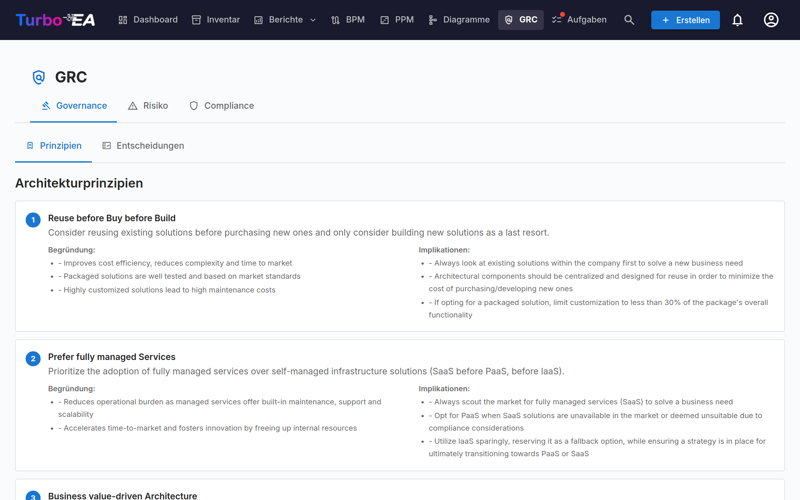
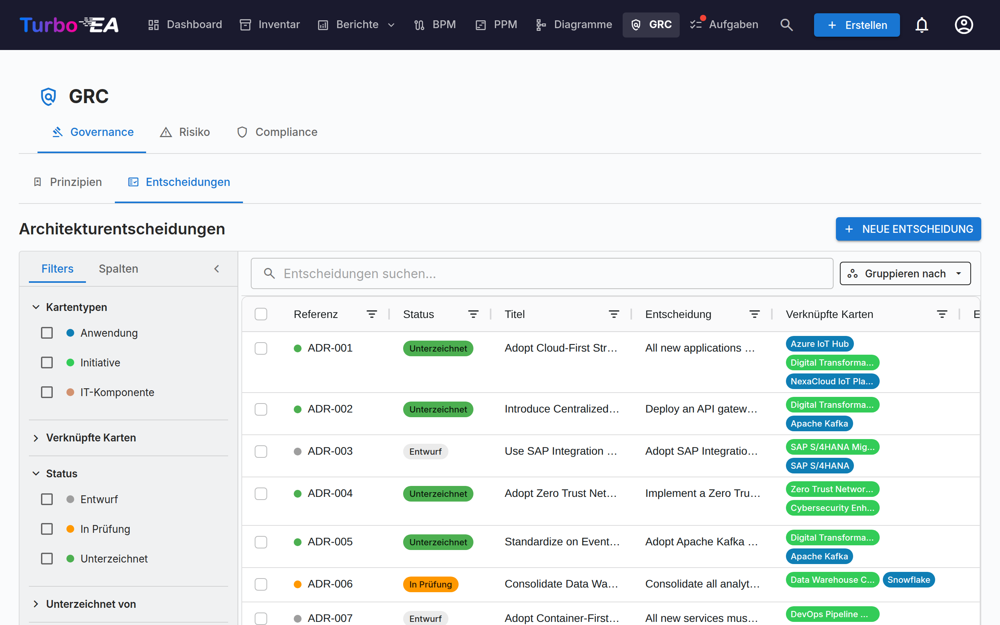
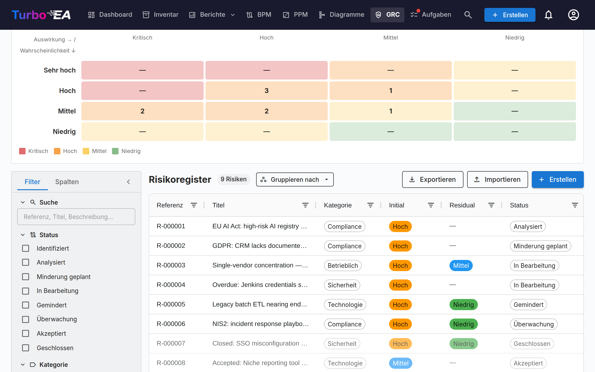
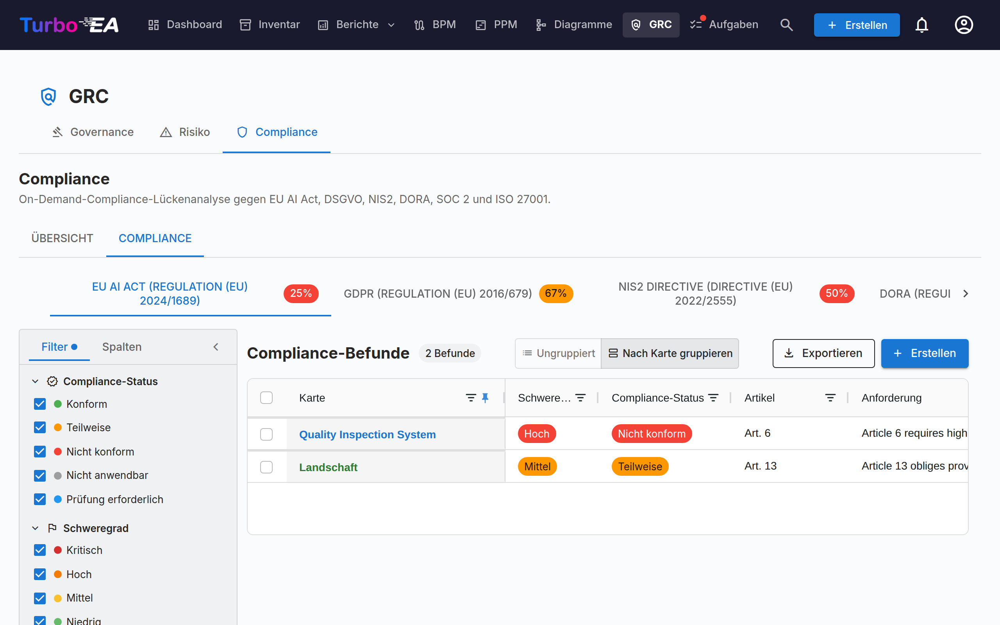

# GRC

Das **GRC**-Modul vereint Governance, Risk und Compliance in einem gemeinsamen Arbeitsbereich unter `/grc`. Es bündelt Aufgaben, die zuvor zwischen EA-Bereitstellung und TurboLens verteilt waren, sodass Architektin, Risikoeigentümer und Compliance-Prüferin auf gemeinsamem Boden arbeiten.

!!! note
    Das GRC-Modul kann von einem Administrator in den [Einstellungen](../admin/settings.md) aktiviert oder deaktiviert werden. Wenn deaktiviert, sind GRC-Navigation und -Funktionen ausgeblendet.

GRC hat drei Reiter:

Du kannst jeden Reiter direkt verlinken: `/grc?tab=governance`, `/grc?tab=risk` oder `/grc?tab=compliance`.

## Governance

Der Governance-Reiter teilt sich in zwei **Unter-Reiter** auf, deep-linkbar über `/grc?tab=governance&sub=principles` (Standard) und `/grc?tab=governance&sub=decisions`:

### Prinzipien

Schreibgeschützter Browser für die im Metamodell veröffentlichten EA-Prinzipien (Aussage, Begründung, Auswirkungen). Den Katalog bearbeitest du unter **Administration → Metamodell → Prinzipien**.

### Entscheidungen

Der Entscheidungen-Unter-Reiter ist das **zentrale Register der Architecture Decision Records (ADRs)** — jedes ADR im gesamten Landscape, unabhängig davon, mit welcher Initiative es verknüpft ist. Er löst den alten EA-Delivery-Reiter «Entscheidungen» ab, der mit dem GRC-Modul abgeschafft wurde.

ADRs dokumentieren wichtige Architekturentscheidungen samt Kontext, Konsequenzen und erwogenen Alternativen. Vom TurboLens-Architect-Wizard erzeugte Entscheidungen landen hier als Entwürfe für Reviewer.

Das Register beantwortet zuerst eine Frage: **Welche Entscheidungen sind heute in Kraft?** Jede unterzeichnete Entscheidung hat eine [Geltung](#standing), die Turbo EA aus ihren Daten, ihren Revisionen und den anderen Entscheidungen ableitet, die auf sie einwirken, und das Raster listet nur die aktuelle Revision jeder Entscheidung auf, es sei denn, Sie fordern die früheren an.

Das Raster lässt sich über die Schaltfläche *Gruppieren nach* neben dem Suchfeld auch **nach Status** oder **nach Geltung gruppieren**: Jeder Status bzw. jede Geltung klappt unter einer eigenen Überschrift zusammen, und das Kontrollkästchen in der Überschrift wählt die ganze Gruppe für einen Sammelexport aus.

#### Status und Geltung {: #standing }

Eine Entscheidung hat zwei getrennte Zustände:

- **Status** ist der Abzeichnungsworkflow, und auf ihn reagieren Sie: **Entwurf** → **In Überprüfung** (Unterschriften angefordert) → **Unterschrieben**. Eine außerhalb von Turbo EA getroffene und [als entschieden erfasste](#recording-a-past-decision) Entscheidung zeigt statt Unterschrieben **Erfasst** an.
- **Geltung** gibt an, wo eine unterzeichnete oder erfasste Entscheidung heute steht. Sie wird abgeleitet — nie von Hand gesetzt —, und ein Entwurf oder eine Entscheidung in Überprüfung hat keine (*Noch nicht unterzeichnet*).

| Geltung | Bedeutung |
|---------|-----------|
| **Geplant** | Unterzeichnet, aber das Datum *Wirksam ab* ist noch nicht erreicht |
| **In Kraft** | Unterzeichnet und wirksam |
| **In Kraft (geändert)** | In Kraft, und eine andere unterzeichnete Entscheidung ändert sie; die Änderung ist noch nicht in eine [konsolidierte Revision](#amendments-and-consolidated-revisions) eingearbeitet |
| **Ersetzt** | Eine spätere Revision derselben Entscheidung oder eine Entscheidung, die sie ersetzt, ist wirksam geworden |
| **Widerrufen** | Eine unterzeichnete Entscheidung, die sie widerruft, ist wirksam geworden |
| **Abgelaufen** | Ihr Datum *Gültig bis* ist überschritten (sie gilt bis einschließlich dieses Tages) |

Die Seite der Entscheidung nennt den Grund in einem Banner — *Diese Entscheidung wurde durch … ersetzt.*, *Diese Entscheidung tritt am … in Kraft.*, *Revision 3 tritt am … in Kraft.* — mit einem Link zur betreffenden Entscheidung.

#### Tabellenspalten

Das ADR-Grid orientiert sich am Layout des Inventar-Grids:

| Spalte | Beschreibung |
|--------|-------------|
| **Referenznr.** | Automatisch generierte Referenznummer (ADR-001, ADR-002, …) mit Statuspunkt; eine Revision nach der ersten fügt ihre Nummer hinzu (ADR-012 · Rev. 2) |
| **Status** | Farbiger Chip — Entwurf, In Überprüfung, Unterschrieben oder Erfasst |
| **Geltung** | Wo eine unterzeichnete Entscheidung heute steht — siehe [Status und Geltung](#standing); leer, bis sie unterzeichnet ist |
| **Titel** | ADR-Titel |
| **Entscheidung** | Klartext-Auszug der Entscheidung |
| **Verknüpfte Karten** | Farbige Pillen passend zur Farbe des jeweiligen Kartentyps |
| **Erstellt von** | Autor des ADR |
| **Erstellt** | Erstellungsdatum |
| **Geändert** | Datum der letzten Änderung |
| **Unterschrieben** | Datum der Unterschrift |
| **Unterschrieben von** | Eine Pille je Unterzeichner, der unterschrieben hat |
| **Entschieden am** / **Wirksam ab** / **Gültig bis** | Die [Daten](#decision-dates) der Entscheidung |
| **Entscheidungsträger** | Die Personen, die die Entscheidung getroffen haben |

Jede Spalte besitzt einen **Spaltenfilter** — Textfilter auf Textspalten, Datumsfilter auf den Datumsspalten — jeweils mit eigener **Zurücksetzen**-Schaltfläche. Sobald ein Spaltenfilter aktiv ist, erscheint in der Werkzeugleiste des Grids die Schaltfläche **Spaltenfilter löschen**, die alle auf einmal entfernt. Spaltenbreiten, Reihenfolge, Sortierung und aktive Filter werden pro Browser gespeichert.

#### Filterseitenleiste

Die dauerhafte Seitenleiste links hat zwei Registerkarten:

- **Filter** — Facettenfilter über die ADR-Liste:
    - **In Kraft** — ein Klick zeigt nur die heute geltenden Entscheidungen (In Kraft und In Kraft (geändert)); ein erneuter Klick hebt den Filter auf
    - **Frühere Revisionen anzeigen** — standardmäßig aus, sodass jede Entscheidung einmal erscheint, als ihre aktuelle Revision (zuzüglich einer Revision, die gerade entworfen wird). Schalten Sie es ein, um auch die früheren Revisionen aufzulisten; die Schaltfläche **Exportieren** folgt demselben Schalter
    - **Kartentypen** — Kontrollkästchen mit farbigen Punkten zum Filtern nach verknüpften Kartentypen
    - **Verknüpfte Karten** — nach bestimmten verknüpften Karten filtern
    - **Status** — Entwurf / In Überprüfung / Unterschrieben (eine erfasste Entscheidung zählt als unterschrieben)
    - **Geltung** — Geplant / In Kraft / In Kraft (geändert) / Ersetzt / Widerrufen / Abgelaufen / Noch nicht unterzeichnet
    - **Unterschrieben von** — nach Unterzeichner filtern
    - **Erstellungs-/Änderungs-/Unterschriftsdatum** / **Entscheidungsdatum** — Von/Bis-Datumsbereiche (**Entscheidungsdatum** bezieht sich auf das Datum *Entschieden am* einer unterzeichneten oder erfassten Entscheidung)
- **Spalten** — auswählen, welche Spalten des Grids sichtbar sind. **Referenznr.** und **Titel** werden immer angezeigt; **Zurücksetzen** stellt die Standardauswahl wieder her. Die Auswahl wird pro Browser gespeichert.

Verwende die **Schnellfilter**-Suchleiste für die Volltextsuche über alle ADRs. Rechtsklick auf eine Zeile öffnet ein Kontextmenü (**Bearbeiten**, **Vorschau**, **Duplizieren**, **Löschen**).

#### Entscheidungen exportieren und importieren {: #decisions-import }

**Exportieren** (neben **+ Neue Entscheidung**) lädt die Entscheidungen, die die Filterseitenleiste gerade anzeigt, als `.xlsx`-Datei herunter, eine Zeile pro Revision einer Entscheidung. Die Spalten in dieser Reihenfolge: `reference_number`, `title`, `status`, `revision_number`, die vier Abschnitte (`context`, `decision`, `consequences`, `alternatives_considered`) als reiner Text, `cards` und `related_decisions` (durch Semikolon getrennt), `author`, `signatories`, `signed_at`, `created_at`, `updated_at`, dann die eigenen Angaben des Registers — `standing` (als Schlüssel wie `in_force`), `decided_on`, `effective_from`, `valid_until`, `decision_makers`, `participants` sowie die typisierten Verknüpfungen `replaces`, `amends`, `revokes` und `consolidates` als Referenzen. Formatierungen wie Fettdruck oder Links werden nicht in die Tabelle übernommen. Um voll formatierte Entscheidungen weiterzugeben, wählen Sie Zeilen im Raster aus und verwenden Sie die **Export**-Schaltfläche des Rasters, die ein Word-Dokument schreibt.

**Importieren** legt Entscheidungen gesammelt aus einer `.xlsx`-Datei an. Klicken Sie auf **Vorlage herunterladen**, um eine Beispielarbeitsmappe zu erhalten, füllen Sie pro Zeile eine Entscheidung aus und laden Sie die Datei hoch:

- Jede Zeile wird zu einer neuen Entscheidung im **Entwurf** mit der nächsten `ADR-NNN`-Referenz. Status und Unterschriften werden nie importiert — eine Entscheidung wird über den **Abzeichnungsworkflow** unterschrieben — und die Vorschau warnt vor einer Zeile, deren `status` nicht „draft“ ist.
- Eine Zeile, deren `reference_number` bereits zu einer Entscheidung gehört, wird **übersprungen**: Der Import ändert nie eine vorhandene Entscheidung, sodass ein erneuter Import eines Exports nichts ändert.
- `title` ist erforderlich. In den vier Abschnittsspalten beginnt eine Leerzeile einen neuen Absatz, Zeilen mit `- ` am Anfang werden zu einer Aufzählung und Zeilen mit `1. ` zu einer nummerierten Liste.
- `cards` verknüpft Karten über den exakten Namen unter den Karten, die Sie sehen können; eine Karte, die nicht gefunden wird oder deren Name von mehreren Karten geteilt wird, wird mit einer Warnung übersprungen, und die Entscheidung wird trotzdem importiert.
- `related_decisions` listet Referenzen auf, entweder vorhandener Entscheidungen oder anderer Zeilen derselben Datei (auch späterer Zeilen); jede wird zu einer Verknüpfung **Bezieht sich auf**. Eine Referenz mit mehreren Revisionen verweist auf ihre aktuelle Revision.
- Alle anderen Spalten — einschließlich Geltung, Daten, Personen und typisierter Verknüpfungen — werden ignoriert: Ein Import legt Entwürfe an, nie unterzeichnete oder erfasste Entscheidungen.
- Ein Export enthält eine Zeile pro Revision, sodass eine Datei mehrere Zeilen für eine Referenz enthalten kann (eine offene Revision oder frühere Revisionen, wenn **Frühere Revisionen anzeigen** eingeschaltet ist). Auf der Instanz, aus der sie stammt, werden alle übersprungen; anderswo wird nur die Zeile mit der höchsten `revision_number` importiert (die letzte Zeile, wenn die Nummern gleich sind oder fehlen), und jede andere Zeile wird mit der Warnung *Frühere Revision von ADR-012 übersprungen* übersprungen. Ein Eintrag in `related_decisions`, der diese Referenz nennt, verweist auf die importierte Zeile.

Die Vorschau zeigt, wie viele Zeilen erstellt, übersprungen werden und fehlschlagen, mit jedem Fehler und jeder Warnung pro Zeile; nichts wird geschrieben, bis Sie bestätigen. Der Import erfordert die Berechtigung `adr.manage`.

#### Ein ADR erstellen

ADRs lassen sich von drei Stellen aus erstellen — alle öffnen denselben Editor und speisen dasselbe Register:

1. **GRC → Governance → Entscheidungen**: Klick auf **+ Neues ADR**, Titel ausfüllen und optional Karten (inkl. Initiativen) verknüpfen.
2. **EA-Delivery-Arbeitsbereich**: Initiative auswählen, dann **+ Neues Artefakt ▾** im Seitenkopf (oder **+ Hinzufügen** im Abschnitt *Architekturentscheidungen*) klicken und **Neue Architekturentscheidung** wählen — die Initiative wird vorab verknüpft.
3. **Karte → Reiter «Ressourcen»**: Klick auf **ADR erstellen** — die aktuelle Karte ist vorab verknüpft.

In allen Fällen können während der Erstellung weitere Karten gesucht und verknüpft werden. Initiativen werden über denselben Kartenverknüpfungsmechanismus wie jede andere Karte angebunden, sodass ein ADR mehrere Initiativen referenzieren kann. Der Editor öffnet sich mit Abschnitten für **Kontext**, **Entscheidung**, **Konsequenzen** und **Erwogene Alternativen**.

#### Der ADR-Editor

Der Editor bietet:

- Rich-Text-Bearbeitung für jeden Abschnitt (Kontext, Entscheidung, Konsequenzen, Erwogene Alternativen)
- Kartenverknüpfung — verbinde das ADR mit relevanten Karten (Anwendungen, IT-Komponenten, Initiativen, …). Initiativen werden über die Standard-Kartenverknüpfung verknüpft, nicht über ein eigenes Feld, sodass ein ADR mehrere Initiativen referenzieren kann
- **Daten** — *Entschieden am*, *Wirksam ab* und optional *Gültig bis* (siehe [Daten](#decision-dates))
- **Personen** — die *Entscheidungsträger* und *Beteiligten* (siehe [Personen](#decision-people))
- **Diese Entscheidung…** — typisierte Verknüpfungen zu anderen Entscheidungen (siehe [Verknüpfungen zwischen Entscheidungen](#decision-links))
- **Änderungszusammenfassung** — nur bei einer Revision: was sich in dieser Revision geändert hat und warum
- **Dateien** — an die Entscheidung angehängte Dokumente (siehe [Dateien](#decision-files))

#### Daten {: #decision-dates }

- **Entschieden am** — der Tag, an dem die Entscheidung getroffen wurde. Er darf nicht in der Zukunft liegen.
- **Wirksam ab** — der Tag, an dem sie wirksam wird. Bis dahin ist eine unterzeichnete Entscheidung **Geplant**.
- **Gültig bis** — optional, für eine befristete Entscheidung wie eine Ausnahmegenehmigung. Am Tag danach ist die Entscheidung **Abgelaufen**. Das Datum darf nicht vor *Wirksam ab* liegen und nicht bereits verstrichen sein, wenn die Entscheidung zur Prüfung gesendet wird.

Bleiben *Entschieden am* und *Wirksam ab* leer, übernehmen sie das Datum der letzten Unterschrift. Die Verlängerung einer abgelaufenen Entscheidung ist eine neue Revision oder eine neue Entscheidung, die wie jede andere unterzeichnet wird.

#### Personen {: #decision-people }

**Entscheidungsträger** sind die Personen, die die Entscheidung getroffen haben; **Beteiligte** sind die Personen, die daran mitgewirkt haben. Wählen Sie einen Turbo EA-Benutzer, oder geben Sie für jemanden ohne Konto einen Namen ein und drücken Sie Enter. Beide werden getrennt von den **Unterzeichnern** erfasst, die den Eintrag in Turbo EA genehmigen. Wenn Sie Unterschriften anfordern, fügt **Entscheidungsträger hinzufügen** im Dialog mit einem Klick jeden Entscheidungsträger, der Turbo EA-Benutzer ist, zu den Unterzeichnern hinzu.

#### Verknüpfungen zwischen Entscheidungen {: #decision-links }

Der Abschnitt **Diese Entscheidung…** einer Entscheidung verknüpft sie mit anderen. Wählen Sie die Art der Verknüpfung und die Entscheidung, und fügen Sie für einen Teilfall optional eine Anmerkung hinzu — zum Beispiel *nur Abschnitt 3*:

| Verknüpfung | Auf der anderen Entscheidung angezeigt als | Wirkung, sobald diese Entscheidung unterzeichnet und wirksam ist |
|-------------|--------------------------------------------|------------------------------------------------------------------|
| **Ersetzt** | Ersetzt durch | Die andere Entscheidung erhält die Geltung **Ersetzt** |
| **Ändert** | Geändert durch | Die andere Entscheidung erhält die Geltung **In Kraft (geändert)** |
| **Widerruft** | Widerrufen durch | Die andere Entscheidung erhält die Geltung **Widerrufen** |
| **Bezieht sich auf** | Verwandt mit | Keine — ein Querverweis |

Verknüpfungen werden auf beiden Entscheidungen angezeigt und verweisen auf die aktuelle Revision der Entscheidung. Sie wirken auf die gesamte Entscheidung, alle ihre Revisionen eingeschlossen, und erst, wenn die Entscheidung, die sie trägt, unterzeichnet und wirksam ist: Ein Entwurf, der eine andere widerruft, ändert nichts, bis er unterzeichnet ist, und einer mit einem späteren *Wirksam ab* wirkt an diesem Datum (die andere Entscheidung meldet *Diese Entscheidung wird am … durch … widerrufen.*). Eine Entscheidung kann nicht mit einer ihrer eigenen Revisionen verknüpft werden, und jede Entscheidung, mit der sie verknüpft ist, muss unterzeichnet sein, bevor sie zur Prüfung gesendet oder erfasst wird.

#### Eine Entscheidung widerrufen oder ersetzen {: #revoking-or-replacing-a-decision }

Eine unterzeichnete Entscheidung wird nie von Hand außer Kraft gesetzt: Sie wird durch eine andere unterzeichnete Entscheidung widerrufen oder ersetzt, sodass das Register festhält, wer sie wann getroffen hat. Öffnen Sie die unterzeichnete Entscheidung und verwenden Sie das Menü **Überarbeiten**:

- **Diese Entscheidung überarbeiten** — eine neue Revision derselben Entscheidung unter derselben Referenz (siehe [Revisionen](#revisionen)).
- **Durch eine neue Entscheidung ersetzen** — ein neuer Entwurf mit dem Titel *Ersetzt: …*, der bereits eine Verknüpfung **Ersetzt** und dieselben verknüpften Karten trägt.
- **Widerrufen** — ein neuer Entwurf mit dem Titel *Widerruf von ADR-012 — …*, der bereits eine Verknüpfung **Widerruft** und dieselben verknüpften Karten trägt.

Vervollständigen Sie den neuen Entwurf und durchlaufen Sie wie bei jeder anderen Entscheidung die Abzeichnung. Das Menü wird nicht auf einer früheren Revision angeboten (öffnen Sie die aktuelle) und auch nicht auf einer Entscheidung, die bereits widerrufen oder ersetzt wurde. Wenn eine unterzeichnete Entscheidung eine andere ersetzt, ändert oder widerruft, erhält der Autor dieser Entscheidung eine Benachrichtigung **ADR-Geltung geändert**.

#### Änderungen und konsolidierte Revisionen {: #amendments-and-consolidated-revisions }

Eine Entscheidung, die durch eine andere geändert wird, bleibt in Kraft, und ihre Seite listet die ändernden Entscheidungen auf. Um den Lesern einen einzigen aktuellen Text zu geben, klicken Sie in diesem Banner auf **Konsolidierte Revision erstellen**: Damit beginnt eine Revision der geänderten Entscheidung, die die ändernde Entscheidung nennt (*Konsolidiert die Änderung durch …*). Arbeiten Sie die Änderung in den Text ein, beschreiben Sie sie in der **Änderungszusammenfassung** und senden Sie die Revision zur Abzeichnung. Sobald sie unterzeichnet und wirksam ist, ist die Entscheidung wieder **In Kraft**, und die ändernde Entscheidung zeigt *Die durch diese Entscheidung vorgenommene Änderung ist in … konsolidiert.* an. Eine Änderung zählt auch nicht mehr, sobald die ändernde Entscheidung widerrufen, ersetzt wird oder abläuft — aber nicht, wenn sie lediglich überarbeitet wird: Ihre Revision behält die Änderung bei, und das Banner nennt die aktuelle Revision der ändernden Entscheidung.

#### Dateien {: #decision-files }

Der Abschnitt **Dateien** hängt Dokumente an eine Entscheidung an — ein unterzeichnetes Protokoll, eine unterstützende Analyse. Dateien akzeptieren dieselben Formate wie [Kartenanhänge](card-details.md#registerkarte-ressourcen), bis zu 20 MB pro Datei, und können nur hochgeladen werden, solange Datei-Uploads aktiviert sind (Löschen ist immer möglich). Sie können nur in einem gespeicherten Entwurf hinzugefügt und gelöscht werden: Sobald die Entscheidung zur Prüfung gesendet wird, sind sie mit ihr gesperrt. Eine Revision übernimmt die Dateien ihrer Entscheidung.

#### Abzeichnungsworkflow

ADRs unterstützen einen formalen Abzeichnungsprozess:

1. ADR im Status **Entwurf** erstellen.
2. **Unterschriften anfordern** klicken und Unterzeichner nach Name oder E-Mail suchen (oder **Entscheidungsträger hinzufügen** klicken). Unterschriften können nur für einen Entwurf angefordert werden.
3. Das ADR wechselt zu **In Überprüfung** — jeder Unterzeichner erhält eine Benachrichtigung und ein Todo.
4. Unterzeichner prüfen und klicken auf **Unterschreiben**.
5. Sobald alle unterschrieben haben, wechselt das ADR automatisch auf **Unterschrieben**.

**Eine Entscheidung in Überprüfung ist gesperrt**, sodass die Unterzeichner genau das unterschreiben, was ihnen gesendet wurde: Text, Daten, Personen, Verknüpfungen, Dateien und Erweiterungsbereiche sind schreibgeschützt, und nur die verknüpften Karten lassen sich noch ändern. Um sie zu bearbeiten, klicken Sie auf **Unterschriften zurückrufen**; sie kehrt dann in den Entwurf zurück. Ein Unterzeichner, der auf **Ablehnen** klickt, setzt sie ebenfalls auf Entwurf zurück, unter derselben Revisionsnummer.

Unterschriebene ADRs sind gesperrt und können nicht bearbeitet werden — für Änderungen wird eine neue Revision angelegt.

#### Eine vergangene Entscheidung erfassen {: #recording-a-past-decision }

Eine außerhalb von Turbo EA getroffene Entscheidung — etwa in einer Vorstandssitzung, bevor es das Register gab — kann ohne Einholen von Unterschriften als entschieden erfasst werden. Legen Sie sie als Entwurf an, nennen Sie mindestens einen Entscheidungsträger, klicken Sie dann auf **Als entschieden erfassen** und geben Sie das Datum **Entschieden am** (nicht in der Zukunft) sowie, falls abweichend, das Datum **Wirksam ab** an (standardmäßig das Entscheidungsdatum).

Die Entscheidung wird dann wie eine unterzeichnete gesperrt und erhält ihre Geltung, aber ihr Status lautet **Erfasst**, und ihre Seite zeigt *Erfasst von … am …, nicht in Turbo EA unterzeichnet.* an. Das Erfassen erfordert die Berechtigung `adr.record`, die standardmäßig nur die Admin-Rolle besitzt, und jede Erfassung erscheint im [Sicherheits- und Administrationsprotokoll](../admin/audit-log.md) als `admin.adr.recorded`. Auch ein Revisionsentwurf kann erfasst werden, sofern sein Entscheidungsdatum nicht vor dem seiner vorherigen Revision liegt.

#### Revisionen

Ein unterschriebenes ADR öffnen und **Überarbeiten → Diese Entscheidung überarbeiten** wählen, um einen neuen Entwurf auf Basis der unterschriebenen Version zu erstellen. Die Revision behält die Referenz der Entscheidung und erhält die nächste Revisionsnummer — **ADR-012 · Rev. 2** — und erbt Inhalt, verknüpfte Karten, Verknüpfungen **Bezieht sich auf**, Personen, Dateien und das Datum *Gültig bis*. Nicht übernommen werden Entscheidungs- und Wirksamkeitsdatum, Unterzeichner, Änderungszusammenfassung sowie die Verknüpfungen Ersetzt / Ändert / Widerruft, die auf der Revision bleiben, die sie angelegt hat. Jede Revision behält ihren eigenen Abzeichnungs-Pfad.

- **Jeweils nur eine offene Revision.** Solange eine Revision entworfen wird, weist die aktuelle Revision darauf hin, und das Menü **Überarbeiten** öffnet diesen Entwurf, statt einen weiteren zu beginnen.
- **Die aktuelle Revision ist die geltende.** Sobald eine Revision unterzeichnet und wirksam ist, sind die früheren **Ersetzt** und zeigen ein Banner mit einem Link zur aktuellen. Die Leiste **Revisionen** auf jeder Revision listet die gesamte Kette auf und markiert die aktuelle.
- **Nur die aktuelle Revision kann überarbeitet werden**, und nicht mehr, sobald die Entscheidung widerrufen oder ersetzt wurde. Eine abgelaufene oder geänderte Entscheidung kann weiterhin überarbeitet werden.
- **Eine Ablehnung zählt nicht als Revision**: Die Revisionsnummer ändert sich nur, wenn eine neue Revision erstellt wird.
- Vor Version 2.199.0 überarbeitete Entscheidungen behalten die Referenznummern, unter denen sie ausgegeben wurden, und erscheinen weiterhin als eine Entscheidung mit einer Revisionsleiste.

#### Vorschau

Klick auf das Vorschau-Symbol für eine schreibgeschützte, formatierte Ansicht des ADR — nützlich vor der Unterschrift.

Klicken Sie in der Vorschau auf **PDF**, um eine druckfertige Kopie in einem neuen Tab zu öffnen — Metadaten und Daten, die vier Abschnitte, Personen, verknüpfte Karten, Verknüpfungen zu anderen Entscheidungen, Dateinamen, Erweiterungsabschnitte und der Unterschriftenblock (oder die Erfassungszeile), mit Genehmiger und Druckdatum in der Fußzeile. Der Editor hat dieselbe **PDF**-Schaltfläche sowie **Word**, das die Entscheidung bis zu ihrer Unterschrift als `.docx` herunterlädt; beide exportieren den aktuellen Stand des Editors, ungespeicherte Änderungen eingeschlossen.

## Risk

Bindet das **Risikoregister** gemäß TOGAF Phase G ein. Lebenszyklus, Statusworkflow, Matrix-Umschalter und Eigentümer-Verhalten sind im [Risikoregister-Leitfaden](risks.md) dokumentiert. Die wichtigsten Punkte:

## Compliance

Der Compliance-Reiter ist ein Register mit zwei Quellen — Befunde können **manuell** von einer Reviewerin erfasst **oder** von einem On-Demand-**KI-Scan** gegen die aktivierten Regulierungen erzeugt werden (EU AI Act, GDPR, NIS2, DORA, SOC 2, ISO 27001 sind standardmäßig aktiviert). Beide Arten von Befunden teilen denselben Lebenszyklus, können zu einem Risiko überführt werden und sind aus der Tabelle heraus bulk-aktionierbar. Im [Compliance-Leitfaden](compliance.md) findest du den vollständigen Lebenszyklus, den manuellen Erstellungs-Dialog, den Scan-Workflow, den semantischen Detektor für den EU AI Act und die Überführungs-Schleife in ein Risiko.

Derselbe Compliance-Reiter erscheint auch auf den Kartendetails (automatisch ausgeblendet, wenn die Karte keine verknüpften Befunde hat), sodass ein Application Owner seine Befunde triagieren kann, ohne die Karte zu verlassen.

## Berechtigungen

| Berechtigung | Standardrollen |
|--------------|----------------|
| `grc.view` | admin, bpm_admin, member, viewer |
| `grc.manage` | admin, bpm_admin, member |
| `adr.view` / `adr.manage` / `adr.sign` | `adr.view`: admin, bpm_admin, member, viewer; `adr.manage` und `adr.sign`: admin, bpm_admin, member |
| `adr.record` | admin — [eine vergangene Entscheidung als entschieden erfassen](#recording-a-past-decision) |
| `risks.view` / `risks.manage` | siehe [Risikoregister § Berechtigungen](risks.md) |
| `compliance.view` / `compliance.manage` | siehe [TurboLens § Security & Compliance](turbolens.md) |

`grc.view` steuert die Sichtbarkeit der GRC-Route selbst — ohne diese Berechtigung wird der Eintrag im Top-Menü ausgeblendet. Jeder Reiter erzwingt zusätzlich seine domänenspezifische Berechtigung, sodass etwa eine Viewerin das Register lesen kann, ohne einen LLM-Scan auslösen zu dürfen.
