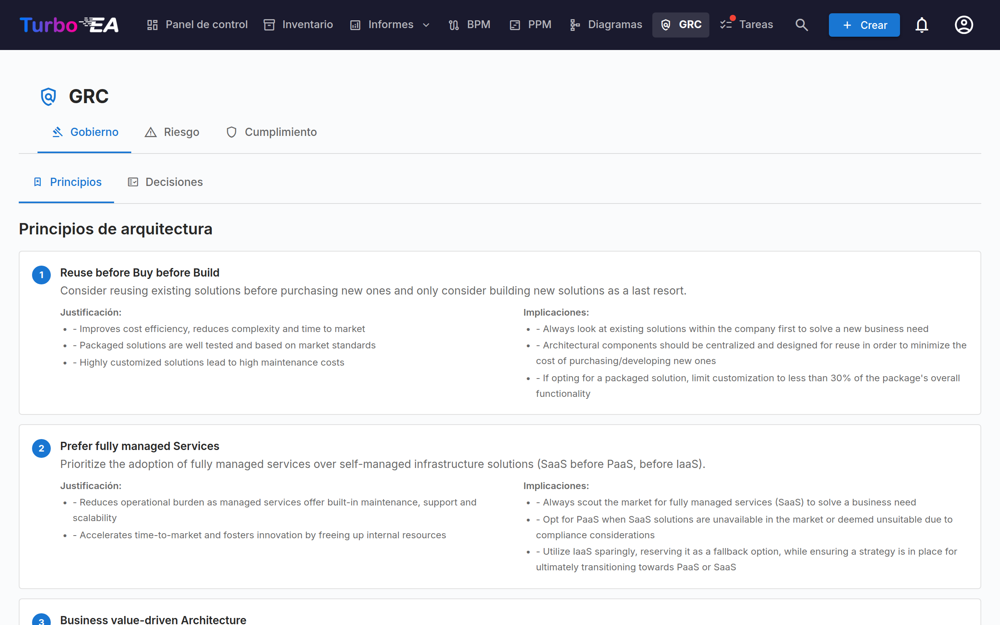
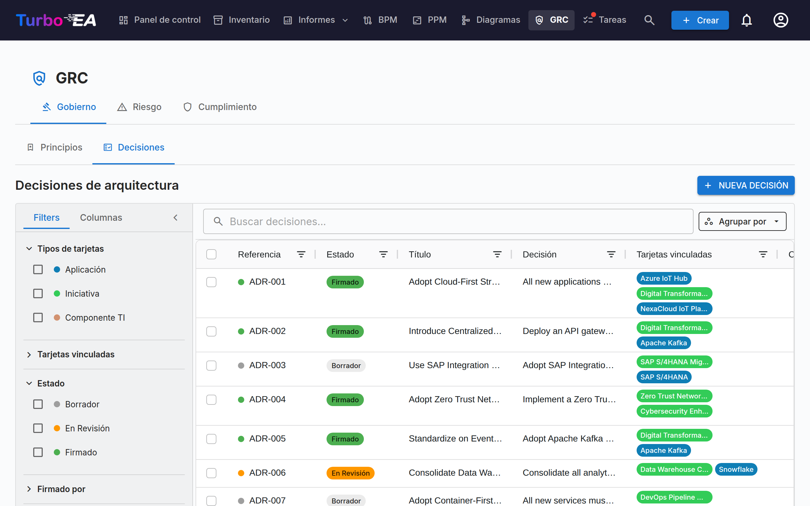
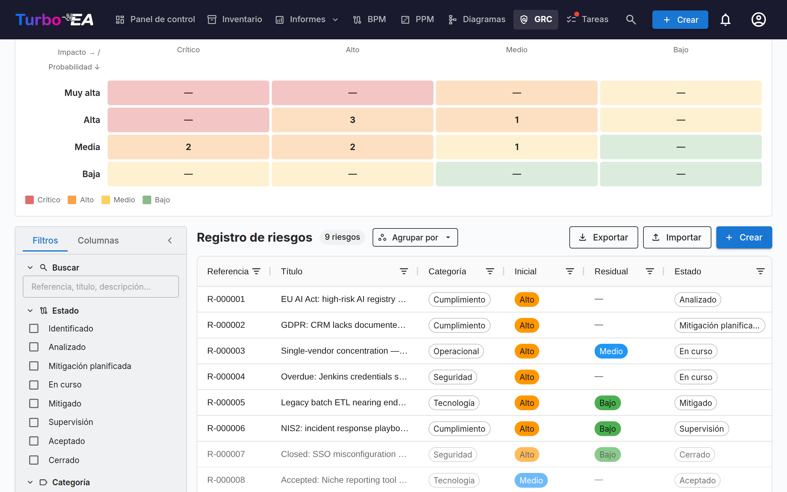
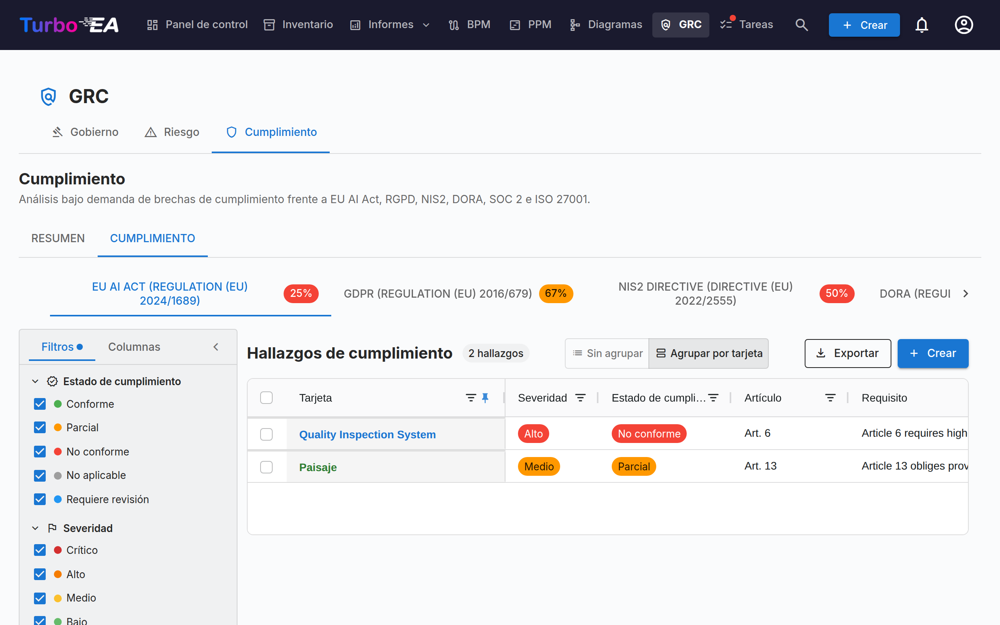

# GRC

El módulo **GRC** reúne Gobernanza, Riesgo y Cumplimiento en un único espacio de trabajo en `/grc`. Consolida tareas que antes vivían entre Entrega EA y TurboLens, de modo que arquitectas, propietarios de riesgo y revisores de cumplimiento operen sobre una base común.

!!! note
    El módulo GRC puede ser habilitado o deshabilitado por un administrador en [Configuración](../admin/settings.es.md). Cuando está deshabilitado, la navegación y las funcionalidades de GRC se ocultan.

GRC tiene tres pestañas:

Puedes apuntar directamente a cualquier pestaña con `/grc?tab=governance`, `/grc?tab=risk` o `/grc?tab=compliance`.

## Gobernanza

La pestaña Gobernanza se divide en dos **sub-pestañas**, con enlace profundo vía `/grc?tab=governance&sub=principles` (por defecto) y `/grc?tab=governance&sub=decisions`:

### Principios

Visor de solo lectura de los Principios EA publicados en el metamodelo (declaración, justificación, implicaciones). El catálogo se edita desde **Administración → Metamodelo → Principios**.

### Decisiones

La sub-pestaña Decisiones es el **registro maestro de los Architecture Decision Records (ADR)** — cada ADR del paisaje, independientemente de la iniciativa a la que esté vinculado. Reemplaza la antigua pestaña Decisiones de Entrega EA, que se disolvió al aterrizar GRC.

Los ADR documentan decisiones de arquitectura importantes junto con su contexto, consecuencias y alternativas consideradas. Las decisiones emitidas por el asistente TurboLens Architect aterrizan aquí como borradores para revisión.

El registro responde primero a una pregunta: **¿qué decisiones están vigentes hoy?** Cada decisión firmada tiene una [vigencia](#standing) que Turbo EA deduce de sus fechas, sus revisiones y las demás decisiones que actúan sobre ella, y la cuadrícula solo lista la revisión actual de cada decisión, a menos que pida las anteriores.

La cuadrícula también puede **agruparse por estado** o **por vigencia** mediante el botón *Agrupar por* junto al cuadro de búsqueda: cada estado o vigencia se pliega bajo su propia cabecera, y la casilla de la cabecera selecciona todo el grupo para una exportación masiva.

#### Estado y vigencia {: #standing }

Una decisión tiene dos estados distintos:

- El **estado** es el flujo de firma, y es sobre lo que usted actúa: **Borrador** → **En Revisión** (firmas solicitadas) → **Firmado**. Una decisión tomada fuera de Turbo EA y [registrada como decidida](#recording-a-past-decision) muestra **Registrado** en lugar de Firmado.
- La **vigencia** indica en qué situación se encuentra hoy una decisión firmada o registrada. Se deduce — nunca se fija a mano — y un borrador o una decisión en revisión no tiene ninguna (*Aún no firmada*).

| Vigencia | Significado |
|----------|-------------|
| **Programada** | Firmada, pero aún no ha llegado su fecha *Vigente desde* |
| **Vigente** | Firmada y en vigor |
| **Vigente (modificada)** | Vigente, y otra decisión firmada la modifica; la modificación aún no se ha incorporado a una [revisión consolidada](#amendments-and-consolidated-revisions) |
| **Sustituida** | Ha entrado en vigor una revisión posterior de la misma decisión, o una decisión que la sustituye |
| **Revocada** | Ha entrado en vigor una decisión firmada que la revoca |
| **Caducada** | Ha pasado su fecha *Válida hasta* (está vigente hasta ese día inclusive) |

La página de la decisión indica el motivo con un banner — *Esta decisión ha sido sustituida por …*, *Esta decisión entra en vigor el …*, *La revisión 3 entra en vigor el …* — con un enlace a la decisión correspondiente.

#### Columnas de la tabla

La cuadrícula de ADR refleja el diseño de la cuadrícula de Inventario:

| Columna | Descripción |
|---------|-------------|
| **N.º de referencia** | Número de referencia generado automáticamente (ADR-001, ADR-002, …) con un punto de estado; una revisión posterior a la primera añade su número (ADR-012 · Rev 2) |
| **Estado** | Chip de color — Borrador, En Revisión, Firmado o Registrado |
| **Vigencia** | En qué situación está hoy una decisión firmada — consulte [Estado y vigencia](#standing); vacía hasta que se firma |
| **Título** | Título del ADR |
| **Decisión** | Extracto en texto plano de la decisión |
| **Tarjetas vinculadas** | Píldoras de color que coinciden con el color del tipo de cada tarjeta vinculada |
| **Creado por** | Autor del ADR |
| **Creado** | Fecha de creación |
| **Modificado** | Fecha de última modificación |
| **Firmado** | Fecha de firma |
| **Firmado por** | Una píldora por cada firmante que ha firmado |
| **Decidida el** / **Vigente desde** / **Válida hasta** | Las [fechas](#decision-dates) de la decisión |
| **Responsables de la decisión** | Las personas que tomaron la decisión |

Cada columna dispone de un **filtro de encabezado** — filtros de texto en las columnas de texto, filtros de fecha en las columnas de fecha — cada uno con su propio botón **Restablecer**. En cuanto algún filtro de columna está activo, aparece un botón **Borrar filtros de columna** en la barra de herramientas de la cuadrícula para borrarlos todos a la vez. El ancho, el orden y la ordenación de las columnas, así como los filtros activos, se recuerdan por navegador.

#### Barra lateral de filtros

La barra lateral persistente a la izquierda tiene dos pestañas:

- **Filtros** — filtros de facetas sobre la lista de ADR:
    - **Vigente** — un clic muestra solo las decisiones vigentes hoy (Vigente y Vigente (modificada)); haga clic de nuevo para quitarlo
    - **Mostrar revisiones anteriores** — desactivado por defecto, de modo que cada decisión aparece una vez, como su revisión actual (más una revisión en redacción). Actívelo para listar también las revisiones anteriores; el botón **Exportar** sigue el mismo ajuste
    - **Tipos de tarjeta** — casillas con puntos coloreados que filtran por tipos de tarjetas vinculadas
    - **Tarjetas vinculadas** — filtrar por tarjetas vinculadas específicas
    - **Estado** — Borrador / En Revisión / Firmado (una decisión registrada cuenta como firmada)
    - **Vigencia** — Programada / Vigente / Vigente (modificada) / Sustituida / Revocada / Caducada / Aún no firmada
    - **Firmado por** — filtrar por firmante
    - **Fecha de creación** / **modificación** / **firma** / **Fecha de decisión** — rangos de fechas desde/hasta (**Fecha de decisión** se aplica a la fecha *Decidida el* de una decisión firmada o registrada)
- **Columnas** — elegir qué columnas de la cuadrícula son visibles. **N.º de referencia** y **Título** se muestran siempre; **Restablecer** restaura la selección predeterminada. Su elección se recuerda por navegador.

Use la barra de **filtro rápido** para búsqueda de texto completo. Haga clic derecho en cualquier fila para un menú contextual (**Editar**, **Vista previa**, **Duplicar**, **Eliminar**).

#### Exportar e importar decisiones {: #decisions-import }

**Exportar** (junto a **+ Nueva decisión**) descarga las decisiones que muestra actualmente la barra lateral de filtros como un archivo `.xlsx`, una fila por revisión de decisión. Las columnas, en orden: `reference_number`, `title`, `status`, `revision_number`, las cuatro secciones (`context`, `decision`, `consequences`, `alternatives_considered`) como texto sin formato, `cards` y `related_decisions` (separadas por punto y coma), `author`, `signatories`, `signed_at`, `created_at`, `updated_at`, y después los datos propios del registro — `standing` (como clave, por ejemplo `in_force`), `decided_on`, `effective_from`, `valid_until`, `decision_makers`, `participants`, y los vínculos tipados `replaces`, `amends`, `revokes` y `consolidates` como referencias. El formato, como las negritas o los enlaces, no se traslada a la hoja de cálculo. Para compartir decisiones con todo su formato, seleccione filas en la cuadrícula y use el botón **Export** de la propia cuadrícula, que genera un documento de Word.

**Importar** crea decisiones de forma masiva desde un archivo `.xlsx`. Haga clic en **Descargar plantilla** para obtener un libro de partida, rellene una decisión por fila y súbalo:

- Cada fila se convierte en una nueva decisión en **borrador** con la siguiente referencia `ADR-NNN`. El estado y las firmas nunca se importan — una decisión se firma mediante el **flujo de firma** — y la vista previa advierte de una fila cuyo `status` no sea borrador (draft).
- Una fila cuya `reference_number` ya pertenece a una decisión se **omite**: la importación nunca modifica una decisión existente, por lo que reimportar una exportación no cambia nada.
- `title` es obligatorio. En las cuatro columnas de sección, una línea en blanco inicia un nuevo párrafo, las líneas que empiezan por `- ` se convierten en una lista con viñetas y las que empiezan por `1. ` en una lista numerada.
- `cards` vincula fichas por su nombre exacto, entre las fichas que usted puede ver; una ficha que no se encuentra, o cuyo nombre comparten varias fichas, se omite con una advertencia y la decisión se importa igualmente.
- `related_decisions` lista referencias, ya sea de decisiones existentes o de otras filas del mismo archivo (incluso filas posteriores); cada una se convierte en un vínculo **Se relaciona con**. Una referencia con varias revisiones se vincula a su revisión actual.
- Todas las demás columnas — incluidas la vigencia, las fechas, las personas y los vínculos tipados — se ignoran: una importación crea borradores, nunca decisiones firmadas o registradas.
- Una exportación contiene una fila por revisión, así que un archivo puede llevar varias filas para una misma referencia (una revisión abierta, o revisiones anteriores cuando **Mostrar revisiones anteriores** está activado). En la instancia de la que procede se omiten todas; en otras, solo se importa la fila con el `revision_number` más alto (la última fila cuando los números son iguales o faltan) y cada una de las demás filas se omite con la advertencia *Revisión anterior de ADR-012 omitida*. Una entrada de `related_decisions` que nombra esa referencia se vincula a la fila importada.

La vista previa muestra cuántas filas se crearán, omitirán y fallarán, con cada error y advertencia listados por fila; no se escribe nada hasta que confirme. La importación requiere el permiso `adr.manage`.

#### Crear un ADR

Los ADR se pueden crear desde tres lugares — todos abren el mismo editor y alimentan el mismo registro:

1. **GRC → Gobernanza → Decisiones**: haga clic en **+ Nuevo ADR**, complete el título y opcionalmente vincule tarjetas (incluidas iniciativas).
2. **Espacio de trabajo de Entrega EA**: seleccione una iniciativa, haga clic en **+ Nuevo artefacto ▾** en la cabecera (o **+ Añadir** en la sección *Decisiones de Arquitectura*) y elija **Nueva Decisión de Arquitectura** — la iniciativa queda pre-vinculada.
3. **Tarjeta → pestaña Recursos**: haga clic en **Crear ADR** — la tarjeta actual queda pre-vinculada.

En todos los casos puede buscar y vincular tarjetas adicionales durante la creación. Las iniciativas se vinculan mediante el mismo mecanismo de vinculación que cualquier otra tarjeta, por lo que un ADR puede referenciar múltiples iniciativas. El editor se abre con secciones para **Contexto**, **Decisión**, **Consecuencias** y **Alternativas Consideradas**.

#### El Editor de ADR

El editor proporciona:

- Edición de texto enriquecido para cada sección (Contexto, Decisión, Consecuencias, Alternativas Consideradas)
- Vinculación de tarjetas — conecte el ADR a tarjetas relevantes (aplicaciones, componentes TI, iniciativas, …). Las iniciativas se vinculan a través de la vinculación estándar de tarjetas, no por un campo dedicado, lo que permite que un ADR referencie múltiples iniciativas
- **Fechas** — *Decidida el*, *Vigente desde* y un *Válida hasta* opcional (consulte [Fechas](#decision-dates))
- **Personas** — los *Responsables de la decisión* y los *Participantes* (consulte [Personas](#decision-people))
- **Esta decisión…** — vínculos tipados con otras decisiones (consulte [Vínculos entre decisiones](#decision-links))
- **Resumen de cambios** — solo en una revisión: qué ha cambiado en esta revisión y por qué
- **Archivos** — documentos adjuntos a la decisión (consulte [Archivos](#decision-files))

#### Fechas {: #decision-dates }

- **Decidida el** — el día en que se tomó la decisión. No puede estar en el futuro.
- **Vigente desde** — el día en que entra en vigor. Hasta entonces, una decisión firmada está **Programada**.
- **Válida hasta** — opcional, para una decisión con plazo limitado, como una excepción. Al día siguiente, la decisión está **Caducada**. No puede ser anterior a *Vigente desde*, ni haber pasado ya cuando la decisión se envía a revisión.

Si se dejan vacías, *Decidida el* y *Vigente desde* toman la fecha de la última firma. La renovación de una decisión caducada es una nueva revisión o una nueva decisión, que se firma como cualquier otra.

#### Personas {: #decision-people }

Los **Responsables de la decisión** son las personas que la tomaron; los **Participantes** son las personas que tomaron parte en ella. Elija un usuario de Turbo EA, o escriba un nombre y pulse Intro para alguien sin cuenta. Ambos se registran por separado de los **firmantes**, que aprueban el registro en Turbo EA. Al solicitar firmas, **Añadir responsables de la decisión** en el diálogo añade a los firmantes, con un clic, a cada responsable de la decisión que sea usuario de Turbo EA.

#### Vínculos entre decisiones {: #decision-links }

La sección **Esta decisión…** de una decisión la vincula con otras. Elija el tipo de vínculo y la decisión, y añada opcionalmente una nota para un caso parcial — por ejemplo *solo la sección 3*:

| Vínculo | Se muestra en la otra decisión como | Efecto una vez que esta decisión está firmada y en vigor |
|---------|-------------------------------------|---------------------------------------------------------|
| **Sustituye a** | Sustituida por | La otra decisión pasa a **Sustituida** |
| **Modifica** | Modificada por | La otra decisión pasa a **Vigente (modificada)** |
| **Revoca** | Revocada por | La otra decisión pasa a **Revocada** |
| **Se relaciona con** | Relacionada con | Ninguno — una referencia cruzada |

Los vínculos se muestran en ambas decisiones y apuntan a la revisión actual de la decisión. Actúan sobre la decisión completa, incluidas todas sus revisiones, y solo una vez que la decisión que los lleva está firmada y en vigor: un borrador que revoca otra decisión no cambia nada hasta que se firma, y uno con una fecha *Vigente desde* posterior actúa en esa fecha (la otra decisión indica *Esta decisión será revocada por … el …*). Una decisión no puede vincularse a una de sus propias revisiones, y cada decisión con la que se vincula debe estar firmada antes de enviarla a revisión o registrarla.

#### Revocar o sustituir una decisión {: #revoking-or-replacing-a-decision }

Una decisión firmada nunca se retira a mano: se revoca o se sustituye mediante otra decisión firmada, de modo que el registro conserva quién la tomó y cuándo. Abra la decisión firmada y use el menú **Revisar**:

- **Revisar esta decisión** — una nueva revisión de la misma decisión, con la misma referencia (consulte [Revisiones](#revisiones)).
- **Sustituir por una nueva decisión** — un nuevo borrador titulado *Sustituye a: …* que ya lleva un vínculo **Sustituye a** y las mismas tarjetas vinculadas.
- **Revocar** — un nuevo borrador titulado *Revocación de ADR-012 — …* que ya lleva un vínculo **Revoca** y las mismas tarjetas vinculadas.

Complete el nuevo borrador y páselo por el flujo de firma como cualquier otra decisión. El menú no se ofrece en una revisión anterior (abra la actual) ni en una decisión que ya ha sido revocada o sustituida. Cuando una decisión firmada sustituye, modifica o revoca otra, el autor de esa decisión recibe una notificación **Vigencia de ADR cambiada**.

#### Modificaciones y revisiones consolidadas {: #amendments-and-consolidated-revisions }

Una decisión modificada por otra sigue vigente, y su página lista las decisiones que la modifican. Para ofrecer a los lectores un único texto actual, haga clic en **Crear revisión consolidada** en ese banner: se inicia una revisión de la decisión modificada que nombra la decisión que la modifica (*Consolida la modificación de …*). Incorpore la modificación al texto, descríbala en el **Resumen de cambios** y envíe la revisión a firma. Una vez firmada y en vigor, la decisión vuelve a estar **Vigente**, y la decisión que la modificaba muestra *La modificación introducida por esta decisión está consolidada en …*. Una modificación también deja de contar cuando la decisión que la introduce se revoca, se sustituye o caduca — pero no cuando simplemente se revisa: su revisión conserva la modificación, y el banner nombra la revisión actual de esa decisión.

#### Archivos {: #decision-files }

La sección **Archivos** adjunta documentos a una decisión — un acta firmada, un análisis de apoyo. Los archivos admiten los mismos formatos que los [adjuntos de las fichas](card-details.md#pestana-de-recursos), hasta 20 MB cada uno, y solo se pueden subir mientras la subida de archivos esté activada (eliminarlos siempre es posible). Solo se pueden añadir y eliminar en un borrador guardado: una vez que la decisión se envía a revisión, quedan bloqueados con ella. Una revisión conserva los archivos de su decisión.

#### Flujo de Firma

Los ADR soportan un proceso formal de firma:

1. Cree el ADR en estado **Borrador**.
2. Haga clic en **Solicitar Firmas** y busque firmantes por nombre o correo electrónico (o haga clic en **Añadir responsables de la decisión**). Solo se pueden solicitar firmas desde un borrador.
3. El ADR pasa a **En Revisión** — cada firmante recibe una notificación y una tarea.
4. Los firmantes revisan y hacen clic en **Firmar**.
5. Cuando todos hayan firmado, el ADR pasa automáticamente al estado **Firmado**.

**Una decisión en revisión está bloqueada**, para que los firmantes firmen exactamente lo que se les envió: el texto, las fechas, las personas, los vínculos, los archivos y los paneles de extensiones son de solo lectura, y solo las tarjetas vinculadas pueden cambiar todavía. Para editarla, haga clic en **Retirar firmas**, lo que la devuelve a borrador. Un firmante que hace clic en **Rechazar** también la devuelve a borrador, con el mismo número de revisión.

Los ADR firmados están bloqueados y no pueden editarse — para cambios cree una nueva revisión.

#### Registrar una decisión pasada {: #recording-a-past-decision }

Una decisión tomada fuera de Turbo EA — por ejemplo, en una reunión del comité de dirección antes de que existiera el registro — puede introducirse como decidida sin recoger firmas. Redáctela como borrador, indique al menos un responsable de la decisión y, a continuación, haga clic en **Registrar como decidida** e indique la fecha **Decidida el** (no en el futuro) y, si es distinta, la fecha **Vigente desde** (por defecto, la fecha de decisión).

La decisión queda entonces bloqueada como una firmada y recibe su vigencia, pero su estado es **Registrado**, y su página indica *Registrada por … el …, no firmada en Turbo EA.* Registrar requiere el permiso `adr.record`, que por defecto solo tiene el rol Admin, y cada registro aparece en el [registro de Seguridad y administración](../admin/audit-log.md) como `admin.adr.recorded`. También se puede registrar un borrador de revisión, siempre que su fecha de decisión no sea anterior a la de su revisión previa.

#### Revisiones

Abra un ADR firmado y elija **Revisar → Revisar esta decisión** para crear un nuevo borrador basado en la versión firmada. La revisión conserva la referencia de la decisión y toma el siguiente número de revisión — **ADR-012 · Rev 2** — y hereda el contenido, las tarjetas vinculadas, los vínculos **Se relaciona con**, las personas, los archivos y la fecha *Válida hasta*. No hereda las fechas de decisión y de entrada en vigor, los firmantes, el resumen de cambios ni los vínculos sustituye / modifica / revoca, que permanecen en la revisión que los creó. Cada revisión conserva su propio rastro de firmas.

- **Una sola revisión abierta a la vez.** Mientras se redacta una revisión, la revisión actual lo indica y el menú **Revisar** abre ese borrador en lugar de iniciar otro.
- **La revisión actual es la vigente.** Una vez que una revisión está firmada y en vigor, las anteriores quedan **Sustituidas** y muestran un banner con un enlace a la actual. La franja **Revisiones** de cada revisión lista toda la cadena y marca la actual.
- **Solo se puede revisar la revisión actual**, y ya no una vez que la decisión ha sido revocada o sustituida. Una decisión caducada o modificada todavía se puede revisar.
- **Un rechazo no cuenta como revisión**: el número de revisión solo cambia cuando se crea una nueva revisión.
- Las decisiones revisadas antes de la versión 2.199.0 conservan los números de referencia con que se emitieron, y se siguen leyendo como una sola decisión con una sola franja de revisiones.

#### Vista previa

Haga clic en el icono de vista previa para ver una versión de solo lectura y formateada del ADR — útil para revisión antes de firmar.

Desde la vista previa, haga clic en **PDF** para abrir una copia lista para imprimir en una pestaña nueva — metadatos y fechas, las cuatro secciones, personas, tarjetas vinculadas, vínculos con otras decisiones, nombres de archivo, secciones de extensiones y el bloque de firmas (o la línea de registro), con el aprobador y la fecha de impresión en el pie. El editor tiene el mismo botón **PDF** más **Word**, que descarga la decisión como `.docx` mientras no esté firmada; ambos exportan el estado actual del editor, incluidos los cambios sin guardar.

## Riesgo

Incrusta el **Registro de riesgos** TOGAF Fase G. El ciclo de vida completo, el flujo de estados, los conmutadores de matriz y el comportamiento de propietarios están documentados en la [guía del Registro de riesgos](risks.md). Lo más relevante:

## Cumplimiento

La pestaña Cumplimiento es un registro de doble fuente — los hallazgos pueden ser **redactados manualmente** por un revisor **o** producidos por un **escaneo IA** bajo demanda contra las regulaciones habilitadas (EU AI Act, RGPD, NIS2, DORA, SOC 2, ISO 27001 vienen habilitadas por defecto). Ambos tipos de hallazgo comparten el mismo ciclo de vida, pueden promoverse a un Riesgo y son bulk-actionables desde la cuadrícula. Consulta la [guía de Cumplimiento](compliance.md) para el ciclo de vida completo, el diálogo de creación manual, el flujo de escaneo, el detector semántico de EU AI Act y el bucle de promoción a Riesgo.

La misma pestaña Cumplimiento también aparece en el Detalle de la ficha (auto-ocultada cuando la ficha no tiene hallazgos vinculados), de modo que un Application Owner pueda triagiar sus hallazgos sin salir de la ficha.

## Permisos

| Permiso | Roles por defecto |
|---------|-------------------|
| `grc.view` | admin, bpm_admin, member, viewer |
| `grc.manage` | admin, bpm_admin, member |
| `adr.view` / `adr.manage` / `adr.sign` | `adr.view`: admin, bpm_admin, member, viewer; `adr.manage` y `adr.sign`: admin, bpm_admin, member |
| `adr.record` | admin — [registrar una decisión pasada como decidida](#recording-a-past-decision) |
| `risks.view` / `risks.manage` | ver [Registro de riesgos § Permisos](risks.md) |
| `compliance.view` / `compliance.manage` | ver [TurboLens § Security & Compliance](turbolens.md) |

`grc.view` controla la visibilidad de la propia ruta GRC — sin él, la entrada del menú superior queda oculta. Cada pestaña además exige su permiso de dominio, de modo que una visualizadora puede leer el registro sin poder disparar un escaneo LLM, por ejemplo.
