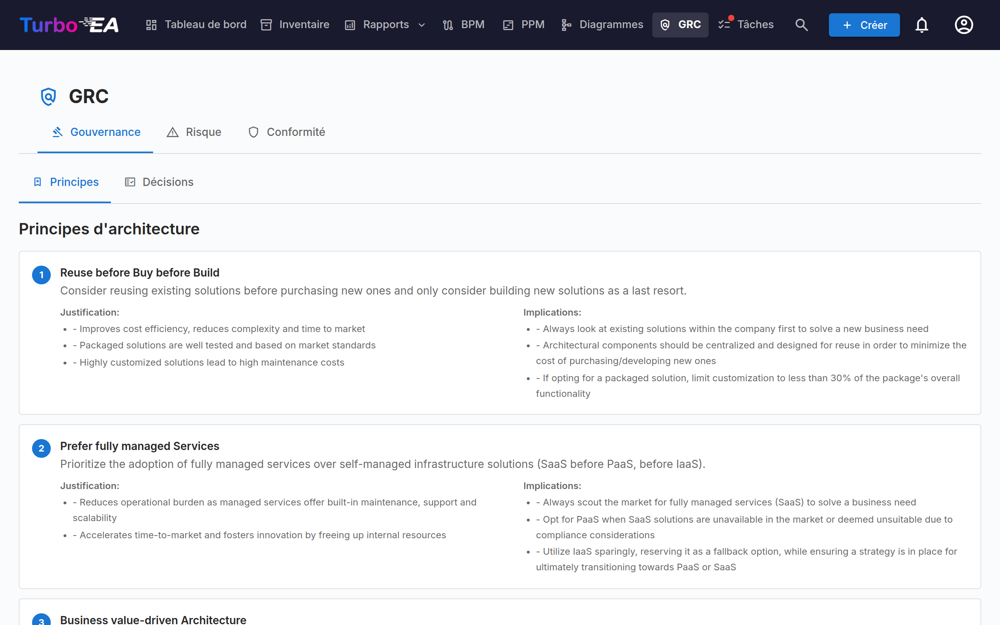
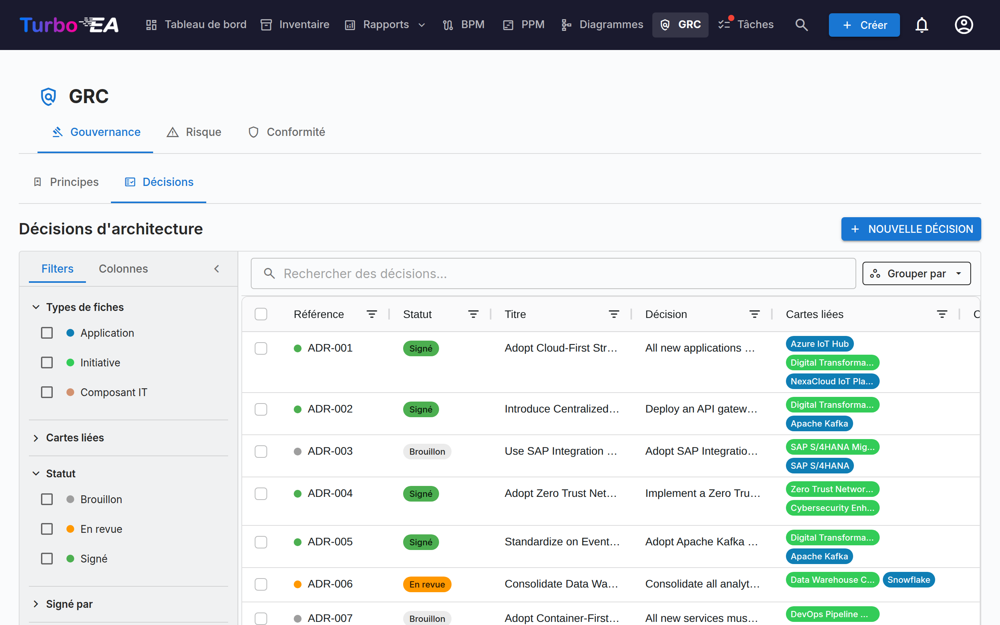
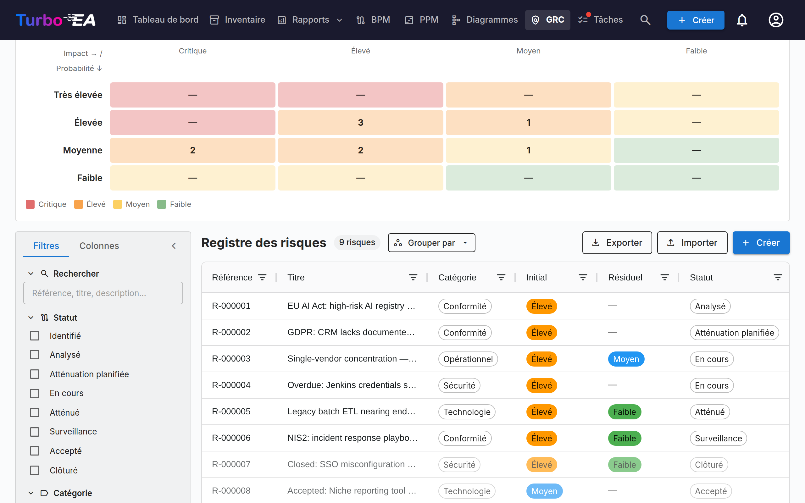
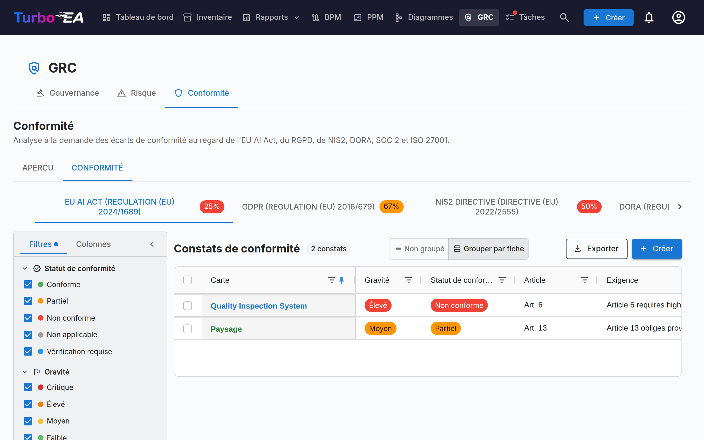

# GRC

Le module **GRC** réunit la Gouvernance, le Risque et la Conformité dans un espace de travail unique à `/grc`. Il regroupe des activités auparavant éparpillées entre Livraison EA et TurboLens, afin que l'architecte, le propriétaire de risque et l'examinateur de conformité partagent un terrain commun.

!!! note
    Le module GRC peut être activé ou désactivé par un administrateur dans les [Paramètres](../admin/settings.md). Lorsqu'il est désactivé, la navigation et les fonctionnalités GRC sont masquées.

GRC comporte trois onglets :

Tu peux pointer directement sur un onglet via `/grc?tab=governance`, `/grc?tab=risk` ou `/grc?tab=compliance`.

## Gouvernance

L'onglet Gouvernance se divise en deux **sous-onglets**, deep-linkables via `/grc?tab=governance&sub=principles` (par défaut) et `/grc?tab=governance&sub=decisions` :

### Principes

Navigateur en lecture seule des Principes EA publiés dans le métamodèle (énoncé, justification, implications). Le catalogue se modifie depuis **Administration → Métamodèle → Principes**.

### Décisions

Le sous-onglet Décisions est le **registre principal des Architecture Decision Records (ADR)** — chaque ADR à l'échelle du paysage, indépendamment de l'initiative à laquelle il est lié. Il remplace l'ancien onglet Décisions d'EA Delivery, dissous lors de l'arrivée du module GRC.

Les ADR documentent les décisions d'architecture importantes ainsi que leur contexte, conséquences et alternatives envisagées. Les décisions émises par l'assistant TurboLens Architect arrivent ici sous forme de brouillons à valider.

Le registre répond d'abord à une question : **quelles décisions sont en vigueur aujourd'hui ?** Chaque décision signée porte une [validité](#standing) que Turbo EA déduit de ses dates, de ses révisions et des autres décisions qui agissent sur elle, et la grille ne liste que la révision actuelle de chaque décision, sauf si vous demandez les révisions antérieures.

La grille peut aussi être **regroupée par statut** ou **par validité** via le bouton *Grouper par* à côté du champ de recherche : chaque statut ou validité se replie sous son propre en-tête, et la case de l'en-tête sélectionne tout le groupe pour un export groupé.

#### Statut et validité {: #standing }

Une décision a deux états distincts :

- Le **statut** est le workflow de signature, et c'est sur lui que vous agissez : **Brouillon** → **En revue** (signatures demandées) → **Signé**. Une décision prise en dehors de Turbo EA et [enregistrée comme décidée](#recording-a-past-decision) affiche **Enregistré** au lieu de Signé.
- La **validité** indique où en est aujourd'hui une décision signée ou enregistrée. Elle est déduite — jamais définie à la main — et un brouillon ou une décision en revue n'en a pas (*Pas encore signée*).

| Validité | Signification |
|----------|---------------|
| **Programmée** | Signée, mais sa date *En vigueur à partir du* n'est pas encore atteinte |
| **En vigueur** | Signée et applicable |
| **En vigueur (modifiée)** | En vigueur, et une autre décision signée la modifie ; la modification n'est pas encore intégrée dans une [révision consolidée](#amendments-and-consolidated-revisions) |
| **Remplacée** | Une révision ultérieure de la même décision, ou une décision qui la remplace, a pris effet |
| **Révoquée** | Une décision signée qui la révoque a pris effet |
| **Expirée** | Sa date *Valable jusqu'au* est dépassée (elle reste en vigueur jusqu'à ce jour inclus) |

La page de la décision en donne la raison dans un bandeau — *Cette décision a été remplacée par …*, *Cette décision entre en vigueur le …*, *La révision 3 entre en vigueur le …* — avec un lien vers la décision concernée.

#### Colonnes du tableau

La grille ADR reprend la disposition de la grille Inventaire :

| Colonne | Description |
|---------|-------------|
| **N° de réf.** | Numéro de référence généré automatiquement (ADR-001, ADR-002, …) avec un point de statut ; une révision après la première ajoute son numéro (ADR-012 · Rév. 2) |
| **Statut** | Puce colorée — Brouillon, En revue, Signé ou Enregistré |
| **Validité** | Où en est aujourd'hui une décision signée — voir [Statut et validité](#standing) ; vide tant qu'elle n'est pas signée |
| **Titre** | Titre de l'ADR |
| **Décision** | Extrait en texte brut de la décision |
| **Fiches liées** | Pilules colorées correspondant à la couleur du type de chaque fiche liée |
| **Créé par** | Auteur de l'ADR |
| **Créé** | Date de création |
| **Modifié** | Date de dernière modification |
| **Signé** | Date de signature |
| **Signé par** | Une pilule par signataire ayant signé |
| **Décidée le** / **En vigueur à partir du** / **Valable jusqu'au** | Les [dates](#decision-dates) de la décision |
| **Décideurs** | Les personnes qui ont pris la décision |

Chaque colonne dispose d'un **filtre d'en-tête** — filtres textuels sur les colonnes de texte, filtres de date sur les colonnes de date — chacun avec son propre bouton **Réinitialiser**. Dès qu'un filtre de colonne est actif, un bouton **Effacer les filtres de colonne** apparaît dans la barre d'outils de la grille pour tous les effacer d'un coup. La largeur, l'ordre et le tri des colonnes ainsi que les filtres actifs sont mémorisés par navigateur.

#### Barre latérale de filtres

La barre latérale persistante à gauche comporte deux onglets :

- **Filtres** — filtres à facettes sur la liste des ADR :
    - **En vigueur** — un clic n'affiche que les décisions en vigueur aujourd'hui (En vigueur et En vigueur (modifiée)) ; cliquez à nouveau pour l'effacer
    - **Afficher les révisions antérieures** — désactivé par défaut, de sorte que chaque décision apparaît une seule fois, sous sa révision actuelle (plus une révision en cours de rédaction). Activez-le pour lister aussi les révisions antérieures ; le bouton **Exporter** suit le même réglage
    - **Types de fiche** — cases à cocher avec des points colorés filtrant par types de fiches liées
    - **Fiches liées** — filtrer par fiches liées spécifiques
    - **Statut** — Brouillon / En revue / Signé (une décision enregistrée compte comme signée)
    - **Validité** — Programmée / En vigueur / En vigueur (modifiée) / Remplacée / Révoquée / Expirée / Pas encore signée
    - **Signé par** — filtrer par signataire
    - **Date de création** / **Date de modification** / **Date de signature** / **Date de décision** — plages de dates de/à (**Date de décision** porte sur la date *Décidée le* d'une décision signée ou enregistrée)
- **Colonnes** — choisir les colonnes visibles de la grille. **N° de réf.** et **Titre** sont toujours affichés ; **Réinitialiser** restaure la sélection par défaut. Votre choix est mémorisé par navigateur.

Utilisez la barre de **filtre rapide** pour une recherche en texte intégral. Faites un clic droit sur n'importe quelle ligne pour un menu contextuel (**Modifier**, **Aperçu**, **Dupliquer**, **Supprimer**).

#### Exporter et importer des décisions {: #decisions-import }

**Exporter** (à côté de **+ Nouvelle décision**) télécharge les décisions actuellement affichées par la barre latérale de filtres sous forme de fichier `.xlsx`, une ligne par révision de décision. Les colonnes, dans l'ordre : `reference_number`, `title`, `status`, `revision_number`, les quatre sections (`context`, `decision`, `consequences`, `alternatives_considered`) en texte brut, `cards` et `related_decisions` (séparées par des points-virgules), `author`, `signatories`, `signed_at`, `created_at`, `updated_at`, puis les données propres au registre — `standing` (sous forme de clé, par ex. `in_force`), `decided_on`, `effective_from`, `valid_until`, `decision_makers`, `participants`, et les liens typés `replaces`, `amends`, `revokes` et `consolidates` sous forme de références. La mise en forme (gras, liens, etc.) n'est pas reprise dans le tableur. Pour partager des décisions entièrement mises en forme, sélectionnez des lignes dans la grille et utilisez le bouton **Export** de la grille, qui produit un document Word.

**Importer** crée des décisions en masse à partir d'un fichier `.xlsx`. Cliquez sur **Télécharger le modèle** pour obtenir un classeur de départ, renseignez une décision par ligne et importez-le :

- Chaque ligne devient une nouvelle décision **brouillon** avec la prochaine référence `ADR-NNN`. Le statut et les signatures ne sont jamais importés — une décision est signée via le **workflow de signature** — et l'aperçu vous avertit d'une ligne dont le `status` n'est pas « draft ».
- Une ligne dont la `reference_number` appartient déjà à une décision est **ignorée** : l'import ne modifie jamais une décision existante, de sorte que réimporter un export ne change rien.
- `title` est obligatoire. Dans les quatre colonnes de section, une ligne vide commence un nouveau paragraphe, les lignes commençant par `- ` deviennent une liste à puces et celles commençant par `1. ` une liste numérotée.
- `cards` lie des fiches par leur nom exact, parmi les fiches que vous pouvez voir ; une fiche introuvable, ou dont le nom est partagé par plusieurs fiches, est ignorée avec un avertissement et la décision est tout de même importée.
- `related_decisions` liste des références, soit de décisions existantes, soit d'autres lignes du même fichier (y compris des lignes ultérieures) ; chacune devient un lien **Se rapporte à**. Une référence qui a plusieurs révisions pointe vers sa révision actuelle.
- Toutes les autres colonnes — validité, dates, personnes et liens typés compris — sont ignorées : un import crée des brouillons, jamais des décisions signées ou enregistrées.
- Un export contient une ligne par révision, si bien qu'un fichier peut porter plusieurs lignes pour une même référence (une révision ouverte, ou des révisions antérieures lorsque **Afficher les révisions antérieures** est activé). Sur l'instance d'où il provient, elles sont toutes ignorées ; ailleurs, seule la ligne ayant le `revision_number` le plus élevé est importée (la dernière ligne lorsque les numéros sont égaux ou absents) et chaque autre ligne est ignorée avec l'avertissement *Révision antérieure de ADR-012 ignorée*. Une entrée de `related_decisions` qui nomme cette référence pointe vers la ligne importée.

L'aperçu indique combien de lignes seront créées, ignorées et en échec, avec chaque erreur et avertissement listés par ligne ; rien n'est écrit tant que vous n'avez pas confirmé. L'import requiert la permission `adr.manage`.

#### Créer un ADR

Les ADR peuvent être créés depuis trois endroits — tous ouvrent le même éditeur et alimentent le même registre :

1. **GRC → Gouvernance → Décisions** : cliquez sur **+ Nouvel ADR**, remplissez le titre et liez optionnellement des fiches (y compris des initiatives).
2. **Espace de travail EA Delivery** : sélectionnez une initiative, puis cliquez sur **+ Nouvel artefact ▾** en haut de la page (ou **+ Ajouter** dans la section *Décisions d'architecture*) et choisissez **Nouvelle décision d'architecture** — l'initiative est pré-liée.
3. **Fiche → onglet Ressources** : cliquez sur **Créer ADR** — la fiche courante est pré-liée.

Dans tous les cas, vous pouvez rechercher et lier des fiches supplémentaires lors de la création. Les initiatives sont liées via le même mécanisme de liaison de fiches que toute autre fiche, ce qui permet à un ADR de référencer plusieurs initiatives. L'éditeur s'ouvre avec des sections pour **Contexte**, **Décision**, **Conséquences** et **Alternatives envisagées**.

#### L'éditeur ADR

L'éditeur offre :

- Édition de texte riche pour chaque section (Contexte, Décision, Conséquences, Alternatives envisagées)
- **Mentions** — tapez **@** dans une section pour mentionner une fiche ou une autre décision (voir [Mentions](#decision-mentions))
- **Discussion** — un panneau à côté du document avec sa discussion (voir [Discussion](#decision-discussion))
- **Historique** — un bouton en haut de la page qui ouvre la chronologie de la décision et ses versions enregistrées (voir [Historique](#decision-history))
- Liaison de fiches — connectez l'ADR aux fiches pertinentes (applications, composants IT, initiatives, …). Les initiatives sont liées via la fonctionnalité standard de liaison de fiches, et non via un champ dédié, ce qui permet à un ADR de référencer plusieurs initiatives
- **Dates** — *Décidée le*, *En vigueur à partir du* et un *Valable jusqu'au* facultatif (voir [Dates](#decision-dates))
- **Personnes** — les *Décideurs* et les *Participants* (voir [Personnes](#decision-people))
- **Cette décision…** — des liens typés vers d'autres décisions (voir [Liens entre décisions](#decision-links))
- **Résumé des modifications** — sur une révision uniquement : ce qui a changé dans cette révision, et pourquoi
- **Fichiers** — des documents joints à la décision (voir [Fichiers](#decision-files))

#### Dates {: #decision-dates }

- **Décidée le** — le jour où la décision a été prise. Il ne peut pas être dans le futur.
- **En vigueur à partir du** — le jour où elle prend effet. Jusque-là, une décision signée est **Programmée**.
- **Valable jusqu'au** — facultatif, pour une décision limitée dans le temps comme une dérogation. Le lendemain, la décision est **Expirée**. Cette date ne peut pas être antérieure à *En vigueur à partir du*, ni déjà passée lorsque la décision est envoyée pour revue.

Laissées vides, *Décidée le* et *En vigueur à partir du* prennent la date de la dernière signature. Le renouvellement d'une décision expirée est une nouvelle révision ou une nouvelle décision, signée comme toute autre.

#### Personnes {: #decision-people }

Les **Décideurs** sont les personnes qui ont pris la décision ; les **Participants** sont les personnes qui y ont pris part. Choisissez un utilisateur Turbo EA, ou saisissez un nom et appuyez sur Entrée pour une personne sans compte. Les deux sont enregistrés séparément des **signataires**, qui approuvent l'enregistrement dans Turbo EA. Lorsque vous demandez des signatures, **Ajouter des décideurs** dans la boîte de dialogue ajoute en un clic aux signataires chaque décideur qui est un utilisateur Turbo EA.

#### Liens entre décisions {: #decision-links }

La section **Cette décision…** d'une décision la lie à d'autres. Choisissez le type de lien et la décision, et ajoutez éventuellement une note pour un cas partiel — par exemple *section 3 uniquement* :

| Lien | Affiché sur l'autre décision comme | Effet une fois cette décision signée et applicable |
|------|------------------------------------|----------------------------------------------------|
| **Remplace** | Remplacée par | L'autre décision devient **Remplacée** |
| **Modifie** | Modifiée par | L'autre décision devient **En vigueur (modifiée)** |
| **Révoque** | Révoquée par | L'autre décision devient **Révoquée** |
| **Se rapporte à** | Liée à | Aucun — un renvoi |

Les liens sont affichés sur les deux décisions et pointent vers la révision actuelle de la décision. Ils agissent sur la décision entière, toutes ses révisions comprises, et seulement une fois que la décision qui les porte est signée et applicable : un brouillon qui en révoque une autre ne change rien tant qu'il n'est pas signé, et un brouillon avec une date *En vigueur à partir du* ultérieure agit à cette date (l'autre décision indique *Cette décision sera révoquée par … le …*). Une décision ne peut pas être liée à l'une de ses propres révisions, et chaque décision à laquelle elle est liée doit être signée avant qu'elle soit envoyée pour revue ou enregistrée.

#### Révoquer ou remplacer une décision {: #revoking-or-replacing-a-decision }

Une décision signée n'est jamais retirée à la main : elle est révoquée ou remplacée par une autre décision signée, de sorte que le registre conserve qui l'a prise et quand. Ouvrez la décision signée et utilisez le menu **Réviser** :

- **Réviser cette décision** — une nouvelle révision de la même décision, sous la même référence (voir [Révisions](#revisions)).
- **Remplacer par une nouvelle décision** — un nouveau brouillon intitulé *Remplace : …* qui porte déjà un lien **Remplace** et les mêmes fiches liées.
- **Révoquer** — un nouveau brouillon intitulé *Révocation de ADR-012 — …* qui porte déjà un lien **Révoque** et les mêmes fiches liées.

Complétez le nouveau brouillon et faites-le passer par le workflow de signature comme toute autre décision. Le menu n'est pas proposé sur une révision antérieure (ouvrez la révision actuelle) ni sur une décision déjà révoquée ou remplacée. Lorsqu'une décision signée en remplace, modifie ou révoque une autre, l'auteur de cette dernière reçoit une notification **Validité d'ADR modifiée**.

#### Modifications et révisions consolidées {: #amendments-and-consolidated-revisions }

Une décision modifiée par une autre reste en vigueur, et sa page liste les décisions qui la modifient. Pour offrir aux lecteurs un texte unique et à jour, cliquez sur **Créer une révision consolidée** dans ce bandeau : cela démarre une révision de la décision modifiée qui nomme la décision modificatrice (*Consolide la modification apportée par …*). Intégrez la modification au texte, décrivez-la dans le **Résumé des modifications** et envoyez la révision en signature. Une fois signée et applicable, la décision est de nouveau **En vigueur**, et la décision modificatrice affiche *La modification apportée par cette décision est consolidée dans …*. Une modification cesse aussi de compter dès que la décision modificatrice est révoquée, remplacée ou expire — mais pas lorsqu'elle est simplement révisée : sa révision conserve la modification, et le bandeau nomme la révision actuelle de la décision modificatrice.

#### Fichiers {: #decision-files }

La section **Fichiers** joint des documents à une décision — un procès-verbal signé, une analyse à l'appui. Les fichiers acceptent les mêmes formats que les [pièces jointes des fiches](card-details.md#onglet-ressources), jusqu'à 20 Mo chacun, et ne peuvent être téléversés que tant que le téléversement de fichiers est activé (la suppression reste toujours possible). Ils ne peuvent être ajoutés et supprimés que sur un brouillon enregistré : une fois la décision envoyée pour revue, ils sont verrouillés avec elle. Une révision reprend les fichiers de sa décision.

#### Workflow de signature

Les ADR prennent en charge un processus formel de signature :

1. Créez l'ADR avec le statut **Brouillon**.
2. Cliquez sur **Demander des signatures** et recherchez des signataires par nom ou e-mail (ou cliquez sur **Ajouter des décideurs**). Les signatures ne peuvent être demandées qu'à partir d'un brouillon.
3. L'ADR passe à **En revue** — chaque signataire reçoit une notification et une tâche.
4. Les signataires examinent et cliquent sur **Signer**.
5. Une fois que tous les signataires ont signé, l'ADR passe automatiquement au statut **Signé**.

**Une décision en revue est verrouillée**, afin que les signataires signent exactement ce qui leur a été envoyé : le texte, les dates, les personnes, les liens, les fichiers et les panneaux d'extension sont en lecture seule, et seules les fiches liées peuvent encore changer. Pour la modifier, cliquez sur **Rappeler les signatures**, ce qui la remet en brouillon. Un signataire qui clique sur **Rejeter** la remet également en brouillon, sous le même numéro de révision.

Les ADR signés sont verrouillés et ne peuvent pas être modifiés — pour apporter des changements, créez une nouvelle révision.

#### Enregistrer une décision passée {: #recording-a-past-decision }

Une décision prise en dehors de Turbo EA — lors d'un comité de direction antérieur à l'existence du registre, par exemple — peut être saisie comme décidée sans collecter de signatures. Rédigez-la comme brouillon, indiquez au moins un décideur, puis cliquez sur **Enregistrer comme décidée** et indiquez la date **Décidée le** (pas dans le futur) et, si elle diffère, la date **En vigueur à partir du** (par défaut, la date de décision).

La décision est alors verrouillée comme une décision signée et reçoit sa validité, mais son statut indique **Enregistré**, et sa page affiche *Enregistrée par … le …, non signée dans Turbo EA.* L'enregistrement requiert la permission `adr.record`, que seul le rôle Admin détient par défaut, et chaque enregistrement apparaît dans le [journal Sécurité et administration](../admin/audit-log.md) sous `admin.adr.recorded`. Un brouillon de révision peut aussi être enregistré, à condition que sa date de décision ne soit pas antérieure à celle de sa révision précédente.

#### Révisions

Ouvrez un ADR signé et choisissez **Réviser → Réviser cette décision** pour créer un nouveau brouillon basé sur la version signée. La révision conserve la référence de la décision et prend le numéro de révision suivant — **ADR-012 · Rév. 2** — et hérite du contenu, des fiches liées, des liens **Se rapporte à**, des personnes, des fichiers et de la date *Valable jusqu'au*. Elle n'hérite pas des dates de décision et d'entrée en vigueur, des signataires, du résumé des modifications ni des liens remplace / modifie / révoque, qui restent sur la révision qui les a créés. Chaque révision conserve sa propre trace de signature.

- **Une seule révision ouverte à la fois.** Tant qu'une révision est en cours de rédaction, la révision actuelle l'indique et le menu **Réviser** ouvre ce brouillon au lieu d'en démarrer un autre.
- **La révision actuelle est celle en vigueur.** Une fois qu'une révision est signée et applicable, les précédentes sont **Remplacées** et affichent un bandeau avec un lien vers la révision actuelle. La barre **Révisions** de chaque révision liste toute la chaîne et signale la révision actuelle.
- **Seule la révision actuelle peut être révisée**, et plus du tout une fois la décision révoquée ou remplacée. Une décision expirée ou modifiée peut toujours être révisée.
- **Un rejet ne compte pas comme une révision** : le numéro de révision ne change que lorsqu'une nouvelle révision est créée.
- Les décisions révisées avant la version 2.199.0 conservent les numéros de référence sous lesquels elles ont été émises, et se lisent toujours comme une seule décision avec une seule barre de révisions.

#### Aperçu

Cliquez sur l'icône d'aperçu pour afficher une version en lecture seule et formatée de l'ADR — utile pour la revue avant signature.

Depuis l'aperçu, cliquez sur **PDF** pour ouvrir une copie prête à imprimer dans un nouvel onglet — métadonnées et dates, les quatre sections, personnes, fiches liées, liens vers d'autres décisions, noms de fichiers, sections d'extension et bloc de signatures (ou la mention d'enregistrement), avec l'approbateur et la date d'impression en pied de page. L'éditeur propose le même bouton **PDF** ainsi que **Word**, qui télécharge la décision au format `.docx` tant qu'elle n'est pas signée ; les deux exportent l'état courant de l'éditeur, modifications non enregistrées comprises.

#### Discussion {: #decision-discussion }

Chaque décision a sa propre **Discussion**, de sorte qu'une décision peut être tranchée dans Turbo EA plutôt que dans un fil de messagerie séparé. Ouvrez-la avec le bouton de discussion de l'éditeur ou de l'aperçu de la décision : sur un écran large, elle s'ouvre dans un panneau à côté du document, sur un écran plus étroit dans un tiroir. Le titre du panneau indique combien de fils sont ouverts. L'[Historique](#decision-history) de la décision ne se trouve pas dans ce panneau : il s'ouvre avec le bouton **Historique** en haut de la page.

- **Fils et réponses.** Saisissez votre texte dans la zone en haut du panneau et cliquez sur **Publier** (ou appuyez sur Ctrl+Entrée, Cmd+Entrée sur Mac) pour lancer un fil. Pour le rattacher à une section, cliquez sur l'une des puces de section au-dessus de la zone — *Contexte*, *Décision*, *Alternatives envisagées* ou *Conséquences* ; cliquez de nouveau sur la puce choisie pour le détacher. Un fil sans section est un fil général. Chaque fil accepte des réponses, sur un seul niveau ; un fil conserve la section avec laquelle il a été lancé, et sa puce de section s'affiche en haut du fil.
- **Filtrer par section.** Dès qu'un fil a une section, une rangée de puces en haut de la discussion liste chaque section qui a des fils, avec leur nombre (*Décision (2)*), ainsi qu'une puce **Général** lorsque certains fils n'ont pas de section. Cliquez sur une puce pour n'afficher que ses fils ; activez-en plusieurs pour voir les fils de l'une ou l'autre, cliquez de nouveau sur une puce pour la désactiver, ou cliquez sur **Effacer**. Cliquer sur la puce de section d'un fil active son filtre. Le filtre fonctionne que les fils résolus soient repliés ou non et avec les révisions antérieures affichées, et ne compte que les fils listés. Il n'est pas conservé lorsque vous quittez le document, et un fil ouvert depuis une notification est toujours affiché.
- **Discussion sur une section.** Chaque section affiche une petite icône de bulle à côté de son titre, dans l'éditeur et dans l'aperçu, pour les personnes qui peuvent commenter (les personnes qui peuvent seulement lire ne la voient que sur les sections qui ont des fils) : le nombre de fils ouverts lorsque la section a une discussion, ou une icône estompée une fois qu'ils sont tous résolus. Cliquez dessus pour ouvrir la discussion filtrée sur cette section, avec les fils résolus dépliés lorsqu'aucun n'est ouvert, et la section déjà sélectionnée pour un nouveau commentaire (l'icône n'est jamais imprimée ni exportée).
- **Résoudre et rouvrir.** Cliquez sur **Résoudre** une fois un fil réglé et sur **Rouvrir** s'il ne l'est pas. Les fils résolus sont repliés derrière **Afficher N fils résolus**.
- **Qui peut publier.** La lecture de la discussion suit le droit d'ouvrir la décision (`adr.view`). Publier, répondre, résoudre et rouvrir requièrent la permission `adr.comment`, que les membres et les administrateurs détiennent par défaut et les lecteurs non ; un administrateur peut la modifier pour chaque rôle. Les signataires de la décision peuvent toujours la commenter, y compris les personnes invitées à la signer lors d'un cycle de revue antérieur qui a été rappelé ou rejeté.
- **Pendant la revue et après la signature.** Le [verrouillage de revue](#workflow-de-signature) porte sur le contenu, pas sur la conversation : la discussion reste ouverte pendant que la décision est en revue et après sa signature.
- **Notes de revue.** Lorsqu'un signataire rejette une décision, le motif ouvre un fil marqué **Motif du rejet** (*Aucun motif indiqué* si le signataire l'a laissé vide), auquel on répond et que l'on résout comme n'importe quel autre. Un signataire peut ajouter une note facultative en signant ; elle apparaît dans la discussion comme **Note de signature**. Ni l'un ni l'autre ne sont plus perdus lorsque les signatures sont rappelées, et tous deux figurent aussi dans l'[Historique](#decision-history).
- **Fils ouverts avant la revue.** **Demander des signatures**, **Signer** et **Rejeter** avertissent lorsque la décision a encore des fils ouverts (*2 fils de discussion ouverts sur ce document.*). Ce n'est qu'un avertissement : rien n'est bloqué.
- **Notifications.** Un nouveau commentaire notifie l'auteur de la décision, ses signataires, ses décideurs et participants qui sont utilisateurs de Turbo EA, et les personnes qui ont déjà commenté — jamais la personne qui l'a publié. Tapez **@** dans un commentaire pour mentionner un collègue : il reçoit alors une notification de mention à la place. Une personne que vous mentionnez et qui ne peut pas ouvrir la décision n'est pas notifiée, et le panneau vous le signale (*… n'a pas été notifié : cette personne ne peut pas ouvrir ce document.*). Les notifications ne contiennent aucun texte de commentaire, et un clic sur l'une d'elles ouvre l'aperçu de la décision avec le panneau sur ce fil. Voir [Notifications](notifications.md#types-de-notifications).
- **Modifier et supprimer.** Vous pouvez modifier vos propres commentaires ; un commentaire modifié est marqué *(modifié)*. Vous pouvez supprimer vos propres commentaires, et toute personne pouvant modifier la décision (`adr.manage`) peut supprimer n'importe quel commentaire ; un commentaire supprimé se réduit à sa place à une petite ligne, avec son auteur, sa date et *Commentaire supprimé*. Supprimer le premier commentaire d'un fil ferme le fil : les réponses déjà présentes restent, mais personne ne peut plus y répondre, le résoudre ni le rouvrir. Un motif de rejet et une note de signature ne peuvent être ni modifiés ni supprimés : un rejet se résout à la place.
- **Révisions antérieures.** Un fil appartient à la révision sur laquelle il a été lancé. Activez **Afficher la discussion des révisions antérieures** pour lire les fils des révisions antérieures de la décision, regroupés par révision.

#### Mentions {: #decision-mentions }

Pendant la rédaction d'une décision, tapez **@** dans l'une de ses quatre sections pour mentionner une **fiche** ou une autre **décision**. Une fenêtre contextuelle liste les fiches et décisions correspondantes au fil de la frappe ; utilisez les flèches et Entrée (ou cliquez) pour en choisir une, et Échap pour la fermer. Dans un commentaire, **@** propose aussi des **personnes**. Chaque entrée indique ce qu'elle est : une fiche affiche la couleur et l'icône de son type, son type, son sous-type et la fiche sous laquelle elle se trouve (*Application · Microservice · dans Finance Suite*, lorsque vous pouvez voir cette fiche) ; une décision affiche sa référence (*ADR-012 · Rev 2*), son titre et son statut ; une personne affiche un nom et une adresse e-mail. Une mention apparaît comme une puce portant le nom actuel de ce qu'elle désigne — le nom d'une fiche, la référence et le titre d'une décision —, si bien que renommer une fiche ne change jamais le texte. Cliquez sur une puce de fiche ou de décision pour l'ouvrir.

- **Ce qui vient en premier.** Lorsque rien n'est saisi après **@**, les fiches liées à la décision viennent en premier, puis les autres fiches par ordre alphabétique ; dans un commentaire, les signataires, les décideurs et les participants de la décision viennent en premier parmi les personnes. Au fil de la frappe, les meilleures correspondances viennent en premier, comme partout ailleurs dans Turbo EA, et à pertinence égale, les fiches liées et les personnes de la décision passent devant.
- **Parcourir.** La dernière entrée de la fenêtre contextuelle, **Parcourir…**, et le bouton **Mentionner…** (**@**) de la barre d'outils de l'éditeur ouvrent une boîte de dialogue avec les sélecteurs habituels : **Fiches** (le sélecteur de fiches du reste de Turbo EA, avec sa liste de types, sa hiérarchie et sa recherche), **Décisions** (une liste avec recherche) et, dans un commentaire, **Personnes**. Choisissez-en autant que nécessaire dans n'importe quel onglet et cliquez sur **Insérer** : une mention par choix est insérée, dans l'ordre où vous les avez choisis, séparées par des espaces — à la place de ce que vous avez saisi après **@** lorsque la boîte de dialogue a été ouverte depuis la fenêtre contextuelle. **Annuler** n'insère rien.
- Un lecteur qui n'a pas le droit de voir une fiche mentionnée voit **Fiche à accès restreint** au lieu de son nom, partout — l'éditeur, l'aperçu, les exports PDF et Word, la grille, l'historique et la discussion. Un lecteur qui ne peut pas ouvrir les décisions voit **Décision à accès restreint**. L'enregistrement du texte conserve ces mentions telles quelles, même lorsque la personne qui enregistre ne peut pas les voir.
- Une fiche mentionnée qui a été supprimée depuis s'affiche **Fiche supprimée** (une décision supprimée, **Décision supprimée**), car le texte ne stocke aucun nom.
- Une mention ne lie pas la fiche. Lorsque le texte mentionne des fiches qui ne sont pas liées, l'éditeur les liste sous *Fiches mentionnées dans le texte mais non liées :*, chacune avec un bouton **Lier cette fiche**. La liaison de fiches dans l'éditeur utilise le même sélecteur de fiches que le reste de Turbo EA.
- **Mentionné dans.** L'[onglet ADR](card-details.md#onglet-adr) d'une fiche et l'aperçu d'une décision listent, sous **Mentionné dans**, les décisions et les SoAW dont le texte mentionne cette fiche ou cette décision, ainsi que ceux dont la discussion la mentionne (signalés *dans la discussion*). La liste ne montre que les documents que vous pouvez ouvrir.

#### Historique {: #decision-history }

Le bouton **Historique** en haut de l'éditeur ou de l'aperçu de la décision, à côté de la bande des révisions lorsque la décision en a plusieurs, ouvre une vue large : la chronologie à gauche, la version sélectionnée à droite. La chronologie consigne ce qui est arrivé à la décision, du plus récent au plus ancien : création, enregistrement, envoi pour revue, chaque signature (avec sa note), rejet (avec le motif), rappel des signatures, signature complète, enregistrement comme décidée, début d'une révision, restauration d'une version antérieure. Toute personne pouvant ouvrir la décision voit cette chronologie. Les événements de revue — envoi pour revue, signature, rappel, rejet — sont conservés à partir de la version 2.200.0 ; auparavant, ils étaient affichés en direct mais jamais stockés. Les décisions qui existaient avant cette version commencent par une chronologie reconstituée à partir de ce qui était stocké : création, révision, envoi pour revue (pour une décision en revue au moment de la mise à niveau, avec les signataires auxquels elle a été envoyée), chaque signature, signature complète et enregistrement.

L'Historique n'est pas le tableau **Historique des versions du document**, tenu à la main, d'un [Statement of Architecture Work](delivery.md#lediteur-soaw), qui consigne ce que les auteurs choisissent d'y écrire.

- **Versions.** Une version est conservée chaque fois qu'un brouillon est enregistré avec des modifications. Elle contient le titre, les quatre sections, les dates, le résumé des modifications et les personnes ; les liens, les fiches liées et les fichiers ne font pas partie d'une version. Les étapes qui contiennent une version sont signalées dans la chronologie ; les personnes qui peuvent modifier la décision et ses signataires en sélectionnent une pour l'afficher à droite, et la version la plus récente est sélectionnée à l'ouverture de la vue. Les autres lecteurs voient la chronologie sans les versions (*Les versions enregistrées ne sont visibles que par les éditeurs et les signataires.*). Sur un écran étroit, la vue affiche d'abord la chronologie, puis la version sélectionnée avec un bouton **Retour**.
- **Modifications.** Au-dessus de la version sélectionnée, **Version** l'affiche telle qu'elle a été enregistrée et **Modifications** montre ce qui a changé entre elle et la version précédente, mot par mot et section par section, ainsi que les dates et les personnes modifiées ; choisissez n'importe quelle autre version sous **Comparer avec**. Seules les versions déjà chargées dans la chronologie peuvent être comparées : lorsque la version précédant la version sélectionnée n'est pas encore chargée, **Modifications** l'indique, et **Charger plus** la charge. Un simple changement de mise en forme est signalé par *Mise en forme uniquement : les mots sont identiques.*
- **Restaurer.** Sur un brouillon, une personne pouvant modifier la décision peut restaurer la version sélectionnée avec **Restaurer cette version**. La restauration va uniquement de l'avant : le texte, les dates et les personnes de la version remplacent ceux du brouillon et sont conservés comme nouvelle version, et l'état du brouillon avant la restauration reste dans l'historique. Les liens, les fiches liées et les fichiers ne sont pas restaurés. Lorsque l'éditeur contient des modifications non enregistrées, la confirmation indique qu'elles seront perdues. Une fois la restauration effectuée, la page affiche la décision restaurée et la vue se ferme. Une décision en revue ou signée ne peut pas être restaurée.

#### Limites connues {: #collaboration-limits }

- Une fiche supprimée s'affiche **Fiche supprimée** partout où elle était mentionnée : le texte ne stocke aucun nom, l'ancien nom ne peut donc pas être affiché.
- Deux personnes qui enregistrent le même brouillon s'écrasent toujours mutuellement : le dernier enregistrement l'emporte. L'historique conserve les deux enregistrements, de sorte que la formulation écrasée peut être retrouvée et restaurée.
- La discussion ne fait pas partie des exports PDF, Word ou tableur, ni de la copie imprimée.
- Un rôle qui peut ouvrir les décisions mais n'a pas accès à l'inventaire ne peut pas rechercher de fiches dans la fenêtre de mention (*Votre rôle ne permet pas de rechercher des fiches ; vous pouvez toujours mentionner des décisions.*).
- Un texte copié d'un document vers un autre perd ses puces **Accès restreint** : une mention restreinte ne peut être conservée que dans le document où elle a été écrite.
- Les personnes invitées à signer lors d'un cycle de revue rejeté ou rappelé avant la version 2.200.0 ne peuvent pas être reconstituées ; elles ne comptent donc pas comme signataires de cette révision. Un cycle encore ouvert au moment de la mise à niveau conserve ses signataires.

## Risque

Intègre le **Registre des risques** TOGAF Phase G. Le cycle de vie complet, le workflow de statut, les bascules de matrice et le comportement des propriétaires sont documentés dans le [guide du Registre des risques](risks.md). L'essentiel :

## Conformité

L'onglet Conformité est un registre à deux sources — les constats peuvent être **saisis manuellement** par un examinateur **ou** produits par un **scan IA** à la demande contre les réglementations activées (EU AI Act, RGPD, NIS2, DORA, SOC 2, ISO 27001 sont activées par défaut). Les deux types de constats partagent le même cycle de vie, peuvent être promus en Risque et bulk-actionnés depuis la grille. Voir le [guide Conformité](compliance.md) pour le cycle de vie complet, le dialogue de création manuelle, le workflow de scan, le détecteur sémantique EU AI Act et la boucle de promotion en Risque.

Le même onglet Conformité apparaît aussi sur le Détail de la fiche (auto-masqué quand la fiche n'a pas de constats liés), de sorte qu'un Application Owner peut trier ses constats sans quitter la fiche.

## Permissions

| Permission | Rôles par défaut |
|------------|------------------|
| `grc.view` | admin, bpm_admin, member, viewer |
| `grc.manage` | admin, bpm_admin, member |
| `adr.view` / `adr.manage` / `adr.sign` | `adr.view` : admin, bpm_admin, member, viewer ; `adr.manage` et `adr.sign` : admin, bpm_admin, member |
| `adr.record` | admin — [enregistrer une décision passée comme décidée](#recording-a-past-decision) |
| `adr.comment` | admin, bpm_admin, member — publier dans la [discussion](#decision-discussion) d'une décision ; les signataires d'une décision peuvent toujours la commenter |
| `risks.view` / `risks.manage` | voir [Registre des risques § Permissions](risks.md) |
| `compliance.view` / `compliance.manage` | voir [TurboLens § Security & Compliance](turbolens.md) |

`grc.view` contrôle la visibilité de la route GRC elle-même — sans elle, l'entrée du menu supérieur est masquée. Chaque onglet impose en plus sa permission propre au domaine, de sorte qu'un visualiseur peut consulter le registre sans pouvoir déclencher un scan LLM, par exemple.
