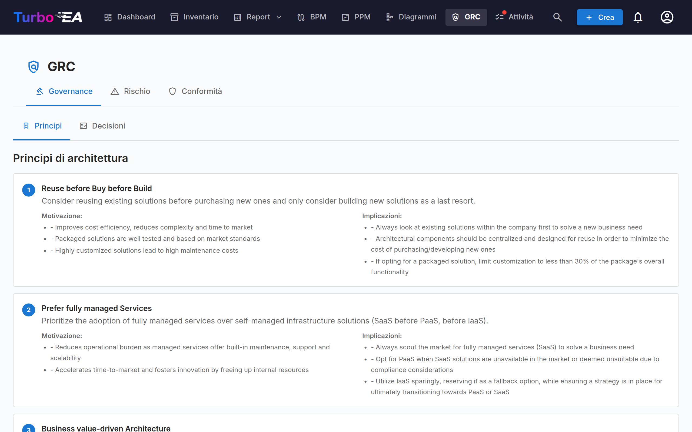
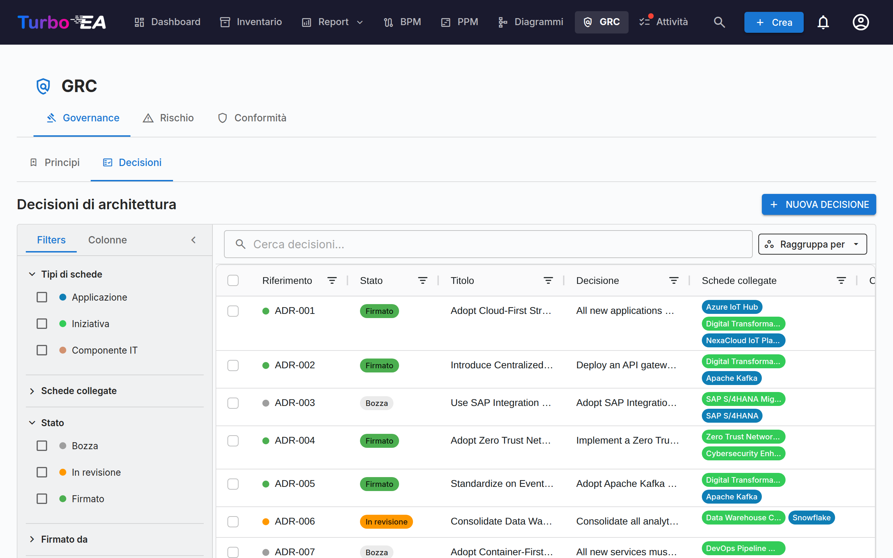
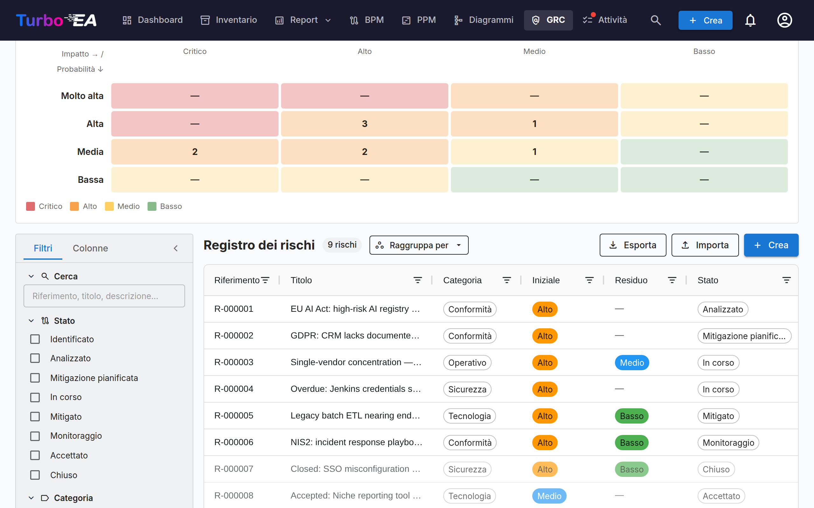
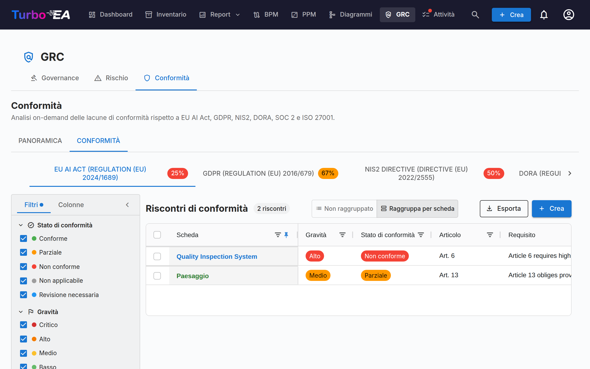

# GRC

Il modulo **GRC** riunisce Governance, Rischio e Conformità in un unico spazio di lavoro a `/grc`. Consolida attività che prima vivevano tra Consegna EA e TurboLens, in modo che un'architetta, un proprietario di rischio e un revisore di conformità lavorino su un terreno comune.

!!! note
    Il modulo GRC può essere abilitato o disabilitato da un amministratore nelle [Impostazioni](../admin/settings.md). Quando disabilitato, la navigazione e le funzionalità GRC sono nascoste.

GRC ha tre schede:

Puoi puntare direttamente a una scheda con `/grc?tab=governance`, `/grc?tab=risk` o `/grc?tab=compliance`.

## Governance

La scheda Governance si divide in due **sotto-schede**, deep-linkabili tramite `/grc?tab=governance&sub=principles` (predefinita) e `/grc?tab=governance&sub=decisions`:

### Principi

Visualizzatore in sola lettura dei Principi EA pubblicati nel metamodello (enunciato, motivazione, implicazioni). Il catalogo si modifica da **Amministrazione → Metamodello → Principi**.

### Decisioni

La sotto-scheda Decisioni è il **registro principale degli Architecture Decision Records (ADR)** — ogni ADR a livello di landscape, indipendentemente dall'iniziativa a cui è collegato. Sostituisce la vecchia scheda Decisioni di EA Delivery, dissolta con l'arrivo del modulo GRC.

Gli ADR documentano importanti decisioni architetturali insieme al loro contesto, alle conseguenze e alle alternative considerate. Le decisioni emesse dalla procedura guidata TurboLens Architect arrivano qui come bozze da approvare.

Il registro risponde innanzitutto a una domanda: **quali decisioni sono in vigore oggi?** Ogni decisione firmata ha una [vigenza](#standing) che Turbo EA ricava dalle sue date, dalle sue revisioni e dalle altre decisioni che agiscono su di essa, e la griglia elenca solo la revisione corrente di ogni decisione, a meno che non chiediate anche quelle precedenti.

La griglia può anche essere **raggruppata per stato** o **per vigenza** tramite il pulsante *Raggruppa per* accanto alla casella di ricerca: ogni stato o vigenza si comprime sotto la propria intestazione, e la casella di controllo nell'intestazione seleziona l'intero gruppo per un'esportazione in blocco.

#### Stato e vigenza {: #standing }

Una decisione ha due stati distinti:

- Lo **Stato** è il workflow di firma, ed è ciò su cui agite: **Bozza** → **In Revisione** (firme richieste) → **Firmato**. Una decisione presa al di fuori di Turbo EA e [registrata come presa](#recording-a-past-decision) mostra **Registrato** al posto di Firmato.
- La **Vigenza** indica la situazione odierna di una decisione firmata o registrata. È derivata — mai impostata a mano — e una bozza o una decisione in revisione non ne ha alcuna (*Non ancora firmata*).

| Vigenza | Significato |
|---------|-------------|
| **Programmata** | Firmata, ma la data *In vigore dal* non è ancora arrivata |
| **In vigore** | Firmata ed efficace |
| **In vigore (modificata)** | In vigore, e un'altra decisione firmata la modifica; la modifica non è ancora integrata in una [revisione consolidata](#amendments-and-consolidated-revisions) |
| **Sostituita** | Una revisione successiva della stessa decisione, o una decisione che la sostituisce, è entrata in vigore |
| **Revocata** | Una decisione firmata che la revoca è entrata in vigore |
| **Scaduta** | La sua data *Valida fino al* è passata (è in vigore fino a quel giorno compreso) |

La pagina della decisione ne indica il motivo con un banner — *Questa decisione è stata sostituita da …*, *Questa decisione entra in vigore il …*, *La revisione 3 entra in vigore il …* — con un collegamento alla decisione interessata.

#### Colonne della tabella

La griglia ADR rispecchia il layout della griglia Inventario:

| Colonna | Descrizione |
|---------|-------------|
| **N. rif.** | Numero di riferimento generato automaticamente (ADR-001, ADR-002, …) con un punto di stato; una revisione successiva alla prima aggiunge il proprio numero (ADR-012 · Rev. 2) |
| **Stato** | Chip colorato — Bozza, In Revisione, Firmato o Registrato |
| **Vigenza** | La situazione odierna di una decisione firmata — vedere [Stato e vigenza](#standing); vuota finché non è firmata |
| **Titolo** | Titolo dell'ADR |
| **Decisione** | Estratto in testo semplice della decisione |
| **Card collegate** | Pillole colorate corrispondenti al colore del tipo di ogni card collegata |
| **Creato da** | Autore dell'ADR |
| **Creato** | Data di creazione |
| **Modificato** | Data di ultima modifica |
| **Firmato** | Data di firma |
| **Firmato da** | Una pillola per ogni firmatario che ha firmato |
| **Decisa il** / **In vigore dal** / **Valida fino al** | Le [date](#decision-dates) della decisione |
| **Decisori** | Le persone che hanno preso la decisione |

Ogni colonna dispone di un **filtro di intestazione** — filtri di testo sulle colonne testuali, filtri di data sulle colonne di data — ciascuno con il proprio pulsante **Ripristina**. Non appena un filtro di colonna è attivo, nella barra degli strumenti della griglia compare il pulsante **Cancella filtri di colonna** per cancellarli tutti in una volta. Larghezza, ordine e ordinamento delle colonne e i filtri attivi vengono memorizzati per browser.

#### Barra laterale dei filtri

La barra laterale persistente a sinistra ha due schede:

- **Filtri** — filtri a faccette sull'elenco degli ADR:
    - **In vigore** — un clic mostra solo le decisioni in vigore oggi (In vigore e In vigore (modificata)); un secondo clic lo disattiva
    - **Mostra revisioni precedenti** — disattivato per impostazione predefinita, così ogni decisione compare una sola volta, come revisione corrente (più un'eventuale revisione in fase di redazione). Attivatelo per elencare anche le revisioni precedenti; il pulsante **Esporta** segue la stessa impostazione
    - **Tipi di card** — caselle di controllo con punti colorati che filtrano per tipi di card collegate
    - **Card collegate** — filtra per card collegate specifiche
    - **Stato** — Bozza / In Revisione / Firmato (una decisione registrata conta come firmata)
    - **Vigenza** — Programmata / In vigore / In vigore (modificata) / Sostituita / Revocata / Scaduta / Non ancora firmata
    - **Firmato da** — filtra per firmatario
    - **Data di creazione / modifica / firma / della decisione** — intervalli di date da/a (**Data della decisione** corrisponde alla data *Decisa il* di una decisione firmata o registrata)
- **Colonne** — scegliete quali colonne della griglia sono visibili. **N. rif.** e **Titolo** sono sempre mostrati; **Ripristina** ripristina la selezione predefinita. La scelta viene memorizzata per browser.

Usate la barra del **filtro rapido** per la ricerca full-text. Fate clic destro su una riga per un menu contestuale (**Modifica**, **Anteprima**, **Duplica**, **Elimina**).

#### Esportare e importare le decisioni {: #decisions-import }

**Esporta** (accanto a **+ Nuova decisione**) scarica come file `.xlsx` le decisioni attualmente mostrate dalla barra laterale dei filtri, una riga per revisione di decisione. Le colonne, nell'ordine: `reference_number`, `title`, `status`, `revision_number`, le quattro sezioni (`context`, `decision`, `consequences`, `alternatives_considered`) come testo semplice, `cards` e `related_decisions` (separate da punto e virgola), `author`, `signatories`, `signed_at`, `created_at`, `updated_at`, poi i dati propri del registro — `standing` (come chiave, ad esempio `in_force`), `decided_on`, `effective_from`, `valid_until`, `decision_makers`, `participants`, e i collegamenti tipizzati `replaces`, `amends`, `revokes` e `consolidates` come riferimenti. La formattazione, come il grassetto o i collegamenti, non viene riportata nel foglio di calcolo. Per condividere decisioni con tutta la formattazione, seleziona le righe nella griglia e usa il pulsante **Export** della griglia, che genera un documento Word.

**Importa** crea decisioni in blocco da un file `.xlsx`. Fai clic su **Scarica il modello** per ottenere una cartella di lavoro di partenza, compila una decisione per riga e caricala:

- Ogni riga diventa una nuova decisione in **bozza** con il successivo riferimento `ADR-NNN`. Stato e firme non vengono mai importati — una decisione viene firmata tramite il **workflow di firma** — e l'anteprima segnala una riga il cui `status` non sia bozza (draft).
- Una riga il cui `reference_number` appartiene già a una decisione viene **saltata**: l'importazione non modifica mai una decisione esistente, quindi reimportare un'esportazione non cambia nulla.
- `title` è obbligatorio. Nelle quattro colonne delle sezioni, una riga vuota inizia un nuovo paragrafo, le righe che iniziano con `- ` diventano un elenco puntato e quelle che iniziano con `1. ` un elenco numerato.
- `cards` collega le schede tramite il nome esatto, tra quelle che puoi vedere; una scheda non trovata, o il cui nome è condiviso da più schede, viene saltata con un avviso e la decisione viene comunque importata.
- `related_decisions` elenca riferimenti, sia di decisioni esistenti sia di altre righe dello stesso file (anche righe successive); ognuno diventa un collegamento **È correlata a**. Un riferimento con più revisioni si collega a quella corrente.
- Tutte le altre colonne — vigenza, date, persone e collegamenti tipizzati compresi — vengono ignorate: un'importazione crea bozze, mai decisioni firmate o registrate.
- Un'esportazione contiene una riga per revisione, quindi un file può contenere più righe per lo stesso riferimento (una revisione aperta, o le revisioni precedenti quando **Mostra revisioni precedenti** è attivo). Sull'istanza di provenienza vengono saltate tutte; altrove viene importata solo la riga con il `revision_number` più alto (l'ultima riga quando i numeri sono uguali o mancanti) e ogni altra riga viene saltata con l'avviso *Revisione precedente di ADR-012 saltata*. Una voce di `related_decisions` che indica quel riferimento si collega alla riga importata.

L'anteprima mostra quante righe verranno create, saltate e quante falliranno, con ogni errore e avviso elencato per riga; nulla viene scritto finché non confermi. L'importazione richiede il permesso `adr.manage`.

#### Creare un ADR

Gli ADR possono essere creati da tre punti — tutti aprono lo stesso editor e alimentano lo stesso registro:

1. **GRC → Governance → Decisioni**: cliccate su **+ Nuovo ADR**, compilate il titolo e opzionalmente collegate card (incluse le iniziative).
2. **Spazio di lavoro EA Delivery**: selezionate un'iniziativa, cliccate su **+ Nuovo artefatto ▾** in alto (oppure **+ Aggiungi** nella sezione *Decisioni di Architettura*) e scegliete **Nuova Decisione di Architettura** — l'iniziativa è pre-collegata.
3. **Card → scheda Risorse**: cliccate su **Crea ADR** — la card corrente è pre-collegata.

In tutti i casi potete cercare e collegare card aggiuntive durante la creazione. Le iniziative sono collegate attraverso lo stesso meccanismo di collegamento di card di qualsiasi altra card, quindi un ADR può fare riferimento a più iniziative. L'editor si apre con sezioni per **Contesto**, **Decisione**, **Conseguenze** e **Alternative considerate**.

#### L'editor ADR

L'editor fornisce:

- Editing di testo ricco per ogni sezione (Contesto, Decisione, Conseguenze, Alternative considerate)
- **Menzioni** — digitate **@** in una sezione per menzionare una card o un'altra decisione (vedere [Menzioni](#decision-mentions))
- **Discussione** — un pannello accanto al documento con la sua discussione (vedere [Discussione](#decision-discussion))
- **Cronologia** — un pulsante in cima alla pagina che apre la sequenza temporale della decisione e le sue versioni salvate (vedere [Cronologia](#decision-history))
- Collegamento di card — collegate l'ADR alle card pertinenti (applicazioni, componenti IT, iniziative, …). Le iniziative sono collegate tramite la funzionalità standard di collegamento di card, non tramite un campo dedicato, consentendo a un ADR di fare riferimento a più iniziative
- **Date** — *Decisa il*, *In vigore dal* e un *Valida fino al* facoltativo (vedere [Date](#decision-dates))
- **Persone** — i *Decisori* e i *Partecipanti* (vedere [Persone](#decision-people))
- **Questa decisione…** — collegamenti tipizzati ad altre decisioni (vedere [Collegamenti tra decisioni](#decision-links))
- **Riepilogo delle modifiche** — solo su una revisione: che cosa è cambiato in questa revisione e perché
- **File allegati** — documenti allegati alla decisione (vedere [File allegati](#decision-files))

#### Date {: #decision-dates }

- **Decisa il** — il giorno in cui la decisione è stata presa. Non può essere nel futuro.
- **In vigore dal** — il giorno in cui entra in vigore. Fino ad allora una decisione firmata è **Programmata**.
- **Valida fino al** — facoltativa, per una decisione a tempo determinato come una deroga. Il giorno successivo la decisione è **Scaduta**. Non può essere precedente a *In vigore dal*, né già passata quando la decisione viene inviata per la revisione.

Se lasciate vuote, *Decisa il* e *In vigore dal* assumono la data della firma finale. Il rinnovo di una decisione scaduta è una nuova revisione o una nuova decisione, firmata come qualsiasi altra.

#### Persone {: #decision-people }

I **Decisori** sono le persone che hanno preso la decisione; i **Partecipanti** sono le persone che vi hanno preso parte. Scegliete un utente di Turbo EA, oppure digitate un nome e premete Invio per qualcuno che non ha un account. Entrambi sono registrati separatamente dai **firmatari**, che approvano il record in Turbo EA. Quando richiedete le firme, **Aggiungi decisori** nella finestra di dialogo aggiunge con un solo clic ai firmatari ogni decisore che è un utente di Turbo EA.

#### Collegamenti tra decisioni {: #decision-links }

La sezione **Questa decisione…** di una decisione la collega ad altre. Scegliete il tipo di collegamento e la decisione, e aggiungete facoltativamente una nota per un caso parziale — ad esempio *solo la sezione 3*:

| Collegamento | Mostrato sull'altra decisione come | Effetto quando questa decisione è firmata ed efficace |
|--------------|------------------------------------|-------------------------------------------------------|
| **Sostituisce** | Sostituita da | L'altra decisione diventa **Sostituita** |
| **Modifica** | Modificata da | L'altra decisione diventa **In vigore (modificata)** |
| **Revoca** | Revocata da | L'altra decisione diventa **Revocata** |
| **È correlata a** | Correlata a | Nessuno — un riferimento incrociato |

I collegamenti sono mostrati su entrambe le decisioni e puntano alla revisione corrente della decisione. Agiscono sull'intera decisione, tutte le sue revisioni comprese, e solo quando la decisione che li porta è firmata ed efficace: una bozza che ne revoca un'altra non cambia nulla finché non è firmata, e una con una data *In vigore dal* successiva agisce a quella data (l'altra decisione indica *Questa decisione sarà revocata da … il …*). Una decisione non può collegarsi a una delle proprie revisioni, e ogni decisione a cui si collega deve essere firmata prima che venga inviata per la revisione o registrata.

#### Revocare o sostituire una decisione

Una decisione firmata non viene mai ritirata a mano: viene revocata o sostituita da un'altra decisione firmata, così il registro conserva chi l'ha decisa e quando. Aprite la decisione firmata e usate il menu **Revisiona**:

- **Revisiona questa decisione** — una nuova revisione della stessa decisione, con lo stesso riferimento (vedere [Revisioni](#revisions)).
- **Sostituisci con una nuova decisione** — una nuova bozza intitolata *Sostituisce: …* che porta già un collegamento **Sostituisce** e le stesse card collegate.
- **Revoca** — una nuova bozza intitolata *Revoca di ADR-012 — …* che porta già un collegamento **Revoca** e le stesse card collegate.

Completate la nuova bozza e inviatela al workflow di firma come qualsiasi altra decisione. Il menu non è disponibile su una revisione precedente (aprite quella corrente) né su una decisione già revocata o sostituita. Quando una decisione firmata ne sostituisce, modifica o revoca un'altra, l'autore di quest'ultima riceve una notifica **Vigenza ADR modificata**.

#### Modifiche e revisioni consolidate {: #amendments-and-consolidated-revisions }

Una decisione modificata da un'altra resta in vigore, e la sua pagina elenca le decisioni che la modificano. Per offrire ai lettori un unico testo aggiornato, cliccate su **Crea revisione consolidata** in quel banner: viene avviata una revisione della decisione modificata che indica la decisione modificante (*Consolida la modifica di …*). Integrate la modifica nel testo, descrivetela nel **Riepilogo delle modifiche** e inviate la revisione per la firma. Una volta firmata ed efficace, la decisione torna **In vigore**, e la decisione modificante mostra *La modifica apportata da questa decisione è consolidata in …*. Una modifica smette di contare anche quando la decisione modificante viene revocata, sostituita o scade — ma non quando viene semplicemente revisionata: la sua revisione mantiene la modifica, e il banner indica la revisione corrente della decisione modificante.

#### File allegati {: #decision-files }

La sezione **File allegati** allega documenti a una decisione — un verbale firmato, un'analisi di supporto. I file accettano gli stessi formati degli [allegati delle card](card-details.md#resources-tab), fino a 20 MB ciascuno, e possono essere caricati solo mentre il caricamento di file è abilitato (eliminarne uno è sempre possibile). Possono essere aggiunti ed eliminati solo su una bozza salvata: una volta che la decisione è inviata per la revisione, sono bloccati insieme a essa. Una revisione riprende i file della sua decisione.

#### Workflow di firma

Gli ADR supportano un processo formale di firma:

1. Create l'ADR con stato **Bozza**.
2. Cliccate su **Richiedi firme** e cercate i firmatari per nome o e-mail (oppure cliccate su **Aggiungi decisori**). Le firme possono essere richieste solo da una bozza.
3. L'ADR passa a **In Revisione** — ogni firmatario riceve una notifica e un Todo.
4. I firmatari esaminano e cliccano su **Firma**.
5. Quando tutti i firmatari hanno firmato, l'ADR passa automaticamente allo stato **Firmato**.

**Una decisione in revisione è bloccata**, così i firmatari firmano esattamente ciò che è stato loro inviato: il testo, le date, le persone, i collegamenti, i file e i pannelli delle estensioni sono in sola lettura, e solo le card collegate possono ancora cambiare. Per modificarla, cliccate su **Ritirare le firme**, che la riporta in bozza. Anche un firmatario che clicca su **Rifiutare** la riporta in bozza, con lo stesso numero di revisione.

Gli ADR firmati sono bloccati e non possono essere modificati — per apportare modifiche create una nuova revisione.

#### Registrare una decisione passata {: #recording-a-past-decision }

Una decisione presa al di fuori di Turbo EA — ad esempio in una riunione del consiglio prima che il registro esistesse — può essere inserita come presa senza raccogliere firme. Redigetela come bozza, indicate almeno un decisore, quindi cliccate su **Registra come decisa** e fornite la data **Decisa il** (non nel futuro) e, se diversa, la data **In vigore dal** (per impostazione predefinita è la data della decisione).

La decisione viene quindi bloccata come una decisione firmata e riceve la sua vigenza, ma il suo stato è **Registrato**, e la sua pagina indica *Registrata da … il …, non firmata in Turbo EA*. La registrazione richiede il permesso `adr.record`, che per impostazione predefinita ha solo il ruolo Admin, e ogni registrazione compare nel [registro Sicurezza e amministrazione](../admin/audit-log.md) come `admin.adr.recorded`. Anche una bozza di revisione può essere registrata, purché la sua data di decisione non sia precedente a quella della revisione precedente.

#### Revisioni {: #revisions }

Aprite un ADR firmato e scegliete **Revisiona → Revisiona questa decisione** per creare una nuova bozza basata sulla versione firmata. La revisione mantiene il riferimento della decisione e prende il numero di revisione successivo — **ADR-012 · Rev. 2** — ed eredita il contenuto, le card collegate, i collegamenti **È correlata a**, le persone, i file e la data *Valida fino al*. Non eredita le date di decisione e di entrata in vigore, i firmatari, il riepilogo delle modifiche né i collegamenti sostituisce / modifica / revoca, che restano sulla revisione che li ha creati. Ogni revisione conserva la propria traccia di firma.

- **Una sola revisione aperta alla volta.** Mentre una revisione è in fase di redazione, la revisione corrente lo segnala e il menu **Revisiona** apre quella bozza invece di avviarne un'altra.
- **La revisione corrente è quella in vigore.** Quando una revisione è firmata ed efficace, quelle precedenti diventano **Sostituite** e mostrano un banner con un collegamento a quella corrente. La striscia **Revisioni** su ogni revisione elenca l'intera catena e contrassegna quella corrente.
- **Solo la revisione corrente può essere revisionata**, e non più una volta che la decisione è stata revocata o sostituita. Una decisione scaduta o modificata può ancora essere revisionata.
- **Un rifiuto non conta come revisione**: il numero di revisione cambia solo quando viene creata una nuova revisione.
- Le decisioni revisionate prima della versione 2.199.0 mantengono i numeri di riferimento con cui sono state emesse, e si leggono comunque come un'unica decisione con un'unica striscia di revisioni.

#### Anteprima

Cliccate sull'icona di anteprima per visualizzare una versione in sola lettura e formattata dell'ADR — utile per la revisione prima della firma.

Dall'anteprima, fate clic su **PDF** per aprire una copia pronta per la stampa in una nuova scheda — metadati e date, le quattro sezioni, persone, schede collegate, collegamenti ad altre decisioni, nomi dei file, sezioni delle estensioni e blocco firme (o la riga di registrazione), con approvatore e data di stampa a piè di pagina. L'editor ha lo stesso pulsante **PDF** più **Word**, che scarica la decisione come `.docx` finché non è firmata; entrambi esportano lo stato corrente dell'editor, modifiche non salvate comprese.

#### Discussione {: #decision-discussion }

Ogni decisione ha la propria **Discussione**, così una decisione può essere definita in Turbo EA anziché in una chat separata. Apritela con il pulsante della discussione nell'editor o nell'anteprima della decisione: su uno schermo largo si apre come pannello accanto al documento, su uno più stretto come pannello a scomparsa. Il titolo del pannello mostra quanti thread sono aperti. La [Cronologia](#decision-history) della decisione non si trova in questo pannello: si apre dal pulsante **Cronologia** in cima alla pagina.

- **Thread e risposte.** Scrivete nella casella in cima al pannello e fate clic su **Pubblica** (oppure premete Ctrl+Invio, Cmd+Invio su un Mac) per avviare un thread. Per associarlo a una sezione, fate clic su uno dei chip di sezione sopra la casella — *Contesto*, *Decisione*, *Alternative considerate* o *Conseguenze*; fate di nuovo clic sul chip scelto per togliere l'associazione. Un thread senza sezione è un thread generale. Ogni thread accetta risposte, su un solo livello; un thread conserva la sezione con cui è stato avviato, e il suo chip di sezione compare in cima al thread.
- **Filtrare per sezione.** Non appena un thread ha una sezione, una riga di chip in cima alla discussione elenca ogni sezione che ha thread, con il loro numero (*Decisione (2)*), e un chip **Generale** quando alcuni thread non hanno sezione. Fate clic su un chip per mostrare solo i suoi thread; attivatene diversi per vedere i thread di ciascuno di essi, fate di nuovo clic su uno per disattivarlo, oppure fate clic su **Azzera**. Un clic sul chip di sezione di un thread attiva il relativo filtro. Il filtro funziona con i thread risolti raccolti o meno e con le revisioni precedenti mostrate, e conta solo i thread elencati. Non viene conservato quando lasciate il documento, e un thread aperto da una notifica viene sempre mostrato.
- **Discussione su una sezione.** Ogni sezione mostra una piccola icona di chat accanto alla sua intestazione, nell'editor e nell'anteprima, per le persone che possono commentare (chi può solo leggere la vede soltanto sulle sezioni che hanno thread): il numero di thread aperti quando la sezione ha una discussione, oppure un'icona attenuata quando sono tutti risolti. Fate clic su di essa per aprire la discussione filtrata su quella sezione, con i thread risolti espansi quando nessuno di essi è aperto e la sezione già selezionata per un nuovo commento (l'icona non viene mai stampata né esportata).
- **Risolvere e riaprire.** Fate clic su **Risolvi** quando un thread è definito e su **Riapri** se non lo è. I thread risolti vengono raccolti dietro **Mostra N thread risolti**.
- **Chi può pubblicare.** La lettura della discussione segue chi può aprire la decisione (`adr.view`). Pubblicare, rispondere, risolvere e riaprire richiedono il permesso `adr.comment`, che membri e amministratori hanno per impostazione predefinita e i visualizzatori no; un amministratore può modificarlo per ruolo. I firmatari della decisione possono sempre commentarla, comprese le persone a cui è stato chiesto di firmarla in un precedente giro di revisione ritirato o rifiutato.
- **Durante la revisione e dopo la firma.** Il [blocco durante la revisione](#workflow-di-firma) riguarda il contenuto, non la conversazione: la discussione resta aperta mentre la decisione è in revisione e dopo che è stata firmata.
- **Note di revisione.** Quando un firmatario rifiuta una decisione, il motivo apre un thread contrassegnato **Motivo del rifiuto** (*Nessun motivo indicato* se il firmatario lo ha lasciato vuoto), a cui si risponde e che si risolve come qualsiasi altro. Un firmatario può aggiungere una nota facoltativa al momento della firma; compare nella discussione come **Nota di firma**. Nessuna delle due va più persa quando le firme vengono ritirate, ed entrambe sono mostrate anche nella [Cronologia](#decision-history).
- **Thread aperti prima della revisione.** **Richiedi firme**, **Firma** e **Rifiutare** avvisano quando la decisione ha ancora thread aperti (*2 thread di discussione aperti su questo documento.*). È solo un avviso: nulla viene bloccato.
- **Notifiche.** Un nuovo commento notifica l'autore della decisione, i suoi firmatari, i suoi decisori e partecipanti che sono utenti di Turbo EA e le persone che hanno già commentato — mai chi lo ha pubblicato. Digitate **@** in un commento per menzionare un collega: riceverà invece una notifica di menzione. Una persona menzionata che non può aprire la decisione non viene avvisata, e il pannello ve lo segnala (*… non sono stati notificati: non possono aprire questo documento.*). Le notifiche non contengono il testo del commento, e un clic su una di esse apre l'anteprima della decisione con il pannello su quel thread. Vedere [Notifiche](notifications.md#tipi-di-notifica).
- **Modifica ed eliminazione.** Potete modificare i vostri commenti; un commento modificato è contrassegnato *(modificato)*. Potete eliminare i vostri commenti, e chiunque possa modificare la decisione (`adr.manage`) può eliminare qualsiasi commento; un commento eliminato si riduce al suo posto a una piccola riga, con il suo autore, la sua data e *Commento eliminato*. Eliminare il primo commento di un thread chiude il thread: le risposte già presenti restano, ma nessuno può più rispondervi, risolverlo o riaprirlo. Un motivo di rifiuto e una nota di firma non possono essere modificati né eliminati: un rifiuto viene invece risolto.
- **Revisioni precedenti.** Un thread appartiene alla revisione su cui è stato avviato. Attivate **Mostra la discussione sulle revisioni precedenti** per leggere i thread delle revisioni precedenti della decisione, raggruppati per revisione.

#### Menzioni {: #decision-mentions }

Mentre scrivete una decisione, digitate **@** in una qualsiasi delle sue quattro sezioni per menzionare una **card** o un'altra **decisione**. Un popup elenca le card e le decisioni corrispondenti mentre digitate; usate i tasti freccia e Invio (o fate clic) per sceglierne una, ed Esc per chiuderlo. In un commento, **@** propone anche **persone**. Ogni voce indica di cosa si tratta: una card mostra il colore e l'icona del suo tipo, il suo tipo, il suo sottotipo e la card sotto cui si trova (*Application · Microservice · in Finance Suite*, quando potete vedere quella card); una decisione mostra il suo riferimento (*ADR-012 · Rev 2*), il suo titolo e il suo stato; una persona mostra un nome e un indirizzo e-mail. Una menzione compare come chip con il nome attuale di ciò a cui rimanda — il nome di una card, il riferimento e il titolo di una decisione — così rinominare una card non cambia mai il testo. Fate clic su un chip di card o di decisione per aprirla.

- **Cosa viene prima.** Quando dopo **@** non è stato digitato nulla, vengono prima le card collegate alla decisione, poi le altre card in ordine alfabetico; in un commento, tra le persone vengono prima i firmatari, i decisori e i partecipanti della decisione. Mentre digitate, i risultati migliori vengono prima come ovunque in Turbo EA, e a parità di corrispondenza sono in testa le card collegate e le persone della decisione.
- **Sfoglia.** L'ultima voce del popup, **Sfoglia…**, e il pulsante **Menziona…** (**@**) nella barra degli strumenti dell'editor aprono una finestra di dialogo con i selettori standard: **Schede** (il selettore di card del resto di Turbo EA, con il suo elenco di tipi, la gerarchia e la ricerca), **Decisioni** (un elenco ricercabile) e, in un commento, **Persone**. Sceglietene quanti ve ne servono in qualsiasi scheda e fate clic su **Inserisci**: viene inserita una menzione per ogni scelta, nell'ordine in cui le avete scelte, separate da spazi — al posto di ciò che avete digitato dopo **@** quando la finestra di dialogo è stata aperta dal popup. **Annulla** non inserisce nulla.
- Un lettore che non può vedere una card menzionata vede **Scheda riservata** al posto del suo nome, ovunque: nell'editor, nell'anteprima, negli export PDF e Word, nella tabella, nella cronologia e nella discussione. Un lettore che non può aprire le decisioni vede **Decisione riservata**. Il salvataggio del testo conserva tali menzioni così come sono, anche quando chi salva non può vederle.
- Una card menzionata che è stata poi eliminata appare come **Scheda eliminata** (una decisione eliminata, **Decisione eliminata**), perché il testo non memorizza nomi.
- Una menzione non collega la card. Quando il testo menziona card non collegate, l'editor le elenca sotto *Menzionate nel testo ma non collegate:*, ciascuna con un pulsante **Collega questa scheda**. Il collegamento delle card nell'editor usa lo stesso selettore di card del resto di Turbo EA.
- **Menzionata in.** La [scheda ADR](card-details.md#scheda-adr) di una card e l'anteprima di una decisione elencano, sotto **Menzionata in**, le decisioni e i SoAW il cui testo menziona quella card o decisione, e quelli la cui discussione lo fa (contrassegnati *nella discussione*). L'elenco mostra solo i documenti che potete aprire.

#### Cronologia {: #decision-history }

Il pulsante **Cronologia** in cima all'editor o all'anteprima della decisione, accanto alla barra delle revisioni quando la decisione ha più revisioni, apre un'unica vista ampia: la sequenza temporale a sinistra, la versione selezionata a destra. La sequenza temporale registra ciò che è accaduto alla decisione, dal più recente: creata, salvata, inviata per la revisione, ogni firma (con la sua nota), rifiutata (con il motivo), firme ritirate, completamente firmata, registrata come decisa, una revisione avviata, una versione precedente ripristinata. Chiunque possa aprire la decisione vede questa cronologia. Gli eventi di revisione — inviata per la revisione, firmata, ritirata, rifiutata — sono conservati a partire dalla versione 2.200.0; prima venivano mostrati in tempo reale ma mai memorizzati. Le decisioni esistenti prima di quella versione iniziano con una cronologia ricostruita da ciò che era memorizzato: creata, revisionata, inviata per la revisione (per una decisione in revisione al momento dell'aggiornamento, con i firmatari a cui era stata inviata), ogni firma, firmata e registrata.

La Cronologia non è la tabella **Cronologia versioni del documento** compilata a mano di uno [Statement of Architecture Work](delivery.md#leditor-soaw), che registra ciò che gli autori scelgono di scriverci.

- **Versioni.** Una versione viene conservata ogni volta che una bozza viene salvata con modifiche. Contiene il titolo, le quattro sezioni, le date, il riepilogo delle modifiche e le persone; link, card collegate e file non fanno parte di una versione. I passaggi che contengono una versione sono contrassegnati nella sequenza temporale; le persone che possono modificare la decisione e i suoi firmatari ne selezionano uno per mostrarlo a destra, e all'apertura della vista è selezionata la versione più recente. Gli altri lettori vedono la sequenza temporale senza le versioni (*Le versioni salvate sono visibili solo a editor e firmatari.*). Su uno schermo stretto la vista mostra prima la sequenza temporale, poi la versione selezionata con un pulsante **Indietro**.
- **Modifiche.** Sopra la versione selezionata, **Versione** la mostra così come è stata salvata e **Modifiche** mostra cosa è cambiato tra essa e la versione precedente, parola per parola per sezione, insieme alle date e alle persone modificate; scegliete qualsiasi altra versione in **Confronta con**. Si possono confrontare solo le versioni già caricate nella sequenza temporale: quando la versione precedente a quella selezionata non è ancora caricata, **Modifiche** lo segnala, e **Carica altro** la carica. Una modifica della sola formattazione viene segnalata come *Solo formattazione: le parole sono le stesse.*
- **Ripristina.** Su una bozza, chi può modificare la decisione può ripristinare la versione selezionata con **Ripristina questa versione**. Il ripristino procede solo in avanti: il testo, le date e le persone della versione sostituiscono quelli della bozza e sono conservati come nuova versione, e lo stato della bozza prima del ripristino resta nella cronologia. Link, card collegate e file non vengono ripristinati. Quando l'editor contiene modifiche non salvate, la conferma avvisa che andranno perse. Dopo il ripristino, la pagina mostra la decisione ripristinata e la vista si chiude. Una decisione in revisione o firmata non può essere ripristinata.

#### Limiti noti {: #collaboration-limits }

- Una card eliminata appare come **Scheda eliminata** ovunque fosse menzionata: il testo non memorizza nomi, quindi il vecchio nome non può essere mostrato.
- Due persone che salvano la stessa bozza si sovrascrivono ancora a vicenda: vince l'ultimo salvataggio. La cronologia conserva entrambi i salvataggi, così la formulazione sovrascritta può essere ritrovata e ripristinata.
- La discussione non fa parte degli export PDF, Word o foglio di calcolo, né della copia stampata.
- Un ruolo che può aprire le decisioni ma non ha accesso all'inventario non può cercare card nel popup delle menzioni (*Il tuo ruolo non può cercare schede; puoi comunque menzionare le decisioni.*).
- Il testo copiato da un documento a un altro perde i suoi chip **Riservato**: una menzione riservata può essere conservata solo nel documento in cui è stata scritta.
- Chi è stato invitato a firmare in un giro di revisione rifiutato o ritirato prima della versione 2.200.0 non può essere ricostruito, quindi quelle persone non contano come firmatari di quella revisione. Un giro ancora aperto al momento dell'aggiornamento conserva i suoi firmatari.

## Rischio

Incorpora il **Registro dei rischi** TOGAF Fase G. Ciclo di vita completo, workflow degli stati, interruttori della matrice e comportamento dei proprietari sono documentati nella [guida del Registro dei rischi](risks.md). I punti più rilevanti:

## Conformità

La scheda Conformità è un registro a doppia fonte — le rilevazioni possono essere **scritte manualmente** da un revisore **oppure** prodotte da una **scansione IA** on-demand contro le regolamentazioni abilitate (EU AI Act, GDPR, NIS2, DORA, SOC 2, ISO 27001 sono abilitate per default). Entrambi i tipi di rilevazione condividono lo stesso ciclo di vita, possono essere promossi a un Rischio e bulk-azionabili dalla griglia. Vedi la [guida Conformità](compliance.md) per il ciclo di vita completo, il dialogo di creazione manuale, il workflow di scansione, il rilevatore semantico EU AI Act e il loop di promozione a Rischio.

La stessa scheda Conformità appare anche nel Dettaglio della card (auto-nascosta quando la card non ha rilevazioni collegate), in modo che un Application Owner possa triagiare le proprie rilevazioni senza lasciare la card.

## Permessi

| Permesso | Ruoli predefiniti |
|----------|-------------------|
| `grc.view` | admin, bpm_admin, member, viewer |
| `grc.manage` | admin, bpm_admin, member |
| `adr.view` / `adr.manage` / `adr.sign` | `adr.view`: admin, bpm_admin, member, viewer; `adr.manage` e `adr.sign`: admin, bpm_admin, member |
| `adr.record` | admin — [registrare una decisione passata come presa](#recording-a-past-decision) |
| `adr.comment` | admin, bpm_admin, member — pubblicare nella [discussione](#decision-discussion) di una decisione; i firmatari di una decisione possono sempre commentarla |
| `risks.view` / `risks.manage` | vedi [Registro dei rischi § Permessi](risks.md) |
| `compliance.view` / `compliance.manage` | vedi [TurboLens § Security & Compliance](turbolens.md) |

`grc.view` controlla la visibilità della rotta GRC stessa — senza di esso, la voce del menu superiore è nascosta. Ogni scheda inoltre impone il proprio permesso di dominio, così che una visualizzatrice possa leggere il registro senza poter avviare una scansione LLM, ad esempio.
