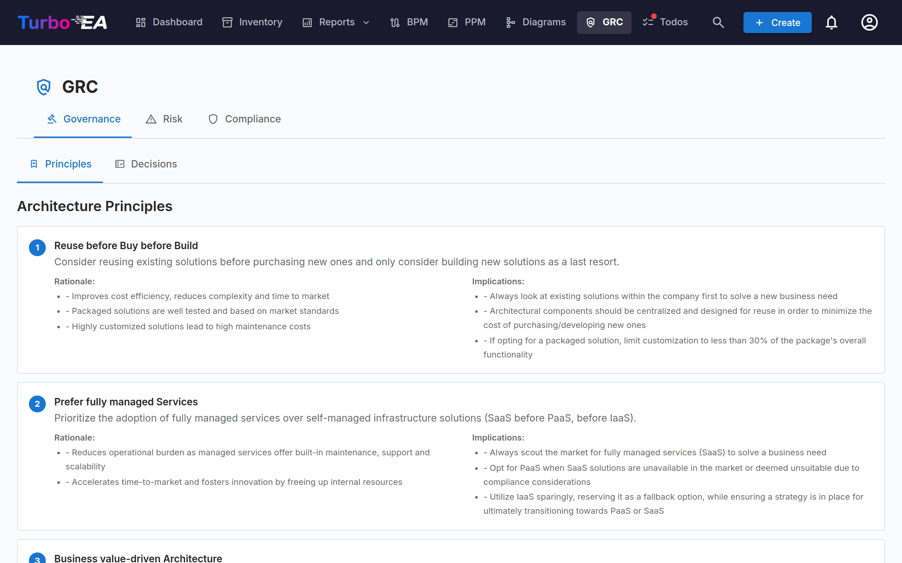
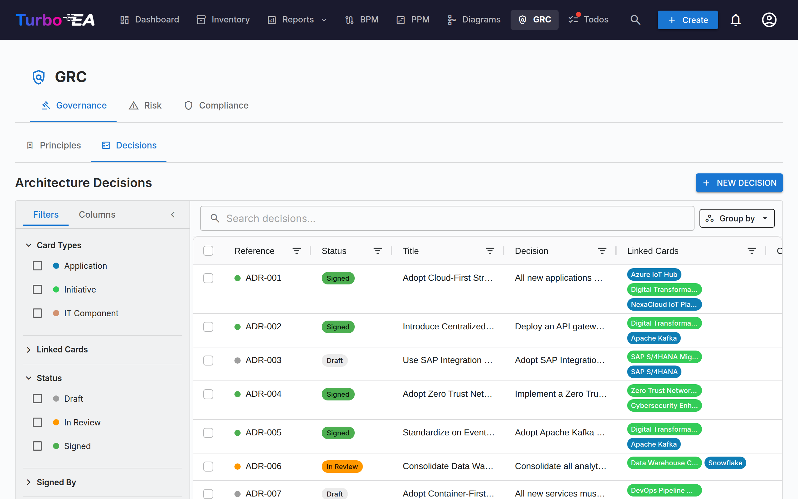
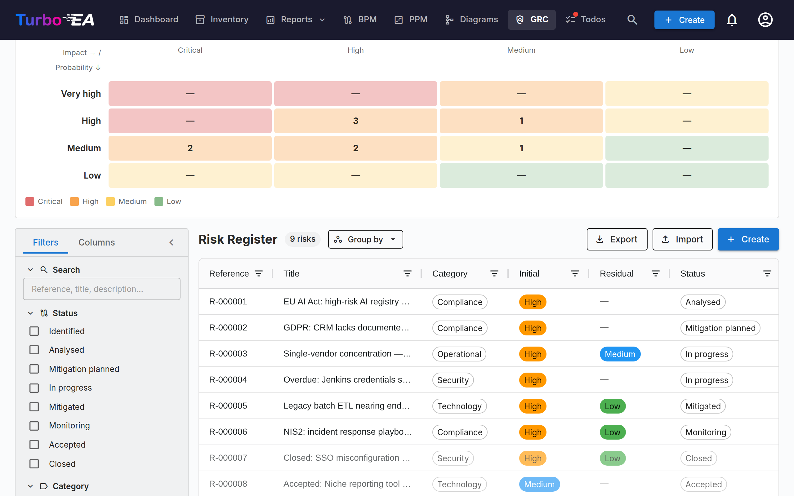
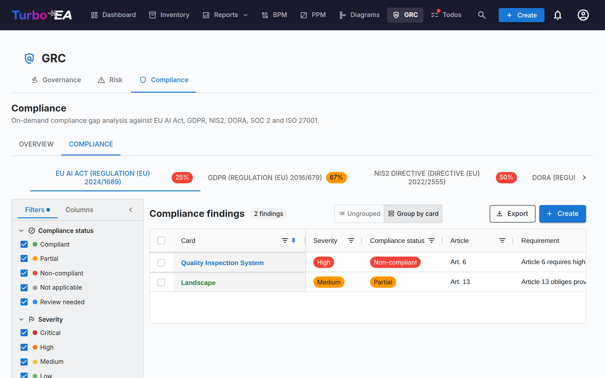

# GRC

The **GRC** module brings Governance, Risk and Compliance into a single workspace at `/grc`. It consolidates work that previously lived across EA Delivery and TurboLens so an architect, a risk owner and a compliance reviewer can stand on common ground.

!!! note
    The GRC module can be enabled or disabled by an administrator in [Settings](../admin/settings.md). When disabled, GRC navigation and features are hidden.

GRC has three tabs:

- **Governance** — EA Principles and Architecture Decision Records (ADRs).
- **Risk** — the TOGAF Phase G [Risk Register](risks.md).
- **Compliance** — the on-demand regulation gap-analysis scanner that used to sit in TurboLens.

You can deep-link any tab via `/grc?tab=governance`, `/grc?tab=risk` or `/grc?tab=compliance`.

## Governance

The Governance tab splits into two **sub-tabs**, deep-linkable via `/grc?tab=governance&sub=principles` (default) and `/grc?tab=governance&sub=decisions`:

### Principles

Read-only browser of EA Principles published in the metamodel (statement, rationale, implications). Edit the catalogue from **Administration → Metamodel → Principles**.

### Decisions

The Decisions sub-tab is the **master registry of Architecture Decision Records (ADRs)** — every ADR across the landscape, regardless of which initiative it's linked to. It replaces the old EA Delivery → Decisions tab that was dissolved when GRC landed.

ADRs document important architecture decisions along with their context, consequences, and alternatives considered. Decisions emitted by the TurboLens Architect wizard land here as drafts so reviewers can sign off.

The register answers one question first: **which decisions are in force today?** Every signed decision carries a [standing](#standing) that Turbo EA works out from its dates, its revisions and the other decisions that act on it, and the grid lists only the current revision of each decision unless you ask for the earlier ones.

The grid can also be **grouped by status** or **by standing** via the *Group by* button next to the search box: each status or standing collapses under its own header, and the header checkbox selects the whole group for a bulk export.

#### Status and standing {: #standing }

A decision has two separate states:

- **Status** is the sign-off workflow, and it is what you act on: **Draft** → **In Review** (signatures requested) → **Signed**. A decision taken outside Turbo EA and [recorded as decided](#recording-a-past-decision) shows **Recorded** instead of Signed.
- **Standing** says where a signed or recorded decision stands today. It is derived — never set by hand — and a draft or a decision in review has none (*Not signed yet*).

| Standing | Meaning |
|----------|---------|
| **Scheduled** | Signed, but its *Effective from* date has not come yet |
| **In force** | Signed and effective |
| **In force (amended)** | In force, and another signed decision amends it; the amendment is not yet folded into a [consolidated revision](#amendments-and-consolidated-revisions) |
| **Superseded** | A later revision of the same decision, or a decision that replaces it, has taken effect |
| **Revoked** | A signed decision that revokes it has taken effect |
| **Expired** | Its *Valid until* date has passed (it is in force through that day) |

The decision's page says why with a banner — *This decision has been superseded by …*, *This decision takes effect on …*, *Revision 3 takes effect on …* — with a link to the decision concerned.

#### Grid columns

The ADR grid mirrors the Inventory grid layout:

| Column | Description |
|--------|-------------|
| **Reference #** | Auto-generated reference number (ADR-001, ADR-002, …) with a status dot; a revision after the first adds its number (ADR-012 · Rev 2) |
| **Status** | Coloured chip — Draft, In Review, Signed or Recorded |
| **Standing** | Where a signed decision stands today — see [Status and standing](#standing); blank until it is signed |
| **Title** | ADR title |
| **Decision** | Plain-text excerpt of the decision |
| **Linked Cards** | Coloured pills matching each linked card's type colour |
| **Created By** | Author of the ADR |
| **Created** | Creation date |
| **Modified** | Last-modified date |
| **Signed** | Date the ADR was signed |
| **Signed By** | One pill per signatory who has signed |
| **Decided on** / **Effective from** / **Valid until** | The decision's [dates](#decision-dates) |
| **Decision makers** | The people who took the decision |

Every column has a **header filter** — text filters on text columns, date filters on the date columns — each with its own **Reset** button. As soon as any column filter is active, a **Clear column filters** button appears in the grid toolbar to clear them all at once. Column widths, order, sorting, and active filters are remembered per browser.

#### Filter sidebar

The persistent sidebar on the left has two tabs:

- **Filters** — facet filters over the ADR list:
    - **In force** — one click shows only the decisions in force today (In force and In force (amended)); click it again to clear it
    - **Show earlier revisions** — off by default, so each decision appears once, as its current revision (plus a revision being drafted). Switch it on to list the earlier revisions too; the **Export** button follows the same switch
    - **Card Types** — checkboxes with coloured dots that filter by linked card types
    - **Linked Cards** — filter by specific linked cards
    - **Status** — Draft / In Review / Signed (a recorded decision counts as signed)
    - **Standing** — Scheduled / In force / In force (amended) / Superseded / Revoked / Expired / Not signed yet
    - **Signed By** — filter by signatory
    - **Date Created** / **Date Modified** / **Date Signed** / **Date Decided** — from/to date ranges (**Date Decided** matches a signed or recorded decision's *Decided on* date)
- **Columns** — choose which grid columns are visible. **Reference #** and **Title** are always shown; **Reset** restores the default set. Your selection is remembered per browser.

Use the **quick filter** search bar for full-text search across all ADRs. Right-click any row for a context menu (**Edit**, **Preview**, **Duplicate**, **Delete**).

#### Exporting and importing decisions {: #decisions-import }

**Export** (next to **+ New ADR**) downloads the decisions the filter sidebar currently shows as an `.xlsx` file, one row per decision revision. The columns, in order: `reference_number`, `title`, `status`, `revision_number`, the four sections (`context`, `decision`, `consequences`, `alternatives_considered`) as plain text, `cards` and `related_decisions` (semicolon-separated), `author`, `signatories`, `signed_at`, `created_at`, `updated_at`, then the register's own facts — `standing` (as a key such as `in_force`), `decided_on`, `effective_from`, `valid_until`, `decision_makers`, `participants`, and the typed links `replaces`, `amends`, `revokes` and `consolidates` as references. Formatting such as bold or links is not carried into the spreadsheet. To share fully formatted decisions instead, select rows in the grid and use the grid's own **Export** button, which writes a Word document.

**Import** creates decisions in bulk from an `.xlsx` file. Click **Download template** for a starter workbook, fill in one decision per row and upload it:

- Every row becomes a new **draft** decision with the next `ADR-NNN` reference. Status and signatures are never imported — a decision is signed through the [sign-off workflow](#sign-off-workflow) — and the preview warns about a row whose `status` is anything other than draft.
- A row whose `reference_number` already belongs to a decision is **skipped**: the importer never changes an existing decision, so re-importing an export changes nothing.
- `title` is required. In the four section columns, a blank line starts a new paragraph, lines starting with `- ` become a bulleted list and lines starting with `1. ` a numbered list.
- `cards` links cards by exact name, among the cards you can see; a card that cannot be found, or whose name is shared by several cards, is skipped with a warning and the decision still imports.
- `related_decisions` lists references, either of existing decisions or of other rows in the same file (even later rows); each becomes a **Relates to** link. A reference that has several revisions links to its current one.
- Every other column — standing, dates, people and the typed links included — is ignored: an import creates drafts, never signed or recorded decisions.
- An export holds one row per revision, so a file can carry several rows for one reference (an open revision, or earlier revisions when **Show earlier revisions** is on). On the instance it came from they are all skipped; elsewhere only the row with the highest `revision_number` is imported (the last row when the numbers are equal or missing) and each other row is skipped with the warning *Earlier revision of ADR-012 skipped*. A `related_decisions` entry naming that reference links to the imported row.

The preview shows how many rows will be created, skipped and failed, with each error and warning listed by row; nothing is written until you confirm. Importing requires the `adr.manage` permission.

#### Creating an ADR

ADRs can be created from three places — all open the same editor and feed the same registry:

1. **GRC → Governance → Decisions**: click **+ New ADR**, fill in the title and optionally link cards (including initiatives).
2. **EA Delivery workspace**: select an initiative, then click **+ New artefact ▾** in the page header (or **+ Add** in the *Architecture Decisions* deliverable section) and choose **New Architecture Decision** — the initiative is pre-linked.
3. **Card → Resources tab**: click **Create ADR** — the current card is pre-linked.

In every case, you can search and link additional cards during creation. Initiatives are linked through the same card-linking mechanism as any other card, so an ADR can reference multiple initiatives. The editor opens with sections for **Context**, **Decision**, **Consequences**, and **Alternatives Considered**.

#### The ADR editor

The editor provides:

- Rich-text editing for each section (Context, Decision, Consequences, Alternatives Considered)
- **Mentions** — type **@** in a section to mention a card or another decision (see [Mentions](#decision-mentions))
- **Discussion** — a panel beside the document with its discussion (see [Discussion](#decision-discussion))
- **History** — a button at the top of the page that opens the decision's timeline and its saved versions (see [History](#decision-history))
- Card linking — connect the ADR to relevant cards (applications, IT components, initiatives, …). Initiatives are linked via the standard card-linking feature, not a dedicated field, so an ADR can reference multiple initiatives
- **Dates** — *Decided on*, *Effective from* and an optional *Valid until* (see [Dates](#decision-dates))
- **People** — the *Decision makers* and *Participants* (see [People](#decision-people))
- **This decision…** — typed links to other decisions (see [Links between decisions](#decision-links))
- **Change summary** — on a revision only: what changed in this revision, and why
- **Files** — documents attached to the decision (see [Files](#decision-files))

#### Dates {: #decision-dates }

- **Decided on** — the day the decision was taken. It cannot be in the future.
- **Effective from** — the day it takes effect. Until then a signed decision is **Scheduled**.
- **Valid until** — optional, for a time-boxed decision such as a waiver. The day after it, the decision is **Expired**. It cannot be earlier than *Effective from*, nor already past when the decision is sent for review.

Left empty, *Decided on* and *Effective from* take the date of the final signature. A renewal of an expired decision is a new revision or a new decision, signed like any other.

#### People {: #decision-people }

**Decision makers** are the people who took the decision; **Participants** are the people who took part in it. Pick a Turbo EA user, or type a name and press Enter for someone who has no account. Both are recorded separately from the **signatories**, who approve the record in Turbo EA. When you request signatures, **Add decision makers** in the dialog adds every decision maker who is a Turbo EA user to the signatories in one click.

#### Links between decisions {: #decision-links }

The **This decision…** section of a decision links it to others. Pick the kind of link and the decision, and optionally add a note for a partial case — for example *section 3 only*:

| Link | Shown on the other decision as | Effect once this decision is signed and effective |
|------|-------------------------------|---------------------------------------------------|
| **Replaces** | Replaced by | The other decision becomes **Superseded** |
| **Amends** | Amended by | The other decision becomes **In force (amended)** |
| **Revokes** | Revoked by | The other decision becomes **Revoked** |
| **Relates to** | Related to | None — a cross-reference |

Links are shown on both decisions and point to the decision's current revision. They act on the whole decision, all its revisions included, and only once the decision carrying them is signed and effective: a draft that revokes another changes nothing until it is signed, and one with a later *Effective from* acts on that date (the other decision says *This decision will be revoked by … on …*). A decision cannot link to one of its own revisions, and every decision it links to must be signed before it is sent for review or recorded.

#### Revoking or replacing a decision

A signed decision is never retired by hand: it is revoked or replaced by another signed decision, so the register keeps who decided it and when. Open the signed decision and use the **Revise** menu:

- **Revise this decision** — a new revision of the same decision, under the same reference (see [Revisions](#revisions)).
- **Replace with a new decision** — a new draft titled *Replaces: …* that already carries a **Replaces** link and the same linked cards.
- **Revoke** — a new draft titled *Revocation of ADR-012 — …* that already carries a **Revokes** link and the same linked cards.

Complete the new draft and send it through sign-off like any other decision. The menu is not offered on an earlier revision (open the current one) or on a decision that has already been revoked or replaced. When a signed decision replaces, amends or revokes another, the author of that decision receives an **ADR Standing Changed** notification.

#### Amendments and consolidated revisions

A decision that another one amends stays in force, and its page lists the amending decisions. To give readers one current text, click **Create consolidated revision** on that banner: it starts a revision of the amended decision that names the amending decision (*Consolidates the amendment of …*). Fold the amendment into the text, describe it in the **Change summary**, and send the revision for sign-off. Once it is signed and effective, the decision is **In force** again, and the amending decision shows *The amendment made by this decision is consolidated into …*. An amendment also stops counting once the amending decision is revoked, replaced or expires — but not when it is merely revised: its revision keeps the amendment, and the banner names the amending decision's current revision.

#### Files {: #decision-files }

The **Files** section attaches documents to a decision — a signed minute, a supporting analysis. Files accept the same formats as [card attachments](card-details.md#resources-tab), up to 20 MB each, and can be uploaded only while file uploads are enabled (deleting one is always possible). They can be added and deleted on a saved draft only: once the decision is sent for review they are locked with it. A revision carries its decision's files over.

#### Sign-off workflow

ADRs support a formal sign-off process:

1. Create the ADR in **Draft** status.
2. Click **Request Signatures** and search for signatories by name or email (or click **Add decision makers**). Signatures can only be requested from a draft.
3. The ADR moves to **In Review** — each signatory receives a notification and a task.
4. Signatories review and click **Sign**.
5. Once every signatory has signed, the ADR automatically moves to **Signed**.

**A decision in review is locked**, so signatories sign exactly what they were sent: the text, the dates, the people, the links, the files and the extension panels are read-only, and only the linked cards can still change. To edit it, click **Recall Signatures**, which returns it to draft. A signatory who clicks **Reject** also returns it to draft, under the same revision number.

Signed ADRs are locked and cannot be edited — to make changes, create a new revision.

#### Recording a past decision {: #recording-a-past-decision }

A decision taken outside Turbo EA — at a board meeting before the register existed, say — can be entered as decided without collecting signatures. Write it as a draft, name at least one decision maker, then click **Record as decided** and give the **Decided on** date (not in the future) and, if it differs, the **Effective from** date (it defaults to the decided date).

The decision is then locked like a signed one and gets its standing, but its status reads **Recorded**, and its page says *Recorded by … on …, not signed in Turbo EA*. Recording needs the `adr.record` permission, which only the Admin role holds by default, and each recording appears in the [Security & admin log](../admin/audit-log.md) as `admin.adr.recorded`. A revision draft can be recorded too, as long as its decided date is not before its previous revision's.

#### Revisions

Open a signed ADR and choose **Revise → Revise this decision** to create a new draft based on the signed version. The revision keeps the decision's reference and takes the next revision number — **ADR-012 · Rev 2** — and inherits the content, linked cards, **Relates to** links, people, files and *Valid until* date. It does not inherit the decided and effective dates, the signatories, the change summary or the replaces / amends / revokes links, which stay on the revision that made them. Each revision keeps its own sign-off trail.

- **One open revision at a time.** While a revision is being drafted, the current revision says so and the **Revise** menu opens that draft instead of starting another.
- **The current revision is the one in force.** Once a revision is signed and effective, the earlier ones are **Superseded** and show a banner linking to the current one. The **Revisions** strip on every revision lists the whole chain and marks the current one.
- **Only the current revision can be revised**, and not once the decision has been revoked or replaced. An expired or amended decision can still be revised.
- **A rejection does not count as a revision**: the revision number only moves when a new revision is created.
- Decisions revised before version 2.199.0 keep the reference numbers they were issued, and still read as one decision with one revision strip.

#### Preview

Click the preview icon to view a read-only, formatted version of the ADR — useful for reviewing before signing.

From the preview click **PDF** to open a print-ready copy in a new tab — metadata and dates, the four sections, people, linked cards, links to other decisions, file names, extension sections and the signature block (or the recorded line), with the approver and print date in the footer. The editor has the same **PDF** button plus **Word**, which downloads the decision as a `.docx` until it is signed; both export what is currently in the editor, unsaved edits included.

#### Discussion {: #decision-discussion }

Every decision has its own **Discussion**, so a decision can be settled in Turbo EA instead of in a separate chat thread. Open it with the discussion button on the decision's editor or preview: on a wide screen it opens as a panel beside the document, on a narrower one as a drawer. The panel's title shows how many threads are open. The decision's [History](#decision-history) is not in this panel: it opens from the **History** button at the top of the page.

- **Threads and replies.** Type in the box at the top of the panel and click **Post** (or press Ctrl+Enter, Cmd+Enter on a Mac) to start a thread. To tag it to a section, click one of the section chips above the box — *Context*, *Decision*, *Alternatives Considered* or *Consequences*; click the chosen chip again to untag it. A thread with no section is a general one. Each thread takes replies, one level deep; a thread keeps the section it was started with, and its section chip shows at the top of the thread.
- **Filtering by section.** Once a thread has a section, a row of chips at the top of the discussion lists each section that has threads, with how many (*Decision (2)*), and a **General** chip when some threads have no section. Click a chip to show only its threads; turn on several to see the threads of any of them, click one again to turn it off, or click **Clear**. Clicking a thread's own section chip turns its filter on. The filter works with the resolved threads folded or not and with the earlier revisions shown, and counts only the threads listed. It is not kept when you leave the document, and a thread opened from a notification is always shown.
- **Discussion on a section.** Every section shows a small chat icon beside its heading, on the editor and the preview, for people who may comment (people who may only read see it only on sections with threads): the number of open threads when the section has discussion, a muted icon once all of them are resolved. Click it to open the discussion filtered to that section, with the resolved threads unfolded when none of them is open, and the section already selected for a new comment (the icon is never printed or exported).
- **Resolve and reopen.** Click **Resolve** once a thread is settled and **Reopen** if it is not. Resolved threads fold away behind **Show N resolved threads**.
- **Who can post.** Reading the discussion follows who can open the decision (`adr.view`). Posting, replying, resolving and reopening need the `adr.comment` permission, which members and admins hold by default and viewers do not; an administrator can change it per role. The decision's signatories can always comment on it, including the people asked to sign it in an earlier review round that was recalled or rejected.
- **During review and after signing.** The [review lock](#sign-off-workflow) covers the content, not the conversation: the discussion stays open while the decision is in review and after it is signed.
- **Review notes.** When a signatory rejects a decision, the reason opens a thread marked **Rejection reason** (*No reason given* when the signatory left it empty), to be answered and resolved like any other. A signatory can add an optional note when signing; it appears in the discussion as a **Signing note**. Neither is lost any more when signatures are recalled, and both are also shown in the [History](#decision-history).
- **Open threads before review.** **Request Signatures**, **Sign** and **Reject** warn when the decision still has open threads (*2 open discussion threads on this document.*). It is a warning only: nothing is blocked.
- **Notifications.** A new comment notifies the decision's author, its signatories, its decision makers and participants who are Turbo EA users, and the people who commented before — never the person who posted it. Type **@** in a comment to mention a colleague: they receive a mention notification instead. Someone you mention who cannot open the decision is not notified, and the panel tells you so (*… was not notified: they cannot open this document.*). Notifications carry no comment text, and clicking one opens the decision's preview with the panel on that thread. See [Notifications](notifications.md#notification-types).
- **Editing and deleting.** You can edit your own comments; an edited comment is marked *(edited)*. You can delete your own comments, and anyone who can edit the decision (`adr.manage`) can delete any comment; a deleted comment shrinks to one small line in its place, with its author, its date and *Comment deleted*. Deleting the first comment of a thread closes the thread: the replies already there stay, but nobody can reply to it, resolve it or reopen it. A rejection reason and a signing note cannot be edited or deleted: a rejection is resolved instead.
- **Earlier revisions.** A thread belongs to the revision it was started on. Switch on **Show discussion on earlier revisions** to read the threads of the decision's earlier revisions, grouped by revision.

#### Mentions {: #decision-mentions }

While writing a decision, type **@** in any of its four sections to mention a **card** or another **decision**. A popup lists matching cards and decisions as you type; use the arrow keys and Enter (or click) to pick one, and Escape to close it. In a comment, **@** also offers **people**. Each entry says what it is: a card shows its type's colour and icon, its type, its subtype and the card it sits under (*Application · Microservice · in Finance Suite*, when you may see that card); a decision shows its reference (*ADR-012 · Rev 2*), its title and its standing; a person shows a name and an e-mail address. A mention appears as a chip carrying the current name of what it points to — a card's name, a decision's reference and title — so renaming a card never changes the text. Click a card or decision chip to open it.

- **What comes first.** With nothing typed after **@**, the cards linked to the decision come first, then the other cards in alphabetical order; in a comment, the decision's signatories, decision makers and participants come first among the people. As you type, the best matches come first as everywhere else in Turbo EA, and among equally good matches the linked cards and the decision's people lead.
- **Browse.** The last entry of the popup, **Browse…**, and the **Mention…** button (**@**) in the editor's toolbar open a dialog with the standard pickers: **Cards** (the card picker of the rest of Turbo EA, with its type list, hierarchy and search), **Decisions** (a searchable list) and, in a comment, **People**. Pick as many as you need on any tab and click **Insert**: one mention per pick is inserted, in the order you picked them, separated by spaces — in place of what you typed after **@** when the dialog was opened from the popup. **Cancel** inserts nothing.
- A reader who may not see a mentioned card sees **Restricted card** instead of its name, on every surface — the editor, the preview, the PDF and Word exports, the grid, the history and the discussion. A reader who cannot open decisions sees **Restricted decision**. Saving the text keeps such mentions as they are, even when the person saving cannot see them.
- A mentioned card that has since been deleted reads **Deleted card** (a deleted decision, **Deleted decision**), since the text stores no names.
- A mention does not link the card. When the text mentions cards that are not linked, the editor lists them under *Mentioned in the text but not linked:*, each with a **Link this card** button. Linking cards in the editor uses the same card picker as the rest of Turbo EA.
- **Mentioned in.** A card's [ADRs tab](card-details.md#adrs-tab) and a decision's preview list, under **Mentioned in**, the decisions and SoAWs whose text mentions that card or decision, and those whose discussion does (marked *in the discussion*). The list only shows documents you can open.

#### History {: #decision-history }

The **History** button at the top of the decision's editor or preview, beside the revision strip when the decision has several revisions, opens one wide view: the timeline on the left, the selected version on the right. The timeline records what happened to the decision, newest first: created, saved, sent for review, each signature (with its note), rejected (with the reason), signatures recalled, fully signed, recorded as decided, a revision started, an earlier version restored. Everyone who can open the decision sees this timeline. Review events — sent for review, signed, recalled, rejected — are kept from version 2.200.0 on; before, they were shown live but never stored. Decisions that existed before that version start with a timeline rebuilt from what was stored: created, revised, sent for review (for a decision in review at the upgrade, with the signatories it was sent to), each signature, signed and recorded.

The History is not the hand-kept **Document Version History** table of a [Statement of Architecture Work](delivery.md#the-soaw-editor), which records what the authors choose to write in it.

- **Versions.** A version is kept each time a draft is saved with changes. It holds the title, the four sections, the dates, the change summary and the people; links, linked cards and files are not part of a version. The steps that hold a version are marked in the timeline; the people who can edit the decision and its signatories select one to show it on the right, and the newest version is selected when the view opens. Other readers see the timeline without the versions (*Saved versions are shown to editors and signatories only.*). On a narrow screen the view shows the timeline first, then the selected version with a **Back** button.
- **Changes.** Above the selected version, **Version** shows it as it was saved and **Changes** shows what changed between it and the version before it, word by word per section, together with the dates and people that changed; pick any other version under **Compare with**. Only the versions already loaded in the timeline can be compared: when the version before the selected one is not loaded yet, **Changes** says so, and **Load more** brings it in. A change of formatting alone is reported as *Formatting only: the words are the same.*
- **Restore.** On a draft, someone who can edit the decision can restore the selected version with **Restore this version**. Restoring is forward only: the version's text, dates and people replace the draft's and are kept as a new version, and the draft's state before the restore stays in the history. Links, linked cards and files are not restored. When the editor holds unsaved edits, the confirmation says they will be discarded. Once restored, the page shows the restored decision and the view closes. A decision in review or signed cannot be restored.

#### Known limits {: #collaboration-limits }

- A deleted card reads **Deleted card** wherever it was mentioned: the text stores no names, so the old name cannot be shown.
- Two people saving the same draft still overwrite each other: the last save wins. The history keeps both saves, so the overwritten wording can be found and restored.
- The discussion is not part of the PDF, Word or spreadsheet exports, nor of the printed copy.
- A role that can open decisions but has no inventory access cannot search cards in the mention popup (*Your role cannot search cards; you can still mention decisions.*).
- Text copied from one document into another loses its **Restricted** chips: a restricted mention can only be kept in the document it was written in.
- Who was asked to sign in a review round rejected or recalled before version 2.200.0 cannot be reconstructed, so those people do not count as signatories of that revision. A round still open at the upgrade keeps its signatories.

## Risk

Embeds the TOGAF Phase G **Risk Register**. The full lifecycle, status workflow, matrix toggles and ownership behaviour are documented in the [Risk Register guide](risks.md). The most relevant points:

- The register lives at `/grc?tab=risk` (it used to live under EA Delivery).
- Risks can be created manually or **promoted** from a compliance finding under the Compliance tab.
- Promotion is idempotent — once a finding has been promoted its button flips to **Open risk R-000123**.

## Compliance

The Compliance tab is a dual-source register — findings can be **authored manually** by a reviewer **or** produced by an on-demand **AI scan** against any of the enabled regulations (EU AI Act, GDPR, NIS2, DORA, SOC 2, ISO 27001 ship enabled by default). Both kinds of finding share the same lifecycle, can be promoted to a Risk, and are bulk-actionable from the grid. See the [Compliance guide](compliance.md) for the full lifecycle, the manual-create dialog, the scan workflow, the EU AI Act semantic detector, and the promotion-to-Risk loop.

The same Compliance tab also appears on Card Detail (auto-hides when the card has no linked findings) so an Application owner can triage their own findings without leaving the card.

## Permissions

| Permission | Default roles |
|------------|---------------|
| `grc.view` | admin, bpm_admin, member, viewer |
| `grc.manage` | admin, bpm_admin, member |
| `adr.view` / `adr.manage` / `adr.sign` | `adr.view`: admin, bpm_admin, member, viewer; `adr.manage` and `adr.sign`: admin, bpm_admin, member |
| `adr.record` | admin — [record a past decision as decided](#recording-a-past-decision) |
| `adr.comment` | admin, bpm_admin, member — post in a decision's [discussion](#decision-discussion); a decision's signatories can always comment on it |
| `risks.view` / `risks.manage` | see [Risk Register § Permissions](risks.md) |
| `compliance.view` / `compliance.manage` | see [TurboLens § Security & Compliance](turbolens.md) |

`grc.view` controls visibility of the GRC route itself — without it the top-nav entry is hidden. Each tab additionally enforces its domain-specific permission so a viewer can read the register without being able to trigger an LLM scan, for example.
