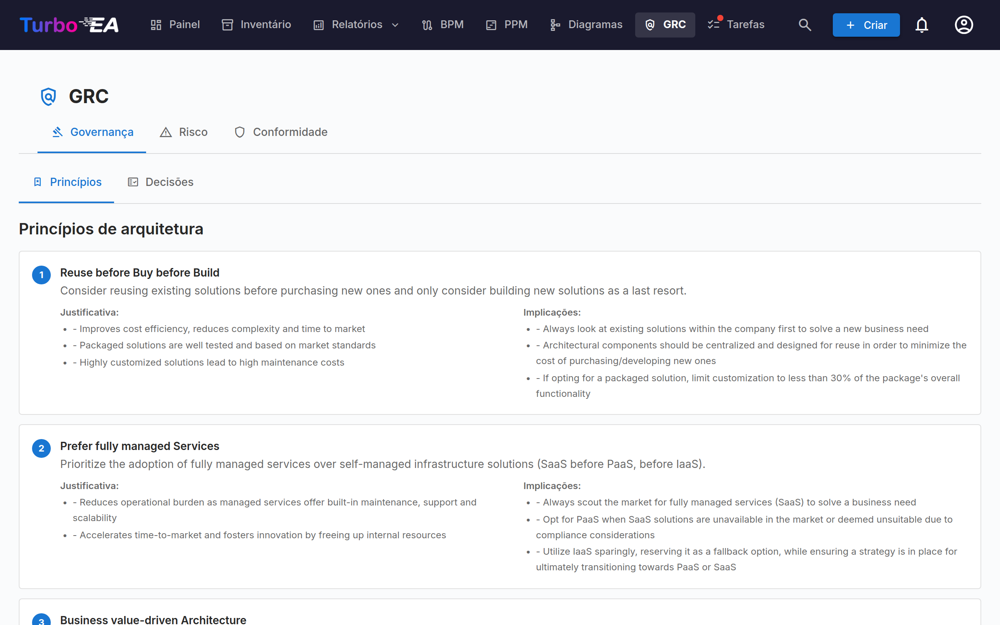
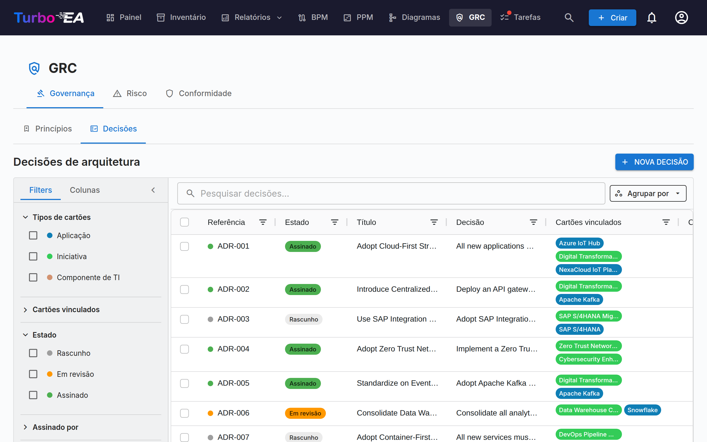
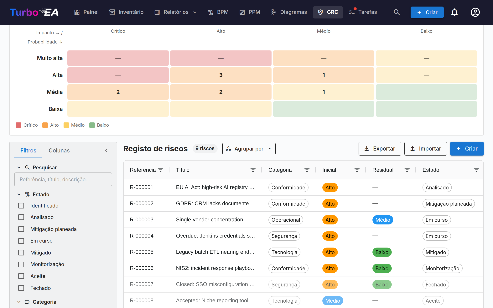
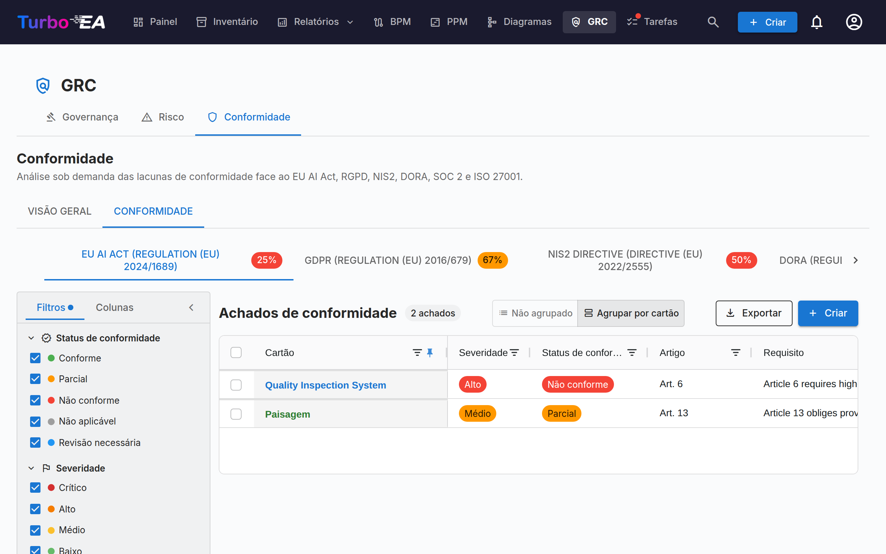

# GRC

O módulo **GRC** reúne Governança, Risco e Conformidade num único espaço de trabalho em `/grc`. Consolida tarefas que antes viviam entre Entrega EA e TurboLens, para que arquitetas, proprietários de risco e revisores de conformidade trabalhem sobre um terreno comum.

!!! note
    O módulo GRC pode ser habilitado ou desabilitado por um administrador em [Configurações](../admin/settings.md). Quando desabilitado, a navegação e os recursos do GRC ficam ocultos.

GRC tem três abas:

Você pode apontar diretamente para qualquer aba via `/grc?tab=governance`, `/grc?tab=risk` ou `/grc?tab=compliance`.

## Governança

A aba Governança divide-se em duas **sub-abas**, com link profundo via `/grc?tab=governance&sub=principles` (padrão) e `/grc?tab=governance&sub=decisions`:

### Princípios

Visualizador somente leitura dos Princípios EA publicados no metamodelo (declaração, justificativa, implicações). O catálogo é editado em **Administração → Metamodelo → Princípios**.

### Decisões

A sub-aba Decisões é o **registro principal dos Architecture Decision Records (ADR)** — cada ADR ao longo do panorama, independentemente da iniciativa à qual está vinculado. Substitui a antiga aba Decisões de Entregas de EA, dissolvida quando o módulo GRC entrou em cena.

Os ADR documentam decisões de arquitetura importantes junto com seu contexto, consequências e alternativas consideradas. As decisões emitidas pelo assistente TurboLens Architect chegam aqui como rascunhos para aprovação.

O registo responde antes de mais a uma pergunta: **que decisões estão em vigor hoje?** Cada decisão assinada tem uma [vigência](#standing) que o Turbo EA calcula a partir das suas datas, das suas revisões e das outras decisões que atuam sobre ela, e a grelha lista apenas a revisão atual de cada decisão, a menos que peça também as anteriores.

A grelha também pode ser **agrupada por estado** ou **por vigência** através do botão *Agrupar por* junto à caixa de pesquisa: cada estado ou vigência recolhe-se sob o seu próprio cabeçalho, e a caixa de seleção do cabeçalho seleciona todo o grupo para uma exportação em massa.

#### Status e vigência {: #standing }

Uma decisão tem dois estados distintos:

- O **Status** é o fluxo de assinatura, e é sobre ele que atua: **Rascunho** → **Em Revisão** (assinaturas solicitadas) → **Assinado**. Uma decisão tomada fora do Turbo EA e [registada como decidida](#recording-a-past-decision) mostra **Registado** em vez de Assinado.
- A **Vigência** indica a situação atual de uma decisão assinada ou registada. É derivada — nunca definida manualmente — e um rascunho ou uma decisão em revisão não tem nenhuma (*Ainda não assinada*).

| Vigência | Significado |
|----------|-------------|
| **Agendada** | Assinada, mas a data *Em vigor desde* ainda não chegou |
| **Em vigor** | Assinada e efetiva |
| **Em vigor (alterada)** | Em vigor, e outra decisão assinada altera-a; a alteração ainda não foi integrada numa [revisão consolidada](#amendments-and-consolidated-revisions) |
| **Substituída** | Uma revisão posterior da mesma decisão, ou uma decisão que a substitui, entrou em vigor |
| **Revogada** | Uma decisão assinada que a revoga entrou em vigor |
| **Expirada** | A sua data *Válida até* já passou (está em vigor até esse dia, inclusive) |

A página da decisão indica o motivo com um banner — *Esta decisão foi substituída por …*, *Esta decisão entra em vigor em …*, *A revisão 3 entra em vigor em …* — com uma ligação para a decisão em causa.

#### Colunas da tabela

A grade de ADR espelha o layout da grade de Inventário:

| Coluna | Descrição |
|--------|-----------|
| **N.º de ref.** | Número de referência gerado automaticamente (ADR-001, ADR-002, …) com um ponto de status; uma revisão após a primeira acrescenta o seu número (ADR-012 · Rev. 2) |
| **Status** | Chip colorido — Rascunho, Em Revisão, Assinado ou Registado |
| **Vigência** | A situação atual de uma decisão assinada — ver [Status e vigência](#standing); vazia até ser assinada |
| **Título** | Título do ADR |
| **Decisão** | Trecho em texto simples da decisão |
| **Cards vinculados** | Pílulas coloridas correspondentes à cor do tipo de cada card vinculado |
| **Criado por** | Autor do ADR |
| **Criado** | Data de criação |
| **Modificado** | Data da última modificação |
| **Assinado** | Data de assinatura |
| **Assinado por** | Uma pílula por signatário que assinou |
| **Decidida em** / **Em vigor desde** / **Válida até** | As [datas](#decision-dates) da decisão |
| **Decisores** | As pessoas que tomaram a decisão |

Cada coluna possui um **filtro de cabeçalho** — filtros de texto nas colunas de texto, filtros de data nas colunas de data — cada um com seu próprio botão **Redefinir**. Assim que algum filtro de coluna está ativo, um botão **Limpar filtros de coluna** aparece na barra de ferramentas da grade para limpá-los todos de uma vez. Largura, ordem e ordenação das colunas e os filtros ativos são lembrados por navegador.

#### Barra lateral de filtros

A barra lateral persistente à esquerda tem duas abas:

- **Filtros** — filtros de facetas sobre a lista de ADRs:
    - **Em vigor** — um clique mostra apenas as decisões em vigor hoje (Em vigor e Em vigor (alterada)); clique novamente para o limpar
    - **Mostrar revisões anteriores** — desativado por predefinição, para que cada decisão apareça uma só vez, como a sua revisão atual (mais uma revisão em redação). Ative-o para listar também as revisões anteriores; o botão **Exportar** segue a mesma opção
    - **Tipos de card** — caixas de seleção com pontos coloridos que filtram por tipos de cards vinculados
    - **Cards vinculados** — filtrar por cards vinculados específicos
    - **Status** — Rascunho / Em Revisão / Assinado (uma decisão registada conta como assinada)
    - **Vigência** — Agendada / Em vigor / Em vigor (alterada) / Substituída / Revogada / Expirada / Ainda não assinada
    - **Assinado por** — filtrar por signatário
    - **Data de criação / modificação / assinatura / da decisão** — intervalos de datas de/até (**Data da decisão** corresponde à data *Decidida em* de uma decisão assinada ou registada)
- **Colunas** — escolha quais colunas da grade ficam visíveis. **N.º de ref.** e **Título** são sempre exibidos; **Redefinir** restaura a seleção padrão. Sua escolha é lembrada por navegador.

Use a barra de **filtro rápido** para pesquisa de texto completo. Clique com o botão direito em qualquer linha para um menu de contexto (**Editar**, **Pré-visualizar**, **Duplicar**, **Excluir**).

#### Exportar e importar decisões {: #decisions-import }

**Exportar** (junto a **+ Nova decisão**) transfere as decisões que a barra lateral de filtros mostra atualmente como um ficheiro `.xlsx`, uma linha por revisão de decisão. As colunas, por ordem: `reference_number`, `title`, `status`, `revision_number`, as quatro secções (`context`, `decision`, `consequences`, `alternatives_considered`) como texto simples, `cards` e `related_decisions` (separadas por ponto e vírgula), `author`, `signatories`, `signed_at`, `created_at`, `updated_at`, e depois os dados próprios do registo — `standing` (como chave, por exemplo `in_force`), `decided_on`, `effective_from`, `valid_until`, `decision_makers`, `participants`, e as ligações tipificadas `replaces`, `amends`, `revokes` e `consolidates` como referências. A formatação, como o negrito ou as ligações, não passa para a folha de cálculo. Para partilhar decisões com toda a formatação, selecione linhas na grelha e utilize o botão **Export** da própria grelha, que gera um documento Word.

**Importar** cria decisões em massa a partir de um ficheiro `.xlsx`. Clique em **Transferir modelo** para obter um livro inicial, preencha uma decisão por linha e carregue-o:

- Cada linha torna-se uma nova decisão em **rascunho** com a próxima referência `ADR-NNN`. O estado e as assinaturas nunca são importados — uma decisão é assinada através do **fluxo de assinatura** — e a pré-visualização avisa sobre uma linha cujo `status` não seja rascunho (draft).
- Uma linha cuja `reference_number` já pertence a uma decisão é **ignorada**: a importação nunca altera uma decisão existente, pelo que reimportar uma exportação não altera nada.
- `title` é obrigatório. Nas quatro colunas de secção, uma linha em branco inicia um novo parágrafo, as linhas que começam por `- ` tornam-se uma lista com marcadores e as que começam por `1. ` uma lista numerada.
- `cards` associa fichas pelo nome exato, entre as fichas que pode ver; uma ficha que não é encontrada, ou cujo nome é partilhado por várias fichas, é ignorada com um aviso e a decisão é importada na mesma.
- `related_decisions` lista referências, quer de decisões existentes, quer de outras linhas do mesmo ficheiro (mesmo linhas posteriores); cada uma torna-se uma ligação **Relaciona-se com**. Uma referência com várias revisões liga-se à revisão atual.
- Todas as outras colunas — vigência, datas, pessoas e ligações tipificadas incluídas — são ignoradas: uma importação cria rascunhos, nunca decisões assinadas ou registadas.
- Uma exportação contém uma linha por revisão, pelo que um ficheiro pode ter várias linhas para a mesma referência (uma revisão aberta, ou revisões anteriores quando **Mostrar revisões anteriores** está ativo). Na instância de origem são todas ignoradas; noutras instâncias apenas a linha com o `revision_number` mais alto é importada (a última linha quando os números são iguais ou estão em falta) e cada uma das outras linhas é ignorada com o aviso *Revisão anterior de ADR-012 ignorada*. Uma entrada de `related_decisions` que indique essa referência liga-se à linha importada.

A pré-visualização mostra quantas linhas serão criadas, ignoradas e quantas falharão, com cada erro e aviso listado por linha; nada é escrito até confirmar. A importação requer a permissão `adr.manage`.

#### Criar um ADR

Os ADR podem ser criados a partir de três locais — todos abrem o mesmo editor e alimentam o mesmo registro:

1. **GRC → Governança → Decisões**: clique em **+ Novo ADR**, preencha o título e opcionalmente vincule cards (incluindo iniciativas).
2. **Espaço de trabalho de Entregas de EA**: selecione uma iniciativa, clique em **+ Novo artefato ▾** no cabeçalho da página (ou **+ Adicionar** na secção *Decisões de Arquitetura*) e escolha **Nova Decisão de Arquitetura** — a iniciativa fica pré-vinculada.
3. **Card → aba Recursos**: clique em **Criar ADR** — o card atual fica pré-vinculado.

Em todos os casos você pode pesquisar e vincular cards adicionais durante a criação. As iniciativas são vinculadas através do mesmo mecanismo de vinculação de cards de qualquer outro card, de modo que um ADR pode referenciar múltiplas iniciativas. O editor abre com seções para **Contexto**, **Decisão**, **Consequências** e **Alternativas Consideradas**.

#### O Editor de ADR

O editor oferece:

- Edição de texto rico para cada seção (Contexto, Decisão, Consequências, Alternativas Consideradas)
- **Menções** — escreva **@** numa seção para mencionar um card ou outra decisão (ver [Menções](#decision-mentions))
- **Discussão** — um painel ao lado do documento com a sua discussão (ver [Discussão](#decision-discussion))
- **Histórico** — um botão no topo da página que abre a cronologia da decisão e as suas versões guardadas (ver [Histórico](#decision-history))
- Vinculação de cards — conecte o ADR a cards relevantes (aplicações, componentes de TI, iniciativas, …). As iniciativas são vinculadas através da vinculação padrão de cards, não por um campo dedicado, permitindo que um ADR referencie múltiplas iniciativas
- **Datas** — *Decidida em*, *Em vigor desde* e um *Válida até* opcional (ver [Datas](#decision-dates))
- **Pessoas** — os *Decisores* e os *Participantes* (ver [Pessoas](#decision-people))
- **Esta decisão…** — ligações tipificadas a outras decisões (ver [Ligações entre decisões](#decision-links))
- **Resumo das alterações** — apenas numa revisão: o que mudou nesta revisão e porquê
- **Ficheiros** — documentos anexados à decisão (ver [Ficheiros](#decision-files))

#### Datas {: #decision-dates }

- **Decidida em** — o dia em que a decisão foi tomada. Não pode estar no futuro.
- **Em vigor desde** — o dia em que entra em vigor. Até lá, uma decisão assinada está **Agendada**.
- **Válida até** — opcional, para uma decisão com prazo limitado, como uma derrogação. No dia seguinte, a decisão fica **Expirada**. Não pode ser anterior a *Em vigor desde*, nem já ter passado quando a decisão é enviada para revisão.

Se ficarem vazias, *Decidida em* e *Em vigor desde* assumem a data da assinatura final. A renovação de uma decisão expirada é uma nova revisão ou uma nova decisão, assinada como qualquer outra.

#### Pessoas {: #decision-people }

Os **Decisores** são as pessoas que tomaram a decisão; os **Participantes** são as pessoas que nela participaram. Escolha um utilizador do Turbo EA, ou escreva um nome e prima Enter para alguém que não tem conta. Ambos são registados separadamente dos **signatários**, que aprovam o registo no Turbo EA. Ao solicitar assinaturas, **Adicionar decisores** na caixa de diálogo adiciona aos signatários, com um só clique, todos os decisores que são utilizadores do Turbo EA.

#### Ligações entre decisões {: #decision-links }

A secção **Esta decisão…** de uma decisão liga-a a outras. Escolha o tipo de ligação e a decisão e, opcionalmente, acrescente uma nota para um caso parcial — por exemplo *apenas a secção 3*:

| Ligação | Mostrada na outra decisão como | Efeito quando esta decisão está assinada e efetiva |
|---------|--------------------------------|----------------------------------------------------|
| **Substitui** | Substituída por | A outra decisão fica **Substituída** |
| **Altera** | Alterada por | A outra decisão fica **Em vigor (alterada)** |
| **Revoga** | Revogada por | A outra decisão fica **Revogada** |
| **Relaciona-se com** | Relacionada com | Nenhum — uma referência cruzada |

As ligações são mostradas em ambas as decisões e apontam para a revisão atual da decisão. Atuam sobre a decisão inteira, incluindo todas as suas revisões, e só depois de a decisão que as contém estar assinada e efetiva: um rascunho que revoga outra decisão não altera nada até ser assinado, e um com uma data *Em vigor desde* posterior atua nessa data (a outra decisão indica *Esta decisão será revogada por … em …*). Uma decisão não pode ligar-se a uma das suas próprias revisões, e todas as decisões a que se liga têm de estar assinadas antes de ser enviada para revisão ou registada.

#### Revogar ou substituir uma decisão

Uma decisão assinada nunca é retirada manualmente: é revogada ou substituída por outra decisão assinada, para que o registo guarde quem a decidiu e quando. Abra a decisão assinada e utilize o menu **Revisar**:

- **Revisar esta decisão** — uma nova revisão da mesma decisão, com a mesma referência (ver [Revisões](#revisions)).
- **Substituir por uma nova decisão** — um novo rascunho intitulado *Substitui: …* que já contém uma ligação **Substitui** e os mesmos cards vinculados.
- **Revogar** — um novo rascunho intitulado *Revogação de ADR-012 — …* que já contém uma ligação **Revoga** e os mesmos cards vinculados.

Complete o novo rascunho e envie-o pelo fluxo de assinatura como qualquer outra decisão. O menu não está disponível numa revisão anterior (abra a atual) nem numa decisão já revogada ou substituída. Quando uma decisão assinada substitui, altera ou revoga outra, o autor dessa decisão recebe uma notificação **Vigência de ADR alterada**.

#### Alterações e revisões consolidadas {: #amendments-and-consolidated-revisions }

Uma decisão alterada por outra continua em vigor, e a sua página lista as decisões que a alteram. Para dar aos leitores um único texto atual, clique em **Criar revisão consolidada** nesse banner: inicia uma revisão da decisão alterada que indica a decisão que a altera (*Consolida a alteração de …*). Integre a alteração no texto, descreva-a no **Resumo das alterações** e envie a revisão para assinatura. Quando estiver assinada e efetiva, a decisão volta a estar **Em vigor**, e a decisão que a alterava mostra *A alteração feita por esta decisão está consolidada em …*. Uma alteração também deixa de contar quando a decisão que a faz é revogada, substituída ou expira — mas não quando é apenas revisada: a sua revisão mantém a alteração, e o banner indica a revisão atual da decisão que a faz.

#### Ficheiros {: #decision-files }

A secção **Ficheiros** anexa documentos a uma decisão — uma ata assinada, uma análise de suporte. Os ficheiros aceitam os mesmos formatos que os [anexos dos cards](card-details.md#resources-tab), até 20 MB cada, e só podem ser carregados enquanto o carregamento de ficheiros estiver ativado (eliminar um é sempre possível). Só podem ser adicionados e eliminados num rascunho guardado: assim que a decisão é enviada para revisão, ficam bloqueados com ela. Uma revisão transporta os ficheiros da sua decisão.

#### Fluxo de Assinatura

Os ADR suportam um processo formal de assinatura:

1. Crie o ADR no status **Rascunho**.
2. Clique em **Solicitar Assinaturas** e pesquise signatários por nome ou e-mail (ou clique em **Adicionar decisores**). Só é possível solicitar assinaturas a partir de um rascunho.
3. O ADR passa para **Em Revisão** — cada signatário recebe uma notificação e uma tarefa.
4. Os signatários revisam e clicam em **Assinar**.
5. Quando todos os signatários assinarem, o ADR passa automaticamente para o status **Assinado**.

**Uma decisão em revisão fica bloqueada**, para que os signatários assinem exatamente o que lhes foi enviado: o texto, as datas, as pessoas, as ligações, os ficheiros e os painéis de extensões ficam só de leitura, e apenas os cards vinculados ainda podem mudar. Para a editar, clique em **Recolher assinaturas**, o que a devolve a rascunho. Um signatário que clique em **Rejeitar** também a devolve a rascunho, com o mesmo número de revisão.

ADR assinados ficam bloqueados e não podem ser editados — para mudanças crie uma nova revisão.

#### Registar uma decisão passada {: #recording-a-past-decision }

Uma decisão tomada fora do Turbo EA — numa reunião do conselho de administração antes de o registo existir, por exemplo — pode ser introduzida como decidida sem recolher assinaturas. Redija-a como rascunho, indique pelo menos um decisor, clique em **Registar como decidida** e indique a data **Decidida em** (não no futuro) e, se for diferente, a data **Em vigor desde** (por predefinição, a data da decisão).

A decisão fica então bloqueada como uma decisão assinada e recebe a sua vigência, mas o seu status indica **Registado**, e a sua página diz *Registada por … em …, não assinada no Turbo EA*. O registo exige a permissão `adr.record`, que por predefinição só o papel Admin tem, e cada registo aparece no [registo de Segurança e administração](../admin/audit-log.md) como `admin.adr.recorded`. Um rascunho de revisão também pode ser registado, desde que a sua data de decisão não seja anterior à da revisão anterior.

#### Revisões {: #revisions }

Abra um ADR assinado e escolha **Revisar → Revisar esta decisão** para criar um novo rascunho baseado na versão assinada. A revisão mantém a referência da decisão e recebe o número de revisão seguinte — **ADR-012 · Rev. 2** — e herda o conteúdo, os cards vinculados, as ligações **Relaciona-se com**, as pessoas, os ficheiros e a data *Válida até*. Não herda as datas de decisão e de entrada em vigor, os signatários, o resumo das alterações nem as ligações substitui / altera / revoga, que ficam na revisão que as criou. Cada revisão mantém o seu próprio rastro de assinaturas.

- **Uma revisão aberta de cada vez.** Enquanto uma revisão está a ser redigida, a revisão atual indica-o e o menu **Revisar** abre esse rascunho em vez de iniciar outro.
- **A revisão atual é a que está em vigor.** Quando uma revisão está assinada e efetiva, as anteriores ficam **Substituídas** e mostram um banner com uma ligação para a atual. A faixa **Revisões** em cada revisão lista a cadeia completa e assinala a atual.
- **Só a revisão atual pode ser revisada**, e não depois de a decisão ter sido revogada ou substituída. Uma decisão expirada ou alterada ainda pode ser revisada.
- **Uma rejeição não conta como revisão**: o número de revisão só muda quando é criada uma nova revisão.
- As decisões revisadas antes da versão 2.199.0 mantêm os números de referência com que foram emitidas, e continuam a ler-se como uma única decisão com uma única faixa de revisões.

#### Pré-visualização

Clique no ícone de pré-visualização para ver uma versão somente leitura e formatada do ADR — útil para revisão antes de assinar.

Na pré-visualização, clique em **PDF** para abrir uma cópia pronta para impressão em uma nova aba — metadados e datas, as quatro seções, pessoas, cartões vinculados, ligações a outras decisões, nomes dos ficheiros, seções de extensões e o bloco de assinaturas (ou a linha de registo), com o aprovador e a data de impressão no rodapé. O editor tem o mesmo botão **PDF** mais **Word**, que baixa a decisão como `.docx` enquanto ela não estiver assinada; ambos exportam o estado atual do editor, incluindo alterações não salvas.

#### Discussão {: #decision-discussion }

Cada decisão tem a sua própria **Discussão**, para que uma decisão possa ser resolvida no Turbo EA em vez de num tópico de chat à parte. Abra-a com o botão de discussão no editor ou na pré-visualização da decisão: num ecrã largo abre-se como um painel ao lado do documento, num mais estreito como uma gaveta lateral. O título do painel mostra quantos tópicos estão abertos. O [Histórico](#decision-history) da decisão não está neste painel: abre-se com o botão **Histórico** no topo da página.

- **Tópicos e respostas.** Escreva na caixa no topo do painel e clique em **Publicar** (ou prima Ctrl+Enter, Cmd+Enter num Mac) para iniciar um tópico. Para o associar a uma seção, clique numa das etiquetas de seção por cima da caixa — *Contexto*, *Decisão*, *Alternativas Consideradas* ou *Consequências*; clique de novo na etiqueta escolhida para o desassociar. Um tópico sem seção é um tópico geral. Cada tópico aceita respostas, com um só nível de profundidade; um tópico mantém a seção com que foi iniciado, e a sua etiqueta de seção aparece no topo do tópico.
- **Filtrar por seção.** Assim que um tópico tem uma seção, uma fila de etiquetas no topo da discussão lista cada seção que tem tópicos, com quantos (*Decisão (2)*), e uma etiqueta **Geral** quando alguns tópicos não têm seção. Clique numa etiqueta para mostrar apenas os seus tópicos; ative várias para ver os tópicos de qualquer uma delas, clique de novo numa para a desativar, ou clique em **Limpar**. Clicar na etiqueta de seção de um tópico ativa o respetivo filtro. O filtro funciona com os tópicos resolvidos recolhidos ou não e com as revisões anteriores mostradas, e conta apenas os tópicos listados. Não é mantido quando sai do documento, e um tópico aberto a partir de uma notificação é sempre mostrado.
- **Discussão numa seção.** Cada seção mostra um pequeno ícone de chat ao lado do seu título, no editor e na pré-visualização, para as pessoas que podem comentar (quem só pode ler vê-o apenas nas seções com tópicos): o número de tópicos abertos quando a seção tem discussão, ou um ícone esbatido quando todos estão resolvidos. Clique nele para abrir a discussão filtrada por essa seção, com os tópicos resolvidos expandidos quando nenhum está aberto e a seção já selecionada para um novo comentário (o ícone nunca é impresso nem exportado).
- **Resolver e reabrir.** Clique em **Resolver** quando um tópico estiver encerrado e em **Reabrir** se não estiver. Os tópicos resolvidos ficam recolhidos atrás de **Mostrar N tópicos resolvidos**.
- **Quem pode publicar.** A leitura da discussão segue quem pode abrir a decisão (`adr.view`). Publicar, responder, resolver e reabrir exigem a permissão `adr.comment`, que os membros e administradores têm por predefinição e os visualizadores não; um administrador pode alterá-la por papel. Os signatários da decisão podem sempre comentá-la, incluindo as pessoas a quem foi pedido que a assinassem numa ronda de revisão anterior que foi recolhida ou rejeitada.
- **Durante a revisão e após a assinatura.** O [bloqueio de revisão](#fluxo-de-assinatura) abrange o conteúdo, não a conversa: a discussão continua aberta enquanto a decisão está em revisão e depois de assinada.
- **Notas de revisão.** Quando um signatário rejeita uma decisão, o motivo abre um tópico marcado como **Motivo da rejeição** (*Nenhum motivo indicado* quando o signatário o deixou vazio), que se responde e resolve como qualquer outro. Um signatário pode acrescentar uma nota opcional ao assinar; esta aparece na discussão como **Nota de assinatura**. Nenhum dos dois se perde já quando as assinaturas são recolhidas, e ambos aparecem também no [Histórico](#decision-history).
- **Tópicos abertos antes da revisão.** **Solicitar assinaturas**, **Assinar** e **Rejeitar** avisam quando a decisão ainda tem tópicos abertos (*2 tópicos de discussão abertos neste documento.*). É apenas um aviso: nada é bloqueado.
- **Notificações.** Um novo comentário notifica o autor da decisão, os seus signatários, os seus decisores e participantes que sejam utilizadores do Turbo EA, e as pessoas que comentaram antes — nunca quem o publicou. Escreva **@** num comentário para mencionar um colega: este recebe uma notificação de menção em vez disso. Alguém que mencione e que não possa abrir a decisão não é notificado, e o painel indica-o (*… não foi notificado: não pode abrir este documento.*). As notificações não trazem o texto do comentário, e clicar numa abre a pré-visualização da decisão com o painel nesse tópico. Ver [Notificações](notifications.md#tipos-de-notificacao).
- **Editar e eliminar.** Pode editar os seus próprios comentários; um comentário editado é marcado como *(editado)*. Pode eliminar os seus próprios comentários, e quem pode editar a decisão (`adr.manage`) pode eliminar qualquer comentário; um comentário eliminado reduz-se, no seu lugar, a uma pequena linha com o seu autor, a sua data e *Comentário eliminado*. Eliminar o primeiro comentário de um tópico fecha o tópico: as respostas já existentes mantêm-se, mas ninguém pode responder-lhe, resolvê-lo ou reabri-lo. Um motivo de rejeição e uma nota de assinatura não podem ser editados nem eliminados: uma rejeição é resolvida em vez disso.
- **Revisões anteriores.** Um tópico pertence à revisão em que foi iniciado. Ative **Mostrar a discussão de revisões anteriores** para ler os tópicos das revisões anteriores da decisão, agrupados por revisão.

#### Menções {: #decision-mentions }

Ao redigir uma decisão, escreva **@** em qualquer uma das suas quatro seções para mencionar um **card** ou outra **decisão**. Uma janela pop-up lista os cards e as decisões correspondentes à medida que escreve; use as setas e Enter (ou clique) para escolher um, e Escape para a fechar. Num comentário, **@** também oferece **pessoas**. Cada entrada indica o que é: um card mostra a cor e o ícone do seu tipo, o seu tipo, o seu subtipo e o card sob o qual se encontra (*Aplicação · Microsserviço · em Finance Suite*, quando pode ver esse card); uma decisão mostra a sua referência (*ADR-012 · Rev 2*), o seu título e o seu estado; uma pessoa mostra um nome e um endereço de e-mail. Uma menção aparece como uma etiqueta (chip) com o nome atual daquilo para que aponta — o nome de um card, a referência e o título de uma decisão —, pelo que mudar o nome de um card nunca altera o texto. Clique numa etiqueta de card ou de decisão para a abrir.

- **O que aparece primeiro.** Sem nada escrito depois de **@**, os cards ligados à decisão aparecem primeiro, depois os outros cards por ordem alfabética; num comentário, os signatários, os decisores e os participantes da decisão aparecem primeiro entre as pessoas. À medida que escreve, as melhores correspondências aparecem primeiro, como em todo o Turbo EA, e entre correspondências igualmente boas, os cards ligados e as pessoas da decisão vêm à frente.
- **Procurar.** A última entrada da janela pop-up, **Procurar…**, e o botão **Mencionar…** (**@**) na barra de ferramentas do editor abrem uma caixa de diálogo com os seletores habituais: **Fichas** (o seletor de cards do resto do Turbo EA, com a sua lista de tipos, hierarquia e pesquisa), **Decisões** (uma lista pesquisável) e, num comentário, **Pessoas**. Escolha quantos precisar em qualquer aba e clique em **Inserir**: é inserida uma menção por escolha, pela ordem em que os escolheu, separadas por espaços — no lugar do que escreveu depois de **@** quando a caixa de diálogo foi aberta a partir da janela pop-up. **Cancelar** não insere nada.
- Um leitor que não pode ver um card mencionado vê **Ficha restrita** em vez do seu nome, em todo o lado — o editor, a pré-visualização, as exportações PDF e Word, a grelha, o histórico e a discussão. Um leitor que não pode abrir decisões vê **Decisão restrita**. Guardar o texto mantém essas menções como estão, mesmo quando quem guarda não as pode ver.
- Um card mencionado que entretanto foi eliminado aparece como **Ficha eliminada** (uma decisão eliminada, **Decisão eliminada**), uma vez que o texto não armazena nomes.
- Uma menção não vincula o card. Quando o texto menciona cards que não estão vinculados, o editor lista-os em *Fichas mencionadas no texto mas não vinculadas:*, cada um com um botão **Vincular esta ficha**. Vincular cards no editor usa o mesmo seletor de cards que o resto do Turbo EA.
- **Mencionado em.** A [aba ADR](card-details.md#aba-de-adr) de um card e a pré-visualização de uma decisão listam, em **Mencionado em**, as decisões e os SoAW cujo texto menciona esse card ou essa decisão, e aqueles cuja discussão o faz (assinalados *na discussão*). A lista só mostra os documentos que pode abrir.

#### Histórico {: #decision-history }

O botão **Histórico** no topo do editor ou da pré-visualização da decisão, ao lado da faixa de revisões quando a decisão tem várias revisões, abre uma vista ampla: a cronologia à esquerda, a versão selecionada à direita. A cronologia regista o que aconteceu à decisão, do mais recente para o mais antigo: criada, guardada, enviada para revisão, cada assinatura (com a sua nota), rejeitada (com o motivo), assinaturas recolhidas, totalmente assinada, registada como decidida, uma revisão iniciada, uma versão anterior restaurada. Todos os que podem abrir a decisão veem esta cronologia. Os eventos de revisão — enviada para revisão, assinada, recolhida, rejeitada — são guardados a partir da versão 2.200.0; antes, eram mostrados em direto mas nunca armazenados. As decisões que existiam antes dessa versão começam com uma cronologia reconstruída a partir do que estava armazenado: criada, revista, enviada para revisão (para uma decisão em revisão no momento da atualização, com os signatários a quem foi enviada), cada assinatura, assinada e registada.

O Histórico não é a tabela **Histórico de versões do documento**, mantida à mão, de um [Statement of Architecture Work](delivery.md#o-editor-de-soaw), que regista o que os autores decidem escrever nela.

- **Versões.** É guardada uma versão sempre que um rascunho é guardado com alterações. Contém o título, as quatro seções, as datas, o resumo das alterações e as pessoas; as ligações, os cards vinculados e os ficheiros não fazem parte de uma versão. Os passos que contêm uma versão estão assinalados na cronologia; as pessoas que podem editar a decisão e os seus signatários selecionam um para o mostrar à direita, e a versão mais recente fica selecionada quando a vista abre. Os outros leitores veem a cronologia sem as versões (*As versões guardadas só são mostradas a editores e signatários.*). Num ecrã estreito, a vista mostra primeiro a cronologia e depois a versão selecionada com um botão **Voltar**.
- **Alterações.** Por cima da versão selecionada, **Versão** mostra-a tal como foi guardada e **Alterações** mostra o que mudou entre ela e a versão anterior, palavra a palavra em cada seção, juntamente com as datas e as pessoas que mudaram; escolha qualquer outra versão em **Comparar com**. Só as versões já carregadas na cronologia podem ser comparadas: quando a versão anterior à selecionada ainda não está carregada, **Alterações** indica-o, e **Carregar mais** carrega-a. Uma alteração apenas de formatação é indicada como *Apenas formatação: as palavras são as mesmas.*
- **Restaurar.** Num rascunho, quem pode editar a decisão pode restaurar a versão selecionada com **Restaurar esta versão**. O restauro só avança: o texto, as datas e as pessoas da versão substituem os do rascunho e são guardados como uma nova versão, e o estado do rascunho antes do restauro fica no histórico. As ligações, os cards vinculados e os ficheiros não são restaurados. Quando o editor tem edições não guardadas, a confirmação avisa que serão descartadas. Depois do restauro, a página mostra a decisão restaurada e a vista fecha-se. Uma decisão em revisão ou assinada não pode ser restaurada.

#### Limitações conhecidas {: #collaboration-limits }

- Um card eliminado aparece como **Ficha eliminada** onde quer que tenha sido mencionado: o texto não armazena nomes, pelo que o nome antigo não pode ser mostrado.
- Duas pessoas que guardam o mesmo rascunho continuam a sobrepor-se: ganha a última gravação. O histórico mantém ambas as gravações, pelo que a redação sobreposta pode ser encontrada e restaurada.
- A discussão não faz parte das exportações PDF, Word ou de folha de cálculo, nem da cópia impressa.
- Um papel que pode abrir decisões mas não tem acesso ao inventário não pode pesquisar cards na janela de menções (*O seu papel não pode pesquisar fichas; ainda pode mencionar decisões.*).
- O texto copiado de um documento para outro perde as suas etiquetas **Restrito**: uma menção restrita só pode ser mantida no documento em que foi escrita.
- Quem foi chamado a assinar numa ronda de revisão rejeitada ou recolhida antes da versão 2.200.0 não pode ser reconstruído, pelo que essas pessoas não contam como signatárias dessa revisão. Uma ronda ainda aberta no momento da atualização mantém os seus signatários.

## Risco

Incorpora o **Registro de riscos** TOGAF Fase G. Ciclo de vida completo, fluxo de status, alternadores da matriz e comportamento dos proprietários estão documentados no [guia do Registro de riscos](risks.md). Os pontos mais relevantes:

## Conformidade

A aba Conformidade é um registro de fonte dupla — descobertas podem ser **redigidas manualmente** por um revisor **ou** produzidas por uma **varredura IA** sob demanda contra as regulamentações habilitadas (EU AI Act, LGPD/GDPR, NIS2, DORA, SOC 2, ISO 27001 vêm habilitadas por padrão). Ambos os tipos de descoberta compartilham o mesmo ciclo de vida, podem ser promovidos a um Risco e bulk-actionados a partir da grade. Veja o [guia de Conformidade](compliance.md) para o ciclo de vida completo, o diálogo de criação manual, o fluxo de varredura, o detector semântico EU AI Act e o loop de promoção a Risco.

A mesma aba Conformidade também aparece no Detalhe do card (auto-ocultada quando o card não tem descobertas vinculadas), de modo que um Application Owner possa triar suas descobertas sem sair do card.

## Permissões

| Permissão | Papéis padrão |
|-----------|---------------|
| `grc.view` | admin, bpm_admin, member, viewer |
| `grc.manage` | admin, bpm_admin, member |
| `adr.view` / `adr.manage` / `adr.sign` | `adr.view`: admin, bpm_admin, member, viewer; `adr.manage` e `adr.sign`: admin, bpm_admin, member |
| `adr.record` | admin — [registar uma decisão passada como decidida](#recording-a-past-decision) |
| `adr.comment` | admin, bpm_admin, member — publicar na [discussão](#decision-discussion) de uma decisão; os signatários de uma decisão podem sempre comentá-la |
| `risks.view` / `risks.manage` | ver [Registro de riscos § Permissões](risks.md) |
| `compliance.view` / `compliance.manage` | ver [TurboLens § Security & Compliance](turbolens.md) |

`grc.view` controla a visibilidade da própria rota GRC — sem ele, a entrada do menu superior fica oculta. Cada aba ainda impõe sua própria permissão de domínio, de modo que uma visualizadora possa ler o registro sem poder disparar uma varredura LLM, por exemplo.
