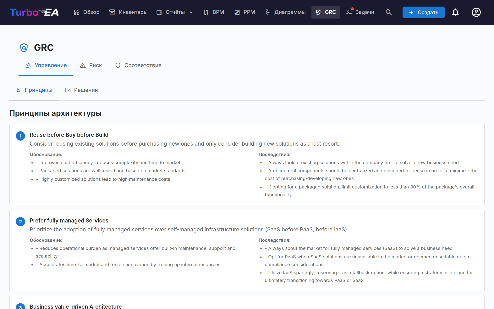
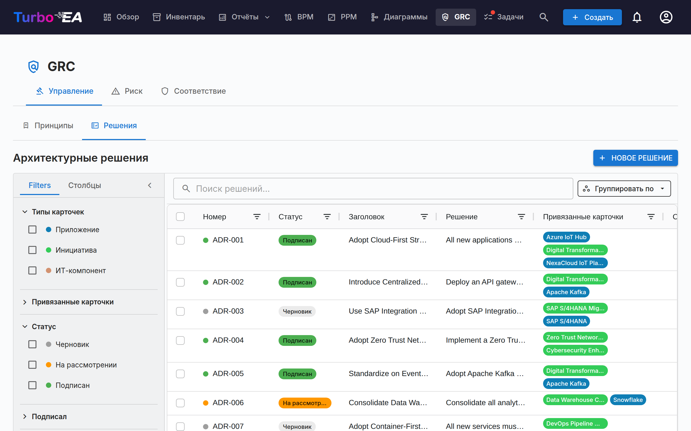
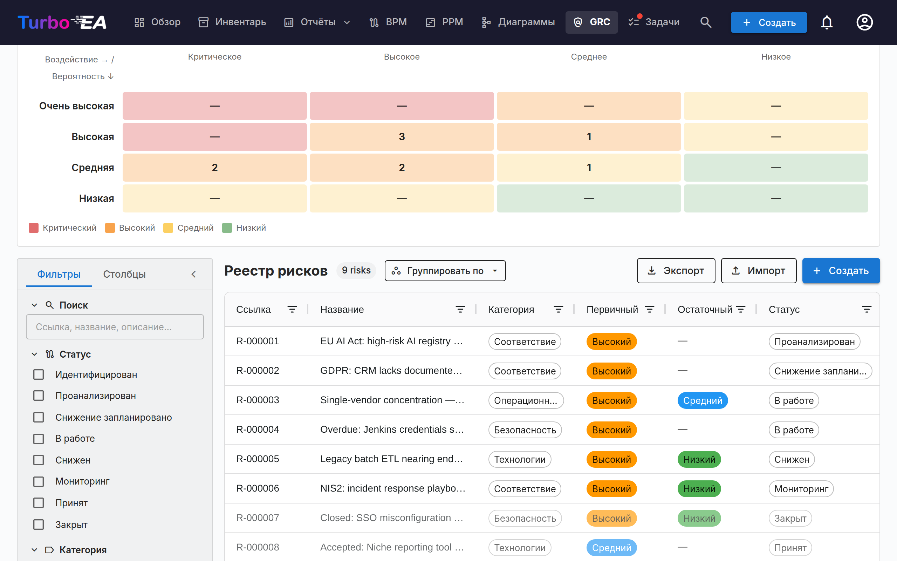
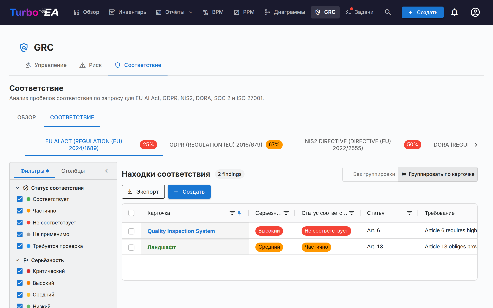

# GRC

Модуль **GRC** объединяет Управление, Риск и Соответствие в единое рабочее пространство по адресу `/grc`. Он консолидирует задачи, ранее разнесённые между «Поставкой EA» и TurboLens, чтобы архитектор, владелец риска и проверяющий по соответствию работали на общей основе.

!!! note
    Модуль GRC может быть включён или отключён администратором в [Настройках](../admin/settings.md). При отключении навигация и функции GRC скрыты.

В GRC три вкладки:

К любой вкладке можно перейти прямой ссылкой через `/grc?tab=governance`, `/grc?tab=risk` или `/grc?tab=compliance`.

## Управление

Вкладка «Управление» разделена на две **подвкладки** с прямыми ссылками `/grc?tab=governance&sub=principles` (по умолчанию) и `/grc?tab=governance&sub=decisions`:

### Принципы

Браузер только для чтения с EA-принципами, опубликованными в метамодели (формулировка, обоснование, последствия). Каталог редактируется в «Администрирование → Метамодель → Принципы».

### Решения

Подвкладка «Решения» — это **главный реестр Architecture Decision Records (ADR)** — каждый ADR в ландшафте независимо от того, с какой инициативой он связан. Она заменяет старую вкладку «Решения» в «Поставке EA», которая была упразднена при появлении модуля GRC.

ADR документируют важные архитектурные решения вместе с их контекстом, последствиями и рассмотренными альтернативами. Решения, выпущенные мастером TurboLens Architect, попадают сюда черновиками для утверждения.

Реестр прежде всего отвечает на один вопрос: **какие решения действуют сегодня?** У каждого подписанного решения есть [статус действия](#standing), который Turbo EA вычисляет по его датам, его редакциям и другим решениям, влияющим на него, а таблица показывает только текущую редакцию каждого решения, если вы не запросите более ранние.

Таблицу также можно **группировать по статусу** или **по статусу действия** с помощью кнопки *Группировать по* рядом с полем поиска: каждый статус или статус действия сворачивается под собственным заголовком, а флажок в заголовке выбирает всю группу для массового экспорта.

#### Статус и статус действия {: #standing }

У решения есть два независимых состояния:

- **Статус** — это процесс подписания, и именно с ним вы работаете: **Черновик** → **На рассмотрении** (подписи запрошены) → **Подписан**. Решение, принятое вне Turbo EA и [зафиксированное как принятое](#recording-a-past-decision), вместо «Подписан» показывает **Зафиксирован**.
- **Статус действия** показывает, в каком положении подписанное или зафиксированное решение находится сегодня. Он вычисляется — никогда не задаётся вручную, — и у черновика или решения на рассмотрении его нет (*Ещё не подписано*).

| Статус действия | Значение |
|-----------------|----------|
| **Запланировано** | Подписано, но дата *Действует с* ещё не наступила |
| **Действует** | Подписано и вступило в силу |
| **Действует (с изменениями)** | Действует, и другое подписанное решение изменяет его; изменение ещё не включено в [консолидированную редакцию](#amendments-and-consolidated-revisions) |
| **Заменено** | Вступила в силу более поздняя редакция того же решения или решение, которое его заменяет |
| **Отменено** | Вступило в силу подписанное решение, которое его отменяет |
| **Истекло** | Дата *Действует до* прошла (решение действует включительно по этот день) |

Страница решения объясняет причину баннером — *Это решение заменено решением …*, *Это решение вступает в силу …*, *Редакция 3 вступает в силу …* — со ссылкой на соответствующее решение.

#### Столбцы таблицы

Сетка ADR повторяет компоновку сетки «Инвентарь»:

| Столбец | Описание |
|---------|----------|
| **Номер ссылки** | Автоматически сгенерированный номер (ADR-001, ADR-002, …) с точкой статуса; у редакции после первой добавляется её номер (ADR-012 · Ред. 2) |
| **Статус** | Цветной чип — Черновик, На рассмотрении, Подписан или Зафиксирован |
| **Статус действия** | Положение подписанного решения на сегодня — см. [Статус и статус действия](#standing); пусто, пока решение не подписано |
| **Заголовок** | Заголовок ADR |
| **Решение** | Текстовый фрагмент решения |
| **Привязанные карточки** | Цветные метки, соответствующие цвету типа каждой привязанной карточки |
| **Создал** | Автор ADR |
| **Создан** | Дата создания |
| **Изменён** | Дата последнего изменения |
| **Подписан** | Дата подписания |
| **Подписали** | По одной метке на каждого подписавшего |
| **Дата принятия** / **Действует с** / **Действует до** | [Даты](#decision-dates) решения |
| **Лица, принявшие решение** | Люди, принявшие решение |

У каждого столбца есть **фильтр в заголовке** — текстовые фильтры для текстовых столбцов, фильтры дат для столбцов с датами — каждый со своей кнопкой **Сбросить**. Как только активен хотя бы один фильтр столбца, на панели инструментов сетки появляется кнопка **Сбросить фильтры столбцов**, очищающая их все сразу. Ширина, порядок и сортировка столбцов, а также активные фильтры запоминаются в браузере.

#### Боковая панель фильтров

Постоянная боковая панель слева содержит две вкладки:

- **Фильтры** — фасетные фильтры по списку ADR:
    - **Действует** — один щелчок показывает только решения, действующие сегодня («Действует» и «Действует (с изменениями)»); повторный щелчок снимает фильтр
    - **Показать более ранние редакции** — по умолчанию выключено, поэтому каждое решение отображается один раз, в виде текущей редакции (плюс готовящаяся редакция). Включите, чтобы показать и более ранние редакции; кнопка **Экспорт** следует тому же переключателю
    - **Типы карточек** — флажки с цветными точками для фильтрации по привязанным типам карточек
    - **Привязанные карточки** — фильтр по конкретным привязанным карточкам
    - **Статус** — Черновик / На рассмотрении / Подписан (зафиксированное решение считается подписанным)
    - **Статус действия** — Запланировано / Действует / Действует (с изменениями) / Заменено / Отменено / Истекло / Ещё не подписано
    - **Подписали** — фильтр по подписавшему
    - **Дата создания / изменения / подписания / принятия** — диапазоны дат «от/до» (**Дата принятия** сопоставляется с датой *Дата принятия* подписанного или зафиксированного решения)
- **Столбцы** — выбор видимых столбцов сетки. **Номер ссылки** и **Заголовок** отображаются всегда; **Сбросить** восстанавливает набор по умолчанию. Выбор запоминается в браузере.

Используйте панель **быстрого фильтра** для полнотекстового поиска. Правый клик по строке открывает контекстное меню (**Редактировать**, **Предварительный просмотр**, **Дублировать**, **Удалить**).

#### Экспорт и импорт решений {: #decisions-import }

**Экспорт** (рядом с **+ Новое решение**) скачивает решения, которые сейчас показывает боковая панель фильтров, в виде файла `.xlsx`, по одной строке на редакцию решения. Столбцы по порядку: `reference_number`, `title`, `status`, `revision_number`, четыре раздела (`context`, `decision`, `consequences`, `alternatives_considered`) простым текстом, `cards` и `related_decisions` (через точку с запятой), `author`, `signatories`, `signed_at`, `created_at`, `updated_at`, затем собственные сведения реестра — `standing` (в виде ключа, например `in_force`), `decided_on`, `effective_from`, `valid_until`, `decision_makers`, `participants` и типизированные связи `replaces`, `amends`, `revokes` и `consolidates` в виде номеров. Форматирование, например полужирный шрифт или ссылки, в таблицу не переносится. Чтобы поделиться полностью отформатированными решениями, выберите строки в сетке и воспользуйтесь кнопкой **Export** самой сетки, которая создаёт документ Word.

**Импорт** массово создаёт решения из файла `.xlsx`. Нажмите **Скачать шаблон**, чтобы получить заготовку книги, заполните по одному решению в строке и загрузите её:

- Каждая строка становится новым **черновиком** решения со следующим номером `ADR-NNN`. Статус и подписи никогда не импортируются — решение подписывается через **процесс подписания** — а предварительный просмотр предупреждает о строке, у которой `status` отличается от черновика (draft).
- Строка, чей `reference_number` уже принадлежит решению, **пропускается**: импорт никогда не изменяет существующее решение, поэтому повторный импорт экспорта ничего не меняет.
- `title` обязателен. В четырёх столбцах разделов пустая строка начинает новый абзац, строки, начинающиеся с `- `, становятся маркированным списком, а строки, начинающиеся с `1. `, — нумерованным.
- `cards` связывает карточки по точному названию среди карточек, которые вы видите; карточка, которую не удалось найти или название которой совпадает у нескольких карточек, пропускается с предупреждением, а решение всё равно импортируется.
- `related_decisions` перечисляет номера либо существующих решений, либо других строк того же файла (в том числе более поздних); каждый становится связью **Связано с**. Номер, у которого несколько редакций, связывается с текущей.
- Все остальные столбцы — включая статус действия, даты, людей и типизированные связи — игнорируются: импорт создаёт черновики, а не подписанные или зафиксированные решения.
- Экспорт содержит по одной строке на редакцию, поэтому в файле может быть несколько строк с одним номером (открытая редакция или более ранние редакции, если включено **Показать более ранние редакции**). На экземпляре, из которого получен файл, все они пропускаются; в другом месте импортируется только строка с наибольшим `revision_number` (последняя строка, если номера равны или отсутствуют), а каждая из остальных строк пропускается с предупреждением *Более ранняя редакция ADR-012 пропущена*. Запись `related_decisions` с этим номером связывается с импортированной строкой.

Предварительный просмотр показывает, сколько строк будет создано, пропущено и сколько завершится ошибкой, с перечнем каждой ошибки и предупреждения по строкам; пока вы не подтвердите, ничего не записывается. Для импорта требуется разрешение `adr.manage`.

#### Создание ADR

ADR можно создать из трёх мест — все они открывают один и тот же редактор и наполняют один и тот же реестр:

1. **GRC → Управление → Решения**: нажмите **+ Новый ADR**, заполните заголовок и при желании привяжите карточки (включая инициативы).
2. **Рабочее пространство «Поставка EA»**: выберите инициативу, затем нажмите **+ Новый артефакт ▾** в шапке (или **+ Добавить** в разделе *Архитектурные решения*) и выберите **Новое архитектурное решение** — инициатива предварительно привязывается.
3. **Карточка → вкладка «Ресурсы»**: нажмите **Создать ADR** — текущая карточка предварительно привязывается.

Во всех случаях вы можете искать и привязывать дополнительные карточки при создании. Инициативы привязываются через тот же механизм, что и любая другая карточка, поэтому ADR может ссылаться на несколько инициатив. Редактор открывается с секциями **Контекст**, **Решение**, **Последствия** и **Рассмотренные альтернативы**.

#### Редактор ADR

Редактор предоставляет:

- Редактирование форматированного текста для каждой секции (Контекст, Решение, Последствия, Рассмотренные альтернативы)
- **Упоминания** — введите **@** в секции, чтобы упомянуть карточку или другое решение (см. [Упоминания](#decision-mentions))
- **Обсуждение** — панель рядом с документом с его обсуждением (см. [Обсуждение](#decision-discussion))
- **История** — кнопка в верхней части страницы, которая открывает хронологию решения и его сохранённые версии (см. [История](#decision-history))
- Привязка карточек — связывайте ADR с подходящими карточками (приложения, ИТ-компоненты, инициативы, …). Инициативы привязываются стандартной привязкой карточек, а не отдельным полем, поэтому ADR может ссылаться на несколько инициатив
- **Даты** — *Дата принятия*, *Действует с* и необязательная *Действует до* (см. [Даты](#decision-dates))
- **Люди** — *Лица, принявшие решение* и *Участники* (см. [Люди](#decision-people))
- **Это решение…** — типизированные связи с другими решениями (см. [Связи между решениями](#decision-links))
- **Описание изменений** — только у редакции: что изменилось в этой редакции и почему
- **Файлы** — документы, прикреплённые к решению (см. [Файлы](#decision-files))

#### Даты {: #decision-dates }

- **Дата принятия** — день, когда решение было принято. Она не может быть в будущем.
- **Действует с** — день, когда решение вступает в силу. До этого дня подписанное решение имеет статус **Запланировано**.
- **Действует до** — необязательно, для решения с ограниченным сроком, например исключения. На следующий день решение получает статус **Истекло**. Эта дата не может быть раньше *Действует с* и не может уже пройти к моменту отправки решения на рассмотрение.

Если *Дата принятия* и *Действует с* не заполнены, они принимают дату последней подписи. Продление истёкшего решения — это новая редакция или новое решение, которое подписывается как любое другое.

#### Люди {: #decision-people }

**Лица, принявшие решение** — это люди, которые приняли решение; **Участники** — люди, которые участвовали в его принятии. Выберите пользователя Turbo EA или введите имя и нажмите Enter для человека без учётной записи. Оба списка хранятся отдельно от **подписантов**, которые утверждают запись в Turbo EA. При запросе подписей кнопка **Добавить лиц, принимающих решение** в диалоге одним щелчком добавляет в подписанты всех лиц, принявших решение, которые являются пользователями Turbo EA.

#### Связи между решениями {: #decision-links }

Раздел **Это решение…** связывает решение с другими. Выберите тип связи и решение и при необходимости добавьте примечание для частичного случая — например, *только раздел 3*:

| Связь | Отображается у другого решения как | Действие после того, как это решение подписано и вступило в силу |
|-------|------------------------------------|------------------------------------------------------------------|
| **Заменяет** | Заменено решением | Другое решение получает статус **Заменено** |
| **Изменяет** | Изменено решением | Другое решение получает статус **Действует (с изменениями)** |
| **Отменяет** | Отменено решением | Другое решение получает статус **Отменено** |
| **Связано с** | Связано с | Нет — перекрёстная ссылка |

Связи отображаются у обоих решений и указывают на текущую редакцию решения. Они действуют на всё решение, включая все его редакции, и только после того, как решение, которое их содержит, подписано и вступило в силу: черновик, отменяющий другое решение, ничего не меняет до подписания, а решение с более поздней датой *Действует с* действует с этой даты (другое решение сообщает *Это решение будет отменено решением … …*). Решение нельзя связать с одной из его собственных редакций, а каждое решение, с которым оно связано, должно быть подписано до отправки на рассмотрение или фиксации.

#### Отмена или замена решения

Подписанное решение никогда не выводится из действия вручную: его отменяет или заменяет другое подписанное решение, поэтому реестр хранит, кто и когда это решил. Откройте подписанное решение и воспользуйтесь меню **Пересмотреть**:

- **Пересмотреть это решение** — новая редакция того же решения под тем же номером (см. [Редакции](#revisions)).
- **Заменить новым решением** — новый черновик с заголовком *Заменяет: …*, который уже содержит связь **Заменяет** и те же привязанные карточки.
- **Отменить** — новый черновик с заголовком *Отмена ADR-012 — …*, который уже содержит связь **Отменяет** и те же привязанные карточки.

Заполните новый черновик и проведите его через подписание, как любое другое решение. Меню недоступно для более ранней редакции (откройте текущую) и для решения, которое уже отменено или заменено. Когда подписанное решение заменяет, изменяет или отменяет другое, автор того решения получает уведомление **Изменён статус действия ADR**.

#### Изменения и консолидированные редакции {: #amendments-and-consolidated-revisions }

Решение, которое изменяет другое решение, остаётся действующим, а на его странице перечислены изменяющие решения. Чтобы у читателей был один актуальный текст, нажмите **Создать консолидированную редакцию** на этом баннере: будет начата редакция изменённого решения, указывающая изменяющее решение (*Включает изменение из …*). Внесите изменение в текст, опишите его в поле **Описание изменений** и отправьте редакцию на подписание. После того как она подписана и вступила в силу, решение снова получает статус **Действует**, а изменяющее решение показывает *Изменение, внесённое этим решением, включено в …*. Изменение также перестаёт учитываться, когда изменяющее решение отменено, заменено или истекло, — но не когда оно просто пересмотрено: его редакция сохраняет изменение, а баннер называет текущую редакцию изменяющего решения.

#### Файлы {: #decision-files }

Раздел **Файлы** прикрепляет к решению документы — подписанный протокол, вспомогательный анализ. Файлы принимаются в тех же форматах, что и [вложения карточек](card-details.md#resources-tab), размером до 20 МБ каждый, и загружать их можно, только пока загрузка файлов включена (удалить файл можно всегда). Добавлять и удалять их можно только в сохранённом черновике: после отправки решения на рассмотрение они блокируются вместе с ним. Редакция переносит файлы своего решения.

#### Процесс подписания {: #sign-off-workflow }

ADR поддерживают формальный процесс подписания:

1. Создайте ADR в статусе **Черновик**.
2. Нажмите **Запросить подписи** и найдите подписантов по имени или электронной почте (или нажмите **Добавить лиц, принимающих решение**). Запросить подписи можно только из черновика.
3. ADR переходит в **На рассмотрении** — каждый подписант получает уведомление и Todo.
4. Подписанты просматривают и нажимают **Подписать**.
5. Когда все подписали, ADR автоматически переходит в **Подписан**.

**Решение на рассмотрении заблокировано**, поэтому подписанты подписывают ровно то, что им отправили: текст, даты, люди, связи, файлы и панели расширений доступны только для чтения, и изменить можно лишь привязанные карточки. Чтобы отредактировать решение, нажмите **Отозвать подписи** — оно вернётся в черновик. Подписант, нажавший **Отклонить**, также возвращает его в черновик с тем же номером редакции.

Подписанные ADR заблокированы и не редактируются — для изменений создаётся новая редакция.

#### Фиксация прошлого решения {: #recording-a-past-decision }

Решение, принятое вне Turbo EA — например, на заседании правления до появления реестра, — можно внести как принятое без сбора подписей. Оформите его как черновик, укажите хотя бы одно лицо, принимающее решение, затем нажмите **Зафиксировать как принятое** и укажите **Дату принятия** (не в будущем) и, если она отличается, дату **Действует с** (по умолчанию — дата принятия).

После этого решение блокируется, как подписанное, и получает статус действия, но его статус — **Зафиксирован**, а на странице указано *Зафиксировано пользователем … …, не подписано в Turbo EA*. Для фиксации нужно разрешение `adr.record`, которое по умолчанию есть только у роли Admin, и каждая фиксация отображается в [журнале безопасности и администрирования](../admin/audit-log.md) как `admin.adr.recorded`. Зафиксировать можно и черновик редакции, если его дата принятия не раньше даты принятия предыдущей редакции.

#### Редакции {: #revisions }

Откройте подписанный ADR и выберите **Пересмотреть → Пересмотреть это решение**, чтобы создать новый черновик на основе подписанной версии. Редакция сохраняет номер решения и получает следующий номер редакции — **ADR-012 · Ред. 2** — и наследует содержимое, привязанные карточки, связи **Связано с**, людей, файлы и дату *Действует до*. Она не наследует дату принятия и дату вступления в силу, подписантов, описание изменений и связи «заменяет» / «изменяет» / «отменяет», которые остаются у той редакции, что их создала. Каждая редакция сохраняет собственный след подписей.

- **Одновременно только одна открытая редакция.** Пока редакция готовится, текущая редакция сообщает об этом, а меню **Пересмотреть** открывает этот черновик вместо создания нового.
- **Действует текущая редакция.** Как только редакция подписана и вступила в силу, более ранние получают статус **Заменено** и показывают баннер со ссылкой на текущую. Полоса **Редакции** на каждой редакции перечисляет всю цепочку и отмечает текущую.
- **Пересмотреть можно только текущую редакцию**, и только пока решение не отменено и не заменено. Истёкшее или изменённое решение пересмотреть можно.
- **Отклонение не считается редакцией**: номер редакции меняется только при создании новой редакции.
- Решения, пересмотренные до версии 2.199.0, сохраняют выданные им номера и по-прежнему отображаются как одно решение с одной полосой редакций.

#### Предварительный просмотр

Нажмите иконку предварительного просмотра, чтобы увидеть отформатированную версию ADR только для чтения — удобно для просмотра перед подписанием.

В предпросмотре нажмите **PDF**, чтобы открыть готовую к печати копию в новой вкладке — метаданные и даты, четыре раздела, люди, связанные карточки, связи с другими решениями, имена файлов, разделы расширений и блок подписей (или строка о фиксации), с утверждающим и датой печати в нижнем колонтитуле. В редакторе есть та же кнопка **PDF** и **Word**, которая скачивает решение в виде `.docx`, пока оно не подписано; обе экспортируют текущее состояние редактора, включая несохранённые изменения.

#### Обсуждение {: #decision-discussion }

У каждого решения есть собственное **Обсуждение**, поэтому решение можно согласовать в Turbo EA, а не в отдельном чате. Откройте его кнопкой обсуждения в редакторе или предпросмотре решения: на широком экране оно открывается панелью рядом с документом, на более узком — выдвижной панелью. В заголовке панели видно, сколько веток открыто. [История](#decision-history) решения находится не на этой панели: она открывается кнопкой **История** в верхней части страницы.

- **Ветки и ответы.** Введите текст в поле вверху панели и нажмите **Отправить** (или Ctrl+Enter, Cmd+Enter на Mac), чтобы начать ветку. Чтобы привязать её к секции, нажмите один из чипов разделов над полем — *Контекст*, *Решение*, *Рассмотренные альтернативы* или *Последствия*; повторное нажатие на выбранный чип снимает привязку. Ветка без раздела считается общей. В каждой ветке можно отвечать, на один уровень вложенности; ветка сохраняет раздел, с которым была начата, и её чип раздела показывается вверху ветки.
- **Фильтр по разделам.** Как только у какой-либо ветки появляется раздел, вверху обсуждения появляется ряд чипов: по одному на каждый раздел, в котором есть ветки, с их количеством (*Решение (2)*), и чип **Общее**, если у некоторых веток нет раздела. Нажмите на чип, чтобы показать только его ветки; включите несколько, чтобы видеть ветки любого из них, нажмите на чип ещё раз, чтобы выключить его, или нажмите **Сбросить**. Нажатие на собственный чип раздела ветки включает его фильтр. Фильтр работает независимо от того, свёрнуты ли решённые ветки и показаны ли более ранние редакции, и учитывает только показанные ветки. Он не сохраняется, когда вы покидаете документ, а ветка, открытая из уведомления, показывается всегда.
- **Обсуждение раздела.** Каждый раздел показывает рядом со своим заголовком небольшой значок чата — в редакторе и в предпросмотре — тем, кто может комментировать (те, кто может только читать, видят его лишь у разделов с ветками): число открытых веток, если в разделе есть обсуждение, или приглушённый значок, когда все они решены. Нажмите на него, чтобы открыть обсуждение, отфильтрованное по этому разделу, причём решённые ветки будут развёрнуты, если среди них нет ни одной открытой, а раздел уже будет выбран для нового комментария (значок никогда не печатается и не экспортируется).
- **Отметка как решённой и повторное открытие.** Нажмите **Отметить как решённое**, когда вопрос в ветке закрыт, и **Открыть снова**, если нет. Решённые ветки сворачиваются за ссылкой **Показать N решённых веток**.
- **Кто может публиковать.** Чтение обсуждения доступно тем, кто может открыть решение (`adr.view`). Для публикации, ответа, отметки как решённого и повторного открытия нужно разрешение `adr.comment`, которое по умолчанию есть у участников и администраторов и нет у наблюдателей; администратор может изменить его для каждой роли. Подписанты решения всегда могут его комментировать, включая тех, кого просили подписать его в более раннем раунде рассмотрения, который был отозван или отклонён.
- **Во время рассмотрения и после подписания.** [Блокировка на время рассмотрения](#sign-off-workflow) распространяется на содержимое, а не на обсуждение: обсуждение остаётся открытым, пока решение находится на рассмотрении, и после его подписания.
- **Заметки рассмотрения.** Когда подписант отклоняет решение, причина открывает ветку с пометкой **Причина отклонения** (*Причина не указана*, если подписант оставил поле пустым), на которую можно отвечать и которую можно отметить как решённую, как любую другую. При подписании подписант может добавить необязательное примечание; оно появляется в обсуждении как **Примечание к подписи**. Ни то ни другое больше не теряется при отзыве подписей, и оба также показываются в [истории](#decision-history).
- **Открытые ветки перед рассмотрением.** **Запросить подписи**, **Подписать** и **Отклонить** предупреждают, если у решения ещё есть открытые ветки (*В этом документе 2 открытые ветки обсуждения.*). Это только предупреждение: ничего не блокируется.
- **Уведомления.** Новый комментарий уведомляет автора решения, его подписантов, лиц, принимающих решение, и участников, являющихся пользователями Turbo EA, а также тех, кто комментировал ранее, — но никогда не автора самого комментария. Введите **@** в комментарии, чтобы упомянуть коллегу: вместо этого он получит уведомление об упоминании. Упомянутый вами пользователь, который не может открыть решение, уведомление не получает, и панель сообщает вам об этом (*… не получили уведомление: у них нет доступа к документу.*). Уведомления не содержат текста комментария, а щелчок по уведомлению открывает предпросмотр решения с панелью на этой ветке. См. [Уведомления](notifications.md#notification-types).
- **Редактирование и удаление.** Свои комментарии можно редактировать; изменённый комментарий помечается *(изменено)*. Свои комментарии можно удалять, а любой, кто может редактировать решение (`adr.manage`), может удалить любой комментарий; удалённый комментарий сворачивается на своём месте в одну небольшую строку с его автором, датой и *Комментарий удалён*. Удаление первого комментария ветки закрывает ветку: уже имеющиеся ответы сохраняются, но никто больше не может ответить в ней, отметить её как решённую или открыть снова. Причину отклонения и примечание к подписи нельзя редактировать или удалять: отклонение вместо этого отмечают как решённое.
- **Более ранние редакции.** Ветка принадлежит той редакции, в которой она была начата. Включите **Показать обсуждение более ранних редакций**, чтобы читать ветки более ранних редакций решения, сгруппированные по редакциям.

#### Упоминания {: #decision-mentions }

При написании решения введите **@** в любой из четырёх секций, чтобы упомянуть **карточку** или другое **решение**. Во всплывающем списке по мере ввода появляются подходящие карточки и решения; выберите вариант стрелками и Enter (или щелчком), а Escape закрывает список. В комментарии **@** предлагает также **людей**. Каждый вариант показывает, что это такое: карточка — цвет и значок своего типа, тип, подтип и карточку, в которую она входит (*Приложение · Микросервис · в Finance Suite*, если вам разрешено видеть эту карточку); решение — свой номер (*ADR-012 · Rev 2*), заголовок и статус; человек — имя и адрес электронной почты. Упоминание отображается как чип с текущим названием того, на что оно указывает, — названием карточки, номером и заголовком решения, — поэтому переименование карточки никогда не меняет текст. Щёлкните по чипу карточки или решения, чтобы открыть его.

- **Что идёт первым.** Пока после **@** ничего не введено, первыми идут карточки, привязанные к решению, затем остальные карточки в алфавитном порядке; в комментарии первыми среди людей идут подписанты решения, лица, принимающие решение, и участники. По мере ввода первыми, как и везде в Turbo EA, идут наилучшие совпадения, а среди одинаково хороших совпадений впереди привязанные карточки и люди решения.
- **Обзор.** Последний пункт всплывающего списка, **Обзор…**, и кнопка **Упомянуть…** (**@**) на панели инструментов редактора открывают диалог со стандартными средствами выбора: **Карточки** (выбор карточек, как и в остальном Turbo EA, со списком типов, иерархией и поиском), **Решения** (список с поиском) и, в комментарии, **Люди**. Выберите сколько нужно на любой вкладке и нажмите **Вставить**: на каждый выбор вставляется одно упоминание, в том порядке, в котором вы их выбирали, через пробел — вместо того, что вы ввели после **@**, если диалог был открыт из всплывающего списка. **Отмена** ничего не вставляет.
- Читатель, которому не разрешено видеть упомянутую карточку, видит вместо её названия **Карточка с ограниченным доступом** — везде: в редакторе, предпросмотре, экспорте в PDF и Word, таблице, истории и обсуждении. Читатель, который не может открывать решения, видит **Решение с ограниченным доступом**. При сохранении текста такие упоминания сохраняются как есть, даже если сохраняющий их не видит.
- Упомянутая карточка, которая с тех пор была удалена, отображается как **Удалённая карточка** (удалённое решение — **Удалённое решение**), поскольку в тексте названия не хранятся.
- Упоминание не привязывает карточку. Если в тексте упомянуты непривязанные карточки, редактор перечисляет их под заголовком *Упомянуты в тексте, но не привязаны:*, каждую с кнопкой **Привязать эту карточку**. Привязка карточек в редакторе использует тот же выбор карточек, что и остальной Turbo EA.
- **Упоминается в.** [Вкладка ADR](card-details.md#adrs-tab) карточки и предпросмотр решения перечисляют в блоке **Упоминается в** решения и SoAW, в тексте которых упоминается эта карточка или решение, а также те, в обсуждении которых оно упоминается (с пометкой *в обсуждении*). В списке показываются только документы, которые вы можете открыть.

#### История {: #decision-history }

Кнопка **История** в верхней части редактора или предпросмотра решения — рядом с полосой редакций, если у решения их несколько, — открывает одно широкое представление: хронология слева, выбранная версия справа. Хронология фиксирует, что происходило с решением, начиная с самого нового: создано, сохранено, отправлено на рассмотрение, каждая подпись (с примечанием), отклонено (с причиной), подписи отозваны, полностью подписано, зафиксировано как принятое, начата новая редакция, восстановлена более ранняя версия. Эту хронологию видит каждый, кто может открыть решение. События рассмотрения — отправка на рассмотрение, подпись, отзыв, отклонение — сохраняются начиная с версии 2.200.0; раньше они показывались в реальном времени, но никогда не сохранялись. Решения, существовавшие до этой версии, начинаются с хронологии, восстановленной по сохранённым данным: создано, пересмотрено, отправлено на рассмотрение (для решения, находившегося на рассмотрении во время обновления, — с подписантами, которым оно было отправлено), каждая подпись, подписано и зафиксировано.

История — это не заполняемая вручную таблица **История версий документа** в [Заявлении об архитектурной работе](delivery.md#the-soaw-editor), в которую авторы записывают то, что сочтут нужным.

- **Версии.** Версия сохраняется каждый раз, когда черновик сохраняется с изменениями. Она содержит заголовок, четыре секции, даты, описание изменений и людей; ссылки, привязанные карточки и файлы в версию не входят. Шаги, содержащие версию, отмечены в хронологии; те, кто может редактировать решение, и его подписанты выбирают один из них, чтобы показать версию справа, а при открытии представления выбрана самая новая версия. Остальные читатели видят хронологию без версий (*Сохранённые версии видны только редакторам и подписантам.*). На узком экране представление сначала показывает хронологию, затем выбранную версию с кнопкой **Назад**.
- **Изменения.** Над выбранной версией **Версия** показывает её в том виде, в каком она была сохранена, а **Изменения** — что изменилось между ней и предыдущей версией, пословно по каждой секции, вместе с изменившимися датами и людьми; любую другую версию можно выбрать в поле **Сравнить с**. Сравнивать можно только версии, уже загруженные в хронологию: если версия, предшествующая выбранной, ещё не загружена, **Изменения** сообщают об этом, а **Загрузить ещё** подгружает её. Изменение одного лишь форматирования отображается как *Только форматирование: текст тот же.*
- **Восстановление.** В черновике тот, кто может редактировать решение, может восстановить выбранную версию кнопкой **Восстановить эту версию**. Восстановление идёт только вперёд: текст, даты и люди версии заменяют содержимое черновика и сохраняются как новая версия, а состояние черновика до восстановления остаётся в истории. Ссылки, привязанные карточки и файлы не восстанавливаются. Если в редакторе есть несохранённые изменения, подтверждение предупреждает, что они будут отброшены. После восстановления страница показывает восстановленное решение, а представление закрывается. Решение на рассмотрении или подписанное восстановить нельзя.

#### Известные ограничения {: #collaboration-limits }

- Удалённая карточка везде, где она упоминалась, отображается как **Удалённая карточка**: в тексте названия не хранятся, поэтому прежнее название показать нельзя.
- Два человека, сохраняющие один черновик, по-прежнему перезаписывают друг друга: побеждает последнее сохранение. История хранит оба сохранения, поэтому перезаписанную формулировку можно найти и восстановить.
- Обсуждение не входит в экспорт в PDF, Word или электронную таблицу, как и в печатную копию.
- Роль, которая может открывать решения, но не имеет доступа к инвентарю, не может искать карточки во всплывающем списке упоминаний (*Ваша роль не позволяет искать карточки; упоминать решения вы по-прежнему можете.*).
- Текст, скопированный из одного документа в другой, теряет свои чипы **Ограниченный доступ**: упоминание с ограниченным доступом сохраняется только в том документе, в котором оно было написано.
- Кого просили подписать в раунде рассмотрения, отклонённом или отозванном до версии 2.200.0, восстановить нельзя, поэтому эти люди не считаются подписантами той редакции. Раунд, ещё открытый на момент обновления, сохраняет своих подписантов.

## Риск

Встраивает **Реестр рисков** TOGAF этапа G. Полный жизненный цикл, рабочий процесс статусов, переключатели матрицы и поведение владельцев описаны в [руководстве по Реестру рисков](risks.md). Самое существенное:

## Соответствие

Вкладка Соответствие — это реестр с двойным источником: находки могут быть **созданы вручную** рецензентом **или** произведены **AI-сканированием** по запросу против включённых регламентов (EU AI Act, GDPR, NIS2, DORA, SOC 2, ISO 27001 включены по умолчанию). Оба типа находок разделяют один и тот же жизненный цикл, могут быть продвинуты в Риск и пакетно обработаны из сетки. См. [руководство по Соответствию](compliance.md) для полного жизненного цикла, диалога ручного создания, рабочего процесса сканирования, семантического детектора EU AI Act и цикла продвижения в Риск.

Та же вкладка Соответствие также появляется в Деталях карточки (автоматически скрывается, когда у карточки нет связанных находок), чтобы владелец Приложения мог сортировать свои находки, не покидая карточку.

## Разрешения

| Разрешение | Роли по умолчанию |
|------------|-------------------|
| `grc.view` | admin, bpm_admin, member, viewer |
| `grc.manage` | admin, bpm_admin, member |
| `adr.view` / `adr.manage` / `adr.sign` | `adr.view`: admin, bpm_admin, member, viewer; `adr.manage` и `adr.sign`: admin, bpm_admin, member |
| `adr.record` | admin — [зафиксировать прошлое решение как принятое](#recording-a-past-decision) |
| `adr.comment` | admin, bpm_admin, member — публиковать в [обсуждении](#decision-discussion) решения; подписанты решения всегда могут его комментировать |
| `risks.view` / `risks.manage` | см. [Реестр рисков § Разрешения](risks.md) |
| `compliance.view` / `compliance.manage` | см. [TurboLens § Security & Compliance](turbolens.md) |

`grc.view` управляет видимостью самого маршрута GRC — без него запись в верхнем меню скрыта. Каждая вкладка дополнительно обеспечивает собственное доменное разрешение, так что просматривающий, например, может читать реестр, но не может запускать LLM-скан.
