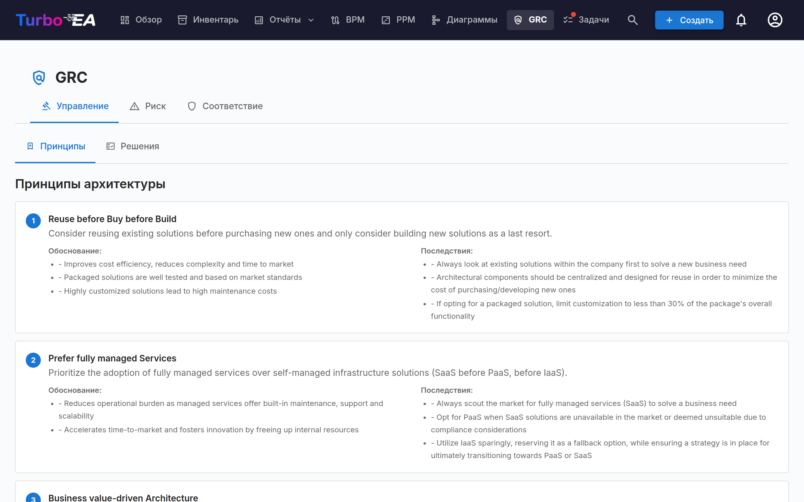
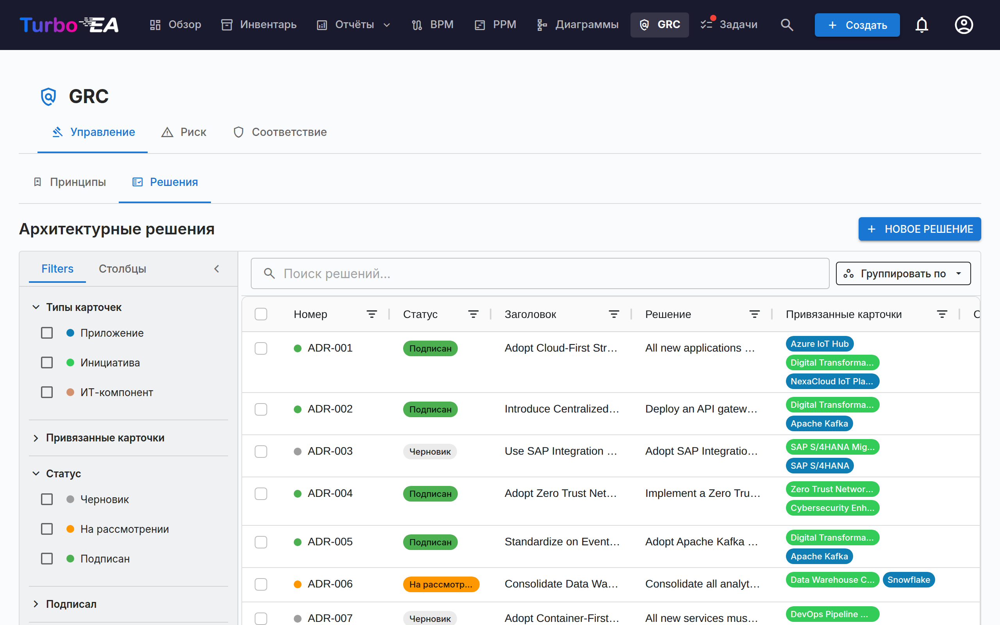
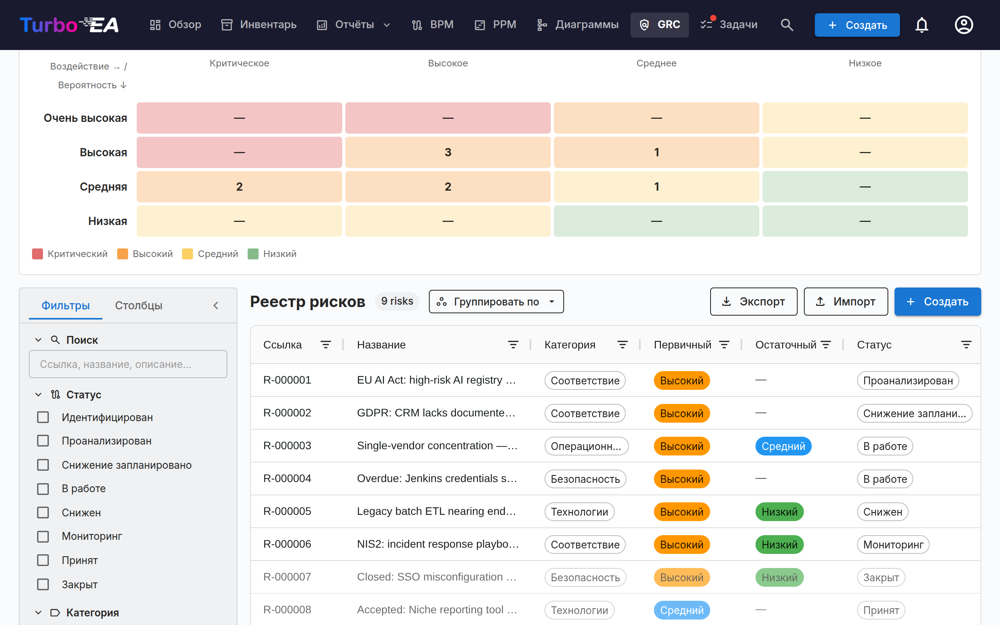
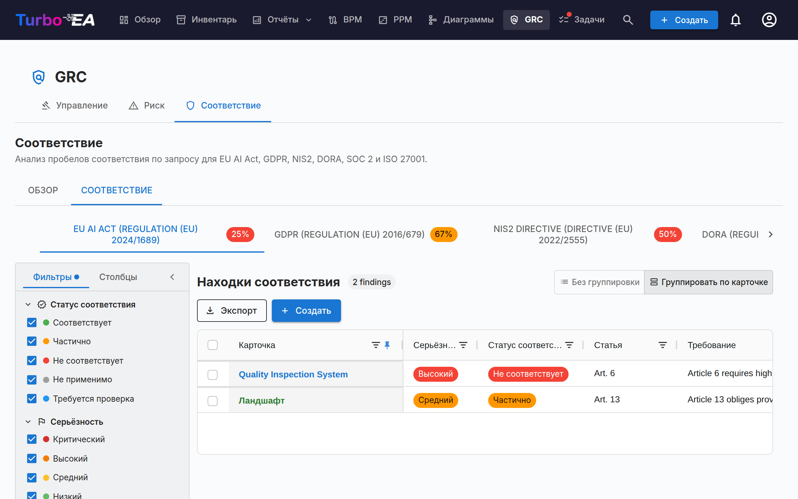

# GRC

Модуль **GRC** объединяет Управление, Риск и Соответствие в единое рабочее пространство по адресу `/grc`. Он консолидирует задачи, ранее разнесённые между «Поставкой EA» и TurboLens, чтобы архитектор, владелец риска и проверяющий по соответствию работали на общей основе.

!!! note
    Модуль GRC может быть включён или отключён администратором в [Настройках](../admin/settings.md). При отключении навигация и функции GRC скрыты.

В GRC три вкладки:

К любой вкладке можно перейти прямой ссылкой через `/grc?tab=governance`, `/grc?tab=risk` или `/grc?tab=compliance`.

## Управление

Вкладка «Управление» разделена на две **подвкладки** с прямыми ссылками `/grc?tab=governance&sub=principles` (по умолчанию) и `/grc?tab=governance&sub=decisions`:

### Принципы

Браузер только для чтения с EA-принципами, опубликованными в метамодели (формулировка, обоснование, последствия). Каталог редактируется в «Администрирование → Метамодель → Принципы».

### Решения

Подвкладка «Решения» — это **главный реестр Architecture Decision Records (ADR)** — каждый ADR в ландшафте независимо от того, с какой инициативой он связан. Она заменяет старую вкладку «Решения» в «Поставке EA», которая была упразднена при появлении модуля GRC.

ADR документируют важные архитектурные решения вместе с их контекстом, последствиями и рассмотренными альтернативами. Решения, выпущенные мастером TurboLens Architect, попадают сюда черновиками для утверждения.

Реестр прежде всего отвечает на один вопрос: **какие решения действуют сегодня?** У каждого подписанного решения есть [статус действия](#standing), который Turbo EA вычисляет по его датам, его редакциям и другим решениям, влияющим на него, а таблица показывает только текущую редакцию каждого решения, если вы не запросите более ранние.

Таблицу также можно **группировать по статусу** или **по статусу действия** с помощью кнопки *Группировать по* рядом с полем поиска: каждый статус или статус действия сворачивается под собственным заголовком (при группировке по статусу у каждого результата рассмотрения своя группа), а флажок в заголовке выбирает всю группу для массового экспорта.

#### Статус и статус действия {: #standing }

У решения есть два независимых состояния:

- **Статус** — это процесс подписания, и именно с ним вы работаете: **Черновик** → **На рассмотрении** (подписи запрошены) → **Подписан**. Решение, принятое вне Turbo EA и [зафиксированное как принятое](#recording-a-past-decision), вместо «Подписан» показывает **Зафиксирован**.
- **Статус действия** показывает, в каком положении подписанное или зафиксированное решение находится сегодня. Он вычисляется — никогда не задаётся вручную, — и у черновика или решения на рассмотрении его нет (*Ещё не подписано*).

У черновика также может быть **результат рассмотрения**, который показывает, чем закончилось его последнее рассмотрение без подписи. Он отображается вместо *Черновик* на чипе статуса, а баннер на решении сообщает, кто, когда и почему (*Отклонено пользователем Ada Lovelace 27 нояб. 2026: …*):

| Результат | Значение |
|-----------|----------|
| **Запрошены изменения** | Подписант вернул решение на доработку. Это редактируемый черновик; пометка снимается, когда подписи запрашиваются снова |
| **Отклонено** | Подписант отклонил решение. Оно **закрыто** |
| **Отозвано** | Сторона автора отозвала решение. Оно **закрыто** |

**Закрытое** решение остаётся в записях, но заблокировано так же, как решение на рассмотрении: изменить можно только его привязанные карточки и [диаграммы](#decision-diagrams), а автор не может отправить его на рассмотрение, зафиксировать, восстановить или удалить (для удаления нужно разрешение `adr.delete`). Чтобы снова работать с ним, нажмите **Открыть повторно** — оно станет обычным черновиком. Реестр скрывает закрытые решения, пока не включён параметр **Показать закрытые**. Черновик, последнее рассмотрение которого было отклонено до версии 2.221.0 — когда отклонение ещё возвращало решение в черновик, — отображается как **Запрошены изменения**.

Жизненный цикл фиксирован: три статуса, шесть статусов действия и три результата одинаковы в каждом рабочем пространстве и не настраиваются ни администратором, ни расширением.

| Статус действия | Значение |
|-----------------|----------|
| **Запланировано** | Подписано, но дата *Действует с* ещё не наступила |
| **Действует** | Подписано и вступило в силу |
| **Действует (с изменениями)** | Действует, и другое подписанное решение изменяет его; изменение ещё не включено в [консолидированную редакцию](#amendments-and-consolidated-revisions) |
| **Заменено** | Вступила в силу более поздняя редакция того же решения или решение, которое его заменяет |
| **Отменено** | Вступило в силу подписанное решение, которое его отменяет |
| **Истекло** | Дата *Действует до* прошла (решение действует включительно по этот день) |

Страница решения объясняет причину баннером — *Это решение заменено решением …*, *Это решение вступает в силу …*, *Редакция 3 вступает в силу …* — со ссылкой на соответствующее решение.

#### Столбцы таблицы

Сетка ADR повторяет компоновку сетки «Инвентарь»:

| Столбец | Описание |
|---------|----------|
| **Номер ссылки** | Автоматически сгенерированный номер (ADR-001, ADR-002, …) с точкой статуса; у редакции после первой добавляется её номер (ADR-012 · Ред. 2) |
| **Статус** | Цветной чип — Черновик, На рассмотрении, Подписан или Зафиксирован, либо результат рассмотрения (Запрошены изменения, Отклонено, Отозвано) у черновика, у которого он есть |
| **Статус действия** | Положение подписанного решения на сегодня — см. [Статус и статус действия](#standing); пусто, пока решение не подписано |
| **Заголовок** | Заголовок ADR |
| **Решение** | Текстовый фрагмент решения |
| **Привязанные карточки** | Цветные метки, соответствующие цвету типа каждой привязанной карточки |
| **Создал** | Автор ADR |
| **Создан** | Дата создания |
| **Изменён** | Дата последнего изменения |
| **Подписан** | Дата подписания |
| **Подписали** | По одной метке на каждого подписавшего |
| **Дата принятия** / **Действует с** / **Действует до** | [Даты](#decision-dates) решения |
| **Лица, принявшие решение** | Люди, принявшие решение |

У каждого столбца есть **фильтр в заголовке** — текстовые фильтры для текстовых столбцов, фильтры дат для столбцов с датами — каждый со своей кнопкой **Сбросить**. Как только активен хотя бы один фильтр столбца, на панели инструментов сетки появляется кнопка **Сбросить фильтры столбцов**, очищающая их все сразу. Ширина, порядок и сортировка столбцов, а также активные фильтры запоминаются в браузере.

#### Боковая панель фильтров

Постоянная боковая панель слева содержит две вкладки:

- **Фильтры** — фасетные фильтры по списку ADR:
    - **Действует** — один щелчок показывает только решения, действующие сегодня («Действует» и «Действует (с изменениями)»); повторный щелчок снимает фильтр
    - **Показать более ранние редакции** — по умолчанию выключено, поэтому каждое решение отображается один раз, в виде текущей редакции (плюс готовящаяся редакция). Включите, чтобы показать и более ранние редакции; кнопка **Экспорт** следует тому же переключателю
    - **Показать закрытые** — по умолчанию выключено, чтобы отклонённые и отозванные решения не мешали. Включите, чтобы показать и их
    - **Типы карточек** — флажки с цветными точками для фильтрации по привязанным типам карточек
    - **Привязанные карточки** — фильтр по конкретным привязанным карточкам
    - **Статус** — Черновик / На рассмотрении / Подписан (зафиксированное решение считается подписанным)
    - **Статус действия** — Запланировано / Действует / Действует (с изменениями) / Заменено / Отменено / Истекло / Ещё не подписано
    - **Результат** — Запрошены изменения / Отклонено / Отозвано / Нет результата. Выбор **Отклонено** или **Отозвано** показывает эти решения, даже когда **Показать закрытые** выключено
    - **Подписали** — фильтр по подписавшему
    - **Дата создания / изменения / подписания / принятия** — диапазоны дат «от/до» (**Дата принятия** сопоставляется с датой *Дата принятия* подписанного или зафиксированного решения)
- **Столбцы** — выбор видимых столбцов сетки. **Номер ссылки** и **Заголовок** отображаются всегда; **Сбросить** восстанавливает набор по умолчанию. Выбор запоминается в браузере.

Используйте панель **быстрого фильтра** для полнотекстового поиска. Правый клик по строке открывает контекстное меню (**Редактировать**, **Предварительный просмотр**, **Дублировать**, **Удалить**, а для закрытого решения — **Открыть повторно** для обладателей `adr.manage`). **Удалить** предлагается для черновика; для закрытого решения — только обладателям `adr.delete`.

#### Экспорт и импорт решений {: #decisions-import }

**Экспорт** (рядом с **+ Новое решение**) скачивает решения, которые сейчас показывает боковая панель фильтров, в виде файла `.xlsx`, по одной строке на редакцию решения. Столбцы по порядку: `reference_number`, `title`, `status`, `revision_number`, четыре раздела (`context`, `decision`, `consequences`, `alternatives_considered`) простым текстом, `cards` и `related_decisions` (через точку с запятой), `author`, `signatories`, `signed_at`, `created_at`, `updated_at`, затем собственные сведения реестра — `standing` (в виде ключа, например `in_force`), `decided_on`, `effective_from`, `valid_until`, `decision_makers`, `participants` и типизированные связи `replaces`, `amends`, `revokes` и `consolidates` в виде номеров. Форматирование, например полужирный шрифт или ссылки, в таблицу не переносится, а каждая строка таблицы внутри раздела записывается одной строкой, ячейки разделяются символами ` | `. Чтобы поделиться полностью отформатированными решениями, выберите строки в сетке и воспользуйтесь кнопкой **Export** самой сетки, которая создаёт документ Word.

**Импорт** массово создаёт решения из файла `.xlsx`. Нажмите **Скачать шаблон**, чтобы получить заготовку книги, заполните по одному решению в строке и загрузите её:

- Каждая строка становится новым **черновиком** решения со следующим номером `ADR-NNN`. Статус и подписи никогда не импортируются — решение подписывается через **процесс подписания** — а предварительный просмотр предупреждает о строке, у которой `status` отличается от черновика (draft).
- Строка, чей `reference_number` уже принадлежит решению, **пропускается**: импорт никогда не изменяет существующее решение, поэтому повторный импорт экспорта ничего не меняет.
- `title` обязателен. В четырёх столбцах разделов пустая строка начинает новый абзац, строки, начинающиеся с `- `, становятся маркированным списком, а строки, начинающиеся с `1. `, — нумерованным.
- `cards` связывает карточки по точному названию среди карточек, которые вы видите; карточка, которую не удалось найти или название которой совпадает у нескольких карточек, пропускается с предупреждением, а решение всё равно импортируется.
- `related_decisions` перечисляет номера либо существующих решений, либо других строк того же файла (в том числе более поздних); каждый становится связью **Связано с**. Номер, у которого несколько редакций, связывается с текущей.
- Все остальные столбцы — включая статус действия, даты, людей и типизированные связи — игнорируются: импорт создаёт черновики, а не подписанные или зафиксированные решения.
- Экспорт содержит по одной строке на редакцию, поэтому в файле может быть несколько строк с одним номером (открытая редакция или более ранние редакции, если включено **Показать более ранние редакции**). На экземпляре, из которого получен файл, все они пропускаются; в другом месте импортируется только строка с наибольшим `revision_number` (последняя строка, если номера равны или отсутствуют), а каждая из остальных строк пропускается с предупреждением *Более ранняя редакция ADR-012 пропущена*. Запись `related_decisions` с этим номером связывается с импортированной строкой.

Предварительный просмотр показывает, сколько строк будет создано, пропущено и сколько завершится ошибкой, с перечнем каждой ошибки и предупреждения по строкам; пока вы не подтвердите, ничего не записывается. Для импорта требуется разрешение `adr.manage`.

#### Создание ADR

ADR можно создать из трёх мест — все они открывают один и тот же редактор и наполняют один и тот же реестр:

1. **GRC → Управление → Решения**: нажмите **+ Новый ADR**, заполните заголовок и при желании привяжите карточки (включая инициативы).
2. **Рабочее пространство «Поставка EA»**: выберите инициативу, затем нажмите **+ Новый артефакт ▾** в шапке (или **+ Добавить** в разделе *Архитектурные решения*) и выберите **Новое архитектурное решение** — инициатива предварительно привязывается.
3. **Карточка → вкладка «Ресурсы»**: нажмите **Создать ADR** — текущая карточка предварительно привязывается.

Во всех случаях вы можете искать и привязывать дополнительные карточки при создании. Инициативы привязываются через тот же механизм, что и любая другая карточка, поэтому ADR может ссылаться на несколько инициатив. Редактор открывается с секциями **Контекст**, **Решение**, **Последствия** и **Рассмотренные альтернативы**.

#### Редактор ADR

Редактор предоставляет:

- Редактирование форматированного текста для каждой секции (Контекст, Решение, Последствия, Рассмотренные альтернативы): полужирный, курсив, подчёркнутый, зачёркнутый, **Встроенный код**, **Заголовок** и **Подзаголовок**, маркированные и нумерованные списки, цитаты, **Блок кода** для команды или фрагмента конфигурации (на отдельных строках моноширинным шрифтом) и разделители
- **Ссылки** — превратите выделенный текст в ссылку на веб-страницу или адрес электронной почты (см. [Ссылки в тексте](#decision-text-links))
- **Таблицы** — вставка и редактирование таблицы в секции (см. [Таблицы](#decision-tables))
- **Упоминания** — введите **@** в секции, чтобы упомянуть карточку или другое решение (см. [Упоминания](#decision-mentions))
- **Изображения** — вставьте снимок экрана или диаграмму в секцию (см. [Изображения](#decision-pictures))
- **Обсуждение** — панель рядом с документом с его обсуждением (см. [Обсуждение](#decision-discussion))
- **История** — кнопка в верхней части страницы, которая открывает хронологию решения и его сохранённые версии (см. [История](#decision-history))
- Привязка карточек — связывайте ADR с подходящими карточками (приложения, ИТ-компоненты, инициативы, …). Инициативы привязываются стандартной привязкой карточек, а не отдельным полем, поэтому ADR может ссылаться на несколько инициатив
- **Даты** — *Дата принятия*, *Действует с* и необязательная *Действует до* (см. [Даты](#decision-dates))
- **Люди** — *Лица, принявшие решение* и *Участники* (см. [Люди](#decision-people))
- **Это решение…** — типизированные связи с другими решениями (см. [Связи между решениями](#decision-links))
- **Описание изменений** — только у редакции: что изменилось в этой редакции и почему
- **Файлы** — документы, прикреплённые к решению (см. [Файлы](#decision-files))
- **Диаграммы** — диаграммы из модуля «Диаграммы», прикреплённые к решению (см. [Диаграммы](#decision-diagrams))

#### Изображения {: #decision-pictures }

Каждая из четырёх секций может содержать изображения — снимок экрана, экспортированную диаграмму, фотографию доски. Нажмите **Вставить изображение** на панели инструментов секции и выберите файл, вставьте изображение из буфера обмена или перетащите файл изображения на секцию. Изображение загружается в момент вставки и отображается на отдельной строке.

- **Размер.** Чтобы изменить размер изображения, перетащите его угол: пропорции сохраняются.
- **Выравнивание.** Выделите изображение и нажмите **По левому краю**, **По центру** или **По правому краю** на панели инструментов.
- **Форматы.** PNG, JPEG, GIF и WebP, до 5 МБ каждое. Изображение большего размера отклоняется, а не уменьшается. SVG не принимается.
- **Где отображается.** Изображения отображаются в [предварительном просмотре](#preview), в PDF / печатной копии и в экспорте Word. В [Истории](#decision-history) версия показывает свои изображения, а **Изменения** помечает добавленное или удалённое изображение как *[Изображение]*. Редакция, дубликат и восстановленная версия сохраняют изображения текста, из которого они созданы.
- **Только изображения, загруженные здесь.** Решение сохраняет только изображения, загруженные в решения. Изображение, ссылающееся на другой веб-сайт, или скопированное из SoAW, удаляется при сохранении решения.
- **Комментарии** в [обсуждении](#decision-discussion) не принимают изображений.
- **Когда загрузка файлов отключена.** Кнопка **Вставить изображение**, вставка и перетаскивание изображений исчезают, если администратор [отключил загрузку файлов](../admin/resources.md#when-file-uploads-are-disabled). Изображения, уже находящиеся в тексте, остаются видимыми.

#### Ссылки в тексте {: #decision-text-links }

Выделите несколько слов и нажмите **Ссылка** на панели инструментов раздела или нажмите **Ctrl+K** (**Cmd+K** на Mac), чтобы превратить их в ссылку. Введите **Адрес** и нажмите **Применить**. Если ничего не выделено, диалог также запрашивает **Отображаемый текст**; если оставить его пустым, отображается сам адрес. Веб-адрес или адрес электронной почты, введённый или вставленный в текст, сам становится ссылкой.

- **Что может быть ссылкой.** Веб-адреса (`http://`, `https://`) и адреса электронной почты (`mailto:`). Адрес без схемы дополняется: `example.com` становится `https://example.com`, а `ann@example.com` — ссылкой на электронную почту. Всё остальное — другая схема или адрес внутри Turbo EA, например `/cards/…`, — отклоняется с сообщением *Введите веб-адрес (https://…) или адрес электронной почты*.
- **Изменение или удаление ссылки.** Поставьте курсор в ссылку и снова нажмите **Ссылка** или Ctrl/Cmd+K: диалог откроется с уже заполненным адресом и предложит также **Удалить ссылку** и **Открыть в новой вкладке**.
- **Переход по ссылке.** Во время редактирования щелчок по ссылке ставит в неё курсор, чтобы её можно было редактировать как любой другой текст; **Ctrl+щелчок** (**Cmd+щелчок** на Mac) открывает её в новой вкладке. В предпросмотре, истории и заблокированном или подписанном решении щелчок открывает её в новой вкладке.
- **Ctrl/Cmd+K.** В редактируемом разделе это сочетание клавиш открывает диалог ссылки вместо [глобального поиска](inventory.md); во всех остальных местах оно по-прежнему открывает поиск.
- **Комментарии** в [обсуждении](#decision-discussion) принимают ссылки так же.
- **Где они отображаются.** Ссылки остаются кликабельными в предпросмотре, PDF / печатной копии и экспорте Word. В [Истории](#decision-history) **Изменения** сообщают об изменённом адресе ссылки как об изменении.

#### Таблицы {: #decision-tables }

Каждый из четырёх разделов может содержать таблицы. Нажмите **Таблица** на панели инструментов раздела и выберите **Вставить таблицу**: будет вставлена таблица из трёх строк и трёх столбцов, первая строка которой — строка заголовка. Ячейка содержит текст, как и остальной раздел: в ней работают форматирование, ссылки, упоминания и изображения.

Действия с таблицей доступны тремя способами, и каждое из них применяется к ячейке, в которой находится курсор, или к выделенным вами ячейкам:

- **Меню «Таблица» на панели инструментов** — когда курсор находится в таблице, **Таблица** перечисляет все описанные ниже действия.
- **Щелчок правой кнопкой** в ячейке — те же действия открываются у указателя.
- **Маркеры** вокруг таблицы — маркер рядом со строкой или над столбцом открывает действия для этой строки или столбца, а **+** вставляет строку или столбец (см. *Маркеры* ниже).

Действия:

- **Выделить строку** и **Выделить столбец** выделяют всю строку или весь столбец курсора или каждой выделенной ячейки.
- **Добавить строку выше**, **Добавить строку ниже**, **Добавить столбец перед** и **Добавить столбец после**. **Добавить строку выше** недоступно в строке заголовка: новая строка всегда добавляется под ней.
- **Переместить строку вверх**, **Переместить строку вниз**, **Переместить столбец к началу** и **Переместить столбец к концу** перемещают строку или столбец на одну позицию и оставляют их выделенными. Перемещение недоступно у края таблицы, через строку заголовка, при выделении более чем одной строки или столбца, а также в таблице, где объединённая ячейка охватывает несколько строк (для строк) или несколько столбцов (для столбцов).
- **Удалить строку** и **Удалить столбец** удаляют все строки или столбцы выделения и указывают их число (*Удалить 2 строки*). В таблице остаётся хотя бы одна строка и один столбец: если выделены все строки, **Удалить строку** недоступно, а если выделены все столбцы, недоступно **Удалить столбец**.
- **Строка заголовка** включает или выключает оформление первой строки как заголовка.
- **Объединить ячейки** объединяет ячейки, выделенные протягиванием указателя, а **Разделить ячейку** снова разделяет объединённую ячейку.
- **Удалить таблицу**.

«Перед» и «после», «к началу» и «к концу» следуют направлению чтения: в языке с письмом справа налево столбец перед текущим — тот, что справа.

**Маркеры.** Во время редактирования вокруг таблицы есть узкое поле, на котором находятся её маркеры. Они отображаются для ячейки под указателем и, пока вы работаете в разделе, для ячейки с курсором:

- **Маркер строки** рядом со строкой и **маркер столбца** над столбцом. Щелчок выделяет строку или столбец и открывает их действия: для строки — **Добавить строку выше**, **Добавить строку ниже**, **Переместить строку вверх**, **Переместить строку вниз**, **Удалить строку** и, в первой строке, **Строка заголовка**; для столбца — **Добавить столбец перед**, **Добавить столбец после**, **Переместить столбец к началу**, **Переместить столбец к концу** и **Удалить столбец**. Щелчок правой кнопкой по маркеру делает то же самое. Для объединённой ячейки маркер относится ко всем строкам или столбцам, которые охватывает ячейка, и его меню это показывает (*Удалить 2 строки*).
- **+** на нижней границе строки вставляет строку под ней, а **+** на конечной границе столбца вставляет столбец после него. У последней строки и последнего столбца вместо этого есть полосы.
- **Полоса** под последней строкой добавляет строку в конец, а **полоса** после последнего столбца добавляет столбец в конец.

Строка или столбец, добавленные таким образом, помещают курсор в свою первую ячейку, а одна отмена удаляет их. На сенсорном экране маркеры крупнее и отображаются для ячейки, которой вы коснулись.

**Контекстное меню.** Щелчок правой кнопкой в ячейке открывает действия таблицы у указателя. Если щелчок сделан внутри выделенных вами ячеек, выделение сохраняется, поэтому действия применяются ко всем из них; в любом другом месте курсор сначала переходит в ячейку, по которой вы щёлкнули.

- **Shift+щелчок правой кнопкой** открывает вместо этого собственное меню браузера — для его вариантов исправления орфографии или **Вставить**.
- Щелчок правой кнопкой по **ссылке** или **изображению** в ячейке тоже открывает меню браузера, чтобы открыть или скопировать их.
- На сенсорном экране долгое нажатие, как обычно, выделяет текст; там используйте маркеры.
- С клавиатуры **Shift+F10** или клавиша **Меню** открывает то же меню для ячейки с курсором.

**Клавиатура.** **Tab** переходит к следующей ячейке, **Shift+Tab** — к предыдущей; Tab в последней ячейке добавляет строку. Через меню **Таблица** на панели инструментов с клавиатуры доступно каждое действие; маркеры предназначены для указателя и сенсорного ввода и не входят в порядок перехода по Tab.

**Ширина и широкие таблицы.** Перетащите границу между двумя столбцами, чтобы изменить их ширину. Таблица шире раздела прокручивается по горизонтали; маркер строки при этом уходит из вида вместе с первым столбцом, а контекстное меню и меню **Таблица** на панели инструментов по-прежнему дают доступ ко всем действиям.

Заблокированное или подписанное решение показывает свои таблицы без маркеров, а щелчок правой кнопкой в нём открывает меню браузера.

- **Где они отображаются.** Таблицы отображаются в [предпросмотре](#preview) и [Истории](#decision-history), где **Изменения** читают каждую строку таблицы как одну строку, а ячейки разделяются символами ` | `. В PDF / печатной копии таблица сохраняет пропорции своих столбцов и вписывается в ширину страницы. Экспорт Word создаёт настоящую таблицу Word с объединёнными ячейками, ширинами столбцов и строкой заголовка, повторяющейся вверху каждой страницы.
- **Комментарии** в [обсуждении](#decision-discussion) не принимают таблиц: таблица, вставленная в комментарий, превращается в текст её ячеек.

#### Даты {: #decision-dates }

- **Дата принятия** — день, когда решение было принято. Она не может быть в будущем.
- **Действует с** — день, когда решение вступает в силу. До этого дня подписанное решение имеет статус **Запланировано**.
- **Действует до** — необязательно, для решения с ограниченным сроком, например исключения. На следующий день решение получает статус **Истекло**. Эта дата не может быть раньше *Действует с* и не может уже пройти к моменту отправки решения на рассмотрение.

Если *Дата принятия* и *Действует с* не заполнены, они принимают дату последней подписи. Продление истёкшего решения — это новая редакция или новое решение, которое подписывается как любое другое.

#### Люди {: #decision-people }

**Лица, принявшие решение** — это люди, которые приняли решение; **Участники** — люди, которые участвовали в его принятии. Выберите пользователя Turbo EA или введите имя и нажмите Enter для человека без учётной записи. Оба списка хранятся отдельно от **подписантов**, которые утверждают запись в Turbo EA. При запросе подписей кнопка **Добавить лиц, принимающих решение** в диалоге одним щелчком добавляет в подписанты всех лиц, принявших решение, которые являются пользователями Turbo EA.

#### Связи между решениями {: #decision-links }

Раздел **Это решение…** связывает решение с другими. Выберите тип связи и решение и при необходимости добавьте примечание для частичного случая — например, *только раздел 3*:

| Связь | Отображается у другого решения как | Действие после того, как это решение подписано и вступило в силу |
|-------|------------------------------------|------------------------------------------------------------------|
| **Заменяет** | Заменено решением | Другое решение получает статус **Заменено** |
| **Изменяет** | Изменено решением | Другое решение получает статус **Действует (с изменениями)** |
| **Отменяет** | Отменено решением | Другое решение получает статус **Отменено** |
| **Связано с** | Связано с | Нет — перекрёстная ссылка |

Связи отображаются у обоих решений и указывают на текущую редакцию решения. Они действуют на всё решение, включая все его редакции, и только после того, как решение, которое их содержит, подписано и вступило в силу: черновик, отменяющий другое решение, ничего не меняет до подписания, а решение с более поздней датой *Действует с* действует с этой даты (другое решение сообщает *Это решение будет отменено решением … …*). Решение нельзя связать с одной из его собственных редакций, а каждое решение, с которым оно связано, должно быть подписано до отправки на рассмотрение или фиксации.

Это связи между решениями; о ссылках на веб-страницы в тексте раздела см. [Ссылки в тексте](#decision-text-links).

#### Отмена или замена решения

Подписанное решение никогда не выводится из действия вручную: его отменяет или заменяет другое подписанное решение, поэтому реестр хранит, кто и когда это решил. Откройте подписанное решение и воспользуйтесь меню **Пересмотреть**:

- **Пересмотреть это решение** — новая редакция того же решения под тем же номером (см. [Редакции](#revisions)).
- **Заменить новым решением** — новый черновик с заголовком *Заменяет: …*, который уже содержит связь **Заменяет** и те же привязанные карточки.
- **Отменить** — новый черновик с заголовком *Отмена ADR-012 — …*, который уже содержит связь **Отменяет** и те же привязанные карточки.

Заполните новый черновик и проведите его через подписание, как любое другое решение. Меню недоступно для более ранней редакции (откройте текущую) и для решения, которое уже отменено или заменено. Когда подписанное решение заменяет, изменяет или отменяет другое, автор того решения получает уведомление **Изменён статус действия ADR**.

#### Изменения и консолидированные редакции {: #amendments-and-consolidated-revisions }

Решение, которое изменяет другое решение, остаётся действующим, а на его странице перечислены изменяющие решения. Чтобы у читателей был один актуальный текст, нажмите **Создать консолидированную редакцию** на этом баннере: будет начата редакция изменённого решения, указывающая изменяющее решение (*Включает изменение из …*). Внесите изменение в текст, опишите его в поле **Описание изменений** и отправьте редакцию на подписание. После того как она подписана и вступила в силу, решение снова получает статус **Действует**, а изменяющее решение показывает *Изменение, внесённое этим решением, включено в …*. Изменение также перестаёт учитываться, когда изменяющее решение отменено, заменено или истекло, — но не когда оно просто пересмотрено: его редакция сохраняет изменение, а баннер называет текущую редакцию изменяющего решения.

#### Файлы {: #decision-files }

Раздел **Файлы** прикрепляет к решению документы — подписанный протокол, вспомогательный анализ. Файлы принимаются в тех же форматах, что и [вложения карточек](card-details.md#resources-tab), размером до 20 МБ каждый, и загружать их можно, только пока загрузка файлов включена (удалить файл можно всегда). Добавлять и удалять их можно только в сохранённом черновике: после отправки решения на рассмотрение они блокируются вместе с ним. Редакция переносит файлы своего решения.

#### Диаграммы {: #decision-diagrams }

Раздел **Диаграммы**, расположенный после раздела **Файлы**, прикрепляет к решению диаграммы из модуля [Диаграммы](diagrams.md) — например, контекстную диаграмму, о которой идёт речь в решении. Нажмите **Прикрепить диаграмму**, найдите нужную в списке и выберите её; она прикрепляется сразу, без сохранения. Каждая прикреплённая диаграмма показывает свою миниатюру и название, а щелчок открывает её. Чтобы открепить диаграмму, нажмите её кнопку удаления и подтвердите: сама диаграмма сохранится.

- **Всегда текущая диаграмма.** Решение ссылается на диаграмму, а не хранит её копию: оно всегда показывает диаграмму в её нынешнем виде, в том числе после подписания решения. Удаление диаграммы убирает её из всех решений, к которым она была прикреплена, включая подписанные.
- **Когда это можно изменить.** Диаграммы можно прикреплять и откреплять, пока решение является черновиком или находится на рассмотрении. После подписания они фиксируются: чтобы изменить их, создайте новую редакцию.
- **Кто их видит.** Чтобы видеть раздел, нужно разрешение на просмотр диаграмм (`diagrams.view`); для прикрепления и открепления нужно также `adr.manage`. Читатель без `diagrams.view` вообще не видит раздела «Диаграммы». Решение, которое нельзя редактировать и у которого нет диаграмм, тоже не показывает этот раздел.
- **Где они отображаются.** [Предпросмотр](#preview) показывает диаграммы только для чтения; PDF / печатная копия и экспорт Word перечисляют их названия. Редакция и дубликат переносят диаграммы. Диаграммы не входят в версию [Истории](#decision-history).

#### Процесс подписания {: #sign-off-workflow }

ADR поддерживают формальный процесс подписания:

1. Создайте ADR в статусе **Черновик**.
2. Нажмите **Запросить подписи** и найдите подписантов по имени или электронной почте (или нажмите **Добавить лиц, принимающих решение**). Запросить подписи можно только из черновика.
3. ADR переходит в **На рассмотрении** — каждый подписант получает уведомление и Todo.
4. Подписанты просматривают и нажимают **Подписать**, **Запросить изменения** или **Отклонить**.
5. Когда все подписали, ADR автоматически переходит в **Подписан**.

**Решение на рассмотрении заблокировано**, поэтому подписанты подписывают ровно то, что им отправили: текст, даты, люди, связи с другими решениями, файлы и панели расширений доступны только для чтения, и изменить можно лишь привязанные карточки и прикреплённые [диаграммы](#decision-diagrams). Чтобы отредактировать решение, нажмите **Отозвать подписи** — оно вернётся в черновик.

У ожидающего подписанта, который не подписывает, есть два варианта, каждый с причиной (до 4000 символов), о которой уведомляются все остальные подписанты и автор:

- **Запросить изменения** возвращает решение на доработку: оно снова становится редактируемым черновиком с тем же номером редакции и пометкой **Запрошены изменения**. Отредактируйте его и снова запросите подписи; тогда пометка снимается. До версии 2.221.0 это делала кнопка **Отклонить**.
- **Отклонить** закрывает решение: оно остаётся черновиком с пометкой **Отклонено** и заблокировано, пока кто-нибудь не откроет его повторно. Отклонить может любой один подписант.

Со стороны автора обладатель `adr.manage` может **Отозвать** сохранённый черновик или решение на рассмотрении с указанием причины: ожидающие запросы на подпись отменяются, их подписанты уведомляются, а решение закрывается с пометкой **Отозвано**. **Открыть повторно** превращает отклонённое или отозванное решение в обычный черновик, который можно редактировать и снова отправить на рассмотрение. Каждый шаг отображается в хронологии [истории](#decision-history).

Подписанные ADR заблокированы и не редактируются — для изменений создаётся новая редакция.

#### Фиксация прошлого решения {: #recording-a-past-decision }

Решение, принятое вне Turbo EA — например, на заседании правления до появления реестра, — можно внести как принятое без сбора подписей. Оформите его как черновик, укажите хотя бы одно лицо, принимающее решение, затем нажмите **Зафиксировать как принятое** и укажите **Дату принятия** (не в будущем) и, если она отличается, дату **Действует с** (по умолчанию — дата принятия).

После этого решение блокируется, как подписанное, и получает статус действия, но его статус — **Зафиксирован**, а на странице указано *Зафиксировано пользователем … …, не подписано в Turbo EA*. Для фиксации нужно разрешение `adr.record`, которое по умолчанию есть только у роли Admin, и каждая фиксация отображается в [журнале безопасности и администрирования](../admin/audit-log.md) как `admin.adr.recorded`. Зафиксировать можно и черновик редакции, если его дата принятия не раньше даты принятия предыдущей редакции.

#### Редакции {: #revisions }

Откройте подписанный ADR и выберите **Пересмотреть → Пересмотреть это решение**, чтобы создать новый черновик на основе подписанной версии. Редакция сохраняет номер решения и получает следующий номер редакции — **ADR-012 · Ред. 2** — и наследует содержимое, привязанные карточки, прикреплённые диаграммы, связи **Связано с**, людей, файлы и дату *Действует до*. Она не наследует дату принятия и дату вступления в силу, подписантов, описание изменений и связи «заменяет» / «изменяет» / «отменяет», которые остаются у той редакции, что их создала. Каждая редакция сохраняет собственный след подписей.

- **Одновременно только одна открытая редакция.** Пока редакция готовится, текущая редакция сообщает об этом, а меню **Пересмотреть** открывает этот черновик вместо создания нового.
- **Действует текущая редакция.** Как только редакция подписана и вступила в силу, более ранние получают статус **Заменено** и показывают баннер со ссылкой на текущую. Полоса **Редакции** на каждой редакции перечисляет всю цепочку и отмечает текущую.
- **Пересмотреть можно только текущую редакцию**, и только пока решение не отменено и не заменено. Истёкшее или изменённое решение пересмотреть можно.
- **Отклонение не считается редакцией**: номер редакции меняется только при создании новой редакции.
- **Отклонённая или отозванная редакция остаётся открытой редакцией.** Она по-прежнему блокирует новую редакцию своего решения, а меню **Пересмотреть** называет её (*Открыть редактируемую ревизию (ADR-012 · Ред. 3, Отклонено)*). Чтобы повторить попытку, откройте её и нажмите **Открыть повторно**; либо удалите её, чтобы начать новую редакцию.
- Решения, пересмотренные до версии 2.199.0, сохраняют выданные им номера и по-прежнему отображаются как одно решение с одной полосой редакций.

#### Предварительный просмотр {: #preview }

Нажмите иконку предварительного просмотра, чтобы увидеть отформатированную версию ADR только для чтения — удобно для просмотра перед подписанием. Он также показывает прикреплённые диаграммы, а ссылки в нём открываются в новой вкладке.

В предпросмотре нажмите **PDF**, чтобы открыть готовую к печати копию в новой вкладке — метаданные и даты, четыре раздела, люди, связанные карточки, связи с другими решениями, имена файлов, названия диаграмм, разделы расширений и блок подписей (или строка о фиксации), с утверждающим и датой печати в нижнем колонтитуле. В редакторе есть та же кнопка **PDF** и **Word**, которая скачивает решение в виде `.docx`, пока оно не подписано; обе экспортируют текущее состояние редактора, включая несохранённые изменения. В документе Word форматирование и ссылки сохраняются везде — в том числе в списках, цитатах и заголовках, — ссылки кликабельны, код сохраняет моноширинный шрифт, а таблицы становятся настоящими таблицами Word.

#### Обсуждение {: #decision-discussion }

У каждого решения есть собственное **Обсуждение**, поэтому решение можно согласовать в Turbo EA, а не в отдельном чате. Откройте его кнопкой обсуждения в редакторе или предпросмотре решения: на широком экране оно открывается панелью рядом с документом, на более узком — выдвижной панелью. В заголовке панели видно, сколько веток открыто. [История](#decision-history) решения находится не на этой панели: она открывается кнопкой **История** в верхней части страницы.

- **Ветки и ответы.** Введите текст в поле вверху панели и нажмите **Отправить** (или Ctrl+Enter, Cmd+Enter на Mac), чтобы начать ветку. Чтобы привязать её к секции, нажмите один из чипов разделов над полем — *Контекст*, *Решение*, *Рассмотренные альтернативы* или *Последствия*; повторное нажатие на выбранный чип снимает привязку. Ветка без раздела считается общей. В каждой ветке можно отвечать, на один уровень вложенности; ветка сохраняет раздел, с которым была начата, и её чип раздела показывается вверху ветки.
- **Фильтр по разделам.** Как только у какой-либо ветки появляется раздел, вверху обсуждения появляется ряд чипов: по одному на каждый раздел, в котором есть ветки, с их количеством (*Решение (2)*), и чип **Общее**, если у некоторых веток нет раздела. Нажмите на чип, чтобы показать только его ветки; включите несколько, чтобы видеть ветки любого из них, нажмите на чип ещё раз, чтобы выключить его, или нажмите **Сбросить**. Нажатие на собственный чип раздела ветки включает его фильтр. Фильтр работает независимо от того, свёрнуты ли решённые ветки и показаны ли более ранние редакции, и учитывает только показанные ветки. Он не сохраняется, когда вы покидаете документ, а ветка, открытая из уведомления, показывается всегда.
- **Обсуждение раздела.** Каждый раздел показывает рядом со своим заголовком небольшой значок чата — в редакторе и в предпросмотре — тем, кто может комментировать (те, кто может только читать, видят его лишь у разделов с ветками): число открытых веток, если в разделе есть обсуждение, или приглушённый значок, когда все они решены. Нажмите на него, чтобы открыть обсуждение, отфильтрованное по этому разделу, причём решённые ветки будут развёрнуты, если среди них нет ни одной открытой, а раздел уже будет выбран для нового комментария (значок никогда не печатается и не экспортируется).
- **Отметка как решённой и повторное открытие.** Нажмите **Отметить как решённое**, когда вопрос в ветке закрыт, и **Открыть снова**, если нет. Решённые ветки сворачиваются за ссылкой **Показать N решённых веток**.
- **Форматирование.** В комментарии можно использовать полужирный, курсив, зачёркнутый, **Встроенный код**, маркированные и нумерованные списки, цитаты и [ссылки](#decision-text-links) (кнопка **Ссылка** или Ctrl/Cmd+K). Заголовкам, блокам кода, изображениям и таблицам место в разделах, а не в комментариях.
- **Кто может публиковать.** Чтение обсуждения доступно тем, кто может открыть решение (`adr.view`). Для публикации, ответа, отметки как решённого и повторного открытия нужно разрешение `adr.comment`, которое по умолчанию есть у участников и администраторов и нет у наблюдателей; администратор может изменить его для каждой роли. Подписанты решения всегда могут его комментировать, включая тех, кого просили подписать его в более раннем раунде рассмотрения, который был отозван или отклонён.
- **Во время рассмотрения и после подписания.** [Блокировка на время рассмотрения](#sign-off-workflow) распространяется на содержимое, а не на обсуждение: обсуждение остаётся открытым, пока решение находится на рассмотрении, и после его подписания.
- **Заметки рассмотрения.** Когда подписант отклоняет решение, причина открывает ветку с пометкой **Причина отклонения** (*Причина не указана*, если подписант оставил поле пустым), на которую можно отвечать и которую можно отметить как решённую, как любую другую; запрос изменений открывает ветку с пометкой **Запрошены изменения**. Причина отзыва хранится в решении и в истории, а не в обсуждении. При подписании подписант может добавить необязательное примечание; оно появляется в обсуждении как **Примечание к подписи**. Ни то ни другое больше не теряется при отзыве подписей, и оба также показываются в [истории](#decision-history).
- **Открытые ветки перед рассмотрением.** **Запросить подписи**, **Подписать**, **Запросить изменения**, **Отклонить** и **Отозвать** предупреждают, если у решения ещё есть открытые ветки (*В этом документе 2 открытые ветки обсуждения.*). Это только предупреждение: ничего не блокируется.
- **Уведомления.** Новый комментарий уведомляет автора решения, его подписантов, лиц, принимающих решение, и участников, являющихся пользователями Turbo EA, а также тех, кто комментировал ранее, — но никогда не автора самого комментария. Введите **@** в комментарии, чтобы упомянуть коллегу: вместо этого он получит уведомление об упоминании. Упомянутый вами пользователь, который не может открыть решение, уведомление не получает, и панель сообщает вам об этом (*… не получили уведомление: у них нет доступа к документу.*). Уведомления не содержат текста комментария, а щелчок по уведомлению открывает предпросмотр решения с панелью на этой ветке. См. [Уведомления](notifications.md#notification-types).
- **Редактирование и удаление.** Свои комментарии можно редактировать; изменённый комментарий помечается *(изменено)*. Свои комментарии можно удалять, а любой, кто может редактировать решение (`adr.manage`), может удалить любой комментарий; удалённый комментарий сворачивается на своём месте в одну небольшую строку с его автором, датой и *Комментарий удалён*. Удаление первого комментария ветки закрывает ветку: уже имеющиеся ответы сохраняются, но никто больше не может ответить в ней, отметить её как решённую или открыть снова. Причину отклонения, запрос изменений и примечание к подписи нельзя редактировать или удалять: первые два вместо этого отмечают как решённые.
- **Более ранние редакции.** Ветка принадлежит той редакции, в которой она была начата. Включите **Показать обсуждение более ранних редакций**, чтобы читать ветки более ранних редакций решения, сгруппированные по редакциям.

#### Упоминания {: #decision-mentions }

При написании решения введите **@** в любой из четырёх секций, чтобы упомянуть **карточку** или другое **решение**. Во всплывающем списке по мере ввода появляются подходящие карточки и решения; выберите вариант стрелками и Enter (или щелчком), а Escape закрывает список. В комментарии **@** предлагает также **людей**. Каждый вариант показывает, что это такое: карточка — цвет и значок своего типа, тип, подтип и карточку, в которую она входит (*Приложение · Микросервис · в Finance Suite*, если вам разрешено видеть эту карточку); решение — свой номер (*ADR-012 · Rev 2*), заголовок и статус; человек — имя и адрес электронной почты. Упоминание отображается как чип с текущим названием того, на что оно указывает, — названием карточки, номером и заголовком решения, — поэтому переименование карточки никогда не меняет текст. Щёлкните по чипу карточки или решения, чтобы открыть его.

- **Что идёт первым.** Пока после **@** ничего не введено, первыми идут карточки, привязанные к решению, затем остальные карточки в алфавитном порядке; в комментарии первыми среди людей идут подписанты решения, лица, принимающие решение, и участники. По мере ввода первыми, как и везде в Turbo EA, идут наилучшие совпадения, а среди одинаково хороших совпадений впереди привязанные карточки и люди решения.
- **Обзор.** Последний пункт всплывающего списка, **Обзор…**, и кнопка **Упомянуть…** (**@**) на панели инструментов редактора открывают диалог со стандартными средствами выбора: **Карточки** (выбор карточек, как и в остальном Turbo EA, со списком типов, иерархией и поиском), **Решения** (список с поиском) и, в комментарии, **Люди**. Выберите сколько нужно на любой вкладке и нажмите **Вставить**: на каждый выбор вставляется одно упоминание, в том порядке, в котором вы их выбирали, через пробел — вместо того, что вы ввели после **@**, если диалог был открыт из всплывающего списка. **Отмена** ничего не вставляет.
- Читатель, которому не разрешено видеть упомянутую карточку, видит вместо её названия **Карточка с ограниченным доступом** — везде: в редакторе, предпросмотре, экспорте в PDF и Word, таблице, истории и обсуждении. Читатель, который не может открывать решения, видит **Решение с ограниченным доступом**. При сохранении текста такие упоминания сохраняются как есть, даже если сохраняющий их не видит.
- Упомянутая карточка, которая с тех пор была удалена, отображается как **Удалённая карточка** (удалённое решение — **Удалённое решение**), поскольку в тексте названия не хранятся.
- Упоминание не привязывает карточку. Если в тексте упомянуты непривязанные карточки, редактор перечисляет их под заголовком *Упомянуты в тексте, но не привязаны:*, каждую с кнопкой **Привязать эту карточку**. Привязка карточек в редакторе использует тот же выбор карточек, что и остальной Turbo EA.
- **Упоминается в.** [Вкладка ADR](card-details.md#adrs-tab) карточки и предпросмотр решения перечисляют в блоке **Упоминается в** решения и SoAW, в тексте которых упоминается эта карточка или решение, а также те, в обсуждении которых оно упоминается (с пометкой *в обсуждении*). В списке показываются только документы, которые вы можете открыть.

#### История {: #decision-history }

Кнопка **История** в верхней части редактора или предпросмотра решения — рядом с полосой редакций, если у решения их несколько, — открывает одно широкое представление: хронология слева, выбранная версия справа. Хронология фиксирует, что происходило с решением, начиная с самого нового: создано, сохранено, отправлено на рассмотрение, каждая подпись (с примечанием), запрошены изменения, отклонено и отозвано (каждое с причиной), открыто повторно, подписи отозваны, полностью подписано, зафиксировано как принятое, начата новая редакция, восстановлена более ранняя версия. Эту хронологию видит каждый, кто может открыть решение. События рассмотрения — отправка на рассмотрение, подпись, отзыв, отклонение — сохраняются начиная с версии 2.200.0; раньше они показывались в реальном времени, но никогда не сохранялись. Решения, существовавшие до этой версии, начинаются с хронологии, восстановленной по сохранённым данным: создано, пересмотрено, отправлено на рассмотрение (для решения, находившегося на рассмотрении во время обновления, — с подписантами, которым оно было отправлено), каждая подпись, подписано и зафиксировано.

История — это не заполняемая вручную таблица **История версий документа** в [Заявлении об архитектурной работе](delivery.md#the-soaw-editor), в которую авторы записывают то, что сочтут нужным.

- **Версии.** Версия сохраняется каждый раз, когда черновик сохраняется с изменениями. Она содержит заголовок, четыре секции, даты, описание изменений и людей; связи с другими решениями, привязанные карточки, файлы и диаграммы в версию не входят. Шаги, содержащие версию, отмечены в хронологии; те, кто может редактировать решение, и его подписанты выбирают один из них, чтобы показать версию справа, а при открытии представления выбрана самая новая версия. Остальные читатели видят хронологию без версий (*Сохранённые версии видны только редакторам и подписантам.*). На узком экране представление сначала показывает хронологию, затем выбранную версию с кнопкой **Назад**.
- **Изменения.** Над выбранной версией **Версия** показывает её в том виде, в каком она была сохранена, а **Изменения** — что изменилось между ней и предыдущей версией, пословно по каждой секции, вместе с изменившимися датами и людьми; любую другую версию можно выбрать в поле **Сравнить с**. Сравнивать можно только версии, уже загруженные в хронологию: если версия, предшествующая выбранной, ещё не загружена, **Изменения** сообщают об этом, а **Загрузить ещё** подгружает её. Изменение одного лишь форматирования отображается как *Только форматирование: текст тот же.*; ссылка с изменившимся адресом считается изменением, а строка таблицы читается как одна строка, ячейки разделяются символами ` | `.
- **Восстановление.** В черновике тот, кто может редактировать решение, может восстановить выбранную версию кнопкой **Восстановить эту версию**. Восстановление идёт только вперёд: текст, даты и люди версии заменяют содержимое черновика и сохраняются как новая версия, а состояние черновика до восстановления остаётся в истории. Связи с другими решениями, привязанные карточки, файлы и диаграммы не восстанавливаются. Если в редакторе есть несохранённые изменения, подтверждение предупреждает, что они будут отброшены. После восстановления страница показывает восстановленное решение, а представление закрывается. Решение на рассмотрении, подписанное или закрытое (отклонённое или отозванное) восстановить нельзя; сначала откройте закрытое повторно.

#### Известные ограничения {: #collaboration-limits }

- Удалённая карточка везде, где она упоминалась, отображается как **Удалённая карточка**: в тексте названия не хранятся, поэтому прежнее название показать нельзя.
- Два человека, сохраняющие один черновик, по-прежнему перезаписывают друг друга: побеждает последнее сохранение. История хранит оба сохранения, поэтому перезаписанную формулировку можно найти и восстановить.
- Обсуждение не входит в экспорт в PDF, Word или электронную таблицу, как и в печатную копию.
- Роль, которая может открывать решения, но не имеет доступа к инвентарю, не может искать карточки во всплывающем списке упоминаний (*Ваша роль не позволяет искать карточки; упоминать решения вы по-прежнему можете.*).
- Текст, скопированный из одного документа в другой, теряет свои чипы **Ограниченный доступ**: упоминание с ограниченным доступом сохраняется только в том документе, в котором оно было написано.
- Кого просили подписать в раунде рассмотрения, отклонённом или отозванном до версии 2.200.0, восстановить нельзя, поэтому эти люди не считаются подписантами той редакции. Раунд, ещё открытый на момент обновления, сохраняет своих подписантов.

## Риск

Встраивает **Реестр рисков** TOGAF этапа G. Полный жизненный цикл, рабочий процесс статусов, переключатели матрицы и поведение владельцев описаны в [руководстве по Реестру рисков](risks.md). Самое существенное:

## Соответствие

Вкладка Соответствие — это реестр с двойным источником: находки могут быть **созданы вручную** рецензентом **или** произведены **AI-сканированием** по запросу против включённых регламентов (EU AI Act, GDPR, NIS2, DORA, SOC 2, ISO 27001 включены по умолчанию). Оба типа находок разделяют один и тот же жизненный цикл, могут быть продвинуты в Риск и пакетно обработаны из сетки. См. [руководство по Соответствию](compliance.md) для полного жизненного цикла, диалога ручного создания, рабочего процесса сканирования, семантического детектора EU AI Act и цикла продвижения в Риск.

Та же вкладка Соответствие также появляется в Деталях карточки (автоматически скрывается, когда у карточки нет связанных находок), чтобы владелец Приложения мог сортировать свои находки, не покидая карточку.

## Разрешения

| Разрешение | Роли по умолчанию |
|------------|-------------------|
| `grc.view` | admin, bpm_admin, member, viewer |
| `grc.manage` | admin, bpm_admin, member |
| `adr.view` / `adr.manage` / `adr.sign` | `adr.view`: admin, bpm_admin, member, viewer; `adr.manage` и `adr.sign`: admin, bpm_admin, member |
| `adr.record` | admin — [зафиксировать прошлое решение как принятое](#recording-a-past-decision) |
| `adr.comment` | admin, bpm_admin, member — публиковать в [обсуждении](#decision-discussion) решения; подписанты решения всегда могут его комментировать |
| `risks.view` / `risks.manage` | см. [Реестр рисков § Разрешения](risks.md) |
| `compliance.view` / `compliance.manage` | см. [TurboLens § Security & Compliance](turbolens.md) |

Для раздела [Диаграммы](#decision-diagrams) решения также нужно разрешение `diagrams.view` (по умолчанию admin, bpm_admin, member, viewer): без него читатель не видит диаграмм ни в одном решении.

`grc.view` управляет видимостью самого маршрута GRC — без него запись в верхнем меню скрыта. Каждая вкладка дополнительно обеспечивает собственное доменное разрешение, так что просматривающий, например, может читать реестр, но не может запускать LLM-скан.
