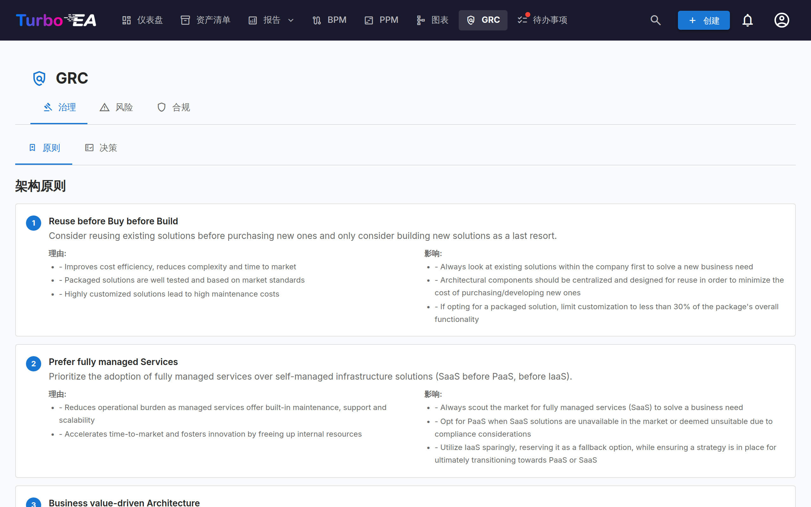
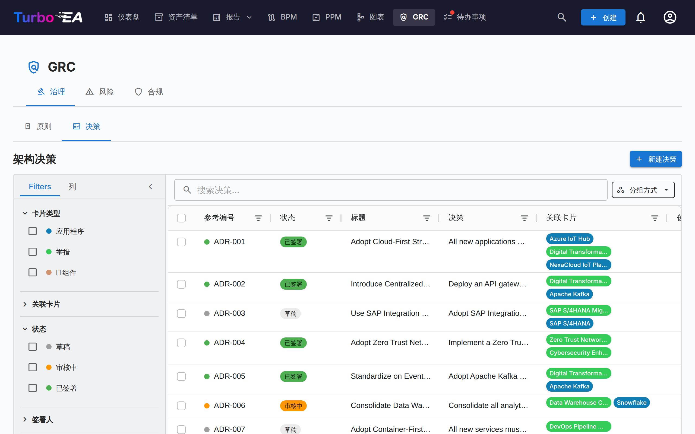
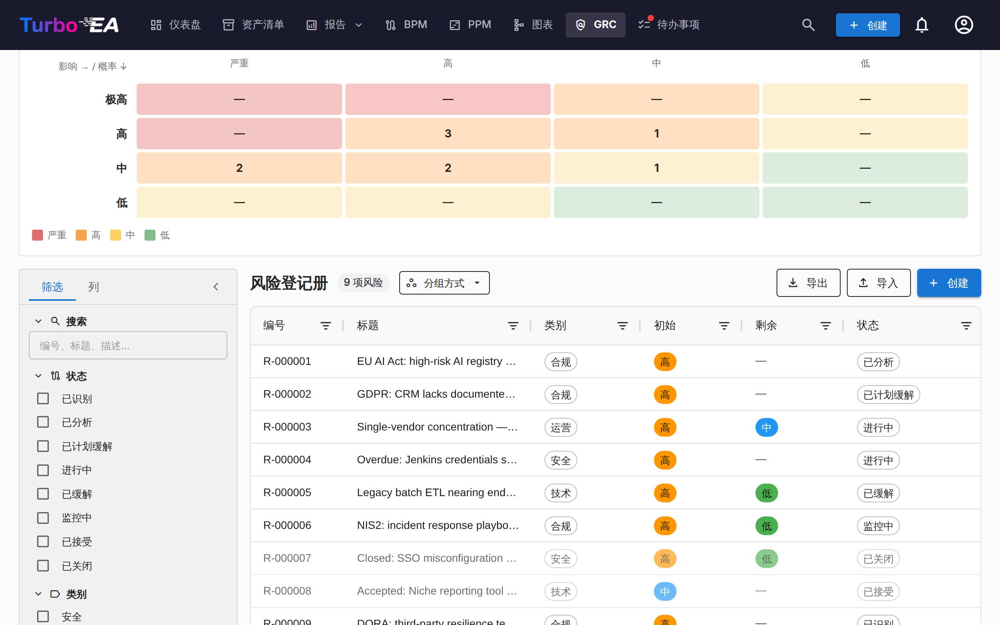
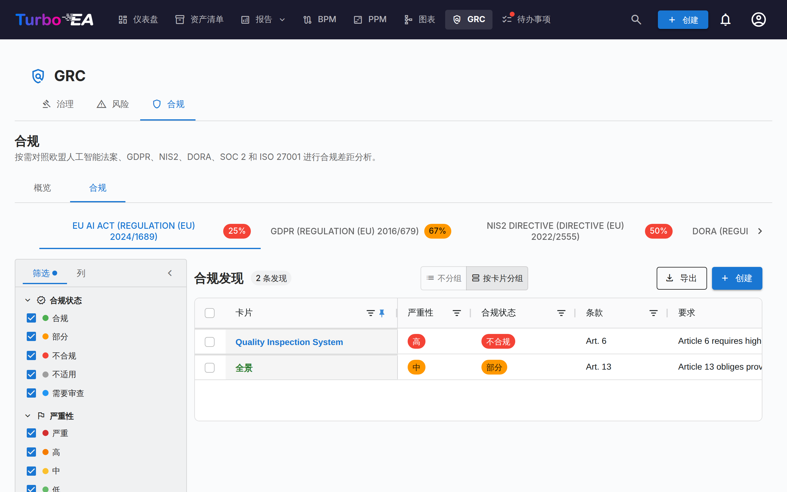

# GRC

**GRC** 模块将治理（Governance）、风险（Risk）与合规（Compliance）整合到 `/grc` 下的统一工作区。它把原本散布于 EA 交付与 TurboLens 之间的工作合并起来，让架构师、风险责任人与合规审查者可以在共同的基础上协作。

!!! note
    GRC 模块可以由管理员在[设置](../admin/settings.md)中启用或禁用。禁用后，GRC 导航和功能将被隐藏。

GRC 共有三个标签页：

任意标签页都可以通过 `/grc?tab=governance`、`/grc?tab=risk` 或 `/grc?tab=compliance` 直接深链。

## 治理

治理标签页分为两个**子标签页**，可通过 `/grc?tab=governance&sub=principles`（默认）和 `/grc?tab=governance&sub=decisions` 进行深链接：

### 原则

元模型中已发布 EA 原则的只读浏览器（声明、依据、影响）。请在「管理 → 元模型 → 原则」中编辑目录。

### 决策

决策子标签页是**架构决策记录（ADR）的主登记册**——景观中的每一条 ADR，无论它链接到哪个举措。它取代了 GRC 模块上线时被取消的旧版 EA 交付「决策」标签页。

ADR 记录重要的架构决策及其背景、后果与所考虑的备选方案。由 TurboLens Architect 向导生成的决策以草稿形式落入此处，供审查者签发。

登记册首先回答一个问题：**今天哪些决策生效？** 每项已签署的决策都有一个[效力状态](#standing)，由 Turbo EA 根据其日期、修订版以及作用于它的其他决策推算得出；除非您要求显示早期修订版，否则表格只列出每项决策的当前修订版。

还可以通过搜索框旁的*分组方式*按钮将表格**按状态**或**按效力状态分组**：每个状态或效力状态各自折叠在对应标题下，分组标题上的复选框可选中整组以便批量导出。

#### 状态与效力状态 {: #standing }

一项决策有两个彼此独立的状态：

- **状态**是签署工作流，也是您要操作的对象：**草稿** → **审核中**（已请求签名）→ **已签署**。在 Turbo EA 之外做出并[登记为已决定](#recording-a-past-decision)的决策显示**已登记**，而不是已签署。
- **效力状态**表示已签署或已登记的决策在今天的状况。它由系统推算——从不手动设置——草稿或审核中的决策没有效力状态（*尚未签署*）。

| 效力状态 | 含义 |
|----------|------|
| **待生效** | 已签署，但尚未到达其*生效日期* |
| **生效中** | 已签署且已生效 |
| **生效中（已修正）** | 生效中，且有另一项已签署的决策修正了它；该修正尚未并入[整合修订版](#amendments-and-consolidated-revisions) |
| **已被取代** | 同一决策的更新修订版，或取代它的决策，已经生效 |
| **已撤销** | 撤销它的已签署决策已经生效 |
| **已过期** | 已过了其*有效期至*日期（该日当天仍然有效） |

决策页面会用横幅说明原因——*此决策已被 … 取代*、*此决策将于 … 生效*、*修订版 3 将于 … 生效*——并附有指向相关决策的链接。

#### 表格列

ADR 网格沿用清单网格的布局：

| 列 | 描述 |
|----|------|
| **参考编号** | 自动生成的参考编号（ADR-001、ADR-002…），带状态圆点；第一版之后的修订版会附加其编号（ADR-012 · 修订版 2） |
| **状态** | 彩色标签——草稿、审核中、已签署或已登记 |
| **效力状态** | 已签署决策在今天的状况——参见[状态与效力状态](#standing)；签署前为空 |
| **标题** | ADR 标题 |
| **决策** | 决策内容的纯文本摘录 |
| **关联卡片** | 与每张关联卡片的类型颜色匹配的彩色胶囊 |
| **创建者** | ADR 的作者 |
| **创建日期** | 创建日期 |
| **修改日期** | 最后修改日期 |
| **签署日期** | 签署日期 |
| **签署人** | 每位已签署的签署人显示一个胶囊 |
| **决定日期** / **生效日期** / **有效期至** | 决策的[日期](#decision-dates) |
| **决策者** | 做出该决策的人员 |

每一列都有**表头筛选器**——文本列使用文本筛选，日期列使用日期筛选——且各自带有**重置**按钮。只要有任意列筛选器处于激活状态，网格工具栏中就会出现**清除列筛选**按钮，可一键清除全部筛选。列宽、列顺序、排序和激活的筛选器会按浏览器记忆。

#### 筛选侧边栏

左侧持久的侧边栏包含两个选项卡：

- **筛选** —— 针对 ADR 列表的分面筛选：
    - **生效中** —— 单击一次即只显示今天生效的决策（生效中和生效中（已修正））；再次单击即可清除
    - **显示早期修订版** —— 默认关闭，因此每项决策只出现一次，即其当前修订版（以及正在起草的修订版）。开启后也会列出早期修订版；**导出**按钮遵循同一开关
    - **卡片类型** —— 带有彩色圆点的复选框，可按关联卡片类型筛选
    - **关联卡片** —— 按特定关联卡片筛选
    - **状态** —— 草稿 / 审核中 / 已签署（已登记的决策视为已签署）
    - **效力状态** —— 待生效 / 生效中 / 生效中（已修正） / 已被取代 / 已撤销 / 已过期 / 尚未签署
    - **签署人** —— 按签署人筛选
    - **创建日期 / 修改日期 / 签署日期 / 决定日期** —— 起止日期范围（**决定日期**匹配已签署或已登记决策的*决定日期*）
- **列** —— 选择显示哪些网格列。**参考编号**和**标题**始终显示；**重置**可恢复默认列集。您的选择会按浏览器记忆。

使用**快速筛选**搜索栏进行全文搜索。右键单击任意行可打开包含**编辑**、**预览**、**复制**和**删除**操作的右键菜单。

#### 导出和导入决策 {: #decisions-import }

**导出**（位于**+ 新建决策**旁边）会将筛选侧边栏当前显示的决策下载为 `.xlsx` 文件，每个决策修订版一行。各列依次为：`reference_number`、`title`、`status`、`revision_number`、四个部分（`context`、`decision`、`consequences`、`alternatives_considered`）的纯文本、`cards` 和 `related_decisions`（以分号分隔）、`author`、`signatories`、`signed_at`、`created_at`、`updated_at`，然后是登记册自身的信息——`standing`（以键表示，例如 `in_force`）、`decided_on`、`effective_from`、`valid_until`、`decision_makers`、`participants`，以及以编号表示的类型化关联 `replaces`、`amends`、`revokes` 和 `consolidates`。粗体或链接等格式不会带入电子表格。若要分享保留完整格式的决策，请在表格中选择行，并使用表格自带的**导出**按钮，它会生成 Word 文档。

**导入**可从 `.xlsx` 文件批量创建决策。点击**下载模板**获取起始工作簿，每行填写一个决策，然后上传：

- 每一行都会成为一个新的**草稿**决策，并使用下一个 `ADR-NNN` 编号。状态和签署信息永远不会被导入——决策通过**签署工作流**进行签署——如果某行的 `status` 不是草稿（draft），预览会给出警告。
- `reference_number` 已属于某个决策的行会被**跳过**：导入不会更改现有决策，因此重新导入导出的文件不会产生任何更改。
- `title` 为必填。在四个部分列中，空行表示新段落，以 `- ` 开头的行成为项目符号列表，以 `1. ` 开头的行成为编号列表。
- `cards` 在您可见的卡片中按完整名称关联卡片；找不到的卡片，或名称被多张卡片共用的卡片，会被跳过并给出警告，决策仍会导入。
- `related_decisions` 列出编号，可以是现有决策的编号，也可以是同一文件中其他行（包括靠后的行）的编号；每个编号都会成为一个**关联**链接。具有多个修订版的编号会关联到其当前修订版。
- 其他所有列——包括效力状态、日期、人员和类型化关联——都会被忽略：导入只创建草稿，绝不会创建已签署或已登记的决策。
- 导出文件中每个修订版占一行，因此一个文件可能包含同一编号的多行（一个起草中的修订版，或在开启**显示早期修订版**时的早期修订版）。在导出来源的实例上，这些行全部被跳过；在其他实例上，只导入 `revision_number` 最大的那一行（编号相同或缺失时取最后一行），其余每行都会被跳过，并给出警告*已跳过 ADR-012 的早期修订版*。指向该编号的 `related_decisions` 条目会关联到被导入的那一行。

预览会显示将创建、跳过和失败的行数，并按行列出每个错误和警告；在您确认之前不会写入任何内容。导入需要 `adr.manage` 权限。

#### 创建 ADR

ADR 可以从三个位置创建——三者都打开同一个编辑器，并写入同一个登记册：

1. **GRC → 治理 → 决策**：点击 **+ 新建 ADR**，填写标题并可选地关联卡片（包括举措）。
2. **EA 交付工作区**：选中一项举措，然后点击页面顶部的 **+ 新工件 ▾**（或*架构决策*分组中的 **+ 添加** 按钮），选择**新建架构决策**——该举措会被预先关联。
3. **卡片 → 资源标签页**：点击**创建 ADR**——当前卡片会被预先关联。

在所有情况下，您都可以在创建过程中搜索并关联额外的卡片。举措通过与其他卡片相同的卡片关联机制进行关联，因此一条 ADR 可以引用多个举措。编辑器打开后包含**背景**、**决策**、**后果**与**所考虑的备选方案**章节。

#### ADR 编辑器

编辑器提供：

- 每个章节的富文本编辑（背景、决策、后果、所考虑的备选方案）
- **提及**——在章节中输入 **@** 即可提及卡片或其他决策（参见[提及](#decision-mentions)）
- **讨论**——文档旁的面板，包含其讨论（参见[讨论](#decision-discussion)）
- **历史**——页面顶部的按钮，用于打开决策的时间线及其已保存的版本（参见[历史](#decision-history)）
- 卡片关联——将 ADR 关联到相关卡片（应用、IT 组件、举措…）。举措通过标准的卡片关联功能进行关联，而不是专用字段，因此一条 ADR 可以引用多项举措
- **日期**——*决定日期*、*生效日期*以及可选的*有效期至*（参见[日期](#decision-dates)）
- **人员**——*决策者*和*参与者*（参见[人员](#decision-people)）
- **此决策…**——指向其他决策的类型化关联（参见[决策之间的关联](#decision-links)）
- **变更摘要**——仅用于修订版：此修订版更改了什么以及原因
- **文件**——附加到决策的文档（参见[文件](#decision-files)）

#### 日期 {: #decision-dates }

- **决定日期**——做出决策的日期。不能是将来的日期。
- **生效日期**——决策开始生效的日期。在此之前，已签署的决策处于**待生效**状态。
- **有效期至**——可选，用于有时限的决策，例如豁免。该日期的次日起，决策即为**已过期**。它不能早于*生效日期*，也不能在决策提交审核时就已经过去。

如果留空，*决定日期*和*生效日期*取最后一个签名的日期。续期已过期的决策需要新建修订版或新决策，并像其他决策一样签署。

#### 人员 {: #decision-people }

**决策者**是做出该决策的人；**参与者**是参与该决策的人。选择一位 Turbo EA 用户，或者为没有账户的人输入姓名并按 Enter。两者都与**签署人**分开记录，签署人负责在 Turbo EA 中批准该记录。请求签名时，对话框中的**添加决策者**会一键将所有属于 Turbo EA 用户的决策者添加为签署人。

#### 决策之间的关联 {: #decision-links }

决策的**此决策…**部分将其与其他决策关联起来。选择关联类型和决策，并可选择为部分情况添加备注——例如*仅第 3 节*：

| 关联 | 在另一项决策上显示为 | 此决策签署并生效后的效果 |
|------|----------------------|--------------------------|
| **取代** | 被以下决策取代 | 另一项决策变为**已被取代** |
| **修正** | 被以下决策修正 | 另一项决策变为**生效中（已修正）** |
| **撤销** | 被以下决策撤销 | 另一项决策变为**已撤销** |
| **关联** | 被以下决策关联 | 无——仅为交叉引用 |

关联会显示在两项决策上，并指向决策的当前修订版。关联作用于整个决策（包括其所有修订版），并且只有在携带关联的决策签署并生效后才起作用：撤销另一项决策的草稿在签署前不会产生任何变化，而*生效日期*较晚的决策则在该日期起作用（另一项决策会显示*此决策将于 … 被 … 撤销*）。决策不能关联到它自己的修订版，并且在提交审核或登记之前，它关联的每项决策都必须已签署。

#### 撤销或取代决策

已签署的决策从不手动停用：它会被另一项已签署的决策撤销或取代，这样登记册就能保留由谁、在何时做出了决定。打开已签署的决策并使用**修订**菜单：

- **修订此决策**——同一决策的新修订版，沿用相同编号（参见[修订](#revisions)）。
- **以新决策取代**——一份标题为*取代：…*的新草稿，已带有一个**取代**关联和相同的关联卡片。
- **撤销**——一份标题为*撤销 ADR-012 — …*的新草稿，已带有一个**撤销**关联和相同的关联卡片。

完成新草稿，并像其他决策一样走签署流程。在早期修订版（请打开当前修订版）或已被撤销或取代的决策上不提供此菜单。当一项已签署的决策取代、修正或撤销另一项决策时，该决策的作者会收到 **ADR 效力状态已变更**通知。

#### 修正与整合修订版 {: #amendments-and-consolidated-revisions }

被另一项决策修正的决策仍然生效，其页面会列出修正它的决策。为了给读者提供一份当前的完整文本，请在该横幅上点击**创建整合修订版**：这会为被修正的决策创建一个修订版，并注明修正它的决策（*整合以下决策的修正 …*）。将修正内容并入正文，在**变更摘要**中加以说明，然后提交该修订版进行签署。签署并生效后，该决策重新变为**生效中**，而修正它的决策会显示*此决策所做的修正已整合到 …*。当修正它的决策被撤销、取代或过期时，该修正也不再计入——但仅仅被修订时不会：其修订版保留该修正，横幅会显示修正决策的当前修订版。

#### 文件 {: #decision-files }

**文件**部分可将文档附加到决策——例如已签署的会议纪要或支持性分析。文件支持与[卡片附件](card-details.md#resources-tab)相同的格式，每个最大 20 MB，并且只有在启用文件上传时才能上传（删除始终可行）。文件只能在已保存的草稿上添加和删除：一旦决策提交审核，文件便随之锁定。修订版会沿用其决策的文件。

#### 签署工作流 {: #sign-off-workflow }

ADR 支持正式签署流程：

1. 以**草稿**状态创建 ADR。
2. 点击**请求签名**并按姓名或电子邮件搜索签署人（或点击**添加决策者**）。只能从草稿请求签名。
3. ADR 转为**审核中**——每位签署人会收到通知与任务。
4. 签署人审查并点击**签署**。
5. 当所有签署人都签署完成后，ADR 自动转为**已签署**。

**审核中的决策处于锁定状态**，因此签署人签署的正是发送给他们的内容：正文、日期、人员、关联、文件和扩展面板均为只读，只有关联卡片仍可更改。如需编辑，请点击**撤回签名**，决策将退回草稿。签署人点击**拒绝**同样会将其退回草稿，修订号保持不变。

已签署的 ADR 会被锁定，无法编辑——如需修改，请创建新的修订版。

#### 登记过去的决策 {: #recording-a-past-decision }

在 Turbo EA 之外做出的决策——例如在登记册建立之前的董事会会议上——可以在不收集签名的情况下作为已决定的决策录入。先将其写为草稿，至少指定一名决策者，然后点击**登记为已决定**，并填写**决定日期**（不能是将来的日期），如有不同，再填写**生效日期**（默认为决定日期）。

随后该决策会像已签署的决策一样被锁定并获得效力状态，但其状态显示为**已登记**，页面上会显示*由 … 于 … 登记，未在 Turbo EA 中签署*。登记需要 `adr.record` 权限，默认只有 Admin 角色拥有该权限，每次登记都会以 `admin.adr.recorded` 记录在[安全与管理日志](../admin/audit-log.md)中。修订版草稿也可以登记，只要其决定日期不早于上一修订版的决定日期。

#### 修订 {: #revisions }

打开已签署的 ADR，选择**修订 → 修订此决策**，以基于已签署版本创建新草稿。修订版保留决策的编号并采用下一个修订号——**ADR-012 · 修订版 2**——并继承内容、关联卡片、**关联**链接、人员、文件以及*有效期至*日期。它不继承决定日期和生效日期、签署人、变更摘要，也不继承取代 / 修正 / 撤销关联，这些都保留在创建它们的修订版上。每个修订版保留自己的签署轨迹。

- **同一时间只有一个起草中的修订版。** 当某个修订版正在起草时，当前修订版会给出提示，**修订**菜单会打开该草稿，而不是再新建一个。
- **当前修订版即为生效的修订版。** 一旦某个修订版签署并生效，早期修订版即变为**已被取代**，并显示链接到当前修订版的横幅。每个修订版上的**修订版**条带会列出整个修订链并标出当前修订版。
- **只有当前修订版可以被修订**，且决策一旦被撤销或取代便不能再修订。已过期或已被修正的决策仍可修订。
- **拒绝不算作修订**：只有在创建新修订版时，修订号才会变化。
- 在 2.199.0 版本之前修订的决策保留其签发时的编号，并且仍显示为带有一个修订版条带的单一决策。

#### 预览

点击预览图标查看 ADR 的只读格式化版本——在签署前进行审阅时很有用。

在预览中点击 **PDF**，即可在新标签页中打开可打印副本——包含元数据和日期、四个章节、人员、关联卡片、与其他决策的关联、文件名、扩展章节和签名区块（或登记说明行），页脚显示批准人和打印日期。编辑器提供同样的 **PDF** 按钮以及 **Word**（在决策签署前可将其下载为 `.docx`）；两者导出的都是编辑器的当前状态，包括未保存的更改。

#### 讨论 {: #decision-discussion }

每项决策都有自己的**讨论**，因此可以在 Turbo EA 中敲定决策，而不必另开聊天主题。在决策的编辑器或预览中点击讨论按钮即可打开：在宽屏上它以面板形式显示在文档旁，在较窄的屏幕上则以抽屉形式显示。面板标题会显示有多少个未解决的主题。决策的[历史](#decision-history)不在此面板中：它通过页面顶部的**历史**按钮打开。

- **主题与回复。** 在面板顶部的输入框中输入内容并点击**发表**（或按 Ctrl+Enter，Mac 上为 Cmd+Enter）即可发起主题。要将其关联到某个章节，请点击输入框上方的一个章节标签——*背景*、*决策*、*已考虑的替代方案*或*后果*；再次点击已选标签即可取消关联。没有章节的主题即为常规主题。每个主题都可以回复，回复只有一层；主题会保留发起时的章节，其章节标签显示在主题顶部。
- **按章节筛选。** 一旦有主题关联了章节，讨论顶部就会出现一行标签，列出每个有主题的章节及其数量（*决策（2）*），当有主题未关联章节时还会显示一个**常规**标签。点击某个标签只显示其主题；打开多个标签可查看其中任一章节的主题，再次点击某个标签即可关闭它，或点击**清除**。点击主题自身的章节标签会打开该章节的筛选。无论已解决的主题是否折叠、是否显示早期修订版，筛选都有效，并且只统计列出的主题。离开文档后筛选不会保留，从通知打开的主题始终会显示。
- **章节上的讨论。** 在编辑器和预览中，每个章节的标题旁都会为可以评论的人显示一个小的聊天图标（只能阅读的人仅在有主题的章节上看到它）：章节有讨论时显示未解决主题的数量，全部解决后则显示为淡色图标。点击它即可打开按该章节筛选的讨论，当其中没有未解决的主题时，已解决的主题会展开显示，并且该章节已预先选定用于新评论（该图标永远不会被打印或导出）。
- **解决与重新打开。** 主题有定论后点击**解决**，若仍未定论则点击**重新打开**。已解决的主题会折叠在**显示 N 个已解决的主题**之后。
- **谁可以发表。** 阅读讨论遵循谁可以打开该决策（`adr.view`）。发表、回复、解决和重新打开需要 `adr.comment` 权限，成员和管理员默认拥有，查看者则没有；管理员可以按角色更改。决策的签署人始终可以对其发表评论，包括在早期已被撤回或拒绝的审核轮次中被要求签署的人。
- **审核期间与签署之后。** [审核锁定](#sign-off-workflow)针对的是内容，而不是对话：决策处于审核中以及签署之后，讨论仍保持开放。
- **审核备注。** 当签署人拒绝决策时，拒绝原因会开启一个标记为**拒绝原因**的主题（签署人未填写时显示*未提供原因*），可以像其他主题一样回复和解决。签署人在签署时可以添加可选备注；它会以**签署备注**的形式出现在讨论中。撤回签名时两者都不再丢失，并且都会显示在[历史](#decision-history)中。
- **审核前的未解决主题。** 当决策仍有未解决的主题时，**请求签署**、**签署**和**拒绝**会给出警告（*此文档有 2 个未解决的讨论主题。*）。这只是警告：不会阻止任何操作。
- **通知。** 新评论会通知决策的作者、签署人、身为 Turbo EA 用户的决策者和参与者，以及此前发表过评论的人——但绝不通知发表者本人。在评论中输入 **@** 可提及同事：对方会收到提及通知。您提及的人如果无法打开该决策，则不会收到通知，面板会告知您（*… 未收到通知：他们无法打开此文档。*）。通知不包含评论内容，点击通知会打开决策的预览，并在面板中定位到该主题。参见[通知](notifications.md#notification-types)。
- **编辑与删除。** 您可以编辑自己的评论；编辑过的评论会标记为*（已编辑）*。您可以删除自己的评论，任何可以编辑该决策的人（`adr.manage`）都可以删除任何评论；被删除的评论会在原处缩为一小行，显示其作者、日期和*评论已删除*。删除主题的第一条评论会关闭该主题：已有的回复会保留，但任何人都不能再回复、解决或重新打开该主题。拒绝原因和签署备注不能编辑或删除：拒绝应改为将其解决。
- **早期修订版。** 主题属于其发起时所在的修订版。打开**显示早期修订版的讨论**，即可按修订版分组阅读该决策早期修订版的主题。

#### 提及 {: #decision-mentions }

撰写决策时，在四个章节中的任意一个输入 **@**，即可提及一张**卡片**或另一项**决策**。输入时会弹出匹配的卡片和决策列表；使用方向键和 Enter（或点击）选择一项，按 Escape 关闭。在评论中，**@** 还会提供**人员**。每个条目都会说明它是什么：卡片显示其类型的颜色和图标、类型、子类型以及它所隶属的卡片（*应用程序 · 微服务 · 位于 Finance Suite 下*，前提是您有权查看该卡片）；决策显示其编号（*ADR-012 · Rev 2*）、标题和状态；人员显示姓名和电子邮件地址。提及以标签形式显示，带有其所指对象的当前名称——卡片的名称、决策的编号和标题——因此重命名卡片永远不会改变正文。点击卡片或决策标签即可打开它。

- **排列顺序。** 在 **@** 之后未输入任何内容时，与该决策关联的卡片排在最前，其余卡片按字母顺序排列；在评论中，决策的签署人、决策者和参与者在人员中排在最前。输入时，与 Turbo EA 其他地方一样，最佳匹配排在最前；在匹配程度相同的结果中，关联的卡片和该决策的相关人员优先。
- **浏览。** 弹出列表的最后一项**浏览…**以及编辑器工具栏中的**提及…**按钮（**@**）会打开一个包含标准选择器的对话框：**卡片**（与 Turbo EA 其他地方相同的卡片选择器，带有类型列表、层级和搜索）、**决策**（可搜索的列表），在评论中还有**人员**。在任意标签页上选择所需的项目并点击**插入**：每个选择插入一个提及，按您选择的顺序排列，以空格分隔——如果对话框是从弹出列表打开的，则替换您在 **@** 之后输入的内容。**取消**不会插入任何内容。
- 无权查看被提及卡片的读者在所有界面上看到的都是**受限卡片**而不是其名称——编辑器、预览、PDF 和 Word 导出、表格、历史和讨论。无法打开决策的读者看到的是**受限决策**。保存正文时会原样保留这些提及，即使保存者本人看不到它们。
- 被提及的卡片如果之后被删除，会显示为**已删除的卡片**（被删除的决策显示为**已删除的决策**），因为正文中不存储名称。
- 提及不会关联卡片。当正文提及了未关联的卡片时，编辑器会在*在正文中提及但未关联：*下列出它们，每张卡片旁都有**关联此卡片**按钮。在编辑器中关联卡片使用与 Turbo EA 其他地方相同的卡片选择器。
- **提及位置。** 卡片的 [ADR 标签页](card-details.md#adrs-tab)和决策的预览会在**提及位置**下列出正文中提及该卡片或决策的决策和 SoAW，以及在讨论中提及它的文档（标记为*在讨论中*）。该列表只显示您可以打开的文档。

#### 历史 {: #decision-history }

决策编辑器或预览顶部的**历史**按钮（当决策有多个修订版时位于修订版条带旁）会打开一个宽视图：左侧为时间线，右侧为所选版本。时间线按从新到旧的顺序记录决策发生的事情：创建、保存、提交审核、每个签名（附其备注）、拒绝（附原因）、撤回签名、全部签署、登记为已决定、开始修订、恢复早期版本。每个可以打开该决策的人都能看到这条时间线。审核事件——提交审核、签署、撤回、拒绝——从 2.200.0 版本起开始保存；在此之前它们只实时显示，从未被存储。在该版本之前已存在的决策，其时间线由已存储的信息重建：创建、修订、提交审核（对于升级时处于审核中的决策，附带其被发送给的签署人）、每个签名、签署和登记。

历史不同于[架构工作说明书](delivery.md#the-soaw-editor)中手动维护的**文档版本历史**表格，后者记录的是作者选择写入其中的内容。

- **版本。** 每次带有更改的草稿保存时都会保留一个版本。版本包含标题、四个章节、日期、变更摘要和人员；链接、关联卡片和文件不属于版本的一部分。包含版本的步骤会在时间线中标出；可以编辑该决策的人及其签署人可以选择其中一个，在右侧显示该版本，视图打开时会选中最新的版本。其他读者看到的是不含版本的时间线（*已保存的版本仅对编辑者和签署人显示。*）。在窄屏上，视图先显示时间线，然后显示带有**返回**按钮的所选版本。
- **更改。** 在所选版本上方，**版本**按保存时的样子显示它，**更改**则按章节逐词显示它与前一个版本之间的变化，以及发生变化的日期和人员；可在**比较对象**下选择任意其他版本。只有时间线中已加载的版本才能比较：当所选版本的前一个版本尚未加载时，**更改**会给出提示，**加载更多**可将其载入。仅格式的变化会报告为*仅格式不同：文字相同。*
- **恢复。** 对于草稿，可以编辑该决策的人可以通过**恢复此版本**恢复所选版本。恢复只会向前进行：该版本的文本、日期和人员会替换草稿中的内容，并作为新版本保留，而草稿在恢复之前的状态会保留在历史中。链接、关联卡片和文件不会被恢复。当编辑器中有未保存的编辑时，确认对话框会提示这些编辑将被丢弃。恢复后，页面会显示恢复后的决策，视图随之关闭。处于审核中或已签署的决策无法恢复。

#### 已知限制 {: #collaboration-limits }

- 被删除的卡片在所有提及它的地方都显示为**已删除的卡片**：正文中不存储名称，因此无法显示其旧名称。
- 两人保存同一草稿时仍会相互覆盖：以最后一次保存为准。历史会保留两次保存，因此被覆盖的措辞可以找到并恢复。
- 讨论不包含在 PDF、Word 或电子表格导出中，也不包含在打印副本中。
- 可以打开决策但没有清单访问权限的角色无法在提及弹窗中搜索卡片（*您的角色无法搜索卡片；您仍可以提及决策。*）。
- 从一份文档复制到另一份文档的文本会丢失其**受限**标签：受限提及只能保留在其撰写所在的文档中。
- 在 2.200.0 版本之前被拒绝或撤回的审核轮次中，被要求签署的人无法重建，因此这些人不计为该修订版的签署人。升级时仍未结束的轮次会保留其签署人。

## 风险

嵌入 TOGAF 阶段 G 的**风险登记册**。完整的生命周期、状态工作流、矩阵切换与责任人行为详见[风险登记册指南](risks.md)。要点如下：

## 合规

合规标签页是一个双来源登记册 — 发现可以由审核员**手工撰写**，**或**由按需的 **AI 扫描**针对已启用的法规生成（EU AI Act、GDPR、NIS2、DORA、SOC 2、ISO 27001 默认启用）。两种发现共享相同的生命周期，可以提升为风险，并且可以从网格中批量操作。请查阅[合规指南](compliance.md)了解完整的生命周期、手工创建对话框、扫描工作流、EU AI Act 语义检测器以及提升为风险的循环。

同一个合规标签页也出现在卡片详情中（当卡片没有关联发现时自动隐藏），以便应用负责人可以不离开卡片就分诊自己的发现。

## 权限

| 权限 | 默认角色 |
|------|----------|
| `grc.view` | admin、bpm_admin、member、viewer |
| `grc.manage` | admin、bpm_admin、member |
| `adr.view` / `adr.manage` / `adr.sign` | `adr.view`：admin、bpm_admin、member、viewer；`adr.manage` 和 `adr.sign`：admin、bpm_admin、member |
| `adr.record` | admin——[将过去的决策登记为已决定](#recording-a-past-decision) |
| `adr.comment` | admin、bpm_admin、member——在决策的[讨论](#decision-discussion)中发表评论；决策的签署人始终可以对其发表评论 |
| `risks.view` / `risks.manage` | 参见[风险登记册 § 权限](risks.md) |
| `compliance.view` / `compliance.manage` | 参见[TurboLens § Security & Compliance](turbolens.md) |

`grc.view` 控制 GRC 路由本身的可见性——若缺少该权限，顶部导航中的入口会被隐藏。每个标签页另外强制其领域专有权限，因而一名查看者可以阅读登记册而无法触发 LLM 扫描，举例而言。
