# المخزون

**المخزون** هو قلب Turbo EA. هنا تُسرد جميع **البطاقات** (المكوّنات) لهندسة المؤسسة: التطبيقات، والعمليات، وقدرات الأعمال، والمنظمات، والمزوّدون، والواجهات، وغيرها.

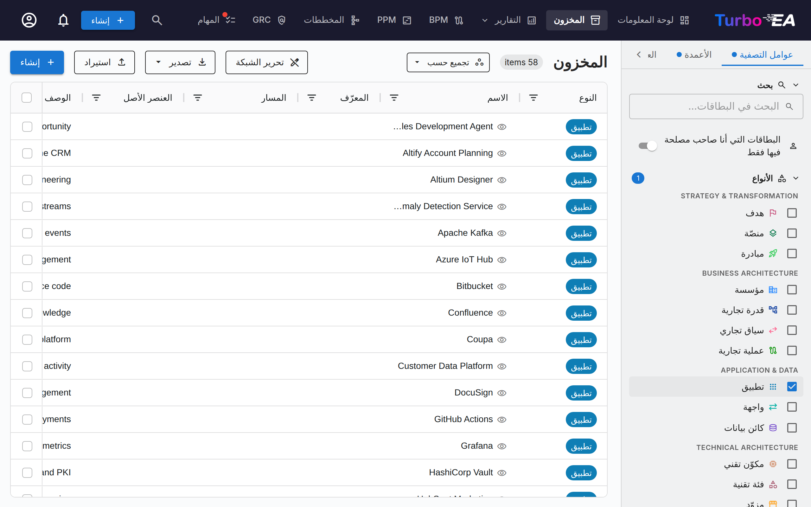

## بنية شاشة المخزون

### لوحة التصفية اليسرى

تتيح لك لوحة الشريط الجانبي الأيسر **تصفية** البطاقات حسب معايير مختلفة:

- **البحث** — بحث نصّي حرّ عبر أسماء البطاقات، بدءاً من الحرف الأول. تظهر أفضل المطابقات أولاً: الأسماء المطابقة تماماً، ثم التي تبدأ بما كتبته، ثم التي يبدأ بها كلمة، ثم البقية. تعتمد كل خانة بحث في Turbo EA هذا الترتيب — البحث الشامل (**Ctrl+K** / **⌘K**)، وكل مُنتقي بطاقات، وسجل المخاطر، والقرارات، والبوابات المنشورة — ما لم تكن قد اخترت ترتيباً خاصاً بك، فهو الذي يسود دائماً. يُطابَق أيضاً **الاسم المستعار** للبطاقة ووصفها، فيمكن العثور على البطاقة بالاسم الذي تستخدمه مؤسستك فعليًا — والاسم المستعار المطابق تماماً يرتقي مثل الاسم المطابق تماماً
- **الأنواع** — التصفية حسب نوع بطاقة واحد أو أكثر، مُجمَّعة حسب طبقة البنية التي ينتمي إليها كل نوع: الاستراتيجية والتحول (هدف، منصة، مبادرة)، بنية الأعمال (منظمة، قدرة الأعمال، سياق الأعمال، عملية الأعمال)، التطبيقات والبيانات (تطبيق، واجهة، كائن بيانات)، والبنية التقنية (مكوّن تقني، فئة تقنية، مزوّد). النوع الذي يضعه المسؤول في طبقة خاصة به يحصل على عنوان مستقل بعد هذه الطبقات الأربع، وأي نوع بلا طبقة محددة يُدرج أخيرًا تحت **غير مصنّف**
- **الأنواع الفرعية** — عند اختيار نوع، يمكن التصفية أكثر حسب النوع الفرعي (مثل التطبيق ← تطبيق أعمال، خدمة مصغّرة، وكيل ذكاء اصطناعي، نشر)
- **حالة الموافقة** — مسوّدة، مُعتمَد، معطوب، أو مرفوض
- **المصدر** — القناة التي أُنشئت عبرها كل بطاقة: **واجهة الويب** و**MCP** (مساعد ذكاء اصطناعي متصل عبر [خادم MCP](../admin/mcp.md)) و**API** (سكربت أو تكامل) و**إضافة** أو **النظام** (مهمة في الخلفية). اختر **MCP** لمراجعة كل ما أضافه وكيل. البطاقات المنشأة قبل أن يسجّل Turbo EA القناة لا تطابق أيًا من الخيارات
- **دورة الحياة** — التصفية حسب مرحلة دورة الحياة: تخطيط، إدخال تدريجي، نشط، إخراج تدريجي، نهاية العمر
- **جودة البيانات** — تصفية حسب النطاق (اختيار متعدد): مكتمل (≥80%)، جزئي (40-79%)، أدنى (أقل من 40%). هي نفسها نطاقات [تقرير جودة البيانات](reports.md#data-quality-report)، لذا فإن النقر على جزء من شريط هناك يقود إلى هنا.
- **يتيمة** — البطاقات التي ليس لها أي علاقة في أي اتجاه فقط. تُقيَّم على الخادم، لذا تعمل دون تحديد نوع بطاقة.
- **قديمة** — البطاقات التي لم تُحدَّث خلال آخر 90 يومًا فقط. كلاهما يعكس مربّعي [تقرير جودة البيانات](reports.md#data-quality-report)، لذا فإن النقر على مربّع هناك يقود إلى هنا.
- **نهاية العمر** — لأنواع البطاقات التي تتتبّع نهاية العمر (التطبيقات والمكوّنات التقنية افتراضيًا، راجع [نهاية العمر في أنواع البطاقات الأخرى](../admin/eol.md))، رشّح حسب حالة الدعم التي يستنتجها Turbo EA من [ارتباط EOL](../admin/eol.md) الخاص بالبطاقة: نهاية العمر، أو قريبة، أو مدعومة، أو غير معروفة. يعرض الخيار **(فارغ)** البطاقات التي لم يُسجَّل لها شيء على الإطلاق. ويعرض عمود **نهاية العمر** المقابل التاريخ بجوار نقطة حالة، ويُرتَّب ويُصدَّر كتاريخ.
- **نوع الارتباط** — عند تحديد نوع بطاقة هرمي واحد وتعريف المسؤول [أنواع ارتباط](../admin/metamodel.md) له، رشّح حسب نوع ارتباط كل بطاقة ببطاقتها الأصل — مثل الشركات التابعة *التجارية* بدل *المبيعات*. ويعرض الخيار **(فارغ)** البطاقات التي لا يحمل ارتباطها أي نوع، وكذلك بطاقات المستوى الأعلى، إذ لم يُسجَّل شيء لأيٍّ منها. ويعرض عمود **نوع الارتباط** المقابل القيمة كشارة ملوّنة، ويمكن تحريره في وضع تحرير الجدول.
- **الوسوم** — التصفية حسب الوسوم من أي مجموعة وسوم
- **العلاقات** — التصفية حسب البطاقات المرتبطة عبر أنواع العلاقات
- **السمات المخصّصة** — التصفية حسب القيم في الحقول المخصّصة (بحث نصّي، خيارات تحديد)
- **عرض المؤرشَف فقط** — تبديل لعرض البطاقات المؤرشَفة (المحذوفة حذفًا ناعمًا)
- **مسح الكل** — إعادة تعيين جميع عوامل التصفية النشطة دفعة واحدة

> **اعثر على البطاقات التي لا قيمة لها.** تتضمّن عوامل تصفية النوع الفرعي ودورة الحياة والوسوم والعلاقات والسمات المخصّصة من نوع التحديد الواحد/المتعدّد كلٌّ منها خيار **(فارغ)**. اختره لسرد البطاقات التي *لا* قيمة لها في ذلك الحقل فقط — على سبيل المثال، كل بطاقة لا دورة حياة مُعيّنة لها. ويمكن دمجه مع القيم العادية (بمطابقة أيٍّ منها) وعبر عوامل التصفية (بمطابقة الكل).

تعرض شارة **عدّ عوامل التصفية النشطة** كم عدد عوامل التصفية المطبّقة حاليًا.

### إجراءات الخلية

انقر بزر الفأرة الأيمن على أي خلية في الجدول (ضغطة مطوّلة على الأجهزة اللمسية) لفتح قائمة سياقية بإجراءات سريعة على ما يوجد تحت المؤشر، على غرار ServiceNow:

- **معاينة البطاقة** — فتح البطاقة التي تشير إليها الخلية في اللوحة الجانبية، دون مغادرة الجدول؛ ولا تحجب اللوحة الجدول، إذ يمكنك مواصلة التمرير والتصفية والنقر على صفوف أخرى وهي مفتوحة، ثم إغلاقها بزر الإغلاق الخاص بها
- **إظهار المطابقات** — الإبقاء فقط على الصفوف التي تساوي قيمتها قيمة الخلية المنقورة
- **استبعاد** — إخفاء الصفوف التي تساوي قيمتها قيمة الخلية المنقورة
- **نسخ القيمة** — نسخ نص الخلية إلى الحافظة
- **مسح عامل تصفية العمود** — إزالة عامل تصفية ذلك العمود (يظهر فقط عندما يكون هناك عامل تصفية نشط)

في الخلايا متعددة القيم (الوسوم، العلاقات، أصحاب المصلحة، السمات متعددة الاختيار) تعرض القائمة أولاً القيم المفردة، بحيث يمكنك التصفية بإحداها أو بالخلية بأكملها. تظهر **معاينة البطاقة** في كل خلية تشير إلى بطاقة — عمود **الاسم** (بطاقة الصف نفسه)، وعمود **الأصل**، وأعمدة العلاقات — وعندما تشير الخلية إلى عدة بطاقات، تسردها القائمة بالطريقة نفسها لتختار أيّها تفتح. تنتقل هذه التصفيات إلى عوامل تصفية الأعمدة الخاصة بالجدول: فهي تتكامل مع عوامل تصفية الشريط الجانبي، وتُحتسب في زر **مسح عوامل التصفية** في شريط الأدوات، وتُحفظ مع طريقة العرض الخاصة بك. القائمة نفسها متاحة في كل جداول Turbo EA — القرارات وسجل المخاطر والامتثال وجداول الإدارة. عندما يكون للعمود عامل تصفية مقابل في اللوحة الجانبية — نوع البطاقة أو النوع الفرعي أو دورة الحياة أو حالة الاعتماد أو سمة ذات اختيار واحد — فإن **إظهار المطابقات** يحدّد تلك القيمة في اللوحة أيضاً، و**المسح** يمسح كليهما، لذا لا يمكن أبداً أن تحمل طريقة عرض محفوظة عامل تصفية في اللوحة وعامل تصفية عمود يتعارضان. وإذا عُدِّل عامل التصفية بعد ذلك في اللوحة، فإن اللوحة هي التي تسود.

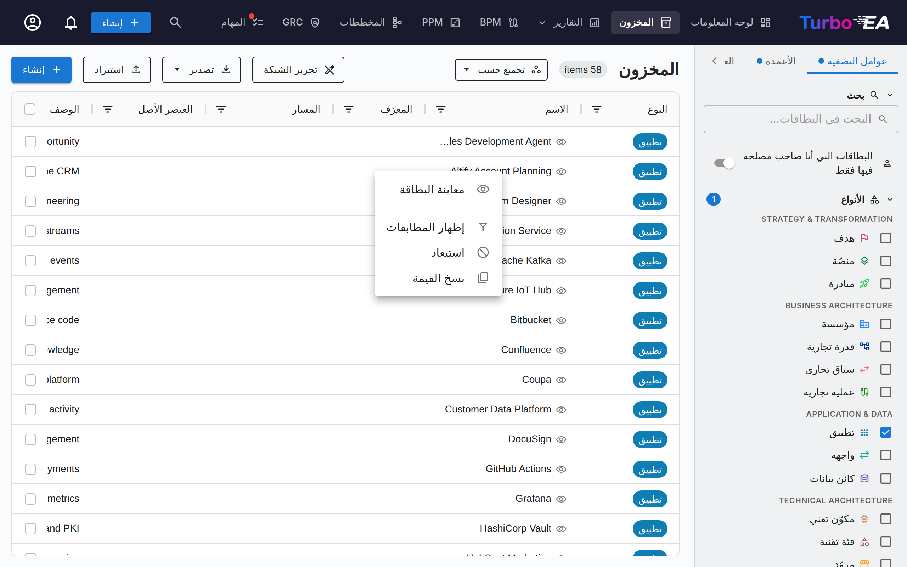

### علامة تبويب الأعمدة

تتيح لك علامة تبويب **الأعمدة** في اللوحة الجانبية اختيار الأعمدة الإضافية المراد عرضها في الشبكة. تتغيّر الأعمدة المتاحة ديناميكيًا استنادًا إلى أنواع البطاقات المختارة:

- **اختيار نوع واحد** — تتوفّر جميع حقول السمات المعرَّفة لذلك النوع، إضافةً إلى أعمدة العلاقات وأعمدة البيانات الوصفية
- **اختيار أنواع متعدّدة** — تتوفّر فقط الحقول **المشتركة عبر جميع الأنواع المختارة**
- **عدم اختيار نوع** — تُظهر رسالة تلميح تحثّك على اختيار نوع بطاقة أولاً

تُجمَّع الأعمدة في خمس فئات:

| الفئة | الوصف |
|----------|-------------|
| **الأعمدة الافتراضية** | أعمدة دائمة التفعيل: النوع، الاسم، المسار، الوصف، النوع الفرعي، دورة الحياة، حالة الموافقة، جودة البيانات. ألغِ تحديد أيٍّ منها لإخفائها من الشبكة — مفيد عند تضييق عرض محفوظ ليقتصر على الأعمدة التي تستخدمها فعلاً. |
| **البيانات الوصفية** | تاريخ الإنشاء، تاريخ التعديل، أنشأها، عدّلها، أُنشئ عبر، عُدّل عبر. **تاريخ التعديل** هو آخر مرة تغيّر فيها محتوى البطاقة — بفعل شخص أو تكامل، وليس عندما أعاد النظام حساب درجة ما — بحيث يمكنك التصفية حسب هذا التاريخ للعثور على البطاقات التي تحتاج إلى مراجعة من مالكها. يعرض عمودا **أُنشئ عبر** و**عُدّل عبر** القناة الكامنة وراء الإنشاء وآخر تغيير على هيئة شارة (MCP وAPI وإضافة والنظام)؛ وتبقى الخلية فارغة لواجهة الويب. |
| **السمات** | الحقول المخصّصة المعرَّفة في النموذج الفوقي (نص، رقم، تكلفة، تاريخ، تحديد، إلخ) |
| **العلاقات** | عمود واحد لكل علاقة، يحمل اسم فعلها ونوع البطاقة المرتبط — مثل *يستخدم مكوّن تقني* أو *مدعوم بواسطة تطبيق*. وعندما يربط نوعا علاقة بين أنواع البطاقات نفسها، يحصل كل منهما على عموده الخاص، ويحصل نوع العلاقة بين بطاقات من النوع نفسه (تطبيق *يرسل بيانات إلى* تطبيق آخر) على عمود لكل اتجاه. ابحث في القائمة بالفعل أو بنوع البطاقة. |
| **أصحاب المصلحة** | عمود واحد لكل دور من أدوار أصحاب المصلحة المعرَّفة لنوع البطاقة المحدد (مثل «أصحاب المصلحة: Responsible»)، يعرض المستخدمين المعيَّنين كشرائح. في وضع تحرير الشبكة، انقر نقرًا مزدوجًا على الخلية لتعيين مستخدمين لهذا الدور أو إزالتهم مباشرة من الشبكة (يتطلب صلاحية إدارة أصحاب المصلحة). |

يعرض عمود **العنصر الأصل** البطاقة التي تعلوه مباشرة فقط، بينما يعرض عمود **المسار** السلسلة كاملة. في وضع تحرير الجدول، انقر نقرًا مزدوجًا على خلية العنصر الأصل لنقل البطاقة، أو أفرغ الحقل لنقلها إلى المستوى الأعلى. لا يكون العمود قابلًا للتحرير إلا عند تصفية الجدول إلى نوع بطاقة واحد يدعم التسلسل الهرمي. وإذا رُفض النقل — لأنه سيُنشئ حلقة مغلقة، أو يتعارض مع بطاقة تحمل الاسم نفسه أسفل الهدف، أو يتجاوز العمق الأقصى — يظهر السبب أسفل الشاشة وتعود الخلية إلى حالتها السابقة.

يعرض عمود **المسار** مسار التنقّل الهرمي للبطاقة (مثل `North America / Sales / Inside Sales`) دون تضمين اسم البطاقة نفسها، فيمكنك إبقاء الاسم والمسار معًا على الشاشة في آنٍ واحد.

يعرض عمود **الشعار** شعار البطاقة الخاص بها، أو أيقونة نوعها إن لم يُضبط أي شعار، بحيث يمكن تصفّح المشهد بحسب علامات المنتجات بدلًا من الأسماء. ولا يُتاح هذا العمود إلا لأنواع البطاقات التي تسمح بالشعارات (وهي افتراضيًا «التطبيق» و«مكوّن تقنية المعلومات»)، وهو مُعطَّل افتراضيًا، ويزيد ارتفاع الصفوف طالما كان معروضًا حتى تبقى العلامات واضحة. وإذا كانت لديك صلاحية تحرير البطاقة، مرّر المؤشر فوق خلية الشعار وانقر لرفع شعار أو استبداله أو اختيار أيقونة علامة تجارية أو إزالته دون مغادرة الشبكة — وهي القائمة نفسها الموجودة في صفحة البطاقة. وقد استُثنيت الشعارات عمدًا من التعبئة للأسفل ومن التحرير الجماعي: علامة واحدة لكل بطاقة، تُضبط عن قصد.

يعرض عمود **الاسم المستعار** الاسم الآخر للبطاقة — الاسم الداخلي الذي تسمّيها به مؤسستك. وهو مُعطَّل تلقائياً لأن معظم المشاهد لا تحمل أي اسم مستعار: فعّله من علامة التبويب **الأعمدة**. يُحرَّر داخل الخلية في وضع تحرير الشبكة ويُعبَّأ إلى الأسفل مثل أي عمود نصّي آخر، وينتقل مع تصدير Excel واستيراده، فيمكن تحميل قائمة أسماء مستعارة في مرة واحدة.

تحتوي كل فئة على مربّع اختيار **تحديد الكل** لتبديل جميع الأعمدة في تلك المجموعة بسرعة. يتيح لك حقل بحث في الأعلى العثور على أعمدة محدّدة بالاسم. تعرض الشارة على رأس كل قسم كم عمودًا من تلك المجموعة مرئيًا حاليًا.

عند اختيار نوع بطاقة لأول مرّة، تُفعَّل **جميع أعمدة السمات والعلاقات افتراضيًا**. يمكنك بعد ذلك إلغاء تحديد الأعمدة التي لا تحتاجها. يستعيد زر **إعادة تعيين** في أسفل علامة تبويب الأعمدة التحديد الافتراضي للأعمدة.

تظهر **نقطة مؤشّر تغيير** على رأس علامة تبويب الأعمدة عندما يختلف تحديد الأعمدة عن الإعدادات الافتراضية. ويظهر المؤشّر ذاته على علامة تبويب **عوامل التصفية** عندما تكون أي عوامل تصفية نشطة، ما يسهّل رؤية الإعدادات المعدّلة بنظرة سريعة.

يُحفظ تحديد الأعمدة لديك و**تخطيط الأعمدة** (الترتيب من اليسار إلى اليمين والعرض والأعمدة المثبّتة) وعوامل التصفية النشطة وترتيب الفرز **تلقائيًا** في متصفّحك. وعند العودة إلى صفحة المخزون، تُستعاد تهيئتك السابقة. كما تحفظ العروض المحفوظة (الإشارات المرجعية) هذا التخطيط الكامل، فيؤدّي التبديل بين العروض إلى استعادة الأعمدة التي هيّأتها بالضبط، وبالترتيب نفسه، وهو أمر مهم عند مشاركة عرض منظّم مع الجهات المعنية.

### الجدول الرئيسي

يستخدم المخزون جدول بيانات **AG Grid** بميزات قوية:

| العمود | الوصف |
|--------|-------------|
| **النوع** | نوع البطاقة مع أيقونة مميّزة بالألوان |
| **الاسم** | اسم المكوّن (انقر لفتح تفاصيل البطاقة). تحتوي كل خلية اسم على أيقونة عين 👁 — انقر عليها لفتح تفاصيل البطاقة في لوحة جانبية دون مغادرة الشبكة. اضغط Ctrl/Cmd مع النقر على الاسم لفتح البطاقة في علامة تبويب متصفّح جديدة. |
| **الشعار** | شعار البطاقة الخاص بها، أو أيقونة نوعها إن لم يكن لديها شعار. مُعطَّل افتراضيًا — فعّله من تبويب «الأعمدة»؛ انقر على الخلية لتغييره |
| **الاسم المستعار** | الاسم الآخر للبطاقة. مُعطَّل تلقائياً — فعّله من علامة التبويب «الأعمدة»؛ تطابقه كل حقول البحث |
| **المسار** | مسار التنقّل الهرمي حتى أصل البطاقة — فارغ للبطاقات الجذرية |
| **الوصف** | وصف موجز — أي عنوان ويب فيه رابط قابل للنقر |
| **دورة الحياة** | حالة دورة الحياة الحالية |
| **حالة الموافقة** | شارة حالة المراجعة |
| **جودة البيانات** | نسبة الاكتمال المئوية مع حلقة بصرية |
| **العلاقات** | عمود واحد لكل علاقة، عنوانه فعلها ونوع البطاقة المرتبط (مثل *يستخدم مكوّن تقني*): أسماء البطاقات المرتبطة عبر تلك العلاقة مرتبةً أبجدياً، مع نافذة منبثقة قابلة للنقر لإضافة علاقات من هذا النوع أو إزالتها — تُخفى البطاقات المرتبطة بالفعل من مُنتقيها، إلا في النوع الهرمي حيث يعرض المُنتقي التسلسل الهرمي كاملًا كشجرة بمسافات بادئة ويُبقي تلك البطاقات بلون باهت في مكانها. وتُفتح العروض المحفوظة وتخطيطات الأعمدة التي تعود إلى ما قبل تقسيم أعمدة العلاقات حسب العلاقة مع الأعمدة الجديدة بدلًا من العمود القديم |

**ميزات الجدول:**

- **الفرز** — انقر على رأس أي عمود للفرز تصاعديًا/تنازليًا
- **التحرير المضمّن** — في وضع تحرير الشبكة، حرِّر قيم الحقول مباشرةً في الجدول
- **تعبئة عمود إلى الأسفل** — في وضع تحرير الشبكة، انقر على خلية ثم اسحب المربّع الصغير في زاويتها إلى الأعلى أو الأسفل لنسخ تلك القيمة إلى كل الصفوف التي تمرّ عليها. قبل حفظ أي شيء، تعرض رسالة تأكيد اسم العمود والقيمة وعدد الصفوف؛ وإذا رفض الخادم صفّاً، فسيُدرج مع السبب ورابط إليه، بينما تبقى الصفوف الناجحة محفوظة. تعمل هذه الإيماءة بالإصبع كما بالفأرة، وكذلك بلوحة المفاتيح — ركّز على المربّع، ووسّع النطاق بمفاتيح الأسهم، وأكّد بمفتاح Enter. تُملأ الصفوف المعروضة حالياً فقط بعد تطبيق عوامل التصفية والترتيب، وعمود الاسم مستثنى عمداً حتى لا تتشارك بطاقتان الاسم نفسه.
- **التحديد المتعدّد** — حدِّد عدّة صفوف للعمليات الجماعية
- **المعاينة السريعة** — استخدم أيقونة العين بجوار أي اسم لفتح تفاصيل البطاقة في لوحة جانبية
- **الفتح في علامة تبويب جديدة** — اضغط Ctrl/Cmd مع النقر على اسم لفتح البطاقة في علامة تبويب متصفّح جديدة؛ كما تدعم روابط شريط التنقّل الرئيسي هذا
- **تهيئة الأعمدة** — إظهار الأعمدة وإخفاؤها وإعادة ترتيبها (بما في ذلك الأعمدة الافتراضية الدائمة التفعيل)
- **تثبيت عمود** — مرّر المؤشّر فوق رأس العمود وانقر على أيقونة الدبّوس لتثبيت العمود عند بداية الجدول، فيبقى ظاهرًا أثناء التمرير الأفقي. انقر على الدبّوس مرّة أخرى لإلغاء التثبيت. كما يحمل كل عمود الدبّوس نفسه في تبويب **الأعمدة** بلوحة التصفية، فيمكنك تثبيت عمود دون البحث عن رأسه. تُحفظ الأعمدة المثبَّتة لكل جدول على حدة، ويتوفّر الزرّ نفسه في كل جداول بيانات Turbo EA (سجلّ المخاطر، القرارات، نتائج الامتثال، المستخدمون، الموارد، سجلّ التدقيق).
- **إعادة ترتيب الأعمدة** — اسحب رأس العمود لنقله، أو افتح قسم **ترتيب الأعمدة** أعلى تبويب **الأعمدة** واسحب الصف من مقبضه. هذه القائمة *هي* ترتيب الجدول نفسه، لذا يتطابقان دائمًا، وتُجمَع الأعمدة المثبَّتة في مقدّمة القائمة لأنها تظهر دائمًا في البداية — ألغِ تثبيت العمود هناك إذا أردت إخراجه من تلك المجموعة. يعمل المقبض أيضًا بلوحة المفاتيح (مفتاح المسافة لالتقاط عمود، ومفاتيح الأسهم لنقله، ومفتاح المسافة لإفلاته) وباللمس، فيمكن تغيير الترتيب من الهاتف. يُحفظ ترتيب الأعمدة لكل جدول على حدة، في كل جداول بيانات Turbo EA.

### شريط الأدوات

- **تحرير الشبكة** — تبديل وضع التحرير المضمّن لتحرير عدّة بطاقات في الجدول
- **تصدير** — تنزيل البيانات كملف Excel‏ ‎(.xlsx)‎
- **استيراد** — تحميل البيانات جماعيًا من ملفات Excel
- **+ إنشاء** — إنشاء بطاقة جديدة

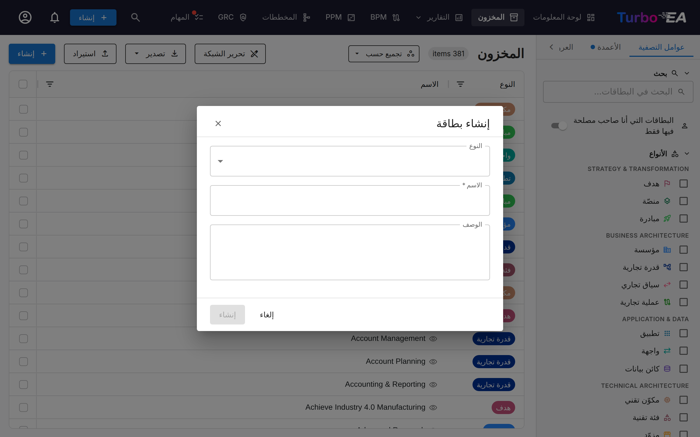

## كيفية إنشاء بطاقة جديدة

1. انقر على زر **+ إنشاء** (أزرق، الزاوية العلوية اليمنى)
2. في مربّع الحوار الذي يظهر:
   - اختر **نوع** البطاقة (تطبيق، عملية، هدف، إلخ)
   - أدخِل **اسم** المكوّن
   - اختياريًا، أضِف **وصفًا**
3. اختياريًا، انقر على **اقتراح بالذكاء الاصطناعي** لإنشاء وصف تلقائيًا (انظر [اقتراحات الوصف بالذكاء الاصطناعي](#ai-description-suggestions) أدناه)
4. انقر على **إنشاء**

## التحرير الجماعي { #mass-edit }

حدّد صفّين أو أكثر باستخدام مربّعات الاختيار في العمود الأيمن، ثم انقر على **التحرير الجماعي** في شريط التحديد. يطبّق مربّع الحوار تغييرًا واحدًا على كل بطاقة محدّدة.

تجمع القائمة المنسدلة **الحقل** ما يمكنك تغييره:

- **عام** — حالة الاعتماد والنوع الفرعي والوسوم والعنصر الأصل
- **السمات** — أي حقل قابل للتحرير مُعرَّف لنوع البطاقة المحدّد
- **العلاقات** — مدخل لكل نوع علاقة واتجاه (على سبيل المثال *يعمل على ← مكوّن تقني*)

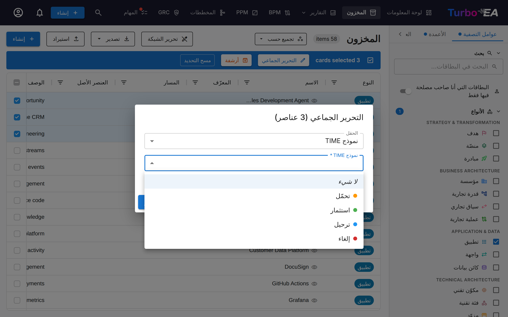

توفّر الوسوم والعلاقات والعنصر الأصل مفتاح **إضافة / إزالة**، بحيث توسّع القيم الحالية أو تقلّصها بدلًا من استبدالها.

عند اختيار **إضافة رابط** لنوع علاقة يحمل تفاصيل — مثل اتجاه التدفق بين تطبيقين، أو كيفية استخدام مؤسسة لتطبيق، أو علامات الإنشاء / القراءة / التحديث / الحذف على كائن بيانات — يعرض مربع الحوار هذه الحقول أيضًا. يُحفظ ما تحدّده على كل رابط يُضاف. وتحصل البطاقات المرتبطة مسبقًا بهدف مختار على التفاصيل أيضًا، لذا فإن تكرار **إضافة رابط** هو طريقة تحديث تفاصيل الروابط الموجودة؛ ولا يتغيّر أي تفصيل تتركه فارغًا.

يتوافق عنصر إدخال القيمة مع نوع الحقل: يعرض حقل الاختيار المتعدّد خياراته مع مربّعات اختيار، ويعرض الحقل من نوع نعم/لا قائمة «نعم» / «لا»، ويعرض حقل التاريخ منتقي تاريخ. ترك القيمة فارغة — **لا شيء** في حقل نعم/لا — يمسح الحقل من كل بطاقة محدّدة. أما الحقول المحسوبة بواسطة صيغة، وحقول التكلفة التي لا تملك إذنًا لعرضها، فلا تظهر في القائمة.

### إعادة هيكلة التسلسل الهرمي { #mass-edit-parent }

يظهر حقل **العنصر الأصل** بعد تصفية الجدول إلى نوع بطاقة واحد يدعم التسلسل الهرمي. للبطاقة عنصر أصل واحد فقط، لذا يغطّي هذا الحقل الواحد كلا اتجاهَي إعادة الهيكلة:

- **تعيين العنصر الأصل** — اختر بطاقة من النوع نفسه؛ تُنقل كل البطاقات المحدّدة أسفلها. بهذه الطريقة تجعل بطاقات كثيرة أبناءً لعنصر أصل واحد.
- **إزالة العنصر الأصل** — تعود كل البطاقات المحدّدة إلى المستوى الأعلى.

تُنقل البطاقات واحدة تلو الأخرى، لذا فإن أي نقل غير مسموح به يحجب تلك البطاقة وحدها. يبقى مربّع الحوار مفتوحًا ويسرد البطاقات المحجوبة وسببها. والأسباب المعتادة هي:

- توجد بالفعل بطاقة بالاسم نفسه أسفل العنصر الأصل الهدف.
- العنصر الأصل المختار من نسل إحدى البطاقات التي يجري نقلها، ما يؤدّي إلى حلقة مغلقة.
- سيدفع النقل قدرةً تجارية إلى ما بعد الحدّ الأقصى البالغ خمسة مستويات.

تأخذ البطاقة أبناءها معها عند النقل، وتعود البطاقات المعتمدة إلى حالة **معطوب** كي تُراجَع التغييرات من جديد.

## تجميع المخزون { #group-by }

انقر على **تجميع حسب** في شريط الأدوات (بجوار عدد العناصر) لتنظيم الجدول في مجموعات قابلة للطي. مرحلة دورة الحياة وحالة الاعتماد متاحتان دائمًا؛ وعند تصفية الجدول إلى نوع بطاقات واحد يُضاف النوع الفرعي وجميع السمات ذات الاختيار الأحادي.

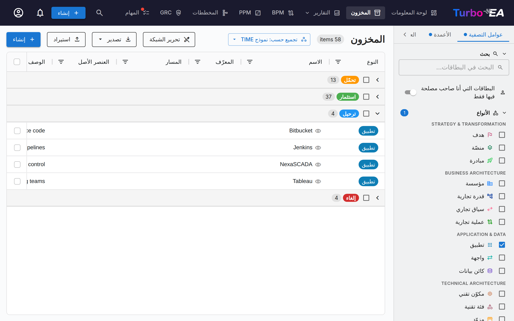

- البطاقات التي لا تحمل قيمة في الحقل المختار تُجمع في مجموعة **غير محدد** في الأعلى، وهي نقطة البداية الطبيعية لفرز البطاقات غير المصنفة.
- انقر على عنوان المجموعة لطيّها أو توسيعها. يعرض العنوان عدد البطاقات في المجموعة.
- عند التمرير داخل مجموعة طويلة يظل عنوانها مثبتًا أسفل عناوين الأعمدة مباشرة، فتعرف دائمًا أي مجموعة تقرأ؛ ويزيحه عنوان المجموعة التالية عند وصوله. وهو العنوان كاملًا بما فيه خانة الاختيار، فيمكنك تحديد مجموعة طويلة دون العودة إلى بدايتها.
- تُحدد خانة الاختيار في العنوان جميع بطاقات المجموعة: لإعادة تصنيف دفعة، وسّع **غير محدد**، وحدد العنوان، ثم عيّن القيمة عبر [التحرير الجماعي](#mass-edit). لا يوجد سحب وإفلات عن قصد — التحديد ثم التعيين يعمل بالطريقة نفسها على الحاسوب والجهاز اللوحي والهاتف.
- يسري الترتيب داخل كل مجموعة؛ ويُحفظ التجميع بعد إعادة التحميل، ويُخزن في العروض المحفوظة، ويمكن مشاركته عبر معامل URL‏ `group_by`.

### إزاحة العناصر الفرعية تحت العناصر الأصلية { #group-by-parents }

حدّد **العنصر الأصلي** أعلى قائمة **التجميع حسب** لعرض البطاقات على شكل شجرة: يظهر كل عنصر أصلي أولًا وتحته عناصره الفرعية بإزاحة. يعمل هذا الخيار بمفرده (تصبح الشبكة كلها شجرة واحدة) أو فوق أي تجميع (تصبح كل مجموعة شجرة مستقلة). تبقى القائمة مفتوحة عند التحديد، فيمكنك اختيار تجميع مباشرةً بعد ذلك.

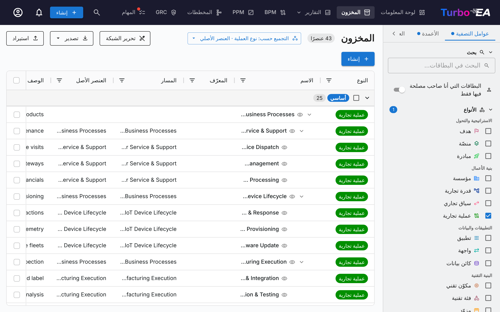

- لا تغادر البطاقة مجموعتها أبدًا. العنصر الفرعي الذي يقع أصله في مجموعة أخرى، أو يخفيه مرشح عمود، أو لم يُحمَّل، يبدأ فرعًا خاصًا به، وتظهر أسلافه المفقودة باللون الرمادي قبل اسمه (مثل *SAP S/4HANA / SAP FI /* قبل اسم الوحدة). لذلك تطابق أعداد المجموعات ومربع التحديد في الترويسة والتحرير الجماعي دائمًا محتوى المجموعة.
- انقر على السهم قبل اسم العنصر الأصلي لإخفاء فرعه أو إظهاره. يواصل العنصر الأصلي المطوي احتساب بطاقاته المخفية في عدد العناصر وفي ترويسة المجموعة. لا تُحفظ الفروع التي تطويها بالسهم، وتغيير مرشح العمود يعيد فتحها جميعًا؛ ومسح آخر مرشح عمود يعيد العرض إلى المستوى الذي اخترته بأداة التدرج.
- أثناء تفعيل طبقة العنصر الأصلي، يغلق زوج الأزرار **−** / **+** المجاور لزر التجميع حسب الشجرة كلها أو يفتحها مستوى بعد مستوى. يُحفظ المستوى الذي تختاره بين عمليات إعادة التحميل، ويُخزَّن في العروض المحفوظة، ويمكن مشاركته عبر `group_tree_level=<n>`؛ كما يتبع المستوى المعروض ما تفتحه وتغلقه يدويًا.
- يُطبَّق الفرز بين العناصر الشقيقة: تُفرز العناصر الأصلية، ثم تُفرز العناصر الفرعية لكل عنصر أصلي تحته.
- يُعرض هذا الخيار فقط عندما يكون لنوع بطاقة في العرض تسلسل هرمي. يُحفظ بين عمليات إعادة التحميل، ويُخزَّن في العروض المحفوظة، ويمكن مشاركته عبر معامل الرابط `group_tree=1`.
- يتبع **التصدير** ترتيب الشجرة ويستثني البطاقات الموجودة في الفروع المطوية، كما يفعل مع المجموعات المطوية.

## اقتراحات الوصف بالذكاء الاصطناعي { #ai-description-suggestions }

يمكن لـ Turbo EA استخدام **الذكاء الاصطناعي لإنشاء وصف** لأي بطاقة. يعمل هذا في كلٍّ من مربّع حوار إنشاء البطاقة وصفحات تفاصيل البطاقات الموجودة.

**كيف يعمل:**

1. أدخِل اسم بطاقة واختر نوعًا
2. انقر على **أيقونة البريق** في رأس البطاقة، أو زر **اقتراح بالذكاء الاصطناعي** في مربّع حوار إنشاء البطاقة
3. يجري النظام **بحثًا على الويب** عن اسم العنصر (باستخدام سياق مدرِك للنوع — مثل "SAP S/4HANA software application")، ثم يرسل النتائج إلى **LLM** لإنشاء وصف موجز وواقعي
4. تظهر لوحة اقتراح تتضمّن:
   - **وصف قابل للتحرير** — راجِع النص وعدِّله قبل التطبيق
   - **درجة الثقة** — تشير إلى مدى يقين الذكاء الاصطناعي (عالية / متوسّطة / منخفضة)
   - **روابط مصادر قابلة للنقر** — صفحات الويب التي اشتُقّ منها الوصف
   - **اسم النموذج** — أي LLM أنشأ الاقتراح
5. انقر على **تطبيق الوصف** للحفظ، أو **تجاهل** للتخلّص منه

**الخصائص الرئيسية:**

- **مدرِك للنوع**: يفهم الذكاء الاصطناعي سياق نوع البطاقة. فبحث "تطبيق" يضيف "software application"، وبحث "مزوّد" يضيف "technology vendor"، إلخ
- **الخصوصية أولاً**: عند استخدام Ollama، يعمل LLM محليًا — لا تغادر بياناتك بنيتك التحتية أبدًا. كما يُدعَم المزوّدون التجاريون (OpenAI وGoogle Gemini وAnthropic Claude وغيرهم)
- **مُتحكَّم به من المسؤول**: يجب أن يُمكِّن المسؤول اقتراحات الذكاء الاصطناعي في [الإعدادات > اقتراحات الذكاء الاصطناعي](../admin/ai.md). يختار المسؤولون أنواع البطاقات التي تعرض زر الاقتراح، ويهيّئون مزوّد LLM، ويختارون مزوّد البحث على الويب
- **قائم على الأذونات**: يمكن للمستخدمين الذين لديهم إذن `ai.suggest` فقط استخدام هذه الميزة (مُمكَّنة افتراضيًا لأدوار المسؤول وBPM Admin والعضو)

## العروض المحفوظة (الإشارات المرجعية)

يمكنك حفظ تهيئة عوامل التصفية والأعمدة والفرز الحالية كـ **عرض مُسمّى** لإعادة الاستخدام السريع.

### إنشاء عرض محفوظ

1. هيّئ المخزون بعوامل التصفية والأعمدة والفرز المرغوبة
2. انقر على أيقونة **الإشارة المرجعية** في لوحة التصفية
3. أدخِل **اسمًا** للعرض
4. اختر **الرؤية**:
   - **خاص** — أنت وحدك من يراه
   - **مشترَك** — مرئي لمستخدمين محدّدين (مع أذونات تحرير اختيارية)
   - **عام** — مرئي لجميع المستخدمين

### استخدام العروض المحفوظة

تظهر العروض المحفوظة في الشريط الجانبي للوحة التصفية. انقر على أي عرض لتطبيق تهيئته فورًا. تُنظَّم العروض في:

- **عروضي** — العروض التي أنشأتها
- **مشترَك معي** — العروض التي شاركها آخرون معك
- **العروض العامة** — العروض المتاحة للجميع

### عروض الاستعلام { #query-views }
<a id="mcp-views"></a>

**عرض الاستعلام** هو عرض محفوظ تكون مرشّحاته **استعلامًا متعدد القفزات** — سلسلة من العلاقات مع شروط في كل خطوة، مثل *المؤسسات التي تستخدم تطبيقًا نشطًا تؤثر فيه مبادرة حالتها On Track*. يمكن تكديس عدة استعلامات من هذا النوع في عرض واحد ودمجها باستخدام **و** و**أو** (انظر أدناه). يخزّن العرض الاستعلام لا نتائجه: يُعاد تشغيله في كل مرة يُفتح فيها العرض، لذا تعكس القائمة دائمًا المشهد الحالي.

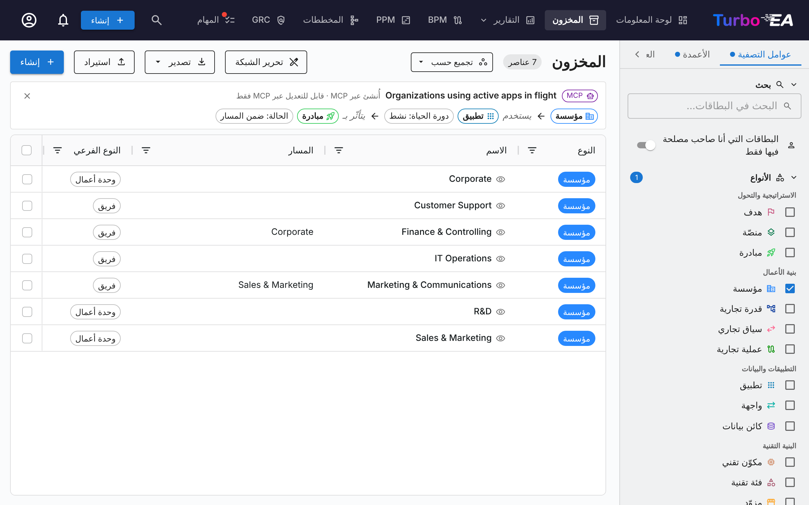

**بناء عرض استعلام.** في تبويب **العروض** بالشريط الجانبي للمرشّحات، انقر **عرض استعلام جديد** بجوار *حفظ الحالي* (يظهر لكل من يحق له إدارة العروض). إذا كان أي مرشّح نشطًا، بما فيه نوع البطاقة المحدد، يطلب تأكيدٌ الموافقة قبل مسحها؛ ويعيدها **إلغاء** على المسودة. يفتح الشريط الموجود فوق الشبكة كمُنشئ استعلامات:

1. انقر شريحة البداية (*اختر نوعًا*) واختر نوع البطاقة الذي يبدأ منه الاستعلام، أي النوع الذي يسرده.
2. انقر **+ علاقة** بعد آخر بطاقة لإضافة قفزة. تسرد القائمة كل فعل علاقة مع نوع البطاقة الذي يؤدي إليه؛ وتُعرض العلاقة بين بطاقات من النوع نفسه في الاتجاهين. كل سطر استعلام سلسلة واحدة من ثلاث قفزات على الأكثر.
3. انقر **+ شرط** أسفل أي بطاقة لتضييق نطاقها: **دورة الحياة** أو **الأنواع الفرعية** أو **حالة الاعتماد** أو **جودة البيانات** (*مكتمل* أو *جزئي* أو *أدنى*، وهي النطاقات نفسها في مرشّح الشريط الجانبي) أو **نهاية العمر** (انظر أدناه) أو **الوسوم** أو **بطاقات محددة** أو حقل اختيار أو نعم/لا لنوع البطاقة ذاك. بالنسبة إلى الوسوم، تتطابق البطاقة إذا كان لديها أي وسم من الوسوم المختارة في مجموعة، ويجب أن تتطابق مع كل مجموعة تضيفها؛ وتُعرض فقط مجموعات الوسوم التي تنطبق على نوع البطاقة ذاك. يفتح **بطاقات محددة** منتقي البطاقات لبطاقات ذلك النوع، وعندها تطابق الخطوة البطاقات التي اخترتها فقط؛ وبالنسبة إلى نوع بطاقة هرمي، يطابق مفتاح **تضمين البطاقات الفرعية** أيضًا البطاقات الواقعة تحت كل اختيار. تظهر البطاقة المختارة التي لا تستطيع رؤيتها على هيئة *(بطاقة مخفية)*.
4. انقر **حفظ**. يفتح مربع حوار حفظ العرض المعتاد للاسم والرؤية والمشاركة وإعداد OData. يؤدي **إلغاء** إلى تجاهل الاستعلام.

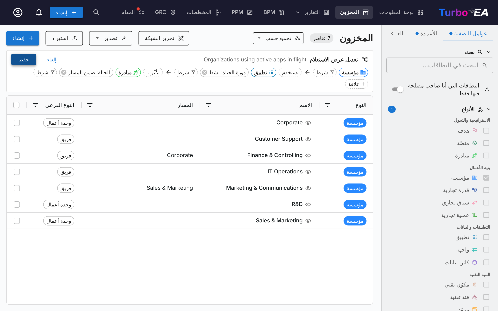

أثناء البناء تُرشَّح الشبكة مباشرةً ويعرض العدّاد في شريط الأدوات عدد البطاقات المطابقة، فترى أثر كل قفزة وشرط قبل الحفظ.

**التصفية حسب نهاية العمر.** يُعرض شرط **نهاية العمر** لنوع بطاقة يتتبع نهاية العمر — افتراضيًا التطبيق والمكوّن التقني؛ وهو يتبع قسم نهاية العمر الخاص بالنوع في النموذج الوصفي. قيمه هي **نهاية العمر الافتراضي** و**اقتراب نهاية العمر الافتراضي** و**مدعوم** و**غير معروف** و*(فارغ)* للبطاقات التي لا تحمل بيانات نهاية العمر. والحالة هي نفسها التي يعرضها عمود **نهاية العمر** في المخزون: فهي تأتي من منتج endoflife.date المرتبط أو من منتج EOL مخصّص، أو من تاريخ نهاية عمر أُدخل يدويًا، وهي مستقلة عن مرحلة دورة حياة البطاقة. يعمل الشرط على البطاقة الأولى وفي أي خطوة علاقة، في أسطر «و» وأسطر «أو» على حد سواء — مثل *التطبيقات التي تستخدم مكوّنًا تقنيًا في نهاية العمر الافتراضي*. وما دام الاستعلام يصفّي به على البطاقة الأولى، تعرض الشبكة عمود نهاية العمر لترى سبب تطابق كل بطاقة؛ ولا تتغير الأعمدة التي اخترتها. وإذا تعذّر الوصول إلى endoflife.date ولم يكن هناك شيء مخزّن مؤقتًا، فتُقرأ البطاقات المرتبطة على أنها *غير معروف*، كما في عمود نهاية العمر.

يتطلب الشرط إذن عرض بيانات نهاية العمر (**عرض بيانات EOL**، `eol.view`). وبدونه لا يُعرض الشرط، ويُرفض فتح عرض يستخدمه أو معاينته أو حفظه مع الرسالة *يصفّي هذا العرض حسب حالة نهاية العمر الافتراضي، التي لا يمكن لدورك الاطلاع عليها.*

**تغيير القفزات والشروط.** انقر شريحة فعل القفزة لفتح قائمتها: يحوّل **ليس لديه** القفزة إلى شرط ألا تكون للبطاقة **أي** علاقة كهذه، ويزيلها **إزالة هذه الخطوة** مع كل القفزات التي تليها. انقر شريحة الشرط لتغيير قيمه، أو انقر **×** الخاص بها لإزالتها.

**دمج الاستعلامات باستخدام «و» و«أو».** يمكن أن يحتوي العرض على عدة أسطر استعلام مكدّسة فوق بعضها. كل سطر استعلام كامل — بطاقة البداية والعلاقات والشروط — ويُبنى تمامًا مثل الاستعلام المفرد أعلاه. تُجمَّع الأسطر في مجموعات:

- **و** تضيف سطرًا إلى المجموعة نفسها: لا تُسرد البطاقة إلا إذا طابقت **كل** سطر في المجموعة. يبدأ سطر «و» من نوع البطاقة نفسه الذي تبدأ منه مجموعته، ويظهر كشريحة ثابتة، ولا يمكن للسطر الأول في المجموعة تغيير نوع بطاقته ما دامت لديه أسطر «و».
- **أو** تبدأ مجموعة جديدة أسفل فاصل **أو**: تُ**ضاف** نتائجها إلى القائمة. يمكن أن تبدأ المجموعة الجديدة من نوع بطاقة آخر، فيستطيع عرض واحد أن يسرد مثلًا التطبيقات والمؤسسات معًا. عندما يسرد العرض عدة أنواع بطاقات، يعرض الجدول الأعمدة المشتركة بين هذه الأنواع.

في وضع التحرير يسأل **علامة الجمع** المحاطة بدائرة أسفل كل مجموعة: «و» أم «أو»؟ تضيف «و» سطرًا إلى تلك المجموعة، وتفتح «أو» مجموعة جديدة بعدها. تزيل علامة **×** في نهاية السطر ذلك السطر؛ وتظهر عندما يحتوي العرض على أكثر من سطر.

على سبيل المثال، يضم العرض التوضيحي *Active apps on aging tech, and the organizations using apps* مجموعة تطبيقات من سطرين — تطبيق نشط يستخدم مكوّن تقنية معلومات في مرحلة الإيقاف أو نهاية العمر، **و** تطبيق تتأثر به مبادرة — **أو** مؤسسة تستخدم تطبيقًا. تعرض القائمة التطبيقات التي تستوفي السطرين معًا، إضافة إلى كل مؤسسة تستخدم تطبيقًا.

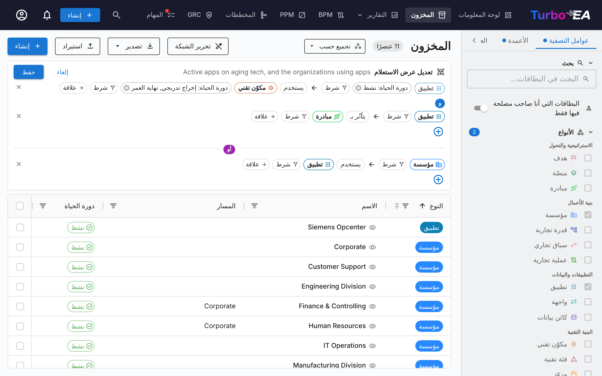

يحتوي العرض على 6 أسطر استعلام كحد أقصى، و12 علاقة عبر جميع أسطره، وثلاث علاقات في العمق لكل سطر. تلتقي أسطر مجموعة «و» عند بطاقة البداية فقط: قد يكون مكوّن تقنية المعلومات في سطر والمبادرة في سطر آخر بطاقتين مختلفتين. أما اشتراط أمرين على **البطاقة نفسها** في منتصف السطر — كأن يقدّم مزوّد المكوّن نفسه **و** ينتمي إلى فئة تقنية — فلا يمكن بناؤه في منشئ الاستعلام؛ يمكن لمساعد ذكاء اصطناعي كتابة هذا الاستعلام عبر [خادم MCP](../admin/mcp.md#multi-hop-card-queries)، ثم يعرضه الشريط.

**تعديل عرض استعلام محفوظ.** عند فتح عرض استعلام يعرض الشريط مساره: أنواع البطاقات على شكل شرائح، تربطها أفعال العلاقات التي تصل كل خطوة (مثل *المؤسسة ← تستخدم التطبيق ← يتأثر بالمبادرة*)، مع شروط كل بطاقة أسفلها. يعرض العرض ذو الأسطر المتعددة المجموعة المكدّسة نفسها، بعلامات «و» وفواصل «أو»، من دون عناصر التحرير. إذا كنت مالك العرض أو لديك حقوق تعديل عليه، يحوّله **قلم** في الشريط إلى المُنشئ نفسه؛ ويحدّث **حفظ** العرض. يعيدك الزر **×** (*مغادرة هذا العرض*) إلى المخزون العادي. يحفظ **حفظ العرض الحالي** أثناء فتح عرض استعلام عرض استعلام جديدًا بالاستعلام نفسه.

#### عرض البطاقات وراء المطابقة { #query-view-matches }

يسرد عرض الاستعلام البطاقة الأولى من استعلامه فقط. لمعرفة البطاقات الأبعد في السلسلة التي جعلت صفًا ما مطابقًا، انقر نوع بطاقتها في مسار الاستعلام. في *المؤسسات التي تستخدم تطبيقًا يستخدم مكوّن تقنية معلومات في نهاية العمر أو قريبًا منها*، انقر **التطبيق** فيسرد عمود لكل مؤسسة التطبيقات التي تطابق من خلالها؛ وانقر **مكوّن تقنية المعلومات** فيسرد عمود آخر مكوّنات تقنية المعلومات المستوفية للشرط. انقر نوع البطاقة مرة أخرى لإزالة عموده.

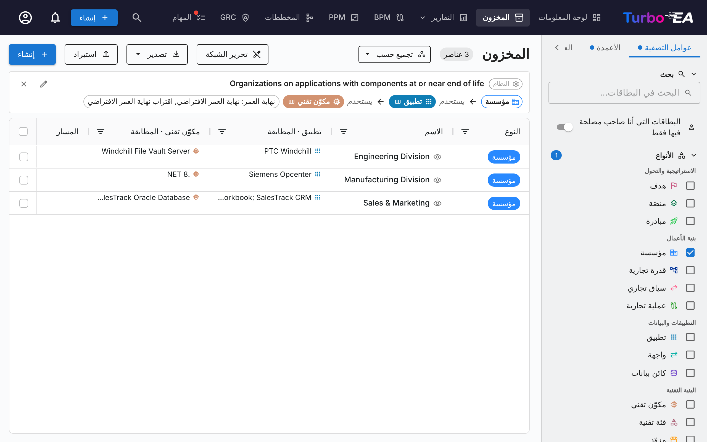

- **شكل المفتاح.** يُظهر نوع البطاقة القابل للنقر مؤشرًا وتلميح *عرضها في عمود*. وبعد تشغيل عموده تُملأ الشريحة بلون نوع البطاقة وتحمل أيقونة عمود صغيرة؛ ويصبح تلميحها *إخفاء العمود*.
- **أنواع البطاقات التي تعمل مفاتيح.** كل نوع بطاقة بعد الأول في سطره. النوع الأول في السطر ليس مفتاحًا، لأن بطاقاته هي صفوف الجدول، وكذلك نوع البطاقة الواقع بعد **ليس لديه** الذي يمثّل علاقة مفقودة. في عرض متعدد الأسطر تكون أنواع البطاقات في كل سطر مفاتيح؛ ومع **أو** يعرض الصف بطاقات للأسطر التي يطابقها فقط. لا تتوفر المفاتيح أثناء تعديل الاستعلام، وتبقى الأعمدة مخفية حتى تحفظ أو تلغي.
- **موضع العمود.** مباشرة بعد **الاسم**، وعنوانه نوع البطاقة متبوعًا بـ *المطابقة* — مثل *التطبيق · المطابقة* — كي لا يُخلط بينه وبين عمود علاقة مثل *يستخدم تطبيق* الذي يسرد كل التطبيقات المرتبطة بهذه الطريقة. وعندما يكون لخطوتين نوع البطاقة نفسه تُرقَّم العناوين. مرّر المؤشر فوق العنوان لرؤية المسار الذي يتبعه العمود.
- **ما تعرضه الخلية.** أسماء البطاقات المطابقة مفصولة بفواصل منقوطة؛ مرّر المؤشر فوق الخلية لرؤية القائمة كاملة. تسرد الخلية **100** اسم كحد أقصى؛ وتنتهي القائمة الأطول بـ *…* ويذكر تلميحها أن أول 100 هي المعروضة. يمكنك فرز العمود وتصفيته كعمود نصي، ويتضمنه **تصدير العرض الحالي**.
- **كل بطاقة على طول السلسلة، لا أيّها يؤدي إلى أيّها.** يسرد الصف كل بطاقة مطابقة في تلك الخطوة: كل تطبيقات المؤسسة المستوفية للشرط وكل مكوّنات تقنية المعلومات المستوفية له في تلك التطبيقات. ولا يبيّن أي مكوّن ينتمي إلى أي تطبيق. لسرد مكوّنات تقنية المعلومات نفسها، واحدًا في كل صف، اكتب الاستعلام بدءًا من مكوّن تقنية المعلومات بدلًا من ذلك.
- **تُحفظ مع العرض.** تُحفظ الأعمدة التي تشغّلها مع العرض (**القلم** في قائمة العروض، ثم **تحديث**)، فتعود عند فتحه مجددًا. يُبقي تعديل الاستعلام على العمود ما دامت خطوته موجودة، ويزيله عندما تحذف تلك الخطوة أو تغيّر نوع بطاقتها.

لا ترى إلا البطاقات المسموح لك برؤيتها: لا تُذكر في أي خلية بطاقة مخفية عنك، ولا يُدرج صف لا يطابق إلا من خلال بطاقات مخفية.

يُفتح العرض التوضيحي *Organizations on applications with components at or near end of life* والعمودان كلاهما قيد التشغيل.

**العروض التي ينشئها مساعد ذكاء اصطناعي.** يمكن لمساعد متصل عبر [خادم MCP](../admin/mcp.md) أن ينشئ عروض استعلام أيضًا. يعرض هذا العرض شريحة **MCP** وملاحظة *أُنشئ عبر MCP* في شريطه، وشارة روبوت في قائمة العروض؛ ويُعدَّل كأي عرض استعلام آخر. وفي قائمة العروض يحمل كل عرض استعلام شارة عرض استعلام صغيرة (مكعّب؛ شارة الروبوت إذا أنشأه مساعد) ومساره المختصر (*المؤسسة › تستخدم التطبيق › يتأثر بالمبادرة*) سطرًا ثانيًا؛ ويُقرأ العرض المكدّس هكذا: *… و … أو …*. وعندما يكون للعرض شروط، يلي عددها المسار (*… › يتأثر بالمبادرة · شرطان*).

**فتح عرض عبر رابط.** عندما يحفظ مساعد عرضًا يعيد رابطًا بالصيغة `/inventory?view=<view id>`؛ وفتحه يطبّق العرض المحفوظ مباشرةً. ويعمل الرابط نفسه مع أي عرض محفوظ يمكنك رؤيته.

**OData.** تعيد تغذية OData لعرض الاستعلام البطاقات نفسها التي يعرضها المخزون: يُطبَّق الاستعلام على التغذية أيضًا.

لمعرفة قواعد الاستعلام وحدوده وأدوات MCP (`query_cards` و`list_inventory_views` و`save_inventory_view` و`list_tag_groups`)، راجع [استعلامات البطاقات متعددة القفزات](../admin/mcp.md#multi-hop-card-queries).

## استيراد / تصدير Excel { #excel-import }

تستخدم عمليات تصدير المخزون واستيراده **مصنّف Excel متعدّد الأوراق** ينقل مشهدك ذهابًا وإيابًا — البطاقات عبر أي عدد من الأنواع إضافةً إلى العلاقات بينها — دون أن يتطلّب منك أبدًا نسخ UUID.

### تخطيط المصنّف

ينتج التصدير الواحد:

- **ورقة واحدة لكل نوع بطاقة** موجود في التصدير (تطبيق، قدرة الأعمال، مكوّن تقني، …). تحمل كل ورقة الأعمدة الأساسية للنوع، وأعمدته المخصّصة `attr_<field_key>`، وأعمدة دورة حياته، وأعمدة علاقاته `rel:<relation_type_key>`، وأعمدة أصحاب المصلحة `stakeholder:<role_key>`.
- **ورقة `Relations`** تحمل **القيم** التي تحملها العلاقات — صفًّا لكل علاقة يملك نوعها قيمًا تُملأ.

والتقسيم بسيط ولا استثناء فيه: **ورقة البطاقات تقول أي البطاقات مرتبطة، وورقة `Relations` تقول ماذا تحمل تلك الروابط.** ولكل نوع علاقة عمود `rel:` في ورقة النوع الذي ينطلق منه، سواء حمل قيمًا أم لا.
- **ورقة `_Meta`** تحمل إصدار تنسيق المصنّف. يقرؤها المستورد لاكتشاف التنسيقات الأقدم ويطبع لافتة.

### تعريف البطاقات (دون الحاجة إلى GUIDs)

تُطابَق البطاقات بـ **الاسم** عندما يكون غير ملتبس ضمن نوعها، وإلا فبـ **`parent_path`** الكامل لها. يمكن أن تسرد خلية علاقة `NexaCore ERP` مباشرةً عندما يحمل تطبيق واحد فقط ذلك الاسم؛ وإذا حمله اثنان، فستحتاج الخلية إلى `Sales / Customer Mgmt / CRM` (تنسيق المسار نفسه الذي يستخدمه عمود `parent_path` في أوراق البطاقات، مع تهريب `\` و`/` للأسماء التي تحتوي على هذين الحرفين).

تقود الأسبقية ذاتها مطابقة تحديث البطاقات: الصفوف التي تحمل UUID في عمود `id` تحدّث تلك البطاقة؛ والصفوف دون `id` تُطابَق بـ `(type, parent_path, name)`؛ والصفوف التي لا تطابق شيئًا تصبح بطاقات جديدة.

#### تفرّد اسم الأشقّاء

نظرًا إلى تعريف البطاقات بالاسم + المسار، **لا يمكن أن تتشارك بطاقتان من النوع ذاته أصلاً واسمًا معًا**. تُرفض البطاقات الجديدة التي قد تنشئ مثل هذا التضارب وقت الإنشاء (في مربّع حوار إنشاء البطاقة، وفي إعادة التسمية المضمّنة، وأثناء استيراد جدول البيانات). أمّا البطاقات الموجودة بالفعل في قاعدة البيانات والتي تتشارك اسمًا مع شقيق — من بيانات أساس سابقة أو عمليات استيراد — فتُترك دون مساس؛ يمكنك تحرير أي من حقولها، لكن إعادة تسمية إحداها لتعود إلى التضارب (أو إنشاء ثالثة) محظورة. الفحص غير حسّاس لحالة الأحرف والمسافات ليطابق محلِّل المستورد. عندما يرفض مربّع حوار إنشاء البطاقة اسمًا مكرّرًا، يعرض التحذير البطاقة الموجودة ويتضمّن رابط **عرض البطاقة الموجودة** الذي ينقلك إليها مباشرة.

### خلايا العلاقات المضمّنة

في كل ورقة بطاقة، تتيح لك أعمدة `rel:<relation_type_key>` التعبير عن العلاقات الصادرة كمراجع أهداف **مفصولة بفاصلة منقوطة**:

```text
rel:supports     →  NexaCore ERP; BillingApp; Salesforce
rel:depends_on   →  Sales / Customer Mgmt / CRM
```

تفصل الفواصل المنقوطة (لا الفواصل العادية) بين الأهداف لأن أسماء البطاقات تحتوي عادةً على `,` (مثل `Acme, Inc.`). داخل الاسم، يجب تهريب `/` و`\` كـ `\/` و`\\`، و`;` كـ `\;` — يقرأ المستورد الخلية بالقواعد ذاتها التي يقرأ بها `parent_path`، فيُكتَب اسم مثل `SAP S/4HANA` بصيغة `SAP S\/4HANA`. يقوم المصدِّر بهذا نيابةً عنك تلقائيًا، والمرجع المُهرَّب دقيق دائمًا. ويمكن للخلية المكتوبة يدويًا أن تترك `/` دون تهريب: يُقرأ `SAP S/4HANA` أولًا كمسار (بطاقة *4HANA* تحت *SAP S*)، وإن لم توجد بطاقة في هذا المسار يُقرأ كاسم واحد، ويُحلّ عندما تحمله بطاقة واحدة فقط من النوع.

الخلايا **تصريحية**: تصبح مجموعة الأهداف في الخلية المجموعة الكاملة للعلاقات الصادرة من ذلك النوع من المصدر بعد الاستيراد. **يؤدّي إزالة هدف من القائمة إلى إسقاط تلك العلاقة**؛ وإفراغ الخلية يُسقطها جميعًا. أمّا حذف العمود كليًا (عدم وجود عمود `rel:supports` إطلاقًا) فيترك العلاقات الموجودة دون مساس.

في المصنّف الذي يصدّره Turbo EA (ويحتوي على ورقة `_Meta`) لا تكون الفاصلة العادية فاصلًا أبدًا، لذا تبقى الخلية التي تحمل هدفًا واحدًا مثل `This is X, it does Y` هدفًا واحدًا. أما الورقة التي لا تحتوي على `_Meta` (المُعدّة يدويًا أو المصدَّرة قبل الإصدار 1.23) فيمكنها أن تفصل الأهداف بفواصل عادية: تُعامَل الخلية التي تحتوي على `;` على أنها مفصولة بفاصلة منقوطة، وتُقرأ الخلية الخالية منها هدفًا واحدًا عندما تشير الخلية بأكملها إلى بطاقة، وإلا فتُقرأ مفصولة بفواصل عادية.

يتبع عمود `tags` القاعدة نفسها: إدخالات `المجموعة: الوسم` مفصولة بـ `; ` (مثل `Vendor: Acme, Inc.; Region: EU`)، ويُكتب `;` داخل اسم الوسم بصيغة `\;`. أما المصنّفات المصدَّرة قبل الإصدار 2.156.1 فكانت تفصل الوسوم بفواصل عادية، ولا تزال تُستورد كما في السابق.

### خلايا أصحاب المصلحة

في كل ورقة بطاقات، تحمل أعمدة `stakeholder:<role_key>` المستخدمين المعيَّنين لكل دور من أدوار أصحاب المصلحة، كعناوين بريد إلكتروني **مفصولة بفاصلة منقوطة** (نفس اصطلاح أعمدة `subscriptions:<RoleType>` في LeanIX)، مثل `ada@corp.com; bob@corp.com`. **عنوان البريد الإلكتروني هو المرجع الوحيد المقبول للمستخدم** — قد تتطابق أسماء العرض بين الأشخاص ولا تُستخدم أبدًا للمطابقة؛ يُقبل إدخال بصيغة `Name <email>` (يُستخدم البريد بين قوسي الزاوية)، أما الاسم وحده فيُنتج تحذيرًا ويتم تخطيه. مثل خلايا العلاقات، خلايا أصحاب المصلحة **تصريحية لكل دور**: يصبح المستخدمون المذكورون في الخلية مجموعة التعيينات الكاملة لذلك الدور بعد الاستيراد. إزالة مستخدم من القائمة تلغي تعيينه؛ وإفراغ الخلية يُفرغ الدور؛ وإسقاط العمود كليًا يترك التعيينات دون تغيير. الإدخالات التي لا تطابق أي مستخدم تُنتج تحذيرًا ويتم تخطيها — ولا تمنع الاستيراد أبدًا.

!!! note "الجداول المصدَّرة قبل تحويل مفاتيح الأدوار إلى camelCase"
    تتبع مفاتيح أدوار أصحاب المصلحة اصطلاح camelCase نفسه المتبع في كل مفاتيح النموذج الفوقي. يحتوي الجدول المصدَّر قبل هذا التغيير على عناوين أعمدة مثل `stakeholder:technical_application_owner`؛ ولا تزال قابلة للاستيراد — إذ يُطابَق عنوان العمود مع دوره بصيغة camelCase عندما لا يطابقه أي دور حرفيًا. أما الجداول المصدَّرة حديثًا فتستخدم صيغة camelCase.


**خلايا تواريخ دورة الحياة** — تتبع أعمدة `lifecycle_<phase>` (`lifecycle_plan`, `lifecycle_phaseIn`, `lifecycle_active`, `lifecycle_phaseOut`, `lifecycle_endOfLife`) القاعدة نفسها، تاريخ واحد لكل عمود: **تفريغ الخلية يزيل ذلك التاريخ** من البطاقة، وحذف العمود بالكامل يترك التاريخ دون تغيير. أما خلايا القيم العادية فتعمل بالعكس: الخلية الفارغة للوصف أو النوع الفرعي أو الاسم المستعار أو المعرّف الخارجي أو تسمية الأصل أو السمة (`attr_<field>`) تترك القيمة المخزّنة دون تغيير؛ امسحها بدلاً من ذلك على البطاقة أو في شبكة المخزون.

### ورقة العلاقات

قد تحمل العلاقة قيمًا خاصة بها — *نوع الاستخدام* على رابط `Organization` ← `Application`، أو تكلفة سنوية، أو وصفًا حرًّا. وخليّة `rel:` قائمة أسماء لا متسع فيها لذلك، فتعيش هذه القيم في ورقة `Relations`، صفًّا لكل علاقة:

| relation_type | source_type | source_ref | target_type | target_ref | attr_usageType | description |
|---------------|-------------|------------|-------------|------------|----------------|-------------|
| relOrgToApp   | Organization | EMEA Sales | Application | Salesforce | user  | |
| relOrgToApp   | Organization | Sales & Marketing | Application | Salesforce | owner | Primary tenant |

تضمّ الورقة العلاقات التي يملك نوعها قيمًا فعلًا — أمّا البقية فلا شيء يُملأ فيها، وتعيش بالكامل في أوراق البطاقات. والعلاقات التي تشير *إلى* بطاقة مصدَّرة مدرجة أيضًا؛ ويبيّن `source_ref` و`target_ref` اتجاه كل صف. وأعمدة `attr_<الحقل>` هي أعمدة أنواع العلاقات في هذا المصنّف. والترتيب بحسب بطاقة المصدر، ثم نوع العلاقة، ثم الهدف.

**هذه الورقة تضبط القيم فقط، ولا تُنشئ علاقة ولا تحذفها أبدًا** — فذلك من شأن ورقة البطاقات:

- **حذف صف لا يحذف شيئًا.** قلّص الورقة إلى ما يعنيك واستوردها؛ فالعلاقات التي أزلتها من الملف تبقى كما هي.
- تعديل قيم الصف يستبدل ما تحمله تلك العلاقة.
- والصف الذي يسمّي بطاقتين غير مرتبطتين لا قيم له تُضبَط، فيُبلَّغ عنه في المعاينة ويُتخطّى. اربطهما في عمود `rel:` في ورقة البطاقات — ويمكن ذلك في الاستيراد نفسه، فتُنشأ العلاقة بقيمها دفعة واحدة.

تحمل المصنّفات الأقدم عمود `action`، وهو الآن مُهمَل ويُتجاهَل؛ والصف الذي يحمل `action = delete` يُبلَّغ عنه ويُتخطّى بدل أن يبدو وكأنه نجح. وإذا تعارضت ورقة البطاقات مع ورقة `Relations`، **فالإزالة هي الراجحة**، وتنبّه المعاينة إلى ذلك.

### الاستيراد

انقر على **استيراد** في شريط الأدوات، وأفلِت المصنّف، وراجِع المعاينة قبل التطبيق. تعرض المعاينة:

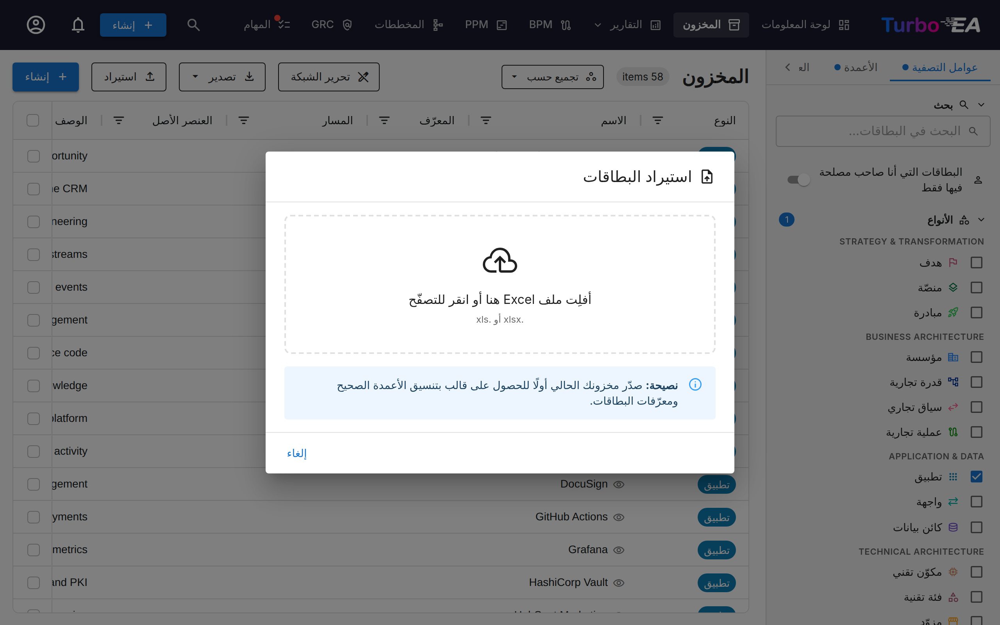

- **البطاقات المراد إنشاؤها / تحديثها** — كما في السابق
- **العلاقات المراد إضافتها / إزالتها** — كل عملية علاقة وضعها المصنّف في قائمة الانتظار
- **الأخطاء والتحذيرات** — بما في ذلك أهداف العلاقات الملتبسة (مع المسارات المرشّحة لتتمكّن من إزالة الالتباس)

تحظر الأخطاء التطبيق. أمّا التحذيرات (مثل وسم غير معروف، أو عدم تطابق إصدار التنسيق) فلا تحظره.

### التصدير

انقر على **تصدير** في شريط الأدوات. يحدّد عامل تصفية الشبكة الحالي المحتويات:

- **عامل تصفية أحادي النوع نشط** ← ورقة بطاقة واحدة لذلك النوع، إضافةً إلى ورقة العلاقات لأي علاقات حاملة للسمات، إضافةً إلى `_Meta`.
- **لا عامل تصفية أو عامل تصفية متعدّد الأنواع** ← ورقة واحدة لكل نوع موجود، إضافةً إلى ورقة العلاقات، إضافةً إلى `_Meta`. والمصنّف قابل للتحرير بالكامل ويمكن إعادة استيراده دون فقدان السمات الخاصة بكل نوع.

يمكنك أيضًا اختيار **تصدير العرض الحالي** من قائمة التصدير — لقطة مسطّحة في ورقة واحدة تطابق ما يظهر على الشاشة (الأعمدة المرئية فقط، بترتيبها الحالي، للصفوف المصفّاة). وهي مخصّصة للمشاركة و**غير مناسبة لإعادة الاستيراد**. إذا كانت أعمدة العلاقات لا تزال قيد التحميل، ينتظرها التصدير، لذا لا يمكن أن تخرج فارغة أبدًا.

### نصائح الذهاب والإياب

- حرِّر المصنّف في Excel، واحفظه كـ `.xlsx`، وأعِد استيراده. تستقرّ البطاقات عبر مطابقة `(type, parent_path, name)` حتى لو لم تُبقِ على عمود `id`.
- تكسر إعادة تسمية البطاقة المطابقة القائمة على الاسم. أبقِ عمود `id` معبّأً عندما تخطّط لإعادة التسمية وإعادة الاستيراد في المصنّف ذاته.
- تعمل البطاقات الجديدة التي يشير بعضها إلى بعض (أصل-فرع أو مصدر-هدف علاقة) بأي ترتيب — يفرز الخادم طوبولوجيًا قبل التطبيق.
- **لإنشاء بطاقة يلزم فقط `name` و`type`.** الحقول المعلَّمة بأنها *مطلوبة* في نموذج التعريف (بما في ذلك Provider أو أي نوع آخر) لا تمنع الاستيراد — تُنشأ البطاقة على أي حال، وتنعكس النواقص في درجة جودة بياناتها بدلاً من تخطّيها بصمت.
- **الشرطة المائلة `/` في عمود `name` الخاص بالبطاقة لا تحتاج إلى هروب (escape).** الهروب (`\/` للشرطة المائلة، `\\` للشرطة المائلة العكسية) مطلوب فقط عندما *تشير* إلى تلك البطاقة من خلية `parent_path` أو `rel:<key>` أو `source_ref` أو `target_ref`، حيث تكون `/` فاصل المسار — وحتى هناك تُقرأ `/` غير المُهرَّبة كجزء من الاسم إذا لم توجد بطاقة في المسار الذي تشير إليه.
