# Inventar

Das **Inventar** ist das Herzstück von Turbo EA. Hier werden alle **Karten** (Komponenten) der Unternehmensarchitektur aufgelistet: Anwendungen, Prozesse, Geschäftsfähigkeiten, Organisationen, Anbieter, Schnittstellen und mehr.

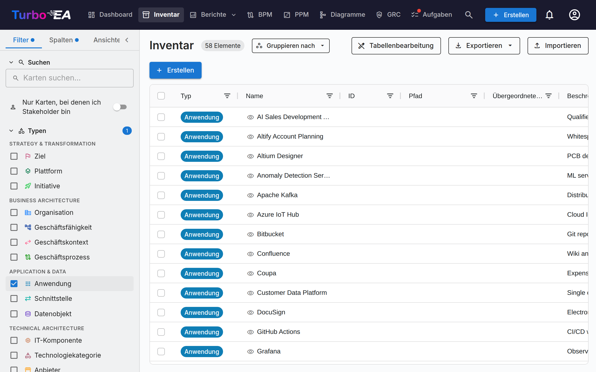

## Aufbau des Inventarbildschirms

### Linkes Filterpanel

Das linke Seitenpanel ermöglicht es Ihnen, Karten nach verschiedenen Kriterien zu **filtern**:

- **Suche** — Freitextsuche über Kartennamen, schon ab dem ersten Buchstaben. Die besten Treffer stehen oben: exakte Namen, dann Namen, die mit Ihrer Eingabe beginnen, dann Namen, in denen sie ein Wort beginnt, dann der Rest. Jedes Suchfeld in Turbo EA sortiert so — die globale Suche (**Strg+K** / **⌘K**), jede Kartenauswahl, das Risikoregister, Entscheidungen und veröffentlichte Portale — sofern Sie keine eigene Sortierung gewählt haben, die immer Vorrang hat. Auch der **Alias** einer Karte und ihre Beschreibung werden durchsucht, sodass eine Karte über den in Ihrer Organisation tatsächlich verwendeten Namen gefunden wird — ein exakt passender Alias zählt dabei so hoch wie ein exakt passender Name
- **Typen** — Filtern nach einem oder mehreren Kartentypen, gruppiert nach der Architekturebene, zu der der jeweilige Typ gehört: Strategie & Transformation (Ziel, Plattform, Initiative), Geschäftsarchitektur (Organisation, Geschäftsfähigkeit, Geschäftskontext, Geschäftsprozess), Anwendung & Daten (Anwendung, Schnittstelle, Datenobjekt) und Technische Architektur (IT-Komponente, Technologiekategorie, Anbieter). Ein Typ, den Ihre Administration in eine eigene Ebene einordnet, erhält nach diesen vier eine eigene Überschrift, und jeder Typ ohne Ebene wird zuletzt unter **Nicht kategorisiert** aufgeführt
- **Subtypen** — Wenn ein Typ ausgewählt ist, können Sie weiter nach Subtyp filtern (z.B. Anwendung -> Geschäftsanwendung, Microservice, AI Agent, Deployment)
- **Genehmigungsstatus** — Entwurf, Genehmigt, Ungültig oder Abgelehnt
- **Herkunft** — Der Kanal, über den jede Karte erstellt wurde: **Weboberfläche**, **MCP** (ein über den [MCP-Server](../admin/mcp.md) verbundener KI-Assistent), **API** (ein Skript oder eine Integration), **Erweiterung** oder **System** (ein Hintergrundjob). Wählen Sie **MCP**, um alles zu prüfen, was ein Agent hinzugefügt hat. Karten, die vor der Erfassung des Kanals durch Turbo EA erstellt wurden, entsprechen keiner der Optionen
- **Lebenszyklus** — Filtern nach Lebenszyklusphase: Planung, Einführung, Aktiv, Auslauf, Lebensende
- **Datenqualität** — Filtern nach Band (Mehrfachauswahl): Vollständig (≥80%), Teilweise (40–79%), Minimal (unter 40%). Dieselben Bänder wie im [Datenqualitätsbericht](reports.md#data-quality-report) — ein Klick auf ein Balkensegment dort führt hierher.
- **Verwaist** — Nur Karten ohne Beziehung in beide Richtungen. Serverseitig ausgewertet und daher auch ohne ausgewählten Kartentyp nutzbar.
- **Veraltet** — Nur Karten, die seit 90 Tagen nicht aktualisiert wurden. Beide entsprechen den KPI-Kacheln des [Datenqualitätsberichts](reports.md#data-quality-report) — ein Klick auf eine Kachel führt hierher.
- **Lebensende** — Für die Kartentypen, die das Lebensende verfolgen (standardmäßig Anwendungen und IT-Komponenten, siehe [Lebensende bei anderen Kartentypen](../admin/eol.md#lebensende-bei-anderen-kartentypen)), nach dem Support-Status filtern, den Turbo EA aus der [EOL-Verknüpfung](../admin/eol.md) der Karte ermittelt: Lebensende, Bevorstehend, Unterstützt oder Unbekannt. **(leer)** listet die Karten, für die überhaupt nichts erfasst ist. Die zugehörige Spalte **Lebensende** zeigt das Datum neben einem Statuspunkt und wird als Datum sortiert und exportiert.
- **Verbindungstyp** — Wenn ein einzelner hierarchischer Kartentyp ausgewählt ist und eine Administratorin [Verbindungstypen](../admin/metamodel.md) dafür definiert hat, filtern Sie nach der Art der Verbindung jeder Karte zu ihrer übergeordneten Karte — etwa die Tochtergesellschaften, die *kommerziell* statt *Vertrieb* sind. **(leer)** listet die Karten, deren Verbindung keinen Typ trägt, sowie die obersten Karten, da für beide nichts erfasst ist. Die zugehörige Spalte **Verbindungstyp** zeigt den Wert als farbigen Chip und ist im Bearbeitungsmodus des Rasters editierbar.
- **Tags** — Filtern nach Tags aus beliebigen Tag-Gruppen
- **Beziehungen** — Filtern nach verwandten Karten über Beziehungstypen
- **Benutzerdefinierte Attribute** — Filtern nach Werten in benutzerdefinierten Feldern (Textsuche, Auswahloptionen)
- **Nur archivierte anzeigen** — Umschalter zur Anzeige archivierter (weich gelöschter) Karten
- **Alle zurücksetzen** — Alle aktiven Filter auf einmal zurücksetzen

> **Karten ohne Wert finden.** Die Filter für Untertyp, Lebenszyklus, Tags, Beziehungen und Auswahl-Attribute bieten jeweils eine Option **(leer)**. Wählen Sie sie, um nur Karten anzuzeigen, die für dieses Feld *keinen* Wert haben – zum Beispiel alle Karten ohne festgelegten Lebenszyklus. Sie lässt sich mit normalen Werten (Treffer bei einem davon) und über mehrere Filter hinweg (Treffer bei allen) kombinieren.

Ein **Badge mit der Anzahl aktiver Filter** zeigt an, wie viele Filter derzeit angewendet werden.

### Zellenaktionen

Klicken Sie mit der rechten Maustaste auf eine beliebige Zelle im Raster (langes Drücken auf Touch-Geräten), um ein Kontextmenü mit Schnellaktionen für das zu öffnen, was sich unter dem Mauszeiger befindet, ähnlich wie in ServiceNow:

- **Karte vorschauen** — die Karte, die die Zelle benennt, im Seitenbereich öffnen, ohne das Raster zu verlassen; der Bereich lässt das Raster bedienbar, sodass Sie weiter scrollen, filtern und andere Zeilen anklicken können, solange er geöffnet ist, und ihn über seine Schließen-Schaltfläche schließen; wenn ein Abschnitt nicht gespeicherte Änderungen enthält, fragt der Bereich nach, bevor sie verworfen werden, wenn Sie eine andere Karte vorschauen, den Bereich schließen oder die Seite verlassen
- **Übereinstimmende anzeigen** — nur die Zeilen behalten, deren Wert dem der angeklickten Zelle entspricht
- **Herausfiltern** — die Zeilen ausblenden, deren Wert dem der angeklickten Zelle entspricht
- **Wert kopieren** — den Zellentext in die Zwischenablage kopieren
- **Spaltenfilter löschen** — den Filter dieser Spalte entfernen (nur sichtbar, solange einer aktiv ist)

Bei mehrwertigen Zellen (Tags, Relationen, Stakeholder, Mehrfachauswahl-Attribute) listet das Menü zunächst die einzelnen Werte auf, sodass Sie nach einem davon oder nach der gesamten Zelle filtern können. **Karte vorschauen** erscheint bei jeder Zelle, die eine Karte benennt — der Spalte **Name** (die Karte der Zeile selbst), der Spalte **Übergeordnet** und den Relationsspalten — und wenn die Zelle mehrere Karten benennt, listet das Menü sie genauso auf, sodass Sie die zu öffnende auswählen. Diese Filter landen in den Spaltenfiltern des Rasters: Sie kombinieren sich mit den Seitenleistenfiltern, zählen in die Schaltfläche **Filter löschen** der Werkzeugleiste und werden mit Ihrer Ansicht gespeichert. Dasselbe Menü ist in jedem Raster von Turbo EA verfügbar — Entscheidungen, Risikoregister, Compliance und die Admin-Raster. Wenn die Spalte einen passenden Filter im linken Panel hat — Kartentyp, Subtyp, Lebenszyklus, Genehmigungsstatus oder ein Einfachauswahl-Attribut —, wählt **Übereinstimmende anzeigen** diesen Wert auch im Panel aus, und **Löschen** löscht beides, sodass eine gespeicherte Ansicht nie einen Panel-Filter und einen Spaltenfilter enthalten kann, die sich widersprechen. Wird der Filter danach im Panel bearbeitet, übernimmt dieser einfach.

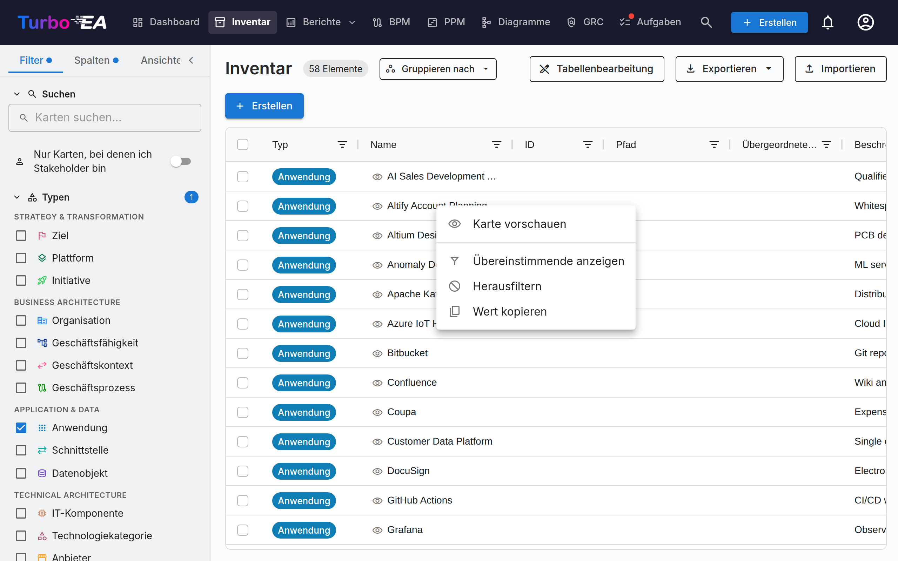

### Registerkarte Spalten

Die Registerkarte **Spalten** im Seitenbereich ermöglicht es Ihnen, zusätzliche Spalten im Raster ein- und auszublenden. Die verfügbaren Spalten ändern sich dynamisch basierend auf den ausgewählten Kartentypen:

- **Ein Typ ausgewählt** — Alle für diesen Typ definierten Attributfelder sind verfügbar, plus Beziehungsspalten und Metadatenspalten
- **Mehrere Typen ausgewählt** — Nur Felder, die **allen ausgewählten Typen gemeinsam** sind, stehen zur Verfügung
- **Kein Typ ausgewählt** — Ein Hinweis fordert Sie auf, zuerst einen Kartentyp auszuwählen

Spalten sind in fünf Kategorien gruppiert:

| Kategorie | Beschreibung |
|-----------|-------------|
| **Standardspalten** | Immer aktive Spalten: Typ, Name, Pfad, Beschreibung, Untertyp, Lebenszyklus, Genehmigungsstatus, Datenqualität. Heben Sie eine davon ab, um sie aus dem Raster auszublenden — nützlich, um eine gespeicherte Ansicht auf genau die Spalten zu reduzieren, die Sie wirklich verwenden. |
| **Metadaten** | Erstellt, Geändert, Erstellt von, Geändert von, Erstellt über, Geändert über. **Geändert** ist der Zeitpunkt, zu dem sich der Inhalt der Karte zuletzt geändert hat — durch eine Person oder eine Integration, nie durch eine systemseitige Neuberechnung eines Werts — sodass Sie danach filtern können, um Karten zu finden, die eine Überprüfung durch den Verantwortlichen benötigen. **Erstellt über** und **Geändert über** zeigen den Kanal hinter dem Erstellen und der letzten Änderung als Chip (MCP, API, Erweiterung, System); für die Weboberfläche bleibt die Zelle leer. |
| **Attribute** | Im Metamodell definierte benutzerdefinierte Felder (Text, Zahl, Kosten, Datum, Auswahl usw.) |
| **Beziehungen** | Eine Spalte pro Beziehung, benannt nach ihrem Verb und dem verknüpften Kartentyp — zum Beispiel *nutzt IT-Komponente* oder *wird unterstützt von Anwendung*. Verbinden zwei Beziehungstypen dieselben Kartentypen, erhält jeder seine eigene Spalte, und ein Beziehungstyp zwischen Karten desselben Typs (eine Anwendung, die *Daten sendet an* eine andere) erhält eine Spalte für jede Richtung. Durchsuchen Sie die Liste nach dem Verb oder nach dem Kartentyp. |
| **Stakeholder** | Eine Spalte pro Stakeholder-Rolle des ausgewählten Kartentyps (z. B. *Stakeholder: Responsible*) mit den zugewiesenen Benutzern als Chips. Im Raster-Bearbeitungsmodus können Sie per Doppelklick Benutzer für die Rolle direkt im Raster zuweisen oder entfernen (erfordert die Berechtigung zum Verwalten von Stakeholdern). |

Die Spalte **Übergeordnetes Element** zeigt nur die direkt darüberliegende Karte, während **Pfad** die gesamte Kette anzeigt. Doppelklicken Sie im Tabellenbearbeitungsmodus auf eine solche Zelle, um die Karte zu verschieben, oder leeren Sie das Feld, um sie auf die oberste Ebene zu setzen. Die Spalte ist nur bearbeitbar, wenn die Tabelle auf einen einzelnen Kartentyp mit Hierarchie gefiltert ist. Wird eine Verschiebung abgelehnt — weil sie eine Schleife erzeugen würde, mit einer gleichnamigen Karte unter dem Ziel kollidiert oder die maximale Hierarchietiefe überschreitet —, erscheint die Begründung am unteren Bildschirmrand und die Zelle wird zurückgesetzt.

Die Spalte **Pfad** zeigt den Hierarchie-Pfad der Karte (z. B. `Nordamerika / Vertrieb / Innendienst`) ohne den Namen der Karte selbst, sodass Sie Name und Pfad gleichzeitig anzeigen können.

Die Spalte **Logo** zeigt das eigene Logo der Karte oder – wenn keines gesetzt ist – ihr Typsymbol, sodass sich eine Landschaft anhand der Produktmarken statt anhand der Namen überfliegen lässt. Sie wird nur für Kartentypen angeboten, die Logos erlauben (standardmäßig Anwendung und IT-Komponente), ist standardmäßig ausgeblendet und macht die Zeilen höher, solange sie eingeblendet ist, damit die Marken erkennbar bleiben. Wenn Sie die Karte bearbeiten dürfen, fahren Sie mit der Maus über die Logo-Zelle und klicken Sie darauf, um das Logo hochzuladen, zu ersetzen, ein Markensymbol auszuwählen oder es zu entfernen — ohne das Raster zu verlassen und mit demselben Menü wie auf der Kartenseite. Logos sind bewusst vom Ausfüllen nach unten und von der Massenbearbeitung ausgenommen: eine Marke pro Karte, bewusst gesetzt.

Die Spalte **Alias** zeigt den zweiten Namen einer Karte — den internen, unter dem Ihre Organisation sie führt. Sie ist standardmäßig ausgeblendet, da die meisten Landschaften keine Aliasse enthalten: einschalten lässt sie sich in der Registerkarte **Spalten**. Sie ist im Raster-Bearbeitungsmodus direkt bearbeitbar, lässt sich wie jede andere Textspalte nach unten ausfüllen und wird von Excel-Export und -Import mitgeführt, sodass eine Liste von Aliassen in einem Durchgang geladen werden kann.

Jede Kategorie hat ein Kontrollkästchen **Alle auswählen**, um alle Spalten in dieser Gruppe schnell umzuschalten. Ein Suchfeld oben ermöglicht es, bestimmte Spalten nach Namen zu finden. Das Badge in jeder Abschnittsüberschrift zeigt an, wie viele Spalten aus dieser Gruppe derzeit sichtbar sind.

Wenn ein Kartentyp zum ersten Mal ausgewählt wird, werden **alle Attribut- und Beziehungsspalten standardmäßig aktiviert**. Sie können dann nicht benötigte Spalten abwählen. Eine Schaltfläche **Zurücksetzen** am unteren Rand der Registerkarte «Spalten» stellt die Standard-Spaltenauswahl wieder her.

Ein **Änderungsindikator-Punkt** erscheint auf der Überschrift der Registerkarte «Spalten», wenn die Spaltenauswahl von den Standardeinstellungen abweicht. Der gleiche Indikator erscheint auf der Registerkarte **Filter**, wenn Filter aktiv sind, sodass Sie auf einen Blick erkennen können, welche Einstellungen geändert wurden.

Ihre Spaltenauswahl, das **Spaltenlayout** (Reihenfolge von links nach rechts, Breiten und angeheftete Spalten), aktiven Filter und die Sortierreihenfolge werden **automatisch im Browser gespeichert**. Wenn Sie zur Inventarseite zurückkehren, wird Ihre vorherige Konfiguration wiederhergestellt. Gespeicherte Ansichten (Lesezeichen) bewahren dieses vollständige Layout ebenfalls, sodass beim Wechseln zwischen Ansichten genau die von Ihnen konfigurierten Spalten — und in derselben Anordnung — wiederhergestellt werden, was beim Teilen einer aufgeräumten Ansicht mit Stakeholdern wichtig ist.

### Haupttabelle

Das Inventar verwendet eine **AG Grid**-Datentabelle mit leistungsstarken Funktionen:

| Spalte | Beschreibung |
|--------|-------------|
| **Typ** | Kartentyp mit farbcodiertem Symbol |
| **Name** | Komponentenname (klicken zum Öffnen der Kartendetails) |
| **Logo** | Das eigene Logo der Karte oder ihr Typsymbol, wenn keines vorhanden ist. Standardmäßig ausgeblendet — in der Registerkarte «Spalten» aktivieren; zum Ändern auf die Zelle klicken |
| **Alias** | Der zweite Name der Karte. Standardmäßig ausgeblendet — in der Registerkarte «Spalten» aktivieren; wird von jedem Suchfeld berücksichtigt |
| **Beschreibung** | Kurzbeschreibung — eine darin enthaltene Webadresse ist ein anklickbarer Link |
| **Lebenszyklus** | Aktueller Lebenszyklusstatus |
| **Genehmigungsstatus** | Badge des Prüfstatus |
| **Datenqualität** | Vollständigkeitsprozentsatz mit visuellem Ring |
| **Beziehungen** | Eine Spalte pro Beziehung, überschrieben mit ihrem Verb und dem verknüpften Kartentyp (z. B. *nutzt IT-Komponente*): die Namen der über diese Beziehung verknüpften Karten, alphabetisch sortiert, mit klickbarem Popover zum Hinzufügen oder Entfernen von Beziehungen dieser Art — bereits verknüpfte Karten werden in dessen Auswahlliste ausgeblendet; bei einem hierarchischen Typ zeigt die Auswahlliste stattdessen die gesamte Hierarchie als eingerückten Baum und lässt diese Karten ausgegraut an ihrem Platz. Gespeicherte Ansichten und Spaltenlayouts aus der Zeit, bevor die Beziehungsspalten nach Beziehung aufgeteilt wurden, öffnen sich mit den neuen Spalten anstelle der alten |

**Tabellenfunktionen:**

- **Sortierung** — Klicken Sie auf eine Spaltenüberschrift zum auf-/absteigenden Sortieren
- **Inline-Bearbeitung** — Im Rasterbearbeitungsmodus können Feldwerte direkt in der Tabelle bearbeitet werden
- **Spalte nach unten füllen** — Klicken Sie im Rasterbearbeitungsmodus auf eine Zelle und ziehen Sie das kleine Quadrat an ihrer Ecke nach oben oder unten, um den Wert in alle überstrichenen Zeilen zu kopieren. Vor dem Speichern nennt eine Bestätigung Spalte, Wert und Zeilenanzahl; lehnt der Server eine Zeile ab, wird sie mit Begründung und Link aufgeführt, und die erfolgreichen Zeilen bleiben gespeichert. Die Geste funktioniert mit dem Finger ebenso wie mit der Maus und mit der Tastatur — Quadrat fokussieren, mit den Pfeiltasten erweitern, mit Eingabe bestätigen. Gefüllt werden nur die nach Filtern und Sortierung sichtbaren Zeilen; die Spalte Name ist bewusst ausgenommen, damit keine Karten denselben Namen erhalten.
- **Mehrfachauswahl** — Mehrere Zeilen für Massenoperationen auswählen
- **Hierarchieanzeige** — Eltern-/Kind-Beziehungen werden als Brotkrumenpfade dargestellt
- **Spaltenkonfiguration** — Spalten ein-/ausblenden und neu anordnen
- **Spalte fixieren** — Fahren Sie mit der Maus über eine Spaltenüberschrift und klicken Sie auf das Pin-Symbol, um die Spalte am linken Rand zu fixieren, sodass sie beim seitlichen Scrollen sichtbar bleibt. Ein erneuter Klick auf den Pin löst sie wieder. Jede Spalte trägt denselben Pin auch im Tab **Spalten** des Filterbereichs, sodass Sie eine Spalte fixieren können, ohne ihre Überschrift zu suchen. Fixierte Spalten werden pro Tabelle gespeichert, und dasselbe Bedienelement steht in jeder Datentabelle von Turbo EA zur Verfügung (Risikoregister, Entscheidungen, Compliance-Befunde, Benutzer, Ressourcen, Audit-Log, PPM-Risikomanagement).
- **Spalten neu anordnen** — Ziehen Sie eine Spaltenüberschrift, um die Spalte zu verschieben, oder öffnen Sie den Abschnitt **Spaltenreihenfolge** oben im Tab **Spalten** und ziehen Sie eine Zeile an ihrem Griff. Diese Liste *ist* die Reihenfolge der Tabelle, beide stimmen also immer überein, und fixierte Spalten stehen als eigene Gruppe voran, weil sie stets am Anfang angezeigt werden — lösen Sie dort den Pin einer Spalte, wenn Sie sie aus dieser Gruppe herausbewegen möchten. Der Griff funktioniert auch mit der Tastatur (Leertaste zum Aufnehmen, Pfeiltasten zum Verschieben, Leertaste zum Ablegen) und per Touch, sodass sich die Reihenfolge auch am Smartphone ändern lässt. Ihre Spaltenreihenfolge wird pro Tabelle gespeichert, in jeder Datentabelle von Turbo EA.

### Werkzeugleiste

- **Rasterbearbeitung** — Inline-Bearbeitungsmodus zum Bearbeiten mehrerer Karten in der Tabelle umschalten
- **Export** — Daten als Excel-Datei (.xlsx) herunterladen
- **Import** — Daten aus Excel-Dateien massenweise hochladen
- **+ Erstellen** — Eine neue Karte erstellen

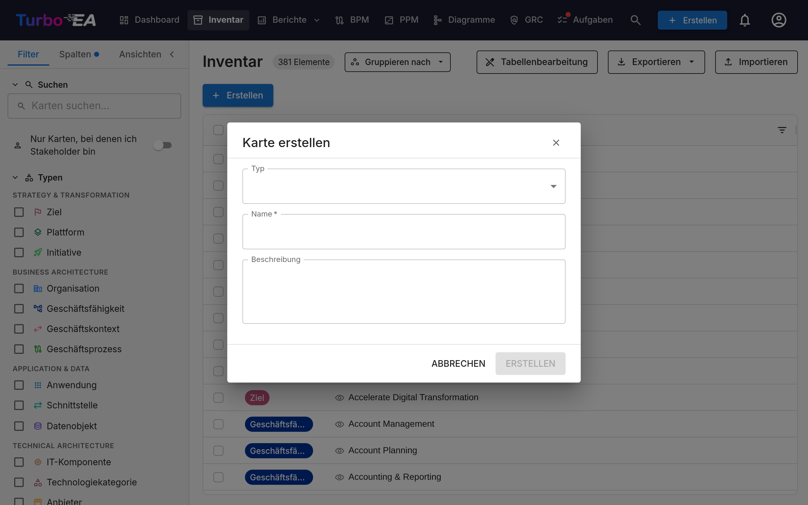

## Wie man eine neue Karte erstellt

1. Klicken Sie auf die Schaltfläche **+ Erstellen** (blau, rechte obere Ecke)
2. Im angezeigten Dialog:
   - Wählen Sie den **Typ** der Karte (Anwendung, Prozess, Ziel usw.)
   - Geben Sie den **Namen** der Komponente ein
   - Optional: Fügen Sie eine **Beschreibung** hinzu
3. Optional: Klicken Sie auf **Mit KI vorschlagen**, um automatisch eine Beschreibung zu generieren (siehe [KI-Beschreibungsvorschläge](#ki-beschreibungsvorschläge) unten)
4. Klicken Sie auf **ERSTELLEN**

## Massenbearbeitung { #mass-edit }

Wählen Sie über die Kontrollkästchen in der linken Spalte zwei oder mehr Zeilen aus und klicken Sie dann in der Auswahlleiste auf **Massenbearbeitung**. Der Dialog wendet eine Änderung auf jede ausgewählte Karte an.

Das Dropdown **Feld** gruppiert die Änderungsmöglichkeiten:

- **Allgemein** — Freigabestatus, Untertyp, Tags und übergeordnetes Element
- **Attribute** — jedes bearbeitbare Feld des ausgewählten Kartentyps
- **Beziehungen** — ein Eintrag je Beziehungstyp und Richtung (zum Beispiel *läuft auf → IT-Komponente*)

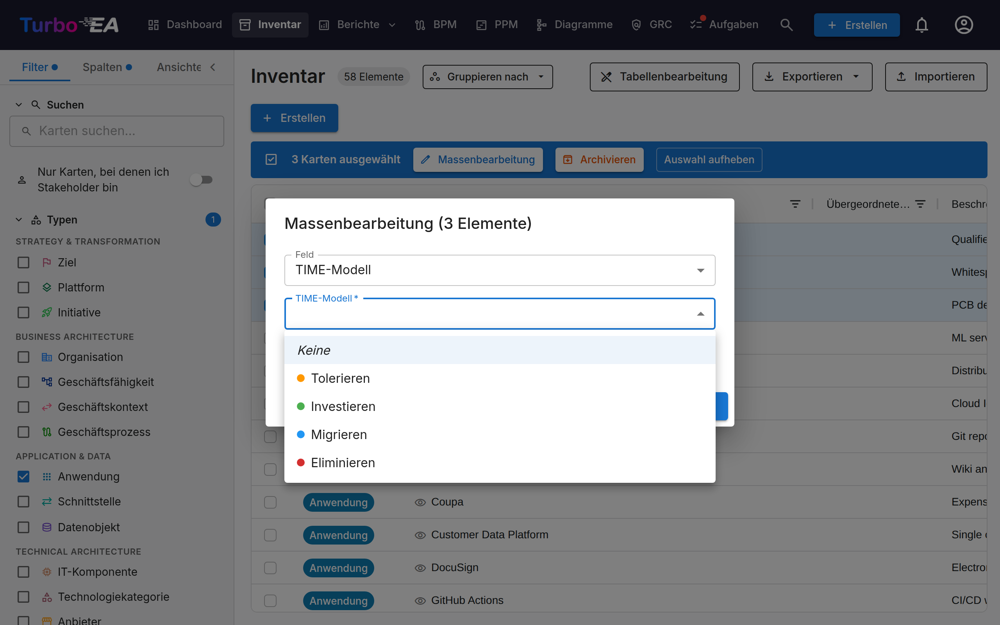

Tags, Beziehungen und das übergeordnete Element bieten jeweils einen Umschalter **Hinzufügen / Entfernen**, sodass Sie vorhandene Werte ergänzen oder reduzieren, statt sie zu ersetzen.

Wenn Sie für einen Beziehungstyp mit Details **Verknüpfung hinzufügen** wählen — etwa die Flussrichtung zwischen zwei Anwendungen, wie eine Organisation eine Anwendung nutzt, oder die Erstellen-/Lesen-/Aktualisieren-/Löschen-Kennzeichen an einem Datenobjekt —, zeigt der Dialog auch diese Felder. Was Sie festlegen, wird bei jeder hinzugefügten Verknüpfung gespeichert. Karten, die bereits mit einem gewählten Ziel verknüpft sind, erhalten die Details ebenfalls; ein erneutes **Verknüpfung hinzufügen** ist also der Weg, die Details bestehender Verknüpfungen zu aktualisieren. Ein leer gelassenes Detail bleibt unverändert.

Das Eingabeelement richtet sich nach dem Feldtyp: Ein Mehrfachauswahlfeld zeigt seine Optionen mit Kontrollkästchen, ein Ja/Nein-Feld eine Ja/Nein-Liste, ein Datumsfeld eine Datumsauswahl. Bleibt der Wert leer – bei einem Ja/Nein-Feld **Keine** –, wird das Feld auf allen ausgewählten Karten geleert. Per Formel berechnete Felder sowie Kostenfelder, für die Ihnen die Leseberechtigung fehlt, werden nicht angeboten.

### Hierarchie umstrukturieren { #mass-edit-parent }

Das Feld **Übergeordnetes Element** erscheint, sobald Sie die Tabelle auf einen einzelnen Kartentyp mit Hierarchie gefiltert haben. Eine Karte hat genau ein übergeordnetes Element, daher deckt dieses eine Feld beide Richtungen einer Umstrukturierung ab:

- **Übergeordnetes Element festlegen** — wählen Sie eine Karte desselben Typs; alle ausgewählten Karten werden darunter eingeordnet. So machen Sie viele Karten zu untergeordneten Elementen einer Karte.
- **Übergeordnetes Element entfernen** — alle ausgewählten Karten werden auf die oberste Ebene verschoben.

Die Karten werden einzeln verschoben; ein unzulässiger Vorgang blockiert daher nur die betroffene Karte. Der Dialog bleibt geöffnet und listet auf, welche Karten blockiert wurden und warum. Die häufigsten Gründe sind:

- Unter dem Zielelement existiert bereits eine Karte mit demselben Namen.
- Das gewählte übergeordnete Element ist ein Nachfahre einer der verschobenen Karten, was eine Schleife erzeugen würde.
- Der Vorgang würde eine Geschäftsfähigkeit über die maximal fünf Ebenen hinaus verschieben.

Eine Karte nimmt ihre untergeordneten Elemente mit, und freigegebene Karten fallen auf **Ungültig** zurück, damit die Änderung erneut geprüft wird.

## Inventar gruppieren { #group-by }

Klicken Sie in der Symbolleiste auf **Gruppieren nach** (neben der Trefferanzahl), um das Raster in ein- und ausklappbare Gruppen zu gliedern. Lebenszyklusphase und Genehmigungsstatus sind immer verfügbar; ist das Raster auf einen einzelnen Kartentyp gefiltert, kommen dessen Untertyp und alle Einfachauswahl-Attribute hinzu.

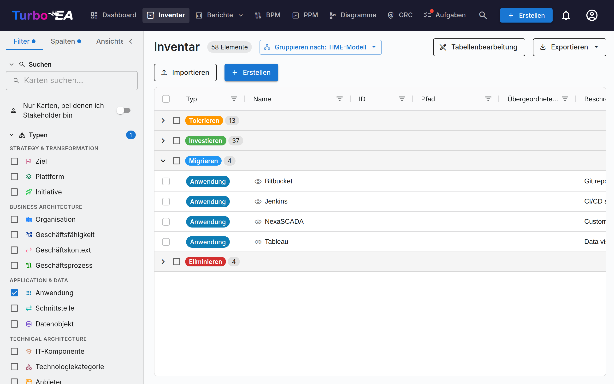

- Karten ohne Wert im gewählten Feld landen in einer Gruppe **Nicht gesetzt** ganz oben — dem natürlichen Sammelbecken für noch nicht klassifizierte Karten.
- Ein Klick auf eine Gruppenüberschrift klappt die Gruppe ein oder aus. Die Überschrift zeigt die Anzahl der Karten der Gruppe.
- Beim Scrollen durch eine lange Gruppe bleibt deren Überschrift direkt unter den Spaltenköpfen stehen, sodass immer klar ist, welche Gruppe man gerade liest; die Überschrift der nächsten Gruppe schiebt sie beim Erreichen zur Seite. Es ist die vollständige Überschrift samt Kontrollkästchen — eine lange Gruppe lässt sich also auswählen, ohne an ihren Anfang zurückzuscrollen.
- Das Kontrollkästchen in der Überschrift wählt alle Karten der Gruppe aus. Eine Neuklassifizierung im Stapel ist damit: **Nicht gesetzt** aufklappen, Überschrift anhaken, dann den Wert per [Massenbearbeitung](#mass-edit) setzen. Auf Drag-and-drop wurde bewusst verzichtet — Auswählen und Setzen funktioniert auf Desktop, Tablet und Smartphone gleich.
- Die Sortierung wirkt innerhalb jeder Gruppe; die Gruppierung bleibt über Neuladen erhalten, wird in gespeicherten Ansichten abgelegt und lässt sich über den URL-Parameter `group_by` teilen.

### Untergeordnete unter Übergeordneten einrücken { #group-by-parents }

Aktivieren Sie oben im Menü **Gruppieren nach** das Kontrollkästchen **Übergeordnetes**, um die Karten als Baum anzuzeigen: zuerst jede übergeordnete Karte, darunter eingerückt ihre untergeordneten Karten. Die Option funktioniert allein (das ganze Raster wird zu einem Baum) oder zusätzlich zu jeder Gruppierung (jede Gruppe wird zu einem eigenen Baum). Das Menü bleibt beim Aktivieren geöffnet, sodass Sie direkt danach eine Gruppierung wählen können.

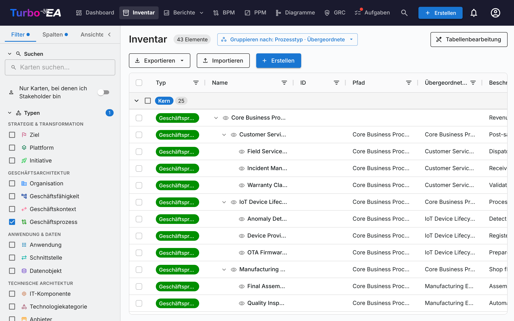

- Eine Karte verlässt nie ihre eigene Gruppe. Eine untergeordnete Karte, deren übergeordnete Karte in einer anderen Gruppe liegt, durch einen Spaltenfilter ausgeblendet oder nicht geladen ist, beginnt einen eigenen Zweig; ihre fehlenden Vorfahren erscheinen grau vor ihrem Namen (zum Beispiel *SAP S/4HANA / SAP FI /* vor dem Namen des Moduls). Gruppenanzahlen, Kontrollkästchen in der Überschrift und Massenbearbeitung stimmen deshalb immer mit dem Inhalt der Gruppe überein.
- Klicken Sie auf den Pfeil vor dem Namen einer übergeordneten Karte, um ihren Zweig aus- oder einzublenden. Eine eingeklappte übergeordnete Karte zählt ihre ausgeblendeten Karten weiterhin in der Elementanzahl und in der Gruppenüberschrift mit. Mit dem Pfeil eingeklappte Zweige werden nicht gespeichert, und eine Änderung des Spaltenfilters klappt sie wieder alle auf; wenn Sie den letzten Spaltenfilter löschen, kehrt die Ansicht zu der mit dem Schrittschalter gewählten Ebene zurück.
- Solange die Ebene „Übergeordnetes“ aktiv ist, schließt oder öffnet ein Paar **−** / **+** neben der Schaltfläche „Gruppieren nach“ den gesamten Baum Ebene für Ebene. Die gewählte Ebene bleibt über Neuladen erhalten, wird in gespeicherten Ansichten abgelegt und lässt sich mit `group_tree_level=<n>` teilen; die angezeigte Ebene folgt außerdem dem, was Sie von Hand öffnen und schließen.
- Die Sortierung wirkt unter Geschwistern: Die übergeordneten Karten werden sortiert, und darunter die untergeordneten Karten jeder übergeordneten Karte.
- Die Option wird nur angeboten, wenn ein Kartentyp in der Ansicht eine Hierarchie hat. Sie bleibt über Neuladen erhalten, wird in gespeicherten Ansichten abgelegt und lässt sich über den URL-Parameter `group_tree=1` teilen.
- Der **Export** folgt der Baumreihenfolge und lässt die Karten in eingeklappten Zweigen aus, wie er es auch bei eingeklappten Gruppen tut.

## KI-Beschreibungsvorschläge { #ai-description-suggestions }

Turbo EA kann **KI verwenden, um eine Beschreibung** für jede Karte zu generieren. Dies funktioniert sowohl im Karte-erstellen-Dialog als auch auf bestehenden Kartendetailseiten.

**So funktioniert es:**

1. Geben Sie einen Kartennamen ein und wählen Sie einen Typ
2. Klicken Sie auf das **Funkensymbol** in der Kartenüberschrift oder auf die Schaltfläche **Mit KI vorschlagen** im Karte-erstellen-Dialog
3. Das System führt eine **Websuche** nach dem Elementnamen durch (mit typbezogenem Kontext — z.B. «SAP S/4HANA Softwareanwendung»), sendet die Ergebnisse dann an ein **LLM**, um eine prägnante, sachliche Beschreibung zu generieren
4. Ein Vorschlagspanel erscheint mit:
   - **Bearbeitbarer Beschreibung** — Text vor dem Anwenden überprüfen und ändern
   - **Konfidenzwert** — zeigt an, wie sicher die KI ist (Hoch / Mittel / Niedrig)
   - **Klickbare Quellenlinks** — die Webseiten, aus denen die Beschreibung abgeleitet wurde
   - **Modellname** — welches LLM den Vorschlag generiert hat
5. Klicken Sie auf **Beschreibung übernehmen** zum Speichern oder **Verwerfen** zum Ablehnen

**Wesentliche Eigenschaften:**

- **Typbezogen**: Die KI versteht den Kartentyp-Kontext. Eine «Anwendung»-Suche fügt «Softwareanwendung» hinzu, eine «Anbieter»-Suche fügt «Technologieanbieter» hinzu usw.
- **Datenschutz zuerst**: Bei Verwendung von Ollama läuft das LLM lokal — Ihre Daten verlassen nie Ihre Infrastruktur. Kommerzielle Anbieter (OpenAI, Google Gemini, Anthropic Claude usw.) werden ebenfalls unterstützt
- **Vom Administrator gesteuert**: KI-Vorschläge müssen von einem Administrator in [Einstellungen > KI-Vorschläge](../admin/ai.md) aktiviert werden. Administratoren wählen, welche Kartentypen die Vorschlagsschaltfläche anzeigen, konfigurieren den LLM-Anbieter und wählen den Websuchanbieter
- **Berechtigungsbasiert**: Nur Benutzer mit der Berechtigung `ai.suggest` können diese Funktion nutzen (standardmäßig für Admin-, BPM-Admin- und Mitglieder-Rollen aktiviert)

## Gespeicherte Ansichten (Lesezeichen)

Sie können Ihre aktuelle Filter-, Spalten- und Sortierkonfiguration als **benannte Ansicht** zur schnellen Wiederverwendung speichern.

### Eine gespeicherte Ansicht erstellen

1. Konfigurieren Sie das Inventar mit Ihren gewünschten Filtern, Spalten und Sortierungen
2. Klicken Sie auf das **Lesezeichen**-Symbol im Filterpanel
3. Geben Sie einen **Namen** für die Ansicht ein
4. Wählen Sie die **Sichtbarkeit**:
   - **Privat** — Nur Sie können sie sehen
   - **Geteilt** — Sichtbar für bestimmte Benutzer (mit optionalen Bearbeitungsrechten)
   - **Öffentlich** — Sichtbar für alle Benutzer

### Gespeicherte Ansichten verwenden

Gespeicherte Ansichten erscheinen in der Seitenleiste des Filterpanels. Klicken Sie auf eine beliebige Ansicht, um deren Konfiguration sofort anzuwenden. Ansichten sind unterteilt in:

- **Meine Ansichten** — Von Ihnen erstellte Ansichten
- **Mit mir geteilt** — Ansichten, die andere mit Ihnen geteilt haben
- **Öffentliche Ansichten** — Ansichten, die für alle verfügbar sind

### Abfrageansichten { #query-views }

Eine **Abfrageansicht** ist eine gespeicherte Ansicht, deren Filter eine **mehrstufige Abfrage** sind — eine Kette von Beziehungen mit Bedingungen an jedem Schritt, etwa *Organisationen, die eine aktive Anwendung nutzen, von der eine Initiative mit dem Status On Track betroffen ist*. Mehrere solcher Abfragen lassen sich in einer Ansicht stapeln und mit **UND** und **ODER** kombinieren (siehe unten). Die Ansicht speichert die Abfrage, nicht ihre Ergebnisse: Sie wird bei jedem Öffnen der Ansicht erneut ausgeführt, sodass die Liste stets die aktuelle Landschaft widerspiegelt.

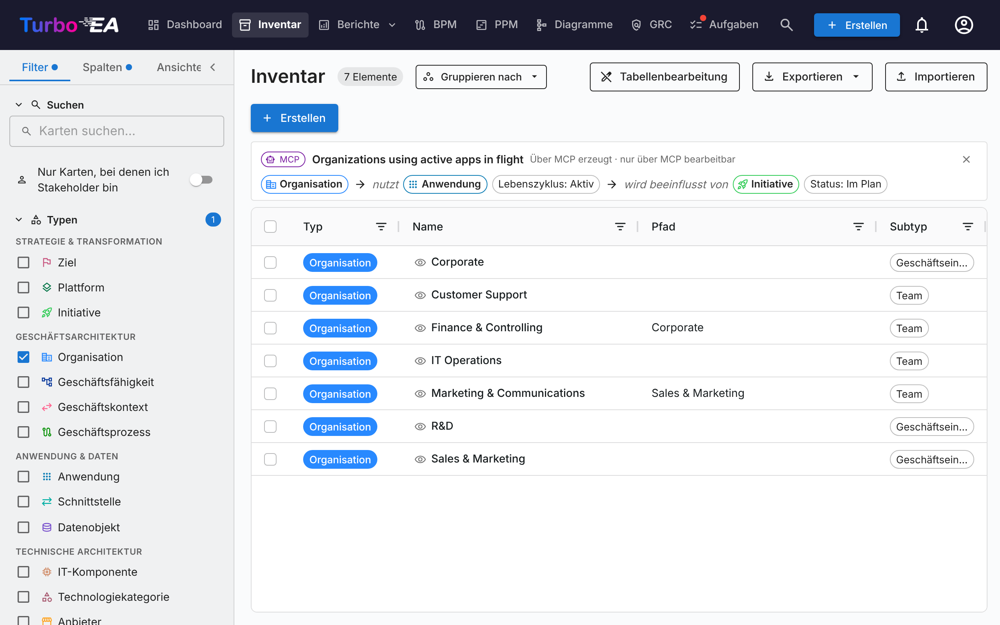

**Eine Abfrageansicht erstellen.** Klicken Sie im Tab **Ansichten** der Filter-Seitenleiste neben *Aktuelle speichern* auf **Neue Abfrageansicht** (sichtbar für alle, die Ansichten verwalten dürfen). Ist ein Filter aktiv, auch der gewählte Kartentyp, fragt eine Bestätigung nach, bevor er gelöscht wird; **Abbrechen** im Entwurf stellt ihn wieder her. Der Streifen über dem Raster öffnet sich als Abfrage-Editor:

1. Klicken Sie auf den Start-Chip (*Typ wählen*) und wählen Sie den Kartentyp, von dem die Abfrage ausgeht — den Typ, den sie auflistet.
2. Klicken Sie nach der letzten Karte auf **+ Beziehung**, um einen Schritt hinzuzufügen. Das Menü listet jedes Beziehungsverb mit dem Kartentyp, zu dem es führt; eine Beziehung zwischen Karten desselben Typs wird in beide Richtungen angeboten. Jede Abfragezeile ist eine einzelne Kette mit bis zu drei Schritten.
3. Klicken Sie unter einer beliebigen Karte auf **+ Bedingung**, um sie einzugrenzen: **Lebenszyklus**, **Subtyp**, **Genehmigungsstatus**, **Datenqualität** (*Vollständig*, *Teilweise* oder *Minimal*, dieselben Bänder wie beim Seitenleistenfilter), **End of Life** (siehe unten), **Tags**, **Bestimmte Karten** oder ein Auswahl- bzw. Ja/Nein-Feld dieses Kartentyps. Bei Tags passt eine Karte, wenn sie irgendeines der gewählten Tags einer Gruppe trägt, und sie muss jede hinzugefügte Gruppe erfüllen; angeboten werden nur Tag-Gruppen, die für diesen Kartentyp gelten. **Bestimmte Karten** öffnet die Kartenauswahl für Karten dieses Typs, und der Schritt trifft dann nur die ausgewählten Karten; bei einem hierarchischen Kartentyp bezieht ein Schalter **Unterkarten einbeziehen** zusätzlich die Karten unterhalb jeder Auswahl ein. Eine ausgewählte Karte, die Sie nicht sehen können, erscheint als *(verborgene Karte)*.
4. Klicken Sie auf **Speichern**. Es öffnet sich der übliche Dialog zum Speichern einer Ansicht für Name, Sichtbarkeit, Freigabe und OData-Einstellung. **Abbrechen** verwirft die Abfrage.

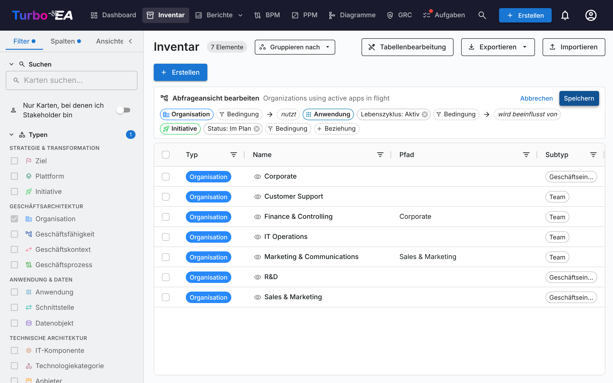

Während Sie aufbauen, filtert das Raster live und der Zähler in der Symbolleiste zeigt, wie viele Karten passen, sodass Sie die Wirkung jedes Schritts und jeder Bedingung vor dem Speichern sehen.

**Nach End of Life filtern.** Die Bedingung **End of Life** wird für einen Kartentyp angeboten, der End of Life erfasst – standardmäßig Anwendung und IT-Komponente; sie folgt dem Abschnitt «End of Life» des Typs im Metamodell. Ihre Werte sind **End of Life**, **EOL-Annäherung**, **Unterstützt**, **Unbekannt** und *(leer)* für Karten ohne End-of-Life-Daten. Der Status ist derselbe, den die Spalte **End of Life** des Inventars zeigt: Er stammt aus dem verknüpften endoflife.date-Produkt oder einem benutzerdefinierten EOL-Produkt oder aus einem von Hand eingetragenen End-of-Life-Datum und ist unabhängig von der Lebenszyklusphase der Karte. Die Bedingung funktioniert an der Startkarte und in jedem Beziehungsschritt, in UND- wie in ODER-Zeilen – zum Beispiel *Anwendungen, die eine IT-Komponente mit End of Life nutzen*. Solange eine Abfrage an der Startkarte danach filtert, zeigt das Raster die Spalte End of Life, damit Sie sehen, warum jede Karte passt; die von Ihnen gewählten Spalten bleiben unverändert. Ist endoflife.date nicht erreichbar und nichts zwischengespeichert, werden verknüpfte Karten als *Unbekannt* gelesen, wie in der Spalte End of Life.

Die Bedingung erfordert die Berechtigung zum Anzeigen von End-of-Life-Daten (**EOL-Daten anzeigen**, `eol.view`). Ohne sie wird die Bedingung nicht angeboten, und das Öffnen, Vorschauen oder Speichern einer Ansicht, die sie verwendet, wird mit *Diese Ansicht filtert nach dem End-of-Life-Status, den Ihre Rolle nicht sehen darf.* abgelehnt.

**Schritte und Bedingungen ändern.** Klicken Sie auf den Verb-Chip eines Schritts, um sein Menü zu öffnen: **hat kein** macht aus dem Schritt die Anforderung, dass die Karte **keine** solche Beziehung hat, und **Diesen Schritt entfernen** entfernt ihn samt allen folgenden Schritten. Klicken Sie auf einen Bedingungs-Chip, um seine Werte zu ändern, oder auf sein **×**, um ihn zu entfernen.

**Abfragen mit UND und ODER kombinieren.** Eine Ansicht kann mehrere übereinander gestapelte Abfragezeilen enthalten. Jede Zeile ist eine vollständige Abfrage — Startkarte, Beziehungen und Bedingungen — und wird genau wie die einzelne Abfrage oben aufgebaut. Die Zeilen sind in Gruppen geordnet:

- **UND** fügt der selben Gruppe eine Zeile hinzu: Eine Karte wird nur aufgelistet, wenn sie **jede** Zeile der Gruppe erfüllt. Eine UND-Zeile geht vom selben Kartentyp aus wie ihre Gruppe, dargestellt als fester Chip, und die erste Zeile der Gruppe kann ihren Kartentyp nicht ändern, solange sie UND-Zeilen hat.
- **ODER** beginnt unter einem **ODER**-Trenner eine neue Gruppe: Ihre Ergebnisse werden der Liste **hinzugefügt**. Eine neue Gruppe darf von einem anderen Kartentyp ausgehen, sodass eine Ansicht zum Beispiel Anwendungen und Organisationen gemeinsam auflisten kann. Listet eine Ansicht mehrere Kartentypen auf, zeigt das Raster die Spalten, die diese Typen gemeinsam haben.

Im Bearbeitungsmodus fragt ein eingekreistes **Plus** unter jeder Gruppe nach **UND** oder **ODER**: UND fügt dieser Gruppe eine Zeile hinzu, ODER öffnet danach eine neue Gruppe. Das **×** am Ende einer Zeile entfernt sie; es wird angezeigt, wenn die Ansicht mehr als eine Zeile hat.

Die Demo-Ansicht *Active apps on aging tech, and the organizations using apps* hat zum Beispiel eine Anwendungsgruppe aus zwei Zeilen — eine aktive Anwendung, die eine IT-Komponente in der Auslaufphase oder am Lebensende nutzt, **UND** eine Anwendung, von der eine Initiative betroffen ist — **ODER** eine Organisation, die eine Anwendung nutzt. Die Liste zeigt die Anwendungen, die beide Zeilen erfüllen, zusammen mit jeder Organisation, die eine Anwendung nutzt.

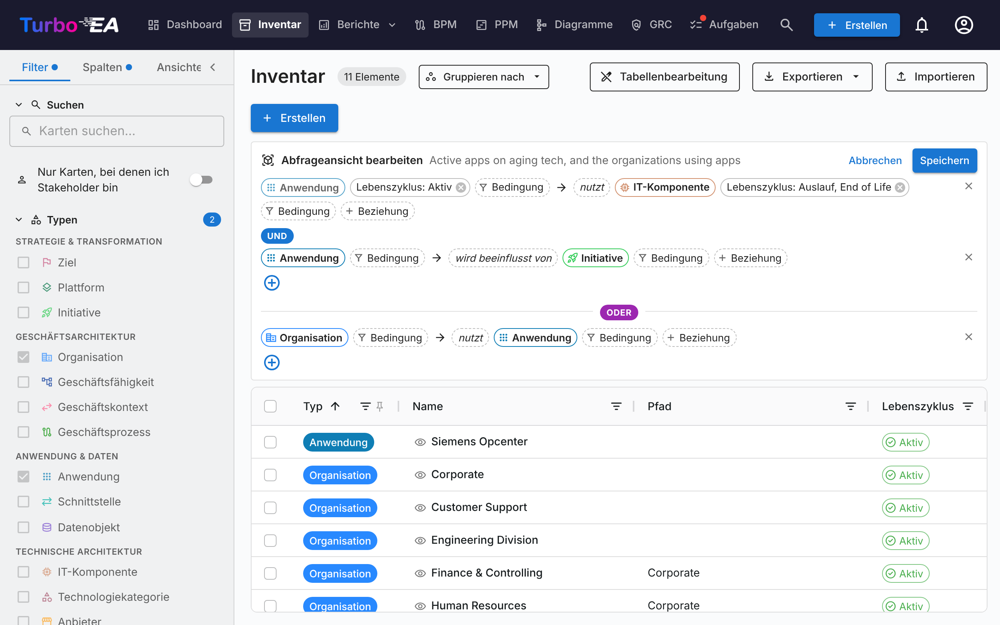

Eine Ansicht enthält höchstens **sechs** Abfragezeilen, **zwölf** Beziehungen über alle Zeilen und **drei** Beziehungen in der Tiefe je Zeile. Die Zeilen einer UND-Gruppe treffen sich nur an ihrer Startkarte: Die IT-Komponente der einen Zeile und die Initiative der anderen können verschiedene Karten sein. Zwei Anforderungen an **dieselbe** Karte in der Mitte einer Zeile — etwa dass dieselbe IT-Komponente von einem Anbieter bereitgestellt wird **und** zu einer Tech-Kategorie gehört — lassen sich im Abfrage-Editor nicht aufbauen; ein KI-Assistent kann eine solche Abfrage über den [MCP-Server](../admin/mcp.md#multi-hop-card-queries) schreiben, und der Streifen zeigt sie dann an.

**Eine gespeicherte Abfrageansicht bearbeiten.** Ist eine Abfrageansicht geöffnet, zeigt der Streifen ihren Pfad: die Kartentypen als Chips, verbunden durch das Beziehungsverb, das jeden Schritt verknüpft (zum Beispiel *Organisation → nutzt Anwendung → ist betroffen von Initiative*), mit den Bedingungen jeder Karte darunter. Eine Ansicht mit mehreren Zeilen zeigt denselben Stapel mit seinen UND-Markierungen und ODER-Trennern, ohne die Bearbeitungselemente. Wenn Sie die Ansicht besitzen oder Bearbeitungsrechte darauf haben, schaltet ein **Stift** im Streifen auf denselben Editor um; **Speichern** aktualisiert die Ansicht. Die **×**-Schaltfläche (*Diese Ansicht verlassen*) führt zum normalen Inventar zurück. **Aktuelle Ansicht speichern** speichert, während eine Abfrageansicht geöffnet ist, eine neue Abfrageansicht mit derselben Abfrage.

#### Die Karten hinter einem Treffer anzeigen { #query-view-matches }

Eine Abfrageansicht listet nur die erste Karte ihrer Abfrage auf. Um zu sehen, welche Karten weiter hinten in der Kette eine Zeile zum Treffer gemacht haben, klicken Sie im Abfragepfad auf ihren Kartentyp. Klicken Sie in *Organisationen, die eine Anwendung nutzen, die eine IT-Komponente am oder nahe dem Lebensende nutzt* auf **Anwendung**, listet eine Spalte für jede Organisation die Anwendungen auf, über die sie zutrifft; klicken Sie auf **IT-Komponente**, listet eine weitere Spalte die zutreffenden IT-Komponenten auf. Ein erneuter Klick auf den Kartentyp entfernt seine Spalte.

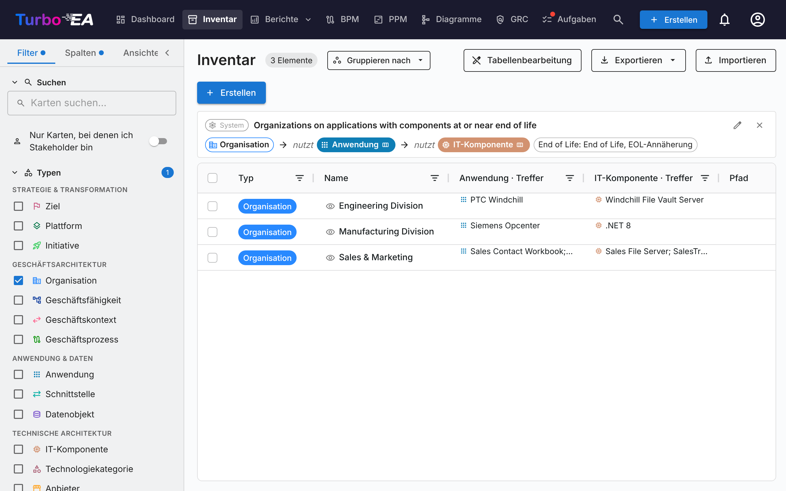

- **So sieht ein Schalter aus.** Ein anklickbarer Kartentyp zeigt einen Zeiger und den Tooltip *In einer Spalte anzeigen*. Ist seine Spalte eingeblendet, ist der Chip in der Farbe des Kartentyps gefüllt und trägt ein kleines Spaltensymbol; sein Tooltip lautet *Spalte ausblenden*.
- **Welche Kartentypen Schalter sind.** Jeder Kartentyp nach dem ersten seiner Abfragezeile. Der erste Kartentyp einer Abfragezeile ist keiner, weil seine Karten die Tabellenzeilen sind, ebenso wenig ein Kartentyp hinter **hat kein**, das für eine fehlende Beziehung steht. In einer Ansicht mit mehreren Abfragezeilen sind die Kartentypen jeder Abfragezeile Schalter; bei **ODER** zeigt eine Tabellenzeile nur Karten für die Abfragezeilen, die sie erfüllt. Während Sie die Abfrage bearbeiten, stehen die Schalter nicht zur Verfügung, und die Spalten sind ausgeblendet, bis Sie speichern oder abbrechen.
- **Wo die Spalte erscheint.** Direkt nach **Name**, betitelt mit dem Kartentyp und *Treffer* — zum Beispiel *Anwendung · Treffer* —, damit sie nicht mit einer Beziehungsspalte wie *nutzt Anwendung* verwechselt wird, die jede auf diese Weise verknüpfte Anwendung auflistet. Haben zwei Schritte denselben Kartentyp, werden die Titel nummeriert. Fahren Sie mit der Maus über den Titel, um den Pfad zu sehen, dem die Spalte folgt.
- **Was eine Zelle zeigt.** Die Namen der zutreffenden Karten, durch Semikolons getrennt; fahren Sie mit der Maus über die Zelle, um die vollständige Liste zu sehen. Eine Zelle listet höchstens **100** Namen auf; eine längere Liste endet mit *…*, und ihr Tooltip gibt an, dass die ersten 100 angezeigt werden. Sie können die Spalte wie eine Textspalte sortieren und filtern, und **Aktuelle Ansicht exportieren** schließt sie ein.
- **Jede Karte entlang der Kette, nicht wer zu wem führt.** Eine Tabellenzeile listet jede zutreffende Karte dieses Schritts auf: alle zutreffenden Anwendungen der Organisation und alle zutreffenden IT-Komponenten dieser Anwendungen. Sie zeigt nicht, welche IT-Komponente zu welcher Anwendung gehört. Um die IT-Komponenten selbst aufzulisten, eine pro Zeile, schreiben Sie die Abfrage stattdessen ausgehend von IT-Komponente.
- **Mit der Ansicht gespeichert.** Die Spalten, die Sie einblenden, werden mit der Ansicht gespeichert (der **Stift** in der Ansichtenliste, dann **Aktualisieren**), sodass sie beim erneuten Öffnen wieder da sind. Beim Bearbeiten der Abfrage bleibt eine Spalte erhalten, solange ihr Schritt noch vorhanden ist, und wird entfernt, wenn Sie diesen Schritt entfernen oder seinen Kartentyp ändern.

Sie sehen nur Karten, die Sie sehen dürfen: Eine für Sie verborgene Karte wird in keiner Zelle genannt, und eine Zeile, die nur über verborgene Karten zutrifft, wird nicht aufgeführt.

Die Demo-Ansicht *Organizations on applications with components at or near end of life* öffnet sich mit beiden Spalten eingeblendet.

**Von einem KI-Assistenten erstellte Ansichten.** Ein über den [MCP-Server](../admin/mcp.md) verbundener Assistent kann ebenfalls Abfrageansichten erstellen. Eine solche Ansicht zeigt in ihrem Streifen einen **MCP**-Chip und den Hinweis *Über MCP erstellt* sowie in der Ansichtenliste ein Roboter-Symbol; sie wird wie jede andere Abfrageansicht bearbeitet. In der Ansichtenliste trägt jede Abfrageansicht ein kleines Abfrageansicht-Symbol (einen Würfel; das Roboter-Symbol, wenn ein Assistent sie erstellt hat) und ihren kompakten Pfad (*Organisation › nutzt Anwendung › ist betroffen von Initiative*) als zweite Zeile; eine gestapelte Ansicht liest sich *… UND … ODER …*. Hat die Ansicht Bedingungen, folgt ihre Anzahl auf den Pfad (*… › ist betroffen von Initiative · 2 Bedingungen*).

**Eine Ansicht per Link öffnen.** Speichert ein Assistent eine Ansicht, liefert er einen Link der Form `/inventory?view=<view id>`; beim Öffnen wird die gespeicherte Ansicht direkt angewendet. Derselbe Link funktioniert für jede gespeicherte Ansicht, die Sie sehen können.

**OData.** Der OData-Feed einer Abfrageansicht liefert dieselben Karten wie das Inventar: Die Abfrage wird auch auf den Feed angewendet.

Zur Abfragegrammatik, ihren Grenzen und den MCP-Werkzeugen (`query_cards`, `list_inventory_views`, `save_inventory_view`, `list_tag_groups`) siehe [Mehrstufige Kartenabfragen](../admin/mcp.md#multi-hop-card-queries).

## Excel-Import / -Export { #excel-import }

Inventar-Exporte und -Importe nutzen eine **mehrblättrige Excel-Arbeitsmappe**, die Ihre Landschaft samt Beziehungen vollständig zurück- und wieder einlesen kann — ohne dass Sie jemals eine UUID kopieren müssen.

### Aufbau der Arbeitsmappe

- **Ein Blatt pro Kartentyp** (Application, Business Capability, IT Component, …) mit Kernspalten, `attr_<feld>`-Spalten, Lebenszyklusspalten und `rel:<beziehungstyp>`-Beziehungsspalten sowie `stakeholder:<rollen_key>`-Stakeholder-Spalten.
- **Ein `Relations`-Blatt** mit den **Werten**, die Beziehungen tragen — eine Zeile je Beziehung, deren Typ Werte besitzt.

Die Aufteilung ist einfach und kennt keine Ausnahme: **Das Kartenblatt sagt, welche Karten verknüpft sind; das `Relations`-Blatt sagt, was diese Verknüpfungen enthalten.** Jeder Beziehungstyp erhält eine `rel:`-Spalte auf dem Kartenblatt seines Ausgangstyps — ob er Werte trägt oder nicht.
- **Ein `_Meta`-Blatt** mit der Formatversion der Arbeitsmappe.

### Karten ohne GUIDs identifizieren

Karten werden über den **Namen** identifiziert, sofern dieser innerhalb des Typs eindeutig ist, ansonsten über den vollen **`parent_path`**. Eine Beziehungszelle kann z. B. `NexaCore ERP` direkt enthalten, wenn nur eine Application diesen Namen trägt; bei mehrdeutigem Namen verwenden Sie `Sales / Customer Mgmt / CRM`.

#### Eindeutigkeit unter Geschwistern

Da Karten über Name + Pfad identifiziert werden, **dürfen zwei Karten desselben Typs nicht gleichzeitig denselben Elternknoten und denselben Namen haben**. Neue Karten, die eine solche Kollision erzeugen würden, werden bei der Erstellung abgelehnt (im Dialog "Karte erstellen", beim Inline-Umbenennen und beim Tabellenkalkulations-Import). Bereits in der Datenbank vorhandene Duplikate aus früheren Seeds oder Importen bleiben unberührt — Sie können alle ihre Felder bearbeiten, aber das erneute Erzeugen oder Zurückbenennen in den Kollisionszustand wird blockiert. Die Prüfung ist groß-/kleinschreibungs- und whitespace-unempfindlich, passend zum Resolver des Importers. Lehnt der Dialog "Karte erstellen" ein Duplikat ab, nennt die Warnung die vorhandene Karte und enthält einen Link **Vorhandene Karte anzeigen**, der Sie direkt dorthin führt.

### Inline-Beziehungszellen

Auf jedem Kartenblatt drücken `rel:<beziehungstyp>`-Spalten ausgehende Beziehungen als **semikolongetrennte** Zielreferenzen aus (z. B. `NexaCore ERP; BillingApp`). Semikolons statt Kommas, weil Kartennamen häufig Kommas enthalten (etwa `Acme, Inc.`). `/` und `\` innerhalb eines Namens werden als `\/` bzw. `\\` maskiert, ein `;` als `\;` — der Exporter erledigt das automatisch (z. B. `SAP S/4HANA` → `SAP S\/4HANA`). Eine maskierte Referenz ist immer eindeutig. In einer von Hand gefüllten Zelle darf der `/` unmaskiert bleiben: `SAP S/4HANA` wird zuerst als Pfad gelesen (eine Karte *4HANA* unter *SAP S*) und, wenn an diesem Pfad keine Karte liegt, als ein einziger Name, der aufgelöst wird, wenn genau eine Karte des Typs ihn trägt. Zellen sind **deklarativ**: Der Inhalt ersetzt die vollständige Menge ausgehender Beziehungen dieses Typs vom Quellobjekt. Wird ein Ziel aus der Liste entfernt, wird die Beziehung gelöscht; eine leere Zelle löscht alle. In einer von Turbo EA exportierten Arbeitsmappe (sie enthält ein `_Meta`-Blatt) ist ein Komma nie ein Trennzeichen, sodass eine Zelle mit einem einzigen Ziel wie `This is X, it does Y` ein Ziel bleibt. Ein Blatt ohne `_Meta` (von Hand erstellt oder vor 1.23 exportiert) darf Ziele noch mit Kommas trennen: Enthält die Zelle kein `;`, wird sie als ein Ziel gelesen, wenn die ganze Zelle eine Karte benennt, und andernfalls als kommagetrennt. Es gibt eine Spalte je Beziehungstyp, der vom Kartentyp des Blattes ausgeht — **alle**, auch solche mit Werten. Die Ziele sind alphabetisch sortiert, sodass ein erneuter Export einer unveränderten Landschaft eine identische Datei ergibt.

Die Spalte `tags` folgt derselben Regel: `Gruppe: Tag`-Einträge, getrennt durch `; ` (z. B. `Vendor: Acme, Inc.; Region: EU`), wobei ein `;` im Tag-Namen als `\;` geschrieben wird. Vor 2.156.1 exportierte Arbeitsmappen trennen Tags mit Kommas und werden weiterhin wie bisher importiert.

### Stakeholder-Zellen

Auf jedem Kartenblatt enthalten `stakeholder:<rollen_key>`-Spalten die den Stakeholder-Rollen zugewiesenen Benutzer als **semikolongetrennte E-Mail-Adressen** (dieselbe Konvention wie LeanIX' `subscriptions:<RoleType>`-Spalten), z. B. `ada@corp.com; bob@corp.com`. Die **E-Mail-Adresse ist die einzige akzeptierte Benutzerreferenz** — Anzeigenamen können kollidieren und werden nie zum Abgleich verwendet; ein Eintrag der Form `Name <email>` wird toleriert (die E-Mail in spitzen Klammern zählt), ein bloßer Anzeigename erzeugt eine Warnung und wird übersprungen. Wie Beziehungszellen sind Stakeholder-Zellen **deklarativ pro Rolle**: Die aufgeführten Benutzer werden nach dem Import zur vollständigen Zuweisungsmenge dieser Rolle. Das Entfernen eines Benutzers hebt die Zuweisung auf; eine leere Zelle leert die Rolle; das Weglassen der Spalte lässt die Zuweisungen unberührt. Einträge ohne passenden Benutzer erzeugen eine Warnung und werden übersprungen — sie blockieren den Import nie.

!!! note "Vor der camelCase-Umstellung exportierte Tabellen"
    Stakeholder-Rollenschlüssel folgen derselben camelCase-Konvention wie alle anderen Metamodell-Schlüssel. Eine zuvor exportierte Tabelle enthält Spalten wie `stakeholder:technical_application_owner`; diese lassen sich weiterhin importieren — der Spaltenkopf wird der camelCase-Rolle zugeordnet, wenn keine Rolle wörtlich passt. Neu exportierte Tabellen verwenden die camelCase-Form.

**Lebenszyklus-Datumszellen** — die Spalten `lifecycle_<phase>` (`lifecycle_plan`, `lifecycle_phaseIn`, `lifecycle_active`, `lifecycle_phaseOut`, `lifecycle_endOfLife`) folgen derselben Regel, ein Datum pro Spalte: **Eine leere Zelle entfernt dieses Datum** von der Karte, und wird die Spalte ganz weggelassen, bleibt das Datum unverändert. Bei einfachen Wertzellen ist es umgekehrt: Eine leere Zelle bei Beschreibung, Untertyp, Alias, externer ID, Eltern-Label oder Attribut (`attr_<field>`) lässt den gespeicherten Wert unverändert; löschen Sie diese stattdessen auf der Karte oder im Inventar-Raster.

### `Relations`-Blatt

Eine Beziehung kann eigene Werte tragen — einen *Nutzungstyp* an einer `Organization` → `Application`-Verknüpfung, jährliche Kosten oder eine freie Beschreibung. Eine `rel:`-Zelle ist eine Namensliste ohne Platz dafür, also stehen diese Werte auf dem `Relations`-Blatt, eine Zeile je Beziehung, mit den Spalten `relation_type`, `source_type`, `source_ref`, `target_type`, `target_ref`, `attr_<feld>` und `description`.

Das Blatt enthält die Beziehungen, deren Typ tatsächlich Werte besitzt — bei allen anderen gibt es nichts einzutragen, sie leben ausschließlich auf den Kartenblättern. Auch Beziehungen, die *auf* eine exportierte Karte zeigen, sind enthalten; `source_ref` und `target_ref` geben die Richtung an. Die `attr_<feld>`-Spalten sind die der Beziehungstypen dieser Arbeitsmappe. Sortiert wird nach Quellkarte, dann Beziehungstyp, dann Ziel.

**Dieses Blatt setzt nur Werte. Es erzeugt und entfernt niemals eine Beziehung** — das ist Sache des Kartenblatts: Das **Löschen einer Zeile löscht nichts**; das Bearbeiten der Werte ersetzt, was die Beziehung enthält; und eine Zeile für zwei nicht verknüpfte Karten wird in der Vorschau gemeldet und übersprungen — verknüpfen Sie sie in der `rel:`-Spalte, gern im selben Import.

Ältere Arbeitsmappen enthalten eine `action`-Spalte. Sie wird ignoriert; eine Zeile mit `action = delete` wird gemeldet und übersprungen. Widersprechen sich Kartenblatt und `Relations`-Blatt, **gewinnt das Entfernen**.

Das Blatt listet **jede Beziehung der exportierten Karten**, unabhängig davon, ob ihr Typ derzeit Werte trägt — ein gerade mit einem Wert versehener Beziehungstyp hat dort also bereits seine Zeile. Auch Beziehungen, die *auf* eine exportierte Karte zeigen, sind enthalten; `source_ref` und `target_ref` geben die Richtung an. Die `attr_<feld>`-Spalten sind die der Beziehungstypen dieser Arbeitsmappe, nicht aller im System definierten.

Ein Beziehungstyp, der Werte trägt, hat **keine `rel:`-Spalte** — dafür ist in einer Namensliste kein Platz; er wird auf diesem Blatt bearbeitet. Widersprechen sich Kartenblatt und `Relations`-Blatt, **gewinnt das Entfernen**, und die Vorschau weist darauf hin.

### Importieren

Klicken Sie in der Werkzeugleiste auf **Import**, ziehen Sie die Arbeitsmappe in den Dialog und prüfen Sie die Vorschau, bevor Sie anwenden. Sie sehen sowohl die zu erzeugenden/aktualisierenden Karten als auch die hinzuzufügenden/zu entfernenden Beziehungen. Fehler (z. B. mehrdeutige Beziehungsziele mit Kandidatenpfaden) blockieren das Anwenden.

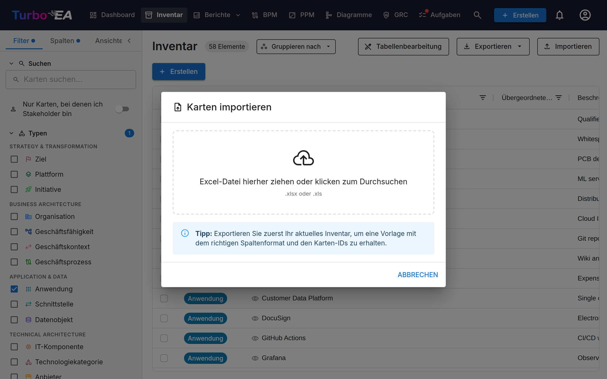

Ein paar Hinweise zum Importieren:

- **Zum Anlegen einer Karte sind nur `name` und `type` erforderlich.** Im Metamodell als *erforderlich* markierte Felder (auch bei Provider oder jedem anderen Typ) blockieren den Import nicht — die Karte wird trotzdem erstellt, und Lücken schlagen sich in der Datenqualitätsbewertung nieder, statt zu einem stillen Überspringen zu führen.
- **Ein `/` in der `name`-Spalte einer Karte muss nicht maskiert werden.** Maskierung (`\/` für einen Schrägstrich, `\\` für einen Backslash) ist nur nötig, wenn Sie diese Karte aus einer `parent_path`-, `rel:<key>`-, `source_ref`- oder `target_ref`-Zelle *referenzieren*, wo `/` das Pfadtrennzeichen ist — und selbst dort wird ein unmaskierter `/` als Teil des Namens gelesen, wenn an dem Pfad, den er ergibt, keine Karte liegt.

### Exportieren

Klicken Sie in der Werkzeugleiste auf **Export**. Der aktuelle Grid-Filter bestimmt den Inhalt: Bei Einzeltyp-Filter ein Blatt für diesen Typ, sonst ein Blatt pro vorhandenem Typ, jeweils zusätzlich mit `Relations` und `_Meta`. Die Datei ist vollständig editierbar und kann ohne Verlust von typspezifischen Attributen wieder importiert werden.

Sie können im Export-Menü auch **Aktuelle Ansicht exportieren** wählen — eine flache Einzelblatt-Momentaufnahme, die genau das Angezeigte abbildet (nur die sichtbaren Spalten, in ihrer aktuellen Reihenfolge, für die gefilterten Zeilen). Sie ist zum Teilen gedacht und **nicht für den Reimport geeignet**. Wenn die Beziehungsspalten noch geladen werden, wartet der Export darauf – sie können also nie leer bleiben.
