# Inventaire

L'**Inventaire** est le cœur de Turbo EA. Toutes les **fiches** (composants) de l'architecture d'entreprise y sont listées : applications, processus, capacités métier, organisations, fournisseurs, interfaces, et plus encore.

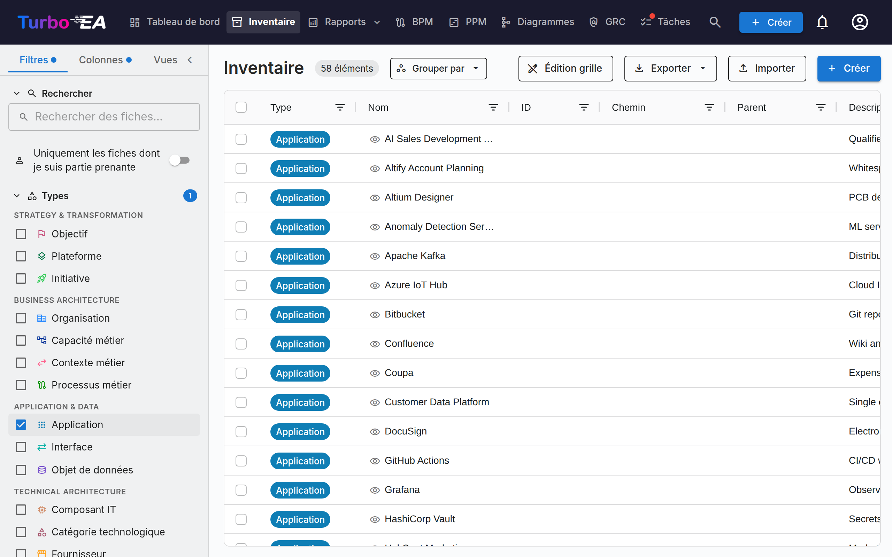

## Structure de l'écran d'inventaire

### Panneau de filtres à gauche

Le panneau latéral gauche permet de **filtrer** les fiches selon différents critères :

- **Recherche** -- Recherche en texte libre sur les noms de fiches, dès la première lettre. Les meilleures correspondances apparaissent en premier : noms exacts, puis noms commençant par votre saisie, puis ceux où elle commence un mot, puis le reste. Tous les champs de recherche de Turbo EA trient ainsi -- la recherche globale (**Ctrl+K** / **⌘K**), chaque sélecteur de fiche, le registre des risques, les décisions et les portails publiés -- sauf si vous avez choisi un tri, qui l'emporte toujours. L'**alias** d'une fiche et sa description sont également pris en compte : une fiche se retrouve donc par le nom réellement employé dans votre organisation -- et un alias correspondant exactement pèse autant qu'un nom qui correspond exactement
- **Types** -- Filtrer par un ou plusieurs types de fiches, regroupés selon la couche d'architecture à laquelle chaque type appartient : Stratégie & Transformation (Objectif, Plateforme, Initiative), Architecture Métier (Organisation, Capacité Métier, Contexte Métier, Processus Métier), Application & Données (Application, Interface, Objet de Données) et Architecture Technique (Composant IT, Catégorie Technique, Fournisseur). Un type que votre administrateur place dans une couche qui lui est propre reçoit son propre en-tête après ces quatre couches, et tout type sans couche définie est listé en dernier sous **Non catégorisé**
- **Sous-types** -- Lorsqu'un type est sélectionné, filtrer davantage par sous-type (par ex. Application -> Application Métier, Microservice, Agent IA, Déploiement)
- **Statut d'approbation** -- Brouillon, Approuvé, Cassé ou Rejeté
- **Origine** -- Le canal par lequel chaque fiche a été créée : **Interface web**, **MCP** (un assistant IA connecté via le [serveur MCP](../admin/mcp.md)), **API** (un script ou une intégration), **Extension** ou **Système** (une tâche de fond). Choisissez **MCP** pour passer en revue tout ce qu'un agent a ajouté. Les fiches créées avant que Turbo EA ne consigne le canal ne correspondent à aucune option
- **Cycle de vie** -- Filtrer par phase du cycle de vie : Planification, Mise en service, Actif, Retrait progressif, Fin de vie
- **Qualité des données** -- Filtrage par plage (sélection multiple) : Complet (≥80 %), Partiel (40-79 %), Minimal (moins de 40 %). Ce sont les plages du [rapport Qualité des données](reports.md#data-quality-report) : un clic sur un segment de barre y mène ici.
- **Orphelines** -- Uniquement les fiches sans aucune relation, dans un sens comme dans l'autre. Évalué côté serveur, donc utilisable sans type de fiche sélectionné.
- **Obsolètes** -- Uniquement les fiches non mises à jour depuis 90 jours. Les deux reflètent les tuiles du [rapport Qualité des données](reports.md#data-quality-report) : un clic sur une tuile y mène ici.
- **Fin de vie** — Pour les types de fiches qui suivent la fin de vie (applications et composants informatiques par défaut, voir [Fin de vie sur d'autres types de fiches](../admin/eol.md#fin-de-vie-sur-dautres-types-de-fiches)), filtrez par le statut de support que Turbo EA résout à partir du [lien EOL](../admin/eol.md) de chaque fiche : Fin de vie, Proche, Pris en charge ou Inconnu. **(vide)** liste les fiches pour lesquelles rien n'a été renseigné. La colonne **Fin de vie** correspondante affiche la date à côté d'une pastille de statut, et se trie et s'exporte comme une date.
- **Type de lien** — Lorsqu'un seul type de fiche hiérarchique est sélectionné et qu'un administrateur a défini des [types de liens](../admin/metamodel.md) pour lui, filtrez selon le type du lien de chaque fiche vers sa fiche parente — par exemple les filiales *commerciales* plutôt que *ventes*. **(vide)** liste les fiches dont le lien ne porte aucun type, ainsi que les fiches de premier niveau, puisque rien n'est renseigné pour les unes comme pour les autres. La colonne **Type de lien** correspondante affiche la valeur sous forme de pastille colorée et est modifiable en mode édition de la grille.
- **Tags** -- Filtrer par tags de n'importe quel groupe de tags
- **Relations** -- Filtrer par fiches liées à travers les types de relations
- **Attributs personnalisés** -- Filtrer par valeurs dans les champs personnalisés (recherche textuelle, options de sélection)
- **Afficher uniquement les archives** -- Basculer pour voir les fiches archivées (supprimées de manière logique)
- **Tout effacer** -- Réinitialiser tous les filtres actifs d'un coup

> **Trouver les fiches sans valeur.** Les filtres Sous-type, Cycle de vie, Étiquettes, Relations et attributs personnalisés de type liste proposent chacun une option **(vide)**. Sélectionnez-la pour n'afficher que les fiches qui n'ont *aucune* valeur pour ce champ — par exemple toutes les fiches sans cycle de vie défini. Elle se combine avec des valeurs normales (correspond à l'une d'elles) et entre plusieurs filtres (correspond à tous).

Un **badge de nombre de filtres actifs** indique combien de filtres sont actuellement appliqués.

### Actions sur une cellule

Faites un clic droit sur n'importe quelle cellule de la grille (appui long sur un appareil tactile) pour ouvrir un menu contextuel d'actions rapides sur ce qui se trouve sous le curseur, à la manière de ServiceNow :

- **Aperçu de la fiche** — ouvrir la fiche nommée par la cellule dans le panneau latéral, sans quitter la grille ; le panneau laisse la grille utilisable : vous pouvez continuer à faire défiler, filtrer et cliquer sur d'autres lignes tant qu'il est ouvert, puis le fermer avec son bouton de fermeture
- **Afficher les correspondances** — ne conserver que les lignes dont la valeur est égale à celle de la cellule cliquée
- **Exclure** — masquer les lignes dont la valeur est égale à celle de la cellule cliquée
- **Copier la valeur** — copier le texte de la cellule dans le presse-papiers
- **Effacer le filtre de colonne** — supprimer le filtre de cette colonne (visible uniquement lorsqu'un filtre est actif)

Sur une cellule à valeurs multiples (étiquettes, relations, parties prenantes, attributs à choix multiples), le menu liste d'abord les valeurs individuelles, afin de filtrer sur l'une d'elles ou sur la cellule entière. **Aperçu de la fiche** apparaît sur toute cellule qui nomme une fiche — la colonne **Nom** (la fiche de la ligne elle-même), la colonne **Parent** et les colonnes de relations — et lorsque la cellule en nomme plusieurs, le menu les liste de la même manière, pour que vous choisissiez celle à ouvrir. Ces filtres alimentent les filtres de colonnes de la grille : ils se combinent avec les filtres de la barre latérale, comptent dans le bouton **Effacer les filtres** de la barre d'outils et sont conservés avec votre vue. Le même menu est disponible sur toutes les grilles de Turbo EA — Décisions, Registre des risques, Conformité et les grilles d'administration. Lorsque la colonne possède un filtre correspondant dans le panneau de gauche — type de fiche, sous-type, cycle de vie, statut d'approbation ou attribut à choix unique —, **Afficher les correspondances** sélectionne également cette valeur dans le panneau, et **Effacer** efface les deux : une vue enregistrée ne peut donc jamais contenir un filtre de panneau et un filtre de colonne contradictoires. Si le filtre est ensuite modifié dans le panneau, c'est lui qui prend le relais.

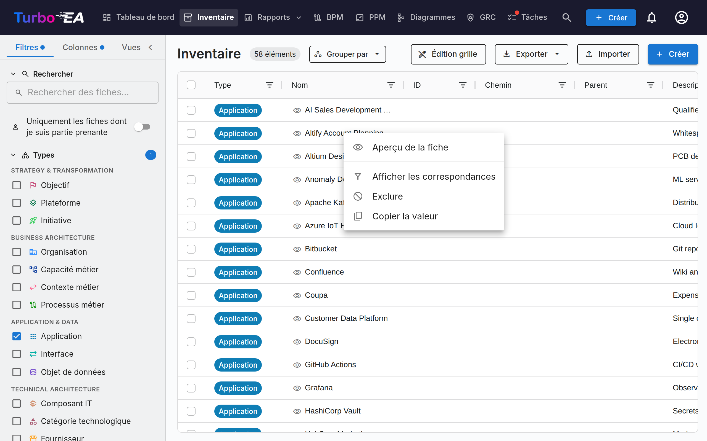

### Onglet Colonnes

L'onglet **Colonnes** dans le panneau latéral vous permet de choisir les colonnes supplémentaires à afficher dans la grille. Les colonnes disponibles changent dynamiquement en fonction des types de fiches sélectionnés :

- **Un seul type sélectionné** — Tous les champs d'attributs définis pour ce type sont disponibles, ainsi que les colonnes de relations et de métadonnées
- **Plusieurs types sélectionnés** — Seuls les champs **communs à tous les types sélectionnés** sont disponibles
- **Aucun type sélectionné** — Un message d'indication vous invite à sélectionner d'abord un type de fiche

Les colonnes sont regroupées en cinq catégories :

| Catégorie | Description |
|-----------|-------------|
| **Colonnes par défaut** | Colonnes toujours actives : Type, Nom, Chemin, Description, Sous-type, Cycle de vie, Statut d'approbation, Qualité des données. Décochez-les pour les masquer de la grille — utile pour resserrer une vue enregistrée aux seules colonnes que vous utilisez vraiment. |
| **Métadonnées** | Créé, Modifié, Créé par, Modifié par, Créé via, Modifié via. **Modifié** correspond à la dernière modification du contenu de la fiche — par une personne ou une intégration, jamais par un recalcul de score effectué par le système — vous pouvez donc filtrer sur cette date pour trouver les fiches à faire revoir par leur responsable. **Créé via** et **Modifié via** affichent le canal à l'origine de la création et de la dernière modification sous forme de pastille (MCP, API, Extension, Système) ; la cellule reste vide pour l'interface web. |
| **Attributs** | Champs personnalisés définis dans le métamodèle (texte, nombre, coût, date, sélection, etc.) |
| **Relations** | Une colonne par relation, nommée d'après son verbe et le type de fiche lié — par exemple *utilise Composant IT* ou *est pris en charge par Application*. Lorsque deux types de relation relient les mêmes types de fiches, chacun a sa propre colonne, et un type de relation entre fiches du même type (une Application qui *envoie des données à* une autre) a une colonne pour chaque sens. Recherchez dans la liste par le verbe ou par le type de fiche. |
| **Parties prenantes** | Une colonne par rôle de partie prenante défini pour le type sélectionné (par ex. *Parties prenantes : Responsible*), affichant les utilisateurs assignés sous forme de puces. En mode édition de grille, double-cliquez sur une cellule pour assigner ou retirer des utilisateurs pour ce rôle directement depuis la grille (nécessite la permission de gestion des parties prenantes). |

La colonne **Parent** n'affiche que la fiche située directement au-dessus, alors que **Chemin** affiche toute la chaîne. En mode d'édition de la grille, double-cliquez sur une cellule Parent pour déplacer la fiche, ou videz le champ pour la remonter au niveau supérieur. La colonne n'est modifiable que si la grille est filtrée sur un seul type de fiche prenant en charge la hiérarchie. Si un déplacement est refusé — parce qu'il créerait une boucle, entrerait en conflit avec une fiche du même nom sous la cible, ou dépasserait la profondeur maximale —, le motif s'affiche en bas de l'écran et la cellule revient à son état précédent.

La colonne **Chemin** affiche le fil d'Ariane hiérarchique (par ex. « Amérique du Nord / Ventes / Ventes internes ») sans le nom de la fiche elle-même, ce qui vous permet d'afficher Nom et Chemin en même temps.

La colonne **Logo** affiche le logo propre à la fiche, ou son icône de type lorsqu'aucun logo n'a été défini, ce qui permet de parcourir un paysage par marque de produit plutôt que par nom. Elle n'est proposée que pour les types de fiches autorisant les logos (par défaut, Application et Composant informatique), elle est masquée par défaut et rend les lignes plus hautes tant qu'elle est affichée, afin que les marques restent lisibles. Si vous pouvez modifier la fiche, survolez sa cellule Logo et cliquez pour téléverser, remplacer, choisir une icône de marque ou supprimer le logo sans quitter la grille — le même menu que sur la page de la fiche. Les logos sont volontairement exclus du remplissage vers le bas et de l'édition en masse : une marque par fiche, définie intentionnellement.

La colonne **Alias** affiche l'autre nom d'une fiche -- celui, interne, sous lequel votre organisation la désigne. Elle est masquée par défaut, la plupart des paysages n'en comportant aucun : activez-la dans l'onglet **Colonnes**. Elle se modifie sur place en mode édition de la grille et se remplit vers le bas comme toute autre colonne de texte ; elle voyage avec l'export et l'import Excel, ce qui permet de charger une liste d'alias en une seule passe.

Chaque catégorie dispose d'une case à cocher **Tout sélectionner** pour activer ou désactiver rapidement toutes les colonnes du groupe. Un champ de recherche en haut permet de trouver des colonnes spécifiques par nom. Le badge sur chaque en-tête de section indique combien de colonnes de ce groupe sont actuellement visibles.

Lorsqu'un type de fiche est sélectionné pour la première fois, **toutes les colonnes d'attributs et de relations sont activées par défaut**. Vous pouvez ensuite décocher les colonnes dont vous n'avez pas besoin. Un bouton **Réinitialiser** en bas de l'onglet « Colonnes » restaure la sélection de colonnes par défaut.

Un **point indicateur de modification** apparaît sur l'en-tête de l'onglet « Colonnes » lorsque la sélection de colonnes diffère des valeurs par défaut. Le même indicateur apparaît sur l'onglet **Filtres** lorsque des filtres sont actifs, permettant de voir d'un coup d'œil quels paramètres ont été modifiés.

Votre sélection de colonnes, la **disposition des colonnes** (ordre de gauche à droite, largeurs et colonnes épinglées), vos filtres actifs et votre ordre de tri sont **automatiquement conservés** dans votre navigateur. Lorsque vous revenez à la page d'inventaire, votre configuration précédente est restaurée. Les vues enregistrées (signets) conservent également cette disposition complète, de sorte que le passage d'une vue à l'autre restaure exactement les colonnes que vous aviez configurées — et dans la même disposition —, ce qui est important lorsque vous partagez une vue organisée avec des parties prenantes.

### Tableau principal

L'inventaire utilise un tableau de données **AG Grid** avec des fonctionnalités puissantes :

| Colonne | Description |
|---------|-------------|
| **Type** | Type de fiche avec icône colorée |
| **Nom** | Nom du composant (cliquer pour ouvrir le détail de la fiche) |
| **Logo** | Le logo propre à la fiche, ou son icône de type à défaut. Masquée par défaut — activez-la dans l'onglet Colonnes ; cliquez sur une cellule pour changer le logo |
| **Alias** | L'autre nom de la fiche. Masquée par défaut -- activez-la dans l'onglet Colonnes ; prise en compte par tous les champs de recherche |
| **Description** | Description brève -- une adresse web qu'elle contient est un lien cliquable |
| **Cycle de vie** | État actuel du cycle de vie |
| **Statut d'approbation** | Badge de statut de révision |
| **Qualité des données** | Pourcentage de complétude avec anneau visuel |
| **Relations** | Une colonne par relation, intitulée avec son verbe et le type de fiche lié (par ex. *utilise Composant IT*) : les noms des fiches liées par cette relation, classés par ordre alphabétique, avec un popover cliquable pour ajouter ou retirer des relations de ce type — les fiches déjà liées sont masquées dans son sélecteur, sauf pour un type hiérarchique, où le sélecteur affiche toute la hiérarchie sous forme d'arborescence indentée et laisse ces fiches en grisé à leur place. Les vues enregistrées et les dispositions de colonnes antérieures à la séparation des colonnes de relation par relation s'ouvrent avec les nouvelles colonnes à la place de l'ancienne |

**Fonctionnalités du tableau :**

- **Tri** -- Cliquer sur l'en-tête de n'importe quelle colonne pour trier par ordre croissant/décroissant
- **Édition en ligne** -- En mode édition grille, modifiez les valeurs des champs directement dans le tableau
- **Remplir une colonne** -- En mode édition grille, cliquez sur une cellule puis faites glisser le petit carré situé dans son coin vers le haut ou vers le bas pour recopier cette valeur dans toutes les lignes parcourues. Avant tout enregistrement, une confirmation indique la colonne, la valeur et le nombre de lignes ; si le serveur refuse une ligne, elle est listée avec le motif et un lien, et les lignes réussies restent enregistrées. Le geste fonctionne au doigt comme à la souris, ainsi qu'au clavier -- placez le focus sur le carré, étendez avec les flèches, validez avec Entrée. Seules les lignes actuellement affichées, après vos filtres et votre tri, sont remplies, et la colonne Nom est volontairement exclue afin que deux fiches ne puissent pas porter le même nom.
- **Sélection multiple** -- Sélectionnez plusieurs lignes pour des opérations en masse
- **Affichage hiérarchique** -- Les relations parent/enfant sont affichées sous forme de chemins de navigation
- **Configuration des colonnes** -- Afficher, masquer et réorganiser les colonnes
- **Figer une colonne** -- Survolez l'en-tête d'une colonne et cliquez sur l'icône d'épingle pour figer cette colonne sur le bord gauche, afin qu'elle reste visible lors du défilement horizontal. Cliquez à nouveau sur l'épingle pour la libérer. Chaque colonne porte également cette épingle dans l'onglet **Colonnes** du panneau de filtres, ce qui permet de figer une colonne sans chercher son en-tête. Les colonnes figées sont mémorisées par tableau, et le même contrôle est disponible dans tous les tableaux de Turbo EA (Registre des risques, Décisions, Constats de conformité, Utilisateurs, Ressources, Journal d'audit).
- **Réorganiser les colonnes** -- Faites glisser un en-tête de colonne pour la déplacer, ou ouvrez la section **Ordre des colonnes** en haut de l'onglet **Colonnes** et faites glisser une ligne par sa poignée. Cette liste *est* l'ordre du tableau : les deux concordent donc toujours, et les colonnes figées sont regroupées en tête parce qu'elles s'affichent toujours au début — libérez-y l'épingle d'une colonne si vous souhaitez la sortir de ce groupe. La poignée fonctionne aussi au clavier (Espace pour saisir une colonne, flèches pour la déplacer, Espace pour la déposer) et au toucher, l'ordre peut donc être modifié sur un téléphone. Votre ordre de colonnes est mémorisé par tableau, dans tous les tableaux de données de Turbo EA.

### Barre d'outils

- **Édition grille** -- Basculer le mode d'édition en ligne pour modifier plusieurs fiches dans le tableau
- **Exporter** -- Télécharger les données sous forme de fichier Excel (.xlsx)
- **Importer** -- Chargement en masse de données depuis des fichiers Excel
- **+ Créer** -- Créer une nouvelle fiche

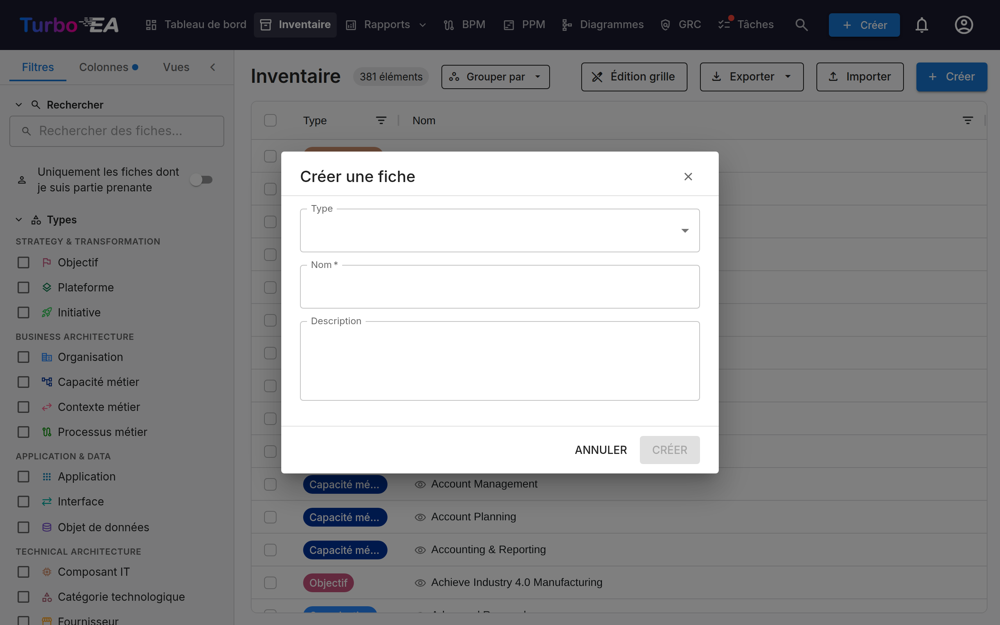

## Comment créer une nouvelle fiche

1. Cliquez sur le bouton **+ Créer** (bleu, coin supérieur droit)
2. Dans la boîte de dialogue qui apparaît :
   - Sélectionnez le **Type** de fiche (Application, Processus, Objectif, etc.)
   - Entrez le **Nom** du composant
   - Optionnellement, ajoutez une **Description**
3. Optionnellement, cliquez sur **Suggérer avec l'IA** pour générer automatiquement une description (voir [Suggestions de description par IA](#suggestions-de-description-par-ia) ci-dessous)
4. Cliquez sur **CREER**

## Édition en masse { #mass-edit }

Cochez deux lignes ou plus à l'aide des cases de la colonne de gauche, puis cliquez sur **Édition en masse** dans la barre de sélection. La boîte de dialogue applique une seule modification à chaque fiche sélectionnée.

La liste déroulante **Champ** regroupe les éléments modifiables :

- **Général** — statut d'approbation, sous-type, étiquettes et parent
- **Attributs** — tout champ modifiable défini pour le type de fiche sélectionné
- **Relations** — une entrée par type de relation et par direction (par exemple *s'exécute sur → Composant informatique*)

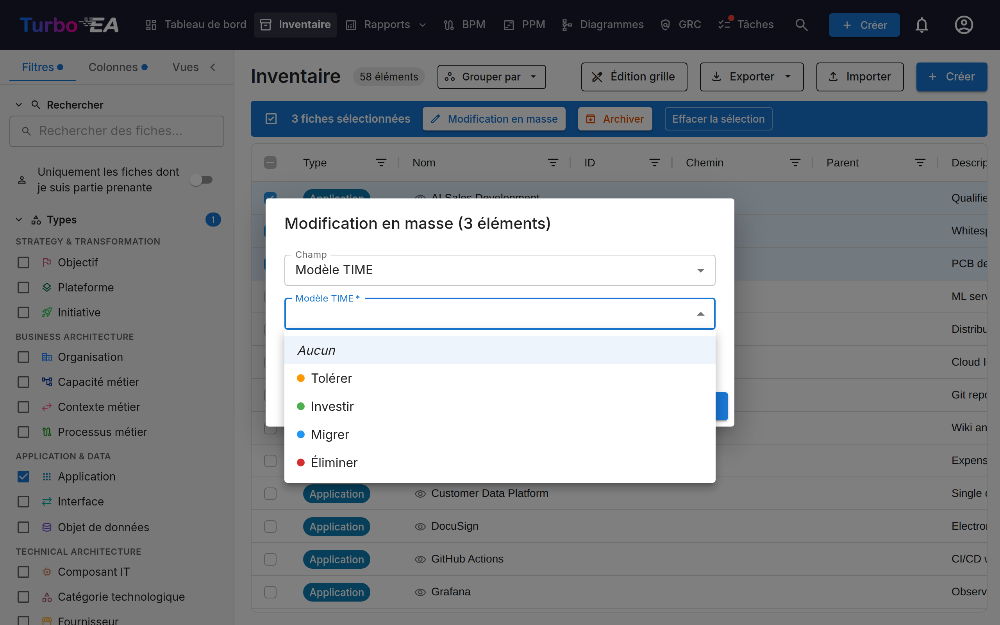

Les étiquettes, les relations et le parent proposent chacun un bouton **ajouter / retirer**, afin d'étendre ou de réduire les valeurs existantes plutôt que de les remplacer.

Lorsque vous choisissez **Ajouter un lien** pour un type de relation qui porte des détails — le sens du flux entre deux applications, la manière dont une organisation utilise une application, les indicateurs créer / lire / mettre à jour / supprimer d'un objet de données —, la boîte de dialogue affiche aussi ces champs. Ce que vous définissez est enregistré sur chaque lien ajouté. Les fiches déjà liées à une cible choisie reçoivent aussi ces détails : relancer **Ajouter un lien** est donc la façon de mettre à jour les détails des liens existants ; un détail laissé vide n'est pas modifié.

Le champ de saisie s'adapte au type de champ : une liste à choix multiples affiche ses options avec des cases à cocher, un champ oui/non une liste Oui / Non, un champ date un sélecteur de date. Laisser la valeur vide — **Aucun** pour un champ oui/non — efface le champ sur toutes les fiches sélectionnées. Les champs calculés par une formule, ainsi que les champs de coût que vous n'êtes pas autorisé à voir, ne sont pas proposés.

### Restructurer la hiérarchie { #mass-edit-parent }

Le champ **Parent** apparaît dès que la grille est filtrée sur un seul type de fiche prenant en charge la hiérarchie. Une fiche n'a qu'un seul parent : ce champ unique couvre donc les deux sens d'une restructuration.

- **Définir le parent** — choisissez une fiche du même type ; toutes les fiches sélectionnées sont placées en dessous. C'est ainsi que l'on rattache plusieurs fiches à un même parent.
- **Supprimer le parent** — toutes les fiches sélectionnées remontent au niveau supérieur.

Les fiches sont déplacées une par une : un déplacement refusé ne bloque donc que la fiche concernée. La boîte de dialogue reste ouverte et indique quelles fiches ont été bloquées et pourquoi. Les motifs habituels sont :

- Une fiche du même nom se trouve déjà sous le parent cible.
- Le parent choisi est un descendant de l'une des fiches déplacées, ce qui créerait une boucle.
- Le déplacement porterait une capacité métier au-delà du maximum de cinq niveaux.

Une fiche emporte ses propres enfants lors du déplacement, et les fiches approuvées repassent à **Rompu** afin que la modification soit réexaminée.

## Regrouper l'inventaire { #group-by }

Cliquez sur **Grouper par** dans la barre d'outils (à côté du nombre d'éléments) pour organiser la grille en groupes repliables. La phase de cycle de vie et le statut d'approbation sont toujours disponibles ; lorsque la grille est filtrée sur un seul type de fiche, son sous-type et tous ses attributs à choix unique s'y ajoutent.

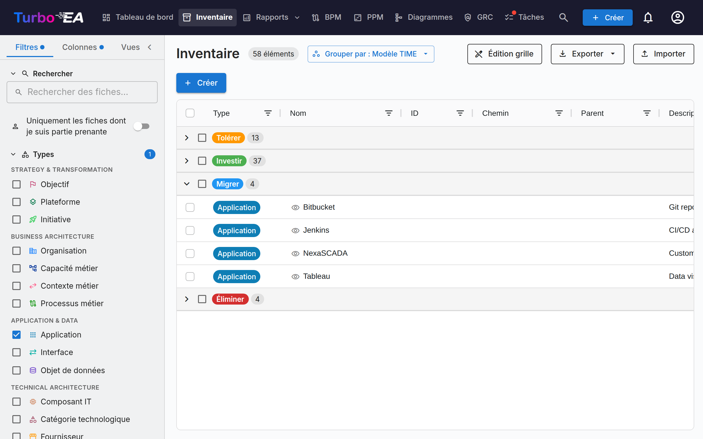

- Les fiches sans valeur pour le champ choisi sont rassemblées dans un groupe **Non défini** en haut de la grille : le point de départ naturel pour trier les fiches non classées.
- Cliquez sur l'en-tête d'un groupe pour le replier ou le déplier. L'en-tête affiche le nombre de fiches du groupe.
- Lorsque vous faites défiler un groupe long, son en-tête reste épinglé juste sous les en-têtes de colonnes : vous savez toujours quel groupe vous lisez, et l'en-tête du groupe suivant le chasse à son arrivée. C'est l'en-tête complet, case à cocher comprise : vous pouvez donc sélectionner un groupe long sans remonter à son début.
- La case à cocher de l'en-tête sélectionne toutes les fiches du groupe : pour reclasser un lot, dépliez **Non défini**, cochez l'en-tête, puis définissez la valeur via la [Modification en masse](#mass-edit). Il n'y a volontairement pas de glisser-déposer : sélectionner puis définir fonctionne de la même façon sur ordinateur, tablette et téléphone.
- Le tri s'applique à l'intérieur de chaque groupe ; le regroupement est conservé après rechargement, enregistré dans les vues sauvegardées et partageable via le paramètre d'URL `group_by`.

### Indenter les enfants sous leurs parents { #group-by-parents }

Cochez **Parent** en haut du menu **Regrouper par** pour afficher les fiches sous forme d'arbre : chaque parent en premier, ses enfants indentés en dessous. L'option fonctionne seule (toute la grille devient un seul arbre) ou en plus d'un regroupement (chaque groupe devient son propre arbre). Le menu reste ouvert quand vous la cochez, ce qui permet de choisir un regroupement juste après.

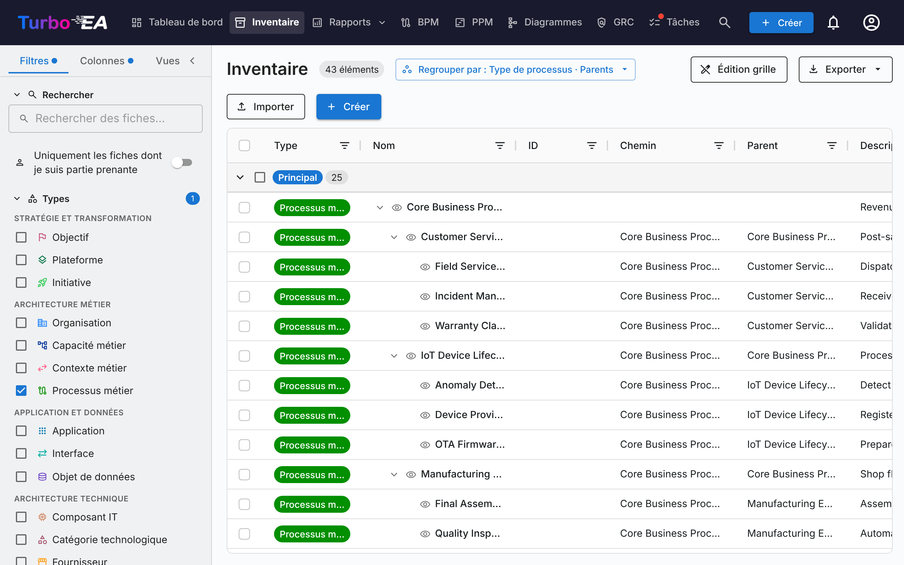

- Une fiche ne quitte jamais son groupe. Un enfant dont le parent se trouve dans un autre groupe, est masqué par un filtre de colonne ou n'est pas chargé démarre sa propre branche, avec ses ancêtres manquants affichés en gris avant son nom (par exemple *SAP S/4HANA / SAP FI /* devant le nom du module). Les décomptes des groupes, la case à cocher de l'en-tête et la modification en masse correspondent donc toujours au contenu du groupe.
- Cliquez sur le chevron avant le nom d'un parent pour masquer ou afficher sa branche. Un parent réduit compte toujours ses fiches masquées dans le nombre d'éléments et dans l'en-tête du groupe. Les branches que vous réduisez avec le chevron ne sont pas mémorisées, et modifier un filtre de colonne les rouvre toutes ; effacer le dernier filtre de colonne ramène au niveau choisi avec le sélecteur.
- Tant que la couche parent est activée, une paire **−** / **+** à côté du bouton Regrouper par ferme ou ouvre tout l'arbre un niveau à la fois. Le niveau choisi est mémorisé d'un rechargement à l'autre, enregistré dans les vues sauvegardées et partageable via `group_tree_level=<n>` ; le niveau affiché suit aussi ce que vous ouvrez et fermez à la main.
- Le tri s'applique entre frères et sœurs : les parents sont triés, et les enfants de chaque parent sont triés en dessous de lui.
- L'option n'est proposée que si un type de fiche affiché possède une hiérarchie. Elle est mémorisée d'un rechargement à l'autre, enregistrée dans les vues sauvegardées et partageable via le paramètre d'URL `group_tree=1`.
- L'**export** suit l'ordre de l'arbre et omet les fiches situées dans des branches réduites, comme il le fait pour les groupes réduits.

## Suggestions de description par IA { #ai-description-suggestions }

Turbo EA peut utiliser l'**IA pour générer une description** pour n'importe quelle fiche. Cela fonctionne aussi bien dans la boîte de dialogue de création de fiche que sur les pages de détail des fiches existantes.

**Comment ça marche :**

1. Entrez un nom de fiche et sélectionnez un type
2. Cliquez sur l'**icône étincelle** dans l'en-tête de la fiche, ou le bouton **Suggérer avec l'IA** dans la boîte de dialogue de création de fiche
3. Le système effectue une **recherche web** pour le nom de l'élément (en utilisant un contexte adapté au type -- par ex. « SAP S/4HANA software application »), puis envoie les résultats à un **LLM** pour générer une description concise et factuelle
4. Un panneau de suggestion apparaît avec :
   - **Description modifiable** -- examinez et modifiez le texte avant de l'appliquer
   - **Score de confiance** -- indique le degré de certitude de l'IA (Élevé / Moyen / Faible)
   - **Liens sources cliquables** -- les pages web d'où provient la description
   - **Nom du modèle** -- quel LLM a généré la suggestion
5. Cliquez sur **Appliquer la description** pour sauvegarder, ou **Ignorer** pour rejeter

**Caractéristiques clés :**

- **Adapté au type** : L'IA comprend le contexte du type de fiche. Une recherche « Application » ajoute « software application », une recherche « Fournisseur » ajoute « technology vendor », etc.
- **Confidentialité d'abord** : Lorsque vous utilisez Ollama, le LLM s'exécute localement -- vos données ne quittent jamais votre infrastructure. Les fournisseurs commerciaux (OpenAI, Google Gemini, Anthropic Claude, etc.) sont également pris en charge
- **Contrôle par l'administrateur** : Les suggestions IA doivent être activées par un administrateur dans [Paramètres > Suggestions IA](../admin/ai.md). Les administrateurs choisissent quels types de fiches affichent le bouton de suggestion, configurent le fournisseur LLM et sélectionnent le fournisseur de recherche web
- **Basé sur les permissions** : Seuls les utilisateurs disposant de la permission `ai.suggest` peuvent utiliser cette fonctionnalité (activée par défaut pour les rôles Admin, Admin BPM et Membre)

## Vues sauvegardées (Signets)

Vous pouvez sauvegarder votre configuration actuelle de filtres, colonnes et tri sous forme de **vue nommée** pour une réutilisation rapide.

### Créer une vue sauvegardée

1. Configurez l'inventaire avec les filtres, colonnes et tri souhaités
2. Cliquez sur l'icône **signet** dans le panneau de filtres
3. Entrez un **nom** pour la vue
4. Choisissez la **visibilité** :
   - **Privée** -- Seul vous pouvez la voir
   - **Partagée** -- Visible par des utilisateurs spécifiques (avec des permissions de modification optionnelles)
   - **Publique** -- Visible par tous les utilisateurs

### Utiliser les vues sauvegardées

Les vues sauvegardées apparaissent dans la barre latérale du panneau de filtres. Cliquez sur n'importe quelle vue pour appliquer instantanément sa configuration. Les vues sont organisées en :

- **Mes vues** -- Vues que vous avez créées
- **Partagées avec moi** -- Vues que d'autres ont partagées avec vous
- **Vues publiques** -- Vues disponibles pour tous

### Vues de requête { #query-views }

Une **vue de requête** est une vue enregistrée dont les filtres sont une **requête à plusieurs sauts** — une chaîne de relations avec des conditions à chaque étape, par exemple *Organisations qui utilisent une Application active affectée par une Initiative dont le statut est On Track*. Plusieurs requêtes de ce type peuvent être empilées dans une même vue et combinées avec **ET** et **OU** (voir plus bas). La vue stocke la requête, pas ses résultats : elle est réexécutée à chaque ouverture de la vue, de sorte que la liste reflète toujours le paysage actuel.

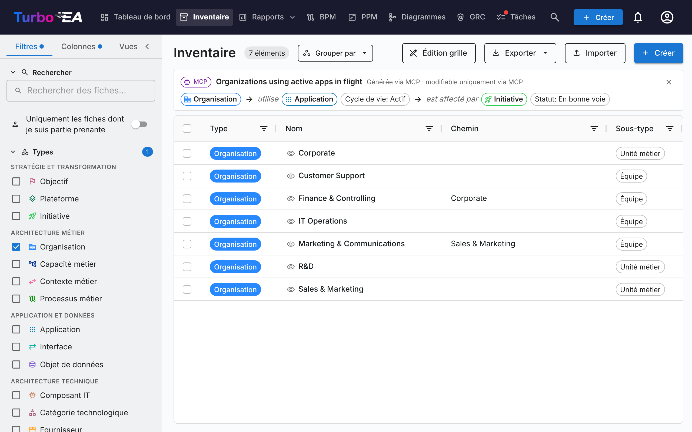

**Créer une vue de requête.** Dans l'onglet **Vues** du panneau latéral des filtres, cliquez sur **Nouvelle vue de requête** à côté de *Enregistrer la vue actuelle* (affiché à toute personne autorisée à gérer les vues). Si un filtre est actif, y compris le type de fiche sélectionné, une confirmation demande avant de les effacer ; **Annuler** sur le brouillon les rétablit. Le bandeau au-dessus de la grille s'ouvre comme un générateur de requête :

1. Cliquez sur la pastille de départ (*Choisir un type*) et choisissez le type de fiche d'où part la requête — celui qu'elle liste.
2. Cliquez sur **+ relation** après la dernière fiche pour ajouter un saut. Le menu liste chaque verbe de relation avec le type de fiche vers lequel il mène ; une relation entre fiches du même type est proposée dans les deux sens. Chaque ligne de requête est une chaîne unique de trois sauts au plus.
3. Cliquez sur **+ condition** sous une fiche pour la restreindre : **Cycle de vie**, **Sous-types**, **Statut d’approbation**, **Qualité des données** (*Complet*, *Partiel* ou *Minimal*, les mêmes tranches que le filtre du panneau latéral), **Fin de vie** (voir ci-dessous), **Étiquettes**, **Fiches spécifiques**, ou un champ de sélection ou oui/non de ce type de fiche. Pour les étiquettes, une fiche correspond si elle porte l'une des étiquettes choisies d'un groupe, et elle doit correspondre à chaque groupe ajouté ; seuls les groupes d'étiquettes qui s'appliquent à ce type de fiche sont proposés. **Fiches spécifiques** ouvre le sélecteur de fiches de ce type, et l'étape ne retient alors que les fiches choisies ; pour un type de fiche hiérarchique, un interrupteur **Inclure les sous-fiches** retient aussi les fiches situées sous chaque choix. Une fiche choisie que vous ne pouvez pas voir apparaît comme *(fiche masquée)*.
4. Cliquez sur **Enregistrer**. La boîte de dialogue habituelle d'enregistrement de vue s'ouvre pour le nom, la visibilité, le partage et le réglage OData. **Annuler** abandonne la requête.

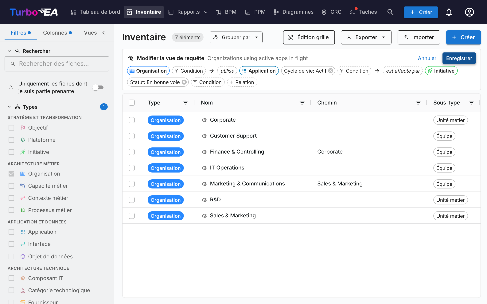

Pendant la construction, la grille se filtre en direct et le compteur de la barre d'outils indique combien de fiches correspondent : vous voyez l'effet de chaque saut et de chaque condition avant d'enregistrer.

**Filtrer sur la fin de vie.** La condition **Fin de vie** est proposée pour un type de fiche qui suit la fin de vie — par défaut Application et Composant IT ; elle suit la section Fin de vie du type dans le métamodèle. Ses valeurs sont **Fin de vie**, **Fin de vie imminente**, **Supporté**, **Inconnu** et *(vide)* pour les fiches sans donnée de fin de vie. Le statut est celui qu’affiche la colonne **Fin de vie** de l’inventaire : il provient du produit endoflife.date lié ou d’un produit de fin de vie personnalisé, ou d’une date de fin de vie saisie à la main, et il est indépendant de la phase de cycle de vie de la fiche. La condition fonctionne sur la fiche de départ et à chaque étape de relation, dans les lignes ET comme dans les lignes OU — par exemple *les Applications qui utilisent un Composant IT en fin de vie*. Tant qu’une requête filtre dessus sur la fiche de départ, la grille affiche la colonne Fin de vie pour que vous voyiez pourquoi chaque fiche correspond ; les colonnes que vous avez choisies ne sont pas modifiées. Si endoflife.date est injoignable et que rien n’est en cache, les fiches liées sont lues comme *Inconnu*, comme dans la colonne Fin de vie.

La condition exige la permission de consulter les données de fin de vie (**Consulter les données de fin de vie**, `eol.view`). Sans elle, la condition n’est pas proposée, et l’ouverture, l’aperçu ou l’enregistrement d’une vue qui l’utilise sont refusés avec le message *Cette vue filtre sur le statut de fin de vie, que votre rôle ne peut pas consulter.*

**Modifier les sauts et les conditions.** Cliquez sur la pastille de verbe d'un saut pour ouvrir son menu : **n'a aucune** transforme le saut en exigence que la fiche n'ait **aucune** relation de ce type, et **Supprimer ce saut** le supprime avec tous les sauts qui le suivent. Cliquez sur une pastille de condition pour modifier ses valeurs, ou sur son **×** pour la supprimer.

**Combiner des requêtes avec ET et OU.** Une vue peut contenir plusieurs lignes de requête empilées. Chaque ligne est une requête complète — fiche de départ, relations et conditions — construite exactement comme la requête unique ci-dessus. Les lignes sont regroupées :

- **ET** ajoute une ligne au même groupe : une fiche n'est listée que si elle correspond à **chaque** ligne du groupe. Une ligne ET part du même type de fiche que son groupe, affiché sous forme de pastille fixe, et la première ligne du groupe ne peut pas changer de type de fiche tant qu'elle a des lignes ET.
- **OU** démarre un nouveau groupe sous un séparateur **OU** : ses résultats sont **ajoutés** à la liste. Un nouveau groupe peut partir d'un autre type de fiche : une vue peut ainsi lister, par exemple, des Applications et des Organisations ensemble. Lorsqu'une vue liste plusieurs types de fiche, la grille affiche les colonnes que ces types ont en commun.

En mode édition, un **plus** cerclé sous chaque groupe demande **ET** ou **OU** : ET ajoute une ligne à ce groupe, OU ouvre un nouveau groupe après lui. Le **×** à la fin d'une ligne la supprime ; il est affiché lorsque la vue compte plus d'une ligne.

Par exemple, la vue de démonstration *Active apps on aging tech, and the organizations using apps* comporte un groupe Application de deux lignes — une Application active qui utilise un Composant IT en fin de vie ou en phase de retrait, **ET** une Application affectée par une Initiative — **OU** une Organisation qui utilise une Application. La liste montre les Applications qui satisfont les deux lignes, ainsi que chaque Organisation qui utilise une Application.

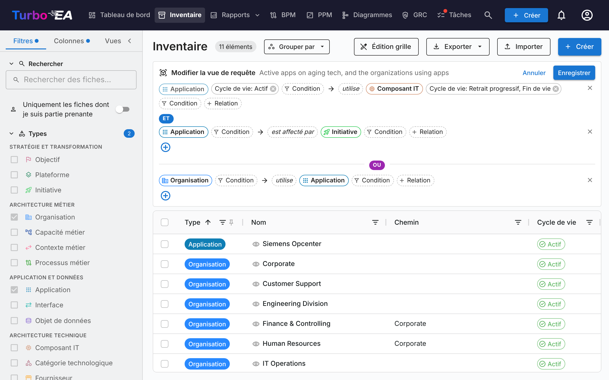

Une vue contient au plus **six** lignes de requête, **douze** relations sur l'ensemble de ses lignes et **trois** relations en profondeur sur chaque ligne. Les lignes d'un groupe ET ne se rejoignent que sur leur fiche de départ : le Composant IT d'une ligne et l'Initiative de l'autre peuvent être des fiches différentes. Deux exigences portant sur la **même** fiche au milieu d'une ligne — par exemple, que le même Composant IT soit proposé par un Fournisseur **et** appartienne à une Catégorie technologique — ne peuvent pas être construites dans le générateur de requête ; un assistant IA peut écrire une telle requête via le [serveur MCP](../admin/mcp.md#multi-hop-card-queries), et le bandeau l'affiche alors.

**Modifier une vue de requête enregistrée.** Lorsqu'une vue de requête est ouverte, le bandeau affiche son chemin : les types de fiche sous forme de pastilles, reliés par le verbe de relation qui lie chaque étape (par exemple *Organisation → utilise Application → est affectée par Initiative*), avec les conditions de chaque fiche en dessous. Une vue à plusieurs lignes affiche la même pile, avec ses marqueurs ET et ses séparateurs OU, sans les commandes de modification. Si vous êtes propriétaire de la vue ou disposez de droits de modification sur elle, un **crayon** dans le bandeau la bascule vers le même générateur ; **Enregistrer** met à jour la vue. Le bouton **×** (*Quitter cette vue*) ramène à l'inventaire normal. **Enregistrer la vue actuelle** pendant qu'une vue de requête est ouverte enregistre une nouvelle vue de requête avec la même requête.

#### Voir les fiches derrière une correspondance { #query-view-matches }

Une vue de requête ne liste que la première fiche de sa requête. Pour voir quelles fiches plus loin dans la chaîne ont fait correspondre une ligne, cliquez sur leur type de fiche dans le chemin de la requête. Dans *Organisations qui utilisent une Application qui utilise un Composant IT en fin de vie ou proche de celle-ci*, cliquez sur **Application** et une colonne liste, pour chaque Organisation, les Applications par lesquelles elle correspond ; cliquez sur **Composant IT** et une autre colonne liste les Composants IT retenus. Cliquez de nouveau sur le type de fiche pour retirer sa colonne.

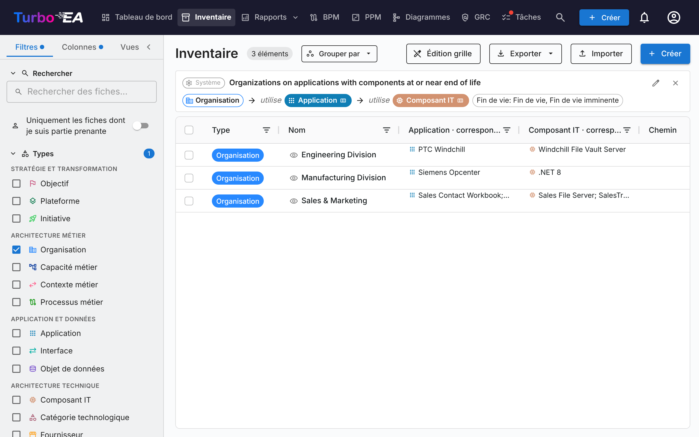

- **L'aspect d'un interrupteur.** Un type de fiche cliquable affiche un pointeur et l'info-bulle *Les afficher dans une colonne*. Une fois sa colonne affichée, la pastille est remplie de la couleur du type de fiche et porte une petite icône de colonne ; son info-bulle indique *Masquer la colonne*.
- **Quels types de fiche sont des interrupteurs.** Chaque type de fiche après le premier de sa ligne. Le premier type de fiche d'une ligne n'en est pas un, car ses fiches sont les lignes du tableau, pas plus qu'un type de fiche placé derrière **n'a aucune**, qui représente une relation absente. Dans une vue à plusieurs lignes, les types de fiche de chaque ligne sont des interrupteurs ; avec **OU**, une ligne du tableau n'affiche des fiches que pour les lignes de requête qu'elle satisfait. Les interrupteurs ne sont pas disponibles pendant que vous modifiez la requête, et les colonnes sont masquées jusqu'à ce que vous enregistriez ou annuliez.
- **Où la colonne apparaît.** Juste après **Nom**, intitulée avec le type de fiche et *correspondances* — par exemple *Application · correspondances* — pour ne pas être confondue avec une colonne de relation telle que *utilise Application*, qui liste toutes les Applications liées de cette façon. Lorsque deux étapes ont le même type de fiche, les intitulés sont numérotés. Survolez l'intitulé pour voir le chemin que suit la colonne.
- **Ce qu'affiche une cellule.** Les noms des fiches correspondantes, séparés par des points-virgules ; survolez la cellule pour voir la liste complète. Une cellule liste au plus **100** noms ; une liste plus longue se termine par *…* et son info-bulle indique que les 100 premières sont affichées. Vous pouvez trier et filtrer la colonne comme une colonne de texte, et **Exporter la vue actuelle** l'inclut.
- **Chaque fiche de la chaîne, pas qui mène à qui.** Une ligne liste chaque fiche correspondante à cette étape : toutes les Applications retenues de l'Organisation et tous les Composants IT retenus de ces Applications. Elle n'indique pas quel Composant IT appartient à quelle Application. Pour lister les Composants IT eux-mêmes, un par ligne, écrivez plutôt la requête en partant de Composant IT.
- **Enregistrées avec la vue.** Les colonnes que vous affichez sont enregistrées avec la vue (le **crayon** dans la liste des vues, puis **Mettre à jour**), de sorte qu'elles reviennent quand vous la rouvrez. Modifier la requête conserve une colonne tant que son étape existe encore, et la retire lorsque vous supprimez cette étape ou changez son type de fiche.

Vous ne voyez que les fiches que vous êtes autorisé à voir : une fiche qui vous est masquée n'est jamais nommée dans une cellule, et une ligne qui ne correspond que par des fiches masquées n'est pas listée.

La vue de démonstration *Organizations on applications with components at or near end of life* s'ouvre avec les deux colonnes affichées.

**Vues créées par un assistant IA.** Un assistant connecté via le [serveur MCP](../admin/mcp.md) peut aussi créer des vues de requête. Une telle vue affiche une pastille **MCP** et la mention *Créée via MCP* dans son bandeau, ainsi qu'un badge robot dans la liste des vues ; elle se modifie comme n'importe quelle autre vue de requête. Dans la liste des vues, chaque vue de requête porte un petit badge de vue de requête (un cube ; le badge robot lorsqu'un assistant l'a créée) et son chemin compact (*Organisation › utilise Application › est affectée par Initiative*) en seconde ligne; une vue empilée se lit *… ET … OU …*. Lorsque la vue comporte des conditions, leur nombre suit le chemin (*… › est affectée par Initiative · 2 conditions*).

**Ouvrir une vue par lien.** Lorsqu'un assistant enregistre une vue, il renvoie un lien de la forme `/inventory?view=<view id>` ; l'ouvrir applique directement la vue enregistrée. Le même lien fonctionne pour toute vue enregistrée que vous pouvez voir.

**OData.** Le flux OData d'une vue de requête renvoie les mêmes fiches que l'inventaire : la requête est également appliquée au flux.

Pour la grammaire des requêtes, ses limites et les outils MCP (`query_cards`, `list_inventory_views`, `save_inventory_view`, `list_tag_groups`), voir [Requêtes de fiches à plusieurs sauts](../admin/mcp.md#multi-hop-card-queries).

## Import / Export Excel { #excel-import }

Les exports et imports d'inventaire utilisent un **classeur Excel multi-feuilles** qui restitue l'intégralité d'un sous-paysage — fiches de tous types et relations entre elles — sans jamais exiger de copier un UUID.

### Structure du classeur

- **Une feuille par type de fiche** (Application, Business Capability, IT Component, …) avec ses colonnes principales, ses `attr_<champ>`, ses colonnes de cycle de vie, ses colonnes `rel:<type_de_relation>`, et ses colonnes de parties prenantes `stakeholder:<clé_de_rôle>`.
- **Une feuille `Relations`** portant les **valeurs** que contiennent les relations — une ligne par relation dont le type a des valeurs à renseigner.

La répartition est simple et sans exception : **la feuille de fiches dit quelles fiches sont liées ; la feuille `Relations` dit ce que ces liens contiennent.** Chaque type de relation a une colonne `rel:` sur la feuille de fiches du type dont il part, qu'il porte des valeurs ou non.
- **Une feuille `_Meta`** contenant la version du format du classeur.

### Identification sans GUID

Les fiches sont identifiées par leur **nom** lorsqu'il est unique dans son type, sinon par leur **`parent_path`** complet. Une cellule de relation peut écrire `NexaCore ERP` directement si une seule Application porte ce nom ; en cas d'homonymie, on utilise `Sales / Customer Mgmt / CRM`.

#### Unicité des fiches sœurs

Parce que les fiches sont identifiées par nom + chemin, **deux fiches du même type ne peuvent pas partager à la fois le même parent et le même nom**. Les nouvelles fiches qui créeraient une telle collision sont rejetées à la création (dans la boîte de dialogue Créer, en renommage inline et lors de l'import Excel). Les doublons déjà présents en base, hérités d'imports ou de seeds antérieurs, restent intacts — vous pouvez modifier n'importe quel champ, mais re-créer un troisième doublon ou renommer une fiche pour recréer la collision est bloqué. La comparaison est insensible à la casse et aux espaces, comme le résolveur de l'import. Lorsque la boîte de dialogue Créer rejette un doublon, l'avertissement nomme la fiche existante et propose un lien **Voir la fiche existante** qui vous y conduit directement.

### Cellules de relation en ligne

Chaque colonne `rel:<type_de_relation>` exprime les relations sortantes sous forme de cibles **séparées par des points-virgules** (par exemple `NexaCore ERP; BillingApp`). Point-virgule plutôt que virgule, car les noms de fiches contiennent souvent des virgules (`Acme, Inc.`). À l'intérieur d'un nom, `/` et `\` sont échappés en `\/` et `\\`, et un `;` en `\;` — l'exporteur s'en charge automatiquement (par ex. `SAP S/4HANA` → `SAP S\/4HANA`). Une référence échappée est toujours exacte. Dans une cellule saisie à la main, le `/` peut rester sans échappement : `SAP S/4HANA` est d'abord lu comme un chemin (une fiche *4HANA* sous *SAP S*) et, si aucune fiche ne se trouve à ce chemin, comme un seul nom, résolu lorsqu'une seule fiche du type le porte. Les cellules sont **déclaratives** : leur contenu remplace l'ensemble des relations sortantes de ce type depuis la source. Retirer une cible supprime la relation correspondante ; vider la cellule les supprime toutes. Dans un classeur exporté par Turbo EA (il contient une feuille `_Meta`), une virgule n'est jamais un séparateur : une cellule contenant une seule cible comme `This is X, it does Y` reste une seule cible. Une feuille sans `_Meta` (construite à la main ou exportée avant la 1.23) peut encore séparer les cibles par des virgules : si la cellule ne contient aucun `;`, elle est lue comme une seule cible lorsque la cellule entière désigne une fiche, et comme une liste séparée par des virgules sinon. Il y a une colonne par type de relation partant du type de fiche de la feuille — **tous**, y compris ceux qui portent des valeurs. Les cibles sont triées alphabétiquement, si bien qu'un nouvel export d'une cartographie inchangée donne un fichier identique.

La colonne `tags` suit la même règle : des entrées `Groupe: Étiquette` séparées par `; ` (par ex. `Vendor: Acme, Inc.; Region: EU`), un `;` dans le nom d'une étiquette s'écrivant `\;`. Les classeurs exportés avant la 2.156.1 séparaient les étiquettes par des virgules et s'importent toujours comme avant.

### Cellules de parties prenantes

Sur chaque feuille de fiches, les colonnes `stakeholder:<clé_de_rôle>` portent les utilisateurs assignés à chaque rôle de partie prenante, sous forme d'**adresses email séparées par des points-virgules** (la même convention que les colonnes `subscriptions:<RoleType>` de LeanIX), par ex. `ada@corp.com; bob@corp.com`. L'**adresse email est la seule référence utilisateur acceptée** — les noms affichés peuvent entrer en collision et ne servent jamais à la résolution ; une entrée `Nom <email>` est tolérée (l'email entre chevrons est utilisé), un nom seul produit un avertissement et est ignoré. Comme les cellules de relations, les cellules de parties prenantes sont **déclaratives par rôle** : les utilisateurs listés deviennent l'ensemble complet des assignations de ce rôle après l'import. Retirer un utilisateur le désassigne ; vider la cellule vide le rôle ; omettre la colonne laisse les assignations intactes. Les entrées sans utilisateur correspondant produisent un avertissement et sont ignorées — elles ne bloquent jamais l'import.

!!! note "Feuilles exportées avant le passage des clés en camelCase"
    Les clés des rôles de parties prenantes suivent la même convention camelCase que toute autre clé du métamodèle. Une feuille exportée avant ce changement contient des en-têtes comme `stakeholder:technical_application_owner` ; ils s'importent toujours — l'en-tête est associé à son rôle camelCase lorsqu'aucun rôle ne correspond littéralement. Les feuilles nouvellement exportées utilisent la forme camelCase.

**Cellules de date de cycle de vie** — les colonnes `lifecycle_<phase>` (`lifecycle_plan`, `lifecycle_phaseIn`, `lifecycle_active`, `lifecycle_phaseOut`, `lifecycle_endOfLife`) suivent la même règle, une date par colonne : **vider une cellule supprime cette date** de la fiche, et omettre complètement la colonne laisse cette date inchangée. Les cellules de valeur simple fonctionnent à l'inverse : une cellule vide de description, de sous-type, d'alias, d'ID externe, de libellé parent ou d'attribut (`attr_<field>`) laisse la valeur enregistrée inchangée ; effacez-les plutôt sur la fiche ou dans la grille de l'inventaire.

### Feuille `Relations`

Une relation peut porter ses propres valeurs — un *type d'usage* sur un lien `Organization` → `Application`, un coût annuel, ou une description libre. Une cellule `rel:` est une liste de noms sans place pour cela : ces valeurs vivent sur la feuille `Relations`, une ligne par relation, avec les colonnes `relation_type`, `source_type`, `source_ref`, `target_type`, `target_ref`, `attr_<champ>` et `description`.

La feuille contient les relations dont le type a effectivement des valeurs — les autres n'ont rien à renseigner et vivent entièrement sur les feuilles de fiches. Les relations pointant *vers* une fiche exportée y figurent aussi ; `source_ref` et `target_ref` indiquent le sens. Les colonnes `attr_<champ>` sont celles des types de relation présents dans ce classeur. Le tri se fait par fiche source, puis type de relation, puis cible.

**Cette feuille ne fait que renseigner des valeurs. Elle ne crée ni ne supprime jamais de relation** — c'est le rôle de la feuille de fiches : **supprimer une ligne ne supprime rien** ; modifier ses valeurs remplace ce que la relation contient ; et une ligne nommant deux fiches non liées est signalée dans l'aperçu puis ignorée — liez-les dans la colonne `rel:`, au besoin dans le même import.

Les classeurs plus anciens comportent une colonne `action`. Elle est ignorée ; une ligne `action = delete` est signalée et ignorée. Si la feuille de fiches et la feuille `Relations` se contredisent, **le retrait l'emporte**.

La feuille liste **toutes les relations des fiches exportées**, que leur type porte ou non des valeurs aujourd'hui — un type de relation auquel vous venez de donner une valeur y a donc déjà sa ligne. Les relations pointant *vers* une fiche exportée y figurent aussi ; `source_ref` et `target_ref` indiquent le sens. Les colonnes `attr_<champ>` sont celles des types de relation présents dans ce classeur, pas de tous ceux définis dans l'instance.

Un type de relation qui porte des valeurs n'a **pas de colonne `rel:`** — une liste de noms ne peut pas les accueillir ; il se modifie sur cette feuille. Si la feuille de fiches et la feuille `Relations` se contredisent, **le retrait l'emporte**, et l'aperçu le signale.

### Import

Cliquez sur **Importer** dans la barre d'outils, déposez le classeur et vérifiez l'aperçu avant d'appliquer. Vous voyez à la fois les fiches à créer / mettre à jour et les relations à ajouter / supprimer. Les erreurs (par exemple, une cible ambiguë avec ses chemins candidats) bloquent l'application.

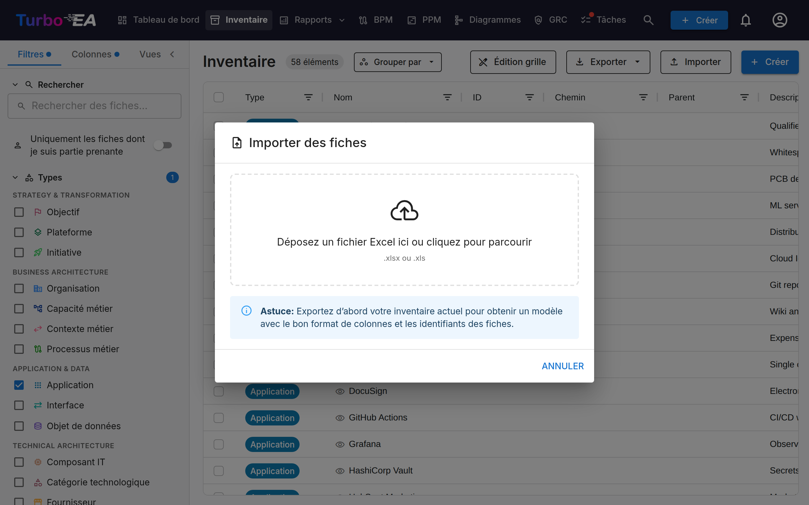

Quelques précisions sur l'import :

- **Seuls `name` et `type` sont requis pour créer une fiche.** Les champs marqués *obligatoires* dans le métamodèle (y compris sur Provider ou tout autre type) ne bloquent pas l'import — la fiche est tout de même créée, et les manques se reflètent dans son score de qualité des données plutôt que de provoquer un saut silencieux.
- **Un `/` dans la colonne `name` d'une fiche n'a pas besoin d'être échappé.** L'échappement (`\/` pour une barre oblique, `\\` pour une barre oblique inverse) n'est nécessaire que lorsque vous *référencez* cette fiche depuis une cellule `parent_path`, `rel:<clé>`, `source_ref` ou `target_ref`, où `/` est le séparateur de chemin ; même là, un `/` non échappé est lu comme faisant partie du nom lorsqu'aucune fiche ne se trouve au chemin qu'il désigne.

### Export

Cliquez sur **Exporter**. Le filtre courant détermine le contenu : avec un filtre mono-type, une seule feuille de fiches ; sans filtre, une feuille par type présent. Dans tous les cas, le classeur inclut `Relations` et `_Meta` et peut être réimporté sans perdre les attributs spécifiques au type.

Vous pouvez aussi choisir **Exporter la vue actuelle** dans le menu Exporter — un instantané plat sur une seule feuille qui reflète ce qui est affiché (uniquement les colonnes visibles, dans leur ordre actuel, pour les lignes filtrées). Il est destiné au partage et **ne convient pas à la réimportation**. Si les colonnes de relations sont encore en cours de chargement, l'export les attend : elles ne peuvent donc jamais être vides.
