# Inventário

O **Inventário** é o coração do Turbo EA. Aqui todos os **cards** (componentes) da arquitetura empresarial são listados: aplicações, processos, capacidades de negócio, organizações, fornecedores, interfaces e mais.

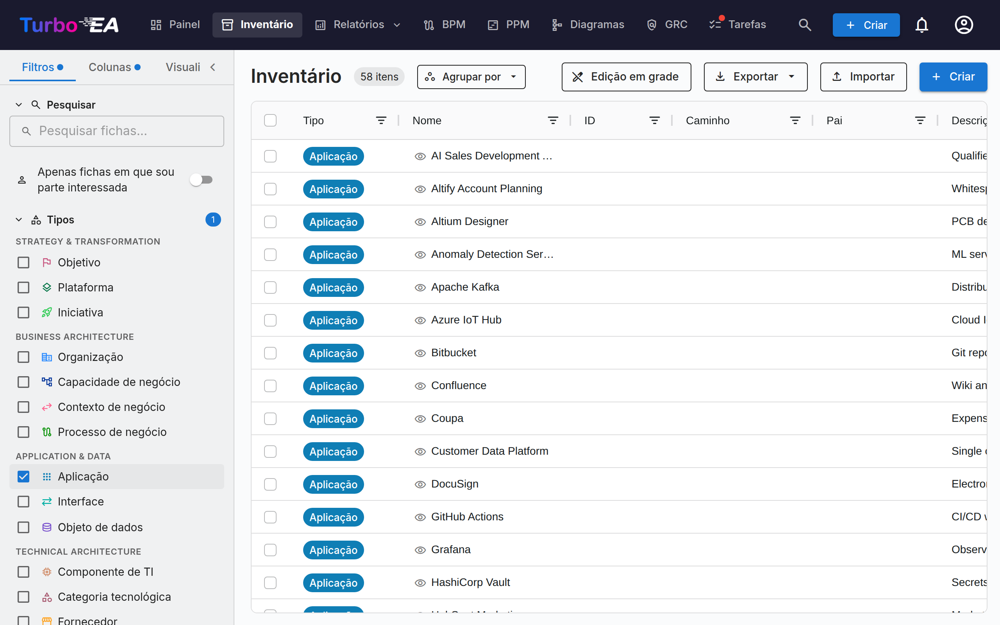

## Estrutura da Tela do Inventário

### Painel de Filtros à Esquerda

O painel lateral esquerdo permite **filtrar** cards por diferentes critérios:

- **Pesquisa** — Busca de texto livre nos nomes dos cards, desde a primeira letra. As melhores correspondências aparecem primeiro: nomes exatos, depois os que começam pelo que você digitou, depois aqueles em que inicia uma palavra e então os restantes. Todos os campos de busca do Turbo EA ordenam assim — a busca global (**Ctrl+K** / **⌘K**), cada seletor de cards, o registo de riscos, as decisões e os portais publicados — a não ser que você tenha escolhido uma ordenação própria, que prevalece sempre. O **alias** do card e a sua descrição também são pesquisados, de modo que um card é encontrado pelo nome que a sua organização realmente usa — e um alias que corresponde exatamente vale tanto quanto um nome que corresponde exatamente
- **Tipos** — Filtrar por um ou mais tipos de card, agrupados pela camada de arquitetura à qual cada tipo pertence: Estratégia e Transformação (Objetivo, Plataforma, Iniciativa), Arquitetura de Negócio (Organização, Capacidade de Negócio, Contexto de Negócio, Processo de Negócio), Aplicação e Dados (Aplicação, Interface, Objeto de Dados) e Arquitetura Técnica (Componente de TI, Categoria Tecnológica, Fornecedor). Um tipo que o seu administrador coloque numa camada própria recebe o seu próprio cabeçalho depois dessas quatro, e qualquer tipo sem camada definida é listado por último em **Sem categoria**
- **Subtipos** — Quando um tipo é selecionado, filtre ainda mais por subtipo (ex.: Aplicação -> Aplicação de Negócio, Microsserviço, Agente de IA, Implantação)
- **Status de Aprovação** — Rascunho, Aprovado, Quebrado ou Rejeitado
- **Origem** — O canal pelo qual cada card foi criado: **Interface web**, **MCP** (um assistente de IA conectado pelo [servidor MCP](../admin/mcp.md)), **API** (um script ou integração), **Extensão** ou **Sistema** (uma tarefa em segundo plano). Escolha **MCP** para revisar tudo o que um agente adicionou. Cards criados antes de o Turbo EA registrar o canal não correspondem a nenhuma das opções
- **Ciclo de Vida** — Filtrar por fase do ciclo de vida: Planejamento, Implantação, Ativo, Desativação, Fim de Vida
- **Qualidade dos Dados** — Filtragem por faixa (seleção múltipla): Completo (≥80%), Parcial (40-79%), Mínimo (abaixo de 40%). São as faixas do [relatório Qualidade dos dados](reports.md#data-quality-report): clicar num segmento de barra leva até aqui.
- **Órfãs** — Apenas fichas sem qualquer relação, em ambos os sentidos. Avaliado no servidor, pelo que funciona sem um tipo selecionado.
- **Desatualizadas** — Apenas fichas não atualizadas nos últimos 90 dias. Ambas espelham os blocos do [relatório Qualidade dos dados](reports.md#data-quality-report): clicar num bloco leva até aqui.
- **Fim de vida** — Para os tipos de card que rastreiam o fim de vida (Aplicações e Componentes de TI por padrão, veja [Fim de vida em outros tipos de card](../admin/eol.md#fim-de-vida-em-outros-tipos-de-card)), filtre pelo estado de suporte que o Turbo EA determina a partir da [ligação EOL](../admin/eol.md) de cada cartão: Fim de vida, A aproximar-se, Suportado ou Desconhecido. **(vazio)** lista os cartões sem nada registado. A coluna **Fim de vida** correspondente mostra a data ao lado de um ponto de estado, e é ordenada e exportada como data.
- **Tipo de ligação** — Quando está selecionado um único tipo de cartão hierárquico e um administrador definiu [tipos de ligação](../admin/metamodel.md) para ele, filtre pelo tipo da ligação de cada cartão ao seu cartão pai — por exemplo as filiais *comerciais* em vez de *vendas*. **(vazio)** lista os cartões cuja ligação não tem tipo, e os cartões de primeiro nível, pois nem uns nem outros têm algo registado. A coluna **Tipo de ligação** correspondente mostra o valor como uma etiqueta colorida e é editável no modo de edição da grelha.
- **Tags** — Filtrar por tags de qualquer grupo de tags
- **Relacionamentos** — Filtrar por cards relacionados através de tipos de relacionamento
- **Atributos personalizados** — Filtrar por valores em campos personalizados (busca de texto, opções de seleção)
- **Mostrar apenas arquivados** — Alternância para visualizar cards arquivados (excluídos temporariamente)
- **Limpar tudo** — Redefinir todos os filtros ativos de uma vez

> **Encontrar cartões sem valor.** Os filtros de Subtipo, Ciclo de vida, Etiquetas, Relações e atributos personalizados de seleção incluem, cada um, uma opção **(vazio)**. Selecione-a para listar apenas os cartões que *não* têm valor nesse campo — por exemplo, todos os cartões sem ciclo de vida definido. Pode ser combinada com valores normais (corresponde a qualquer um) e entre vários filtros (corresponde a todos).

Um **contador de filtros ativos** mostra quantos filtros estão atualmente aplicados.

### Ações de célula

Clique com o botão direito em qualquer célula da grelha (toque longo em dispositivos táteis) para abrir um menu de contexto com ações rápidas sobre o que está sob o cursor, ao estilo do ServiceNow:

- **Pré-visualizar ficha** — abrir a ficha que a célula indica no painel lateral, sem sair da grelha; o painel deixa a grelha utilizável, pelo que pode continuar a deslocar-se, filtrar e clicar noutras linhas enquanto está aberto, e fechá-lo com o respetivo botão de fechar
- **Mostrar correspondências** — manter apenas as linhas cujo valor é igual ao da célula clicada
- **Excluir** — ocultar as linhas cujo valor é igual ao da célula clicada
- **Copiar valor** — copiar o texto da célula para a área de transferência
- **Limpar filtro da coluna** — remover o filtro dessa coluna (visível apenas enquanto houver um ativo)

Numa célula com vários valores (etiquetas, relações, partes interessadas, atributos de seleção múltipla), o menu lista primeiro os valores individuais, para filtrar por um deles ou pela célula inteira. **Pré-visualizar ficha** aparece em todas as células que indicam uma ficha — a coluna **Nome** (a ficha da própria linha), a coluna **Pai** e as colunas de relações — e quando a célula indica várias, o menu lista-as da mesma forma, para escolher qual abrir. Estes filtros entram nos filtros de coluna da grelha: combinam-se com os filtros da barra lateral, contam para o botão **Limpar filtros** da barra de ferramentas e são preservados com a sua vista. O mesmo menu está disponível em todas as grelhas do Turbo EA — Decisões, Registo de riscos, Conformidade e as grelhas de administração. Quando a coluna tem um filtro correspondente no painel esquerdo — tipo de cartão, subtipo, ciclo de vida, estado de aprovação ou um atributo de seleção única —, **Mostrar correspondências** seleciona também esse valor no painel, e **Limpar** limpa ambos, pelo que uma vista guardada nunca pode conter um filtro do painel e um filtro de coluna contraditórios. Se o filtro for depois editado no painel, é esse que passa a mandar.

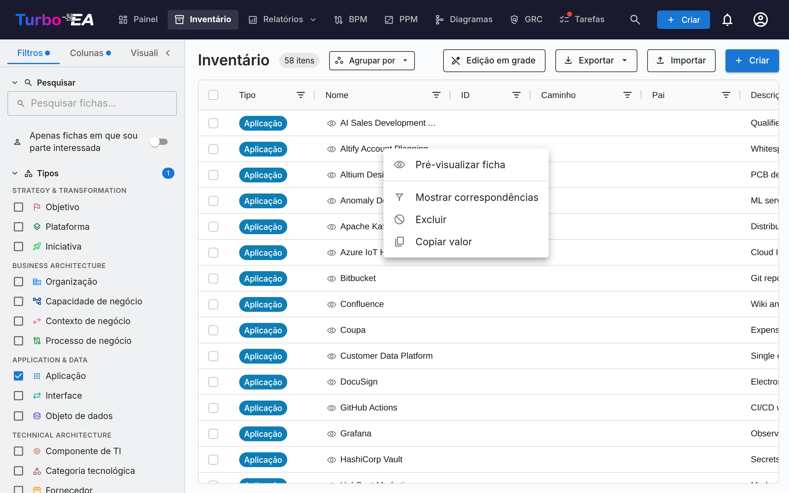

### Aba Colunas

A aba **Colunas** no painel lateral permite escolher quais colunas adicionais exibir na grade. As colunas disponíveis mudam dinamicamente com base nos tipos de cartões selecionados:

- **Um único tipo selecionado** — Todos os campos de atributos definidos para esse tipo estão disponíveis, além de colunas de relações e metadados
- **Vários tipos selecionados** — Apenas os campos que são **comuns a todos os tipos selecionados** estão disponíveis
- **Nenhum tipo selecionado** — Uma mensagem de orientação solicita que você selecione primeiro um tipo de cartão

As colunas são agrupadas em cinco categorias:

| Categoria | Descrição |
|-----------|-----------|
| **Colunas padrão** | Colunas sempre ativas: Tipo, Nome, Caminho, Descrição, Subtipo, Ciclo de vida, Estado de aprovação, Qualidade dos dados. Desmarque-as para ocultá-las da grade — útil para ajustar uma visualização salva apenas às colunas que você realmente usa. |
| **Metadados** | Criado, Modificado, Criado por, Modificado por, Criado via, Modificado via. **Modificado** é quando o conteúdo do card mudou pela última vez — por uma pessoa ou uma integração, nunca por um recálculo do sistema — assim você pode filtrar por essa data para encontrar cards que precisam de revisão pelo responsável. **Criado via** e **Modificado via** mostram o canal por trás da criação e da última alteração como um chip (MCP, API, Extensão, Sistema); a célula fica vazia para a interface web. |
| **Atributos** | Campos personalizados definidos no metamodelo (texto, número, custo, data, seleção, etc.) |
| **Relações** | Uma coluna por relação, com o nome do seu verbo e do tipo de cartão relacionado — por exemplo *utiliza Componente de TI* ou *é suportado por Aplicação*. Quando dois tipos de relação ligam os mesmos tipos de cartão, cada um tem a sua própria coluna, e um tipo de relação entre cartões do mesmo tipo (uma Aplicação que *envia dados para* outra) tem uma coluna para cada sentido. Pesquise a lista pelo verbo ou pelo tipo de cartão. |
| **Partes interessadas** | Uma coluna por cada papel de parte interessada definido para o tipo selecionado (por ex. *Partes interessadas: Responsible*), mostrando os utilizadores atribuídos como chips. No modo de edição da grade, faça duplo clique numa célula para atribuir ou remover utilizadores desse papel diretamente na grade (requer a permissão de gestão de partes interessadas). |

A coluna **Pai** mostra apenas o cartão diretamente acima, enquanto **Caminho** mostra toda a cadeia. No modo de edição da grelha, faça duplo clique numa célula Pai para mover o cartão, ou esvazie o campo para o levar ao nível superior. A coluna só é editável quando a grelha está filtrada por um único tipo de cartão com suporte a hierarquia. Se um movimento for recusado — por criar um ciclo, colidir com um cartão do mesmo nome sob o destino ou exceder a profundidade máxima —, o motivo aparece no fundo do ecrã e a célula é revertida.

A coluna **Caminho** mostra a hierarquia da ficha (por ex. «América do Norte / Vendas / Vendas internas») sem incluir o próprio nome da ficha, para que você possa exibir Nome e Caminho ao mesmo tempo.

A coluna **Logótipo** mostra o logótipo próprio da ficha, ou o ícone do seu tipo quando nenhum foi definido, permitindo percorrer um panorama pela marca do produto em vez do nome. Só é oferecida para os tipos de ficha que permitem logótipos (de origem, Aplicação e Componente de TI), está desativada por predefinição e torna as linhas mais altas enquanto está visível, para que as marcas continuem legíveis. Se puder editar a ficha, passe o rato sobre a célula do logótipo e clique para carregar, substituir, escolher um ícone de marca ou remover o logótipo sem sair da grelha — o mesmo menu da página da ficha. Os logótipos ficam deliberadamente de fora do preenchimento para baixo e da edição em massa: uma marca por ficha, definida de propósito.

A coluna **Alias** mostra o outro nome do card — o interno pelo qual a sua organização o trata. Está desativada por predefinição, pois a maioria dos panoramas não tem nenhum: ative-a no separador **Colunas**. Edita-se na própria célula em modo de edição da grelha e preenche-se para baixo como qualquer outra coluna de texto, e viaja com a exportação e importação Excel, pelo que uma lista de aliases pode ser carregada de uma só vez.

Cada categoria tem uma caixa de seleção **Selecionar tudo** para ativar ou desativar rapidamente todas as colunas desse grupo. Um campo de pesquisa no topo permite encontrar colunas específicas por nome. O indicador em cada cabeçalho de seção mostra quantas colunas desse grupo estão atualmente visíveis.

Quando um tipo de cartão é selecionado pela primeira vez, **todas as colunas de atributos e relações são ativadas por padrão**. Você pode então desmarcar as colunas que não precisa. Um botão **Redefinir** na parte inferior da aba «Colunas» restaura a seleção de colunas padrão.

Um **ponto indicador de alteração** aparece no cabeçalho da aba «Colunas» quando a seleção de colunas difere dos padrões. O mesmo indicador aparece na aba **Filtros** quando há filtros ativos, facilitando ver rapidamente quais configurações foram modificadas.

Sua seleção de colunas, o **layout das colunas** (ordem da esquerda para a direita, larguras e colunas fixadas), os filtros ativos e a ordem de classificação são **salvos automaticamente** no navegador. Ao retornar à página de inventário, sua configuração anterior é restaurada. As visualizações salvas (favoritos) também preservam esse layout completo, de modo que ao alternar entre visualizações são restauradas exatamente as colunas que você havia configurado, e na mesma disposição, o que importa ao compartilhar uma visualização organizada com as partes interessadas.

### Tabela Principal

O inventário usa uma tabela de dados **AG Grid** com recursos poderosos:

| Coluna | Descrição |
|--------|-----------|
| **Tipo** | Tipo do card com ícone colorido |
| **Nome** | Nome do componente (clique para abrir o detalhe do card) |
| **Logótipo** | O logótipo próprio da ficha, ou o ícone do seu tipo quando não tem nenhum. Desativada por predefinição — ative-a no separador Colunas; clique numa célula para o alterar |
| **Alias** | O outro nome do card. Desativada por predefinição — ative-a no separador Colunas; é considerada por todas as caixas de pesquisa |
| **Descrição** | Breve descrição — um endereço web nela é um link clicável |
| **Ciclo de Vida** | Estado atual do ciclo de vida |
| **Status de Aprovação** | Badge de status de revisão |
| **Qualidade dos Dados** | Porcentagem de completude com anel visual |
| **Relacionamentos** | Uma coluna por relação, encabeçada pelo seu verbo e pelo tipo de cartão relacionado (por ex. *utiliza Componente de TI*): os nomes dos cartões ligados através dessa relação, em ordem alfabética, com um popover clicável para adicionar ou remover relacionamentos desse tipo — os cartões já ligados ficam ocultos do seu seletor, exceto num tipo hierárquico, onde o seletor mostra toda a hierarquia como uma árvore indentada e deixa esses cartões a cinzento no lugar. As vistas guardadas e os layouts de colunas anteriores à divisão das colunas de relação por relação abrem com as novas colunas no lugar da antiga |

**Recursos da tabela:**

- **Ordenação** — Clique em qualquer cabeçalho de coluna para ordenar em ascendente/descendente
- **Edição inline** — No modo de edição da grade, edite valores de campos diretamente na tabela
- **Preencher uma coluna** — No modo de edição da grade, clique numa célula e arraste o pequeno quadrado do seu canto para cima ou para baixo para copiar esse valor para todas as linhas percorridas. Antes de guardar seja o que for, uma confirmação indica a coluna, o valor e quantas linhas; se o servidor recusar uma linha, esta é listada com o motivo e uma ligação, e as linhas bem-sucedidas continuam guardadas. O gesto funciona com o dedo tal como com o rato, e também com o teclado: coloque o foco no quadrado, estenda com as setas e confirme com Enter. Só são preenchidas as linhas visíveis após os seus filtros e ordenação, e a coluna Nome fica propositadamente excluída para que dois cards não partilhem o mesmo nome.
- **Seleção múltipla** — Selecione múltiplas linhas para operações em massa
- **Exibição de hierarquia** — Relacionamentos pai/filho mostrados como caminhos em breadcrumb
- **Configuração de colunas** — Mostrar, ocultar e reordenar colunas
- **Fixar uma coluna** — Passe o rato sobre o cabeçalho de uma coluna e clique no ícone de pino para fixar essa coluna na margem esquerda, para que continue visível enquanto desloca a tabela lateralmente. Clique novamente no pino para a libertar. Cada coluna tem também esse pino no separador **Colunas** do painel de filtros, pelo que pode fixar uma coluna sem procurar o respetivo cabeçalho. As colunas fixadas são memorizadas por tabela e o mesmo controlo está disponível em todas as tabelas de dados do Turbo EA (Registo de riscos, Decisões, Constatações de conformidade, Utilizadores, Recursos, Registo de auditoria).
- **Reordenar colunas** — Arraste o cabeçalho de uma coluna para a mover, ou abra a secção **Ordem das colunas** no topo do separador **Colunas** e arraste uma linha pela respetiva pega. Essa lista *é* a ordem da tabela, pelo que as duas coincidem sempre, e as colunas fixadas são agrupadas à cabeça porque são sempre apresentadas no início — liberte aí o pino de uma coluna se quiser retirá-la desse grupo. A pega funciona também com o teclado (Espaço para agarrar uma coluna, setas para a mover, Espaço para a largar) e por toque, pelo que a ordem pode ser alterada num telemóvel. A sua ordem de colunas é memorizada por tabela, em todas as tabelas de dados do Turbo EA.

### Barra de Ferramentas

- **Edição na Grade** — Alternar modo de edição inline para editar múltiplos cards na tabela
- **Exportar** — Baixar dados como arquivo Excel (.xlsx)
- **Importar** — Upload em massa de dados a partir de arquivos Excel
- **+ Criar** — Criar um novo card

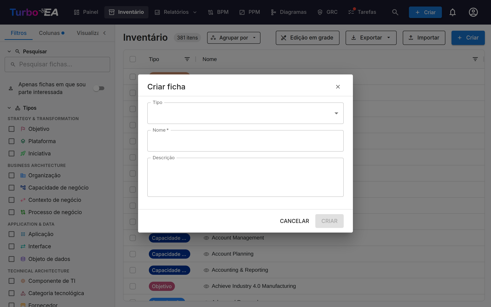

## Como Criar um Novo Card

1. Clique no botão **+ Criar** (azul, canto superior direito)
2. No diálogo que aparece:
   - Selecione o **Tipo** de card (Aplicação, Processo, Objetivo, etc.)
   - Insira o **Nome** do componente
   - Opcionalmente, adicione uma **Descrição**
3. Opcionalmente, clique em **Sugerir com IA** para gerar uma descrição automaticamente (veja [Sugestões de Descrição com IA](#sugestoes-de-descricao-com-ia) abaixo)
4. Clique em **CRIAR**

## Edição em massa { #mass-edit }

Marque duas ou mais linhas com as caixas de seleção da coluna à esquerda e clique em **Edição em massa** na barra de seleção. A caixa de diálogo aplica uma única alteração a todos os cartões selecionados.

A lista **Campo** agrupa o que pode ser alterado:

- **Geral** — estado de aprovação, subtipo, etiquetas e pai
- **Atributos** — qualquer campo editável definido para o tipo de cartão selecionado
- **Relações** — uma entrada por tipo de relação e direção (por exemplo *é executado em → Componente de TI*)

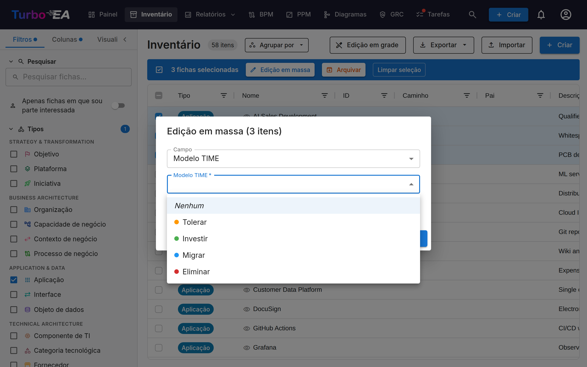

Etiquetas, relações e pai oferecem um botão **adicionar / remover**, para que amplie ou reduza os valores existentes em vez de os substituir.

Quando escolhe **Adicionar vínculo** para um tipo de relação com detalhes — o sentido do fluxo entre duas aplicações, a forma como uma organização usa uma aplicação, os indicadores de criar / ler / atualizar / eliminar de um objeto de dados —, o diálogo mostra também esses campos. O que definir é guardado em cada vínculo adicionado. Os cartões já vinculados a um destino escolhido também recebem os detalhes, pelo que voltar a usar **Adicionar vínculo** é a forma de atualizar os detalhes dos vínculos existentes; um detalhe deixado em branco não é alterado.

O controlo de valor adapta-se ao tipo de campo: um campo de seleção múltipla mostra as suas opções com caixas de verificação, um campo sim/não uma lista Sim / Não e um campo de data um seletor de data. Deixar o valor vazio — **Nenhum** num campo sim/não — limpa o campo em todos os cartões selecionados. Os campos calculados por uma fórmula, e os campos de custo que não tem permissão para ver, não são disponibilizados.

### Reestruturar a hierarquia { #mass-edit-parent }

O campo **Pai** aparece quando a grelha está filtrada por um único tipo de cartão com suporte a hierarquia. Um cartão tem exatamente um pai, por isso este único campo cobre os dois sentidos de uma reestruturação:

- **Definir pai** — escolha um cartão do mesmo tipo; todos os cartões selecionados passam para baixo dele. É assim que se tornam vários cartões filhos de um mesmo pai.
- **Remover pai** — todos os cartões selecionados voltam ao nível superior.

Os cartões são movidos um a um, pelo que um movimento não permitido bloqueia apenas esse cartão. A caixa de diálogo permanece aberta e indica quais os cartões bloqueados e porquê. Os motivos habituais são:

- Já existe um cartão com o mesmo nome sob o pai de destino.
- O pai escolhido é descendente de um dos cartões que estão a ser movidos, o que criaria um ciclo.
- O movimento levaria uma capacidade de negócio para além do máximo de cinco níveis.

Um cartão leva consigo os seus próprios filhos ao mover-se, e os cartões aprovados voltam a **Quebrado** para que a alteração seja revista.

## Agrupar o inventário { #group-by }

Clique em **Agrupar por** na barra de ferramentas (ao lado da contagem de itens) para organizar a grelha em grupos expansíveis. A fase do ciclo de vida e o estado de aprovação estão sempre disponíveis; ao filtrar a grelha para um único tipo de cartão, acrescentam-se o seu subtipo e todos os atributos de seleção única.

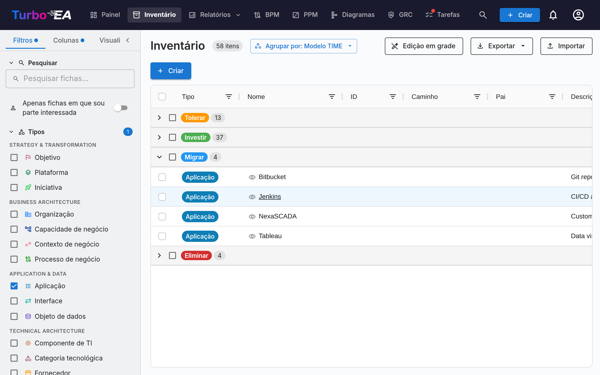

- Os cartões sem valor no campo escolhido caem num grupo **Não definido**, no topo: o ponto de partida natural para classificar cartões pendentes.
- Clique no cabeçalho de um grupo para o recolher ou expandir. O cabeçalho mostra o número de cartões do grupo.
- Ao percorrer um grupo longo, o seu cabeçalho permanece fixo logo abaixo dos cabeçalhos de coluna, para que saiba sempre que grupo está a ler; o cabeçalho do grupo seguinte empurra-o ao chegar. É o cabeçalho completo, incluindo a caixa de seleção, pelo que pode selecionar um grupo longo sem voltar ao seu início.
- A caixa de seleção do cabeçalho seleciona todos os cartões do grupo: para reclassificar um lote, expanda **Não definido**, marque o cabeçalho e defina o valor com a [Edição em massa](#mass-edit). Deliberadamente não há arrastar e largar: selecionar e definir funciona da mesma forma em computador, tablet e telemóvel.
- A ordenação aplica-se dentro de cada grupo; o agrupamento é mantido após recarregar, guardado nas vistas guardadas e partilhável através do parâmetro de URL `group_by`.

### Recuar os filhos sob os pais { #group-by-parents }

Marque **Pai** no topo do menu **Agrupar por** para mostrar as fichas como uma árvore: primeiro cada pai e, por baixo, os seus filhos recuados. Funciona sozinha (toda a grelha passa a ser uma única árvore) ou sobre qualquer agrupamento (cada grupo passa a ser a sua própria árvore). O menu permanece aberto ao marcá-la, para poder escolher um agrupamento logo a seguir.

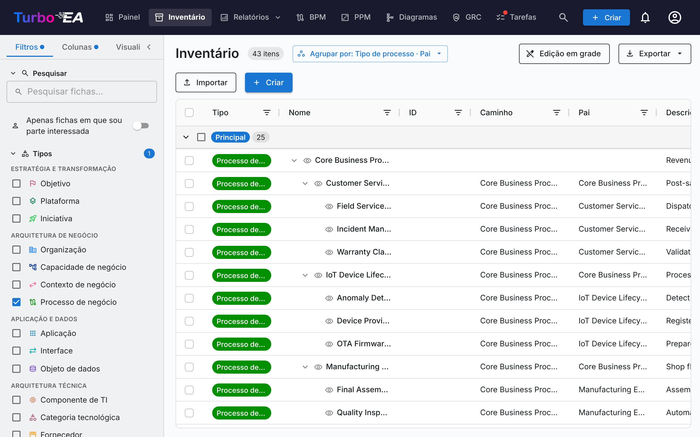

- Uma ficha nunca sai do seu próprio grupo. Um filho cujo pai está noutro grupo, oculto por um filtro de coluna ou não carregado inicia o seu próprio ramo, com os ascendentes em falta apresentados a cinzento antes do seu nome (por exemplo, *SAP S/4HANA / SAP FI /* antes do nome do módulo). As contagens dos grupos, a caixa de seleção do cabeçalho e a edição em massa correspondem, por isso, sempre ao conteúdo do grupo.
- Clique no chevron antes do nome de um pai para ocultar ou mostrar o seu ramo. Um pai recolhido continua a contar as fichas ocultas no número de itens e no cabeçalho do grupo. Os ramos que recolhe com o chevron não são memorizados, e alterar um filtro de coluna volta a abri-los todos; limpar o último filtro de coluna regressa ao nível que escolheu com o seletor.
- Enquanto a camada de pais está ativa, um par **−** / **+** junto ao botão Agrupar por fecha ou abre toda a árvore um nível de cada vez. O nível escolhido é memorizado entre recarregamentos, guardado nas vistas guardadas e partilhável com `group_tree_level=<n>`; o nível apresentado também acompanha o que abre e fecha manualmente.
- A ordenação aplica-se entre irmãos: os pais são ordenados e, por baixo de cada um, os respetivos filhos.
- A opção só é oferecida quando um tipo de ficha em vista tem hierarquia. É memorizada entre recarregamentos, guardada nas vistas guardadas e pode ser partilhada com o parâmetro de URL `group_tree=1`.
- A **exportação** segue a ordem da árvore e omite as fichas dos ramos recolhidos, tal como faz com os grupos recolhidos.

## Sugestões de Descrição com IA { #ai-description-suggestions }

O Turbo EA pode usar **IA para gerar uma descrição** para qualquer card. Isso funciona tanto no diálogo de Criação de Card quanto nas páginas de detalhe de cards existentes.

**Como funciona:**

1. Insira um nome de card e selecione um tipo
2. Clique no **ícone de brilho** no cabeçalho do card, ou no botão **Sugerir com IA** no diálogo de Criação de Card
3. O sistema realiza uma **busca na web** pelo nome do item (usando contexto por tipo — ex.: "SAP S/4HANA software application"), então envia os resultados para um **LLM** para gerar uma descrição concisa e factual
4. Um painel de sugestão aparece com:
   - **Descrição editável** — revise e modifique o texto antes de aplicar
   - **Pontuação de confiança** — indica o quão certa a IA está (Alta / Média / Baixa)
   - **Links de fontes clicáveis** — as páginas web das quais a descrição foi derivada
   - **Nome do modelo** — qual LLM gerou a sugestão
5. Clique em **Aplicar descrição** para salvar, ou **Descartar** para ignorar

**Características principais:**

- **Contextual por tipo**: A IA entende o contexto do tipo de card. Uma busca de "Aplicação" adiciona "software application", uma busca de "Fornecedor" adiciona "technology vendor", etc.
- **Privacidade em primeiro lugar**: Ao usar Ollama, o LLM roda localmente — seus dados nunca saem da sua infraestrutura. Provedores comerciais (OpenAI, Google Gemini, Anthropic Claude, etc.) também são suportados
- **Controlado pelo administrador**: Sugestões de IA devem ser habilitadas por um administrador em [Configurações > Sugestões de IA](../admin/ai.md). Administradores escolhem quais tipos de card mostram o botão de sugestão, configuram o provedor de LLM e selecionam o provedor de busca web
- **Baseado em permissões**: Apenas usuários com a permissão `ai.suggest` podem usar este recurso (habilitado por padrão para os papéis Admin, BPM Admin e Membro)

## Visualizações Salvas (Favoritos)

Você pode salvar sua configuração atual de filtros, colunas e ordenação como uma **visualização nomeada** para reutilização rápida.

### Criando uma Visualização Salva

1. Configure o inventário com os filtros, colunas e ordenação desejados
2. Clique no ícone de **favorito** no painel de filtros
3. Insira um **nome** para a visualização
4. Escolha a **visibilidade**:
   - **Privada** — Apenas você pode ver
   - **Compartilhada** — Visível para usuários específicos (com permissões de edição opcionais)
   - **Pública** — Visível para todos os usuários

### Usando Visualizações Salvas

Visualizações salvas aparecem na barra lateral do painel de filtros. Clique em qualquer visualização para aplicar instantaneamente sua configuração. As visualizações são organizadas em:

- **Minhas Visualizações** — Visualizações que você criou
- **Compartilhadas Comigo** — Visualizações que outros compartilharam com você
- **Visualizações Públicas** — Visualizações disponíveis para todos

### Visualizações de consulta { #query-views }

Uma **visualização de consulta** é uma visualização salva cujos filtros são uma **consulta de vários saltos** — uma cadeia de relações com condições em cada etapa, como *Organizações que usam uma Aplicação ativa afetada por uma Iniciativa com status On Track*. Várias consultas deste tipo podem ser empilhadas numa visualização e combinadas com **E** e **OU** (veja abaixo). A visualização guarda a consulta, não os seus resultados: ela é executada novamente sempre que a visualização é aberta, de modo que a lista reflete sempre o panorama atual.

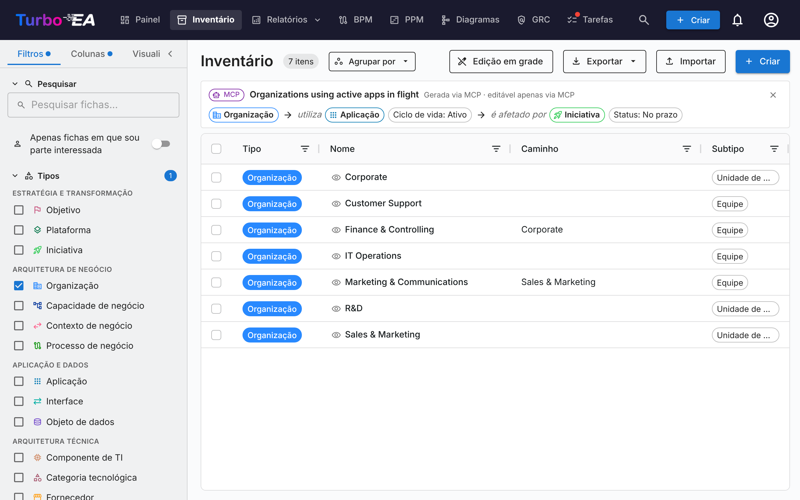

**Criar uma visualização de consulta.** Na aba **Visualizações** da barra lateral de filtros, clique em **Nova visualização de consulta** ao lado de *Salvar atual* (exibido para quem pode gerir visualizações). Se algum filtro estiver ativo, incluindo o tipo de card selecionado, uma confirmação pergunta antes de limpá-los; **Cancelar** no rascunho os restaura. A faixa acima da grade abre-se como um construtor de consultas:

1. Clique no chip inicial (*Escolher um tipo*) e escolha o tipo de card de que a consulta parte, ou seja, o que ela lista.
2. Clique em **+ relação** após o último card para adicionar um salto. O menu lista cada verbo de relação com o tipo de card para o qual leva; uma relação entre cards do mesmo tipo é oferecida nos dois sentidos. Cada linha de consulta é uma única cadeia de até três saltos.
3. Clique em **+ condição** sob qualquer card para restringi-lo: **Ciclo de vida**, **Subtipos**, **Status de aprovação**, **Qualidade dos dados** (*Completo*, *Parcial* ou *Mínimo*, as mesmas faixas do filtro da barra lateral), **Fim de vida** (ver abaixo), **Etiquetas**, **Cards específicos**, ou um campo de seleção ou sim/não desse tipo de card. Para etiquetas, um card corresponde se tiver qualquer uma das etiquetas escolhidas de um grupo, e deve corresponder a cada grupo adicionado; só são oferecidos os grupos de etiquetas que se aplicam a esse tipo de card. **Cards específicos** abre o seletor de cards desse tipo, e a etapa passa então a corresponder apenas aos cards escolhidos; para um tipo de card hierárquico, uma chave **Incluir subcards** faz corresponder também os cards abaixo de cada escolha. Um card escolhido que você não pode ver aparece como *(card oculto)*.
4. Clique em **Salvar**. Abre-se a caixa de diálogo habitual de salvar visualização para o nome, a visibilidade, o compartilhamento e a configuração OData. **Cancelar** descarta a consulta.

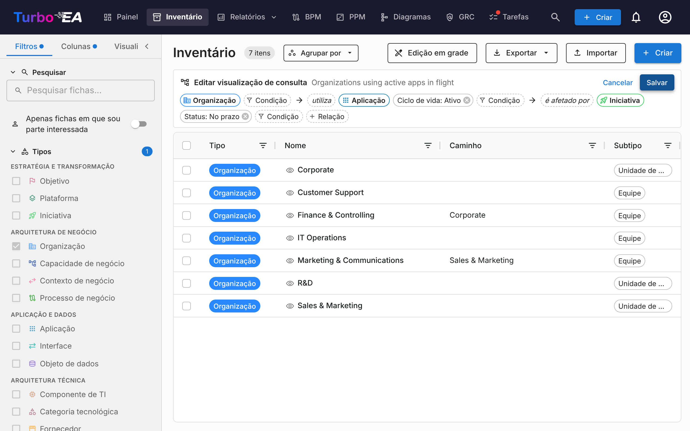

Enquanto você constrói, a grade filtra em tempo real e o contador da barra de ferramentas mostra quantos cards correspondem, de modo que você vê o efeito de cada salto e condição antes de salvar.

**Filtrar por fim de vida.** A condição **Fim de vida** é oferecida num tipo de card que acompanha o fim de vida — por predefinição Aplicação e Componente de TI; segue a secção Fim de vida do tipo no metamodelo. Os seus valores são **Fim de vida**, **Aproximando-se do EOL**, **Suportado**, **Desconhecido** e *(vazio)* para os cards sem dados de fim de vida. O estado é o que a coluna **Fim de vida** do inventário mostra: vem do produto endoflife.date associado ou de um produto EOL personalizado, ou de uma data de fim de vida introduzida manualmente, e é independente da fase do ciclo de vida do card. A condição funciona no card de partida e em qualquer passo de relação, tanto em linhas E como em linhas OU — por exemplo, *Aplicações que utilizam um Componente de TI em fim de vida*. Enquanto uma consulta filtra por ela no card de partida, a grelha mostra a coluna Fim de vida para que veja porque é que cada card corresponde; as colunas que escolheu não mudam. Se o endoflife.date não puder ser contactado e não houver nada em cache, os cards associados são lidos como *Desconhecido*, tal como na coluna Fim de vida.

A condição exige a permissão para ver os dados de fim de vida (**Ver dados de EOL**, `eol.view`). Sem ela, a condição não é oferecida, e abrir, pré-visualizar ou guardar uma visualização que a use é recusado com *Esta visualização filtra pelo estado de fim de vida, que a sua função não pode ver.*

**Alterar saltos e condições.** Clique no chip de verbo de um salto para abrir o seu menu: **não tem** transforma o salto no requisito de que o card **não** tenha nenhuma relação assim, e **Remover este salto** remove-o junto com todos os saltos seguintes. Clique num chip de condição para alterar os seus valores, ou no seu **×** para removê-lo.

**Combinar consultas com E e OU.** Uma visualização pode conter várias linhas de consulta empilhadas. Cada linha é uma consulta completa — card inicial, relações e condições — construída exatamente como a consulta única acima. As linhas são agrupadas:

- **E** adiciona uma linha ao mesmo grupo: um card só é listado quando corresponde a **todas** as linhas do grupo. Uma linha E parte do mesmo tipo de card que o seu grupo, mostrado como um chip fixo, e a primeira linha do grupo não pode mudar o seu tipo de card enquanto tiver linhas E.
- **OU** inicia um novo grupo abaixo de um divisor **OU**: os seus resultados são **adicionados** à lista. Um novo grupo pode partir de outro tipo de card, pelo que uma visualização pode listar, por exemplo, Aplicações e Organizações em conjunto. Quando uma visualização lista vários tipos de card, a grade mostra as colunas que esses tipos têm em comum.

No modo de edição, um **mais** dentro de um círculo abaixo de cada grupo pergunta **E** ou **OU**: E adiciona uma linha a esse grupo, OU abre um novo grupo depois dele. O **×** no fim de uma linha remove-a; é mostrado quando a visualização tem mais de uma linha.

Por exemplo, a visualização de demonstração *Active apps on aging tech, and the organizations using apps* tem um grupo de Aplicação com duas linhas — uma Aplicação ativa que usa um Componente de TI em descontinuação ou em fim de vida, **E** uma Aplicação afetada por uma Iniciativa — **OU** uma Organização que usa uma Aplicação. A lista mostra as Aplicações que cumprem ambas as linhas, juntamente com cada Organização que usa uma Aplicação.

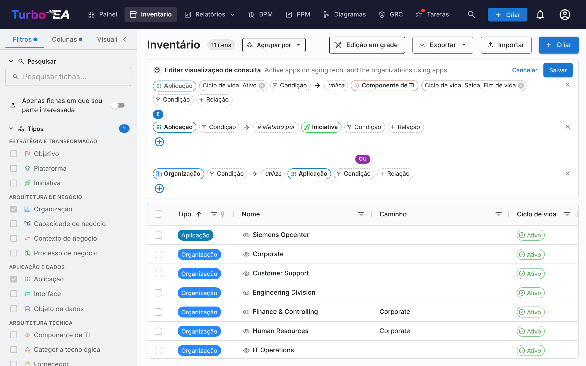

Uma visualização contém no máximo **seis** linhas de consulta, **doze** relações em todas as suas linhas e **três** relações em profundidade em cada linha. As linhas de um grupo E encontram-se apenas no card inicial: o Componente de TI de uma linha e a Iniciativa da outra podem ser cards diferentes. Dois requisitos sobre o **mesmo** card a meio de uma linha — por exemplo, que o mesmo Componente de TI seja oferecido por um Fornecedor **e** pertença a uma Categoria tecnológica — não podem ser construídos no construtor de consultas; um assistente de IA pode escrever uma consulta assim através do [servidor MCP](../admin/mcp.md#multi-hop-card-queries), e a faixa passa então a mostrá-la.

**Editar uma visualização de consulta salva.** Quando uma visualização de consulta está aberta, a faixa mostra o seu caminho: os tipos de card como chips, unidos pelo verbo de relação que liga cada etapa (por exemplo *Organização → usa Aplicação → é afetada por Iniciativa*), com as condições de cada card abaixo. Uma visualização com várias linhas mostra a mesma pilha, com os seus marcadores E e divisores OU, sem os controles de edição. Se você é o proprietário da visualização ou tem direitos de edição sobre ela, um **lápis** na faixa a muda para o mesmo construtor; **Salvar** atualiza a visualização. O botão **×** (*Sair desta visualização*) volta ao inventário normal. **Salvar visualização atual** enquanto uma visualização de consulta está aberta salva uma nova visualização de consulta com a mesma consulta.

#### Ver os cards por trás de uma correspondência { #query-view-matches }

Uma visualização de consulta lista apenas o primeiro card da sua consulta. Para ver que cards mais adiante na cadeia fizeram uma linha corresponder, clique no tipo de card deles no caminho da consulta. Em *Organizações que usam uma Aplicação que usa um Componente de TI em fim de vida ou perto dele*, clique em **Aplicação** e uma coluna lista, para cada Organização, as Aplicações através das quais ela corresponde; clique em **Componente de TI** e outra coluna lista os Componentes de TI que cumprem a condição. Clique novamente no tipo de card para remover a sua coluna.

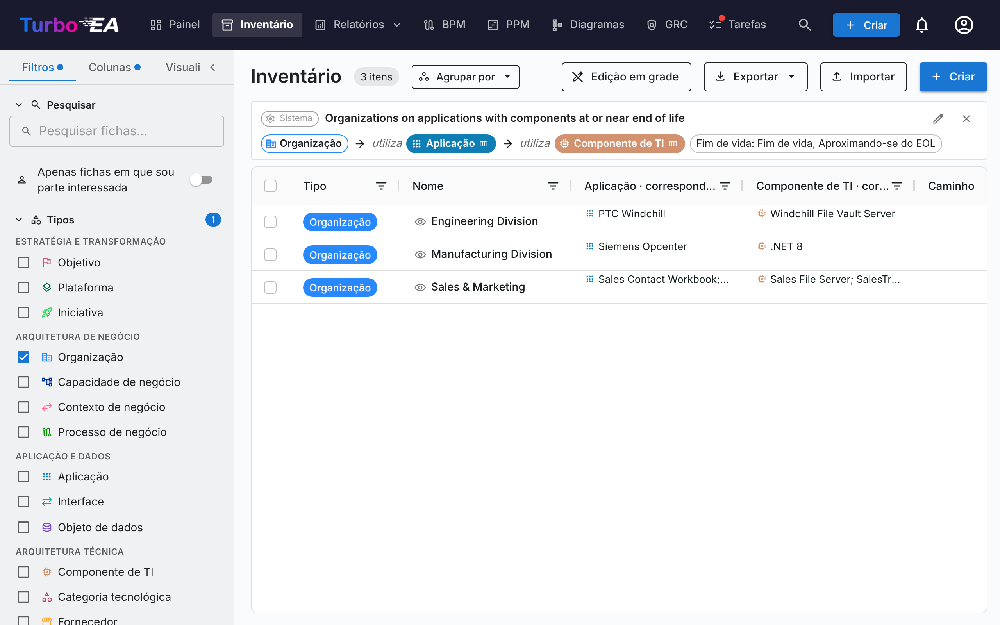

- **Como é um interruptor.** Um tipo de card clicável mostra um ponteiro e a dica *Mostrá-los numa coluna*. Quando a sua coluna está ativa, o chip fica preenchido com a cor do tipo de card e tem um pequeno ícone de coluna; a sua dica diz *Ocultar a coluna*.
- **Que tipos de card são interruptores.** Todos os tipos de card depois do primeiro da sua linha de consulta. O primeiro tipo de card de uma linha de consulta não é, porque os seus cards são as linhas da tabela, nem um tipo de card a seguir a **não tem**, que representa uma relação em falta. Numa visualização com várias linhas de consulta, os tipos de card de cada linha são interruptores; com **OU**, uma linha da tabela mostra cards apenas para as linhas de consulta que cumpre. Os interruptores não estão disponíveis enquanto edita a consulta, e as colunas ficam ocultas até salvar ou cancelar.
- **Onde aparece a coluna.** Logo a seguir a **Nome**, intitulada com o tipo de card e *correspondentes* — por exemplo *Aplicação · correspondentes* — para não ser confundida com uma coluna de relação como *utiliza Aplicação*, que lista todas as Aplicações relacionadas dessa forma. Quando dois passos têm o mesmo tipo de card, os títulos são numerados. Passe o rato sobre o título para ver o caminho que a coluna segue.
- **O que mostra uma célula.** Os nomes dos cards correspondentes, separados por ponto e vírgula; passe o rato sobre a célula para ver a lista completa. Uma célula lista no máximo **100** nomes; uma lista mais longa termina em *…* e a sua dica indica que são mostrados os primeiros 100. Pode ordenar e filtrar a coluna como uma coluna de texto, e **Exportar vista atual** inclui-a.
- **Todos os cards ao longo da cadeia, não quem leva a quem.** Uma linha lista todos os cards correspondentes nesse passo: todas as Aplicações da Organização que cumprem a condição e todos os Componentes de TI dessas Aplicações que a cumprem. Não mostra que Componente de TI pertence a que Aplicação. Para listar os próprios Componentes de TI, um por linha, escreva antes a consulta a partir de Componente de TI.
- **Salvas com a visualização.** As colunas que ativar são salvas com a visualização (o **lápis** na lista de visualizações e depois **Atualizar**), pelo que voltam quando a abrir de novo. Editar a consulta mantém uma coluna enquanto o seu passo ainda existir, e remove-a quando remove esse passo ou muda o seu tipo de card.

Só vê os cards que tem permissão para ver: um card oculto para si nunca é nomeado numa célula, e uma linha que corresponde apenas através de cards ocultos não é listada.

A visualização de demonstração *Organizations on applications with components at or near end of life* abre com ambas as colunas ativas.

**Visualizações criadas por um assistente de IA.** Um assistente conectado pelo [servidor MCP](../admin/mcp.md) também pode criar visualizações de consulta. Uma visualização assim mostra um chip **MCP** e a nota *Criada via MCP* na sua faixa, e um selo de robô na lista de visualizações; é editada como qualquer outra visualização de consulta. Na lista de visualizações, cada visualização de consulta traz um pequeno selo de visualização de consulta (um cubo; o selo de robô quando foi criada por um assistente) e o seu caminho compacto (*Organização › usa Aplicação › é afetada por Iniciativa*) como segunda linha; uma visualização empilhada lê-se *… E … OU …*. Quando a visualização tem condições, o seu número segue o caminho (*… › é afetada por Iniciativa · 2 condições*).

**Abrir uma visualização por link.** Quando um assistente salva uma visualização, devolve um link no formato `/inventory?view=<view id>`; abri-lo aplica diretamente a visualização salva. O mesmo link funciona para qualquer visualização salva que você possa ver.

**OData.** O feed OData de uma visualização de consulta devolve os mesmos cards que o inventário: a consulta também é aplicada ao feed.

Para a gramática de consultas, os seus limites e as ferramentas MCP (`query_cards`, `list_inventory_views`, `save_inventory_view`, `list_tag_groups`), consulte [Consultas de cards de vários saltos](../admin/mcp.md#multi-hop-card-queries).

## Importação / Exportação Excel { #excel-import }

As importações e exportações do inventário usam uma **pasta de trabalho Excel com várias planilhas** que reconstrói uma sub-paisagem inteira — cards de qualquer número de tipos e as relações entre eles — sem nunca exigir a cópia de um UUID.

### Estrutura da pasta de trabalho

- **Uma planilha por tipo de card** (Application, Business Capability, IT Component, …) com as colunas principais, as colunas `attr_<campo>`, as colunas de ciclo de vida as colunas de relação `rel:<tipo_de_relação>` e as colunas de partes interessadas `stakeholder:<chave_do_papel>`.
- **Uma planilha `Relations`** com os **valores** que as relações carregam — uma linha por relação cujo tipo tem valores a preencher.

A divisão é simples e sem exceções: **a planilha de cards diz quais cards estão ligados; a planilha `Relations` diz o que essas ligações contêm.** Cada tipo de relação tem uma coluna `rel:` na planilha do tipo de onde parte, carregue valores ou não.
- **Uma planilha `_Meta`** com a versão do formato da pasta de trabalho.

### Identificação sem GUIDs

Os cards são identificados pelo **nome** quando este é único dentro do tipo, e caso contrário pelo **`parent_path`** completo. Uma célula de relação pode conter `NexaCore ERP` diretamente se apenas uma Application tiver esse nome; em caso de ambiguidade, use `Sales / Customer Mgmt / CRM`.

#### Unicidade entre irmãos

Como os cards são identificados por nome + caminho, **dois cards do mesmo tipo não podem partilhar simultaneamente o mesmo pai e o mesmo nome**. Novos cards que provocariam uma colisão são rejeitados na criação (na caixa Criar card, no renomear em linha e durante a importação de Excel). Duplicados já presentes na base de dados — herdados de seeds ou imports anteriores — permanecem intactos: pode editar qualquer campo, mas criar um terceiro duplicado ou renomear um card de volta à colisão é bloqueado. A verificação é insensível a maiúsculas/minúsculas e espaços, igual ao resolvedor do importador. Quando a caixa Criar card rejeita um duplicado, o aviso indica o card existente e inclui uma ligação **Ver a ficha existente** que o leva diretamente até ele.

### Células de relação em linha

Cada coluna `rel:<tipo_de_relação>` expressa as relações de saída como uma lista **separada por ponto e vírgula** (por exemplo `NexaCore ERP; BillingApp`). Ponto e vírgula em vez de vírgula, porque os nomes de cards frequentemente contêm vírgulas (`Acme, Inc.`). Dentro de um nome, `/` e `\` são escapados como `\/` e `\\`, e um `;` como `\;` — o exportador faz isso automaticamente (ex.: `SAP S/4HANA` → `SAP S\/4HANA`). Uma referência escapada é sempre exata. Numa célula escrita à mão, a `/` pode ficar sem escape: `SAP S/4HANA` é lido primeiro como um caminho (um card *4HANA* sob *SAP S*) e, se não houver nenhum card nesse caminho, como um único nome, que é resolvido quando exatamente um card do tipo o tem. As células são **declarativas**: o seu conteúdo substitui o conjunto de relações de saída desse tipo a partir da origem. Remover um destino elimina a relação correspondente; esvaziar a célula elimina todas. Numa pasta de trabalho exportada pelo Turbo EA (contém uma planilha `_Meta`), a vírgula nunca é um separador, pelo que uma célula com um único destino como `This is X, it does Y` continua a ser um destino. Uma planilha sem `_Meta` (criada à mão ou exportada antes da 1.23) ainda pode separar os destinos por vírgulas: se a célula não contiver nenhum `;`, é lida como um único destino quando a célula inteira nomeia um card e, caso contrário, como separada por vírgulas. Há uma coluna por tipo de relação que parte do tipo de card da planilha — **todos**, incluindo os que carregam valores. Os destinos são ordenados alfabeticamente, pelo que reexportar um panorama inalterado dá um ficheiro idêntico.

A coluna `tags` segue a mesma regra: entradas `Grupo: Etiqueta` separadas por `; ` (ex.: `Vendor: Acme, Inc.; Region: EU`), com um `;` no nome de uma etiqueta escrito como `\;`. As pastas de trabalho exportadas antes da 2.156.1 separavam as etiquetas por vírgulas e continuam a ser importadas como antes.

### Células de partes interessadas

Em cada planilha de fichas, as colunas `stakeholder:<chave_do_papel>` carregam os utilizadores atribuídos a cada papel de parte interessada, como **endereços de email separados por ponto e vírgula** (a mesma convenção das colunas `subscriptions:<RoleType>` do LeanIX), por ex. `ada@corp.com; bob@corp.com`. O **endereço de email é a única referência de utilizador aceite** — os nomes podem colidir e nunca são usados na resolução; uma entrada `Nome <email>` é tolerada (usa-se o email entre parênteses angulares), um nome sozinho produz um aviso e é ignorado. Como as células de relação, as células de partes interessadas são **declarativas por papel**: os utilizadores listados tornam-se o conjunto completo de atribuições desse papel após a importação. Remover um utilizador retira a atribuição; esvaziar a célula limpa o papel; omitir a coluna deixa as atribuições intactas. Entradas sem utilizador correspondente produzem um aviso e são ignoradas — nunca bloqueiam a importação.

!!! note "Folhas exportadas antes de as chaves passarem a camelCase"
    As chaves dos papéis de partes interessadas seguem a mesma convenção camelCase de qualquer outra chave do metamodelo. Uma folha exportada antes dessa mudança contém cabeçalhos como `stakeholder:technical_application_owner`; continuam a ser importados — o cabeçalho é associado ao papel em camelCase quando nenhum papel corresponde literalmente. As folhas novas usam a forma camelCase.

**Células de data do ciclo de vida** — as colunas `lifecycle_<phase>` (`lifecycle_plan`, `lifecycle_phaseIn`, `lifecycle_active`, `lifecycle_phaseOut`, `lifecycle_endOfLife`) seguem a mesma regra, uma data por coluna: **esvaziar uma célula remove essa data** do cartão, e omitir a coluna por completo deixa essa data inalterada. As células de valor simples funcionam ao contrário: uma célula vazia de descrição, subtipo, alias, ID externo, rótulo do pai ou atributo (`attr_<field>`) deixa o valor armazenado inalterado; limpe-os no cartão ou na grelha do Inventário.

### Planilha `Relations`

Uma relação pode ter valores próprios — um *tipo de utilização* numa ligação `Organization` → `Application`, um custo anual, ou uma descrição livre. Uma célula `rel:` é uma lista de nomes sem lugar para eles, por isso esses valores vivem na planilha `Relations`, uma linha por relação, com as colunas `relation_type`, `source_type`, `source_ref`, `target_type`, `target_ref`, `attr_<campo>` e `description`.

A planilha contém as relações cujo tipo tem realmente valores — as restantes nada têm a preencher e vivem inteiramente nas planilhas de cards. As relações que apontam *para* um card exportado também aparecem; `source_ref` e `target_ref` indicam o sentido. As colunas `attr_<campo>` são as dos tipos de relação desta pasta de trabalho. A ordenação é por card de origem, depois tipo de relação, depois destino.

**Esta planilha só define valores. Nunca cria nem remove uma relação** — isso é da planilha de cards: **apagar uma linha não apaga nada**; editar os seus valores substitui o que a relação contém; e uma linha que nomeia dois cards não ligados é comunicada na pré-visualização e ignorada — ligue-os na coluna `rel:`, mesmo no mesmo import.

As pastas de trabalho mais antigas têm uma coluna `action`. É ignorada; uma linha com `action = delete` é comunicada e ignorada. Se a planilha de cards e a planilha `Relations` se contradisserem, **a remoção prevalece**.

A planilha lista **todas as relações dos cards exportados**, tenha ou não o seu tipo valores neste momento — por isso um tipo de relação a que acabou de dar um valor já tem ali a sua linha. As relações que apontam *para* um card exportado também aparecem; `source_ref` e `target_ref` indicam o sentido. As colunas `attr_<campo>` são as dos tipos de relação presentes nesta pasta de trabalho, não as de todos os definidos na instância.

Um tipo de relação que tem valores **não tem coluna `rel:`** — uma lista de nomes não os pode acolher; edita-se nesta planilha. Se a planilha de cards e a planilha `Relations` se contradisserem, **a remoção prevalece**, e a pré-visualização assinala-o.

### Importar

Clique em **Importar** na barra de ferramentas, solte a pasta de trabalho e verifique a pré-visualização antes de aplicar. Verá tanto os cards a criar / atualizar como as relações a adicionar / remover. Os erros (por exemplo, um destino ambíguo com os seus caminhos candidatos) bloqueiam a aplicação.

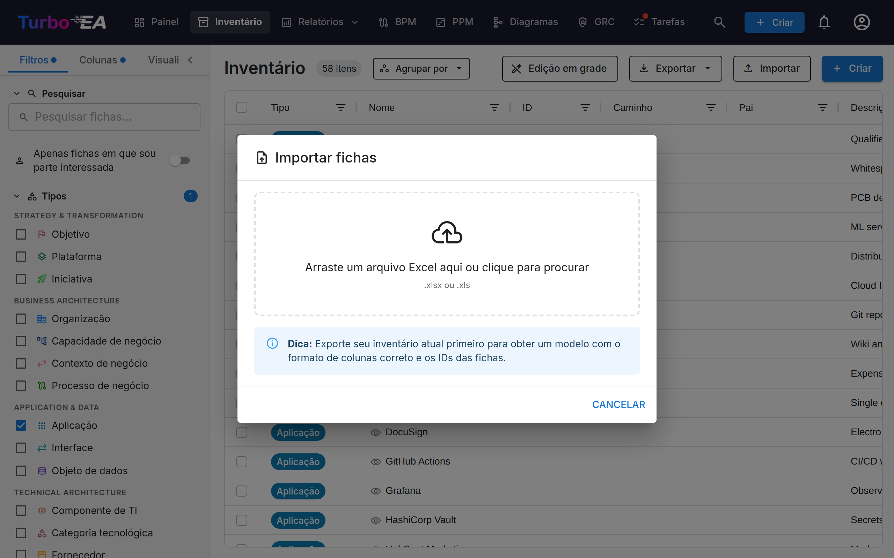

Algumas notas sobre a importação:

- **Apenas `name` e `type` são obrigatórios para criar um card.** Os campos marcados como *obrigatórios* no metamodelo (incluindo Provider ou qualquer outro tipo) não bloqueiam a importação — o card é criado na mesma, e as lacunas refletem-se na sua pontuação de qualidade de dados em vez de causarem um salto silencioso.
- **Uma `/` na coluna `name` de um card não precisa de ser escapada.** O escape (`\/` para uma barra, `\\` para uma barra invertida) só é necessário quando *referencia* esse card a partir de uma célula `parent_path`, `rel:<chave>`, `source_ref` ou `target_ref`, onde `/` é o separador de caminho; mesmo aí, uma `/` sem escape é lida como parte do nome quando não há nenhum card no caminho que ela forma.

### Exportar

Clique em **Exportar**. O filtro atual determina o conteúdo: com um filtro de tipo único, uma planilha para esse tipo; sem filtro, uma planilha por tipo presente. Em todos os casos a pasta de trabalho inclui `Relations` e `_Meta` e pode ser reimportada sem perder atributos específicos do tipo.

Você também pode escolher **Exportar vista atual** no menu Exportar — um instantâneo plano de uma única planilha que espelha o que está na tela (apenas as colunas visíveis, na ordem atual, para as linhas filtradas). Destina-se a compartilhamento e **não é adequado para reimportação**. Se as colunas de relações ainda estiverem a carregar, a exportação aguarda por elas, pelo que nunca podem sair vazias.
