# Инвентарь

**Инвентарь** — это сердце Turbo EA. Здесь перечислены все **карточки** (компоненты) корпоративной архитектуры: приложения, процессы, бизнес-способности, организации, поставщики, интерфейсы и многое другое.

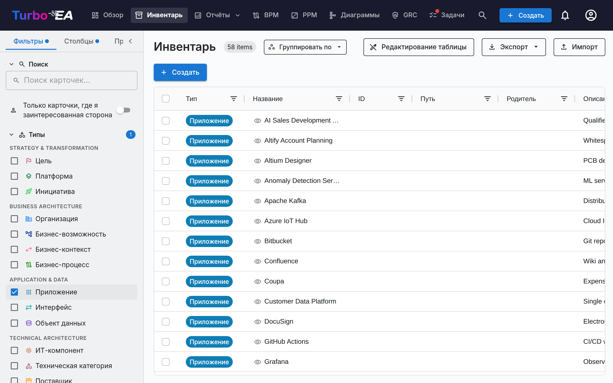

## Структура экрана инвентаря

### Левая панель фильтров

Левая боковая панель позволяет **фильтровать** карточки по различным критериям:

- **Поиск** — полнотекстовый поиск по названиям карточек, начиная с первой же буквы. Наиболее точные совпадения идут первыми: точные названия, затем начинающиеся с введённого текста, затем те, где он начинает слово, затем остальные. Так упорядочивает результаты каждое поле поиска в Turbo EA — глобальный поиск (**Ctrl+K** / **⌘K**), любой выбор карточек, реестр рисков, решения и опубликованные порталы — если только вы не выбрали собственную сортировку, которая всегда имеет приоритет. Также учитываются **псевдоним** карточки и её описание, поэтому карточку можно найти по имени, которым её действительно называют в вашей организации, — а точно совпавший псевдоним ценится так же высоко, как точно совпавшее название
- **Типы** — фильтр по одному или нескольким типам карточек, сгруппированным по архитектурному слою, к которому относится каждый тип: Стратегия и трансформация (Цель, Платформа, Инициатива), Бизнес-архитектура (Организация, Бизнес-способность, Бизнес-контекст, Бизнес-процесс), Приложения и данные (Приложение, Интерфейс, Объект данных) и Техническая архитектура (ИТ-компонент, Техническая категория, Поставщик). Тип, которому администратор задал собственный слой, получает свой заголовок после этих четырёх, а типы без указанного слоя перечисляются последними в разделе **Без категории**
- **Подтипы** — при выборе типа можно дополнительно фильтровать по подтипу (например, Приложение → Бизнес-приложение, Микросервис, ИИ-агент, Развёртывание)
- **Статус утверждения** — Черновик, Утверждено, Нарушено или Отклонено
- **Источник** — канал, через который была создана каждая карточка: **Веб-интерфейс**, **MCP** (ИИ-ассистент, подключённый через [MCP-сервер](../admin/mcp.md)), **API** (скрипт или интеграция), **Расширение** или **Система** (фоновое задание). Выберите **MCP**, чтобы просмотреть всё, что добавил агент. Карточки, созданные до того, как Turbo EA начал фиксировать канал, не соответствуют ни одному из вариантов
- **Жизненный цикл** — фильтр по фазе жизненного цикла: Планирование, Внедрение, Активный, Вывод, Конец жизни
- **Качество данных** — фильтрация по диапазонам (множественный выбор): Полный (≥80%), Частичный (40–79%), Минимальный (ниже 40%). Это те же диапазоны, что и в [отчёте о качестве данных](reports.md#data-quality-report), поэтому клик по сегменту столбца там ведёт сюда.
- **Без связей** — только карточки без связей в обоих направлениях. Вычисляется на сервере, поэтому работает и без выбранного типа карточки.
- **Устаревшие** — только карточки, не обновлявшиеся последние 90 дней. Оба фильтра соответствуют плиткам [отчёта о качестве данных](reports.md#data-quality-report): клик по плитке ведёт сюда.
- **Окончание поддержки** — Для типов карточек, отслеживающих окончание поддержки (по умолчанию приложения и ИТ-компоненты, см. [Окончание поддержки для других типов карточек](../admin/eol.md)), можно фильтровать по статусу поддержки, который Turbo EA получает по [связи EOL](../admin/eol.md) карточки: Окончена, Приближается, Поддерживается или Неизвестно. **(пусто)** показывает карточки, для которых ничего не заполнено. Соответствующий столбец **Окончание поддержки** показывает дату рядом с цветной точкой статуса, сортируется и экспортируется как дата.
- **Тип иерархической связи** — Когда выбран один иерархический тип карточек и администратор определил для него [типы связей](../admin/metamodel.md), можно фильтровать по типу связи каждой карточки с родительской — например, дочерние компании *коммерческие*, а не *сбытовые*. **(пусто)** показывает карточки, у связи которых нет типа, и карточки верхнего уровня, поскольку ни для тех, ни для других ничего не заполнено. Соответствующий столбец **Тип иерархической связи** показывает значение цветной меткой и доступен для правки в режиме редактирования таблицы.
- **Теги** — фильтр по тегам из любой группы тегов
- **Связи** — фильтр по связанным карточкам по типам связей
- **Пользовательские атрибуты** — фильтр по значениям пользовательских полей (текстовый поиск, варианты выбора)
- **Показать только архивные** — переключатель для просмотра архивированных (мягко удалённых) карточек
- **Очистить всё** — сброс всех активных фильтров одновременно

> **Поиск карточек без значения.** Фильтры «Подтип», «Жизненный цикл», «Теги», «Связи» и пользовательские атрибуты-списки содержат вариант **(пусто)**. Выберите его, чтобы показать только карточки, у которых *нет* значения в этом поле, — например, все карточки без заданного жизненного цикла. Его можно сочетать с обычными значениями (совпадение с любым) и между несколькими фильтрами (совпадение со всеми).

**Счётчик активных фильтров** в виде значка показывает количество применённых фильтров.

### Действия с ячейкой

Щёлкните правой кнопкой мыши по любой ячейке таблицы (долгое нажатие на сенсорных устройствах), чтобы открыть контекстное меню быстрых действий над тем, что находится под курсором, как в ServiceNow:

- **Просмотр карточки** — открыть карточку, на которую указывает ячейка, в боковой панели, не покидая таблицу; панель не блокирует таблицу: пока она открыта, можно прокручивать, фильтровать и выбирать другие строки, а закрыть её — кнопкой закрытия
- **Показать совпадения** — оставить только строки, значение которых совпадает со значением выбранной ячейки
- **Исключить** — скрыть строки, значение которых совпадает со значением выбранной ячейки
- **Копировать значение** — скопировать текст ячейки в буфер обмена
- **Очистить фильтр столбца** — убрать фильтр этого столбца (отображается, только пока фильтр активен)

Для ячеек с несколькими значениями (теги, связи, заинтересованные стороны, атрибуты с множественным выбором) меню сначала показывает отдельные значения, чтобы можно было фильтровать по одному из них или по всей ячейке. **Просмотр карточки** доступен для любой ячейки, указывающей на карточку, — столбца «Название» (карточка самой строки), столбца «Родитель» и столбцов связей; если ячейка указывает на несколько карточек, меню перечисляет их так же, чтобы вы выбрали нужную. Эти фильтры попадают в собственные фильтры столбцов таблицы: они сочетаются с фильтрами боковой панели, учитываются кнопкой **Очистить фильтры** на панели инструментов и сохраняются вместе с вашим представлением. То же меню доступно во всех таблицах Turbo EA — «Решения», «Реестр рисков», «Соответствие» и административных таблицах. Если у столбца есть соответствующий фильтр на левой панели — тип карточки, подтип, жизненный цикл, статус утверждения или атрибут с одиночным выбором — **Показать совпадения** выбирает это значение и на панели, а **Очистить** очищает оба, поэтому сохранённое представление никогда не может содержать противоречащие друг другу фильтр панели и фильтр столбца. Если после этого изменить фильтр на панели, приоритет получает панель.

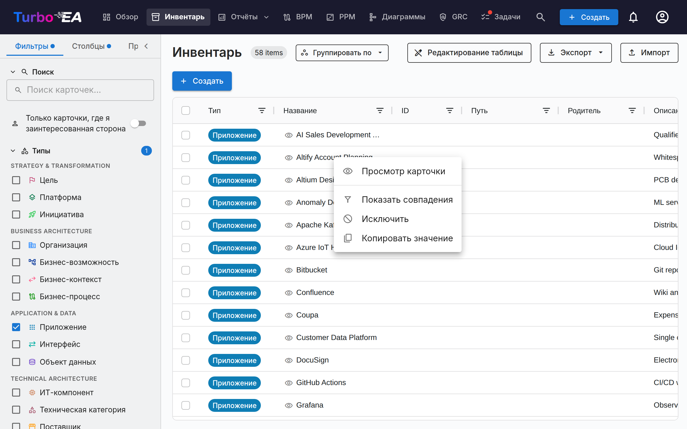

### Вкладка «Столбцы»

Вкладка **Столбцы** на боковой панели позволяет выбрать, какие дополнительные столбцы отображать в таблице. Доступные столбцы динамически меняются в зависимости от выбранных типов карточек:

- **Выбран один тип** — доступны все поля атрибутов, определённые для этого типа, а также столбцы связей и метаданных
- **Выбрано несколько типов** — доступны только поля, **общие для всех выбранных типов**
- **Тип не выбран** — отображается подсказка с предложением сначала выбрать тип карточки

Столбцы сгруппированы в пять категорий:

| Категория | Описание |
|-----------|----------|
| **Столбцы по умолчанию** | Постоянно отображаемые столбцы: Тип, Имя, Путь, Описание, Подтип, Жизненный цикл, Статус одобрения, Качество данных. Снимите флажок, чтобы скрыть любой из них — полезно для сужения сохранённого представления до нужных столбцов. |
| **Метаданные** | Создано, Изменено, Создал, Изменил, Создано через, Изменено через. **Изменено** — это момент последнего изменения содержимого карточки человеком или интеграцией, но никогда не пересчётом показателя системой, поэтому по этой дате можно отфильтровать карточки, которым нужна проверка ответственным. **Создано через** и **Изменено через** показывают канал создания и последнего изменения в виде значка (MCP, API, Расширение, Система); для веб-интерфейса ячейка остаётся пустой. |
| **Атрибуты** | Пользовательские поля, определённые в метамодели (текст, число, стоимость, дата, выбор и т. д.) |
| **Связи** | По одному столбцу на каждую связь, названному по её глаголу и связанному типу карточек, — например, *использует ИТ-компонент* или *поддерживается Приложение*. Если два типа связи соединяют одни и те же типы карточек, у каждого свой столбец, а тип связи между карточками одного типа (приложение, которое *отправляет данные* другому) получает по столбцу на каждое направление. Ищите в списке по глаголу или по типу карточек. |
| **Заинтересованные стороны** | По одному столбцу на каждую роль заинтересованной стороны выбранного типа карточки (например, «Заинтересованные стороны: Responsible») с назначенными пользователями в виде чипов. В режиме редактирования сетки дважды щёлкните ячейку, чтобы назначить или убрать пользователей этой роли прямо из сетки (требуется право управления заинтересованными сторонами). |

Столбец **Родитель** показывает только карточку непосредственно выше, тогда как **Путь** показывает всю цепочку. В режиме редактирования таблицы дважды щёлкните ячейку «Родитель», чтобы переместить карточку, или очистите поле, чтобы поднять её на верхний уровень. Столбец доступен для редактирования, только когда таблица отфильтрована по одному типу карточек с поддержкой иерархии. Если перемещение отклонено — потому что оно создало бы цикл, столкнулось бы с одноимённой карточкой под целевым родителем или превысило бы максимальную глубину, — причина появится внизу экрана, а ячейка вернётся к прежнему значению.

Столбец **Путь** показывает иерархическую цепочку карточки (например, «Северная Америка / Продажи / Внутренние продажи») без имени самой карточки — вы можете держать «Имя» и «Путь» на экране одновременно.

Столбец **Логотип** показывает собственный логотип карточки, а если он не задан — значок её типа, так что ландшафт можно просматривать по продуктовым знакам, а не по названиям. Столбец предлагается только для типов карточек, которым разрешены логотипы (по умолчанию это Приложение и ИТ-компонент), по умолчанию выключен и, пока он показан, делает строки выше, чтобы знаки оставались различимыми. Если у вас есть право редактировать карточку, наведите указатель на ячейку логотипа и щёлкните, чтобы загрузить, заменить, выбрать фирменный значок или удалить логотип, не покидая таблицу, — то же меню, что и на странице карточки. Логотипы намеренно исключены из заполнения перетаскиванием и массового редактирования: один знак на карточку, заданный осознанно.

Столбец **Псевдоним** показывает второе имя карточки — внутреннее, которым её называют в вашей организации. По умолчанию он отключён, поскольку в большинстве ландшафтов псевдонимов нет: включите его на вкладке **Столбцы**. Он редактируется прямо в ячейке в режиме правки таблицы и заполняется вниз, как любой текстовый столбец, а также переносится экспортом и импортом Excel, так что список псевдонимов можно загрузить за один проход.

Каждая категория имеет флажок **Выбрать все** для быстрого переключения всех столбцов в группе. Поле поиска вверху позволяет найти конкретные столбцы по названию. Значок на заголовке каждого раздела показывает, сколько столбцов из этой группы в данный момент отображается.

При первом выборе типа карточки **все столбцы атрибутов и связей включены по умолчанию**. Затем вы можете снять отметку с ненужных столбцов. Кнопка **Сбросить** внизу вкладки «Столбцы» восстанавливает выбор столбцов по умолчанию.

**Точка-индикатор изменений** появляется на заголовке вкладки «Столбцы», когда выбор столбцов отличается от значений по умолчанию. Такой же индикатор появляется на вкладке **Фильтры**, когда активны какие-либо фильтры, что позволяет сразу увидеть, какие настройки были изменены.

Ваш выбор столбцов, **компоновка столбцов** (порядок слева направо, ширина и закреплённые столбцы), активные фильтры и порядок сортировки **автоматически сохраняются** в браузере. При возвращении на страницу инвентаря восстанавливается ваша предыдущая конфигурация. Сохранённые представления (закладки) также сохраняют эту полную компоновку, поэтому при переключении между представлениями восстанавливаются именно те столбцы, которые вы настроили, и в том же расположении, что важно при предоставлении упорядоченного представления заинтересованным сторонам.

### Основная таблица

Инвентарь использует таблицу данных **AG Grid** с мощными возможностями:

| Столбец | Описание |
|---------|----------|
| **Тип** | Тип карточки с цветной иконкой |
| **Название** | Название компонента (нажмите, чтобы открыть детали карточки) |
| **Логотип** | Собственный логотип карточки или значок её типа, если логотипа нет. По умолчанию выключен — включите на вкладке «Столбцы»; щёлкните ячейку, чтобы изменить |
| **Псевдоним** | Второе имя карточки. По умолчанию отключён — включите его на вкладке «Столбцы»; учитывается в каждом поле поиска |
| **Описание** | Краткое описание — веб-адрес в нём является кликабельной ссылкой |
| **Жизненный цикл** | Текущая фаза жизненного цикла |
| **Статус утверждения** | Значок статуса проверки |
| **Качество данных** | Процент полноты с визуальным кольцом |
| **Связи** | По одному столбцу на каждую связь, с заголовком из её глагола и связанного типа карточек (например, *использует ИТ-компонент*): имена карточек, связанных через эту связь, в алфавитном порядке, с всплывающим окном для добавления или удаления связей этого вида — уже связанные карточки скрыты из его списка выбора, кроме иерархического типа: там список показывает всю иерархию в виде дерева с отступами и оставляет такие карточки серыми на своих местах. Сохранённые представления и раскладки столбцов, созданные до разделения столбцов связей по связям, открываются с новыми столбцами вместо прежнего |

**Возможности таблицы:**

- **Сортировка** — нажмите на заголовок любого столбца для сортировки по возрастанию/убыванию
- **Редактирование в таблице** — в режиме редактирования можно изменять значения полей прямо в таблице
- **Заполнение столбца** — в режиме редактирования нажмите на ячейку и потяните маленький квадрат в её углу вверх или вниз, чтобы скопировать это значение во все охваченные строки. Прежде чем что-либо будет сохранено, подтверждение сообщит столбец, значение и число строк; если сервер отклонит строку, она будет указана с причиной и ссылкой, а успешно записанные строки останутся сохранёнными. Жест работает и пальцем, и мышью, и с клавиатуры — установите фокус на квадрат, расширьте диапазон стрелками, подтвердите клавишей Enter. Заполняются только строки, отображаемые сейчас с учётом фильтров и сортировки, а столбец «Название» намеренно исключён, чтобы у карточек не совпали имена.
- **Множественный выбор** — выберите несколько строк для массовых операций
- **Отображение иерархии** — отношения «родитель/потомок» показаны в виде цепочки навигации
- **Настройка столбцов** — отображение, скрытие и изменение порядка столбцов
- **Закрепление столбца** — наведите указатель на заголовок столбца и нажмите значок булавки, чтобы закрепить столбец у левого края: он останется на виду при горизонтальной прокрутке. Повторное нажатие на булавку открепляет столбец. Такая же булавка есть у каждого столбца на вкладке **Столбцы** панели фильтров, поэтому закрепить столбец можно, не разыскивая его заголовок. Закреплённые столбцы запоминаются для каждой таблицы, и такой же элемент управления доступен в любой таблице Turbo EA (Реестр рисков, Решения, Результаты проверки соответствия, Пользователи, Ресурсы, Журнал аудита).
- **Изменение порядка столбцов** — перетащите заголовок столбца, чтобы переместить его, либо откройте раздел **Порядок столбцов** в верхней части вкладки **Столбцы** и перетащите строку за её маркер. Этот список *и есть* порядок таблицы, поэтому они всегда совпадают, а закреплённые столбцы вынесены в отдельную группу в начале, потому что всегда отображаются первыми: чтобы вывести столбец из этой группы, откепите его прямо там. Маркер работает и с клавиатурой (пробел — взять столбец, стрелки — переместить, пробел — отпустить), и при касании, поэтому порядок можно изменить с телефона. Порядок столбцов запоминается для каждой таблицы, во всех таблицах Turbo EA.

### Панель инструментов

- **Редактирование в таблице** — переключение режима инлайн-редактирования для редактирования нескольких карточек в таблице
- **Экспорт** — скачать данные в виде файла Excel (.xlsx)
- **Импорт** — массовая загрузка данных из файлов Excel
- **+ Создать** — создать новую карточку

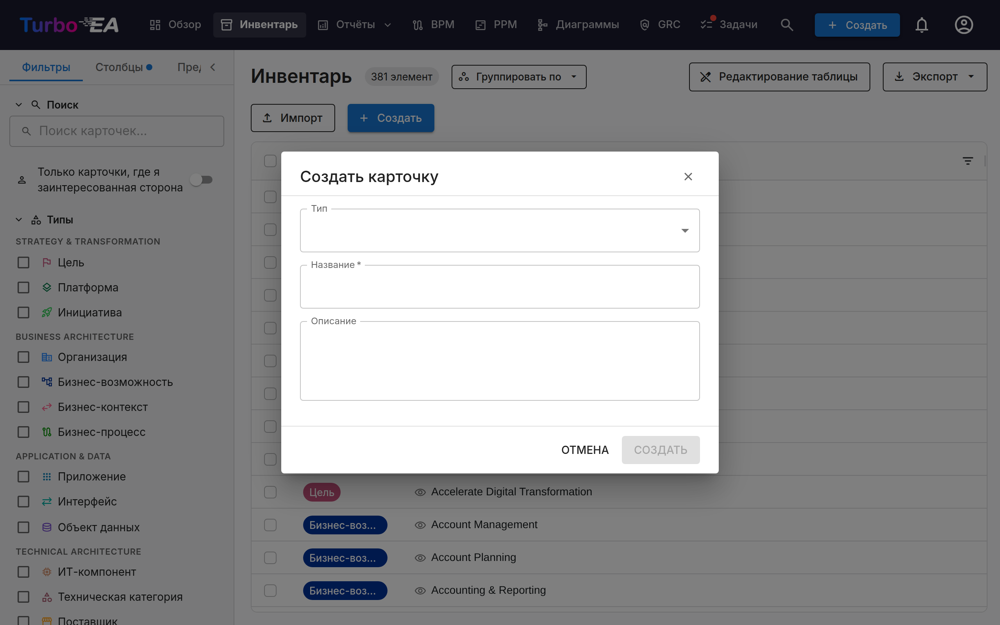

## Как создать новую карточку

1. Нажмите кнопку **+ Создать** (синяя, в правом верхнем углу)
2. В появившемся диалоге:
   - Выберите **Тип** карточки (Приложение, Процесс, Цель и т.д.)
   - Введите **Название** компонента
   - При желании добавьте **Описание**
3. При желании нажмите **Предложить с помощью ИИ**, чтобы автоматически сгенерировать описание (см. [ИИ-подсказки для описаний](#ии-подсказки-для-описаний) ниже)
4. Нажмите **СОЗДАТЬ**

## Массовое редактирование { #mass-edit }

Отметьте две или более строк флажками в левом столбце, затем нажмите **Массовое редактирование** на панели выбора. Диалог применяет одно изменение ко всем выбранным карточкам.

Раскрывающийся список **Поле** группирует доступные изменения:

- **Общее** — статус утверждения, подтип, теги и родитель
- **Атрибуты** — любое редактируемое поле, определённое для выбранного типа карточки
- **Связи** — по одной записи на тип связи и направление (например, *выполняется на → ИТ-компонент*)

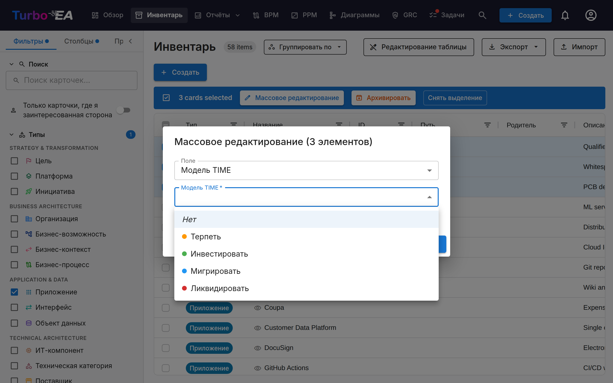

Для тегов, связей и родителя доступен переключатель **добавить / удалить**, поэтому вы дополняете или сокращаете существующие значения, а не заменяете их.

Когда вы выбираете **Добавить связь** для типа связи с деталями — направлением потока между двумя приложениями, тем, как организация использует приложение, флагами создания / чтения / изменения / удаления на объекте данных, — диалог показывает и эти поля. Заданное сохраняется для каждой добавленной связи. Карточки, уже связанные с выбранной целью, тоже получают эти детали, поэтому повторное **Добавить связь** — способ обновить детали существующих связей; незаполненная деталь не изменяется.

Элемент ввода соответствует типу поля: поле с множественным выбором показывает свои варианты с флажками, логическое поле — список «Да» / «Нет», поле даты — выбор даты. Если оставить значение пустым (для логического поля — пустой вариант **Нет**), поле будет очищено на всех выбранных карточках. Поля, вычисляемые по формуле, и поля стоимости, которые вам не разрешено просматривать, не предлагаются.

### Перестройка иерархии { #mass-edit-parent }

Поле **Родитель** появляется, когда таблица отфильтрована по одному типу карточек с поддержкой иерархии. У карточки ровно один родитель, поэтому это единственное поле охватывает оба направления перестройки:

- **Задать родителя** — выберите карточку того же типа; все выбранные карточки переместятся под неё. Именно так несколько карточек становятся дочерними для одного родителя.
- **Убрать родителя** — все выбранные карточки вернутся на верхний уровень.

Карточки перемещаются по одной, поэтому недопустимое перемещение блокирует только одну карточку. Диалог остаётся открытым и показывает, какие карточки заблокированы и почему. Обычные причины:

- Под целевым родителем уже есть карточка с таким же именем.
- Выбранный родитель является потомком одной из перемещаемых карточек, что создало бы цикл.
- Перемещение вывело бы бизнес-способность за предел в пять уровней.

При перемещении карточка забирает с собой свои дочерние карточки, а утверждённые карточки возвращаются в состояние **Нарушено**, чтобы изменение было проверено заново.

## Группировка инвентаря { #group-by }

Нажмите **Группировать по** на панели инструментов (рядом со счётчиком элементов), чтобы организовать таблицу в сворачиваемые группы. Фаза жизненного цикла и статус утверждения доступны всегда; если таблица отфильтрована по одному типу карточек, добавляются его подтип и все атрибуты с одиночным выбором.

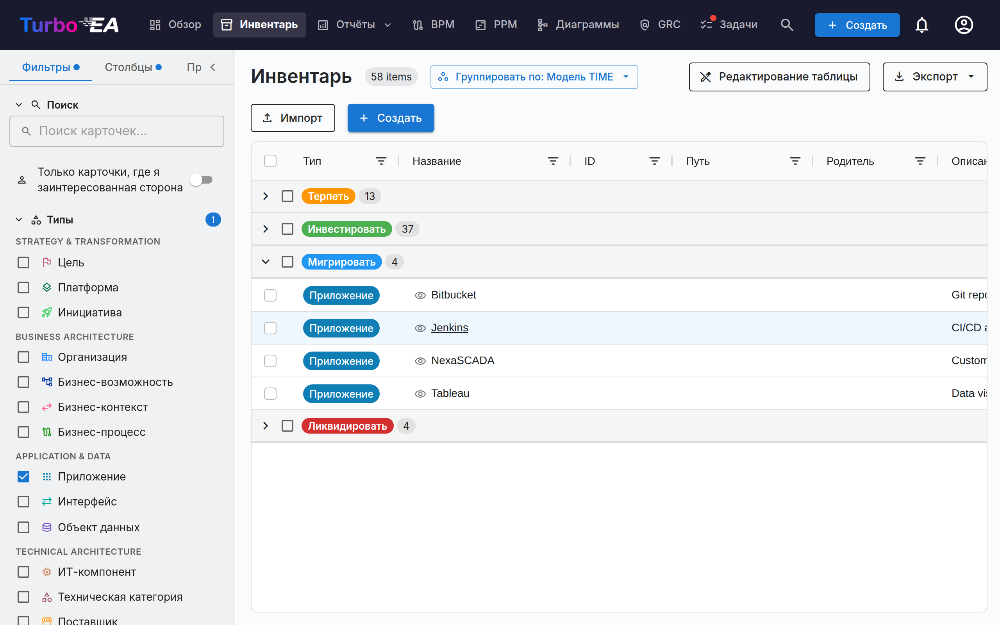

- Карточки без значения в выбранном поле попадают в группу **Не задано** в самом верху — естественная точка входа для разбора неклассифицированных карточек.
- Щелчок по заголовку группы сворачивает или разворачивает её. Заголовок показывает количество карточек в группе.
- При прокрутке длинной группы её заголовок остаётся закреплённым сразу под заголовками столбцов, поэтому всегда видно, какую группу вы читаете; заголовок следующей группы вытесняет его, когда доходит до верха. Это полноценный заголовок вместе с флажком, поэтому длинную группу можно выделить, не прокручивая обратно к её началу.
- Флажок в заголовке выбирает все карточки группы: чтобы переклассифицировать партию, разверните **Не задано**, отметьте заголовок и задайте значение через [Массовое редактирование](#mass-edit). Перетаскивания намеренно нет — «выбрать и задать» одинаково работает на компьютере, планшете и телефоне.
- Сортировка действует внутри каждой группы; группировка сохраняется после перезагрузки, входит в сохранённые представления и передаётся через URL-параметр `group_by`.

### Отступ для дочерних элементов под родительскими { #group-by-parents }

Отметьте **Родительский** вверху меню **Группировка**, чтобы показать карточки в виде дерева: сначала каждая родительская, под ней с отступом её дочерние. Параметр работает сам по себе (вся таблица становится одним деревом) или поверх любой группировки (каждая группа становится отдельным деревом). При установке флажка меню остаётся открытым, поэтому группировку можно выбрать сразу после.

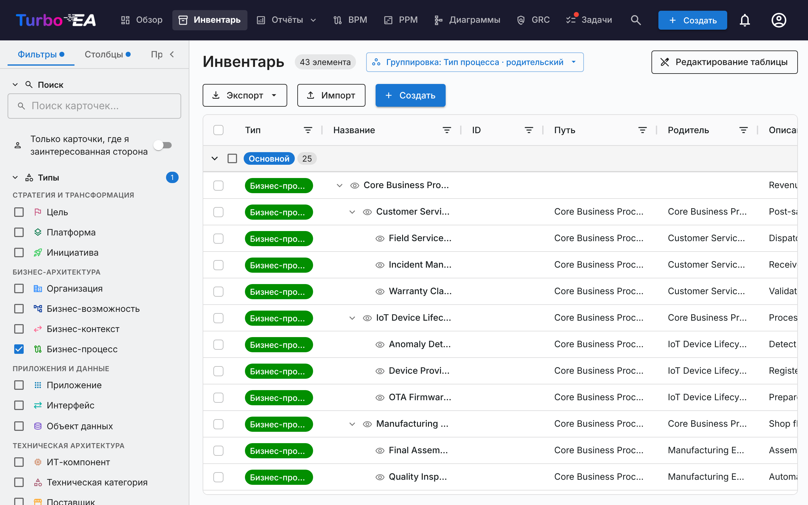

- Карточка никогда не покидает свою группу. Дочерняя карточка, родитель которой находится в другой группе, скрыт фильтром столбца или не загружен, начинает собственную ветку, а недостающие предки отображаются серым перед её названием (например, *SAP S/4HANA / SAP FI /* перед названием модуля). Поэтому счётчики групп, флажок в заголовке и массовое редактирование всегда соответствуют содержимому группы.
- Нажмите на шеврон перед названием родителя, чтобы скрыть или показать его ветку. Свёрнутый родитель по-прежнему учитывает скрытые карточки в числе элементов и в заголовке группы. Ветки, которые вы свернули шевроном, не запоминаются, а изменение фильтра столбца снова раскрывает их все; сброс последнего фильтра столбца возвращает к уровню, выбранному с помощью переключателя.
- Пока включён родительский слой, пара кнопок **−** / **+** рядом с кнопкой «Группировка» закрывает или открывает всё дерево по одному уровню. Выбранный уровень запоминается между перезагрузками, сохраняется в сохранённых представлениях и доступен для передачи через `group_tree_level=<n>`; отображаемый уровень также следует за тем, что вы открываете и закрываете вручную.
- Сортировка применяется среди «братьев»: сортируются родители, а под каждым из них — его дочерние карточки.
- Параметр предлагается только тогда, когда у типа карточек в представлении есть иерархия. Он запоминается между перезагрузками, сохраняется в сохранённых представлениях и доступен для передачи через параметр URL `group_tree=1`.
- **Экспорт** следует порядку дерева и пропускает карточки в свёрнутых ветках, как и в случае свёрнутых групп.

## ИИ-подсказки для описаний { #ai-description-suggestions }

Turbo EA может использовать **ИИ для генерации описания** любой карточки. Это работает как в диалоге создания карточки, так и на страницах деталей существующих карточек.

**Как это работает:**

1. Введите название карточки и выберите тип
2. Нажмите на **иконку искры** в заголовке карточки или кнопку **Предложить с помощью ИИ** в диалоге создания карточки
3. Система выполняет **веб-поиск** по названию элемента (с учётом контекста типа — например, «SAP S/4HANA программное приложение»), затем отправляет результаты в **LLM** для генерации краткого фактологического описания
4. Появляется панель подсказки с:
   - **Редактируемым описанием** — просмотрите и измените текст перед применением
   - **Оценкой уверенности** — показывает степень уверенности ИИ (Высокая / Средняя / Низкая)
   - **Ссылками на источники** — веб-страницы, на основе которых составлено описание
   - **Названием модели** — какая LLM сгенерировала подсказку
5. Нажмите **Применить описание**, чтобы сохранить, или **Отклонить**, чтобы отбросить

**Основные характеристики:**

- **Учёт типа**: ИИ понимает контекст типа карточки. Поиск «Приложения» добавляет «программное приложение», поиск «Поставщика» добавляет «технологический вендор» и т.д.
- **Конфиденциальность**: при использовании Ollama модель LLM работает локально — ваши данные никогда не покидают вашу инфраструктуру. Коммерческие провайдеры (OpenAI, Google Gemini, Anthropic Claude и др.) также поддерживаются
- **Контроль администратора**: ИИ-подсказки должны быть включены администратором в [Настройки > ИИ-подсказки](../admin/ai.md). Администраторы выбирают, для каких типов карточек отображается кнопка подсказки, настраивают провайдера LLM и выбирают провайдера веб-поиска
- **На основе прав доступа**: только пользователи с разрешением `ai.suggest` могут использовать эту функцию (включено по умолчанию для ролей Администратор, Администратор BPM и Участник)

## Сохранённые представления (Закладки)

Вы можете сохранить текущую конфигурацию фильтров, столбцов и сортировки как **именованное представление** для быстрого повторного использования.

### Создание сохранённого представления

1. Настройте инвентарь с нужными фильтрами, столбцами и сортировкой
2. Нажмите иконку **закладки** на панели фильтров
3. Введите **название** представления
4. Выберите **видимость**:
   - **Личное** — видите только вы
   - **Общее** — видно определённым пользователям (с возможностью редактирования)
   - **Публичное** — видно всем пользователям

### Использование сохранённых представлений

Сохранённые представления отображаются в боковой панели фильтров. Нажмите на любое представление, чтобы мгновенно применить его конфигурацию. Представления организованы в разделы:

- **Мои представления** — созданные вами представления
- **Доступные мне** — представления, которыми с вами поделились другие
- **Публичные** — представления, доступные всем

### Представления-запросы { #query-views }

**Представление-запрос** — это сохранённое представление, фильтры которого представляют собой **многошаговый запрос**: цепочку связей с условиями на каждом шаге, например *Организации, использующие активное Приложение, на которое влияет Инициатива со статусом On Track*. Несколько таких запросов можно сложить в одно представление и объединить с помощью **И** и **ИЛИ** (см. ниже). Представление хранит запрос, а не его результаты: он выполняется заново при каждом открытии представления, поэтому список всегда отражает текущий ландшафт.

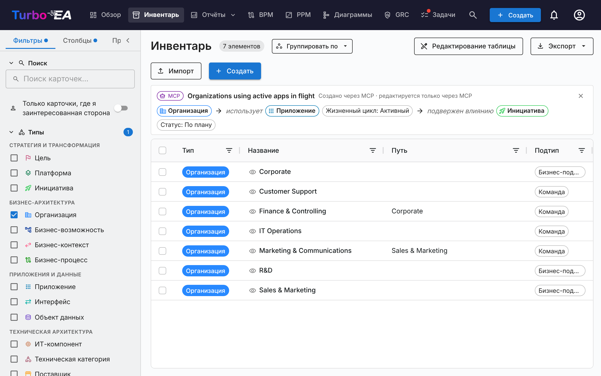

**Создание представления-запроса.** На вкладке **Представления** боковой панели фильтров нажмите **Новое представление-запрос** рядом с *Сохранить текущее* (показывается всем, кто может управлять представлениями). Если активен какой-либо фильтр, включая выбранный тип карточки, перед их очисткой запрашивается подтверждение; **Отмена** на черновике возвращает их. Полоса над таблицей открывается как конструктор запроса:

1. Нажмите на начальный чип (*Выберите тип*) и выберите тип карточки, с которого начинается запрос, — тот, который он перечисляет.
2. Нажмите **+ связь** после последней карточки, чтобы добавить переход. В меню перечислены все глаголы связей с типом карточки, к которому они ведут; связь между карточками одного типа предлагается в обоих направлениях. Каждая строка запроса — это единая цепочка не более чем из трёх переходов.
3. Нажмите **+ условие** под любой карточкой, чтобы сузить выборку: **Жизненный цикл**, **Подтипы**, **Статус утверждения**, **Качество данных** (*Полный*, *Частичный* или *Минимальный*, те же диапазоны, что и в фильтре боковой панели), **Окончание поддержки** (см. ниже), **Теги**, **Конкретные карточки**, либо поле выбора или «да/нет» этого типа карточки. Для тегов карточка подходит, если у неё есть любой из выбранных тегов группы, и она должна подходить под каждую добавленную группу; предлагаются только группы тегов, применимые к этому типу карточки. **Конкретные карточки** открывает выбор карточек этого типа, и тогда шаг соответствует только выбранным карточкам; для иерархического типа карточек переключатель **Включить дочерние карточки** добавляет также карточки под каждым выбором. Выбранная карточка, которую вы не видите, отображается как *(скрытая карточка)*.
4. Нажмите **Сохранить**. Откроется обычный диалог сохранения представления для имени, видимости, общего доступа и настройки OData. **Отмена** отбрасывает запрос.

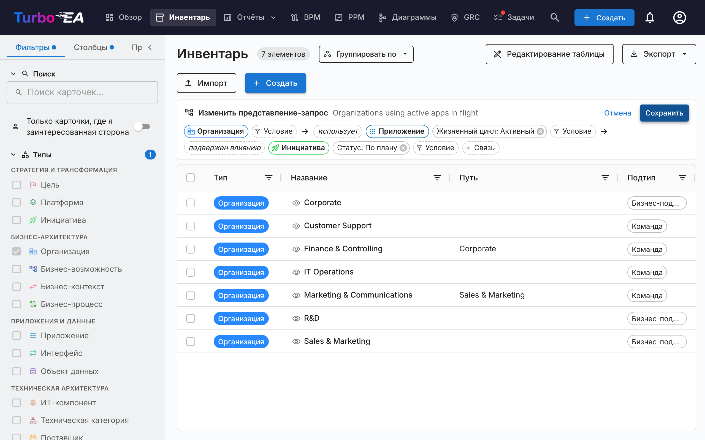

Пока вы строите запрос, таблица фильтруется в реальном времени, а счётчик на панели инструментов показывает, сколько карточек подходит, так что эффект каждого перехода и условия виден до сохранения.

**Фильтрация по окончанию жизненного цикла.** Условие **Окончание поддержки** предлагается для типа карточки, который отслеживает окончание жизненного цикла, — по умолчанию это Приложение и ИТ-компонент; оно следует разделу «Конец жизненного цикла» этого типа в метамодели. Его значения: **Конец жизненного цикла**, **Приближается EOL**, **Поддерживается**, **Неизвестно** и *(пусто)* для карточек без данных об окончании жизненного цикла. Статус тот же, что показывает столбец **Окончание поддержки** инвентаря: он берётся из связанного продукта endoflife.date или пользовательского EOL-продукта либо из даты окончания жизненного цикла, введённой вручную, и не зависит от фазы жизненного цикла карточки. Условие работает на начальной карточке и на любом шаге связи, как в строках И, так и в строках ИЛИ — например, *приложения, использующие ИТ-компонент в конце жизненного цикла*. Пока запрос фильтрует по нему на начальной карточке, в таблице показан столбец «Окончание поддержки», чтобы было видно, почему подошла каждая карточка; выбранные вами столбцы не меняются. Если endoflife.date недоступен и в кэше ничего нет, связанные карточки читаются как *Неизвестно*, как и в столбце «Окончание поддержки».

Условие требует разрешения на просмотр данных об окончании жизненного цикла (**Просмотр данных EOL**, `eol.view`). Без него условие не предлагается, а открытие, предварительный просмотр или сохранение представления, которое его использует, отклоняются с сообщением *Это представление фильтрует по статусу окончания жизненного цикла, который недоступен вашей роли.*

**Изменение переходов и условий.** Нажмите на чип глагола перехода, чтобы открыть его меню: **не имеет** превращает переход в требование, чтобы у карточки **не было** такой связи, а **Удалить этот переход** удаляет его вместе со всеми последующими. Нажмите на чип условия, чтобы изменить его значения, или на его **×**, чтобы удалить.

**Объединение запросов с помощью И и ИЛИ.** Представление может содержать несколько строк запроса, расположенных друг под другом. Каждая строка — это полный запрос (начальная карточка, связи и условия), строящийся так же, как одиночный запрос выше. Строки объединяются в группы:

- **И** добавляет строку в ту же группу: карточка попадает в список, только если она соответствует **каждой** строке группы. Строка И начинается с того же типа карточки, что и её группа, он показан как неизменяемый чип; пока в группе есть строки И, её первая строка не может сменить тип карточки.
- **ИЛИ** начинает новую группу под разделителем **ИЛИ**: её результаты **добавляются** к списку. Новая группа может начинаться с другого типа карточки, поэтому одно представление может перечислять, например, приложения и организации вместе. Если представление перечисляет несколько типов карточек, в таблице показаны столбцы, общие для этих типов.

В режиме редактирования **плюс** в кружке под каждой группой спрашивает **И** или **ИЛИ**: И добавляет строку в эту группу, ИЛИ открывает после неё новую группу. **×** в конце строки удаляет её; он показан, когда в представлении больше одной строки.

Например, демонстрационное представление *Active apps on aging tech, and the organizations using apps* содержит группу «Приложение» из двух строк — активное приложение, использующее ИТ-компонент на этапе вывода из эксплуатации или в конце жизненного цикла, **И** приложение, затрагиваемое инициативой, — **ИЛИ** организация, использующая приложение. В списке показаны приложения, удовлетворяющие обеим строкам, и каждая организация, использующая приложение.

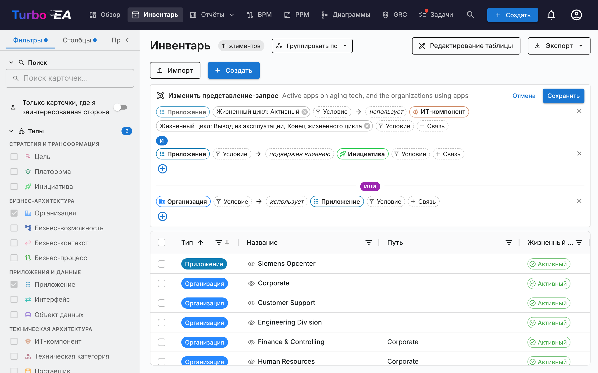

Представление содержит не более **шести** строк запроса, **двенадцати** связей во всех строках и **трёх** уровней связей в каждой строке. Строки группы И сходятся только на начальной карточке: ИТ-компонент одной строки и инициатива другой могут быть разными карточками. Два требования к **одной и той же** карточке в середине строки — например, что один и тот же ИТ-компонент предоставляется поставщиком **и** относится к технологической категории — нельзя построить в конструкторе запросов; ИИ-ассистент может написать такой запрос через [MCP-сервер](../admin/mcp.md#multi-hop-card-queries), и тогда полоса его покажет.

**Редактирование сохранённого представления-запроса.** Когда представление-запрос открыто, полоса показывает его путь: типы карточек в виде чипов, соединённые глаголом связи каждого шага (например, *Организация → использует Приложение → затрагивается Инициативой*), а под ними условия каждой карточки. Представление с несколькими строками показывает тот же набор, с метками И и разделителями ИЛИ, но без элементов редактирования. Если вы владелец представления или у вас есть права на его редактирование, **карандаш** на полосе переключает его в тот же конструктор; **Сохранить** обновляет представление. Кнопка **×** (*Выйти из этого представления*) возвращает к обычному инвентарю. **Сохранить текущее представление** при открытом представлении-запросе сохраняет новое представление-запрос с тем же запросом.

#### Карточки, стоящие за совпадением { #query-view-matches }

Представление-запрос перечисляет только первую карточку своего запроса. Чтобы увидеть, какие карточки дальше по цепочке привели к совпадению строки, нажмите на их тип карточки в пути запроса. В запросе *Организации, использующие приложение, которое использует ИТ-компонент в конце жизненного цикла или близко к нему* нажмите **Приложение** — и столбец перечислит для каждой организации приложения, через которые она совпала; нажмите **ИТ-компонент** — и другой столбец перечислит подходящие ИТ-компоненты. Повторное нажатие на тип карточки убирает его столбец.

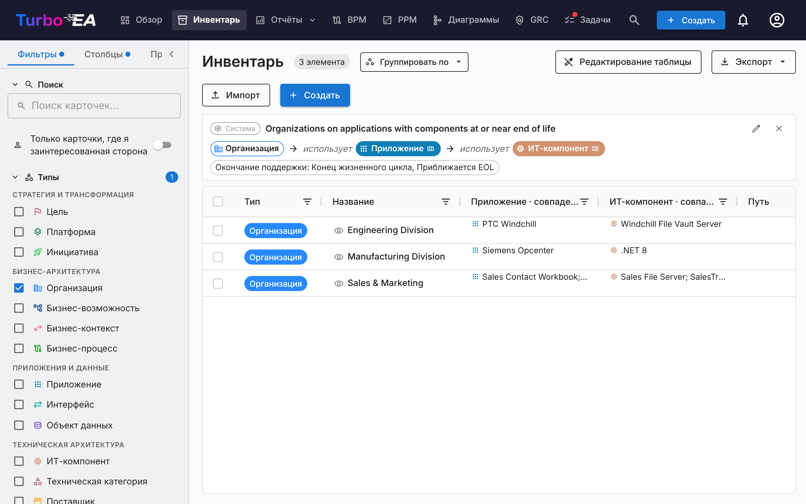

- **Как выглядит переключатель.** Тип карточки, на который можно нажать, показывает указатель и подсказку *Показать в столбце*. Когда его столбец включён, чип залит цветом типа карточки и несёт маленький значок столбца; его подсказка — *Скрыть столбец*.
- **Какие типы карточек являются переключателями.** Каждый тип карточки после первого в своей строке запроса. Первый тип карточки строки запроса им не является, потому что его карточки — это строки таблицы, как и тип карточки после **не имеет**, обозначающего отсутствующую связь. В представлении с несколькими строками запроса переключателями являются типы карточек каждой строки; при **ИЛИ** строка таблицы показывает карточки только для тех строк запроса, которым она соответствует. Пока вы редактируете запрос, переключатели недоступны, а столбцы скрыты, пока вы не сохраните изменения или не отмените их.
- **Где появляется столбец.** Сразу после **Название**, с заголовком из типа карточки и слова *совпадения* — например, *Приложение · совпадения*, — чтобы его не путали со столбцом связи вроде *использует Приложение*, который перечисляет все приложения, связанные таким образом. Если у двух шагов одинаковый тип карточки, заголовки нумеруются. Наведите указатель на заголовок, чтобы увидеть путь, по которому идёт столбец.
- **Что показывает ячейка.** Названия совпавших карточек через точку с запятой; наведите указатель на ячейку, чтобы увидеть полный список. Ячейка перечисляет не более **100** названий; более длинный список заканчивается на *…*, а его подсказка сообщает, что показаны первые 100. Столбец можно сортировать и фильтровать как текстовый, и **Экспортировать текущий вид** включает его.
- **Каждая карточка цепочки, а не то, кто к кому ведёт.** Строка перечисляет каждую совпавшую карточку на этом шаге: все подходящие приложения организации и все подходящие ИТ-компоненты этих приложений. Она не показывает, какой ИТ-компонент относится к какому приложению. Чтобы перечислить сами ИТ-компоненты, по одному на строку, напишите вместо этого запрос, начинающийся с ИТ-компонента.
- **Сохраняются вместе с представлением.** Включённые столбцы сохраняются вместе с представлением (**карандаш** в списке представлений, затем **Обновить**), поэтому при повторном открытии они на месте. При редактировании запроса столбец сохраняется, пока его шаг существует, и удаляется, когда вы удаляете этот шаг или меняете его тип карточки.

Вы видите только те карточки, которые вам разрешено видеть: скрытая от вас карточка никогда не называется в ячейке, а строка, совпадающая только через скрытые карточки, не выводится.

Демонстрационное представление *Organizations on applications with components at or near end of life* открывается с обоими включёнными столбцами.

**Представления, созданные ИИ-ассистентом.** Ассистент, подключённый через [MCP-сервер](../admin/mcp.md), тоже может создавать представления-запросы. Такое представление показывает на своей полосе чип **MCP** и пометку *Создано через MCP*, а в списке представлений — значок робота; редактируется оно, как любое другое представление-запрос. В списке представлений каждое представление-запрос имеет маленький значок представления-запроса (куб; значок робота, если его создал ассистент) и свой компактный путь (*Организация › использует Приложение › затрагивается Инициативой*) во второй строке; составное представление читается как *… И … ИЛИ …*. Если у представления есть условия, их число следует за путём (*… › затрагивается Инициатива · 2 условия*).

**Открытие представления по ссылке.** Когда ассистент сохраняет представление, он возвращает ссылку вида `/inventory?view=<view id>`; её открытие сразу применяет сохранённое представление. Та же ссылка работает для любого сохранённого представления, которое вы видите.

**OData.** OData-фид представления-запроса возвращает те же карточки, что и инвентарь: запрос применяется и к фиду.

О грамматике запросов, её ограничениях и инструментах MCP (`query_cards`, `list_inventory_views`, `save_inventory_view`, `list_tag_groups`) см. [Многошаговые запросы карточек](../admin/mcp.md#multi-hop-card-queries).

## Импорт / Экспорт Excel { #excel-import }

Импорт и экспорт инвентаря используют **многолистовую книгу Excel**, которая полностью восстанавливает подкарту ландшафта — карточки любого числа типов и связи между ними — без необходимости копировать UUID.

### Структура книги

- **По одному листу на каждый тип карточки** (Application, Business Capability, IT Component, …) с основными столбцами, столбцами `attr_<поле>`, столбцами жизненного цикла столбцами связей `rel:<тип_связи>` и столбцами заинтересованных сторон `stakeholder:<ключ_роли>`.
- **Лист `Relations`** со **значениями**, которые несут связи, — по строке на связь, тип которой имеет значения для заполнения.

Разделение простое и без исключений: **лист карточек говорит, какие карточки связаны; лист `Relations` — что эти связи содержат.** У каждого типа связи есть столбец `rel:` на листе того типа, из которого он исходит, независимо от того, несёт ли он значения.
- **Лист `_Meta`** с версией формата книги.

### Идентификация без GUID

Карточки идентифицируются по **имени**, если оно уникально внутри типа, иначе по полному **`parent_path`**. Если только одно Application носит имя `NexaCore ERP`, ячейку связи можно заполнить именно так; в случае неоднозначности используйте `Sales / Customer Mgmt / CRM`.

#### Уникальность среди соседей

Поскольку карточки идентифицируются по имени + пути, **две карточки одного типа не могут одновременно делить один родительский узел и одно имя**. Новые карточки, которые создали бы такую коллизию, отклоняются при создании (в диалоге «Создать карточку», при инлайн-переименовании и во время импорта Excel). Дубликаты, уже находящиеся в базе из ранних Seed-ов или импортов, остаются без изменений — вы можете редактировать любое поле, но создание третьего дубликата или возврат имени к коллизии заблокированы. Проверка не зависит от регистра и пробелов, в соответствии с резолвером импортера. Когда диалог «Создать карточку» отклоняет дубликат, предупреждение называет существующую карточку и содержит ссылку **Открыть существующую карточку**, ведущую прямо к ней.

### Связи внутри ячейки

Каждая колонка `rel:<тип_связи>` выражает исходящие связи в виде списка целей **через точку с запятой** (например `NexaCore ERP; BillingApp`). Точка с запятой, а не запятая, потому что имена карточек часто содержат запятую (`Acme, Inc.`). Внутри имени символы `/` и `\` экранируются как `\/` и `\\`, а символ `;` — как `\;`; экспорт делает это автоматически (например `SAP S/4HANA` → `SAP S\/4HANA`). Экранированная ссылка всегда точна. В ячейке, заполненной вручную, `/` можно не экранировать: `SAP S/4HANA` сначала читается как путь (карточка *4HANA* под *SAP S*), а если по этому пути карточки нет — как одно имя, которое находится, если его носит ровно одна карточка этого типа. Ячейки **декларативны**: содержимое заменяет полный набор исходящих связей данного типа от источника. Удаление цели из списка удаляет связь; пустая ячейка удаляет все. В книге, экспортированной из Turbo EA (в ней есть лист `_Meta`), запятая никогда не является разделителем, поэтому ячейка с одной целью, например `This is X, it does Y`, остаётся одной целью. Лист без `_Meta` (созданный вручную или экспортированный до версии 1.23) может по-прежнему разделять цели запятыми: если в ячейке нет `;`, она читается как одна цель, когда вся ячейка называет карточку, а иначе — как список через запятую. Есть по столбцу на каждый тип связи, исходящий из типа карточек этого листа, — **на все**, включая несущие значения. Цели отсортированы по алфавиту, поэтому повторный экспорт неизменного ландшафта даёт идентичный файл.

Столбец `tags` подчиняется тому же правилу: записи `Группа: Тег` через `; ` (например `Vendor: Acme, Inc.; Region: EU`), а `;` внутри имени тега записывается как `\;`. Книги, экспортированные до версии 2.156.1, разделяли теги запятыми и по-прежнему импортируются как раньше.

### Ячейки заинтересованных сторон

На каждом листе карточек столбцы `stakeholder:<ключ_роли>` содержат пользователей, назначенных на каждую роль заинтересованной стороны, в виде **адресов электронной почты через точку с запятой** (та же конвенция, что и в столбцах `subscriptions:<RoleType>` LeanIX), например `ada@corp.com; bob@corp.com`. **Адрес электронной почты — единственная принимаемая ссылка на пользователя**: отображаемые имена могут совпадать и никогда не используются для сопоставления; запись вида `Имя <email>` допускается (используется адрес в угловых скобках), а одно лишь имя вызывает предупреждение и пропускается. Как и ячейки связей, ячейки заинтересованных сторон **декларативны для каждой роли**: перечисленные пользователи становятся полным набором назначений этой роли после импорта. Удаление пользователя из списка снимает назначение; пустая ячейка очищает роль; отсутствие столбца оставляет назначения без изменений. Записи без подходящего пользователя вызывают предупреждение и пропускаются — они никогда не блокируют импорт.

!!! note "Таблицы, экспортированные до перехода ключей на camelCase"
    Ключи ролей заинтересованных сторон следуют той же конвенции camelCase, что и все остальные ключи метамодели. Таблица, экспортированная до этого изменения, содержит заголовки вида `stakeholder:technical_application_owner`; они по-прежнему импортируются — заголовок сопоставляется с ролью в camelCase, если ни одна роль не совпадает буквально. Новые выгрузки используют форму camelCase.

### Лист `Relations`

Связь может нести собственные значения — *тип использования* на связке `Organization` → `Application`, годовую стоимость или произвольное описание. Ячейка `rel:` — это список имён, места для них там нет, поэтому значения живут на листе `Relations`, по строке на связь, со столбцами `relation_type`, `source_type`, `source_ref`, `target_type`, `target_ref`, `attr_<поле>` и `description`.

Лист содержит связи, тип которых действительно имеет значения, — у остальных заполнять нечего, и они целиком живут на листах карточек. Связи, направленные *на* экспортированную карточку, тоже включены; `source_ref` и `target_ref` показывают направление. Столбцы `attr_<поле>` — это поля типов связей данной книги. Сортировка: исходная карточка, затем тип связи, затем цель.

**Этот лист только задаёт значения. Он никогда не создаёт и не удаляет связь** — это дело листа карточек: **удаление строки не удаляет ничего**; правка её значений заменяет то, что несёт связь; а строка, называющая две несвязанные карточки, отмечается в предпросмотре и пропускается — свяжите их в столбце `rel:`, хоть в том же импорте.

В более старых книгах есть столбец `action`. Он игнорируется; строка с `action = delete` отмечается и пропускается. Если лист карточек и лист `Relations` противоречат друг другу, **приоритет у удаления**.

Лист перечисляет **каждую связь экспортированных карточек**, независимо от того, несёт ли её тип значения сейчас, — так что у типа связи, которому вы только что задали значение, строка там уже есть. Связи, направленные *на* экспортированную карточку, тоже включены; `source_ref` и `target_ref` показывают направление. Столбцы `attr_<поле>` — это поля типов связей данной книги, а не всех определённых в системе.

У типа связи, несущего значения, **нет столбца `rel:`** — список имён их не вместит; он редактируется на этом листе. Если лист карточек и лист `Relations` противоречат друг другу, **приоритет у удаления**, и предпросмотр об этом сообщает.

### Импорт

Нажмите **Импорт** на панели инструментов, перетащите книгу и просмотрите предпросмотр перед применением. Вы увидите как карточки на создание / обновление, так и связи на добавление / удаление. Ошибки (например, неоднозначная цель с кандидатами путей) блокируют применение.

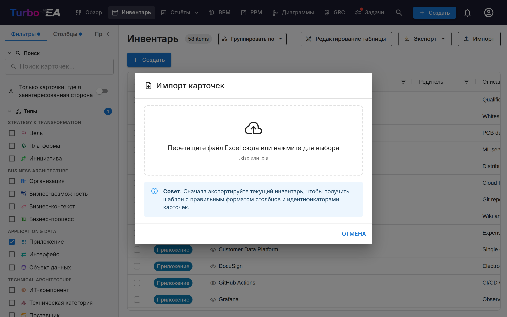

Несколько замечаний об импорте:

- **Для создания карточки обязательны только `name` и `type`.** Поля, отмеченные как *обязательные* в метамодели (в том числе у Provider или любого другого типа), не блокируют импорт — карточка всё равно создаётся, а пробелы отражаются в её оценке качества данных, а не приводят к молчаливому пропуску.
- **`/` в столбце `name` карточки экранировать не нужно.** Экранирование (`\/` для косой черты, `\\` для обратной косой черты) требуется только тогда, когда вы *ссылаетесь* на эту карточку из ячейки `parent_path`, `rel:<ключ>`, `source_ref` или `target_ref`, где `/` — разделитель пути; но и там неэкранированный `/` читается как часть имени, если по образуемому им пути карточки нет.

### Экспорт

Нажмите **Экспорт**. Текущий фильтр определяет содержимое: при фильтре по одному типу — один лист этого типа, без фильтра — по листу на каждый присутствующий тип. В любом случае книга включает `Relations` и `_Meta` и может быть импортирована обратно без потери специфических для типа атрибутов.

Также в меню «Экспорт» можно выбрать **Экспортировать текущий вид** — плоский снимок на одном листе, отражающий то, что на экране (только видимые столбцы, в текущем порядке, для отфильтрованных строк). Он предназначен для обмена и **не подходит для повторного импорта**. Если столбцы связей ещё загружаются, экспорт дождётся их, поэтому они никогда не окажутся пустыми.
