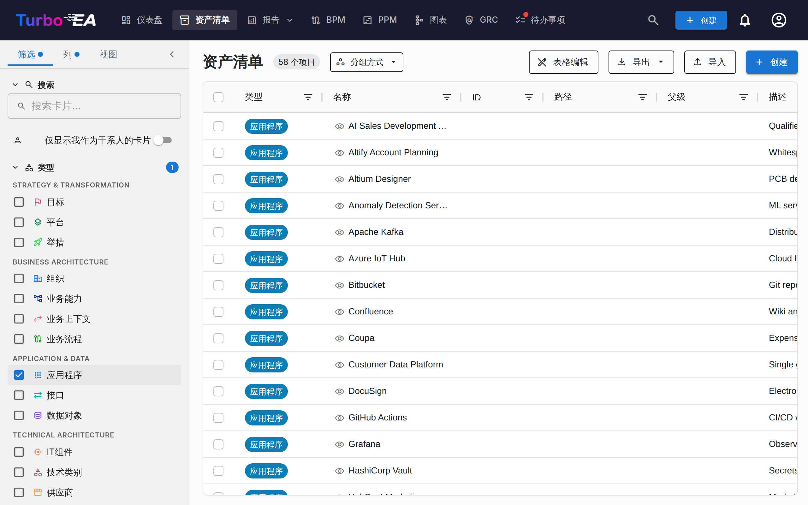
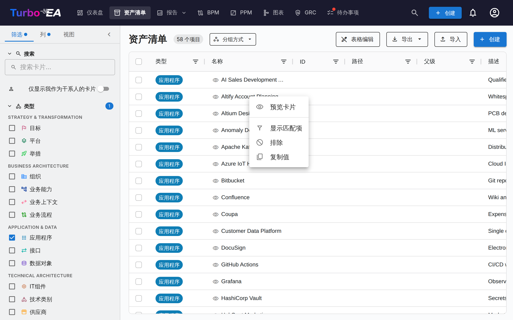
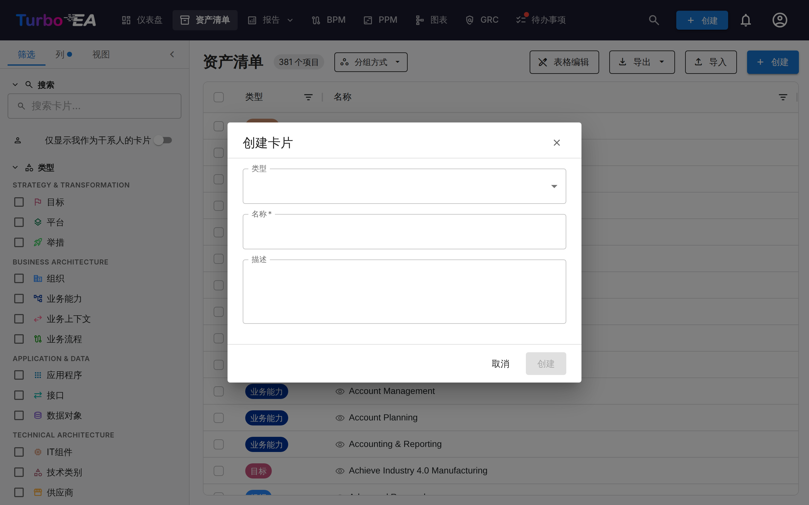
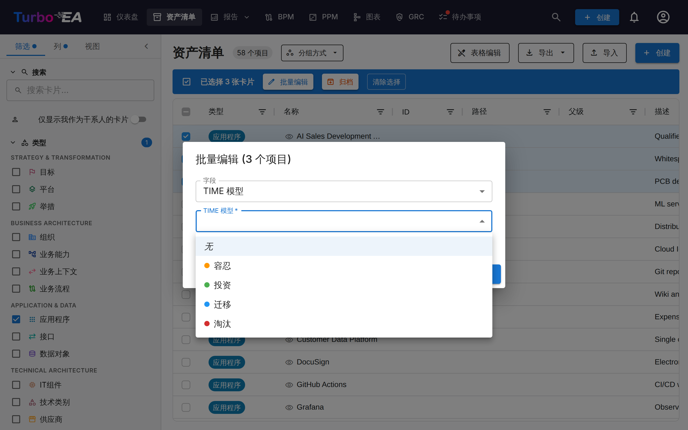
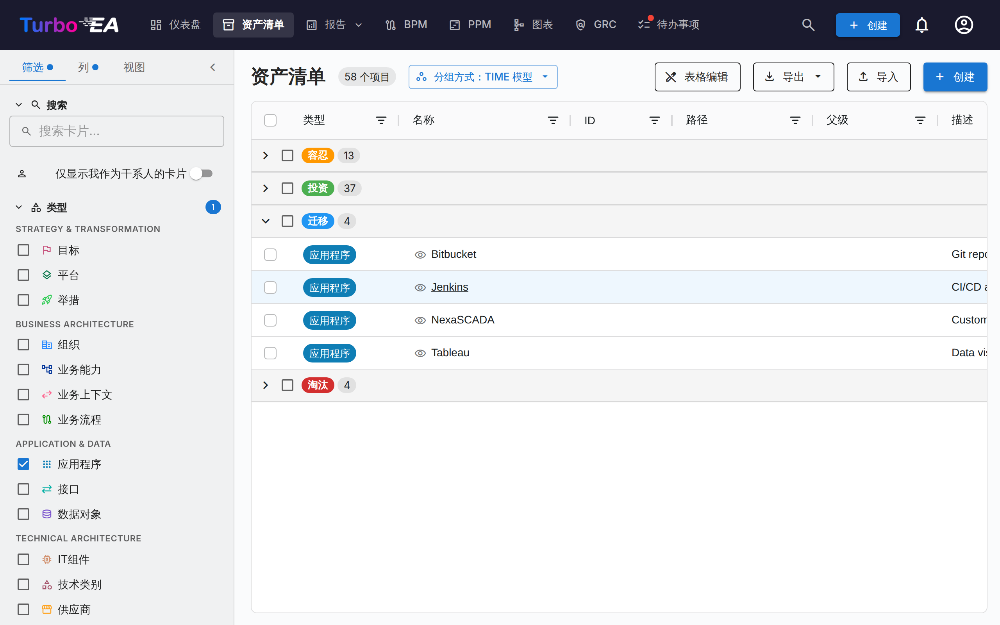
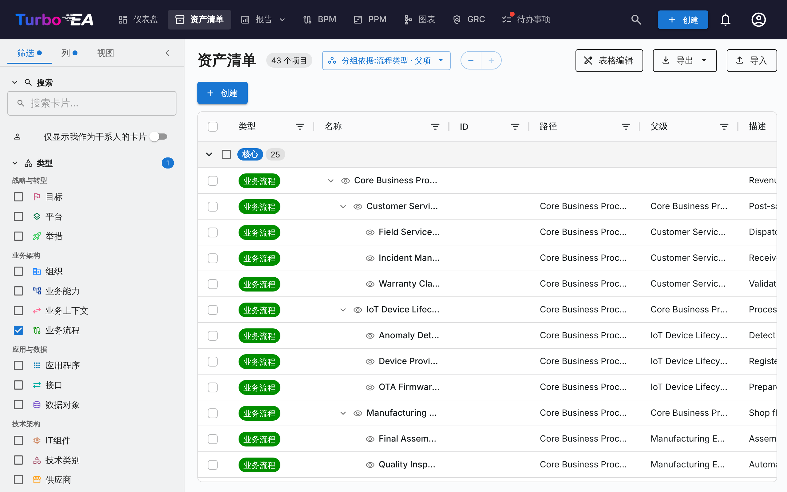
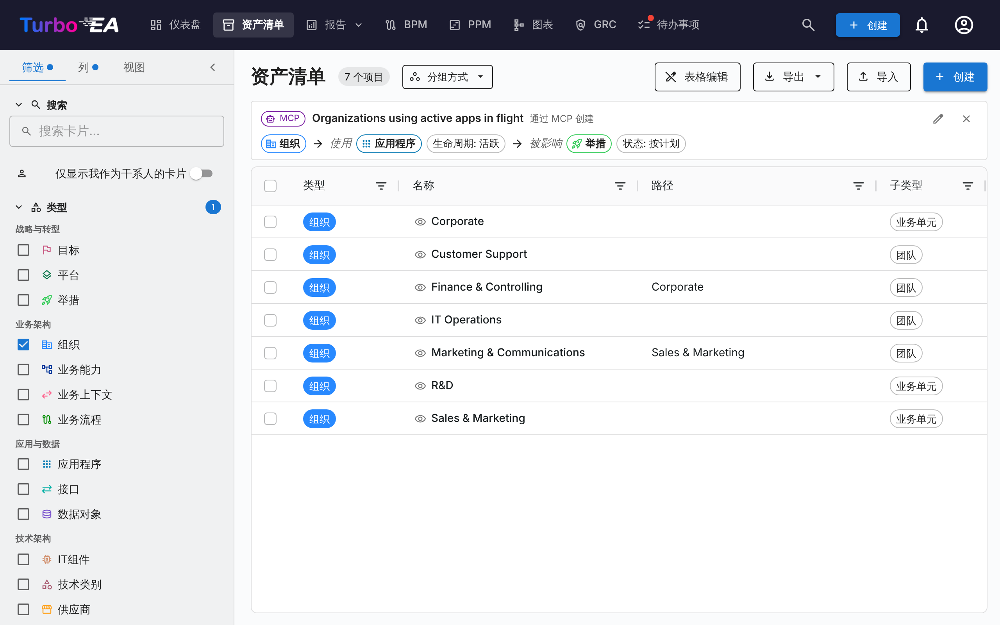
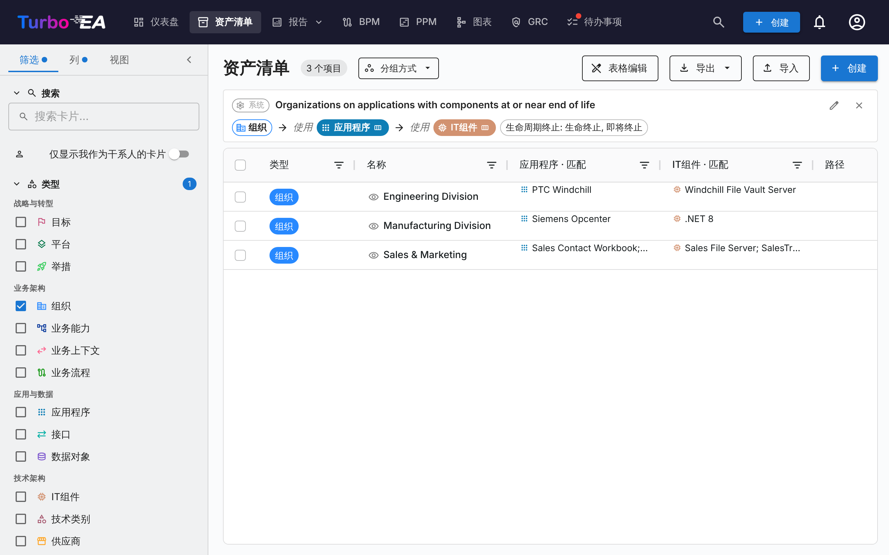
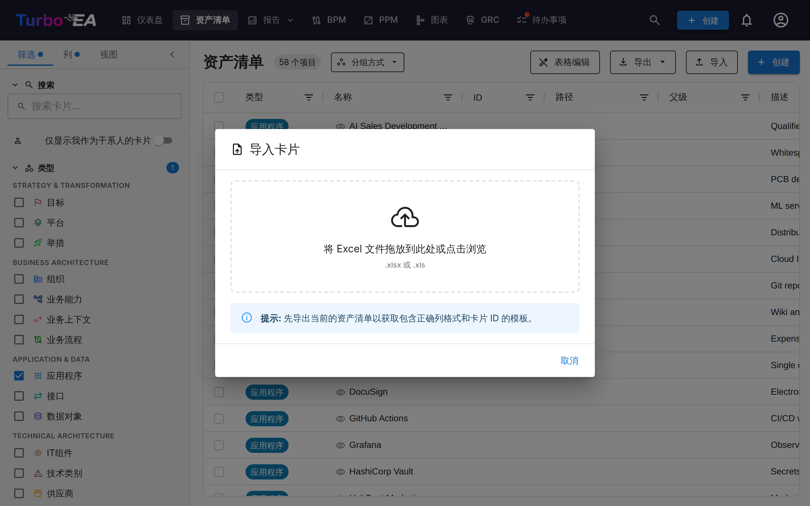

# 清单

**清单**是 Turbo EA 的核心。这里列出了企业架构的所有**卡片**（组件）：应用程序、流程、业务能力、组织、供应商、接口等等。

## 清单界面结构

### 左侧筛选面板

左侧边栏面板允许您按不同条件**筛选**卡片：

- **搜索** —— 按卡片名称进行自由文本搜索，输入第一个字母即开始。最匹配的结果排在最前：先是完全一致的名称，然后是以输入内容开头的名称，接着是输入内容位于词首的名称，最后是其余结果。Turbo EA 中的每一个搜索框都采用这一排序——全局搜索（**Ctrl+K** / **⌘K**）、各类卡片选择器、风险登记册、决策以及已发布的门户——除非您自行选择了排序方式，那将始终优先。卡片的**别名**和描述也会被匹配，因此可以用组织内实际使用的名称找到卡片——完全一致的别名与完全一致的名称同等靠前
- **类型** —— 按一种或多种卡片类型筛选，并按每种类型所属的架构层分组：战略与转型（目标、平台、项目）、业务架构（组织、业务能力、业务上下文、业务流程）、应用与数据（应用程序、接口、数据对象）以及技术架构（IT 组件、技术类别、供应商）。管理员为某个类型单独设置的层会排在这四层之后并拥有自己的标题；未设置层的类型列在最后的**未分类**下
- **子类型** —— 选择类型后，可进一步按子类型筛选（例如，应用程序 → 业务应用、微服务、AI 代理、部署）
- **审批状态** —— 草稿、已批准、已变更或已拒绝
- **来源** —— 每张卡片创建时所用的渠道：**网页界面**、**MCP**（通过 [MCP 服务器](../admin/mcp.md)连接的 AI 助手）、**API**（脚本或集成）、**扩展**或**系统**（后台任务）。选择 **MCP** 即可复核代理添加的所有内容。在 Turbo EA 记录渠道之前创建的卡片不匹配任何选项
- **生命周期** —— 按生命周期阶段筛选：规划、引入、活跃、淘汰、生命周期结束
- **数据质量** —— 按区段筛选（可多选）：完整（≥80%）、部分（40-79%）、最少（低于 40%）。与[数据质量报表](reports.md#data-quality-report)使用相同的区段，因此在那里点击某个柱形分段即可跳转至此。
- **孤立** —— 仅显示在任一方向上都没有关系的卡片。在服务端计算，因此未选择卡片类型时同样可用。
- **过期** —— 仅显示最近 90 天内未更新的卡片。两者与[数据质量报表](reports.md#data-quality-report)的 KPI 磁贴一致，在那里点击磁贴即可跳转至此。
- **生命周期终止** — 对于跟踪生命周期终止的卡片类型（默认为应用和 IT 组件，参见[其他卡片类型上的生命周期终止](../admin/eol.md)），可按 Turbo EA 从卡片的 [EOL 关联](../admin/eol.md)解析出的支持状态筛选：已终止、即将终止、受支持或未知。**（空）**列出完全没有记录的卡片。对应的**生命周期终止**列在状态圆点旁显示日期，并按日期排序和导出。
- **关联类型** —— 当选中单一支持层级的卡片类型，且管理员已为其定义[关联类型](../admin/metamodel.md)时，可按每张卡片与其上级卡片之间关联的类型进行筛选 —— 例如属于*商务*而非*销售*的子公司。**（空）**列出关联未标注类型的卡片，以及顶层卡片，因为两者都没有记录。对应的**关联类型**列以彩色标签显示该值，并可在表格编辑模式下修改。
- **标签** —— 按任何标签组的标签筛选
- **关系** —— 按跨关系类型的关联卡片筛选
- **自定义属性** —— 按自定义字段的值筛选（文本搜索、选择选项）
- **仅显示已归档** —— 切换查看已归档（软删除）的卡片
- **清除全部** —— 一次性重置所有活跃筛选条件

> **查找没有值的卡片。** 子类型、生命周期、标签、关系以及选择类自定义属性筛选器都提供 **（空）** 选项。选择该选项可仅列出该字段*没有*值的卡片——例如所有未设置生命周期的卡片。它可以与普通值组合（匹配其一），也可以跨多个筛选器组合（全部匹配）。

**活跃筛选数量**徽章显示当前应用了多少个筛选条件。

### 单元格操作

右键点击网格中的任意单元格（触摸设备上长按）即可打开针对光标所指内容的快捷操作上下文菜单，类似 ServiceNow：

- **预览卡片** — 在侧边面板中打开该单元格所指的卡片，无需离开网格；面板打开期间网格仍可正常使用，您可以继续滚动、筛选并点击其他行，然后通过面板的关闭按钮将其关闭；如果某个部分存有未保存的修改，当您预览另一张卡片、关闭面板或离开页面时，面板会先询问再丢弃这些修改
- **显示匹配项** — 只保留值与所点单元格相同的行
- **排除** — 隐藏值与所点单元格相同的行
- **复制值** — 将单元格文本复制到剪贴板
- **清除列筛选** — 移除该列的筛选（仅在有筛选生效时显示）

对于多值单元格（标签、关系、干系人、多选属性），菜单会先列出各个值，您可以按其中一个值或整个单元格进行筛选。**预览卡片**会出现在任何指向卡片的单元格上——**名称**列（该行自身的卡片）、**父级**列以及各关系列；当单元格指向多张卡片时，菜单会以同样的方式列出它们，供您选择要打开的一张。 这些筛选会进入网格自身的列筛选：它们与侧边栏筛选组合生效，计入工具栏的**清除筛选**按钮，并随视图一起保存。Turbo EA 的每个网格都提供同样的菜单——决策、风险登记册、合规以及管理网格。 当该列在左侧面板中有对应的筛选器时——卡片类型、子类型、生命周期、审批状态或单选属性——**显示匹配项**也会在面板中选中该值，**清除**会同时清除两者，因此保存的视图绝不会同时携带互相矛盾的面板筛选和列筛选。之后在面板中修改筛选器，即以面板为准。

### 列选项卡

侧面板中的**列**选项卡允许您选择在网格中显示哪些附加列。可用列会根据所选卡片类型动态变化：

- **选择单个类型** —— 该类型定义的所有属性字段均可用，包括关系列和元数据列
- **选择多个类型** —— 仅显示**所有选定类型共有的**字段
- **未选择类型** —— 提示信息建议您先选择一个卡片类型

列分为五个类别：

| 类别 | 描述 |
|------|------|
| **默认列** | 始终显示的列：类型、名称、路径、描述、子类型、生命周期、审批状态、数据质量。取消勾选可将其从表格中隐藏 — 有助于将已保存的视图收紧为您真正使用的列。 |
| **元数据** | 创建时间、修改时间、创建者、修改者、创建渠道、修改渠道。**修改时间**是卡片内容最后一次发生变化的时间——由人或集成引起，绝不会因系统重新计算分数而变动——因此可以按此日期筛选，找出需要负责人复核的卡片。**创建渠道**和**修改渠道**以徽章形式显示创建和最后一次变更所经由的渠道（MCP、API、扩展、系统）；网页界面对应的单元格保持为空。 |
| **属性** | 在元模型中定义的自定义字段（文本、数字、成本、日期、选择等） |
| **关系** | 每种关系一列，以其动词和关联的卡片类型命名——例如*使用 IT组件*或*被支持 应用程序*。当两种关系类型连接相同的卡片类型时，每种各有一列；同一卡片类型之间的关系类型（例如一个应用程序*发送数据到*另一个应用程序）则每个方向各有一列。可按动词或卡片类型搜索该列表。 |
| **干系人** | 所选卡片类型定义的每个干系人角色各一列（例如「干系人：Responsible」），以标签形式显示已分配的用户。在表格编辑模式下，双击单元格即可直接在表格中为该角色分配或移除用户（需要管理干系人的权限）。 |

**父级**列只显示层级中紧邻其上的那张卡片，而**路径**列显示整条链路。在表格编辑模式下，双击父级单元格即可移动卡片，或清空该字段将其移至顶层。仅当表格筛选为单一且支持层级的卡片类型时，该列才可编辑。若移动被拒绝——因为会形成循环、与目标下的同名卡片冲突，或超出最大层级深度——原因会显示在屏幕底部，单元格随即还原。

**路径**列显示卡片的层级面包屑（例如「北美 / 销售 / 内部销售」），不包含卡片自身的名称，因此可以同时显示「名称」和「路径」。

**徽标**列显示卡片自身的徽标；若尚未设置，则显示其类型图标——这样就可以按产品标识而非名称浏览整个架构全景。该列仅对允许徽标的卡片类型开放（开箱即用为「应用程序」和「IT 组件」），默认关闭；显示期间行高会增加，以便标识清晰可辨。若您有权编辑该卡片，将鼠标悬停在徽标单元格上并点击，即可在不离开表格的情况下上传、替换、选择品牌图标或移除徽标——与卡片详情页相同的菜单。徽标特意排除在向下填充和批量编辑之外：每张卡片一个标识，需有意设置。

**别名**列显示卡片的另一个名称——组织内部对它的称法。该列默认关闭，因为大多数架构全景中并没有别名：可在**列**选项卡中启用。它在网格编辑模式下支持行内编辑，并且像其他文本列一样支持向下填充；它还随 Excel 导出和导入一同传递，因此可以一次性载入一份别名清单。

每个类别都有一个**全选**复选框，可快速切换该组中的所有列。顶部的搜索框可按名称查找特定列。每个分区标题上的徽章显示该组中当前可见的列数。

首次选择卡片类型时，**所有属性列和关系列默认启用**。之后您可以取消勾选不需要的列。「列」选项卡底部的**重置**按钮可恢复默认列选择。

当列选择与默认值不同时，「列」选项卡标题上会出现**变更指示点**。同样的指示器也会出现在**筛选器**选项卡上（当有活动筛选器时），便于一目了然地看到哪些设置已被修改。

您的列选择、**列布局**（从左到右的顺序、宽度和固定列）、活动筛选器和排序顺序会**自动保存**在浏览器中。返回库存页面时，系统会恢复您之前的配置。保存的视图（书签）也会保留这一完整布局，因此在视图之间切换时会完全恢复您配置的列，并保持相同的排列方式——这在与利益相关者共享整理好的视图时尤为重要。

### 主表格

清单使用 **AG Grid** 数据表格，具有强大的功能：

| 列 | 描述 |
|----|------|
| **类型** | 带颜色编码图标的卡片类型 |
| **名称** | 组件名称（点击打开卡片详情） |
| **徽标** | 卡片自身的徽标；若没有，则显示其类型图标。默认关闭——在「列」标签页中启用；点击单元格即可更改 |
| **别名** | 卡片的另一个名称。默认关闭——可在「列」选项卡中启用；所有搜索框都会匹配它 |
| **描述** | 简要描述 —— 其中的网址为可点击的链接 |
| **生命周期** | 当前生命周期状态 |
| **审批状态** | 审核状态徽章 |
| **数据质量** | 带可视化圆环的完整度百分比 |
| **关系** | 每种关系一列，标题为其动词和关联的卡片类型（例如*使用 IT组件*）：显示通过该关系关联的卡片名称，按字母顺序排列；可点击弹出窗口添加或移除该关系——已关联的卡片会从其选择器中隐藏；若为分层类型，选择器会改为以缩进树显示整个层级，并将这些卡片以灰色留在原位。在关系列按关系拆分之前保存的视图和列布局，打开时会以新列取代原来的那一列 |

**表格功能：**

- **排序** —— 点击任何列标题进行升序/降序排序
- **行内编辑** —— 在网格编辑模式下，直接在表格中编辑字段值
- **向下填充某一列** —— 在网格编辑模式下，点击一个单元格，然后向上或向下拖动其角上的小方块，即可将该值复制到经过的所有行。在保存之前，确认对话框会说明所涉及的列、值以及行数；若服务器拒绝某一行，该行会连同原因和链接一并列出，而已成功的行仍会保留。该操作既支持鼠标也支持手指，还支持键盘——将焦点移到小方块上，用方向键扩展范围，按回车确认。只有经过筛选和排序后当前显示的行才会被填充；名称列被特意排除，以免两张卡片使用相同的名称。
- **多选** —— 选择多行进行批量操作
- **层级显示** —— 父子关系以面包屑路径显示
- **列配置** —— 显示、隐藏和重新排列列
- **冻结列** —— 将鼠标悬停在列标题上并点击图钉图标，即可将该列冻结在左侧边缘，横向滚动时它始终可见。再次点击图钉即可取消冻结。筛选面板的**列**选项卡中，每一列也都带有同样的图钉，因此无需寻找列标题即可冻结某列。冻结的列会按表格分别记住，并且 Turbo EA 中的每个数据表格（风险登记册、决策、合规发现、用户、资源、审计日志、PPM 风险管理）都提供相同的控件。
- **调整列顺序** —— 拖动列标题即可移动该列，也可以展开**列**选项卡顶部的**列顺序**区域，通过拖动手柄调整行的位置。该列表*就是*表格的顺序，因此两者始终一致；冻结的列会单独归为一组排在最前面，因为它们始终显示在最前——若要将某列移出该组，请在那里取消它的冻结。手柄同样支持键盘操作（空格键拿起某列，方向键移动，空格键放下）和触摸操作，因此在手机上也能调整顺序。您的列顺序会按表格分别记住，Turbo EA 中的每个数据表格都是如此。

### 工具栏

- **网格编辑** —— 切换行内编辑模式以在表格中编辑多张卡片
- **导出** —— 以 Excel (.xlsx) 文件下载数据
- **导入** —— 从 Excel 文件批量上传数据
- **+ 创建** —— 创建新卡片

## 如何创建新卡片

1. 点击**+ 创建**按钮（蓝色，右上角）
2. 在弹出的对话框中：
   - 选择卡片的**类型**（应用程序、流程、目标等）
   - 输入组件的**名称**
   - 可选填写**描述**
3. 可选点击**AI 建议**自动生成描述（参见下方 [AI 描述建议](#ai-描述建议)）
4. 点击**创建**

## 批量编辑 { #mass-edit }

使用左侧列的复选框勾选两行或更多行，然后在选择工具栏中点击 **批量编辑**。该对话框会将同一项更改应用到每一张选中的卡片。

**字段** 下拉列表按以下分组列出可修改的内容：

- **常规** — 审批状态、子类型、标签和父级
- **属性** — 所选卡片类型中定义的任何可编辑字段
- **关系** — 每种关系类型及方向各占一项（例如 *运行于 → IT 组件*）

标签、关系和父级都提供 **添加 / 移除** 切换，因此您是在扩展或缩减现有值，而不是替换它们。

当您为带有详细信息的关系类型选择 **添加链接** 时——例如两个应用之间的流向、组织如何使用某个应用，或数据对象上的创建 / 读取 / 更新 / 删除标志——对话框也会显示这些字段。您设置的内容会保存到每条新增链接上。已链接到所选目标的卡片也会获得这些详细信息，因此再次执行 **添加链接** 就是更新现有链接详细信息的方式；留空的详细信息不会被更改。

取值控件会与字段类型匹配：多选字段显示带复选框的选项列表，是/否字段显示「是 / 否」列表，日期字段显示日期选择器。将取值留空（是/否字段选择 **无**）会清除所有选中卡片上的该字段。由公式计算的字段，以及您无权查看的成本字段，不会出现在列表中。

### 调整层级结构 { #mass-edit-parent }

当您将表格筛选为单一且支持层级的卡片类型时，**父级** 字段才会出现。一张卡片只有一个父级，因此这一个字段即可覆盖层级调整的两个方向：

- **设置父级** — 选择一张同类型的卡片，所有选中的卡片都会移到它下面。这就是把多张卡片变成同一父级子项的方法。
- **清除父级** — 所有选中的卡片都会移回顶层。

卡片是逐张移动的，因此不被允许的移动只会阻塞该张卡片。对话框会保持打开，并列出哪些卡片被阻塞以及原因。常见原因包括：

- 目标父级下已存在同名卡片。
- 所选父级是被移动卡片的后代，这会形成循环。
- 该移动会使业务能力超出最多五个层级的限制。

卡片移动时会带走自己的子项，已审批的卡片会回退为 **已失效**，以便重新审核该变更。

## 分组显示资产清单 { #group-by }

点击工具栏中的**分组方式**（位于条目数旁边），即可将表格组织为可折叠的分组。生命周期阶段和审批状态始终可用；当表格筛选为单一卡片类型时，还可以按该类型的子类型及所有单选属性分组。

- 所选字段没有值的卡片会归入顶部的**未设置**分组，这是整理未分类卡片的天然起点。
- 点击分组标题可折叠或展开该分组，标题会显示分组内的卡片数量。
- 滚动浏览较长的分组时，该分组的标题会固定在列标题正下方，因此你始终知道自己正在阅读哪个分组；下一个分组的标题到达时会将其推走。它是完整的分组标题，包含复选框，因此无需滚回分组开头即可选中整个分组。
- 分组标题上的复选框会选中该组的全部卡片：批量重新分类时，展开**未设置**，勾选标题，然后通过[批量编辑](#mass-edit)设置值。这里有意不提供拖放操作——「选择再设置」在桌面、平板和手机上的体验完全一致。
- 排序在每个分组内部生效；分组设置在重新加载后仍会保留，可存入已保存的视图，也可通过 URL 参数 `group_by` 分享。

### 将子项缩进显示在父项下 { #group-by-parents }

在 **分组依据** 菜单顶部勾选 **父项**,即可将卡片显示为树形:每个父项在前,其子项缩进显示在下方。该选项可单独使用(整个表格成为一棵树),也可叠加在任意分组之上(每个分组各成一棵树)。勾选时菜单保持打开,因此可以紧接着选择分组方式。

- 卡片绝不会离开自己所在的分组。若某个子项的父项位于其他分组、被列筛选器隐藏或尚未加载,则该子项会另起一个分支,并在其名称前以灰色显示缺失的上级(例如在模块名称前显示 *SAP S/4HANA / SAP FI /*)。因此,分组计数、表头复选框和批量编辑始终与分组实际包含的内容一致。
- 点击父项名称前的箭头可隐藏或显示其分支。已折叠的父项仍会把被隐藏的卡片计入项目数和分组表头。用箭头折叠的分支不会被记住,更改列筛选器会重新展开所有分支;清除最后一个列筛选器后,会回到您通过步进按钮选择的层级。
- 启用父项层后,分组依据按钮旁的 **−** / **+** 按钮对可逐级关闭或展开整棵树。所选层级会在刷新后保留,保存在已保存视图中,并可通过 `group_tree_level=<n>` 分享;显示的层级也会随您手动展开和折叠而变化。
- 排序在同级之间生效:先对父项排序,再对每个父项下的子项排序。
- 仅当当前视图中的某个卡片类型具有层级时才会提供该选项。该设置会在刷新后保留,保存在已保存视图中,并可通过 URL 参数 `group_tree=1` 分享。
- **导出**遵循树形顺序,并像处理已折叠的分组一样,省略已折叠分支中的卡片。

## AI 描述建议 { #ai-description-suggestions }

Turbo EA 可以使用 **AI 为任何卡片生成描述**。此功能适用于创建卡片对话框和现有卡片详情页面。

**工作原理：**

1. 输入卡片名称并选择类型
2. 点击卡片标题中的**星光图标**，或在创建卡片对话框中点击**AI 建议**按钮
3. 系统执行**网络搜索**（使用类型感知的上下文 —— 例如「SAP S/4HANA 软件应用程序」），然后将结果发送给 **LLM** 生成简洁、事实性的描述
4. 建议面板显示：
   - **可编辑的描述** —— 在应用前查看和修改文本
   - **置信度评分** —— 表示 AI 的确定程度（高 / 中 / 低）
   - **可点击的来源链接** —— 描述所引用的网页
   - **模型名称** —— 生成建议的 LLM
5. 点击**应用描述**保存，或点击**取消**放弃

**主要特点：**

- **类型感知**：AI 理解卡片类型上下文。「应用程序」搜索会添加「软件应用程序」，「供应商」搜索会添加「技术供应商」等。
- **隐私优先**：使用 Ollama 时，LLM 在本地运行 —— 您的数据永远不会离开您的基础设施。也支持商业提供商（OpenAI、Google Gemini、Anthropic Claude 等）
- **管理员控制**：AI 建议必须由管理员在[设置 > AI 建议](../admin/ai.md)中启用。管理员选择哪些卡片类型显示建议按钮，配置 LLM 提供商，以及选择网络搜索提供商
- **基于权限**：只有拥有 `ai.suggest` 权限的用户才能使用此功能（默认对管理员、BPM 管理员和成员角色启用）

## 已保存视图（书签）

您可以将当前的筛选、列和排序配置保存为**命名视图**以便快速复用。

### 创建已保存视图

1. 按您期望的筛选条件、列和排序配置清单
2. 点击筛选面板中的**书签**图标
3. 输入视图的**名称**
4. 选择**可见性**：
   - **私有** —— 仅您可见
   - **共享** —— 对特定用户可见（可选编辑权限）
   - **公开** —— 对所有用户可见

### 使用已保存视图

已保存视图显示在筛选面板侧边栏中。点击任何视图可立即应用其配置。视图按以下类别组织：

- **我的视图** —— 您创建的视图
- **与我共享** —— 他人与您共享的视图
- **公开视图** —— 所有人可用的视图

### 查询视图 { #query-views }

**查询视图**是一种已保存的视图，其筛选条件是一个**多跳查询**——由一连串关系组成，每一步都带有条件，例如「使用某个活动状态应用程序、而该应用程序受到状态为 On Track 的举措影响的组织」。多个这样的查询可以堆叠在同一个视图中，并用**且**和**或**组合（见下文）。视图保存的是查询而不是结果：每次打开视图时都会重新运行查询，因此列表始终反映当前的全景。

**构建查询视图。** 在筛选侧边栏的**视图**选项卡中，点击*保存当前视图*旁边的**新建查询视图**（凡有权管理视图的用户均可看到）。如果有任何筛选器处于活动状态（包括已选的卡片类型），会先弹出确认再清除；在草稿上点击**取消**可将其恢复。网格上方的条带将变为查询构建器：

1. 点击起始芯片（*选择类型*），选择该查询起始的卡片类型，也就是它所列出的类型。
2. 点击最后一张卡片之后的 **+ 关系** 以添加一跳。菜单列出每个关系动词及其所通向的卡片类型；同一类型卡片之间的关系会在两个方向上都提供。每一行查询都是最多三跳的单条链。
3. 点击任意卡片下方的 **+ 条件** 以进一步限定：**生命周期**、**子类型**、**审批状态**、**数据质量**（*完整*、*部分*或*最少*，与侧边栏筛选器的档位相同）、**生命周期终止**（见下文）、**标签**、**指定卡片**，或该卡片类型的选择字段或是/否字段。对于标签，只要卡片带有某个组中所选的任一标签即匹配，且必须匹配您添加的每个组；仅提供适用于该卡片类型的标签组。 **指定卡片** 会打开该类型卡片的卡片选择器，此步骤随后只匹配您所选的卡片；对于有层级的卡片类型，**包含子卡片** 开关还会匹配每个所选卡片之下的卡片。您看不到的已选卡片显示为 *(隐藏卡片)*。
4. 点击**保存**。随后会打开常规的保存视图对话框，用于设置名称、可见性、共享和 OData 设置。**取消**会丢弃该查询。

构建过程中，网格会实时筛选，工具栏中的计数显示匹配的卡片数量，因此您可以在保存之前看到每一跳和每个条件的效果。

**按生命周期终止筛选。** 对于跟踪生命周期终止的卡片类型，会提供**生命周期终止**条件——默认是应用程序和 IT 组件；它遵循元模型中该类型的「生命周期终止」部分。其取值为**生命终止**、**即将终止**、**支持中**、**未知**，以及用于没有生命周期终止数据的卡片的*（空）*。该状态与清单的**生命周期终止**列所显示的一致：它来自关联的 endoflife.date 产品或自定义 EOL 产品，或来自手动输入的生命周期终止日期，并且与卡片的生命周期阶段无关。该条件可用于起始卡片和任何关系步骤，在“且”行和“或”行中均可——例如*使用处于生命终止状态的 IT 组件的应用程序*。当查询在起始卡片上按它筛选时，网格会显示「生命周期终止」列，以便您了解每张卡片为何匹配；您选择的列不会改变。如果无法访问 endoflife.date 且没有缓存，关联的卡片会显示为*未知*，与「生命周期终止」列中一致。

该条件需要查看生命周期终止数据的权限（**查看 EOL 数据**，`eol.view`）。没有该权限时，不会提供该条件，打开、预览或保存使用它的视图会被拒绝，并提示*此视图按生命周期终止状态筛选，而您的角色无法查看该状态。*

**更改跳和条件。** 点击某一跳的动词芯片以打开其菜单：**没有**会把该跳变为要求卡片**没有**此类关系，**移除此跳**会将其连同之后的所有跳一并移除。点击条件芯片可更改其取值，点击其 **×** 则将其移除。

**用「且」和「或」组合查询。** 一个视图可以包含多行上下堆叠的查询。每一行都是一个完整的查询——起始卡片、关系和条件——其构建方式与上面的单个查询完全相同。各行会被分组：

- **且**会在同一组中添加一行：只有当卡片匹配该组的**每一**行时，才会被列出。「且」行与其所在组从同一卡片类型开始，显示为固定的芯片；只要组内有「且」行，该组的第一行就不能更改其卡片类型。
- **或**会在**或**分隔线下方开始一个新组：其结果会**添加**到列表中。新组可以从另一种卡片类型开始，因此一个视图可以同时列出例如应用程序和组织。当视图列出多种卡片类型时，表格会显示这些类型共有的列。

在编辑模式下，每个组下方带圆圈的**加号**会询问选择**且**还是**或**：「且」会向该组添加一行，「或」会在其后开启一个新组。行末的 **×** 用于移除该行；当视图多于一行时才会显示。

例如，演示视图 *Active apps on aging tech, and the organizations using apps* 有一个由两行组成的应用程序组——一个使用处于淘汰阶段或已终止支持的 IT 组件的活跃应用程序，**且**一个受到举措影响的应用程序——**或**一个使用应用程序的组织。列表显示同时满足这两行的应用程序，以及每个使用应用程序的组织。

一个视图最多包含**六**行查询、所有行合计**十二**个关系，每一行最多**三**层关系深度。「且」组中的各行仅在起始卡片处汇合：一行中的 IT 组件与另一行中的举措可以是不同的卡片。对一行中间的**同一**张卡片提出两项要求——例如同一个 IT 组件既由某个提供商提供，**又**属于某个技术类别——无法在查询构建器中构建；AI 助手可以通过 [MCP 服务器](../admin/mcp.md#multi-hop-card-queries)编写这样的查询，之后条带会将其显示出来。

**编辑已保存的查询视图。** 打开查询视图时，条带会显示其路径：以芯片显示卡片类型，由连接每一步的关系动词串联起来（例如*组织 → 使用 应用程序 → 受到 举措 影响*），每张卡片的条件显示在其下方。包含多行的视图会显示同样的堆叠，带有「且」标记和「或」分隔线，但没有编辑控件。如果您是该视图的所有者或拥有其编辑权限，条带中的**铅笔**图标会将其切换到同一个构建器；**保存**会更新该视图。**×** 按钮（*离开此视图*）会返回普通清单。在打开查询视图时点击**保存当前视图**，会用相同的查询保存一个新的查询视图。

#### 查看匹配背后的卡片 { #query-view-matches }

查询视图只列出其查询的第一张卡片。要查看链中更靠后的哪些卡片使某一行匹配，请在查询路径中点击它们的卡片类型。在*使用某个应用程序、而该应用程序使用已终止支持或即将终止支持的 IT 组件的组织*中，点击**应用程序**，会有一列为每个组织列出其借以匹配的应用程序；点击 **IT 组件**，另一列会列出符合条件的 IT 组件。再次点击该卡片类型即可移除其列。

- **开关的样子。** 可点击的卡片类型会显示指针和工具提示*在列中显示这些卡片*。其列开启后，芯片以该卡片类型的颜色填充，并带有一个小的列图标；其工具提示为*隐藏该列*。
- **哪些卡片类型是开关。** 每一查询行中第一个之后的每个卡片类型。查询行的第一个卡片类型不是开关，因为它的卡片就是表格中的行；位于**没有**之后的卡片类型也不是，它表示缺少的关系。在包含多个查询行的视图中，每一查询行的卡片类型都是开关；使用**或**时，表格中的一行只为它满足的查询行显示卡片。编辑查询时开关不可用，在您保存或取消之前这些列会被隐藏。
- **列出现的位置。** 紧跟在**名称**之后，标题由卡片类型和*匹配*组成（例如*应用程序 · 匹配*），以免与*使用 应用程序*这类关系列混淆，后者会列出以该方式关联的所有应用程序。当两个步骤的卡片类型相同时，标题会编号。将鼠标悬停在标题上可查看该列所沿的路径。
- **单元格显示的内容。** 匹配卡片的名称，以分号分隔；将鼠标悬停在单元格上可查看完整列表。一个单元格最多列出 **100** 个名称；更长的列表以 *…* 结尾，其工具提示会说明仅显示前 100 个。您可以像文本列一样对该列排序和筛选，**导出当前视图**也会包含它。
- **链上的每张卡片，而不是谁通向谁。** 一行会列出该步骤上每张匹配的卡片：该组织所有符合条件的应用程序，以及这些应用程序所有符合条件的 IT 组件。它不会显示哪个 IT 组件属于哪个应用程序。若要逐行列出 IT 组件本身，请改为从 IT 组件开始编写查询。
- **随视图保存。** 您开启的列会随视图一起保存（视图列表中的**铅笔**图标，然后点击**更新**），因此再次打开时它们仍在。编辑查询时，只要某列的步骤仍然存在，该列就会保留；当您移除该步骤或更改其卡片类型时，该列会被移除。

您只能看到有权查看的卡片：对您隐藏的卡片绝不会出现在单元格中，仅通过隐藏卡片匹配的行也不会被列出。

演示视图 *Organizations on applications with components at or near end of life* 打开时两列均已开启。

**由 AI 助手创建的视图。** 通过 [MCP 服务器](../admin/mcp.md)连接的助手也可以创建查询视图。这样的视图会在其条带中显示 **MCP** 芯片和*通过 MCP 创建*的提示，并在视图列表中显示机器人徽章；其编辑方式与其他查询视图相同。在视图列表中，每个查询视图都带有一个小的查询视图徽章（立方体；由助手创建时为机器人徽章），并以其紧凑路径（*组织 › 使用 应用程序 › 受到 举措 影响*）作为第二行；堆叠视图读作 *…且…或…*。如果视图有条件，其数量会跟在路径之后（*… › 受 Initiative 影响 · 2 个条件*）。

**通过链接打开视图。** 助手保存视图时会返回形如 `/inventory?view=<view id>` 的链接；打开它会直接应用已保存的视图。同一链接对您能看到的任何已保存视图都有效。

**OData。** 查询视图的 OData 数据源返回与清单相同的卡片：该查询同样会应用于数据源。

有关查询语法、其限制以及 MCP 工具（`query_cards`、`list_inventory_views`、`save_inventory_view`、`list_tag_groups`），请参阅[多跳卡片查询](../admin/mcp.md#multi-hop-card-queries)。

## Excel 导入 / 导出 { #excel-import }

清单的导入和导出使用**多工作表 Excel 工作簿**，可完整往返一个子景观——任意数量类型的卡片以及它们之间的关系——无需复制任何 UUID。

### 工作簿结构

- **每个卡片类型一个工作表**（Application、Business Capability、IT Component、……），包含核心列、`attr_<字段>` 自定义属性列、生命周期列`rel:<关系类型>` 关系列以及 `stakeholder:<角色键>` 干系人列。
- **`Relations` 工作表**记录关系所携带的**值** —— 其类型拥有可填写值的关系，每条一行。

分工简单且无例外：**卡片工作表说明哪些卡片被关联，`Relations` 工作表说明这些关联携带了什么。** 每个关系类型都会在其起点卡片类型的工作表上获得一个 `rel:` 列，无论它是否携带值。
- **`_Meta` 工作表**记录工作簿格式版本。

### 无 GUID 识别

当卡片名称在其类型内唯一时按**名称**识别，否则按完整的 **`parent_path`** 识别。若仅有一张 Application 名为 `NexaCore ERP`，关系单元格可直接写 `NexaCore ERP`；若名称重复，使用 `Sales / Customer Mgmt / CRM`。

#### 同级唯一性

由于卡片按"名称 + 路径"识别，**同一类型的两张卡片不能同时拥有相同的父级与相同的名称**。任何会产生此类冲突的新卡片在创建时都会被拒绝（包括"创建卡片"对话框、内联重命名以及表格导入）。数据库中已有的重复项（来自旧 Seed 或导入）保持不变 —— 您可以编辑它们的任何字段，但创建第三个重复或将卡片重命名回冲突状态会被阻止。比较时忽略大小写和首尾空白，与导入器的解析器一致。当"创建卡片"对话框拒绝重复项时，警告会显示已存在的卡片，并提供**查看现有卡片**链接直接跳转到该卡片。

### 内联关系单元格

每个 `rel:<关系类型>` 列以**分号分隔**的目标引用表达出向关系（例如 `NexaCore ERP; BillingApp`）。使用分号而非逗号，因为卡片名称中常包含逗号（如 `Acme, Inc.`）。名称内的 `/` 与 `\` 会被转义为 `\/` 与 `\\`，`;` 会被转义为 `\;` —— 导出器会自动处理（例如 `SAP S/4HANA` → `SAP S\/4HANA`）。转义后的引用始终是精确的。手工填写的单元格可以不转义 `/`：`SAP S/4HANA` 先按路径读取（*SAP S* 下名为 *4HANA* 的卡片），若该路径上没有卡片，则按单个名称读取；当该类型中恰好只有一张卡片使用此名称时即可匹配。单元格是**声明式**的：单元格内容会替换该类型下源卡片的全部出向关系。从列表中移除一个目标会删除对应关系；清空单元格则全部删除。在 Turbo EA 导出的工作簿中（含 `_Meta` 工作表），逗号从不作为分隔符，因此只含一个目标的单元格（如 `This is X, it does Y`）仍视为一个目标。没有 `_Meta` 的工作表（手工创建或在 1.23 之前导出）仍可用逗号分隔目标：若单元格中没有 `;`，当整个单元格指向一张卡片时按单个目标读取，否则按逗号分隔读取。 每个以本工作表卡片类型为起点的关系类型各占一列 —— **全部**，包括携带值的类型。目标按字母顺序排列，因此对未变更的架构再次导出会得到完全相同的文件。

`tags` 列遵循相同规则：以 `; ` 分隔的 `分组: 标签` 条目（例如 `Vendor: Acme, Inc.; Region: EU`），标签名中的 `;` 写作 `\;`。2.156.1 之前导出的工作簿以逗号分隔标签，仍按原方式导入。

### 干系人单元格

在每个卡片工作表上，`stakeholder:<角色键>` 列以**分号分隔的电子邮件地址**携带分配给各干系人角色的用户（与 LeanIX 的 `subscriptions:<RoleType>` 导出列约定一致），例如 `ada@corp.com; bob@corp.com`。**电子邮件地址是唯一接受的用户引用** —— 显示名可能重复，绝不用于匹配；手工编写的 `姓名 <email>` 条目可被接受（使用尖括号中的邮箱），仅有姓名的条目会产生警告并被跳过。与关系单元格一样，干系人单元格**按角色声明式生效**：导入后，单元格中列出的用户将成为该角色的完整分配集合。从列表中移除用户即取消分配；清空单元格即清空该角色；完全省略该列则保持现有分配不变。无法匹配用户的条目会产生警告并被跳过 —— 绝不会阻止导入。

!!! note "在角色键改为驼峰式之前导出的工作表"
    干系人角色键与其他所有元模型键一样使用驼峰式约定。在此变更之前导出的工作表包含 `stakeholder:technical_application_owner` 这样的列标题；它们仍可导入 —— 当没有角色与列标题完全匹配时，会将其匹配到对应的驼峰式角色。新导出的工作表使用驼峰式形式。

**生命周期日期单元格** — `lifecycle_<phase>` 列（`lifecycle_plan`, `lifecycle_phaseIn`, `lifecycle_active`, `lifecycle_phaseOut`, `lifecycle_endOfLife`）遵循相同的规则，每列一个日期：**清空单元格会从卡片中移除该日期**，完全省略该列则保持该日期不变。普通值单元格则相反：描述、子类型、别名、外部 ID、父级标签或属性（`attr_<field>`）的空单元格会保持已存储的值不变；如需清除这些值，请在卡片上或在清单网格中操作。

### `Relations` 工作表

关系可以携带自身的值 —— `Organization` → `Application` 关联上的*使用类型*、年度成本，或自由描述。`rel:` 单元格是一串名称，放不下这些值，因此它们位于 `Relations` 工作表，每条关系一行，列为：`relation_type`、`source_type`、`source_ref`、`target_type`、`target_ref`、`attr_<字段>` 以及 `description`。

该工作表收录类型确实拥有值的关系 —— 其余关系无值可填，完全存在于卡片工作表中。指*向*所导出卡片的关系同样列出；`source_ref` 与 `target_ref` 表明方向。`attr_<字段>` 列仅为本工作簿中关系类型的字段。排序依次为来源卡片、关系类型、目标。

**本工作表只设置值，从不创建或移除关系** —— 那是卡片工作表的职责：**删除某一行不会删除任何内容**；编辑其值会替换该关系所携带的内容；若某行所指的两张卡片并未关联，则会在预览中提示并跳过 —— 请在 `rel:` 列中建立关联，可在同一次导入中完成。

较旧的工作簿含有 `action` 列，现已忽略；`action = delete` 的行会被提示并跳过。若卡片工作表与 `Relations` 工作表相互矛盾，**以移除为准**。

该工作表列出**所导出卡片的每一条关系**，无论其类型当前是否携带值 —— 因此刚刚被赋予某个值的关系类型在此已有对应行。指*向*所导出卡片的关系同样列出；`source_ref` 与 `target_ref` 表明方向。`attr_<字段>` 列仅为本工作簿中关系类型的字段，而非实例中定义的全部字段。

携带值的关系类型**没有 `rel:` 列** —— 名称列表容纳不下这些值；请在本工作表中编辑。若卡片工作表与 `Relations` 工作表相互矛盾，**以移除为准**，预览会予以提示。

### 导入

点击工具栏中的**导入**，将工作簿拖入对话框并在应用前查看预览。你会看到要创建/更新的卡片，以及要新增/移除的关系。错误（例如目标不明确并列出候选路径）会阻止应用。

关于导入的几点说明：

- **创建一张卡片只需要 `name` 和 `type`。** 在元模型中标记为「必填」的字段（包括 Provider 或任何其他类型）不会阻止导入——卡片仍会被创建，缺失的内容只会反映在其数据质量评分中，而不会导致卡片被悄悄跳过。
- **卡片自身 `name` 列中的 `/` 无需转义。** 只有当你在 `parent_path`、`rel:<key>`、`source_ref` 或 `target_ref` 单元格中*引用*该卡片时才需要转义（`\/` 表示斜杠，`\\` 表示反斜杠），因为在那些列中 `/` 是路径分隔符；即便如此，当未转义的 `/` 所构成的路径上没有卡片时，它也会被视为名称的一部分。

### 导出

点击工具栏中的**导出**。当前过滤决定内容：单类型过滤时仅导出该类型的工作表；不过滤或多类型时按存在的每种类型导出一个工作表。任一情况下工作簿都包含 `Relations` 与 `_Meta`，可重新导入且不会丢失类型特定的属性。

您也可以在导出菜单中选择**导出当前视图**——这是与屏幕一致的单工作表平面快照（仅包含可见列，按当前顺序，针对筛选后的行）。它用于共享，**不适合重新导入**。如果关系列仍在加载中，导出会等待其加载完成，因此这些列不会为空。
