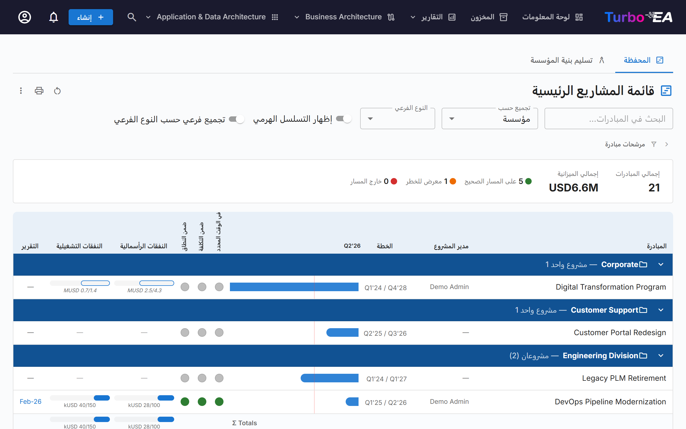
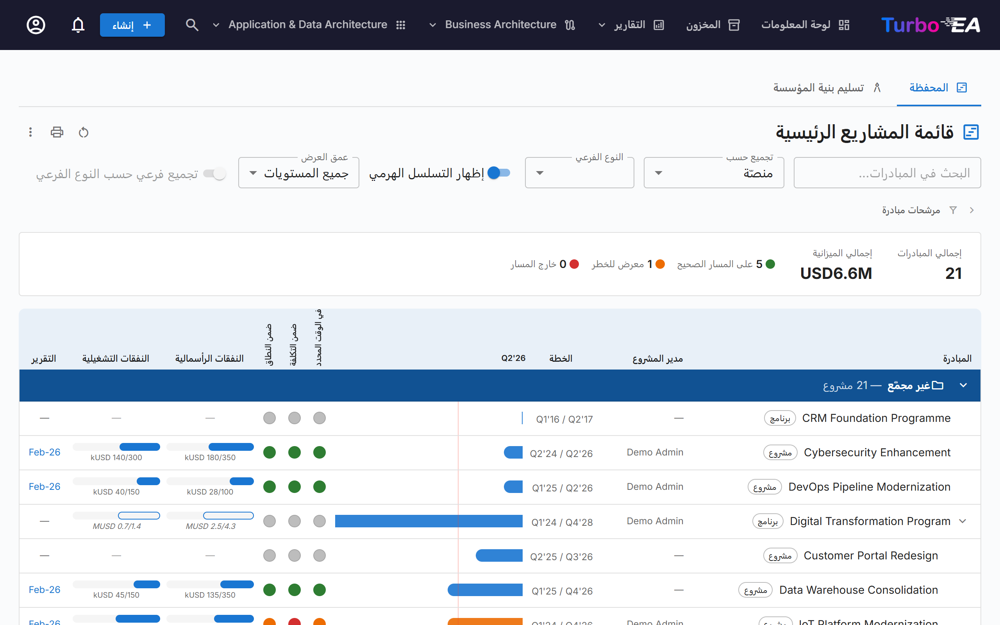
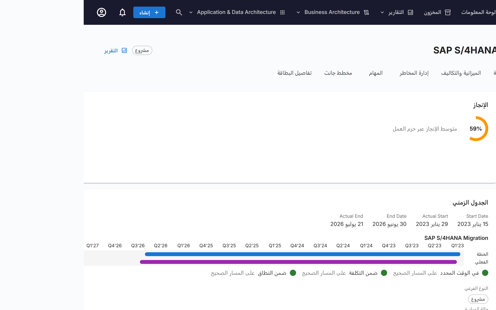
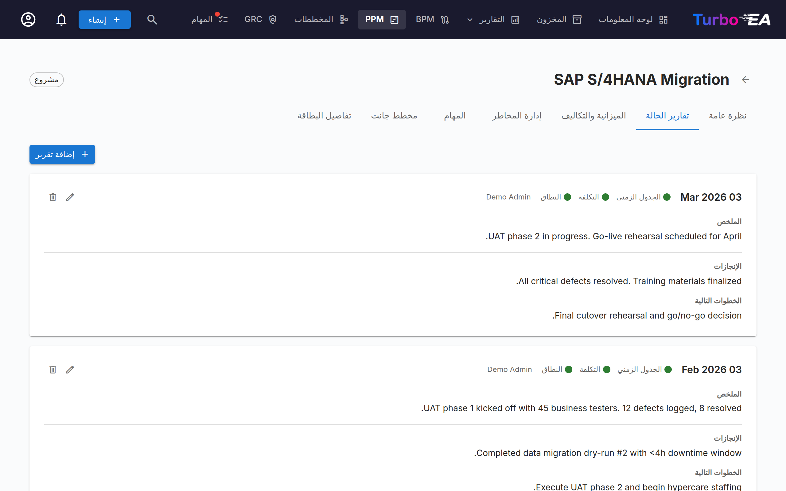
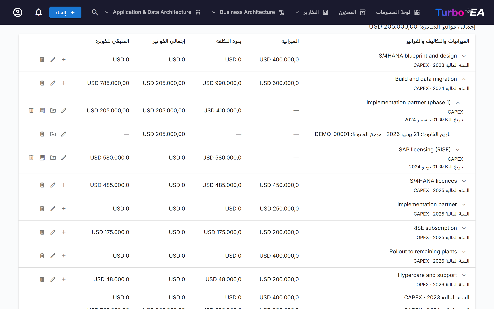
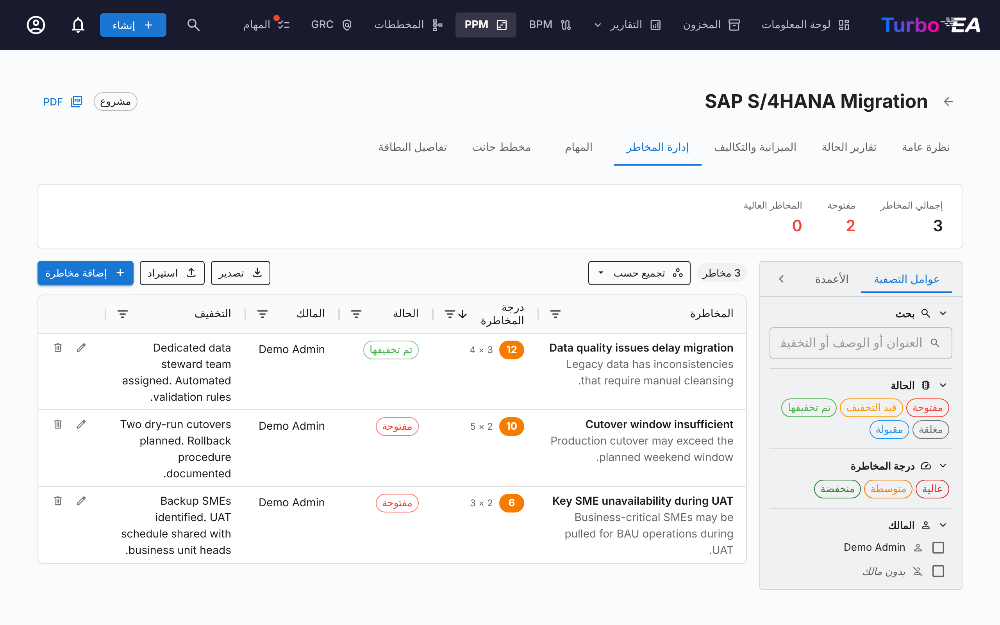
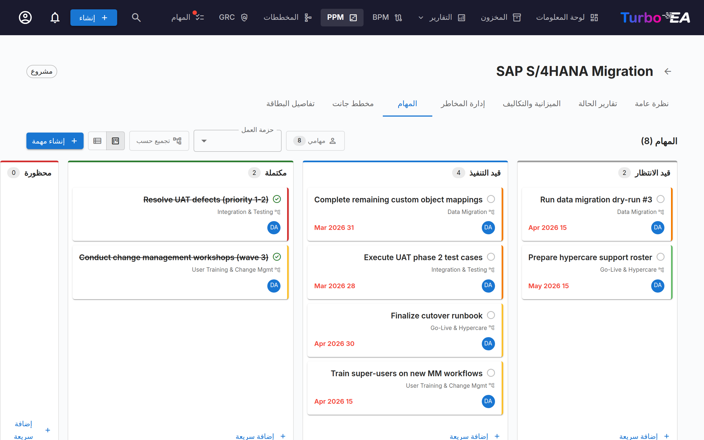
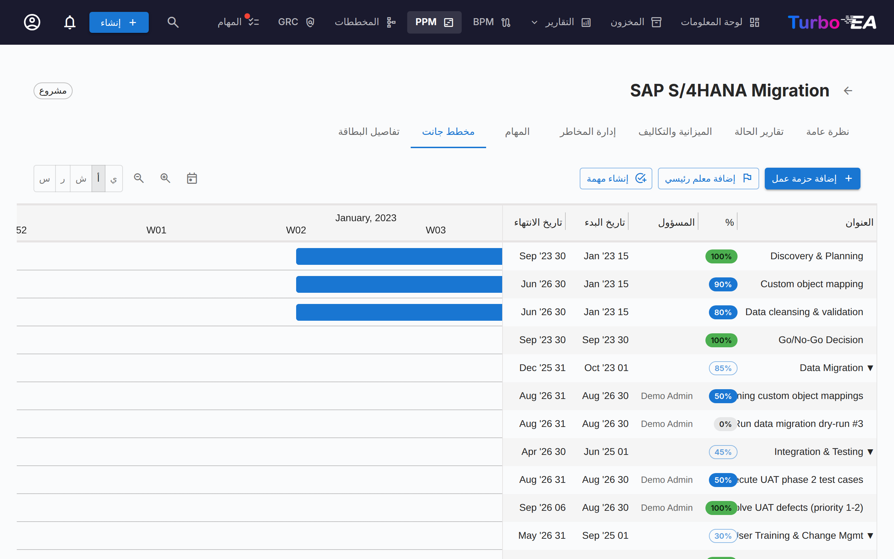
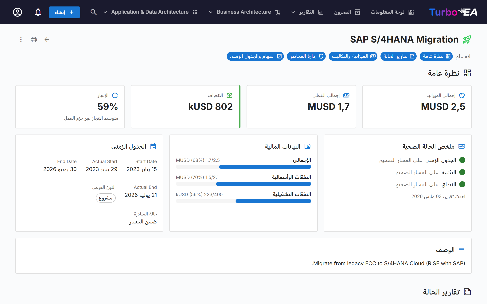

# قائمة المشاريع الرئيسية (PML)

افتح **قائمة المشاريع الرئيسية** من شريط التنقل لتتبّع بطاقات المبادرات والميزانيات والمخاطر والمهام والجداول الزمنية. تجمع الوحدة بين تقارير الحالة والتتبّع المالي ومخططات Gantt.

!!! note
    يمكن للمسؤول تفعيل وحدة PML أو تعطيلها في [الإعدادات](../admin/settings.md). عند التعطيل، يُخفى تنقّل PML وميزاتها.

## لوحة معلومات المحفظة

يعرض الجدول الزمني الداخلي مسارَي **الخطة** و**الفعلي** على مقياس ربعي. يظهر التاريخ الوحيد كعلامة، وتظهر التواريخ الدقيقة للمستخدم المخوّل. تعرض بوابة المحفظة العامة مسار **الخطة**.

**لوحة معلومات المحفظة** هي نقطة الدخول الرئيسية إلى PML. وهي توفّر:

- **شريط KPI** — عدد المبادرات، وإجمالي ميزانيتها (حيث تُعرض عليك التكاليف)، وعدد المبادرات التي حالتها من حيث الجدول الزمني «على المسار الصحيح» و«معرض للخطر» و«خارج المسار». وتتبع الأرقام المحفظة: إذ يحصرها البحث واختيار النوع الفرعي وقسم **المرشحات** في المبادرات التي تنظر إليها
- **نظرة عامة على Gantt** — أشرطة زمنية تُظهر تاريخ بداية ونهاية كل مبادرة، مع مؤشرات صحة RAG

### التجميع والترشيح

استخدم شريط الأدوات من أجل:

- **التجميع حسب** أي نوع بطاقة مرتبط (مثل المنظمة أو المنصة) لرؤية المبادرات مجمّعة حسب وحدة الأعمال أو المنصة التقنية
- **التجميع حسب** نوع فرعي للمبادرة (مثل البرنامج)، مُدرج في قسم ثانٍ من القائمة نفسها، لرؤية كل برنامج مع جميع المبادرات التابعة له (انظر أدناه)
- **الترشيح حسب النوع الفرعي** (فكرة، برنامج، مشروع، Epic)
- **البحث** حسب اسم المبادرة
- **إظهار التسلسل الهرمي** لتضمين مبادرات كل مجموعة تحت المبادرة الأصل الخاصة بها (انظر أدناه)
- **التجميع الفرعي حسب النوع الفرعي** لتقسيم كل مجموعة حسب النوع الفرعي (انظر أدناه)

تُحفَظ هذه الإعدادات في عنوان URL، فيحتفظ تحديث الصفحة بعرضك الحالي، ويفتح الرابط الذي تشاركه المحفظة نفسها. وتتذكّر المحفظة أيضًا البحث والتجميع والنوع الفرعي وإعدادات التسلسل الهرمي والمرشّحات في متصفحك، وتستعيدها عند عودتك — من قائمة PML، أو بسهم الرجوع بعد فتح مبادرة. والرابط الذي يحمل إعداداته الخاصة يُفتح بها، وتصبح هي الإعدادات المحفوظة. وتُعيد أيقونة **إعادة التعيين إلى الافتراضيات** في شريط العنوان المحفظة إلى إعداداتها الافتراضية.

#### قسم المرشحات

يوجد أسفل شريط الأدوات قسم **المرشحات**، وهو مطويّ عند فتح المحفظة للمرة الأولى كي تبقى ظاهرة، ثم يبقى بعد ذلك على الحالة التي تركته عليها آخر مرة؛ وأثناء طيّه تُظهر شارة في ترويسته عدد المرشّحات النشطة. افتحه لتضييق المحفظة باستخدام المرشّحات نفسها المتاحة في التقارير:

- **البطاقات المرتبطة** — تُبقي المبادرات المرتبطة بالبطاقات التي تختارها، مثل مؤسسة أو تطبيق. ويُبقي **تضمين البطاقات الفرعية** أيضًا المبادرات المرتبطة بالبطاقات الواقعة تحت بطاقة مختارة في تسلسلها الهرمي
- **الوسوم** — تُبقي المبادرات التي تحمل الوسوم التي تختارها
- **الحقول** — تُبقي المبادرات التي تطابق حقولها الخاصة (سمات نوع المبادرة) القيم التي تختارها

تُحفَظ المرشّحات النشطة في عنوان URL وتُتذكَّر مع بقية إعدادات المحفظة، فيفتح الرابط الذي تشاركه المحفظة نفسها، وتُدرَج في سطر المعاملات عند الطباعة أو التصدير. ويُفرغ **مسح الكل** قسم المرشحات ويترك بقية شريط الأدوات كما هو.

#### إظهار التسلسل الهرمي للمبادرات

عندما تكون لبعض المبادرات في المحفظة مبادرة أصل موجودة في المحفظة أيضًا، يعرض شريط الأدوات مفتاح **إظهار التسلسل الهرمي**. عند تفعيله، تعرض كل مجموعة مبادراتها على شكل شجرة: تظهر المبادرة الفرعية بإزاحة تحت أصلها، ويطوي السهم الموجود قبل اسم المبادرة الأصل شجرتها الفرعية أو يوسّعها، ويعرض كل صف نوعه الفرعي حتى يبقى دور كل مستوى (مثل برنامج ← مشروع ← Epic) واضحًا. ويحصر **عمق العرض** الشجرة في مستوياتها الأولى (*المستوى 1*، *المستوى 2*، … أو *جميع المستويات*).

يبقى التجميع هو الأساس: يُبنى التسلسل الهرمي **داخل كل مجموعة**، فتظهر المبادرة التي ينتمي أصلها إلى مجموعة أخرى كصف في المستوى الأعلى من مجموعتها. تُطبَّق المرشّحات أولًا وتعرض الشجرة ما تبقّى: عندما يستبعد البحث أو مرشّح النوع الفرعي مبادرة أصلًا، تنتقل مبادراتها الفرعية إلى المستوى الأعلى بدلًا من الإبقاء على الأصل كسياق.

#### التجميع الفرعي حسب النوع الفرعي

يقسّم **التجميع الفرعي حسب النوع الفرعي** كل مجموعة إلى مجموعة فرعية لكل نوع فرعي، بالترتيب الذي عُرّفت به الأنواع الفرعية على النوع Initiative، مع وضع المبادرات التي ليس لها نوع فرعي في الأخير. لكل مجموعة فرعية عنوانها الخاص، ويمكن طيّها وحدها، ولها سطر إجماليات خاص بها؛ وتظل إجماليات المجموعة تشمل جميع مبادراتها. ويكون المفتاح غير متاح ما دام التسلسل الهرمي معروضًا، لأن الشجرة تشمل الأنواع الفرعية بالفعل.

#### التجميع حسب نوع فرعي للمبادرة

تضمّ قائمة **تجميع حسب** قسمين: **أنواع البطاقات المرتبطة** و**الأنواع الفرعية للمبادرة**، أي الأنواع الفرعية المعرّفة على نوع المبادرة. عند اختيار نوع فرعي — مثل **البرنامج** — تعرض اللوحة مجموعة واحدة لكل مبادرة من نوع البرنامج. يمنح البرنامج اسمه لمجموعته ويكون **عنوانها فقط، ولا يكون صفًا أبدًا**؛ وتضمّ المجموعة **كل المبادرات التابعة له على أي عمق** وأيًا كان نوعها الفرعي، فالبرنامج المتداخل تحت برنامج آخر صفٌّ في مجموعة البرنامج الأعلى.

يحلّ السطر الأخير في المجموعة محلّ صف المجاميع: يحمل اسم النوع الفرعي ويعرض ميزانية البرنامج وفعليّه وتواريخه **الخاصة به**، أو — حين لا تكون لديه — الأرقام **المشتقّة** من المبادرات التابعة له، مرسومة بإطار ومتقطّعة ومائلة كما هو موضّح في *تجميع الأرقام في المبادرات الأصل*. تُدرج المبادرات التي لا يعلوها أي برنامج تحت **غير مجمَّع**. والمبادرة الوسيطة التي لا يمكنك رؤيتها أو المؤرشفة أو التي لا تنشرها البوابة **تقطع السلسلة**: فما يقع تحتها لا يعود مجمّعًا تحت البرنامج الأعلى. لا يظهر **إظهار التسلسل الهرمي** إلا حين يتداخل شيء تحت الأبناء المباشرين لبرنامج ما، ولا يعرض مرشّح النوع الفرعي النوعَ الفرعي المستخدم في التجميع، لأن مبادراته عناوين لا صفوف.

#### تجميع الأرقام في المبادرات الأصل

تعرض كل مبادرة أرقامها الخاصة متى كانت لديها أرقام: تغطي أشرطة النفقات الرأسمالية والتشغيلية للمبادرة الأصل أسطر الميزانية والتكلفة المسجّلة عليها هي، ويغطي شريط Gantt الخاص بها تاريخَي البداية والنهاية الخاصين بها. أما المبادرة الأصل التي **ليست لها أسطر ميزانية خاصة بها** فتعرض بدلًا من ذلك ميزانية المبادرات التابعة لها، والتي **ليست لها أسطر تكلفة خاصة بها** فتعرض الفعلي لتلك المبادرات؛ وفي الحالتين يُرسم الشريط **محدّد الإطار** بأرقام مائلة، وتذكر تلميحته أيّ النصفين مأخوذ من المبادرات التابعة. والمبادرة الأصل التي **ليس لها تاريخ بداية ولا تاريخ نهاية** تمتد من أبكر بداية إلى أبعد نهاية بين المبادرات التابعة لها، مرسومةً بشريط **متقطّع** وأرباع سنة مائلة. وتذكر تلميحة في كل حالة عدد المبادرات المشمولة. القواعد الثلاث مستقلة — فالبرنامج الذي يحمل الميزانية بينما تسجّل مشاريعه الإنفاق يعرض ميزانيته الخاصة مقابل الفعلي لمشاريعه، وقد يكون لبرنامج تواريخه الخاصة ويعرض مع ذلك تكاليف مشاريعه — ويكفي تسجيل سطر ميزانية واحد أو سطر تكلفة واحد أو تاريخ واحد على المبادرة الأصل لكي يعود ذلك الجزء إلى أرقامها الخاصة. لا تُحتسب إلا المبادرات التي يمكنك رؤيتها، وعلى البوابة لا تُحتسب إلا المبادرات التي تنشرها البوابة. وتواصل إجماليات المجموعة وشريط مؤشرات الأداء جمع الأسطر المسجّلة فقط، فيُحتسب كل رقم مرة واحدة.

لا توجد الأرقام المشتقة إلا على لوحة PML وعلى علامتَي التبويب **نظرة عامة** و**الميزانية والتكاليف** الخاصتين بالمبادرة نفسها. لنقل إجمالي مجمّع إلى المخزون أو التقارير أو بوابة، عرّف حقلًا محسوبًا يضيف الميزانية الخاصة بكل مستوى إلى إجماليات مبادراته الفرعية — راجع [تجميع أرقام PML عبر التسلسل الهرمي للمبادرات](../admin/calculations.md#rolling-ppm-figures-up-the-initiative-hierarchy). ويؤدي أي تغيير في بيانات PML على مبادرة فرعية إلى إعادة تشغيل حسابات جميع المبادرات التي فوقها، فيتحدّث إجمالي المبادرة الأصل فورًا.

### الطباعة والتصدير

توفّر المحفظة نفس إجراءات شريط العنوان الموجودة في التقارير:

- **الطباعة / الحفظ بصيغة PDF** — تطبع أيقونة الطابعة المحفظة كما تظهر على الشاشة. يُخفى شريط علامات التبويب وشريط المرشّحات والنوافذ المنبثقة عند التمرير، وتُطبع التجميعة والنوع الفرعي والبحث النشطة ومرشّحات قسم «المرشحات» كسطر معاملات مختصر، ولم تعد شبكة الجدول الزمني تُقتطع، فتتّسع جميع الأعمدة داخل الصفحة. وعند تفعيل التسلسل الهرمي أو التجميع الفرعي، يذكره سطر المعاملات أيضًا مع عمق العرض.
- **التصدير إلى PowerPoint (.pptx)** — من قائمة **⋮**. تحمل الشريحة الأولى العنوان وطابع وقت الإنشاء والمرشّحات النشطة مع المحفظة بجودة العرض التقديمي؛ وتستمر المحافظ الطويلة على شرائح إضافية، مع التقسيم بين المبادرات فقط — ولا يقع القطع أبدًا داخل صف أو عنوان مجموعة أو سطر إجماليات.
- **التصدير إلى Excel (.xlsx)** — من قائمة **⋮** أيضًا. صف واحد لكل مبادرة يتضمّن مجموعتها ونوعها الفرعي ومدير المشروع وتاريخي البداية والنهاية وتقييمات الصحة الثلاثة والنفقات الرأسمالية/التشغيلية المخطّطة مقابل الفعلية وتاريخ آخر تقرير حالة. تتبع الصفوف الترتيب الظاهر على الشاشة؛ وما دام التسلسل الهرمي معروضًا، يذكر عمود **الأصل** المبادرة الأصل لكل مبادرة. وتبيّن ثلاثة أعمدة، **مصدر الميزانية** و**مصدر التكاليف** و**مصدر التواريخ**، ما إذا كانت ميزانية الصف وفعليّه وتواريخه خاصة به أم مجموع المبادرات التابعة له. وحين تكون اللوحة مجمّعة حسب نوع فرعي للمبادرة، تكون المبادرة المجمِّعة **الصف الأول في مجموعتها**، بالأرقام التي يعرضها سطرها الأخير.

## عرض تفاصيل المبادرة

البدء الفعلي والانتهاء الفعلي حقلان مدمجان في بطاقة المبادرة ويمكن تعديل قيمهما أو مسحها. يمكن للمسؤول تغيير التسمية والموقع في النموذج الوصفي، وتظل التعريفات محمية من الحذف.

انقر على أي مبادرة لفتح صفحة تفاصيلها بسبع علامات تبويب:

### علامة تبويب النظرة العامة

تُظهر النظرة العامة ملخصًا لصحة المبادرة وأوضاعها المالية:

- **ملخص الصحة** — مؤشرات الجدول الزمني والتكلفة والنطاق من أحدث تقرير حالة
- **الجدول الزمني** — تواريخ الخطة والفعلي ومساران على المقياس الربعي نفسه
- **الميزانية مقابل الفعلي** — بطاقة KPI مدمجة تُظهر إجمالي الميزانية والإنفاق الفعلي مع الفرق
- **أرقام من المبادرات التابعة** — عندما لا تكون للمبادرة أسطر ميزانية خاصة بها، تعرض ميزانيتها الإجمالية وأشرطة ميزانيتها والفرق بدلًا من ذلك ميزانية المبادرات التابعة لها: بخط مائل، مع علامة السهم ↳، ومسار ميزانية محدّد الإطار، وتلميحة تذكر عدد المبادرات المشمولة. وعندما لا تكون لها أسطر تكلفة خاصة بها، يُؤخذ الفعلي من المبادرات التابعة بالطريقة نفسها، مع أشرطة إنفاق محدّدة الإطار. ويُحسم كل جانب على حدة، وتسجيل أول سطر خاص بها يعيد ذلك الجانب إلى أرقام المبادرة الخاصة.
- **المبادرات التابعة لهذه المبادرة** — عندما تكون للمبادرة مبادرات تابعة لها، يذكر سطر أسفل أشرطة الميزانية عددها ومجموع ميزانيتها وإنفاقها الفعلي والفترة التي تمتد عليها تواريخها. ويُعرض بجانب أرقام المبادرة الخاصة ولا يُضاف إليها أبدًا. وعندما تكون الميزانية والفعلي كلاهما مأخوذين من المبادرات التابعة، لا يُبقي السطر إلا العدد والفترة الزمنية.
- **النشاط الأخير** — ملخص أحدث تقرير حالة

### علامة تبويب تقارير الحالة

تتتبع تقارير الحالة الشهرية صحة المشروع عبر الزمن. يتضمن كل تقرير:

| الحقل | الوصف |
|-------|-------------|
| **تاريخ التقرير** | تاريخ فترة التقرير |
| **صحة الجدول الزمني** | على المسار، في خطر، أو خارج المسار |
| **صحة التكلفة** | على المسار، في خطر، أو خارج المسار |
| **صحة النطاق** | على المسار، في خطر، أو خارج المسار |
| **الملخص** | ملخص تنفيذي للحالة الراهنة |
| **الإنجازات** | ما تحقق في هذه الفترة |
| **الخطوات التالية** | الأنشطة المخطط لها للفترة التالية |

### علامة تبويب الميزانية والتكاليف

تعرض **الميزانية المخططة** البنود حسب السنة المالية وفئة CapEx أو OpEx. وسّع بند ميزانية لرؤية **بنود التكلفة** ثم وسّع بند تكلفة لرؤية سجلات **الفواتير المسجّلة**. تحدّد [الإعدادات](../admin/settings.md#fiscal-year-start) بداية السنة المالية.

أدخل مبالغ الميزانية والتكاليف والفواتير دون ضريبة القيمة المضافة. استخدم الفواتير المسجّلة لتتبّع الفواتير الصادرة بالفعل.

- أضف بند التكلفة من بند الميزانية. تعثر على البنود القديمة ضمن **تكاليف دون ميزانية** ويمكنك إسنادها إلى ميزانية أو نقل بنود التكلفة بين ميزانيات المبادرة نفسها.
- سجّل تاريخ الفاتورة ومرجعها ومبلغها. إذا غطّت فاتورة واحدة عدة بنود تكلفة، فسجّل المبلغ المخصّص تحت كل بند. يمكنك نقل السجل إلى بند تكلفة آخر في المبادرة نفسها.
- يعرض كل بند تكلفته الفعلية والمبلغ المسجّل والمتبقي للفوترة. المتبقي هو التكلفة الفعلية ناقص المبلغ المسجّل وقد يكون سالبًا. تجمع الميزانية البنود المرتبطة بها، وتعرض المجاميع الفرعية بحسب السنة المالية والفئة. يشمل إجمالي المبادرة أيضًا الفواتير المرتبطة ببنود بلا ميزانية.
- تستخدم مخططات الميزانية والتكلفة الفعلية المبالغ المسجّلة في الميزانية وبنود التكلفة. يغيّر تسجيل الفاتورة أو نقلها أرقام الفوترة مع بقاء مبالغ الميزانية والتكاليف كما هي.

إذا عيّن المسؤول موفّرًا على الميزانية، يرثه بند التكلفة ويمكن اختيار موفّر فرعي مباشر مسموح به. راجع [ضبط الميزانية والتكاليف](../admin/settings.md#pml-budget-costs) للحقول الإضافية والمحسوبة.

إذا لم تسجّل المبادرة ميزانية أو تكاليف خاصة بها، يمكن عرض الأرقام المعنية من المبادرات الفرعية المرئية. يُحسب كل جانب على حدة، وتُعرض شرطة للتكاليف المرتبطة والفواتير في الصفوف المشتقة. تُحدّث إجماليات الميزانية والتكاليف حقلي `costBudget` و`costActual` في بطاقة المبادرة تلقائيًا. عند تسجيل بنود التكلفة الخاصة بالمبادرة، تُحسب الحقول المذكورة تلقائيًا وتظهر للقراءة فقط في تفاصيل البطاقة.

#### الإنفاق عبر الزمن

فوق جدولَي الميزانية والتكاليف، تعرض ثلاثة رسوم بيانية كيفية تراكم الإنفاق شهرًا بعد شهر:

- **الإنفاق التراكمي حسب الفئة** — النفقات الرأسمالية والتشغيلية التراكمية للسنة المالية المحددة، مع خطوط أفقية منقّطة تحدّد ميزانية النفقات الرأسمالية والتشغيلية لتلك السنة
- **إجمالي الإنفاق التراكمي** — السنة المالية نفسها مع دمج الفئتين، مقابل خط منقّط يمثّل الميزانية الإجمالية
- **المشروع حتى تاريخه** — النفقات الرأسمالية والتشغيلية التراكمية عبر كل أشهر المشروع، مقابل الميزانية الإجمالية لكل السنوات المالية

ينطبق محدّد السنة المالية على الرسمين الأولين، ويتيح السنة الحالية وأي سنة أخرى تتوفر لها بيانات، إضافةً إلى **كل السنوات المالية**. ويُحتفظ باختياراتك للسنة المالية وحالة الطي أو التوسيع بين الزيارات.

نقطتان ينبغي مراعاتهما عند قراءة الرسوم البيانية:

- تتوقف الخطوط عند الشهر الحالي بدلًا من الامتداد أفقيًا حتى نهاية السنة، حتى لا تُقرأ السنة الجارية على أنها سنة توقّف فيها الإنفاق
- لا يمكن وضع بنود التكلفة بلا تاريخ على خط زمني، لذا تُستبعد. ويوضّح تنبيه أسفل الرسوم البيانية عدد البنود المستبعدة، بما يتيح مطابقة إجماليات الرسم البياني مع شريط الملخص

### علامة تبويب إدارة المخاطر

يتتبع سجل المخاطر مخاطر المبادرة. لكل مخاطرة:

| الحقل | الوصف |
|-------|-------------|
| **العنوان** | وصف موجز للمخاطرة |
| **الوصف** | المخاطرة بالتفصيل الكامل |
| **الاحتمالية** | درجة الاحتمال (1–5) |
| **الأثر** | درجة الأثر (1–5) |
| **درجة المخاطرة** | محسوبة تلقائيًا بصيغة الاحتمالية × الأثر |
| **الحالة** | مفتوحة، قيد التخفيف، مُخفَّفة، مغلقة، أو مقبولة |
| **التخفيف** | إجراءات التخفيف المخطط لها |
| **المالك** | المستخدم المسؤول عن إدارة المخاطرة |

يعرض شريط ملخّص فوق الشبكة **إجمالي المخاطر** وعدد المخاطر بحالة **مفتوحة** و**المخاطر العالية**.

#### شبكة المخاطر

تُعرض المخاطر في شبكة مبنية مثل [المخزون](inventory.md) و[سجل المخاطر](risks.md#register-grid). لا يُقتطع النص أبدًا: يعرض كل صف عنوان المخاطرة بخط عريض وتحته **وصفها الكامل**، و**التخفيف الكامل**، ويلتفّ النص على عدد الأسطر الذي يحتاجه. عناوين الويب في الوصف والتخفيف قابلة للنقر.

| العمود | يعرض |
|--------|------|
| **المخاطرة** | العنوان وتحته الوصف |
| **درجة المخاطرة** | الدرجة في شريحة ملوّنة، وبجانبها *الاحتمالية × التأثير* (مثلًا **20** *4 × 5*) |
| **الحالة** | شريحة الحالة |
| **المالك** | مالك المخاطرة، أو شَرطة |
| **التخفيف** | التخفيف المخطط له، أو شَرطة |
| *(الأزرار)* | **تعديل** و**حذف** |

يتوفّر **الاحتمالية** و**التأثير** أيضًا كعمودين منفصلين؛ وهما مخفيّان افتراضيًا — فعّلهما من تبويب **الأعمدة** في لوحة التصفية.

- **الفرز** — انقر على رأس عمود. إلى أن تختار فرزًا خاصًا بك، تأتي الدرجة الأعلى أولًا.
- **تصفية عمود** — استخدم مرشّحات الرؤوس، كما في الشبكات الأخرى.
- **تثبيت عمود** — انقر على الدبّوس في رأسه لإبقائه عند الحافة الأولى أثناء التمرير الأفقي؛ انقر عليه مرّة أخرى لإلغاء التثبيت.
- **إعادة ترتيب الأعمدة** — اسحب رأس العمود.
- **قائمة الخلية** — انقر بزر الفأرة الأيمن على خلية (أو اضغط مطوّلًا على جهاز يعمل باللمس) لفتح قائمة الخلية نفسها الموجودة في الشبكات الأخرى.

#### لوحة التصفية

تحتوي اللوحة الجانبية على تبويبين:

- **عوامل التصفية**
    - **بحث** — يطابق العنوان والوصف والتخفيف والمالك.
    - **الحالة** — حدّد شريحة حالة واحدة أو أكثر.
    - **درجة المخاطرة** — نطاقات الدرجة **عالية** (15 فأكثر) و**متوسطة** (من 6 إلى 14) و**منخفضة** (أقل من 6).
    - **المالك** — المالكون الموجودون في القائمة، إضافةً إلى **بدون مالك**.
    - **مسح جميع عوامل التصفية** يعيد ضبط كل المرشّحات دفعة واحدة.
- **الأعمدة** — قائمة **ترتيب الأعمدة** (اسحب صفًا لنقل عمود، واستخدم دبّوسه لتثبيته، و**إعادة تعيين الترتيب** لاستعادة الترتيب الافتراضي) وقائمة **الأعمدة المرئية** لإظهار الأعمدة أو إخفائها، مع **تحديد الكل** لإظهار جميع الأعمدة. يظهر عمود المخاطرة والأزرار دائمًا. عندما تختلف الأعمدة المرئية عن الإعداد الافتراضي، يعيدها **إعادة تعيين** إليه: جميع الأعمدة ما عدا الاحتمالية والتأثير.

تنطوي اللوحة إلى شريط ضيّق يُظهر عدد المرشّحات النشطة، ويمكن سحب حافتها لتغيير عرضها. على الهاتف تكون اللوحة درجًا يُفتح بزر التصفية في شريط الأدوات.

#### شريط الأدوات

يعرض شريط الأدوات عدد المخاطر المدرجة ويوفّر:

- **تجميع حسب** — تجميع الصفوف حسب **الحالة** أو **المالك** أو **نطاق الدرجة**.
- **تصدير** — تنزيل المخاطر المعروضة حاليًا كملف `.xlsx` (انظر أدناه).
- **استيراد** — تحميل المخاطر من ملف `.xlsx` (انظر أدناه).
- **إضافة مخاطرة** — فتح مربع الحوار لتسجيل مخاطرة جديدة.

يُحفظ الفرز والأعمدة المثبَّتة وترتيب الأعمدة والأعمدة المرئية وعرض اللوحة والتجميع في متصفحك.

#### تصدير المخاطر إلى Excel

يُنزّل **تصدير** المخاطر التي تعرضها الشبكة حاليًا — بعد تطبيق مرشّحات اللوحة وبترتيب الشبكة — كملف `.xlsx` فيه صف لكل مخاطرة والأعمدة **معرّف المخاطرة** و**عنوان المخاطرة** و**الوصف** و**الاحتمالية** و**التأثير** و**درجة المخاطرة** و**الحالة** و**المالك** و**التخفيف**. والملف صالح أيضًا للاستيراد: صدّره، وعدّله في Excel، ثم استورده من جديد.

#### استيراد المخاطر من Excel {: #importing-risks }

يحمّل **استيراد** ملف `.xlsx` لإضافة مخاطر المبادرة أو تحديثها. يوفّر **تنزيل القالب** في مربع الحوار مصنّفًا بالرؤوس الصحيحة وصفًّا نموذجيًا.

- الصف الذي يحمل **معرّف المخاطرة** من ملف تصدير **يحدّث** تلك المخاطرة، والحقول التي تغيّرت فقط.
- الصف **دون معرّف مخاطرة** **ينشئ** مخاطرة جديدة.
- معرّف مخاطرة لا تملكه المبادرة، أو معرّف مستخدم مرّتين في الملف، **يرفض** الصف.
- تبقى المخاطر غير الموجودة في الملف على حالها: **الاستيراد لا يحذف أبدًا**.

قبل كتابة أي شيء، تُدرج معاينةٌ كل صف على أنه **جديدة** أو **تحديث** (مع الحقول التي تتغيّر) أو **دون تغيير** أو **مرفوضة** (مع السبب)، وتعدّ التحذيرات. تُتخطّى الصفوف المرفوضة؛ ويستورد الزر التغييرات الأخرى. ثم تُظهر النتيجة عدد المخاطر التي أُنشئت وحُدّثت وفشلت.

| العمود | القاعدة |
|--------|---------|
| **عنوان المخاطرة** | مطلوب |
| **الاحتمالية**، **التأثير** | عدد صحيح من 1 إلى 5. القيمة الفارغة تعني 3 في صف جديد وتُبقي القيمة دون تغيير عند التحديث |
| **الحالة** | مفتوحة، قيد التخفيف، تم تخفيفها، مغلقة أو مقبولة. القيمة الفارغة تعني مفتوحة في صف جديد وتُبقي الحالة دون تغيير عند التحديث |
| **المالك** | تتم المطابقة بالبريد الإلكتروني ثم بالاسم. المالك الذي لا يطابق أحدًا، أو يطابق عدة أشخاص، يُعدّ تحذيرًا: يُستورد الصف مع ذلك ويبقى المالك دون تغيير |
| **الوصف**، **التخفيف**، **المالك** | الخلية الفارغة تمسح الحقل عند التحديث |
| **درجة المخاطرة**، أي عمود آخر | يُتجاهل — تُحسب الدرجة دائمًا |

تُتعرَّف الأعمدة من رأسها بلغتك أو بالإنجليزية. العمود الذي يغيب عن الملف يبقى دون تغيير في كل مخاطرة يحدّثها الاستيراد.

### علامة تبويب المهام

يدعم مدير المهام كلًا من عرض **لوحة Kanban** وعرض **القائمة** بأربعة أعمدة حالة:

- **قيد الانتظار** — مهام لم تبدأ بعد
- **قيد التنفيذ** — مهام يجري العمل عليها حاليًا
- **منجَزة** — مهام مكتملة
- **محظورة** — مهام لا يمكن المضي بها

يمكن ترشيح المهام وتجميعها حسب عنصر هيكل تجزئة العمل (WBS). عند التجميع، تظهر كل حزمة عمل كمجموعة — بما في ذلك الحزمة التي لا تحتوي على مهام بعد، إذ تعرض تلميحًا وزر **إضافة مهمة** يفتح مربع حوار المهمة مع تحديد تلك الحزمة مسبقًا. أما المعالم الرئيسية فلا تظهر إلا بعد أن تحتوي على مهمة. اسحب البطاقات وأفلتها بين الأعمدة لتحديث الحالة. تدعم كل مهمة:

- مستويات الأولوية (حرج، مرتفع، متوسط، منخفض)
- المُسنَد إليه (مع إشعار عند الإسناد)
- تاريخا البداية والاستحقاق
- وسوم للتصنيف
- تعليقات للنقاش

تستمر مرشّحات العرض (وضع العرض، مرشّح WBS، مفتاح التجميع) في عنوان URL عبر تحديثات الصفحة.

### علامة تبويب Gantt

يصوّر مخطط Gantt الجدول الزمني للمشروع عبر:

- **حزم العمل (WBS)** — عناصر هيكل تجزئة العمل الهرمية بتواريخ بداية/نهاية
- **المهام** — أشرطة مهام فردية مرتبطة بحزم العمل
- **معالم رئيسية** — تواريخ مفتاحية مُعلَّمة بمؤشرات معينية الشكل
- **أشرطة التقدم** — نسبة إنجاز بصرية. ليس للمهمة نسبة خاصة بها: يتبع امتلاؤها حالتها — **قيد الانتظار (0%)**، **قيد التنفيذ (50%)**، **منجَزة (100%)**. انقر على شريحة النسبة على مهمة لفتح منزلقة تحمل درجاتها الثلاث تسميات تلك الحالات؛ واختيار درجة يغيّر الحالة، وسحب الامتلاء على شريط المهمة يفعل الشيء نفسه. أما حزمة العمل الطرفية فلها منزلقة حرة بخطوات 5%. وتُظهر حزم العمل التي تحتوي على حزم عمل فرعية **أو مهام** شريحة للقراءة فقط تُجمَّع قيمتها تلقائيًا من الشجرة الفرعية.
- **علامات ربعية** — شبكة زمنية للتوجيه

تفاعل مع مخطط Gantt عبر:

- **انقر على ترويسة عمود** (العنوان، %، المسؤول، تاريخ البداية أو تاريخ النهاية) لفرز القائمة بحسبه: تصاعديًا عند النقرة الأولى، وتنازليًا عند الثانية، والعودة إلى الترتيب المخطط عند الثالثة. يُظهر سهم بجوار الترويسة الفرز النشط. تُفرز العناصر بين العناصر الشقيقة لها، فتبقى حزمة العمل أو المهمة المتداخلة تحت العنصر الأب. تأتي العناصر التي ليس لها مسؤول أو ليس لها تاريخ خاص بها في النهاية في الاتجاهين، ويبقى صف **+** في الأسفل. يُحفظ الاختيار في المتصفح. على الهاتف، حيث يُعرض العنوان و% فقط، لا يمكن فرز سوى هذين العمودين
- **السحب** للأشرطة لإعادة جدولة العناصر
- **اسحب صفاً في قائمة المهام** لإعادة ترتيبه: أفلته فوق صف آخر أو تحته لوضعه هناك، أو على حزمة عمل لنقله إلى داخلها في النهاية. وإذا أُفلت أسفل حزمة عمل مفتوحة مباشرةً فإنه يصبح أول عنصر في تلك الحزمة، وإذا أُفلت على مهمة فإنه يوضع بعدها مباشرةً. تبقى حزم العمل دائماً فوق المهام التي تشترك معها في العنصر الأب، لذا فإن مهمة تُفلت بجانب حزمة عمل تنتقل إلى أعلى مهام ذلك العنصر الأب. لا يمكن للمعلم الرئيسي أن يحتوي على عناصر أخرى. وأثناء فرز القائمة بترويسة عمود، امسح الفرز أولاً.
- **تغيير حجم** حواف الشريط لتغيير المدة (بدقة يوم واحد)
- **النقر بالزر الأيمن** للحصول على قائمة سياق (تحرير، إضافة مهمة، تعليم منجَزة، حذف)
- **زر اليوم** للتمرير إلى التاريخ الحالي
- **منتقي مقياس العرض** — اختر بين مقاييس اليوم والأسبوع والشهر والربع والسنة؛ ويُتذكَّر الاختيار في متصفحك
- **زرّا التكبير / التصغير** — انتقل عبر المقاييس الخمسة نفسها درجةً واحدة في كل مرة
- **اسحب النقطة على الحافة اليمنى لشريط إلى النقطة على الحافة اليسرى لشريط آخر** لإنشاء سهم تبعية من الإنهاء إلى البدء. تعمل التبعيات بين أي مزيج من حزم العمل والمهام. تُرفَض الدورات تلقائيًا. **انقر نقرًا مزدوجًا على سهم** لإزالته.
- **صف +** في أسفل القائمة يسألك عمّا تريد إنشاءه — حزمة عمل أو معلمًا رئيسيًا أو مهمة — بحيث تصل المهمة المكتوبة هناك إلى علامة تبويب المهام.

### علامة تبويب تفاصيل البطاقة

تُظهر علامة التبويب الأخيرة عرض تفاصيل البطاقة الكامل، بما في ذلك كل الأقسام القياسية (الوصف، دورة الحياة، السمات، العلاقات، أصحاب المصلحة، التعليقات، السجل).

في **التكاليف والجدول الزمني** تقارن الأشرطة المتراكبة بين الميزانية والتكلفة الفعلية للإجمالي وCapEx وOpEx. يظهر إجمالي الفواتير المسجّلة منفصلًا وفق الإذن. ويعرض الجدول الزمني تواريخ الخطة والفعلي والمؤشرات الخاصة بالموعد والتكلفة والنطاق.

### تقرير المبادرة {: #initiative-report }

يتضمّن التقرير المطبوع التواريخ المخططة والفعلية المرئية والتسلسل الموسّع من الميزانية إلى بنود التكلفة والفواتير. وتظهر فيه مجاميع السنوات المالية وإجمالي الفواتير المسجّلة للمبادرة وفق الأذونات.

يفتح زر **التقرير** في رأس المبادرة، بجانب رقاقة النوع الفرعي (أيقونة على الهاتف)، **تقرير المبادرة**: صفحة واحدة للقراءة فقط تجمع ما تعرضه علامات التبويب، منسّقة مثل التقارير الأخرى، ويكون اسم المبادرة عنوانًا لها مع سهم رجوع للعودة إلى المبادرة. تُظهر رقاقات **الأقسام** في شريط الأدوات كل قسم أو تُخفيه؛ تُعرض جميعها في المرة الأولى، ويُحفظ اختيارك في متصفحك:

| القسم | ما يعرضه |
|-------|----------|
| **نظرة عامة** | مربعات **إجمالي الميزانية** و**إجمالي الفعلي** و**الانحراف** و**الإنجاز**؛ و**ملخص الحالة الصحية** مع التقييمات الثلاثة من أحدث تقرير حالة بالألوان وبالكلمات؛ وأشرطة **البيانات المالية** للإجمالي وCapEx وOpEx؛ وبطاقة **الجدول الزمني** مع التواريخ المخططة والفعلية المرئية والنوع الفرعي وحالة المبادرة؛ والوصف. الأرقام المأخوذة من المبادرات التابعة مميَّزة، مع ملاحظة توضّحها |
| **تقارير الحالة** | أحدث تقرير كاملًا مع تقييماته، ثم التقارير السابقة في جدول يضمّ التاريخ والمُبلِّغ وتقييمات الحالة الصحية |
| **الميزانية والتكاليف** | مربعات لإجمالي الميزانية والفعلي والانحراف، ولـ CapEx وOpEx المُنفَقين مقابل ميزانيتهما؛ ومخططات **الإنفاق عبر الزمن** للسنة المالية المذكورة في رقاقتها وللمشروع بأكمله؛ ثم التسلسل الموسّع **الميزانية المخططة ← بنود التكلفة ← الفواتير المسجّلة** مع مجاميع السنوات المالية وإجمالي الفواتير للمبادرة |
| **إدارة المخاطر** | مربعات **إجمالي المخاطر** و**مفتوحة** و**المخاطر العالية**؛ و**خريطة حرارية للمخاطر** للاحتمالية مقابل التأثير، كل خلية فيها ملوّنة حسب نطاق الدرجة وتُبيّن عدد المخاطر التي تضمّها، بجانب عدّاد **حسب الحالة**؛ ثم كل مخاطرة مع درجتها (والاحتمالية × التأثير) وحالتها ومالكها ووصفها الكامل والتخفيف الكامل، بدءًا بالدرجة الأعلى |
| **المهام والجدول الزمني** | جدول بحزم العمل، تقع تحت كل منها مهامها، ثم المهام التي لا تنتمي إلى حزمة عمل، إلى جانب خط زمني على مقياس الأرباع: شريط لكل حزمة عمل مملوء بقدر نسبة إنجازها، وشريط لكل مهمة بلون حالتها، وشكل معيّن لكل معلم رئيسي (كما في مخطط Gantt)، ونقطة لكل عنصر له تاريخ واحد فقط، وخط لليوم الحالي حين يقع ضمن النطاق. ويعرض كل صف أيضًا تقدّمه أو حالته وأولويته، ويشرح مفتاحُ الرموز العلامات |

لطباعة التقرير أو حفظه بصيغة PDF، استخدم زر **طباعة / حفظ كـ PDF** في شريط العنوان، كما في كل تقرير؛ فهو يفتح مربع حوار الطباعة في المتصفح، أو ورقة الطباعة في Safari على iPhone أو iPad، حيث يمكنك أيضًا الحفظ بصيغة PDF. تُطبع الصفحة بالاتجاه الأفقي دون شريط الأدوات وتنقّل التطبيق، مع مخططاتها بحجم الطباعة، ويذكر سطر تحت العنوان النوع الفرعي وحالة المبادرة وتاريخَي البدء والانتهاء ووقت طباعة التقرير. والقسم الذي لا يوجد فيه شيء مسجَّل يذكر ذلك.

لنقل التقرير إلى عرض تقديمي، اختر **تصدير إلى PowerPoint‏ ‎(.pptx)‎** من قائمة **⋮** في شريط العنوان. يبدأ العرض التقديمي بشريحة عنوان تذكر اسم المبادرة وتاريخ إنشاء العرض ونوعها الفرعي وحالتها وتاريخَي البدء والانتهاء. ثم يأتي كل قسم معروض في الصفحة في شريحة خاصة به يتصدّرها اسم القسم، على هيئة صورة للقسم كما تراه؛ ويستمر القسم الطويل في شرائح لاحقة («الميزانية والتكاليف — الصفحة 2 / 3»)، ويكرّر الجدول الممتد صفّ رأسه. ويتبع العرض التقديمي رقاقات **الأقسام**: فالقسم الذي أخفيته، أو الذي لا يوجد فيه شيء مسجَّل، لا يُدرج. وأثناء إنشاء العرض التقديمي يعرض زر القائمة مؤشر تحميل؛ وإذا فشل التصدير، تظهر رسالة بذلك ويمكنك المحاولة مرة أخرى.

لتوزيع **تقرير مخاطر**، اعرض **إدارة المخاطر** فقط.

## هيكل تجزئة العمل (WBS)

يوفّر WBS تفكيكًا هرميًا لنطاق المشروع:

- **حزم العمل** — تجميعات منطقية للمهام بتواريخ بداية/نهاية وتتبع إنجاز
- **معالم رئيسية** — أحداث مهمة أو نقاط إنجاز
- **التسلسل الهرمي** — علاقات الأب والابن بين عناصر WBS
- **الإنجاز التلقائي** — تُحسب نسبة الإنجاز تلقائيًا من المهام في الشجرة الفرعية لحزمة العمل: تُحتسب كل مهمة بنسبة 0% (قيد الانتظار، محظورة) أو 50% (قيد التنفيذ) أو 100% (منجَزة)، مرجَّحةً بمدتها بالأيام (يوم واحد عند غياب التاريخ)، ثم تتجمّع تكراريًا إلى العناصر الأم. وتحتفظ حزمة العمل التي لا توجد تحتها أي مهمة بالقيمة المُدخلة يدويًا. ومتوسط حزم العمل في المستوى الأعلى هو التقدّم الإجمالي للمبادرة — الرقم الظاهر في علامة تبويب النظرة العامة، والمتغير `ppm.completion` الذي يمكن [لحقل محسوب](../admin/calculations.md#ppm-data-on-initiative-cards) عرضه على البطاقة وفي بوابة

## التكامل مع تفاصيل البطاقة

عند تفعيل PML، تعرض بطاقات **المبادرة** علامة تبويب **PML** بوصفها العلامة الأخيرة في [عرض تفاصيل البطاقة](card-details.md). يؤدي النقر على هذه العلامة إلى التنقل مباشرةً إلى عرض تفاصيل مبادرة PML (علامة تبويب النظرة العامة). يوفّر هذا نقطة دخول سريعة من أي بطاقة مبادرة إلى صفحة مشروع PML الكاملة الخاصة بها.

وفي المقابل، تُظهر علامة تبويب **تفاصيل البطاقة** داخل عرض تفاصيل مبادرة PML أقسام تفاصيل البطاقة القياسية دون علامة تبويب PML، تجنّبًا للتنقّل الدائري.

## الأذونات

| الإذن | الوصف |
|-----------|-------------|
| `ppm.view` | عرض لوحة معلومات PML ومخطط Gantt وتقارير المبادرة، وقراءة بطاقات المبادرات. يُمنح لكل الأدوار افتراضيًا |
| `ppm.manage` | إنشاء وإدارة تقارير الحالة والمهام والتكاليف والمخاطر وعناصر WBS. يُمنح لأدوار Admin وBPM Admin وMember |
| `reports.ppm_dashboard` | عرض لوحة معلومات محفظة PML. يُمنح لكل الأدوار افتراضيًا |

تتبع الميزانية وبنود التكلفة إذن PML وإمكانية رؤية المبادرة. تتطلب تفاصيل الفواتير وإجماليها ومؤشر التكلفة في الجدول الزمني إذن رؤية التكاليف أيضًا. يتطلب تسجيل الفواتير أو نقلها كذلك إذن إدارة PML.
