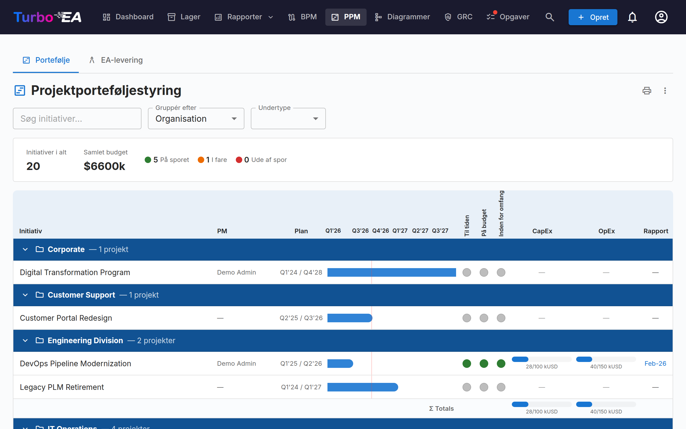
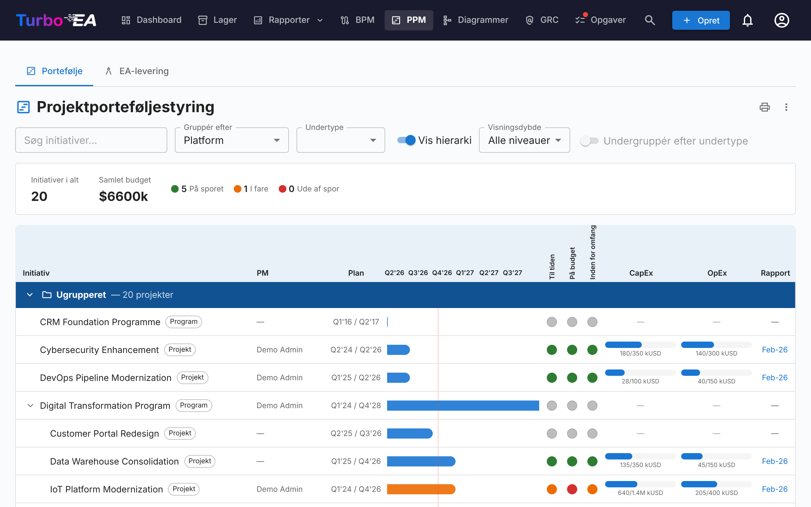
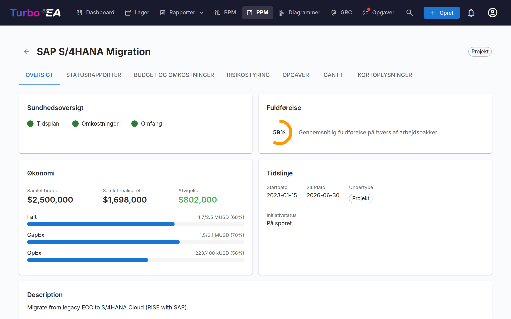
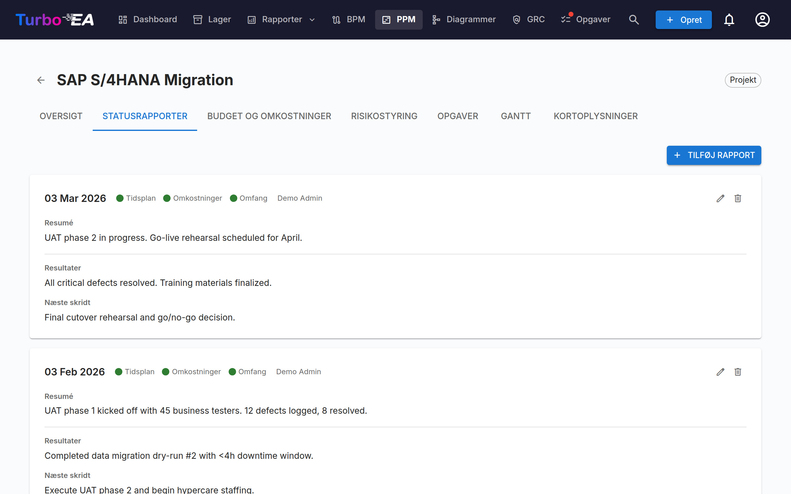
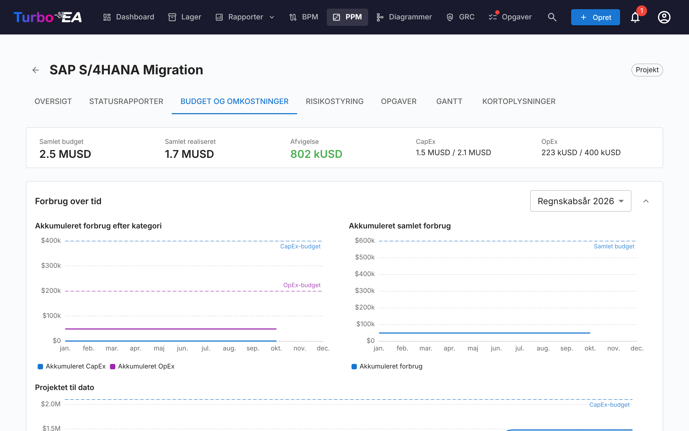
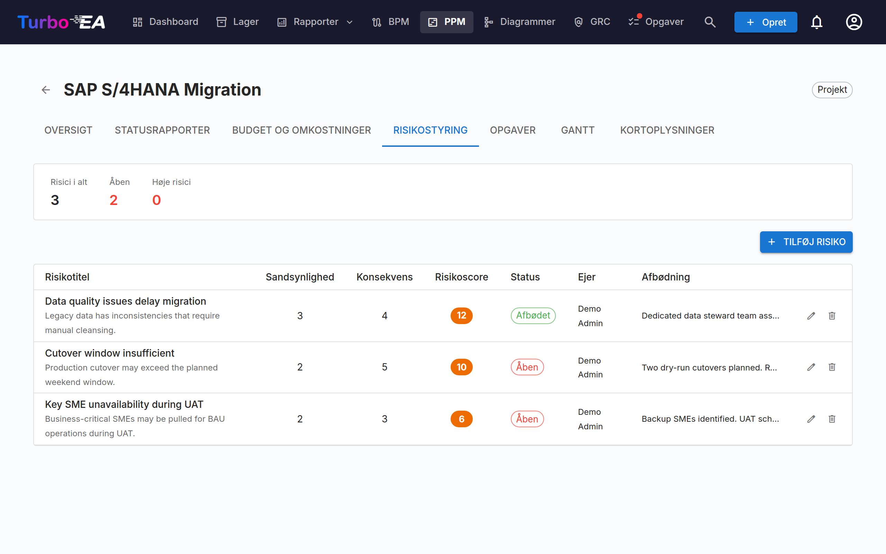
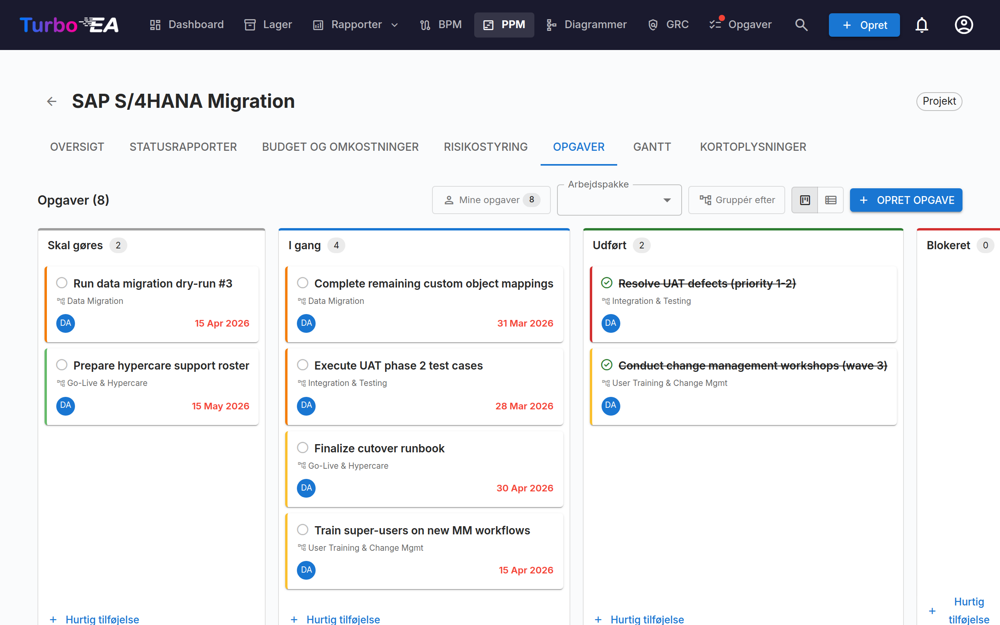
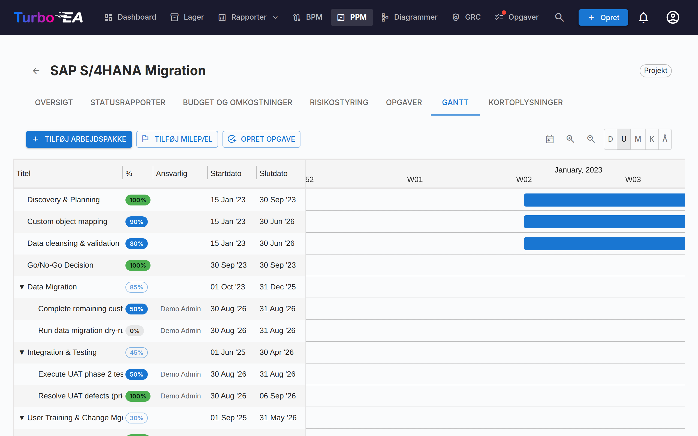

# Project Portfolio Management (PPM)

**PPM**-modulet tilbyder en komplet projekt­porteføljestyringsløsning til at spore initiativer, budgetter, risici, opgaver og tidslinjer. Det integrerer direkte med Initiative-korttypen for at berige hvert projekt med statusrapportering, omkostningssporing og Gantt-visualisering.

!!! note
    PPM-modulet kan slås til eller fra af en administrator i [Indstillinger](../admin/settings.md). Når det er slået fra, skjules PPM-navigation og -funktioner.

## Portefølje-dashboard

**Portefølje-dashboardet** er hovedindgangspunktet for PPM. Det tilbyder:

- **KPI-kort** — Samlede initiativer, samlet budget, samlede faktiske omkostninger og oversigt over sundhedsstatus
- **Sundheds-cirkeldiagrammer** — Fordeling af tidsplan-, omkostnings- og scope-sundhed (On Track / At Risk / Off Track)
- **Status-fordeling** — Opdeling efter initiativ-undertype og status
- **Gantt-oversigt** — Tidslinjebjælker, der viser hvert initiativs start- og slutdatoer, med RAG-sundhedsindikatorer

### Gruppering og filtrering

Brug værktøjslinjen til at:

- **Gruppere efter** en hvilken som helst relateret korttype (f.eks. Organization, Platform) for at se initiativer grupperet efter forretningsenhed eller teknologiplatform
- **Filtrere efter undertype** (Idea, Program, Project, Epic)
- **Søge** efter initiativnavn
- **Vise hierarki** for at indlejre initiativerne i hver gruppe under deres overordnede initiativ (se nedenfor)
- **Undergruppere efter undertype** for at opdele hver gruppe efter undertype (se nedenfor)

Disse filtre vedvarer i URL'en, så opdatering af siden bibeholder din nuværende visning. Hierarkiet, dets visningsdybde og undergrupperingen gemmes også i URL'en.

#### Vis initiativhierarkiet

Når nogle initiativer i porteføljen har et overordnet initiativ, der også er i porteføljen, tilbyder værktøjslinjen **Vis hierarki**. Når det er slået til, viser hver gruppe sine initiativer som et træ: et underordnet initiativ står indrykket under sit overordnede, pilen foran et overordnet initiativs navn folder dets undertræ sammen eller ud, og hver række viser sin undertype, så hvert niveaus rolle (for eksempel Program → Project → Epic) forbliver synlig. **Visningsdybde** begrænser træet til de første niveauer (*Niveau 1*, *Niveau 2*, … eller *Alle niveauer*).

Grupperingen kommer stadig først: hierarkiet indlejres **inden for hver gruppe**, så et initiativ, hvis overordnede hører til en anden gruppe, vises som en række på øverste niveau i sin egen gruppe. Filtrene anvendes først, og træet viser det, der er tilbage: når søgningen eller undertypefilteret udelader et overordnet initiativ, rykker dets underordnede op på øverste niveau i stedet for, at det overordnede bevares som kontekst.

#### Undergruppér efter undertype

**Undergruppér efter undertype** deler hver gruppe op i én undergruppe pr. undertype i den rækkefølge, undertyperne er defineret på Initiative-typen, med initiativer uden undertype til sidst. Hver undergruppe har sin egen overskrift, kan foldes sammen for sig og har sin egen totallinje; gruppens totaler dækker stadig alle dens initiativer. Kontakten er ikke tilgængelig, mens hierarkiet vises, fordi træet allerede spænder over undertyperne.

#### Summér tal op til overordnede initiativer

Porteføljen viser hvert initiativs egne tal: et overordnet initiativs CapEx- og OpEx-bjælker dækker de budget- og omkostningslinjer, der er registreret på det selv, ikke dem på de underordnede, og gruppetotalerne tæller hvert initiativ én gang. Hvis du vil se en total på det overordnede initiativ, skal du definere et beregnet felt, der lægger hvert niveaus eget budget til de underordnedes totaler — se [Summér PPM-tal op gennem initiativhierarkiet](../admin/calculations.md#rolling-ppm-figures-up-the-initiative-hierarchy). En PPM-ændring på et underordnet initiativ kører beregningerne igen for alle initiativer over det, så det overordnedes total flytter sig med det samme.

### Udskrivning og eksport

Porteføljen tilbyder de samme handlinger i titellinjen som rapporterne:

- **Udskriv / Gem som PDF** — printerikonet udskriver porteføljen, som den ser ud på skærmen. Fanebjælken, filterværktøjslinjen og pop op-vinduer ved museover udelades, den aktive gruppering, undertype og søgning udskrives som en kompakt parameterlinje, og tidslinjegitteret beskæres ikke længere, så alle kolonner er med på siden. Når hierarkiet eller undergrupperingen er slået til, nævner parameterlinjen også det, med visningsdybden.
- **Eksportér til PowerPoint (.pptx)** — fra **⋮**-menuen. Det første dias indeholder titlen, tidsstemplet for genereringen og de aktive filtre sammen med porteføljen i præsentationskvalitet; lange porteføljer fortsætter på flere dias og opdeles kun mellem initiativer — aldrig midt i en række, en gruppeoverskrift eller en totallinje.
- **Eksportér til Excel (.xlsx)** — også fra **⋮**-menuen. Én række pr. initiativ med gruppe, undertype, projektleder, start- og slutdato, de tre sundhedsvurderinger, planlagt og faktisk CapEx/OpEx samt datoen for den seneste statusrapport. Rækkerne følger rækkefølgen på skærmen; mens hierarkiet vises, angiver en kolonne **Overordnet** hvert initiativs overordnede initiativ.

## Initiativ-detaljevisning

Klik på et initiativ for at åbne dets detaljeside med syv faner:

### Overview-fane

Overblikket viser et resumé af initiativets sundhed og økonomi:

- **Sundhedsresumé** — Tidsplan-, omkostnings- og scope-indikatorer fra den seneste statusrapport
- **Budget vs. faktisk** — Kombineret KPI-kort, der viser samlet budget og faktisk forbrug med varians
- **Seneste aktivitet** — Resumé af seneste statusrapport

### Statusrapporter-fane

Månedlige statusrapporter sporer projektsundhed over tid. Hver rapport indeholder:

| Felt | Beskrivelse |
|------|-------------|
| **Rapport-dato** | Datoen for rapporteringsperioden |
| **Tidsplan-sundhed** | On Track, At Risk eller Off Track |
| **Omkostnings-sundhed** | On Track, At Risk eller Off Track |
| **Scope-sundhed** | On Track, At Risk eller Off Track |
| **Resumé** | Ledelsesresumé af aktuel status |
| **Resultater** | Hvad der blev opnået i denne periode |
| **Næste skridt** | Planlagte aktiviteter for næste periode |

### Budget og omkostninger-fane

Spor finansielle data med to typer af linjeposter:

- **Budgetlinjer** — Planlagt budget pr. regnskabsår og kategori (CapEx / OpEx) med en valgfri beskrivelse. Et regnskabsår og en kategori kan have så mange linjer, som du har brug for — én pr. licens, implementeringspartner eller hardwareparti — og beskrivelsen skelner dem fra hinanden; totalerne lægger dem alle sammen. Budgetlinjer grupperes efter den **startmåned for regnskabsåret**, der er konfigureret i [Indstillinger](../admin/settings.md#fiscal-year-start). For eksempel, hvis regnskabsåret begynder i april, tilhører en budgetlinje dateret juni 2026 FY 2026–2027
- **Omkostningslinjer** — Faktiske udgifter med dato, beskrivelse og kategori

Begge tabeller er grupperet efter regnskabsår. Hvert år har en overskriftsrække med årets subtotaler for CapEx, OpEx og i alt samt antallet af linjer; pilen i overskriften viser eller skjuler årets linjer. Når fanen åbnes, er kun det aktuelle regnskabsår foldet ud (eller det seneste år med linjer, hvis det aktuelle ikke har nogen). Beløbene står i separate kolonner **CapEx** og **OpEx**, og en række **I alt, alle regnskabsår** under hver tabel lægger alle år sammen. Vælg **+** i overskriften for et budgetår for at tilføje en budgetlinje med det regnskabsår allerede udfyldt. Omkostningslinjer grupperes efter det regnskabsår, deres dato falder i, og sorteres efter dato inden for året; omkostningslinjer uden dato samles til sidst i gruppen **Uden dato** og tæller med i omkostningstotalerne som alle andre linjer.

Budget- og omkostnings­totaler rulles automatisk op til Initiative-kortets egenskaber `costBudget` og `costActual`. Når PPM-omkostningslinjer findes, markeres disse kort-felter som auto-beregnet og bliver skrivebeskyttede i kortdetaljevisningen.

#### Forbrug over tid

Over budget- og omkostningstabellerne viser tre diagrammer, hvordan forbruget akkumuleres måned for måned:

- **Akkumuleret forbrug efter kategori** — akkumuleret CapEx og OpEx for det valgte regnskabsår med prikkede vandrette linjer, der markerer årets CapEx- og OpEx-budget
- **Akkumuleret samlet forbrug** — samme regnskabsår med begge kategorier lagt sammen, holdt op mod en prikket linje for det samlede budget
- **Projektet til dato** — akkumuleret CapEx og OpEx på tværs af alle projektets måneder, holdt op mod det samlede budget for alle regnskabsår

Regnskabsårsvælgeren gælder for de to første diagrammer og tilbyder indeværende år, ethvert andet år med data samt **Alle regnskabsår**. Dine valg af regnskabsår og sammenfoldet eller udfoldet tilstand huskes mellem besøg.

To ting at være opmærksom på, når diagrammerne læses:

- Linjerne stopper ved indeværende måned i stedet for at fortsætte fladt til årets slutning, så et igangværende år ikke forveksles med et, hvor forbruget er stoppet
- Omkostningsposter uden dato kan ikke placeres på en tidslinje og udelades. En note under diagrammerne oplyser, hvor mange der blev udeladt, så diagrammernes totaler kan afstemmes med oversigtslinjen

### Risikostyring-fane

Risikoregistret sporer projektrisici med:

| Felt | Beskrivelse |
|------|-------------|
| **Titel** | Kort beskrivelse af risikoen |
| **Sandsynlighed** | Sandsynlighedsscore (1–5) |
| **Virkning** | Virkningsscore (1–5) |
| **Risikoscore** | Auto-beregnet som sandsynlighed × virkning |
| **Status** | Open, Mitigating, Mitigated, Closed eller Accepted |
| **Afhjælpning** | Planlagte afhjælpningshandlinger |
| **Ejer** | Bruger ansvarlig for at håndtere risikoen |

### Tasks-fane

Opgavestyringen understøtter både **Kanban-tavle**- og **liste**-visninger med fire status-kolonner:

- **To Do** — Opgaver, der endnu ikke er startet
- **In Progress** — Opgaver der aktuelt arbejdes på
- **Done** — Fuldførte opgaver
- **Blocked** — Opgaver der ikke kan fortsætte

Opgaver kan filtreres og grupperes efter Work Breakdown Structure (WBS)-element. Ved gruppering vises hver arbejdspakke som en gruppe — også en, der endnu ikke indeholder opgaver; den viser et hint og en **Tilføj opgave**-knap, som åbner opgavedialogen med den pakke forvalgt. Milepæle vises først, når de indeholder en opgave. Træk og slip kort mellem kolonner for at opdatere status. Hver opgave understøtter:

- Prioritetsniveauer (Critical, High, Medium, Low)
- Tildelt (med notifikation ved tildeling)
- Start- og forfaldsdatoer
- Tags til kategorisering
- Kommentarer til diskussion

Visningsfiltre (visningstilstand, WBS-filter, gruppér-efter-skifter) vedvarer i URL'en på tværs af sideopdateringer.

### Gantt-fane

Gantt-diagrammet visualiserer projekttidslinjen med:

- **Arbejdspakker (WBS)** — Hierarkiske arbejdsbrydningsstruktur-elementer med start-/slutdatoer
- **Opgaver** — Individuelle opgavebjælker linket til arbejdspakker
- **Milepæle** — Nøgledatoer markeret med diamant-indikatorer
- **Fremgangsbjælker** — Visuel fuldførelsesprocent. En opgave har ingen procent i sig selv: dens fyld følger dens status — **To Do (0%)**, **In Progress (50%)**, **Done (100%)**. Klik på procent-chippen på en opgave for at åbne en skyder, hvis tre stop er mærket med disse tilstande; vælger du et stop, ændres status, og det samme sker, når du trækker i fyldet på opgavens bjælke. En blad-arbejdspakke har en fri skyder i trin af 5%. Arbejdspakker med underordnede arbejdspakker **eller opgaver** viser en skrivebeskyttet chip, hvis værdi rulles automatisk op fra undertræet.
- **Kvartals-mærker** — Tidslinjegitter til orientering

Interager med Gantt-diagrammet ved hjælp af:

- **Træk** bjælker for at om-planlægge elementer
- **Skift størrelse** af bjælkeenderne for at ændre varighed (1-dags granularitet)
- **Højreklik** for kontekstmenu (rediger, tilføj opgave, markér udført, slet)
- **Today-knap** for at rulle til den aktuelle dato
- **View scale-vælger** — vælg mellem Day, Week, Month, Quarter og Year-skalaer; valget huskes i din browser
- **Zoom ind / Zoom ud-knapper** — gå gennem de samme fem skalaer ét hak ad gangen
- **Træk prikken på højre kant af én bjælke over på prikken på venstre kant af en anden** for at oprette en finish-to-start-afhængighedspil. Afhængigheder virker mellem enhver kombination af arbejdspakker og opgaver. Cyklusser afvises automatisk. **Dobbeltklik på en pil** for at fjerne den.
- **+-rækken** nederst på listen spørger, hvad der skal oprettes — en arbejdspakke, en milepæl eller en opgave — så en opgave, der indtastes dér, havner på Tasks-fanen.

### Card Details-fane

Den sidste fane viser den fulde kortdetaljevisning, inklusive alle standardsektioner (beskrivelse, livscyklus, egenskaber, relationer, interessenter, kommentarer, historik).

## Work Breakdown Structure (WBS)

WBS'en tilbyder en hierarkisk nedbrydning af projektets scope:

- **Arbejdspakker** — Logiske grupperinger af opgaver med start-/slutdatoer og fuldførelses­sporing
- **Milepæle** — Betydelige hændelser eller fuldførelsespunkter
- **Hierarki** — Forældre-barn-relationer mellem WBS-elementer
- **Auto-fuldførelse** — Fuldførelse beregnes automatisk ud fra opgaverne i en arbejdspakkes undertræ: hver opgave tæller som 0% (To Do, Blocked), 50% (In Progress) eller 100% (Done), vægtet efter dens varighed i dage (én dag, når en dato mangler), hvorefter den rulles rekursivt op til forældre-elementer. En arbejdspakke uden opgaver noget sted under sig beholder den værdi, der er indtastet manuelt. Gennemsnittet af arbejdspakkerne på øverste niveau er initiativets samlede fremdrift — tallet på Overview-fanen og variablen `ppm.completion`, som et [beregnet felt](../admin/calculations.md#ppm-data-on-initiative-cards) kan vise på kortet og i en portal

## Kortdetalje-integration

Når PPM er aktiveret, viser **Initiative**-kort en **PPM**-fane som den sidste fane i [kortdetaljevisningen](card-details.md). Klikker du på denne fane, navigeres direkte til PPM Initiativ-detaljevisningen (Overview-fane). Dette giver et hurtigt indgangspunkt fra ethvert Initiative-kort til dets fulde PPM-projektside.

Omvendt viser **Card Details**-fanen inden i PPM Initiativ-detaljevisningen standardkortdetaljesektionerne uden PPM-fanen, hvilket undgår cirkulær navigation.

## Tilladelser

| Tilladelse | Beskrivelse |
|------------|-------------|
| `ppm.view` | Se PPM-dashboardet, Gantt-diagram og initiativrapporter samt læse initiativkort. Givet til alle roller som standard |
| `ppm.manage` | Opret og administrer statusrapporter, opgaver, omkostninger, risici og WBS-elementer. Givet til Admin-, BPM Admin- og Member-roller |
| `reports.ppm_dashboard` | Se PPM-portefølje-dashboardet. Givet til alle roller som standard |
