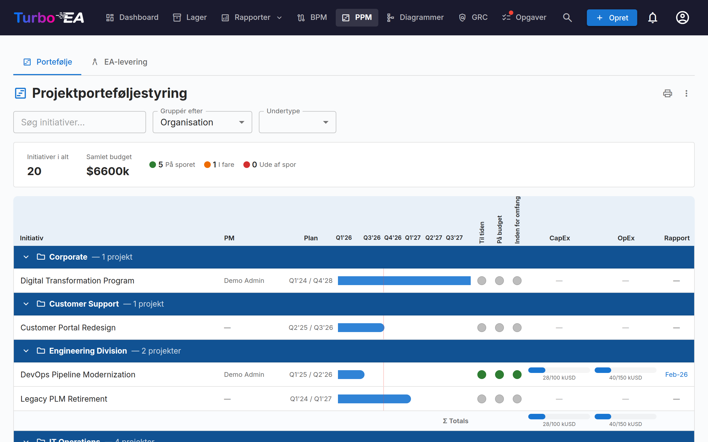
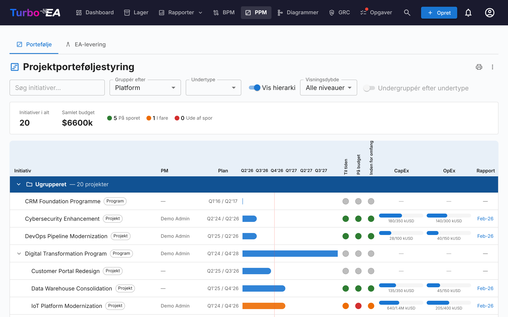
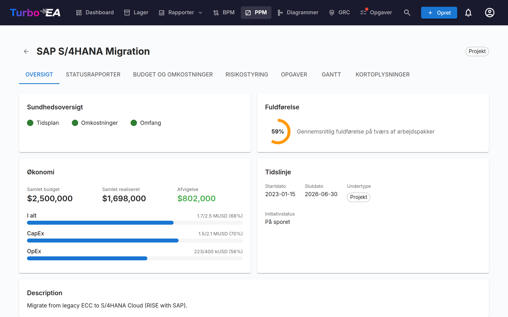
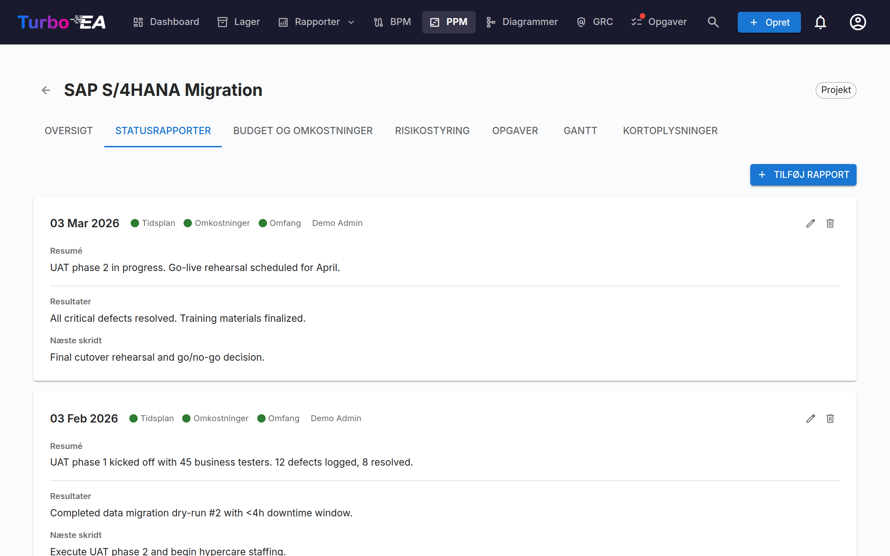
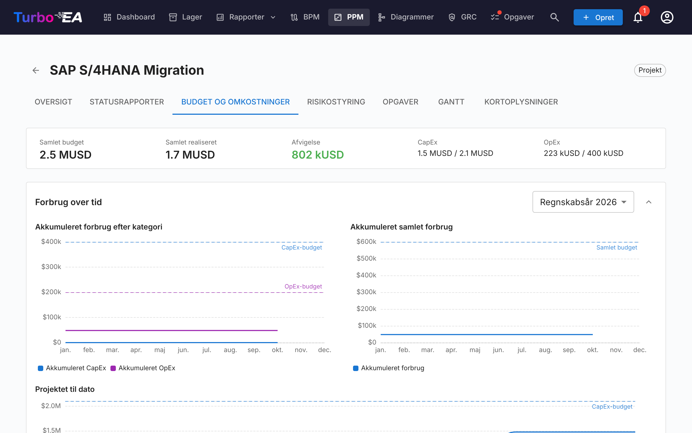
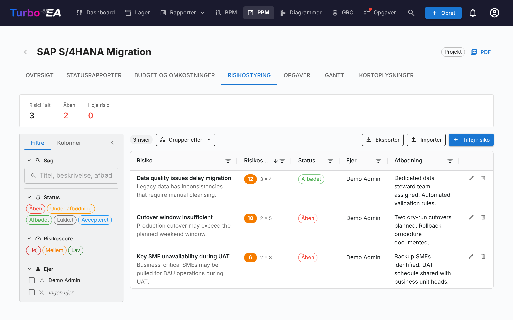
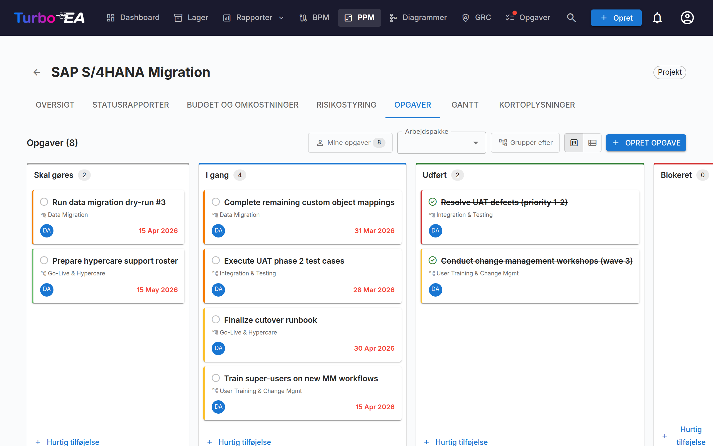
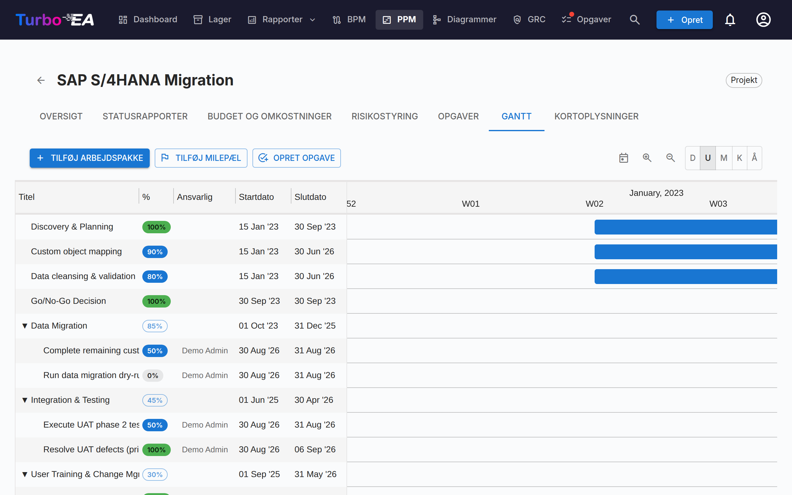

# Project Portfolio Management (PPM)

**PPM**-modulet tilbyder en komplet projekt­porteføljestyringsløsning til at spore initiativer, budgetter, risici, opgaver og tidslinjer. Det integrerer direkte med Initiative-korttypen for at berige hvert projekt med statusrapportering, omkostningssporing og Gantt-visualisering.

!!! note
    PPM-modulet kan slås til eller fra af en administrator i [Indstillinger](../admin/settings.md). Når det er slået fra, skjules PPM-navigation og -funktioner.

## Portefølje-dashboard

**Portefølje-dashboardet** er hovedindgangspunktet for PPM. Det tilbyder:

- **KPI-kort** — Samlede initiativer, samlet budget, samlede faktiske omkostninger og oversigt over sundhedsstatus
- **Sundheds-cirkeldiagrammer** — Fordeling af tidsplan-, omkostnings- og scope-sundhed (On Track / At Risk / Off Track)
- **Status-fordeling** — Opdeling efter initiativ-undertype og status
- **Gantt-oversigt** — Tidslinjebjælker, der viser hvert initiativs start- og slutdatoer, med RAG-sundhedsindikatorer

### Gruppering og filtrering

Brug værktøjslinjen til at:

- **Gruppere efter** en hvilken som helst relateret korttype (f.eks. Organization, Platform) for at se initiativer grupperet efter forretningsenhed eller teknologiplatform
- **Gruppere efter** en undertype af Initiativ (f.eks. Program), vist i en anden sektion af samme menu, for at se hvert program med alle initiativer under det (se nedenfor)
- **Filtrere efter undertype** (Idea, Program, Project, Epic)
- **Søge** efter initiativnavn
- **Vise hierarki** for at indlejre initiativerne i hver gruppe under deres overordnede initiativ (se nedenfor)
- **Undergruppere efter undertype** for at opdele hver gruppe efter undertype (se nedenfor)

Disse filtre vedvarer i URL'en, så opdatering af siden bibeholder din nuværende visning. Hierarkiet, dets visningsdybde og undergrupperingen gemmes også i URL'en.

#### Vis initiativhierarkiet

Når nogle initiativer i porteføljen har et overordnet initiativ, der også er i porteføljen, tilbyder værktøjslinjen **Vis hierarki**. Når det er slået til, viser hver gruppe sine initiativer som et træ: et underordnet initiativ står indrykket under sit overordnede, pilen foran et overordnet initiativs navn folder dets undertræ sammen eller ud, og hver række viser sin undertype, så hvert niveaus rolle (for eksempel Program → Project → Epic) forbliver synlig. **Visningsdybde** begrænser træet til de første niveauer (*Niveau 1*, *Niveau 2*, … eller *Alle niveauer*).

Grupperingen kommer stadig først: hierarkiet indlejres **inden for hver gruppe**, så et initiativ, hvis overordnede hører til en anden gruppe, vises som en række på øverste niveau i sin egen gruppe. Filtrene anvendes først, og træet viser det, der er tilbage: når søgningen eller undertypefilteret udelader et overordnet initiativ, rykker dets underordnede op på øverste niveau i stedet for, at det overordnede bevares som kontekst.

#### Undergruppér efter undertype

**Undergruppér efter undertype** deler hver gruppe op i én undergruppe pr. undertype i den rækkefølge, undertyperne er defineret på Initiative-typen, med initiativer uden undertype til sidst. Hver undergruppe har sin egen overskrift, kan foldes sammen for sig og har sin egen totallinje; gruppens totaler dækker stadig alle dens initiativer. Kontakten er ikke tilgængelig, mens hierarkiet vises, fordi træet allerede spænder over undertyperne.

#### Gruppér efter en undertype af Initiativ

Menuen **Gruppér efter** har to sektioner: **Relaterede korttyper** og **Initiativ-undertyper**, de undertyper der er defineret på typen Initiativ. Vælger du en undertype — f.eks. **Program** — viser tavlen én gruppe pr. program-initiativ. Programmet navngiver sin gruppe og er **kun dens overskrift, aldrig en række**; gruppen rummer **alle initiativer under det, i enhver dybde** og uanset undertype, så et program under et andet program er en række i det øverste programs gruppe.

Gruppens bundlinje træder i stedet for totalrækken: Den bærer undertypens navn og viser programmets **egne** budget, realiserede tal og datoer eller — hvor det ingen egne har — tallene **afledt** af initiativerne under det, tegnet med kontur, stiplet og i kursiv som beskrevet under *Summér tal op til overordnede initiativer*. Initiativer uden noget program over sig vises under **Ugrupperet**. Et mellemliggende initiativ, som du ikke kan se, som er arkiveret, eller som en portal ikke udgiver, **bryder kæden**: Det, der ligger under det, grupperes ikke længere under programmet ovenover. **Vis hierarki** vises kun, når noget er indlejret under et programs direkte børn, og undertypefilteret tilbyder ikke den grupperende undertype, fordi dens initiativer er overskrifter og ikke rækker.

#### Summér tal op til overordnede initiativer

Hvert initiativ viser sine egne tal, når det har nogen: et overordnet initiativs CapEx- og OpEx-bjælker dækker de budget- og omkostningslinjer, der er registreret på det selv, og dets Gantt-bjælke dets egne start- og slutdatoer. Et overordnet initiativ **uden egne budgetlinjer** viser i stedet budgettet for initiativerne under det, og et **uden egne omkostningslinjer** deres realiserede tal; i begge tilfælde tegnes bjælken **omridset** med kursive tal, og dens værktøjstip angiver, hvilken halvdel der kommer nedefra. Et initiativ **uden hverken start- eller slutdato** spænder fra den tidligste start til den seneste slutning under det, tegnet som en **stiplet** bjælke med kursive kvartaler. Et værktøjstip fortæller i begge tilfælde, hvor mange initiativer det dækker. De tre regler er uafhængige af hinanden — et program, der har budgettet, mens dets projekter registrerer forbruget, viser sit eget budget over for deres realiserede tal, og et program kan have egne datoer og alligevel vise sine projekters omkostninger — og én budgetlinje, én omkostningslinje eller én dato på det overordnede initiativ er nok til at skifte den del tilbage til dets egne tal. Kun de initiativer, du kan se, tæller med, og på en portal kun dem, portalen udgiver. Gruppetotalerne og KPI-linjen lægger fortsat kun registrerede linjer sammen, så hvert tal tælles én gang.

De afledte tal findes kun på PPM-tavlen og på initiativets egne faner **Oversigt** og **Budget og omkostninger**. Hvis du vil have en sammenlagt total med i inventaret, rapporter eller en portal, skal du definere et beregnet felt, der lægger hvert niveaus eget budget til de underordnedes totaler — se [Summér PPM-tal op gennem initiativhierarkiet](../admin/calculations.md#rolling-ppm-figures-up-the-initiative-hierarchy). En PPM-ændring på et underordnet initiativ kører beregningerne igen for alle initiativer over det, så det overordnedes total flytter sig med det samme.

### Udskrivning og eksport

Porteføljen tilbyder de samme handlinger i titellinjen som rapporterne:

- **Udskriv / Gem som PDF** — printerikonet udskriver porteføljen, som den ser ud på skærmen. Fanebjælken, filterværktøjslinjen og pop op-vinduer ved museover udelades, den aktive gruppering, undertype og søgning udskrives som en kompakt parameterlinje, og tidslinjegitteret beskæres ikke længere, så alle kolonner er med på siden. Når hierarkiet eller undergrupperingen er slået til, nævner parameterlinjen også det, med visningsdybden.
- **Eksportér til PowerPoint (.pptx)** — fra **⋮**-menuen. Det første dias indeholder titlen, tidsstemplet for genereringen og de aktive filtre sammen med porteføljen i præsentationskvalitet; lange porteføljer fortsætter på flere dias og opdeles kun mellem initiativer — aldrig midt i en række, en gruppeoverskrift eller en totallinje.
- **Eksportér til Excel (.xlsx)** — også fra **⋮**-menuen. Én række pr. initiativ med gruppe, undertype, projektleder, start- og slutdato, de tre sundhedsvurderinger, planlagt og faktisk CapEx/OpEx samt datoen for den seneste statusrapport. Rækkerne følger rækkefølgen på skærmen; mens hierarkiet vises, angiver en kolonne **Overordnet** hvert initiativs overordnede initiativ. Tre kolonner, **Budget fra**, **Omkostninger fra** og **Datoer fra**, angiver, om en rækkes budget, realiserede tal og datoer er dens egne eller summen af initiativerne under den. Når tavlen er grupperet efter en undertype af Initiativ, er det grupperende initiativ **den første række i sin gruppe**, med de tal dets bundlinje viser.

## Initiativ-detaljevisning

Klik på et initiativ for at åbne dets detaljeside med syv faner:

### Overview-fane

Overblikket viser et resumé af initiativets sundhed og økonomi:

- **Sundhedsresumé** — Tidsplan-, omkostnings- og scope-indikatorer fra den seneste statusrapport
- **Budget vs. faktisk** — Kombineret KPI-kort, der viser samlet budget og faktisk forbrug med varians
- **Tal nedefra** — Når initiativet ikke har egne budgetlinjer, viser dets samlede budget, dets budgetbjælker og variansen i stedet budgettet for initiativerne under det: i kursiv, markeret med en ↳-pil, med budgetsporet omridset og et værktøjstip, der fortæller, hvor mange initiativer de dækker. Når det ikke har egne omkostningslinjer, kommer dets realiserede tal nedefra på samme måde, med forbrugsbjælkerne omridset. De to sider afgøres hver for sig, og den første egne linje skifter den side tilbage til initiativets egne tal.
- **Under dette initiativ** — Når initiativet har initiativer under sig, viser en linje under budgetbjælkerne, hvor mange der er, deres samlede budget og faktiske forbrug samt det tidsrum, deres datoer spænder over. Den vises ved siden af initiativets egne tal og lægges aldrig til dem. Når både budgettet og de realiserede tal allerede kommer nedefra, beholder linjen kun antallet og tidsrummet.
- **Seneste aktivitet** — Resumé af seneste statusrapport

### Statusrapporter-fane

Månedlige statusrapporter sporer projektsundhed over tid. Hver rapport indeholder:

| Felt | Beskrivelse |
|------|-------------|
| **Rapport-dato** | Datoen for rapporteringsperioden |
| **Tidsplan-sundhed** | On Track, At Risk eller Off Track |
| **Omkostnings-sundhed** | On Track, At Risk eller Off Track |
| **Scope-sundhed** | On Track, At Risk eller Off Track |
| **Resumé** | Ledelsesresumé af aktuel status |
| **Resultater** | Hvad der blev opnået i denne periode |
| **Næste skridt** | Planlagte aktiviteter for næste periode |

### Budget og omkostninger-fane

Spor finansielle data med to typer af linjeposter:

- **Budgetlinjer** — Planlagt budget pr. regnskabsår og kategori (CapEx / OpEx) med en valgfri beskrivelse. Et regnskabsår og en kategori kan have så mange linjer, som du har brug for — én pr. licens, implementeringspartner eller hardwareparti — og beskrivelsen skelner dem fra hinanden; totalerne lægger dem alle sammen. Budgetlinjer grupperes efter den **startmåned for regnskabsåret**, der er konfigureret i [Indstillinger](../admin/settings.md#fiscal-year-start). For eksempel, hvis regnskabsåret begynder i april, tilhører en budgetlinje dateret juni 2026 FY 2026–2027
- **Omkostningslinjer** — Faktiske udgifter med dato, beskrivelse og kategori

Begge tabeller er grupperet efter regnskabsår. Hvert år har en overskriftsrække med årets subtotaler for CapEx, OpEx og i alt samt antallet af linjer; pilen i overskriften viser eller skjuler årets linjer. Når fanen åbnes, er kun det aktuelle regnskabsår foldet ud (eller det seneste år med linjer, hvis det aktuelle ikke har nogen). Beløbene står i separate kolonner **CapEx** og **OpEx**, og en række **I alt, alle regnskabsår** under hver tabel lægger alle år sammen. Vælg **+** i overskriften for et budgetår for at tilføje en budgetlinje med det regnskabsår allerede udfyldt. Omkostningslinjer grupperes efter det regnskabsår, deres dato falder i, og sorteres efter dato inden for året; omkostningslinjer uden dato samles til sidst i gruppen **Uden dato** og tæller med i omkostningstotalerne som alle andre linjer.

Når initiativet **ikke har egne budgetlinjer**, viser budgettabellen budgettet for initiativerne under det i stedet for sin tomme tilstand: en billedtekst angiver, hvor mange initiativer det kommer fra, én skrivebeskyttet række pr. regnskabsår viser CapEx, OpEx og total i kursiv, og rækken **I alt, alle regnskabsår** lægger dem sammen. Omkostningstabellen gør det samme med deres realiserede tal, når initiativet **ikke har egne omkostningslinjer**, med en række **Uden dato** for deres omkostningslinjer uden dato. Opsummeringslinjen markerer disse tal i kursiv med et værktøjstip. Hver tabel afgør det selv, intet gemmes eller lægges til initiativets egne tal, og kun de initiativer, du kan se, tæller med. Den første egne linje via **Tilføj budgetlinje** eller **Tilføj omkostningspost** skifter tabellen tilbage til initiativets egne linjer; forbrugsdiagrammerne viser altid initiativets egne linjer.

Budget- og omkostnings­totaler rulles automatisk op til Initiative-kortets egenskaber `costBudget` og `costActual`. Når PPM-omkostningslinjer findes, markeres disse kort-felter som auto-beregnet og bliver skrivebeskyttede i kortdetaljevisningen. Disse kortfelter er **totaler på tværs af alle regnskabsår**. [Omkostningsrapporten](reports.md) og dashboardets omkostningsfliser, som viser det aktuelle regnskabsår, tæller kun indeværende års budgetlinjer og de omkostningslinjer, der er dateret i det; omkostningslinjer uden dato tæller ikke i noget år.

#### Forbrug over tid

Over budget- og omkostningstabellerne viser tre diagrammer, hvordan forbruget akkumuleres måned for måned:

- **Akkumuleret forbrug efter kategori** — akkumuleret CapEx og OpEx for det valgte regnskabsår med prikkede vandrette linjer, der markerer årets CapEx- og OpEx-budget
- **Akkumuleret samlet forbrug** — samme regnskabsår med begge kategorier lagt sammen, holdt op mod en prikket linje for det samlede budget
- **Projektet til dato** — akkumuleret CapEx og OpEx på tværs af alle projektets måneder, holdt op mod det samlede budget for alle regnskabsår

Regnskabsårsvælgeren gælder for de to første diagrammer og tilbyder indeværende år, ethvert andet år med data samt **Alle regnskabsår**. Dine valg af regnskabsår og sammenfoldet eller udfoldet tilstand huskes mellem besøg.

To ting at være opmærksom på, når diagrammerne læses:

- Linjerne stopper ved indeværende måned i stedet for at fortsætte fladt til årets slutning, så et igangværende år ikke forveksles med et, hvor forbruget er stoppet
- Omkostningsposter uden dato kan ikke placeres på en tidslinje og udelades. En note under diagrammerne oplyser, hvor mange der blev udeladt, så diagrammernes totaler kan afstemmes med oversigtslinjen

### Risikostyring-fane

Risikoregistret sporer initiativets risici. Hver risiko har:

| Felt | Beskrivelse |
|------|-------------|
| **Titel** | Kort beskrivelse af risikoen |
| **Beskrivelse** | Den fulde beskrivelse af risikoen |
| **Sandsynlighed** | Sandsynlighedsscore (1–5) |
| **Virkning** | Virkningsscore (1–5) |
| **Risikoscore** | Auto-beregnet som sandsynlighed × virkning |
| **Status** | Open, Mitigating, Mitigated, Closed eller Accepted |
| **Afhjælpning** | Planlagte afhjælpningshandlinger |
| **Ejer** | Bruger ansvarlig for at håndtere risikoen |

En oversigtsbjælke over gitteret tæller **Risici i alt**, de risici, der er **Åben**, og **Høje risici**.

#### Risikogitteret

Risiciene vises i et gitter, der er bygget som [Inventory](inventory.md) og [Risikoregistret](risks.md#register-gitter). Tekst bliver aldrig afkortet: hver række viser risikoens titel med fed skrift med dens **fulde beskrivelse** nedenunder samt den **fulde afbødning**, ombrudt over så mange linjer, som der er brug for. Webadresser i beskrivelsen og afbødningen er klikbare.

| Kolonne | Viser |
|---------|-------|
| **Risiko** | Titlen med beskrivelsen nedenunder |
| **Risikoscore** | Scoren som en farvet chip med *sandsynlighed × konsekvens* ved siden af (for eksempel **20** *4 × 5*) |
| **Status** | Status-chippen |
| **Ejer** | Risikoejeren eller en tankestreg |
| **Afbødning** | Den planlagte afbødning eller en tankestreg |
| *(knapper)* | **Redigér** og **Slet** |

**Sandsynlighed** og **Konsekvens** findes også som separate kolonner; de er skjult som standard — slå dem til i fanen **Kolonner** i filterpanelet.

- **Sortér** — klik på en kolonneoverskrift. Indtil du vælger din egen sortering, kommer den højeste score først.
- **Filtrér en kolonne** — brug overskriftsfiltrene som i de andre gitre.
- **Frys en kolonne** — klik på nålen i dens overskrift for at holde den ved venstre kant, mens du ruller til siden; klik igen for at frigive den.
- **Omarrangér kolonner** — træk en kolonneoverskrift.
- **Cellemenu** — højreklik på en celle (langt tryk på en berøringsenhed) for den samme cellemenu som i de andre gitre.

#### Filterpanel

Panelet til venstre har to faner:

- **Filtre**
    - **Søg** — matcher titel, beskrivelse, afbødning og ejer.
    - **Status** — markér en eller flere status-chips.
    - **Risikoscore** — scoreniveauerne **Høj** (15 eller derover), **Mellem** (6 til 14) og **Lav** (under 6).
    - **Ejer** — de ejere, der findes på listen, plus **Ingen ejer**.
    - **Ryd alle filtre** nulstiller alle filtre på én gang.
- **Kolonner** — listen **Kolonnerækkefølge** (træk en række for at flytte en kolonne, brug dens nål til at fryse den, **Nulstil rækkefølge** for at gendanne standardrækkefølgen) og listen **Synlige kolonner** til at vise eller skjule kolonner, med **Vælg alle** for at vise alle kolonner. Risiko-kolonnen og knapperne vises altid. Så snart de synlige kolonner afviger fra standarden, vender **Nulstil** tilbage til den: alle kolonner undtagen Sandsynlighed og Konsekvens.

Panelet kan foldes sammen til en smal skinne, der viser, hvor mange filtre der er aktive, og dets kant kan trækkes for at ændre bredden. På en telefon er panelet en skuffe, der åbnes med filterknappen i værktøjslinjen.

#### Værktøjslinje

Værktøjslinjen viser, hvor mange risici der er på listen, og tilbyder:

- **Gruppér efter** — gruppér rækkerne efter **Status**, **Ejer** eller **Scoreniveau**.
- **Eksportér** — download de risici, der vises lige nu, som en `.xlsx` (se nedenfor).
- **Importér** — indlæs risici fra en `.xlsx` (se nedenfor).
- **Tilføj risiko** — åbn dialogen for at registrere en ny risiko.

Sortering, frosne kolonner, kolonnerækkefølge, synlige kolonner, panelbredde og gruppering huskes i din browser.

#### Eksport af risici til Excel

**Eksportér** downloader de risici, gitteret viser lige nu — efter panelets filtre og i gitterets rækkefølge — som en `.xlsx` med én række pr. risiko og kolonnerne **Risiko-ID**, **Risikotitel**, **Beskrivelse**, **Sandsynlighed**, **Konsekvens**, **Risikoscore**, **Status**, **Ejer** og **Afbødning**. Filen er også en gyldig importfil: eksportér, redigér i Excel, og importér den igen.

#### Import af risici fra Excel {: #importing-risks }

**Importér** indlæser en `.xlsx` for at tilføje eller opdatere initiativets risici. **Download skabelon** i dialogen giver en projektmappe med de rigtige overskrifter og en eksempelrække.

- En række med et **Risiko-ID** fra en eksport **opdaterer** den pågældende risiko, og kun de felter, der er ændret.
- En række **uden Risiko-ID** **opretter** en ny risiko.
- Et Risiko-ID, som initiativet ikke har, eller et, der bruges to gange i filen, **afviser** rækken.
- Risici, der mangler i filen, lades i fred: **importen sletter aldrig**.

Før noget skrives, viser en forhåndsvisning hver række som **Ny**, **Opdatering** (med de felter, der ændres), **Uændret** eller **Afvist** (med årsagen) og tæller advarslerne. Afviste rækker springes over; knappen importerer de øvrige ændringer. Et resultat viser derefter, hvor mange risici der blev oprettet, opdateret og mislykkedes.

| Kolonne | Regel |
|---------|-------|
| **Risikotitel** | Påkrævet |
| **Sandsynlighed**, **Konsekvens** | Et heltal fra 1 til 5. Tom betyder 3 på en ny række og lader værdien være uændret ved en opdatering |
| **Status** | Åben, Under afbødning, Afbødet, Lukket eller Accepteret. Tom betyder Åben på en ny række og lader status være uændret ved en opdatering |
| **Ejer** | Matches på e-mail og derefter på navn. En ejer, der ikke matcher nogen eller matcher flere personer, giver en advarsel: rækken importeres stadig, og ejeren forbliver uændret |
| **Beskrivelse**, **Afbødning**, **Ejer** | En tom celle rydder feltet ved en opdatering |
| **Risikoscore**, enhver anden kolonne | Ignoreres — scoren beregnes altid |

Kolonner genkendes på deres overskrift på dit sprog eller på engelsk. En kolonne, som filen udelader, forbliver uændret på alle de risici, den opdaterer.

### Tasks-fane

Opgavestyringen understøtter både **Kanban-tavle**- og **liste**-visninger med fire status-kolonner:

- **To Do** — Opgaver, der endnu ikke er startet
- **In Progress** — Opgaver der aktuelt arbejdes på
- **Done** — Fuldførte opgaver
- **Blocked** — Opgaver der ikke kan fortsætte

Opgaver kan filtreres og grupperes efter Work Breakdown Structure (WBS)-element. Ved gruppering vises hver arbejdspakke som en gruppe — også en, der endnu ikke indeholder opgaver; den viser et hint og en **Tilføj opgave**-knap, som åbner opgavedialogen med den pakke forvalgt. Milepæle vises først, når de indeholder en opgave. Træk og slip kort mellem kolonner for at opdatere status. Hver opgave understøtter:

- Prioritetsniveauer (Critical, High, Medium, Low)
- Tildelt (med notifikation ved tildeling)
- Start- og forfaldsdatoer
- Tags til kategorisering
- Kommentarer til diskussion

Visningsfiltre (visningstilstand, WBS-filter, gruppér-efter-skifter) vedvarer i URL'en på tværs af sideopdateringer.

### Gantt-fane

Gantt-diagrammet visualiserer projekttidslinjen med:

- **Arbejdspakker (WBS)** — Hierarkiske arbejdsbrydningsstruktur-elementer med start-/slutdatoer
- **Opgaver** — Individuelle opgavebjælker linket til arbejdspakker
- **Milepæle** — Nøgledatoer markeret med diamant-indikatorer
- **Fremgangsbjælker** — Visuel fuldførelsesprocent. En opgave har ingen procent i sig selv: dens fyld følger dens status — **To Do (0%)**, **In Progress (50%)**, **Done (100%)**. Klik på procent-chippen på en opgave for at åbne en skyder, hvis tre stop er mærket med disse tilstande; vælger du et stop, ændres status, og det samme sker, når du trækker i fyldet på opgavens bjælke. En blad-arbejdspakke har en fri skyder i trin af 5%. Arbejdspakker med underordnede arbejdspakker **eller opgaver** viser en skrivebeskyttet chip, hvis værdi rulles automatisk op fra undertræet.
- **Kvartals-mærker** — Tidslinjegitter til orientering

Interager med Gantt-diagrammet ved hjælp af:

- **Klik på en kolonneoverskrift** (Titel, %, Ansvarlig, Startdato eller Slutdato) for at sortere listen efter den: stigende ved første klik, faldende ved andet og tilbage til den planlagte rækkefølge ved tredje. En pil ved siden af overskriften viser den aktive sortering. Elementer sorteres blandt deres søskende, så en indlejret arbejdspakke eller opgave bliver under sin overordnede. Elementer uden ansvarlig eller uden egen dato kommer sidst i begge retninger, og **+**-rækken forbliver nederst. Valget huskes i din browser. På en telefon, hvor kun Titel og % vises, kan kun disse to sorteres
- **Træk** bjælker for at om-planlægge elementer
- **Skift størrelse** af bjælkeenderne for at ændre varighed (1-dags granularitet)
- **Højreklik** for kontekstmenu (rediger, tilføj opgave, markér udført, slet)
- **Today-knap** for at rulle til den aktuelle dato
- **View scale-vælger** — vælg mellem Day, Week, Month, Quarter og Year-skalaer; valget huskes i din browser
- **Zoom ind / Zoom ud-knapper** — gå gennem de samme fem skalaer ét hak ad gangen
- **Træk prikken på højre kant af én bjælke over på prikken på venstre kant af en anden** for at oprette en finish-to-start-afhængighedspil. Afhængigheder virker mellem enhver kombination af arbejdspakker og opgaver. Cyklusser afvises automatisk. **Dobbeltklik på en pil** for at fjerne den.
- **+-rækken** nederst på listen spørger, hvad der skal oprettes — en arbejdspakke, en milepæl eller en opgave — så en opgave, der indtastes dér, havner på Tasks-fanen.

### Card Details-fane

Den sidste fane viser den fulde kortdetaljevisning, inklusive alle standardsektioner (beskrivelse, livscyklus, egenskaber, relationer, interessenter, kommentarer, historik).

### Eksport af et initiativ som PDF

Knappen **PDF** i initiativets overskrift, ved siden af undertype-chippen, udskriver initiativet som et dokument (på en telefon er det et PDF-ikon). Den åbner en dialog med ét afkrydsningsfelt pr. afsnit; første gang er alle markeret, **Vælg alle** og **Fravælg alle** sætter dem på én gang, og dit seneste valg huskes i din browser:

| Afsnit | Hvad der udskrives |
|--------|--------------------|
| **Oversigt** | Undertype, initiativstatus, start- og slutdato og fuldførelse; sundhedsvurderingerne fra den seneste statusrapport; budget, realiseret og afvigelse fordelt på CapEx, OpEx og i alt — tal hentet fra de underliggende initiativer står i kursiv med en note om det; og beskrivelsen |
| **Statusrapporter** | Den seneste rapport i sin helhed og derefter de tidligere rapporter som en tabel med dato, rapportør og de tre sundhedsvurderinger |
| **Budget og omkostninger** | Budgetlinjerne og omkostningsposterne, grupperet efter regnskabsår med subtotaler og totaler |
| **Risikostyring** | En linje med det samlede antal risici, de åbne og de høje risici, og derefter hver risiko med fuld beskrivelse, score (med sandsynlighed × konsekvens), status, ejer og fuld afbødning, højeste score først |
| **Opgaver og tidsplan** | Arbejdsnedbrydningen som en indrykket tabel — arbejdspakker med deres datoer, ejer og fuldførelse, milepæle markeret og hver pakkes opgaver nedenunder med status og prioritet — og derefter opgaverne uden arbejdspakke. Selve Gantt-diagrammet udskrives ikke |

**Eksportér PDF** åbner et udskriftsklart dokument i en ny fane sammen med browserens udskriftsdialog; vælg *Gem som PDF* for at beholde det. Tillad pop op-vinduer for dette websted, hvis intet åbner. Forsiden viser initiativets navn og dato og klokkeslæt for udskriften, afsnittene følger i rækkefølgen ovenfor, og et markeret afsnit uden indhold viser *Intet registreret.*

For at uddele en **risikorapport** skal du kun markere **Risikostyring**.

## Work Breakdown Structure (WBS)

WBS'en tilbyder en hierarkisk nedbrydning af projektets scope:

- **Arbejdspakker** — Logiske grupperinger af opgaver med start-/slutdatoer og fuldførelses­sporing
- **Milepæle** — Betydelige hændelser eller fuldførelsespunkter
- **Hierarki** — Forældre-barn-relationer mellem WBS-elementer
- **Auto-fuldførelse** — Fuldførelse beregnes automatisk ud fra opgaverne i en arbejdspakkes undertræ: hver opgave tæller som 0% (To Do, Blocked), 50% (In Progress) eller 100% (Done), vægtet efter dens varighed i dage (én dag, når en dato mangler), hvorefter den rulles rekursivt op til forældre-elementer. En arbejdspakke uden opgaver noget sted under sig beholder den værdi, der er indtastet manuelt. Gennemsnittet af arbejdspakkerne på øverste niveau er initiativets samlede fremdrift — tallet på Overview-fanen og variablen `ppm.completion`, som et [beregnet felt](../admin/calculations.md#ppm-data-on-initiative-cards) kan vise på kortet og i en portal

## Kortdetalje-integration

Når PPM er aktiveret, viser **Initiative**-kort en **PPM**-fane som den sidste fane i [kortdetaljevisningen](card-details.md). Klikker du på denne fane, navigeres direkte til PPM Initiativ-detaljevisningen (Overview-fane). Dette giver et hurtigt indgangspunkt fra ethvert Initiative-kort til dets fulde PPM-projektside.

Omvendt viser **Card Details**-fanen inden i PPM Initiativ-detaljevisningen standardkortdetaljesektionerne uden PPM-fanen, hvilket undgår cirkulær navigation.

## Tilladelser

| Tilladelse | Beskrivelse |
|------------|-------------|
| `ppm.view` | Se PPM-dashboardet, Gantt-diagram og initiativrapporter samt læse initiativkort. Givet til alle roller som standard |
| `ppm.manage` | Opret og administrer statusrapporter, opgaver, omkostninger, risici og WBS-elementer. Givet til Admin-, BPM Admin- og Member-roller |
| `reports.ppm_dashboard` | Se PPM-portefølje-dashboardet. Givet til alle roller som standard |
