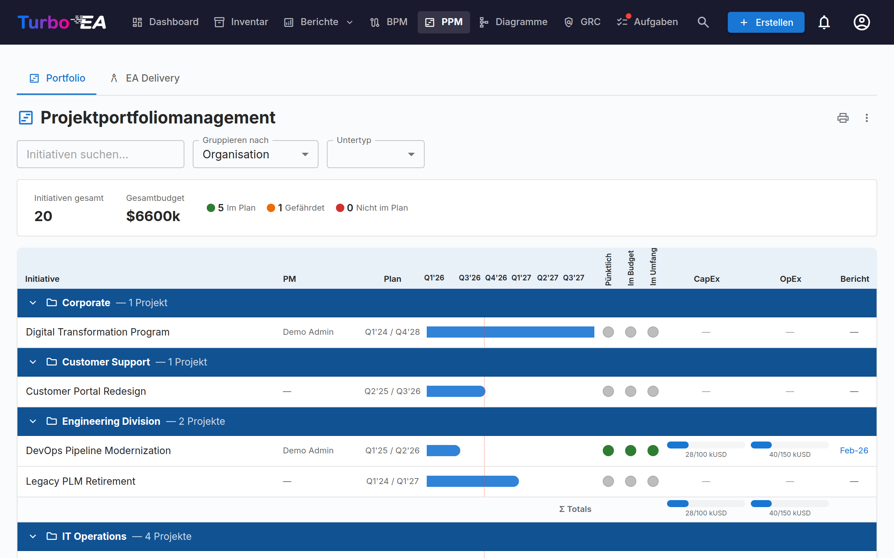
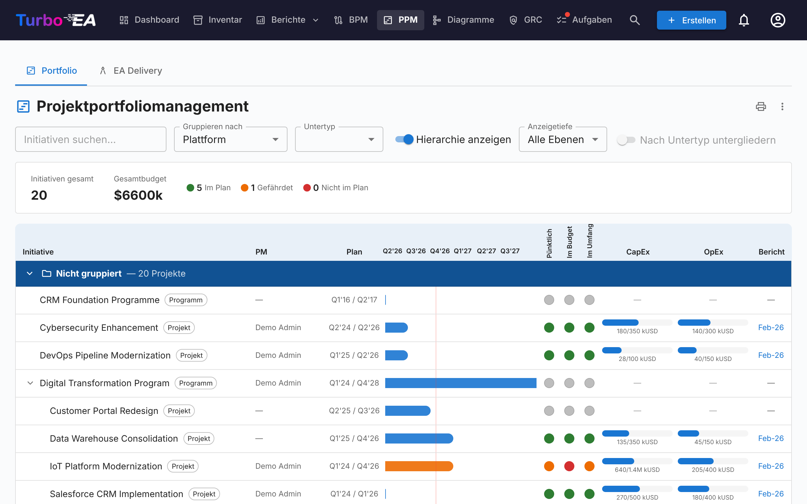
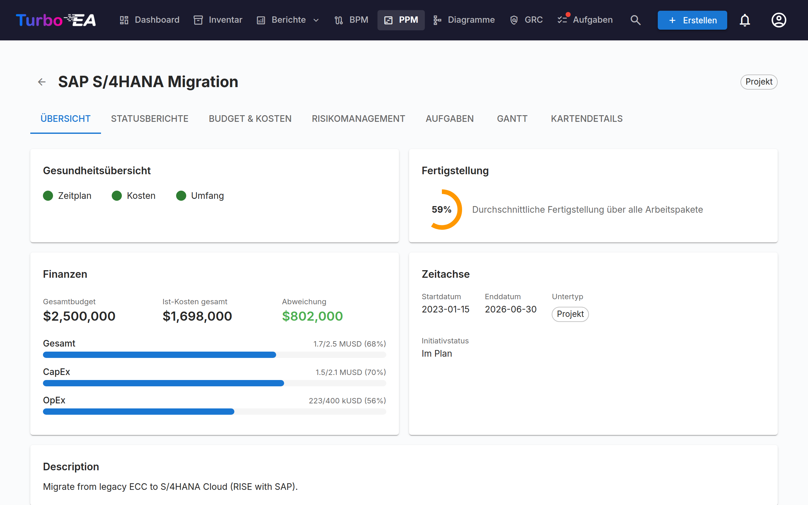
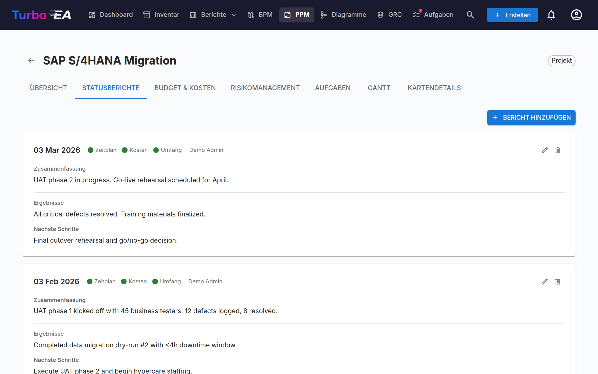
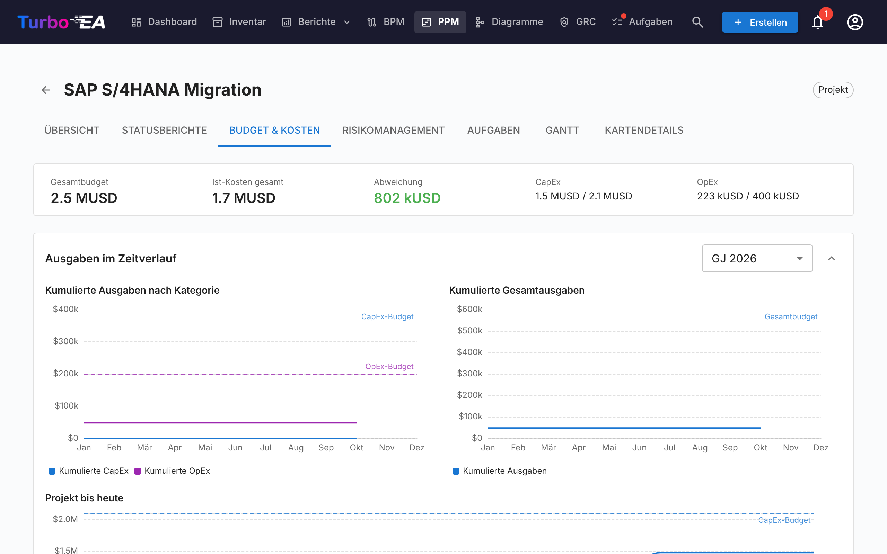
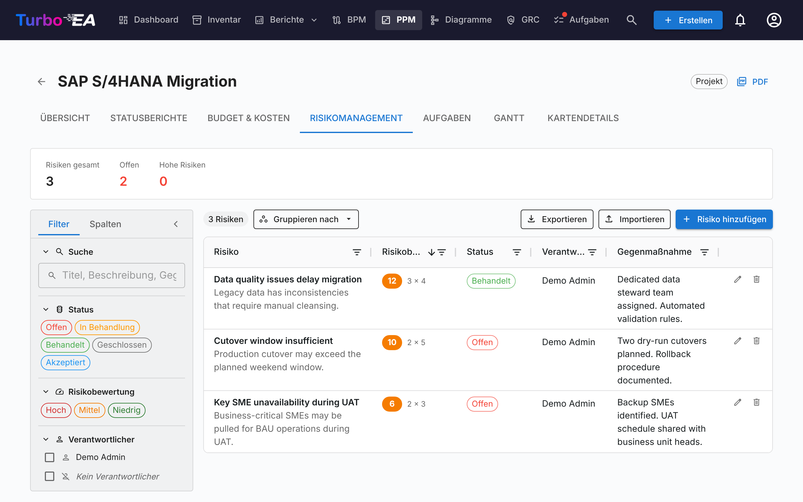
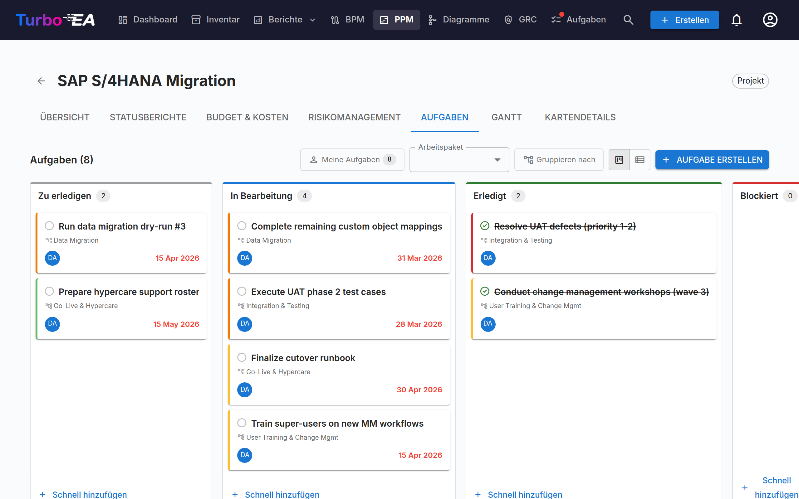
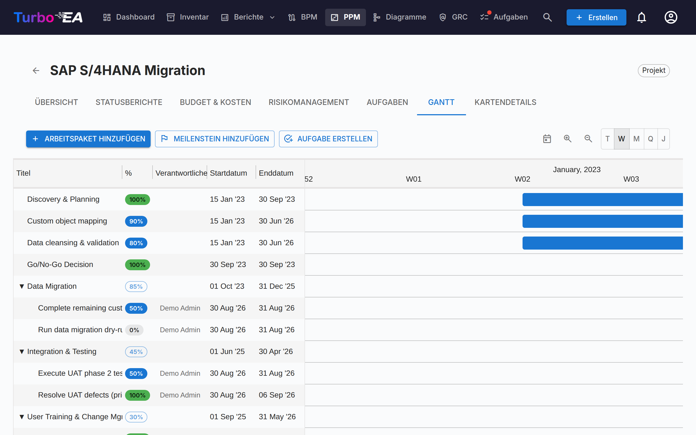
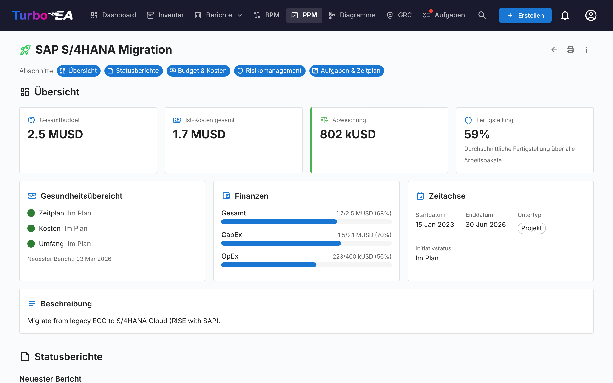

# Projektportfoliomanagement (PPM)

Das **PPM**-Modul bietet eine vollständige Lösung für das Projektportfoliomanagement zur Verfolgung von Initiativen, Budgets, Risiken, Aufgaben und Zeitplänen. Es integriert sich direkt mit dem Kartentyp Initiative, um jedes Projekt mit Statusberichten, Kostenverfolgung und Gantt-Visualisierung anzureichern.

!!! note
    Das PPM-Modul kann von einem Administrator in den [Einstellungen](../admin/settings.md) aktiviert oder deaktiviert werden. Wenn deaktiviert, sind PPM-Navigation und -Funktionen ausgeblendet.

## Portfolio-Dashboard

Das **Portfolio-Dashboard** ist der Haupteinstiegspunkt für PPM. Es bietet:

- **KPI-Karten** — Gesamtzahl der Initiativen, Gesamtbudget, tatsächliche Gesamtkosten und Zusammenfassungen des Gesundheitsstatus
- **Gesundheits-Kreisdiagramme** — Verteilung von Zeitplan-, Kosten- und Umfangsgesundheit (Auf Kurs / Gefährdet / Abweichend)
- **Statusverteilung** — Aufschlüsselung nach Initiativ-Subtyp und Status
- **Gantt-Übersicht** — Zeitbalken mit Start- und Enddaten jeder Initiative und RAG-Gesundheitsindikatoren

### Gruppierung und Filterung

Verwenden Sie die Symbolleiste, um:

- **Gruppieren nach** jedem verknüpften Kartentyp (z. B. Organisation, Plattform)
- **Gruppieren nach** einem Untertyp der Initiative (z. B. Programm), aufgeführt in einem zweiten Abschnitt desselben Menüs, um jedes Programm mit allen Initiativen darunter zu sehen (siehe unten)
- **Filtern nach Subtyp** (Idee, Programm, Projekt, Epic)
- **Suchen** nach Initiativname
- **Hierarchie anzeigen** – die Initiativen jeder Gruppe unter ihrer übergeordneten Initiative einrücken (siehe unten)
- **Nach Untertyp untergliedern** – jede Gruppe nach Untertyp aufteilen (siehe unten)

Diese Filter bleiben in der URL erhalten, sodass eine Seitenaktualisierung Ihre aktuelle Ansicht beibehält. Auch die Hierarchie, ihre Anzeigetiefe und die Untergliederung bleiben in der URL erhalten.

#### Die Initiativhierarchie anzeigen

Wenn einige Initiativen im Portfolio eine übergeordnete Initiative haben, die ebenfalls im Portfolio steht, bietet die Symbolleiste **Hierarchie anzeigen** an. Eingeschaltet listet jede Gruppe ihre Initiativen als Baum: Eine untergeordnete Initiative steht eingerückt unter ihrer übergeordneten, der Pfeil vor dem Namen einer übergeordneten Initiative klappt ihren Teilbaum ein oder aus, und jede Zeile zeigt ihren Untertyp, sodass die Rolle jeder Ebene (zum Beispiel Programm → Projekt → Epic) sichtbar bleibt. **Anzeigetiefe** begrenzt den Baum auf seine ersten Ebenen (*Ebene 1*, *Ebene 2*, … oder *Alle Ebenen*).

Die Gruppierung bleibt vorrangig: Die Hierarchie wird **innerhalb jeder Gruppe** aufgebaut, sodass eine Initiative, deren übergeordnete Initiative zu einer anderen Gruppe gehört, in ihrer eigenen Gruppe als Zeile der obersten Ebene erscheint. Die Filter wirken zuerst, und der Baum zeigt, was übrig bleibt: Schließen die Suche oder der Untertypfilter eine übergeordnete Initiative aus, rücken ihre untergeordneten Initiativen auf die oberste Ebene, statt dass die übergeordnete als Kontext erhalten bleibt.

#### Nach Untertyp untergliedern

**Nach Untertyp untergliedern** teilt jede Gruppe in eine Untergruppe je Untertyp auf, in der Reihenfolge, in der die Untertypen am Typ Initiative definiert sind; Initiativen ohne Untertyp stehen zuletzt. Jede Untergruppe hat eine eigene Überschrift, lässt sich einzeln einklappen und hat eine eigene Summenzeile; die Summen der Gruppe umfassen weiterhin alle ihre Initiativen. Solange die Hierarchie angezeigt wird, ist der Schalter nicht verfügbar, da der Baum bereits alle Untertypen umfasst.

#### Nach einem Untertyp der Initiative gruppieren

Das Menü **Gruppieren nach** hat zwei Abschnitte: **Verknüpfte Kartentypen** und **Initiative-Subtypen**, die auf dem Typ Initiative definierten Untertypen. Wählen Sie einen Untertyp — etwa **Programm** —, zeigt das Board eine Gruppe je Programm-Initiative. Das Programm benennt seine Gruppe und ist **nur deren Kopfzeile, nie eine Zeile**; die Gruppe enthält **jede Initiative darunter, auf jeder Ebene** und gleich welchen Untertyps, sodass ein Programm unter einem anderen Programm eine Zeile in der Gruppe des obersten Programms ist.

Die Schlusszeile der Gruppe ersetzt die Summenzeile: Sie trägt den Namen des Untertyps und zeigt das **eigene** Budget, die eigenen Ist-Kosten und Termine des Programms oder — wo es keine eigenen hat — die aus den Initiativen darunter **abgeleiteten** Werte, umrandet, gestrichelt und kursiv dargestellt wie unter *Werte auf übergeordnete Initiativen aufsummieren* beschrieben. Initiativen ohne Programm darüber stehen unter **Nicht gruppiert**. Eine Initiative dazwischen, die Sie nicht sehen dürfen, die archiviert ist oder die ein Portal nicht veröffentlicht, **unterbricht die Kette**: Was darunter liegt, wird nicht mehr dem Programm darüber zugeordnet. **Hierarchie anzeigen** erscheint nur, wenn unterhalb der direkten Kinder eines Programms etwas verschachtelt ist, und der Untertyp-Filter bietet den gruppierenden Untertyp nicht an, weil dessen Initiativen Kopfzeilen und keine Zeilen sind.

#### Werte auf übergeordnete Initiativen aufsummieren

Jede Initiative zeigt ihre eigenen Werte, sobald sie welche hat: Die CapEx- und OpEx-Balken einer übergeordneten Initiative umfassen die auf ihr selbst erfassten Budget- und Kostenzeilen, ihr Gantt-Balken ihr eigenes Start- und Enddatum. Eine übergeordnete Initiative **ohne eigene Budgetzeilen** zeigt stattdessen das Budget der Initiativen darunter, eine **ohne eigene Kostenzeilen** deren Ist-Kosten; in beiden Fällen wird der Balken **umrandet** mit kursiven Werten gezeichnet, und sein Tooltip nennt, welche Hälfte von darunter stammt. Eine ohne **Start- und ohne Enddatum** erstreckt sich vom frühesten Start bis zum spätesten Ende darunter, als **gestrichelter** Balken mit kursiven Quartalen. Ein Tooltip nennt jeweils, wie viele Initiativen erfasst sind. Die drei Regeln gelten unabhängig voneinander – ein Programm, das das Budget hält, während seine Projekte die Ausgaben erfassen, zeigt sein eigenes Budget gegen deren Ist-Kosten, und ein Programm kann eigene Termine haben und trotzdem die Kosten seiner Projekte zeigen –, und schon eine Budgetzeile, eine Kostenzeile oder ein Datum auf der übergeordneten Initiative schaltet diesen Teil auf ihre eigenen Werte zurück. Es zählen nur die Initiativen, die Sie sehen dürfen, und auf einem Portal nur die, die das Portal veröffentlicht. Die Gruppensummen und die KPI-Leiste addieren weiterhin nur erfasste Zeilen, sodass jeder Wert genau einmal zählt.

Die abgeleiteten Werte gibt es nur auf dem PPM-Board und auf den Reitern **Übersicht** und **Budget & Kosten** der Initiative selbst. Um eine aufsummierte Summe ins Inventar, in Berichte oder in ein Portal zu bringen, legen Sie ein berechnetes Feld an, das das eigene Budget jeder Ebene zu den Summen ihrer untergeordneten Initiativen addiert – siehe [PPM-Werte entlang der Initiativhierarchie aufsummieren](../admin/calculations.md#rolling-ppm-figures-up-the-initiative-hierarchy). Eine PPM-Änderung an einer untergeordneten Initiative führt die Berechnungen aller darüberliegenden Initiativen erneut aus, sodass sich die Summe der übergeordneten sofort aktualisiert.

### Drucken und Exportieren

Das Portfolio bietet dieselben Aktionen in der Titelleiste wie die Berichte:

- **Drucken / Als PDF speichern** — Das Druckersymbol druckt das Portfolio so, wie es auf dem Bildschirm aussieht. Die Registerkartenleiste, die Filterleiste und Hover-Popovers werden ausgeblendet, die aktive Gruppierung, der Subtyp und die Suche erscheinen als kompakte Parameterzeile, und das Zeitplanraster wird nicht mehr beschnitten, sodass alle Spalten auf die Seite passen. Sind die Hierarchie oder die Untergliederung eingeschaltet, nennt die Parameterzeile auch diese, mit der Anzeigetiefe.
- **Export nach PowerPoint (.pptx)** — über das **⋮**-Menü. Die erste Folie enthält Titel, Erstellungszeitstempel und die aktiven Filter zusammen mit dem Portfolio in Präsentationsqualität; lange Portfolios werden auf weiteren Folien fortgesetzt und nur zwischen Initiativen getrennt — nie mitten in einer Zeile, einer Gruppenüberschrift oder einer Summenzeile.
- **Export nach Excel (.xlsx)** — ebenfalls über das **⋮**-Menü. Eine Zeile je Initiative mit Gruppe, Subtyp, Projektleitung, Start- und Enddatum, den drei Gesundheitsbewertungen, CapEx/OpEx geplant und tatsächlich sowie dem Datum des letzten Statusberichts. Die Zeilen folgen der Reihenfolge auf dem Bildschirm; solange die Hierarchie angezeigt wird, nennt eine Spalte **Übergeordnet** die übergeordnete Initiative jeder Initiative. Drei Spalten, **Budget aus**, **Kosten aus** und **Termine aus**, geben an, ob Budget, Ist-Kosten und Termine einer Zeile ihre eigenen sind oder die Summe der Initiativen darunter. Ist das Board nach einem Untertyp der Initiative gruppiert, ist die gruppierende Initiative die **erste Zeile ihrer Gruppe**, mit den Werten, die ihre Schlusszeile zeigt.

## Initiativ-Detailansicht

Klicken Sie auf eine Initiative, um deren Detailseite mit sieben Tabs zu öffnen:

### Übersicht-Tab

Die Übersicht zeigt eine Zusammenfassung der Gesundheit und Finanzen der Initiative:

- **Gesundheitsübersicht** — Zeitplan-, Kosten- und Umfangsindikatoren aus dem letzten Statusbericht
- **Budget vs. Ist** — Kombinierte KPI-Karte mit Gesamtbudget und tatsächlichen Ausgaben mit Abweichung
- **Werte von darunter** — Hat die Initiative keine eigenen Budgetzeilen, zeigen ihr Gesamtbudget, ihre Budgetbalken und die Abweichung stattdessen das Budget der Initiativen darunter: kursiv, mit einem ↳-Pfeil markiert, mit umrandeter Budgetspur und einem Tooltip, der nennt, wie viele Initiativen erfasst sind. Hat sie keine eigenen Kostenzeilen, stammen ihre Ist-Kosten auf dieselbe Weise von darunter, mit umrandeten Ausgabenbalken. Beide Seiten werden getrennt entschieden, und die erste eigene Zeile schaltet diese Seite auf die eigenen Werte der Initiative zurück.
- **Unter dieser Initiative** — Hat die Initiative untergeordnete Initiativen, nennt eine Zeile unter den Budgetbalken deren Anzahl, ihr summiertes Budget und ihre Ist-Ausgaben sowie die Spanne ihrer Termine. Sie steht neben den eigenen Werten der Initiative und wird nie zu ihnen addiert. Stammen Budget und Ist-Kosten bereits beide von darunter, nennt die Zeile nur noch die Anzahl und die Terminspanne.
- **Letzte Aktivität** — Zusammenfassung des letzten Statusberichts

### Statusberichte-Tab

Monatliche Statusberichte verfolgen die Projektgesundheit über die Zeit. Jeder Bericht enthält:

| Feld | Beschreibung |
|------|--------------|
| **Berichtsdatum** | Das Datum des Berichtszeitraums |
| **Zeitplan-Gesundheit** | Auf Kurs, Gefährdet oder Abweichend |
| **Kosten-Gesundheit** | Auf Kurs, Gefährdet oder Abweichend |
| **Umfangs-Gesundheit** | Auf Kurs, Gefährdet oder Abweichend |
| **Zusammenfassung** | Zusammenfassung des aktuellen Status |
| **Errungenschaften** | Was in diesem Zeitraum erreicht wurde |
| **Nächste Schritte** | Geplante Aktivitäten für den nächsten Zeitraum |

### Budget & Kosten-Tab

Finanzdaten verfolgen mit zwei Arten von Positionen:

- **Budgetpositionen** — Geplantes Budget nach Geschäftsjahr und Kategorie (CapEx / OpEx), mit optionaler Beschreibung. Ein Geschäftsjahr und eine Kategorie können beliebig viele Positionen enthalten — etwa eine je Lizenz, Implementierungspartner oder Hardware-Lieferung —, die Beschreibung unterscheidet sie; die Summen rechnen alle zusammen. Budgetzeilen werden nach dem **Geschäftsjahresbeginn** gruppiert, der in den [Einstellungen](../admin/settings.md#beginn-des-geschäftsjahres) konfiguriert ist. Wenn das Geschäftsjahr beispielsweise im April beginnt, gehört eine Budgetzeile vom Juni 2026 zum GJ 2026–2027
- **Kostenpositionen** — Tatsächliche Ausgaben mit Datum, Beschreibung und Kategorie

Beide Tabellen sind nach Geschäftsjahr gruppiert. Jedes Jahr hat eine Kopfzeile mit seinen Zwischensummen für CapEx, OpEx und Gesamt sowie der Anzahl seiner Zeilen; mit dem Pfeil in der Kopfzeile blenden Sie die Zeilen dieses Jahres ein oder aus. Beim Öffnen des Tabs ist nur das aktuelle Geschäftsjahr aufgeklappt (oder das letzte Jahr mit Zeilen, wenn das aktuelle keine hat). Die Beträge stehen in getrennten Spalten **CapEx** und **OpEx**, und eine Zeile **Gesamt, alle Geschäftsjahre** unter jeder Tabelle summiert alle Jahre. Mit **+** in der Kopfzeile eines Budgetjahres legen Sie eine Budgetzeile an, in der dieses Geschäftsjahr bereits eingetragen ist. Kostenpositionen werden nach dem Geschäftsjahr ihres Datums gruppiert und darin nach Datum sortiert; Kostenpositionen ohne Datum stehen am Ende in der Gruppe **Ohne Datum** und zählen wie jede andere Position zu den Kostensummen.

Hat die Initiative **keine eigenen Budgetzeilen**, zeigt die Budgettabelle anstelle ihres leeren Zustands das Budget der Initiativen darunter: Eine Beschriftung nennt, aus wie vielen Initiativen es stammt, je Geschäftsjahr gibt eine schreibgeschützte Zeile CapEx, OpEx und Gesamt kursiv an, und die Zeile **Gesamt, alle Geschäftsjahre** addiert sie. Die Kostentabelle tut dasselbe mit deren Ist-Kosten, wenn die Initiative **keine eigenen Kostenzeilen** hat, mit einer Zeile **Ohne Datum** für deren Kostenzeilen ohne Datum. Die Übersichtsleiste kennzeichnet diese Werte kursiv, mit einem Tooltip. Jede Tabelle entscheidet für sich, nichts wird gespeichert oder zu den eigenen Werten der Initiative addiert, und es zählen nur die Initiativen, die Sie sehen dürfen. Die erste eigene Zeile über **Budgetzeile hinzufügen** oder **Kostenposition hinzufügen** schaltet diese Tabelle auf die eigenen Zeilen der Initiative zurück; die Ausgabendiagramme zeigen stets die eigenen Zeilen der Initiative.

Budget- und Kostensummen werden automatisch in die `costBudget`- und `costActual`-Attribute der Initiativ-Karte hochgerechnet. Diese Kartenfelder sind **Summen über alle Geschäftsjahre**. Der [Kostenbericht](reports.md) und die Kosten-Kacheln des Dashboards, die das aktuelle Geschäftsjahr zeigen, zählen nur die Budgetpositionen des laufenden Jahres und die darin datierten Kostenpositionen; Kostenpositionen ohne Datum zählen in keinem Jahr.

#### Ausgaben im Zeitverlauf

Über den Budget- und Kostentabellen zeigen drei Diagramme, wie sich die Ausgaben Monat für Monat aufsummieren:

- **Kumulierte Ausgaben nach Kategorie** — kumulierte CapEx und OpEx für das gewählte Geschäftsjahr, mit gepunkteten waagerechten Linien für das CapEx- und OpEx-Budget dieses Jahres
- **Kumulierte Gesamtausgaben** — dasselbe Geschäftsjahr mit beiden Kategorien zusammengefasst, gegen eine gepunktete Gesamtbudget-Linie
- **Projekt bis heute** — kumulierte CapEx und OpEx über alle Monate des Projekts, gegen das Gesamtbudget aller Geschäftsjahre

Die Geschäftsjahr-Auswahl gilt für die ersten beiden Diagramme und bietet das laufende Jahr, jedes weitere Jahr mit Daten sowie **Alle Geschäftsjahre**. Geschäftsjahr und der Auf-/Zugeklappt-Zustand werden zwischen Besuchen gespeichert.

Zwei Hinweise zum Lesen der Diagramme:

- Die Linien enden im aktuellen Monat, statt flach bis zum Jahresende weiterzulaufen — so wird ein laufendes Jahr nicht mit einem verwechselt, in dem die Ausgaben gestoppt wurden
- Kostenpositionen ohne Datum lassen sich zeitlich nicht einordnen und bleiben unberücksichtigt. Ein Hinweis unter den Diagrammen nennt die Anzahl der ausgeschlossenen Positionen, damit sich die Diagrammsummen mit der Übersichtsleiste abgleichen lassen

### Risikomanagement-Tab

Das Risikoregister verfolgt die Risiken der Initiative. Jedes Risiko hat:

| Feld | Beschreibung |
|------|--------------|
| **Titel** | Kurze Beschreibung des Risikos |
| **Beschreibung** | Das Risiko in vollem Umfang |
| **Wahrscheinlichkeit** | Wahrscheinlichkeitswert (1–5) |
| **Auswirkung** | Auswirkungswert (1–5) |
| **Risikobewertung** | Automatisch berechnet als Wahrscheinlichkeit × Auswirkung |
| **Status** | Offen, In Behandlung, Behandelt, Geschlossen oder Akzeptiert |
| **Gegenmaßnahme** | Geplante Gegenmaßnahmen |
| **Verantwortlicher** | Benutzer, der für die Risikoverwaltung verantwortlich ist |

Eine Übersichtsleiste über dem Raster zeigt **Risiken gesamt**, die Anzahl der Risiken mit dem Status **Offen** und **Hohe Risiken**.

#### Das Risikoraster

Die Risiken werden in einem Raster aufgelistet, das wie das [Inventar](inventory.md) und das [Risikoregister](risks.md#register-grid) aufgebaut ist. Text wird nie abgeschnitten: Jede Zeile zeigt den Titel des Risikos fett mit der **vollständigen Beschreibung** darunter sowie die **vollständige Gegenmaßnahme**, jeweils umbrochen auf so viele Zeilen wie nötig. Webadressen in der Beschreibung und der Gegenmaßnahme sind anklickbar.

| Spalte | Zeigt |
|--------|-------|
| **Risiko** | Den Titel, mit der Beschreibung darunter |
| **Risikobewertung** | Die Bewertung als farbiger Chip, daneben *Wahrscheinlichkeit × Auswirkung* (zum Beispiel **20** *4 × 5*) |
| **Status** | Den Status-Chip |
| **Verantwortlicher** | Den Verantwortlichen des Risikos oder einen Strich |
| **Gegenmaßnahme** | Die geplante Gegenmaßnahme oder einen Strich |
| *(Schaltflächen)* | **Bearbeiten** und **Löschen** |

**Wahrscheinlichkeit** und **Auswirkung** gibt es auch als eigene Spalten; sie sind standardmäßig ausgeblendet — blenden Sie sie im Tab **Spalten** des Filterbereichs ein.

- **Sortieren** — klicken Sie auf eine Spaltenüberschrift. Solange Sie keine eigene Sortierung wählen, steht die höchste Bewertung oben.
- **Spalte filtern** — verwenden Sie die Filter in den Spaltenüberschriften, wie in den anderen Rastern.
- **Spalte fixieren** — klicken Sie auf den Pin in der Überschrift, um die Spalte beim seitlichen Scrollen am linken Rand zu halten; ein erneuter Klick löst sie wieder.
- **Spalten neu anordnen** — ziehen Sie eine Spaltenüberschrift.
- **Zellenmenü** — klicken Sie mit der rechten Maustaste auf eine Zelle (langes Drücken auf Touch-Geräten), um dasselbe Zellenmenü wie in den anderen Rastern zu öffnen.

#### Filterbereich

Der Bereich auf der linken Seite hat zwei Tabs:

- **Filter**
    - **Suche** — durchsucht Titel, Beschreibung, Gegenmaßnahme und Verantwortlichen.
    - **Status** — wählen Sie einen oder mehrere Status-Chips aus.
    - **Risikobewertung** — die Bewertungsstufen **Hoch** (15 oder mehr), **Mittel** (6 bis 14) und **Niedrig** (unter 6).
    - **Verantwortlicher** — die in der Liste vorkommenden Verantwortlichen sowie **Kein Verantwortlicher**.
    - **Alle Filter zurücksetzen** setzt alle Filter auf einmal zurück.
- **Spalten** — die Liste **Spaltenreihenfolge** (ziehen Sie eine Zeile, um eine Spalte zu verschieben, fixieren Sie sie mit ihrem Pin, **Reihenfolge zurücksetzen** stellt die Standardreihenfolge wieder her) und die Liste **Sichtbare Spalten** zum Ein- und Ausblenden von Spalten, mit **Alle auswählen**, um jede Spalte anzuzeigen. Die Spalte Risiko und die Schaltflächen werden immer angezeigt. Sobald die sichtbaren Spalten vom Standard abweichen, kehrt **Zurücksetzen** zu ihm zurück: alle Spalten außer Wahrscheinlichkeit und Auswirkung.

Der Bereich lässt sich zu einer schmalen Leiste einklappen, die anzeigt, wie viele Filter aktiv sind, und seine Kante lässt sich ziehen, um die Breite anzupassen. Auf dem Smartphone ist der Bereich eine Schublade, die über die Filter-Schaltfläche in der Werkzeugleiste geöffnet wird.

#### Werkzeugleiste

Die Werkzeugleiste zeigt, wie viele Risiken aufgelistet sind, und bietet:

- **Gruppieren nach** — gruppiert die Zeilen nach **Status**, **Verantwortlicher** oder **Bewertungsstufe**.
- **Exportieren** — lädt die aktuell angezeigten Risiken als `.xlsx` herunter (siehe unten).
- **Importieren** — lädt Risiken aus einer `.xlsx` (siehe unten).
- **Risiko hinzufügen** — öffnet den Dialog, um ein neues Risiko zu erfassen.

Sortierung, fixierte Spalten, Spaltenreihenfolge, sichtbare Spalten, Breite des Bereichs und Gruppierung werden in Ihrem Browser gespeichert.

#### Risiken nach Excel exportieren

**Exportieren** lädt die Risiken herunter, die das Raster gerade anzeigt — nach den Filtern des Bereichs, in der Reihenfolge des Rasters — als `.xlsx` mit einer Zeile pro Risiko und den Spalten **Risiko-ID**, **Risikotitel**, **Beschreibung**, **Wahrscheinlichkeit**, **Auswirkung**, **Risikobewertung**, **Status**, **Verantwortlicher** und **Gegenmaßnahme**. Die Datei ist zugleich eine gültige Importdatei: exportieren, in Excel bearbeiten und wieder importieren.

#### Risiken aus Excel importieren {: #importing-risks }

**Importieren** lädt eine `.xlsx`, um Risiken der Initiative hinzuzufügen oder zu aktualisieren. **Vorlage herunterladen** im Dialog liefert eine Arbeitsmappe mit den richtigen Überschriften und einer Beispielzeile.

- Eine Zeile mit einer **Risiko-ID** aus einem Export **aktualisiert** dieses Risiko, und zwar nur die geänderten Felder.
- Eine Zeile **ohne Risiko-ID** **legt** ein neues Risiko **an**.
- Eine Risiko-ID, die die Initiative nicht hat, oder eine, die in der Datei doppelt vorkommt, führt zur **Ablehnung** der Zeile.
- Risiken, die in der Datei fehlen, bleiben unberührt: **Der Import löscht nie**.

Bevor etwas geschrieben wird, listet eine Vorschau jede Zeile als **Neu**, **Aktualisierung** (mit den Feldern, die sich ändern), **Unverändert** oder **Abgelehnt** (mit dem Grund) auf und zählt die Warnungen. Abgelehnte Zeilen werden übersprungen; die Schaltfläche importiert die übrigen Änderungen. Anschließend zeigt ein Ergebnis, wie viele Risiken angelegt, aktualisiert und fehlgeschlagen sind.

| Spalte | Regel |
|--------|-------|
| **Risikotitel** | Erforderlich |
| **Wahrscheinlichkeit**, **Auswirkung** | Eine ganze Zahl von 1 bis 5. Leer bedeutet 3 bei einer neuen Zeile und lässt den Wert bei einer Aktualisierung unverändert |
| **Status** | Offen, In Behandlung, Behandelt, Geschlossen oder Akzeptiert. Leer bedeutet Offen bei einer neuen Zeile und lässt den Status bei einer Aktualisierung unverändert |
| **Verantwortlicher** | Zuordnung per E-Mail, dann per Name. Ein Verantwortlicher, der zu niemandem oder zu mehreren Personen passt, ergibt eine Warnung: Die Zeile wird trotzdem importiert und der Verantwortliche bleibt unverändert |
| **Beschreibung**, **Gegenmaßnahme**, **Verantwortlicher** | Eine leere Zelle leert das Feld bei einer Aktualisierung |
| **Risikobewertung**, jede andere Spalte | Ignoriert — die Bewertung wird immer berechnet |

Spalten werden anhand ihrer Überschrift in Ihrer Sprache oder auf Englisch erkannt. Eine Spalte, die in der Datei fehlt, bleibt bei jedem aktualisierten Risiko unverändert.

### Aufgaben-Tab

Der Aufgabenmanager unterstützt **Kanban-Board** und **Listen**-Ansichten mit vier Statusspalten:

- **Zu erledigen** — Noch nicht begonnene Aufgaben
- **In Bearbeitung** — Aufgaben, an denen gerade gearbeitet wird
- **Erledigt** — Abgeschlossene Aufgaben
- **Blockiert** — Aufgaben, die nicht fortgesetzt werden können

Aufgaben können nach Projektstrukturplan (PSP)-Element gefiltert und gruppiert werden. Bei Gruppierung erscheint jedes Arbeitspaket als Gruppe — auch eines, das noch keine Aufgaben enthält; es zeigt einen Hinweis und eine Schaltfläche **Aufgabe hinzufügen**, die den Aufgabendialog mit diesem Paket vorausgewählt öffnet. Meilensteine erscheinen erst, sobald sie eine Aufgabe enthalten. Ziehen Sie Karten zwischen Spalten, um den Status zu aktualisieren.

Anzeigefilter (Ansichtsmodus, WBS-Filter, Gruppierungs-Umschalter) bleiben in der URL zwischen Seitenaktualisierungen erhalten.

### Gantt-Tab

Das Gantt-Diagramm visualisiert den Projektzeitplan mit:

- **Arbeitspakete (WBS)** — Hierarchische Projektstrukturplanelemente mit Start-/Enddaten
- **Aufgaben** — Einzelne Aufgabenbalken, die mit Arbeitspaketen verknüpft sind
- **Meilensteine** — Wichtige Termine, markiert mit Rautenindikatoren
- **Fortschrittsbalken** — Visueller Fertigstellungsgrad. Eine Aufgabe hat keinen eigenen Prozentwert: ihre Füllung folgt ihrem Status — **Zu erledigen (0%)**, **In Bearbeitung (50%)**, **Erledigt (100%)**. Klicken Sie auf den Prozent-Chip einer Aufgabe, um einen Schieberegler zu öffnen, dessen drei Stufen mit diesen Status beschriftet sind; die Wahl einer Stufe ändert den Status, und das Ziehen der Füllung auf dem Balken der Aufgabe tut dasselbe. Ein Blatt-Arbeitspaket hat einen freien Schieberegler in 5%-Schritten. Arbeitspakete mit untergeordneten Arbeitspaketen **oder Aufgaben** zeigen einen schreibgeschützten Chip, dessen Wert automatisch aus dem Teilbaum hochgerechnet wird.
- **Quartalstakte** — Zeitraster zur Orientierung

Interaktion mit dem Gantt-Diagramm:

- **Auf eine Spaltenüberschrift klicken** (Titel, %, Verantwortlich, Startdatum oder Enddatum), um die Liste danach zu sortieren: beim ersten Klick aufsteigend, beim zweiten absteigend und beim dritten zurück zur geplanten Reihenfolge. Ein Pfeil neben der Überschrift zeigt die aktive Sortierung. Die Elemente werden innerhalb ihrer Geschwister sortiert, sodass ein verschachteltes Arbeitspaket oder eine Aufgabe unter ihrem übergeordneten Element bleibt. Elemente ohne verantwortliche Person oder ohne eigenes Datum stehen in beiden Richtungen am Ende, und die **+**-Zeile bleibt ganz unten. Die Auswahl wird im Browser gespeichert. Auf einem Smartphone, wo nur Titel und % angezeigt werden, lassen sich nur diese beiden sortieren
- **Skalenauswahl** — Tag, Woche, Monat, Quartal oder Jahr; die Auswahl wird im Browser gespeichert
- **Zoom-Schaltflächen (+/−)** — Schrittweises Vergrößern bzw. Verkleinern entlang derselben fünf Skalen
- **Punkte an den Balkenenden** — Vom rechten Punkt eines Balkens auf den linken Punkt eines anderen ziehen, um eine Finish-to-Start-Abhängigkeit zu erstellen. Funktioniert zwischen Arbeitspaketen und Aufgaben in jeder Kombination. Zyklen werden automatisch zurückgewiesen. **Pfeil doppelklicken**, um ihn zu entfernen.
- **Die +-Zeile** am Ende der Liste fragt, was erstellt werden soll — ein Arbeitspaket, ein Meilenstein oder eine Aufgabe —, sodass eine dort eingegebene Aufgabe im Aufgaben-Tab landet.

### Kartendetails-Tab

Der letzte Tab zeigt die vollständige Kartendetailansicht mit allen Standardabschnitten.

### Initiativbericht

Die Schaltfläche **Bericht** in der Kopfzeile der Initiative, neben dem Untertyp-Chip (auf dem Smartphone ein Symbol), öffnet den **Initiativbericht**: eine schreibgeschützte Seite, die zusammenfasst, was die Tabs zeigen, gestaltet wie die anderen Berichte, mit dem Namen der Initiative als Titel und einem Zurück-Pfeil, um zur Initiative zurückzukehren. Die Chips unter **Abschnitte** in der Werkzeugleiste blenden jeden Abschnitt ein oder aus; beim ersten Mal werden alle angezeigt, und Ihre Auswahl wird in Ihrem Browser gespeichert:

| Abschnitt | Was angezeigt wird |
|-----------|--------------------|
| **Übersicht** | Kacheln für **Gesamtbudget**, **Ist-Kosten gesamt**, **Abweichung** und **Fertigstellung**; die **Gesundheitsübersicht** mit den drei Bewertungen des neuesten Statusberichts in Farbe und in Worten; die Balken unter **Finanzen** für Gesamt, CapEx und OpEx; der Bereich **Zeitachse** mit Start- und Enddatum, Untertyp und Initiativstatus; und die Beschreibung. Werte, die aus den untergeordneten Initiativen stammen, sind gekennzeichnet, mit einem erläuternden Hinweis |
| **Statusberichte** | Der neueste Bericht vollständig, mit seinen Bewertungen, dann die früheren Berichte in einer Tabelle mit Datum, Berichterstatter und Gesundheitsbewertungen |
| **Budget & Kosten** | Kacheln für Gesamtbudget, Ist-Kosten und Abweichung sowie für die CapEx- und OpEx-Ausgaben gegenüber ihrem Budget; die Diagramme **Ausgaben im Zeitverlauf** für das in ihrem Chip genannte Geschäftsjahr und für das gesamte Projekt; dann die Tabellen **Geplantes Budget** und **Kostenpositionen** mit allen Geschäftsjahren aufgeklappt |
| **Risikomanagement** | Kacheln für **Risiken gesamt**, **Offen** und **Hohe Risiken**; die **Risiko-Heatmap** von Wahrscheinlichkeit gegen Auswirkung, jede Zelle nach Bewertungsstufe gefärbt und mit der Anzahl der Risiken darin, daneben eine Zählung **Nach Status**; dann jedes Risiko mit seiner Bewertung (und Wahrscheinlichkeit × Auswirkung), Status, Verantwortlichem, vollständiger Beschreibung und vollständiger Gegenmaßnahme, die höchste Bewertung zuerst |
| **Aufgaben & Zeitplan** | Eine Tabelle der Arbeitspakete, jeweils mit ihren Aufgaben darunter, dann die Aufgaben ohne Arbeitspaket, neben einer Zeitleiste auf Quartalsskala: ein Balken für jedes Arbeitspaket, gefüllt entsprechend seiner Fertigstellung, ein Balken für jede Aufgabe in ihrer Statusfarbe, eine Raute für einen Meilenstein (wie im Gantt-Diagramm), ein Punkt für ein Element mit nur einem Datum und eine Linie für heute, wenn es im Zeitraum liegt. Jede Zeile zeigt außerdem ihren Fortschritt oder Status und ihre Priorität, und eine Legende erklärt die Markierungen |

Um den Bericht zu drucken oder als PDF zu speichern, verwenden Sie wie bei jedem Bericht die Schaltfläche **Drucken / Als PDF speichern** in der Titelleiste; sie öffnet den Druckdialog des Browsers bzw. in Safari auf einem iPhone oder iPad das Druckblatt, in dem Sie ebenfalls als PDF speichern können. Die Seite wird im Querformat gedruckt, ohne die Werkzeugleiste und die Navigation der App, mit ihren Diagrammen in Druckgröße, und eine Zeile unter dem Titel nennt Untertyp, Initiativstatus, Start- und Enddatum sowie den Zeitpunkt des Drucks. Ein Abschnitt, in dem nichts erfasst ist, weist darauf hin.

Um den Bericht in eine Präsentation zu übernehmen, wählen Sie **Als PowerPoint exportieren (.pptx)** im **⋮**-Menü der Titelleiste. Die Präsentation beginnt mit einer Titelfolie mit dem Namen der Initiative, dem Erstellungsdatum sowie Untertyp, Status, Start- und Enddatum. Jeder auf der Seite angezeigte Abschnitt folgt auf einer eigenen Folie, überschrieben mit dem Namen des Abschnitts, als Bild des Abschnitts, so wie Sie ihn sehen; ein langer Abschnitt wird auf weiteren Folien fortgesetzt („Budget & Kosten — Seite 2 / 3“), und eine Tabelle, die weiterläuft, wiederholt ihre Kopfzeile. Die Präsentation folgt den Chips unter **Abschnitte**: Ein ausgeblendeter Abschnitt oder einer, in dem nichts erfasst ist, wird weggelassen. Während die Präsentation erstellt wird, zeigt die Menüschaltfläche einen Ladeindikator; schlägt der Export fehl, weist eine Meldung darauf hin, und Sie können es erneut versuchen.

Um einen **Risikobericht** weiterzugeben, zeigen Sie nur **Risikomanagement** an.

## Projektstrukturplan (PSP / WBS)

Der PSP bietet eine hierarchische Zerlegung des Projektumfangs:

- **Arbeitspakete** — Logische Gruppierungen von Aufgaben mit Start-/Enddaten und Fortschrittsverfolgung
- **Meilensteine** — Bedeutende Ereignisse oder Abschlusspunkte
- **Hierarchie** — Eltern-Kind-Beziehungen zwischen PSP-Elementen
- **Auto-Fertigstellung** — Der Fertigstellungsgrad wird automatisch aus den Aufgaben im Teilbaum eines Arbeitspakets berechnet: jede Aufgabe zählt als 0% (Zu erledigen, Blockiert), 50% (In Bearbeitung) oder 100% (Erledigt), gewichtet nach ihrer Dauer in Tagen (ein Tag, wenn ein Datum fehlt), und wird dann rekursiv zu den übergeordneten Elementen aufgerollt. Ein Arbeitspaket ohne Aufgaben irgendwo unterhalb behält den von Hand eingetragenen Wert. Der Mittelwert der Arbeitspakete oberster Ebene ist der Gesamtfortschritt der Initiative — die Zahl auf dem Übersicht-Tab und die Variable `ppm.completion`, die ein [berechnetes Feld](../admin/calculations.md#ppm-data-on-initiative-cards) auf der Karte und in einem Portal anzeigen kann

## Kartendetail-Integration

Wenn PPM aktiviert ist, zeigen **Initiativ**-Karten einen **PPM**-Tab als letzten Tab in der [Kartendetailansicht](card-details.md). Ein Klick auf diesen Tab navigiert direkt zur PPM-Initiativ-Detailansicht (Übersicht-Tab). Dies bietet einen schnellen Einstiegspunkt von jeder Initiativ-Karte zu ihrer vollständigen PPM-Projektseite.

Umgekehrt zeigt der **Kartendetails**-Tab innerhalb der PPM-Initiativ-Detailansicht die Standardabschnitte der Kartendetails ohne den PPM-Tab, um zirkuläre Navigation zu vermeiden.

## Berechtigungen

| Berechtigung | Beschreibung |
|-------------|--------------|
| `ppm.view` | PPM-Dashboard, Gantt-Diagramm und Initiativberichte anzeigen sowie Initiative-Karten lesen. Standardmäßig für alle Rollen gewährt |
| `ppm.manage` | Statusberichte, Aufgaben, Kosten, Risiken und WBS-Elemente erstellen und verwalten. Gewährt für Admin-, BPM-Admin- und Mitglied-Rollen |
| `reports.ppm_dashboard` | PPM-Portfolio-Dashboard anzeigen. Standardmäßig für alle Rollen gewährt |
