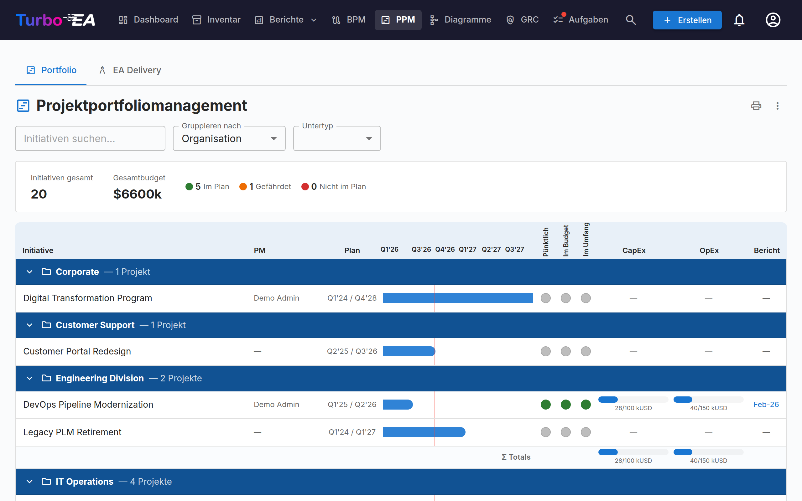
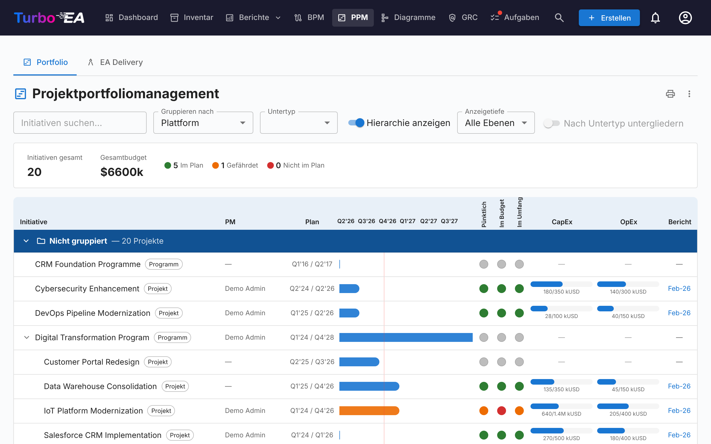
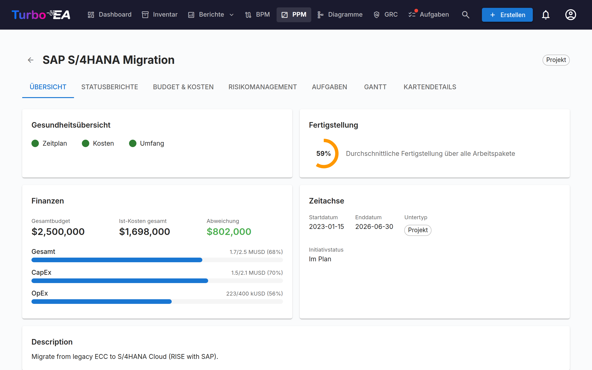
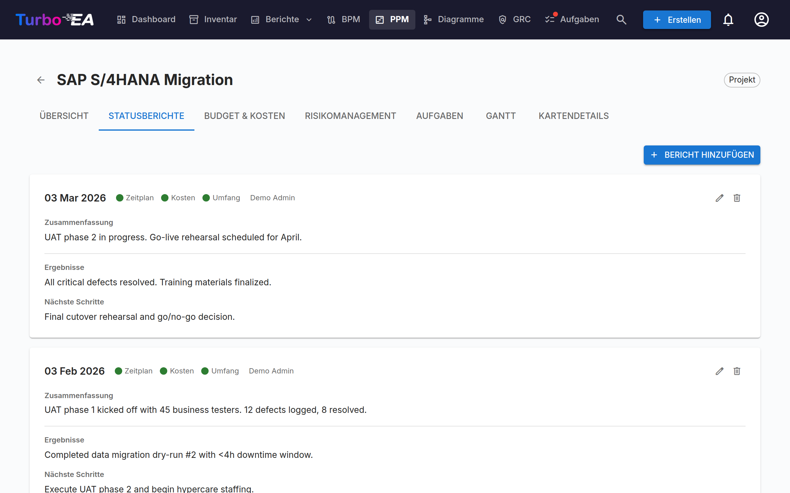
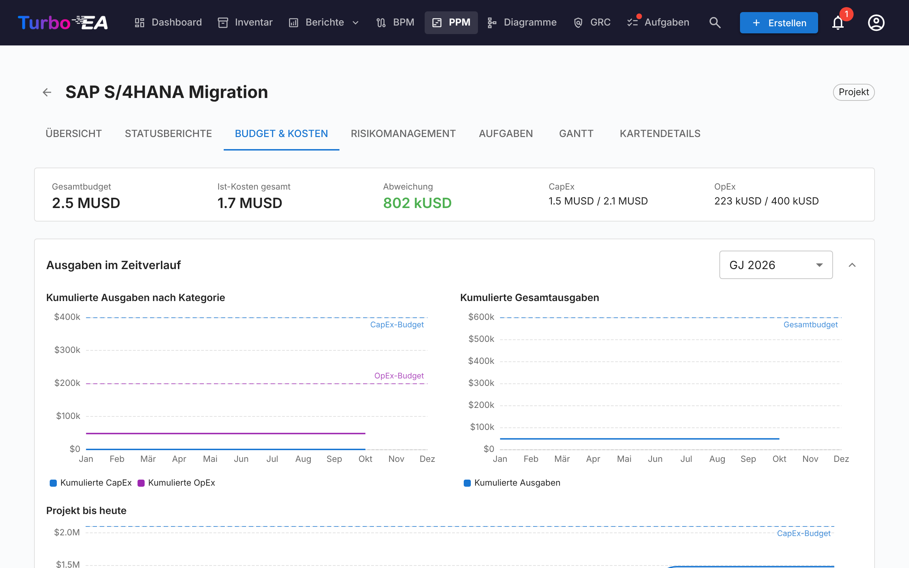
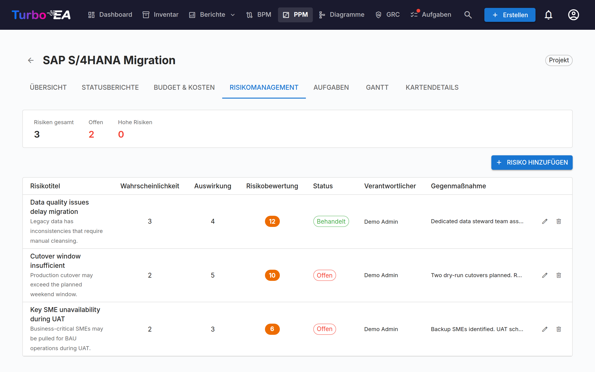
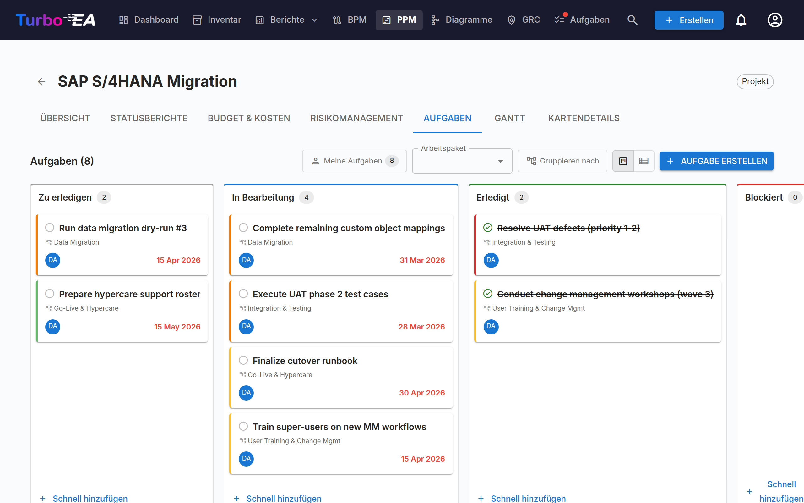
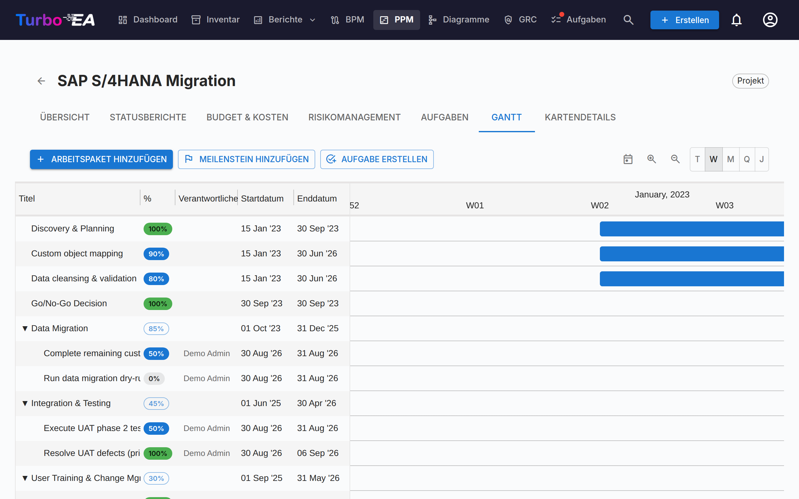

# Projektportfoliomanagement (PPM)

Das **PPM**-Modul bietet eine vollständige Lösung für das Projektportfoliomanagement zur Verfolgung von Initiativen, Budgets, Risiken, Aufgaben und Zeitplänen. Es integriert sich direkt mit dem Kartentyp Initiative, um jedes Projekt mit Statusberichten, Kostenverfolgung und Gantt-Visualisierung anzureichern.

!!! note
    Das PPM-Modul kann von einem Administrator in den [Einstellungen](../admin/settings.md) aktiviert oder deaktiviert werden. Wenn deaktiviert, sind PPM-Navigation und -Funktionen ausgeblendet.

## Portfolio-Dashboard

Das **Portfolio-Dashboard** ist der Haupteinstiegspunkt für PPM. Es bietet:

- **KPI-Karten** — Gesamtzahl der Initiativen, Gesamtbudget, tatsächliche Gesamtkosten und Zusammenfassungen des Gesundheitsstatus
- **Gesundheits-Kreisdiagramme** — Verteilung von Zeitplan-, Kosten- und Umfangsgesundheit (Auf Kurs / Gefährdet / Abweichend)
- **Statusverteilung** — Aufschlüsselung nach Initiativ-Subtyp und Status
- **Gantt-Übersicht** — Zeitbalken mit Start- und Enddaten jeder Initiative und RAG-Gesundheitsindikatoren

### Gruppierung und Filterung

Verwenden Sie die Symbolleiste, um:

- **Gruppieren nach** jedem verknüpften Kartentyp (z. B. Organisation, Plattform)
- **Filtern nach Subtyp** (Idee, Programm, Projekt, Epic)
- **Suchen** nach Initiativname
- **Hierarchie anzeigen** – die Initiativen jeder Gruppe unter ihrer übergeordneten Initiative einrücken (siehe unten)
- **Nach Untertyp untergliedern** – jede Gruppe nach Untertyp aufteilen (siehe unten)

Diese Filter bleiben in der URL erhalten, sodass eine Seitenaktualisierung Ihre aktuelle Ansicht beibehält. Auch die Hierarchie, ihre Anzeigetiefe und die Untergliederung bleiben in der URL erhalten.

#### Die Initiativhierarchie anzeigen

Wenn einige Initiativen im Portfolio eine übergeordnete Initiative haben, die ebenfalls im Portfolio steht, bietet die Symbolleiste **Hierarchie anzeigen** an. Eingeschaltet listet jede Gruppe ihre Initiativen als Baum: Eine untergeordnete Initiative steht eingerückt unter ihrer übergeordneten, der Pfeil vor dem Namen einer übergeordneten Initiative klappt ihren Teilbaum ein oder aus, und jede Zeile zeigt ihren Untertyp, sodass die Rolle jeder Ebene (zum Beispiel Programm → Projekt → Epic) sichtbar bleibt. **Anzeigetiefe** begrenzt den Baum auf seine ersten Ebenen (*Ebene 1*, *Ebene 2*, … oder *Alle Ebenen*).

Die Gruppierung bleibt vorrangig: Die Hierarchie wird **innerhalb jeder Gruppe** aufgebaut, sodass eine Initiative, deren übergeordnete Initiative zu einer anderen Gruppe gehört, in ihrer eigenen Gruppe als Zeile der obersten Ebene erscheint. Die Filter wirken zuerst, und der Baum zeigt, was übrig bleibt: Schließen die Suche oder der Untertypfilter eine übergeordnete Initiative aus, rücken ihre untergeordneten Initiativen auf die oberste Ebene, statt dass die übergeordnete als Kontext erhalten bleibt.

#### Nach Untertyp untergliedern

**Nach Untertyp untergliedern** teilt jede Gruppe in eine Untergruppe je Untertyp auf, in der Reihenfolge, in der die Untertypen am Typ Initiative definiert sind; Initiativen ohne Untertyp stehen zuletzt. Jede Untergruppe hat eine eigene Überschrift, lässt sich einzeln einklappen und hat eine eigene Summenzeile; die Summen der Gruppe umfassen weiterhin alle ihre Initiativen. Solange die Hierarchie angezeigt wird, ist der Schalter nicht verfügbar, da der Baum bereits alle Untertypen umfasst.

#### Werte auf übergeordnete Initiativen aufsummieren

Das Portfolio zeigt die eigenen Werte jeder Initiative: Die CapEx- und OpEx-Balken einer übergeordneten Initiative umfassen die Budget- und Kostenzeilen, die auf ihr selbst erfasst sind, nicht die ihrer untergeordneten Initiativen, und die Gruppensummen zählen jede Initiative einmal. Um eine Summe auf der übergeordneten Initiative zu sehen, legen Sie ein berechnetes Feld an, das das eigene Budget jeder Ebene zu den Summen ihrer untergeordneten Initiativen addiert – siehe [PPM-Werte entlang der Initiativhierarchie aufsummieren](../admin/calculations.md#rolling-ppm-figures-up-the-initiative-hierarchy). Eine PPM-Änderung an einer untergeordneten Initiative führt die Berechnungen aller darüberliegenden Initiativen erneut aus, sodass sich die Summe der übergeordneten sofort aktualisiert.

### Drucken und Exportieren

Das Portfolio bietet dieselben Aktionen in der Titelleiste wie die Berichte:

- **Drucken / Als PDF speichern** — Das Druckersymbol druckt das Portfolio so, wie es auf dem Bildschirm aussieht. Die Registerkartenleiste, die Filterleiste und Hover-Popovers werden ausgeblendet, die aktive Gruppierung, der Subtyp und die Suche erscheinen als kompakte Parameterzeile, und das Zeitplanraster wird nicht mehr beschnitten, sodass alle Spalten auf die Seite passen. Sind die Hierarchie oder die Untergliederung eingeschaltet, nennt die Parameterzeile auch diese, mit der Anzeigetiefe.
- **Export nach PowerPoint (.pptx)** — über das **⋮**-Menü. Die erste Folie enthält Titel, Erstellungszeitstempel und die aktiven Filter zusammen mit dem Portfolio in Präsentationsqualität; lange Portfolios werden auf weiteren Folien fortgesetzt und nur zwischen Initiativen getrennt — nie mitten in einer Zeile, einer Gruppenüberschrift oder einer Summenzeile.
- **Export nach Excel (.xlsx)** — ebenfalls über das **⋮**-Menü. Eine Zeile je Initiative mit Gruppe, Subtyp, Projektleitung, Start- und Enddatum, den drei Gesundheitsbewertungen, CapEx/OpEx geplant und tatsächlich sowie dem Datum des letzten Statusberichts. Die Zeilen folgen der Reihenfolge auf dem Bildschirm; solange die Hierarchie angezeigt wird, nennt eine Spalte **Übergeordnet** die übergeordnete Initiative jeder Initiative.

## Initiativ-Detailansicht

Klicken Sie auf eine Initiative, um deren Detailseite mit sieben Tabs zu öffnen:

### Übersicht-Tab

Die Übersicht zeigt eine Zusammenfassung der Gesundheit und Finanzen der Initiative:

- **Gesundheitsübersicht** — Zeitplan-, Kosten- und Umfangsindikatoren aus dem letzten Statusbericht
- **Budget vs. Ist** — Kombinierte KPI-Karte mit Gesamtbudget und tatsächlichen Ausgaben mit Abweichung
- **Letzte Aktivität** — Zusammenfassung des letzten Statusberichts

### Statusberichte-Tab

Monatliche Statusberichte verfolgen die Projektgesundheit über die Zeit. Jeder Bericht enthält:

| Feld | Beschreibung |
|------|--------------|
| **Berichtsdatum** | Das Datum des Berichtszeitraums |
| **Zeitplan-Gesundheit** | Auf Kurs, Gefährdet oder Abweichend |
| **Kosten-Gesundheit** | Auf Kurs, Gefährdet oder Abweichend |
| **Umfangs-Gesundheit** | Auf Kurs, Gefährdet oder Abweichend |
| **Zusammenfassung** | Zusammenfassung des aktuellen Status |
| **Errungenschaften** | Was in diesem Zeitraum erreicht wurde |
| **Nächste Schritte** | Geplante Aktivitäten für den nächsten Zeitraum |

### Budget & Kosten-Tab

Finanzdaten verfolgen mit zwei Arten von Positionen:

- **Budgetpositionen** — Geplantes Budget nach Geschäftsjahr und Kategorie (CapEx / OpEx), mit optionaler Beschreibung. Ein Geschäftsjahr und eine Kategorie können beliebig viele Positionen enthalten — etwa eine je Lizenz, Implementierungspartner oder Hardware-Lieferung —, die Beschreibung unterscheidet sie; die Summen rechnen alle zusammen. Budgetzeilen werden nach dem **Geschäftsjahresbeginn** gruppiert, der in den [Einstellungen](../admin/settings.md#beginn-des-geschäftsjahres) konfiguriert ist. Wenn das Geschäftsjahr beispielsweise im April beginnt, gehört eine Budgetzeile vom Juni 2026 zum GJ 2026–2027
- **Kostenpositionen** — Tatsächliche Ausgaben mit Datum, Beschreibung und Kategorie

Beide Tabellen sind nach Geschäftsjahr gruppiert. Jedes Jahr hat eine Kopfzeile mit seinen Zwischensummen für CapEx, OpEx und Gesamt sowie der Anzahl seiner Zeilen; mit dem Pfeil in der Kopfzeile blenden Sie die Zeilen dieses Jahres ein oder aus. Beim Öffnen des Tabs ist nur das aktuelle Geschäftsjahr aufgeklappt (oder das letzte Jahr mit Zeilen, wenn das aktuelle keine hat). Die Beträge stehen in getrennten Spalten **CapEx** und **OpEx**, und eine Zeile **Gesamt, alle Geschäftsjahre** unter jeder Tabelle summiert alle Jahre. Mit **+** in der Kopfzeile eines Budgetjahres legen Sie eine Budgetzeile an, in der dieses Geschäftsjahr bereits eingetragen ist. Kostenpositionen werden nach dem Geschäftsjahr ihres Datums gruppiert und darin nach Datum sortiert; Kostenpositionen ohne Datum stehen am Ende in der Gruppe **Ohne Datum** und zählen wie jede andere Position zu den Kostensummen.

Budget- und Kostensummen werden automatisch in die `costBudget`- und `costActual`-Attribute der Initiativ-Karte hochgerechnet.

#### Ausgaben im Zeitverlauf

Über den Budget- und Kostentabellen zeigen drei Diagramme, wie sich die Ausgaben Monat für Monat aufsummieren:

- **Kumulierte Ausgaben nach Kategorie** — kumulierte CapEx und OpEx für das gewählte Geschäftsjahr, mit gepunkteten waagerechten Linien für das CapEx- und OpEx-Budget dieses Jahres
- **Kumulierte Gesamtausgaben** — dasselbe Geschäftsjahr mit beiden Kategorien zusammengefasst, gegen eine gepunktete Gesamtbudget-Linie
- **Projekt bis heute** — kumulierte CapEx und OpEx über alle Monate des Projekts, gegen das Gesamtbudget aller Geschäftsjahre

Die Geschäftsjahr-Auswahl gilt für die ersten beiden Diagramme und bietet das laufende Jahr, jedes weitere Jahr mit Daten sowie **Alle Geschäftsjahre**. Geschäftsjahr und der Auf-/Zugeklappt-Zustand werden zwischen Besuchen gespeichert.

Zwei Hinweise zum Lesen der Diagramme:

- Die Linien enden im aktuellen Monat, statt flach bis zum Jahresende weiterzulaufen — so wird ein laufendes Jahr nicht mit einem verwechselt, in dem die Ausgaben gestoppt wurden
- Kostenpositionen ohne Datum lassen sich zeitlich nicht einordnen und bleiben unberücksichtigt. Ein Hinweis unter den Diagrammen nennt die Anzahl der ausgeschlossenen Positionen, damit sich die Diagrammsummen mit der Übersichtsleiste abgleichen lassen

### Risikomanagement-Tab

Das Risikoregister verfolgt Projektrisiken mit:

| Feld | Beschreibung |
|------|--------------|
| **Titel** | Kurze Beschreibung des Risikos |
| **Wahrscheinlichkeit** | Wahrscheinlichkeitswert (1–5) |
| **Auswirkung** | Auswirkungswert (1–5) |
| **Risikobewertung** | Automatisch berechnet als Wahrscheinlichkeit x Auswirkung |
| **Status** | Offen, Mindernd, Gemindert, Geschlossen oder Akzeptiert |
| **Minderung** | Geplante Minderungsmaßnahmen |
| **Verantwortlicher** | Benutzer, der für die Risikoverwaltung verantwortlich ist |

### Aufgaben-Tab

Der Aufgabenmanager unterstützt **Kanban-Board** und **Listen**-Ansichten mit vier Statusspalten:

- **Zu erledigen** — Noch nicht begonnene Aufgaben
- **In Bearbeitung** — Aufgaben, an denen gerade gearbeitet wird
- **Erledigt** — Abgeschlossene Aufgaben
- **Blockiert** — Aufgaben, die nicht fortgesetzt werden können

Aufgaben können nach Projektstrukturplan (PSP)-Element gefiltert und gruppiert werden. Bei Gruppierung erscheint jedes Arbeitspaket als Gruppe — auch eines, das noch keine Aufgaben enthält; es zeigt einen Hinweis und eine Schaltfläche **Aufgabe hinzufügen**, die den Aufgabendialog mit diesem Paket vorausgewählt öffnet. Meilensteine erscheinen erst, sobald sie eine Aufgabe enthalten. Ziehen Sie Karten zwischen Spalten, um den Status zu aktualisieren.

Anzeigefilter (Ansichtsmodus, WBS-Filter, Gruppierungs-Umschalter) bleiben in der URL zwischen Seitenaktualisierungen erhalten.

### Gantt-Tab

Das Gantt-Diagramm visualisiert den Projektzeitplan mit:

- **Arbeitspakete (WBS)** — Hierarchische Projektstrukturplanelemente mit Start-/Enddaten
- **Aufgaben** — Einzelne Aufgabenbalken, die mit Arbeitspaketen verknüpft sind
- **Meilensteine** — Wichtige Termine, markiert mit Rautenindikatoren
- **Fortschrittsbalken** — Visueller Fertigstellungsgrad. Eine Aufgabe hat keinen eigenen Prozentwert: ihre Füllung folgt ihrem Status — **Zu erledigen (0%)**, **In Bearbeitung (50%)**, **Erledigt (100%)**. Klicken Sie auf den Prozent-Chip einer Aufgabe, um einen Schieberegler zu öffnen, dessen drei Stufen mit diesen Status beschriftet sind; die Wahl einer Stufe ändert den Status, und das Ziehen der Füllung auf dem Balken der Aufgabe tut dasselbe. Ein Blatt-Arbeitspaket hat einen freien Schieberegler in 5%-Schritten. Arbeitspakete mit untergeordneten Arbeitspaketen **oder Aufgaben** zeigen einen schreibgeschützten Chip, dessen Wert automatisch aus dem Teilbaum hochgerechnet wird.
- **Quartalstakte** — Zeitraster zur Orientierung

Interaktion mit dem Gantt-Diagramm:

- **Skalenauswahl** — Tag, Woche, Monat, Quartal oder Jahr; die Auswahl wird im Browser gespeichert
- **Zoom-Schaltflächen (+/−)** — Schrittweises Vergrößern bzw. Verkleinern entlang derselben fünf Skalen
- **Punkte an den Balkenenden** — Vom rechten Punkt eines Balkens auf den linken Punkt eines anderen ziehen, um eine Finish-to-Start-Abhängigkeit zu erstellen. Funktioniert zwischen Arbeitspaketen und Aufgaben in jeder Kombination. Zyklen werden automatisch zurückgewiesen. **Pfeil doppelklicken**, um ihn zu entfernen.
- **Die +-Zeile** am Ende der Liste fragt, was erstellt werden soll — ein Arbeitspaket, ein Meilenstein oder eine Aufgabe —, sodass eine dort eingegebene Aufgabe im Aufgaben-Tab landet.

### Kartendetails-Tab

Der letzte Tab zeigt die vollständige Kartendetailansicht mit allen Standardabschnitten.

## Projektstrukturplan (PSP / WBS)

Der PSP bietet eine hierarchische Zerlegung des Projektumfangs:

- **Arbeitspakete** — Logische Gruppierungen von Aufgaben mit Start-/Enddaten und Fortschrittsverfolgung
- **Meilensteine** — Bedeutende Ereignisse oder Abschlusspunkte
- **Hierarchie** — Eltern-Kind-Beziehungen zwischen PSP-Elementen
- **Auto-Fertigstellung** — Der Fertigstellungsgrad wird automatisch aus den Aufgaben im Teilbaum eines Arbeitspakets berechnet: jede Aufgabe zählt als 0% (Zu erledigen, Blockiert), 50% (In Bearbeitung) oder 100% (Erledigt), gewichtet nach ihrer Dauer in Tagen (ein Tag, wenn ein Datum fehlt), und wird dann rekursiv zu den übergeordneten Elementen aufgerollt. Ein Arbeitspaket ohne Aufgaben irgendwo unterhalb behält den von Hand eingetragenen Wert. Der Mittelwert der Arbeitspakete oberster Ebene ist der Gesamtfortschritt der Initiative — die Zahl auf dem Übersicht-Tab und die Variable `ppm.completion`, die ein [berechnetes Feld](../admin/calculations.md#ppm-data-on-initiative-cards) auf der Karte und in einem Portal anzeigen kann

## Kartendetail-Integration

Wenn PPM aktiviert ist, zeigen **Initiativ**-Karten einen **PPM**-Tab als letzten Tab in der [Kartendetailansicht](card-details.md). Ein Klick auf diesen Tab navigiert direkt zur PPM-Initiativ-Detailansicht (Übersicht-Tab). Dies bietet einen schnellen Einstiegspunkt von jeder Initiativ-Karte zu ihrer vollständigen PPM-Projektseite.

Umgekehrt zeigt der **Kartendetails**-Tab innerhalb der PPM-Initiativ-Detailansicht die Standardabschnitte der Kartendetails ohne den PPM-Tab, um zirkuläre Navigation zu vermeiden.

## Berechtigungen

| Berechtigung | Beschreibung |
|-------------|--------------|
| `ppm.view` | PPM-Dashboard, Gantt-Diagramm und Initiativberichte anzeigen sowie Initiative-Karten lesen. Standardmäßig für alle Rollen gewährt |
| `ppm.manage` | Statusberichte, Aufgaben, Kosten, Risiken und WBS-Elemente erstellen und verwalten. Gewährt für Admin-, BPM-Admin- und Mitglied-Rollen |
| `reports.ppm_dashboard` | PPM-Portfolio-Dashboard anzeigen. Standardmäßig für alle Rollen gewährt |
