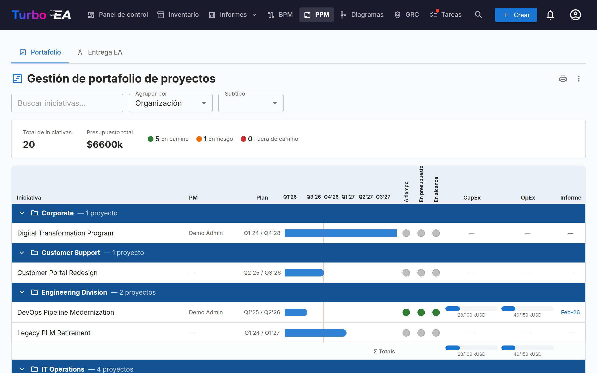
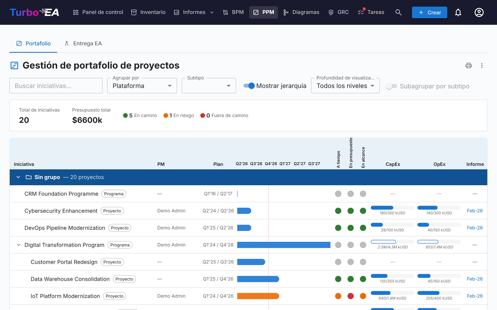
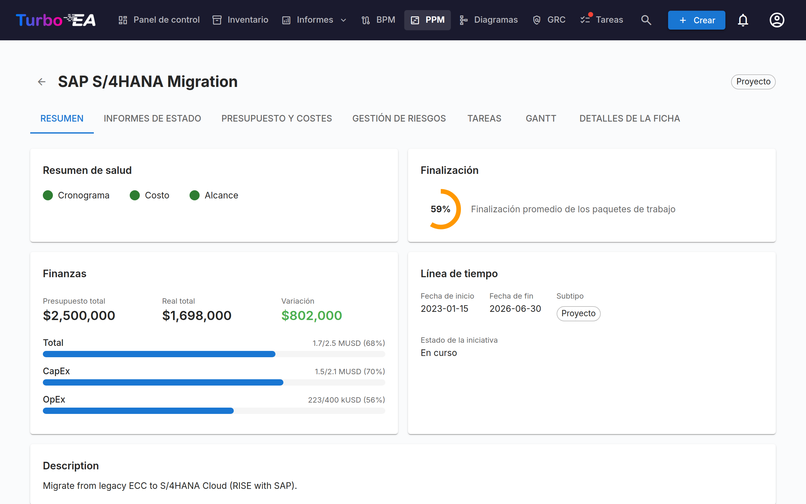
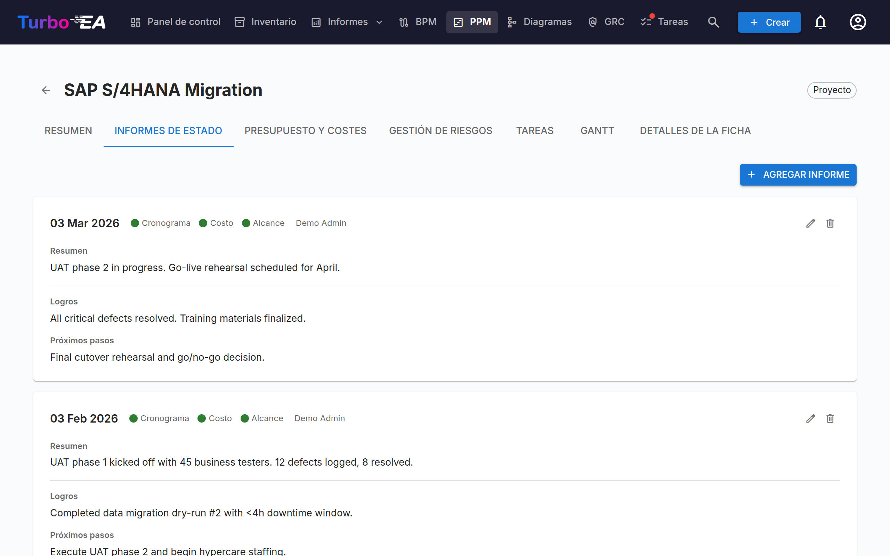
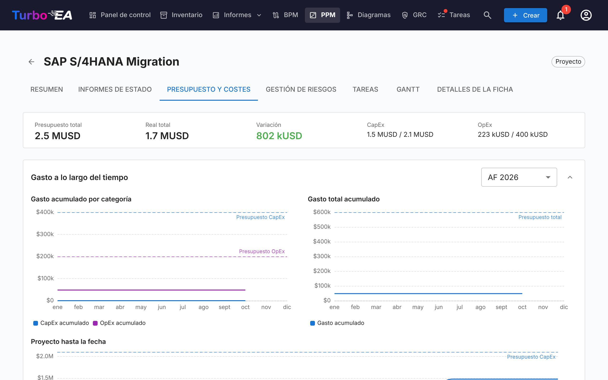
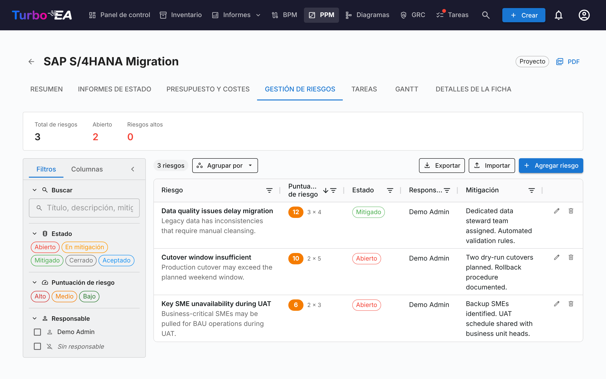
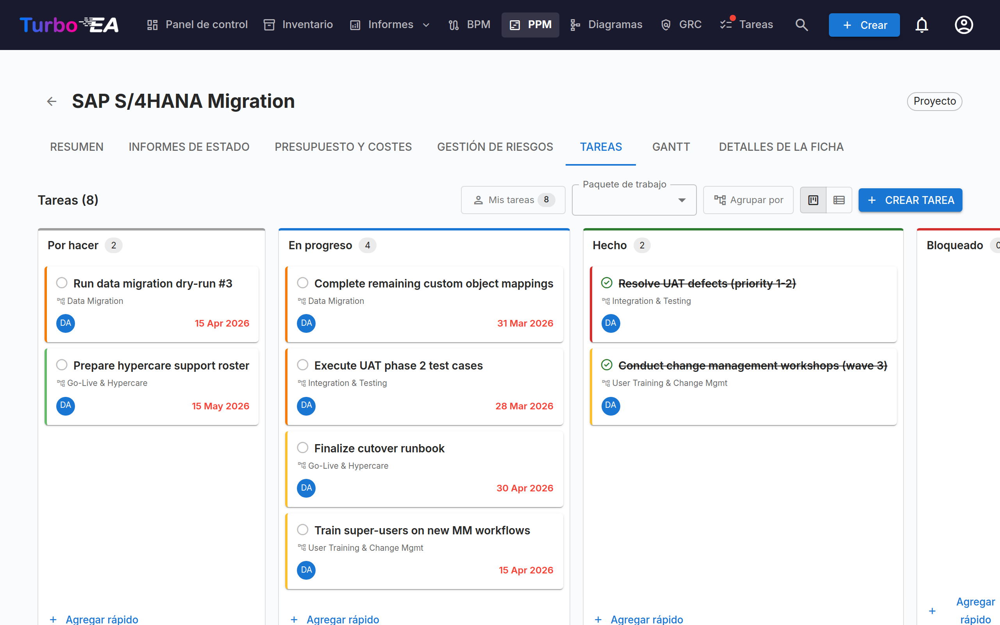
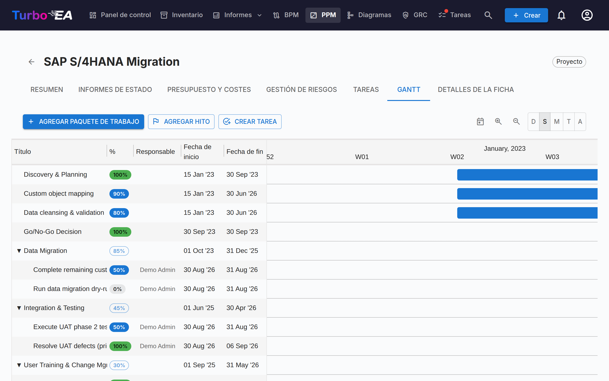
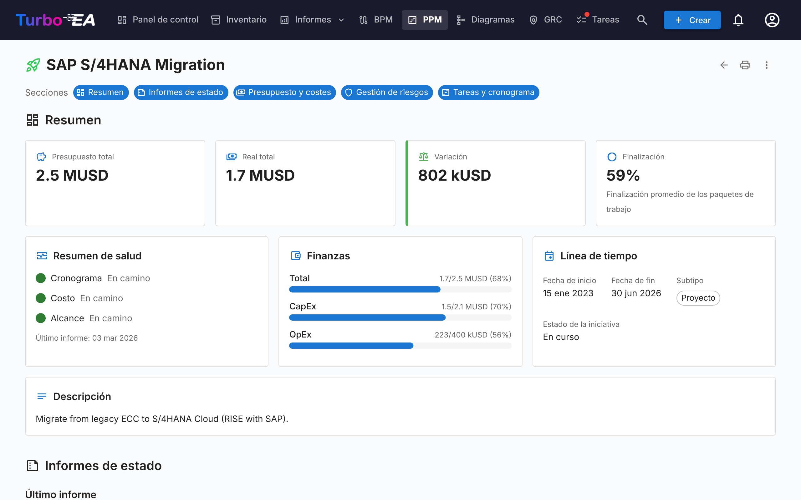

# Gestión de Cartera de Proyectos (PPM)

El módulo **PPM** proporciona una solución completa de gestión de cartera de proyectos para el seguimiento de iniciativas, presupuestos, riesgos, tareas y cronogramas. Se integra directamente con el tipo de tarjeta Iniciativa para enriquecer cada proyecto con informes de estado, seguimiento de costos y visualización Gantt.

!!! note
    El módulo PPM puede ser habilitado o deshabilitado por un administrador en [Configuración](../admin/settings.md). Cuando está deshabilitado, la navegación y funciones de PPM quedan ocultas.

## Panel de Portafolio

El **Panel de Portafolio** es el punto de entrada principal para PPM. Proporciona:

- **Tarjetas de KPI** — Total de iniciativas, presupuesto total, costo real total y resúmenes de estado de salud
- **Gráficos circulares de salud** — Distribución de salud de cronograma, costo y alcance (En curso / En riesgo / Fuera de curso)
- **Distribución de estado** — Desglose por subtipo de iniciativa y estado
- **Vista general Gantt** — Barras de cronograma mostrando las fechas de inicio y fin de cada iniciativa, con indicadores de salud RAG

### Agrupación y filtrado

Use la barra de herramientas para:

- **Agrupar por** cualquier tipo de tarjeta relacionada (p. ej., Organización, Plataforma)
- **Agrupar por** un subtipo de iniciativa (p. ej., Programa), que aparece en una segunda sección del mismo menú, para ver cada programa con todas las iniciativas que tiene por debajo (ver más abajo)
- **Filtrar por subtipo** (Idea, Programa, Proyecto, Épica)
- **Buscar** por nombre de iniciativa
- **Mostrar jerarquía** para anidar las iniciativas de cada grupo bajo su iniciativa padre (ver más abajo)
- **Subagrupar por subtipo** para dividir cada grupo por subtipo (ver más abajo)

Estos filtros se mantienen en la URL, por lo que al actualizar la página se conserva su vista actual. La jerarquía, su profundidad de visualización y la subagrupación también se conservan en la URL.

#### Mostrar la jerarquía de iniciativas

Cuando algunas iniciativas de la cartera tienen una iniciativa padre que también está en la cartera, la barra de herramientas ofrece **Mostrar jerarquía**. Al activarla, cada grupo muestra sus iniciativas como un árbol: una iniciativa hija aparece con sangría bajo su padre, el chevrón delante del nombre de un padre pliega o despliega su subárbol, y cada fila muestra su subtipo para que el papel de cada nivel (por ejemplo Programa → Proyecto → Épica) siga siendo visible. **Profundidad de visualización** limita el árbol a sus primeros niveles (*Nivel 1*, *Nivel 2*, … o *Todos los niveles*).

La agrupación sigue siendo la principal: la jerarquía se anida **dentro de cada grupo**, de modo que una iniciativa cuyo padre pertenece a otro grupo aparece como fila de primer nivel de su propio grupo. Los filtros se aplican primero y el árbol muestra lo que queda: cuando la búsqueda o el filtro de subtipo dejan fuera a un padre, sus hijas suben al primer nivel en lugar de conservarse el padre como contexto.

#### Subagrupar por subtipo

**Subagrupar por subtipo** divide cada grupo en un subgrupo por subtipo, en el orden en que los subtipos están definidos en el tipo Iniciativa, con las iniciativas sin subtipo al final. Cada subgrupo tiene su propio encabezado, se contrae por separado y tiene su propia fila de totales; los totales del grupo siguen abarcando todas sus iniciativas. El interruptor no está disponible mientras se muestra la jerarquía, porque el árbol ya abarca todos los subtipos.

#### Agrupar por un subtipo de iniciativa

El menú **Agrupar por** tiene dos secciones: **Tipos de tarjeta relacionados** y **Subtipos de iniciativa**, los subtipos definidos en el tipo Iniciativa. Al elegir un subtipo —por ejemplo **Programa**— se muestra un grupo por cada iniciativa de tipo Programa. El programa da nombre a su grupo y es **solo su encabezado, nunca una fila**; el grupo contiene **todas las iniciativas que tiene por debajo, a cualquier profundidad** y sea cual sea su subtipo, de modo que un programa anidado bajo otro programa es una fila del grupo del programa superior.

La línea final del grupo sustituye a la fila de totales: lleva el nombre del subtipo y muestra el presupuesto, el gasto real y las fechas **propios** del programa o, cuando no tiene los suyos, las cifras **derivadas** de las iniciativas que tiene por debajo, dibujadas con contorno, en discontinuo y en cursiva como se describe en *Acumular cifras en las iniciativas padre*. Las iniciativas sin ningún programa por encima aparecen en **Sin grupo**. Una iniciativa intermedia que usted no puede ver, que está archivada o que un portal no publica **rompe la cadena**: lo que hay por debajo deja de agruparse bajo el programa superior. **Mostrar jerarquía** solo aparece cuando algo se anida por debajo de los hijos directos de un programa, y el filtro de subtipo no ofrece el subtipo de agrupación, porque sus iniciativas son encabezados y no filas.

#### Acumular cifras en las iniciativas padre

Cada iniciativa muestra sus propias cifras siempre que las tenga: las barras de CapEx y OpEx de un padre cubren las líneas de presupuesto y de coste registradas en el padre, y su barra de Gantt sus propias fechas de inicio y fin. Un padre **sin líneas de presupuesto propias** muestra en su lugar el presupuesto de las iniciativas que tiene por debajo, y un padre **sin líneas de coste propias** su gasto real; en ambos casos la barra se dibuja **de contorno** con cifras en cursiva, y su información sobre herramientas indica qué mitad procede de abajo. Un padre **sin fecha de inicio ni de fin** abarca desde el inicio más temprano hasta el fin más tardío de lo que tiene por debajo, dibujado como una barra **discontinua** con trimestres en cursiva. Una información sobre herramientas indica en cada caso cuántas iniciativas abarca. Las tres reglas son independientes —un programa que tiene el presupuesto mientras sus proyectos registran el gasto muestra su propio presupuesto frente al gasto real de estos, y un programa puede tener sus propias fechas y aun así mostrar los costes de sus proyectos— y basta con registrar una línea de presupuesto, una línea de coste o una fecha en el padre para que esa parte vuelva a sus propias cifras. Solo cuentan las iniciativas que usted puede ver y, en un portal, las que el portal publica. Los totales de grupo y la barra de KPI siguen sumando únicamente las líneas registradas, de modo que cada cifra se cuenta una sola vez.

Las cifras derivadas solo existen en el tablero de PPM y en las pestañas **Resumen** y **Presupuesto y costes** de la propia iniciativa. Para llevar un total acumulado al inventario, a los informes o a un portal, defina un campo calculado que sume el presupuesto propio de cada nivel a los totales de sus hijas; consulte [Acumular cifras de PPM a lo largo de la jerarquía de iniciativas](../admin/calculations.md#rolling-ppm-figures-up-the-initiative-hierarchy). Un cambio de PPM en una hija vuelve a ejecutar los cálculos de todas las iniciativas superiores, de modo que el total del padre se actualiza de inmediato.

### Impresión y exportación

La cartera ofrece las mismas acciones en la barra de título que los informes:

- **Imprimir / Guardar como PDF** — el icono de impresora imprime la cartera tal como se ve en pantalla. La barra de pestañas, la barra de filtros y las ventanas emergentes al pasar el ratón se ocultan, la agrupación, el subtipo y la búsqueda activos se imprimen como una línea compacta de parámetros, y la cuadrícula de cronología deja de recortarse para que todas las columnas quepan en la página. Cuando la jerarquía o la subagrupación están activadas, la línea de parámetros también lo indica, con la profundidad de visualización.
- **Exportar a PowerPoint (.pptx)** — desde el menú **⋮**. La primera diapositiva incluye el título, la marca de tiempo de generación y los filtros activos junto con la cartera con calidad de presentación; las carteras largas continúan en más diapositivas, cortadas solo entre iniciativas, nunca a través de una fila, un encabezado de grupo o una línea de totales.
- **Exportar a Excel (.xlsx)** — también desde el menú **⋮**. Una fila por iniciativa con su grupo, subtipo, jefe de proyecto, fechas de inicio y fin, los tres indicadores de salud, CapEx/OpEx planificado frente a real y la fecha del último informe de estado. Las filas siguen el orden de la pantalla; mientras se muestra la jerarquía, una columna **Padre** indica la iniciativa padre de cada iniciativa. Tres columnas, **Origen del presupuesto**, **Origen de los costes** y **Origen de las fechas**, indican si el presupuesto, el gasto real y las fechas de una fila son los suyos propios o el total de las iniciativas que tiene por debajo. Cuando el tablero está agrupado por un subtipo de iniciativa, la iniciativa que agrupa es la **primera fila de su grupo**, con las cifras que muestra su línea final.

## Vista de detalle de iniciativa

Haga clic en cualquier iniciativa para abrir su página de detalle con siete pestañas:

### Pestaña de visión general

La visión general muestra un resumen de la salud y finanzas de la iniciativa:

- **Resumen de salud** — Indicadores de cronograma, costo y alcance del último informe de estado
- **Presupuesto vs. Real** — Tarjeta de KPI combinada mostrando presupuesto total y gasto real con variación
- **Cifras de abajo** — Cuando la iniciativa no tiene líneas de presupuesto propias, su presupuesto total, sus barras de presupuesto y la variación muestran en su lugar el presupuesto de las iniciativas que tiene por debajo: en cursiva, marcados con una flecha ↳, con la pista del presupuesto de contorno y una información sobre herramientas que indica cuántas iniciativas abarcan. Cuando no tiene líneas de coste propias, su gasto real procede de abajo del mismo modo, con las barras de gasto de contorno. Ambos lados se deciden por separado, y registrar una primera línea propia devuelve ese lado a las cifras propias de la iniciativa.
- **Por debajo de esta iniciativa** — Cuando la iniciativa tiene iniciativas por debajo, una línea bajo las barras de presupuesto indica cuántas son, su presupuesto y su gasto real sumados y el periodo que abarcan sus fechas. Se muestra junto a las cifras propias de la iniciativa y nunca se suma a ellas. Cuando el presupuesto y el gasto real ya proceden ambos de abajo, la línea conserva solo el número y el periodo de las fechas.
- **Actividad reciente** — Resumen del último informe de estado

### Pestaña de informes de estado

Los informes de estado mensuales rastrean la salud del proyecto a lo largo del tiempo. Cada informe incluye:

| Campo | Descripción |
|-------|-------------|
| **Fecha del informe** | La fecha del período de reporte |
| **Salud del cronograma** | En curso, En riesgo o Fuera de curso |
| **Salud del costo** | En curso, En riesgo o Fuera de curso |
| **Salud del alcance** | En curso, En riesgo o Fuera de curso |
| **Resumen** | Resumen ejecutivo del estado actual |
| **Logros** | Lo que se logró en este período |
| **Próximos pasos** | Actividades planificadas para el próximo período |

### Pestaña de presupuesto y costos

Seguimiento de datos financieros con dos tipos de partidas:

- **Líneas de presupuesto** — Presupuesto planificado por año fiscal y categoría (CapEx / OpEx), con una descripción opcional. Un mismo año fiscal y categoría pueden tener tantas líneas como necesite —una por licencia, socio de implantación o lote de hardware— y la descripción las distingue; los totales las suman todas. Las líneas de presupuesto se agrupan según el **mes de inicio del año fiscal** configurado en [Configuración](../admin/settings.md#inicio-del-año-fiscal). Por ejemplo, si el año fiscal comienza en abril, una línea de presupuesto de junio de 2026 pertenece al AF 2026–2027
- **Líneas de costo** — Gastos reales con fecha, descripción y categoría

Ambas tablas se agrupan por año fiscal. Cada año tiene una fila de encabezado con sus subtotales de CapEx, OpEx y total, y el número de líneas que contiene; la flecha del encabezado muestra u oculta las líneas de ese año. Al abrir la pestaña, solo el año fiscal en curso aparece desplegado (o el último año con líneas, si el actual no tiene ninguna). Los importes figuran en columnas **CapEx** y **OpEx** separadas, y una fila **Total, todos los años fiscales** bajo cada tabla suma todos los años. El botón **+** del encabezado de un año de presupuesto añade una línea de presupuesto con ese año fiscal ya rellenado. Las líneas de costo se agrupan por el año fiscal de su fecha y se ordenan por fecha dentro de él; las que no tienen fecha se reúnen al final en el grupo **Sin fecha** y cuentan en los totales de costos como cualquier otra línea.

Cuando la iniciativa **no tiene líneas de presupuesto propias**, la tabla de presupuesto muestra, en lugar de su estado vacío, el presupuesto de las iniciativas que tiene por debajo: un rótulo indica de cuántas iniciativas procede, una fila de solo lectura por año fiscal da el CapEx, el OpEx y el total en cursiva, y la fila **Total, todos los años fiscales** los suma. La tabla de costes hace lo mismo con su gasto real cuando la iniciativa **no tiene líneas de coste propias**, con una fila **Sin fecha** para sus líneas de coste sin fecha. La barra de resumen marca esas cifras en cursiva, con una información sobre herramientas. Cada tabla decide por sí misma, nada se guarda ni se suma a las cifras propias de la iniciativa, y solo cuentan las iniciativas que usted puede ver. Registrar una primera línea con **Añadir línea de presupuesto** o **Agregar elemento de costo** devuelve esa tabla a las líneas propias de la iniciativa; los gráficos de gasto muestran siempre las líneas propias de la iniciativa.

Los totales de presupuesto y costos se acumulan automáticamente en los atributos `costBudget` y `costActual` de la tarjeta de Iniciativa. Estos campos de la tarjeta son **totales de todos los ejercicios fiscales**. El [informe de costes](reports.md) y los mosaicos de costes del panel, que muestran el ejercicio fiscal actual, cuentan solo las líneas de presupuesto del año en curso y las líneas de coste fechadas en él; las líneas de coste sin fecha no cuentan en ningún año.

#### Gasto a lo largo del tiempo

Encima de las tablas de presupuesto y costes, tres gráficos muestran cómo se acumula el gasto mes a mes:

- **Gasto acumulado por categoría** — CapEx y OpEx acumulados del ejercicio seleccionado, con líneas horizontales punteadas que marcan el presupuesto CapEx y OpEx de ese ejercicio
- **Gasto total acumulado** — el mismo ejercicio con ambas categorías combinadas, frente a una línea punteada de presupuesto total
- **Proyecto hasta la fecha** — CapEx y OpEx acumulados a lo largo de todos los meses del proyecto, frente al presupuesto total de todos los ejercicios

El selector de ejercicio se aplica a los dos primeros gráficos y ofrece el ejercicio actual, cualquier otro ejercicio con datos y **Todos los ejercicios fiscales**. Sus elecciones de ejercicio y estado plegado o desplegado se recuerdan entre visitas.

Dos aspectos a tener en cuenta al leer los gráficos:

- Las líneas se detienen en el mes actual en lugar de continuar planas hasta el final del ejercicio, de modo que un ejercicio en curso no se confunda con uno en el que el gasto se ha detenido
- Las partidas de coste sin fecha no pueden situarse en una línea temporal y quedan excluidas. Una nota bajo los gráficos indica cuántas se excluyeron, para poder conciliar los totales del gráfico con la barra de resumen

### Pestaña de gestión de riesgos

El registro de riesgos rastrea los riesgos de la iniciativa. Cada riesgo tiene:

| Campo | Descripción |
|-------|-------------|
| **Título** | Breve descripción del riesgo |
| **Descripción** | El riesgo completo |
| **Probabilidad** | Puntuación de probabilidad (1–5) |
| **Impacto** | Puntuación de impacto (1–5) |
| **Puntuación de riesgo** | Calculado automáticamente como probabilidad × impacto |
| **Estado** | Abierto, En mitigación, Mitigado, Cerrado o Aceptado |
| **Mitigación** | Acciones de mitigación planificadas |
| **Responsable** | Usuario responsable de gestionar el riesgo |

Una franja de resumen sobre la cuadrícula muestra el **Total de riesgos**, el número de riesgos en estado **Abierto** y los **Riesgos altos**.

#### La cuadrícula de riesgos

Los riesgos se listan en una cuadrícula construida como el [Inventario](inventory.md) y el [Registro de riesgos](risks.md#cuadricula-del-registro). El texto nunca se corta: cada fila muestra el título del riesgo en negrita con su **descripción completa** debajo, y la **mitigación completa**, ocupando tantas líneas como necesiten. Las direcciones web de la descripción y de la mitigación son clicables.

| Columna | Muestra |
|---------|---------|
| **Riesgo** | El título, con la descripción debajo |
| **Puntuación de riesgo** | La puntuación como chip de color, con *probabilidad × impacto* al lado (por ejemplo **20** *4 × 5*) |
| **Estado** | El chip de estado |
| **Responsable** | El responsable del riesgo, o un guion |
| **Mitigación** | La mitigación planificada, o un guion |
| *(botones)* | **Editar** y **Eliminar** |

**Probabilidad** e **Impacto** también están disponibles como columnas independientes; están ocultas por defecto: actívelas en la pestaña **Columnas** del panel de filtros.

- **Ordenar** — haga clic en un encabezado de columna. Mientras no elija su propio orden, la puntuación más alta aparece primero.
- **Filtrar una columna** — use los filtros de los encabezados, como en las demás cuadrículas.
- **Fijar una columna** — haga clic en la chincheta de su encabezado para mantenerla en el borde izquierdo al desplazarse lateralmente; haga clic de nuevo para liberarla.
- **Reordenar columnas** — arrastre el encabezado de una columna.
- **Menú de celda** — haga clic derecho en una celda (pulsación larga en dispositivos táctiles) para abrir el mismo menú contextual que en las demás cuadrículas.

#### Panel de filtros

El panel de la izquierda tiene dos pestañas:

- **Filtros**
    - **Buscar** — busca en el título, la descripción, la mitigación y el responsable.
    - **Estado** — marque uno o varios chips de estado.
    - **Puntuación de riesgo** — los rangos de puntuación **Alto** (15 o más), **Medio** (de 6 a 14) y **Bajo** (menos de 6).
    - **Responsable** — los responsables presentes en la lista, más **Sin responsable**.
    - **Borrar todos los filtros** restablece todos los filtros a la vez.
- **Columnas** — la lista **Orden de columnas** (arrastre una fila para mover una columna, use su chincheta para fijarla, **Restablecer orden** para recuperar el orden predeterminado) y la lista **Columnas visibles** para mostrar u ocultar columnas, con **Seleccionar todo** para mostrar todas las columnas. La columna Riesgo y los botones se muestran siempre. Cuando las columnas visibles difieren de las predeterminadas, **Restablecer** vuelve a ellas: todas las columnas excepto Probabilidad e Impacto.

El panel se contrae en un carril estrecho, que muestra cuántos filtros están activos, y su borde se puede arrastrar para cambiar su tamaño. En un teléfono, el panel es un cajón que se abre con el botón de filtro de la barra de herramientas.

#### Barra de herramientas

La barra de herramientas muestra cuántos riesgos hay en la lista y ofrece:

- **Agrupar por** — agrupa las filas por **Estado**, **Responsable** o **Rango de puntuación**.
- **Exportar** — descarga los riesgos que se muestran como `.xlsx` (ver más abajo).
- **Importar** — carga riesgos desde un `.xlsx` (ver más abajo).
- **Agregar riesgo** — abre el diálogo para registrar un riesgo nuevo.

El orden, las columnas fijadas, el orden de columnas, las columnas visibles, el ancho del panel y la agrupación se recuerdan en su navegador.

#### Exportar riesgos a Excel

**Exportar** descarga los riesgos que la cuadrícula muestra en ese momento —tras los filtros del panel y en el orden de la cuadrícula— como un `.xlsx` con una fila por riesgo y las columnas **ID del riesgo**, **Título del riesgo**, **Descripción**, **Probabilidad**, **Impacto**, **Puntuación de riesgo**, **Estado**, **Responsable** y **Mitigación**. El archivo es también un archivo de importación válido: exporte, edite en Excel y vuelva a importarlo.

#### Importar riesgos desde Excel {: #importing-risks }

**Importar** carga un `.xlsx` para añadir o actualizar los riesgos de la iniciativa. **Descargar plantilla**, en el diálogo, proporciona un libro con los encabezados correctos y una fila de ejemplo.

- Una fila con un **ID del riesgo** procedente de una exportación **actualiza** ese riesgo, y solo los campos que han cambiado.
- Una fila **sin ID del riesgo** **crea** un riesgo nuevo.
- Un ID del riesgo que la iniciativa no tiene, o uno usado dos veces en el archivo, provoca el **rechazo** de la fila.
- Los riesgos que no aparecen en el archivo no se tocan: **la importación nunca elimina nada**.

Antes de escribir nada, una vista previa muestra cada fila como **Nuevo**, **Actualización** (con los campos que cambian), **Sin cambios** o **Rechazado** (con el motivo), y cuenta las advertencias. Las filas rechazadas se omiten; el botón importa los demás cambios. Después, un resultado indica cuántos riesgos se crearon, se actualizaron y fallaron.

| Columna | Regla |
|---------|-------|
| **Título del riesgo** | Obligatorio |
| **Probabilidad**, **Impacto** | Un número entero del 1 al 5. En blanco significa 3 en una fila nueva y deja el valor sin cambios en una actualización |
| **Estado** | Abierto, En mitigación, Mitigado, Cerrado o Aceptado. En blanco significa Abierto en una fila nueva y deja el estado sin cambios en una actualización |
| **Responsable** | Se asocia por correo electrónico y luego por nombre. Un responsable que no coincide con nadie, o con varias personas, genera una advertencia: la fila se importa igualmente y el responsable no se modifica |
| **Descripción**, **Mitigación**, **Responsable** | Una celda en blanco vacía el campo en una actualización |
| **Puntuación de riesgo**, cualquier otra columna | Se ignora: la puntuación siempre se calcula |

Las columnas se reconocen por su encabezado en su idioma o en inglés. Una columna que el archivo omite queda sin cambios en cada riesgo que se actualiza.

### Pestaña de tareas

El gestor de tareas admite vistas de **tablero Kanban** y **lista** con cuatro columnas de estado:

- **Por hacer** — Tareas aún no iniciadas
- **En progreso** — Tareas en las que se está trabajando actualmente
- **Hecho** — Tareas completadas
- **Bloqueado** — Tareas que no pueden avanzar

Las tareas se pueden filtrar y agrupar por elemento de Estructura de Desglose del Trabajo (WBS). Al agrupar, cada paquete de trabajo aparece como un grupo —incluido uno que aún no contiene tareas, que muestra una indicación y un botón **Agregar tarea** que abre el diálogo de tarea con ese paquete preseleccionado—. Los hitos aparecen solo cuando contienen una tarea. Arrastre y suelte tarjetas entre columnas para actualizar el estado.

Los filtros de visualización (modo de vista, filtro WBS, alternancia de agrupación) se mantienen en la URL entre actualizaciones de página.

### Pestaña Gantt

El diagrama de Gantt visualiza el cronograma del proyecto con:

- **Paquetes de trabajo (WBS)** — Elementos jerárquicos de estructura de desglose del trabajo con fechas de inicio/fin
- **Tareas** — Barras de tareas individuales vinculadas a paquetes de trabajo
- **Hitos** — Fechas clave marcadas con indicadores de diamante
- **Barras de progreso** — Porcentaje de finalización visual. Una tarea no tiene porcentaje propio: su relleno sigue su estado — **Por hacer (0%)**, **En progreso (50%)**, **Hecho (100%)**. Haga clic en el chip de porcentaje de una tarea para abrir un control deslizante cuyas tres posiciones llevan el nombre de esos estados; elegir una posición cambia el estado, y arrastrar el relleno en la barra de la tarea hace lo mismo. Un paquete de trabajo hoja tiene un control deslizante libre en pasos del 5%. Los paquetes de trabajo que tienen paquetes de trabajo hijos **o tareas** muestran un chip de solo lectura cuyo valor se calcula automáticamente a partir del subárbol.
- **Marcas trimestrales** — Cuadrícula de cronograma para orientación

Interactúa con el diagrama de Gantt:

- **Haz clic en el encabezado de una columna** (Título, %, Responsable, Fecha de inicio o Fecha de fin) para ordenar la lista por ella: ascendente en el primer clic, descendente en el segundo y de vuelta al orden planificado en el tercero. Una flecha junto al encabezado indica la ordenación activa. Los elementos se ordenan entre sus hermanos, de modo que un paquete de trabajo o una tarea anidados permanecen bajo su padre. Los elementos sin responsable o sin fecha propia van al final en ambos sentidos, y la fila **+** se mantiene al fondo. La elección se recuerda en tu navegador. En un teléfono, donde solo se muestran Título y %, solo se pueden ordenar esas dos columnas
- **Selector de escala** — Elige entre Día, Semana, Mes, Trimestre y Año; la elección se recuerda en tu navegador
- **Botones de zoom +/−** — Avanza un nivel a la vez por las mismas cinco escalas
- **Puntos en los extremos de las barras** — Arrastra desde el punto derecho de una barra hasta el punto izquierdo de otra para crear una dependencia «finish-to-start». Funciona entre paquetes de trabajo y tareas en cualquier combinación. Los ciclos se rechazan automáticamente. **Haz doble clic en una flecha** para eliminarla.
- **La fila +** al final de la lista pregunta qué crear —un paquete de trabajo, un hito o una tarea—, de modo que una tarea escrita ahí aparece en la pestaña de tareas.

### Pestaña de detalles de tarjeta

La última pestaña muestra la vista completa de detalle de la tarjeta, incluyendo todas las secciones estándar.

### Informe de la iniciativa

El botón **Informe** en la cabecera de la iniciativa, junto al chip del subtipo (un icono en un teléfono), abre el **Informe de la iniciativa**: una página de solo lectura que reúne lo que muestran las pestañas, maquetada como los demás informes, con el nombre de la iniciativa como título y una flecha para volver a la iniciativa. Los chips de **Secciones** de la barra de herramientas muestran u ocultan cada sección; la primera vez se muestran todas, y su elección se recuerda en su navegador:

| Sección | Qué muestra |
|---------|-------------|
| **Resumen** | Mosaicos de **Presupuesto total**, **Real total**, **Variación** y **Finalización**; el **Resumen de salud** con las tres valoraciones del último informe de estado, en color y en palabras; las barras de **Finanzas** para Total, CapEx y OpEx; el recuadro **Línea de tiempo** con las fechas de inicio y fin, el subtipo y el estado de la iniciativa; y la descripción. Las cifras tomadas de las iniciativas subordinadas van marcadas, con una nota que las explica |
| **Informes de estado** | El último informe completo, con sus valoraciones, y después los informes anteriores en una tabla con la fecha, el autor y las valoraciones de salud |
| **Presupuesto y costes** | Mosaicos del presupuesto total, el real y la variación, y del CapEx y OpEx gastados frente a su presupuesto; los gráficos de **Gasto a lo largo del tiempo** para el ejercicio fiscal indicado en su chip y para el proyecto completo; después, las tablas de **Presupuesto planificado** y **Partidas de coste** con todos los ejercicios fiscales desplegados |
| **Gestión de riesgos** | Mosaicos de **Total de riesgos**, **Abierto** y **Riesgos altos**; el **Mapa de calor de riesgos** de probabilidad frente a impacto, con cada celda coloreada por franja de puntuación y mostrando cuántos riesgos contiene, junto a un recuento **Por estado**; después, cada riesgo con su puntuación (y probabilidad × impacto), su estado, su responsable, su descripción completa y su mitigación completa, con la puntuación más alta primero |
| **Tareas y cronograma** | Una tabla de paquetes de trabajo, cada uno con sus tareas debajo, y a continuación las tareas sin paquete de trabajo, junto a una línea de tiempo en escala trimestral: una barra para cada paquete de trabajo, rellena según su avance, una barra para cada tarea en el color de su estado, un rombo para un hito (como en el diagrama de Gantt), un punto para un elemento con una sola fecha y una línea para hoy cuando cae dentro del intervalo. Cada fila muestra además su progreso o estado y su prioridad, y una leyenda explica las marcas |

Para imprimir el informe o guardarlo como PDF, use el botón **Imprimir / Guardar como PDF** de la barra de título, como en todos los informes; abre el cuadro de diálogo de impresión del navegador, o la hoja de impresión de Safari en un iPhone o iPad, donde también puede guardarlo como PDF. La página se imprime en horizontal, sin la barra de herramientas ni la navegación de la aplicación, con sus gráficos a tamaño de impresión, y una línea bajo el título indica el subtipo, el estado de la iniciativa, las fechas de inicio y fin y cuándo se imprimió el informe. Una sección sin nada registrado lo indica.

Para llevar el informe a una presentación, elija **Exportar a PowerPoint (.pptx)** en el menú **⋮** de la barra de título. La presentación comienza con una diapositiva de título con el nombre de la iniciativa, la fecha en que se generó y su subtipo, estado y fechas de inicio y fin. Cada sección mostrada en la página sigue en su propia diapositiva, encabezada por el nombre de la sección, como una imagen de la sección tal como usted la ve; una sección larga continúa en más diapositivas («Presupuesto y costes — Página 2 / 3»), y una tabla que continúa repite su fila de encabezado. La presentación sigue los chips de **Secciones**: una sección que haya ocultado, o una sin nada registrado, se omite. Mientras se genera la presentación, el botón del menú muestra un indicador de carga; si la exportación falla, un mensaje lo indica y puede volver a intentarlo.

Para entregar un **informe de riesgos**, muestre solo **Gestión de riesgos**.

## Estructura de Desglose del Trabajo (WBS)

La WBS proporciona una descomposición jerárquica del alcance del proyecto:

- **Paquetes de trabajo** — Agrupaciones lógicas de tareas con fechas de inicio/fin y seguimiento de finalización
- **Hitos** — Eventos significativos o puntos de finalización
- **Jerarquía** — Relaciones padre-hijo entre elementos WBS
- **Auto-finalización** — La finalización se calcula automáticamente a partir de las tareas del subárbol de un paquete de trabajo: cada tarea cuenta como 0% (Por hacer, Bloqueado), 50% (En progreso) o 100% (Hecho), ponderada por su duración en días (un día cuando falta una fecha), y luego se acumula recursivamente hasta los elementos padre. Un paquete de trabajo sin ninguna tarea por debajo conserva el valor escrito a mano. La media de los paquetes de trabajo de nivel superior es el progreso general de la iniciativa: el número de la pestaña de visión general y la variable `ppm.completion` que un [campo calculado](../admin/calculations.md#ppm-data-on-initiative-cards) puede mostrar en la ficha y en un portal

## Integración con los detalles de la ficha

Cuando PPM está activado, las fichas de **Iniciativa** muestran una pestaña **PPM** como última pestaña en la [vista de detalle de la ficha](card-details.md). Al hacer clic en esta pestaña, se navega directamente a la vista detallada PPM de la iniciativa (pestaña Resumen). Esto proporciona un punto de acceso rápido desde cualquier ficha de Iniciativa a su página de proyecto PPM completa.

A la inversa, la pestaña **Detalles de la ficha** dentro de la vista detallada PPM de la iniciativa muestra las secciones estándar de la ficha sin la pestaña PPM, evitando la navegación circular.

## Permisos

| Permiso | Descripción |
|---------|-------------|
| `ppm.view` | Ver el panel de PPM, diagrama de Gantt e informes de iniciativas, y leer las tarjetas de iniciativa. Concedido a todos los roles por defecto |
| `ppm.manage` | Crear y gestionar informes de estado, tareas, costos, riesgos y elementos WBS. Concedido a los roles Admin, BPM Admin y Miembro |
| `reports.ppm_dashboard` | Ver el panel del portafolio PPM. Concedido a todos los roles por defecto |
