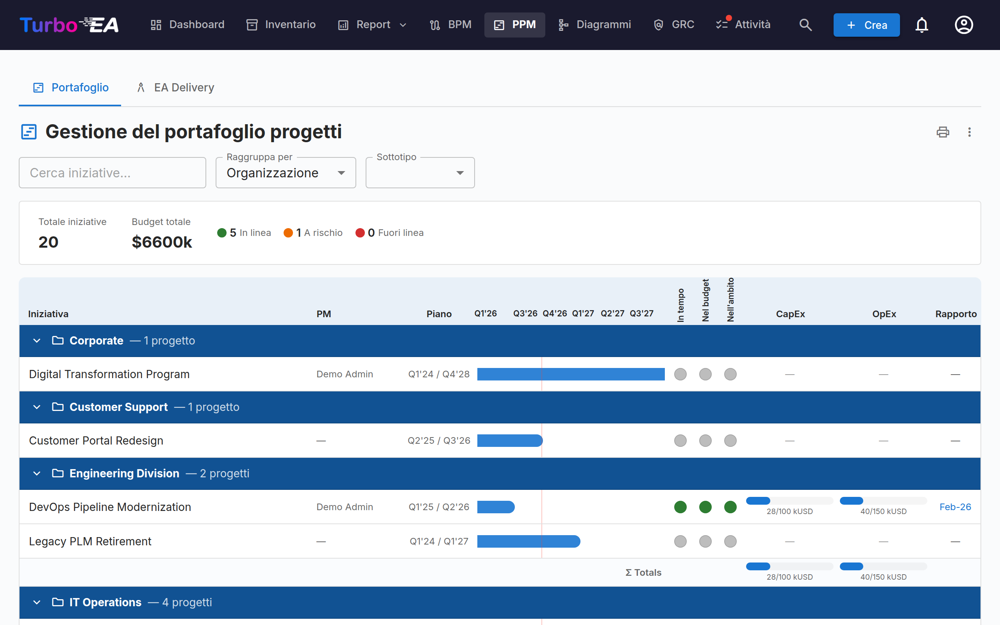
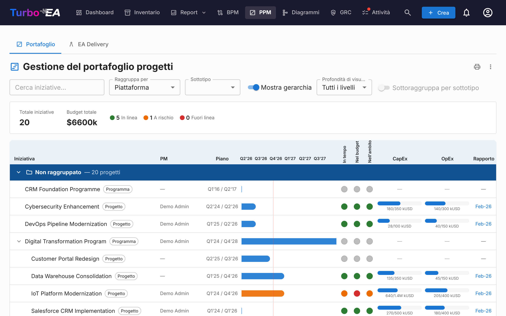
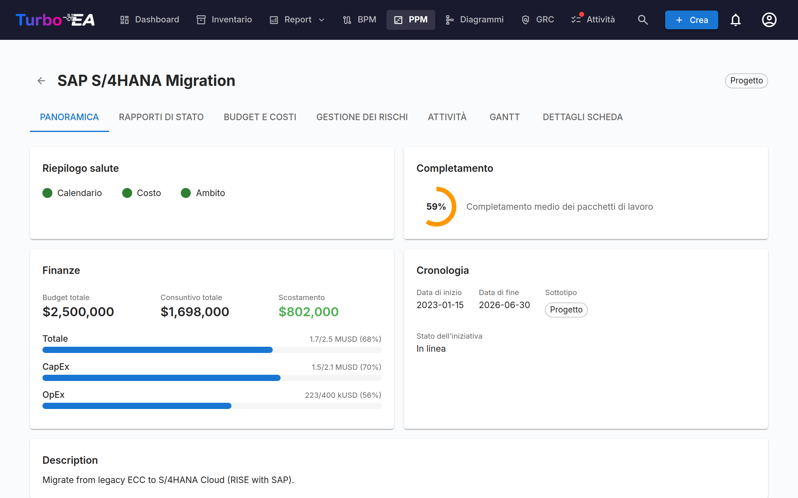
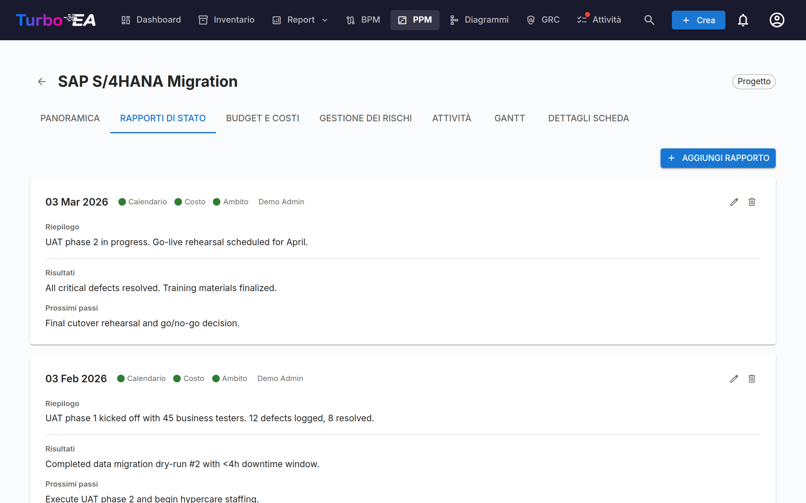
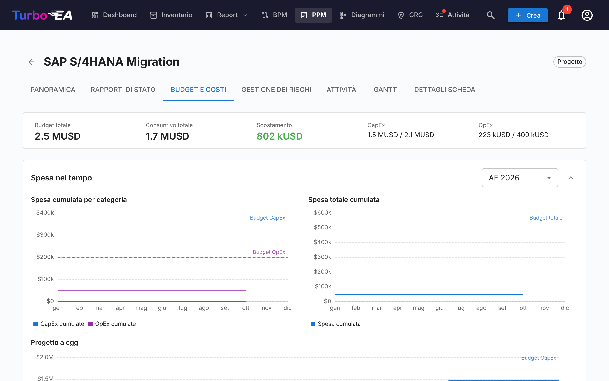
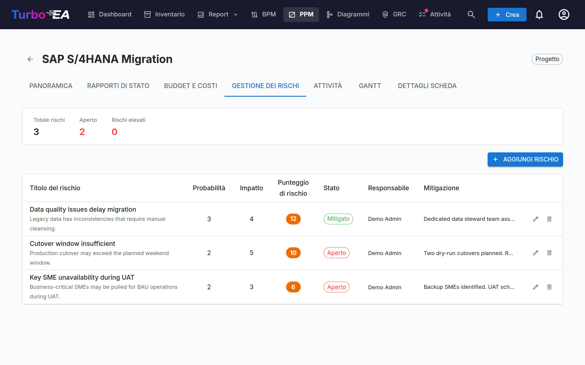
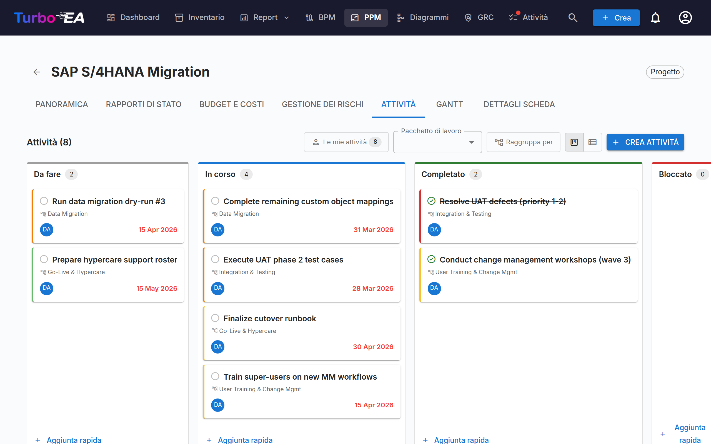
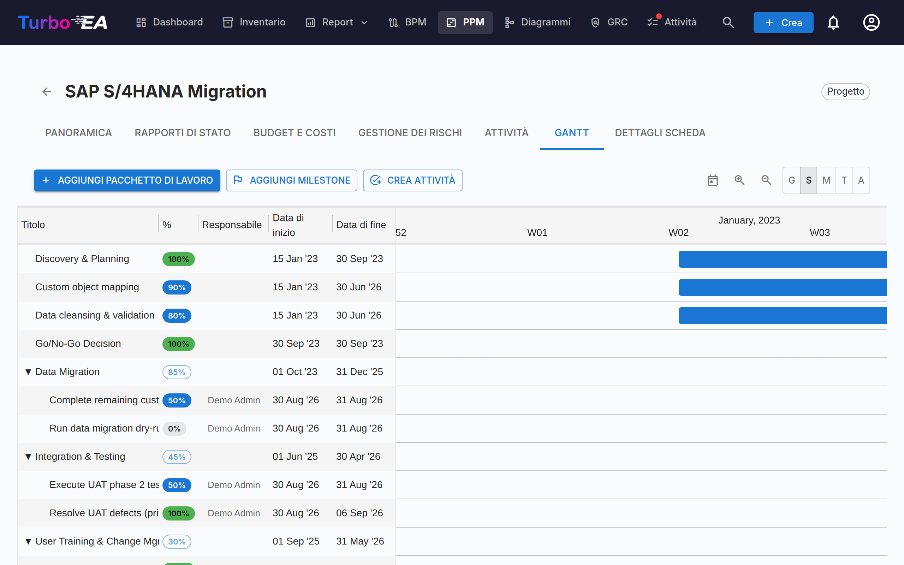

# Gestione del Portafoglio Progetti (PPM)

Il modulo **PPM** fornisce una soluzione completa di gestione del portafoglio progetti per il monitoraggio di iniziative, budget, rischi, attività e tempistiche. Si integra direttamente con il tipo di card Iniziativa per arricchire ogni progetto con report di stato, monitoraggio dei costi e visualizzazione Gantt.

!!! note
    Il modulo PPM può essere abilitato o disabilitato da un amministratore nelle [Impostazioni](../admin/settings.md). Quando disabilitato, la navigazione e le funzionalità PPM sono nascoste.

## Dashboard del Portafoglio

Il **Dashboard del Portafoglio** è il punto di ingresso principale per PPM. Fornisce:

- **Card KPI** — Totale iniziative, budget totale, costo effettivo totale e riepiloghi dello stato di salute
- **Grafici a torta della salute** — Distribuzione della salute di calendario, costi e ambito (In corso / A rischio / Fuori rotta)
- **Distribuzione dello stato** — Ripartizione per sottotipo di iniziativa e stato
- **Panoramica Gantt** — Barre temporali che mostrano le date di inizio e fine di ogni iniziativa, con indicatori di salute RAG

### Raggruppamento e filtri

Utilizzare la barra degli strumenti per:

- **Raggruppare per** qualsiasi tipo di card correlato (es. Organizzazione, Piattaforma)
- **Filtrare per sottotipo** (Idea, Programma, Progetto, Epic)
- **Cercare** per nome dell'iniziativa
- **Mostrare la gerarchia** per annidare le iniziative di ogni gruppo sotto la loro iniziativa padre (vedi sotto)
- **Sottoraggruppare per sottotipo** per suddividere ogni gruppo per sottotipo (vedi sotto)

Questi filtri vengono mantenuti nell'URL, quindi l'aggiornamento della pagina conserva la vista corrente. Anche la gerarchia, la sua profondità di visualizzazione e il sottoraggruppamento vengono mantenuti nell'URL.

#### Mostrare la gerarchia delle iniziative

Quando alcune iniziative del portafoglio hanno un'iniziativa padre anch'essa presente nel portafoglio, la barra degli strumenti offre **Mostra gerarchia**. Una volta attivata, ogni gruppo elenca le proprie iniziative come un albero: un'iniziativa figlia compare rientrata sotto il padre, la freccia davanti al nome di un padre comprime o espande il suo sottoalbero e ogni riga mostra il proprio sottotipo, così il ruolo di ciascun livello (per esempio Programma → Progetto → Epic) resta visibile. **Profondità di visualizzazione** limita l'albero ai suoi primi livelli (*Livello 1*, *Livello 2*, … o *Tutti i livelli*).

Il raggruppamento resta prioritario: la gerarchia si annida **all'interno di ogni gruppo**, quindi un'iniziativa il cui padre appartiene a un altro gruppo compare come riga di primo livello del proprio gruppo. I filtri si applicano per primi e l'albero mostra ciò che resta: quando la ricerca o il filtro per sottotipo escludono un padre, le sue figlie salgono al primo livello invece di mantenere il padre come contesto.

#### Sottoraggruppare per sottotipo

**Sottoraggruppa per sottotipo** divide ogni gruppo in un sottogruppo per sottotipo, nell'ordine in cui i sottotipi sono definiti sul tipo Iniziativa, con le iniziative senza sottotipo in fondo. Ogni sottogruppo ha la propria intestazione, si comprime separatamente e ha la propria riga dei totali; i totali del gruppo continuano a comprendere tutte le sue iniziative. L'interruttore non è disponibile mentre la gerarchia è visualizzata, perché l'albero comprende già tutti i sottotipi.

#### Aggregare gli importi sulle iniziative padre

Il portafoglio mostra gli importi propri di ogni iniziativa: le barre CapEx e OpEx di un padre coprono le righe di budget e di costo registrate sul padre, non quelle delle figlie, e i totali di gruppo contano ogni iniziativa una sola volta. Per vedere un totale su un padre, definire un campo calcolato che sommi il budget proprio di ogni livello ai totali delle sue figlie: vedere [Aggregare gli importi PPM lungo la gerarchia delle iniziative](../admin/calculations.md#rolling-ppm-figures-up-the-initiative-hierarchy). Una modifica PPM su una figlia riesegue i calcoli di tutte le iniziative superiori, così il totale del padre si aggiorna subito.

### Stampa ed esportazione

Il portafoglio offre le stesse azioni nella barra del titolo dei report:

- **Stampa / Salva come PDF** — l'icona della stampante stampa il portafoglio così come appare a schermo. La barra delle schede, la barra dei filtri e i popover al passaggio del mouse vengono nascosti, il raggruppamento, il sottotipo e la ricerca attivi vengono stampati come una riga compatta di parametri e la griglia della timeline non viene più ritagliata, così tutte le colonne entrano nella pagina. Quando la gerarchia o il sottoraggruppamento sono attivi, anche la riga dei parametri lo indica, con la profondità di visualizzazione.
- **Esporta in PowerPoint (.pptx)** — dal menu **⋮**. La prima diapositiva riporta titolo, data e ora di generazione e filtri attivi insieme al portafoglio in qualità da presentazione; i portafogli lunghi proseguono su altre diapositive, tagliate solo tra le iniziative — mai attraverso una riga, un'intestazione di gruppo o una riga dei totali.
- **Esporta in Excel (.xlsx)** — anch'esso dal menu **⋮**. Una riga per iniziativa con gruppo, sottotipo, project manager, date di inizio e fine, i tre indicatori di salute, CapEx/OpEx pianificato ed effettivo e la data dell'ultimo report di stato. Le righe seguono l'ordine sullo schermo; mentre la gerarchia è visualizzata, una colonna **Padre** indica l'iniziativa padre di ciascuna iniziativa.

## Vista Dettagliata dell'Iniziativa

Cliccare su qualsiasi iniziativa per aprire la sua pagina di dettaglio con sette schede:

### Scheda Panoramica

La panoramica mostra un riepilogo della salute e delle finanze dell'iniziativa:

- **Riepilogo salute** — Indicatori di calendario, costi e ambito dall'ultimo report di stato
- **Budget vs. Effettivo** — Card KPI combinata che mostra budget totale e spesa effettiva con varianza
- **Attività recente** — Riepilogo dell'ultimo report di stato

### Scheda Report di Stato

I report di stato mensili monitorano la salute del progetto nel tempo. Ogni report include:

| Campo | Descrizione |
|-------|-------------|
| **Data del report** | La data del periodo di reportistica |
| **Salute del calendario** | In corso, A rischio o Fuori rotta |
| **Salute dei costi** | In corso, A rischio o Fuori rotta |
| **Salute dell'ambito** | In corso, A rischio o Fuori rotta |
| **Riepilogo** | Riepilogo esecutivo dello stato attuale |
| **Risultati** | Cosa è stato raggiunto in questo periodo |
| **Prossimi passi** | Attività pianificate per il prossimo periodo |

### Scheda Budget e Costi

Monitoraggio dei dati finanziari con due tipi di voci:

- **Voci di budget** — Budget pianificato per anno fiscale e categoria (CapEx / OpEx), con una descrizione facoltativa. Uno stesso anno fiscale e categoria possono contenere tutte le voci necessarie — una per licenza, partner di implementazione o lotto di hardware — e la descrizione le distingue; i totali le sommano tutte. Le linee di budget sono raggruppate in base al **mese di inizio dell'anno fiscale** configurato nelle [Impostazioni](../admin/settings.md#inizio-dellanno-fiscale). Ad esempio, se l'anno fiscale inizia ad aprile, una linea di budget di giugno 2026 appartiene all'AF 2026–2027
- **Voci di costo** — Spese effettive con data, descrizione e categoria

Entrambe le tabelle sono raggruppate per anno fiscale. Ogni anno ha una riga di intestazione con i subtotali CapEx, OpEx e totale e il numero di righe che contiene; la freccia nell'intestazione mostra o nasconde le righe di quell'anno. All'apertura della scheda è espanso solo l'anno fiscale corrente (o l'ultimo anno con righe, se quello corrente non ne ha). Gli importi si trovano in colonne **CapEx** e **OpEx** separate, e una riga **Totale, tutti gli anni fiscali** sotto ogni tabella somma tutti gli anni. Il pulsante **+** nell'intestazione di un anno di budget aggiunge una riga di budget con quell'anno fiscale già compilato. Le voci di costo sono raggruppate per l'anno fiscale della loro data e ordinate per data al suo interno; quelle senza data sono raccolte in fondo nel gruppo **Senza data** e contano nei totali dei costi come qualsiasi altra voce.

I totali di budget e costi vengono automaticamente aggregati negli attributi `costBudget` e `costActual` della card Iniziativa.

#### Spesa nel tempo

Sopra le tabelle di budget e costi, tre grafici mostrano come la spesa si accumula mese per mese:

- **Spesa cumulata per categoria** — CapEx e OpEx cumulate per l'esercizio selezionato, con linee orizzontali tratteggiate che indicano il budget CapEx e OpEx di quell'esercizio
- **Spesa totale cumulata** — lo stesso esercizio con entrambe le categorie combinate, rispetto a una linea tratteggiata di budget totale
- **Progetto a oggi** — CapEx e OpEx cumulate su tutti i mesi del progetto, rispetto al budget totale di tutti gli esercizi

Il selettore dell'esercizio si applica ai primi due grafici e propone l'esercizio corrente, qualsiasi altro esercizio con dati e **Tutti gli esercizi**. Le scelte di esercizio e stato aperto o chiuso vengono ricordate tra una visita e l'altra.

Due aspetti da tenere presenti nella lettura dei grafici:

- Le linee si fermano al mese corrente anziché proseguire piatte fino a fine esercizio, così un esercizio in corso non viene scambiato per uno in cui la spesa si è fermata
- Le voci di costo senza data non possono essere collocate su una linea temporale e vengono escluse. Una nota sotto i grafici riporta quante ne sono state escluse, per riconciliare i totali del grafico con la barra di riepilogo

### Scheda Gestione dei Rischi

Il registro dei rischi monitora i rischi del progetto con:

| Campo | Descrizione |
|-------|-------------|
| **Titolo** | Breve descrizione del rischio |
| **Probabilità** | Punteggio di probabilità (1–5) |
| **Impatto** | Punteggio di impatto (1–5) |
| **Punteggio di rischio** | Calcolato automaticamente come probabilità x impatto |
| **Stato** | Aperto, In mitigazione, Mitigato, Chiuso o Accettato |
| **Mitigazione** | Azioni di mitigazione pianificate |
| **Responsabile** | Utente responsabile della gestione del rischio |

### Scheda Attività

Il gestore delle attività supporta le viste **board Kanban** e **lista** con quattro colonne di stato:

- **Da fare** — Attività non ancora iniziate
- **In corso** — Attività attualmente in lavorazione
- **Completato** — Attività completate
- **Bloccato** — Attività che non possono procedere

Le attività possono essere filtrate e raggruppate per elemento della Struttura di Scomposizione del Lavoro (WBS). Quando sono raggruppate, ogni pacchetto di lavoro compare come gruppo — compreso uno che non contiene ancora attività, che mostra un suggerimento e un pulsante **Aggiungi attività** che apre la finestra di dialogo dell'attività con quel pacchetto preselezionato. Le milestone compaiono solo quando contengono un'attività. Trascina le card tra le colonne per aggiornare lo stato.

I filtri di visualizzazione (modalità vista, filtro WBS, interruttore raggruppamento) vengono mantenuti nell'URL tra gli aggiornamenti della pagina.

### Scheda Gantt

Il diagramma di Gantt visualizza la tempistica del progetto con:

- **Pacchetti di lavoro (WBS)** — Elementi gerarchici della struttura di scomposizione del lavoro con date di inizio/fine
- **Attività** — Barre di attività individuali collegate ai pacchetti di lavoro
- **Milestone** — Date chiave contrassegnate con indicatori a diamante
- **Barre di avanzamento** — Percentuale di completamento visiva. Un'attività non ha una percentuale propria: il suo riempimento segue lo stato — **Da fare (0%)**, **In corso (50%)**, **Completato (100%)**. Fai clic sul chip percentuale di un'attività per aprire un cursore i cui tre scatti riportano quegli stati; scegliere uno scatto cambia lo stato, e trascinare il riempimento sulla barra dell'attività fa lo stesso. Un pacchetto di lavoro foglia ha un cursore libero a passi del 5%. I pacchetti di lavoro che hanno pacchetti di lavoro figli **o attività** mostrano un chip in sola lettura il cui valore viene calcolato automaticamente dal sottoalbero.
- **Segni trimestrali** — Griglia temporale per orientamento

Interagisci con il diagramma di Gantt:

- **Selettore della scala** — Scegli tra Giorno, Settimana, Mese, Trimestre e Anno; la scelta viene memorizzata nel browser
- **Pulsanti di zoom +/−** — Naviga di un livello alla volta lungo le stesse cinque scale
- **Punti alle estremità delle barre** — Trascina dal punto destro di una barra al punto sinistro di un'altra per creare una dipendenza finish-to-start. Funziona tra pacchetti di lavoro e attività in qualsiasi combinazione. I cicli vengono rifiutati automaticamente. **Fai doppio clic su una freccia** per rimuoverla.
- **La riga +** in fondo all'elenco chiede cosa creare — un pacchetto di lavoro, una milestone o un'attività — così un'attività digitata lì finisce nella scheda Attività.

### Scheda Dettagli della Card

L'ultima scheda mostra la vista completa dei dettagli della card, incluse tutte le sezioni standard.

## Struttura di Scomposizione del Lavoro (WBS)

La WBS fornisce una scomposizione gerarchica dell'ambito del progetto:

- **Pacchetti di lavoro** — Raggruppamenti logici di attività con date di inizio/fine e monitoraggio del completamento
- **Milestone** — Eventi significativi o punti di completamento
- **Gerarchia** — Relazioni genitore-figlio tra elementi WBS
- **Auto-completamento** — Il completamento viene calcolato automaticamente dalle attività nel sottoalbero di un pacchetto di lavoro: ogni attività conta come 0% (Da fare, Bloccato), 50% (In corso) o 100% (Completato), ponderata per la sua durata in giorni (un giorno quando manca una data), e poi cumulato ricorsivamente fino agli elementi padre. Un pacchetto di lavoro senza alcuna attività al di sotto conserva il valore inserito a mano. La media dei pacchetti di lavoro di primo livello è il progresso complessivo dell'iniziativa — il numero nella scheda Panoramica e la variabile `ppm.completion` che un [campo calcolato](../admin/calculations.md#ppm-data-on-initiative-cards) può mostrare sulla card e in un portale

## Integrazione con i dettagli della card

Quando il PPM è attivato, le card **Iniziativa** mostrano una scheda **PPM** come ultima scheda nella [vista dettagli della card](card-details.md). Cliccando su questa scheda si accede direttamente alla vista dettagliata PPM dell'iniziativa (scheda Panoramica). Questo offre un punto di accesso rapido da qualsiasi card Iniziativa alla sua pagina completa del progetto PPM.

Al contrario, la scheda **Dettagli della card** all'interno della vista dettagliata PPM dell'iniziativa mostra le sezioni standard senza la scheda PPM, evitando la navigazione circolare.

## Permessi

| Permesso | Descrizione |
|----------|-------------|
| `ppm.view` | Visualizzare il dashboard PPM, il diagramma di Gantt e i report delle iniziative, e leggere le card Iniziativa. Concesso a tutti i ruoli per impostazione predefinita |
| `ppm.manage` | Creare e gestire report di stato, attività, costi, rischi ed elementi WBS. Concesso ai ruoli Admin, Admin BPM e Membro |
| `reports.ppm_dashboard` | Visualizzare il dashboard del portafoglio PPM. Concesso a tutti i ruoli per impostazione predefinita |
