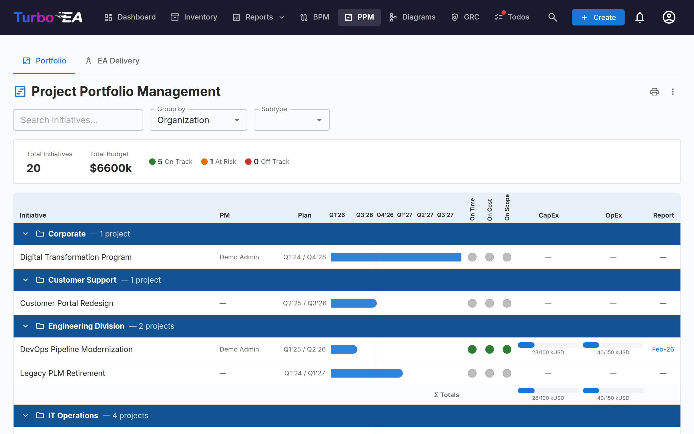
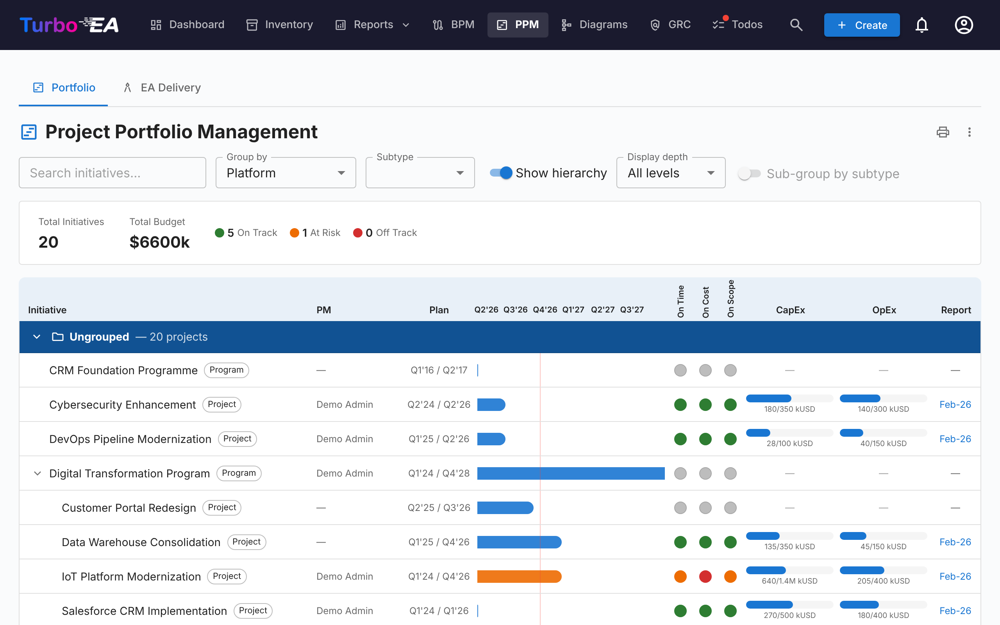
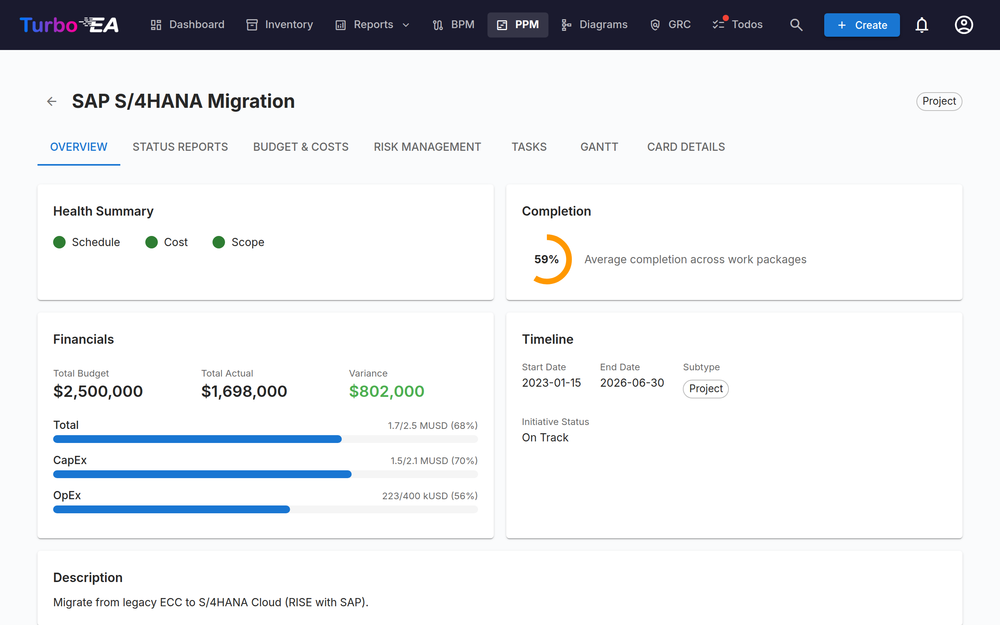
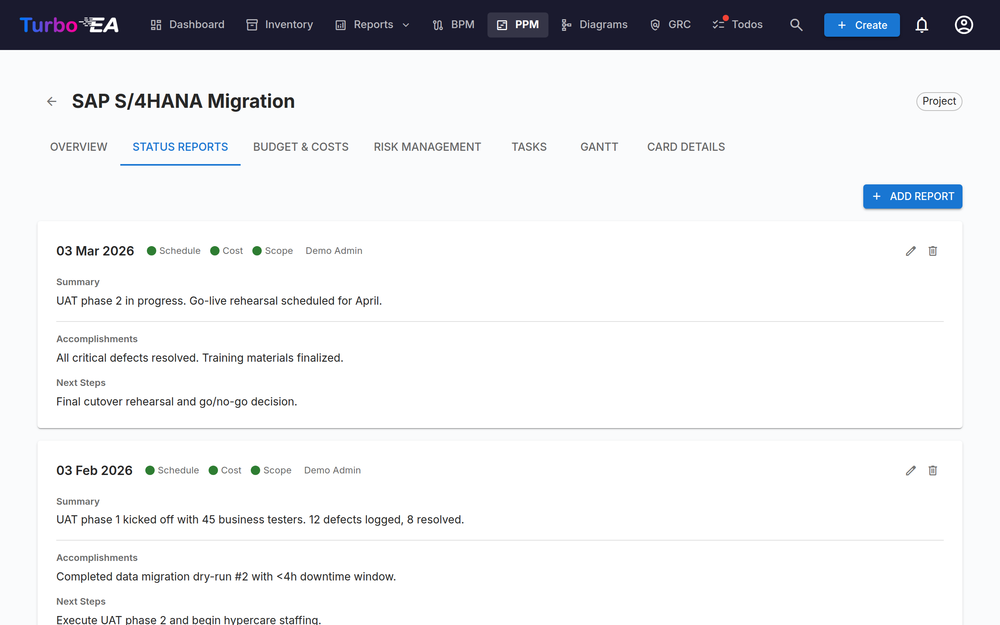
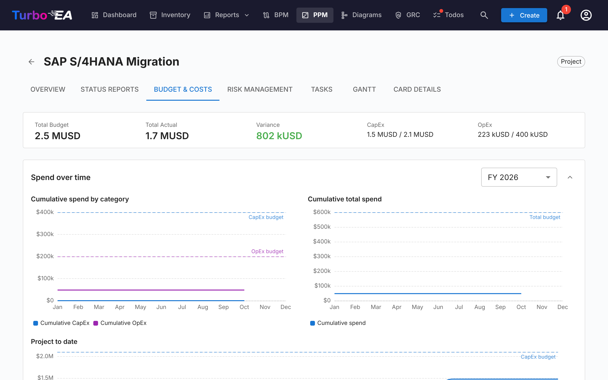
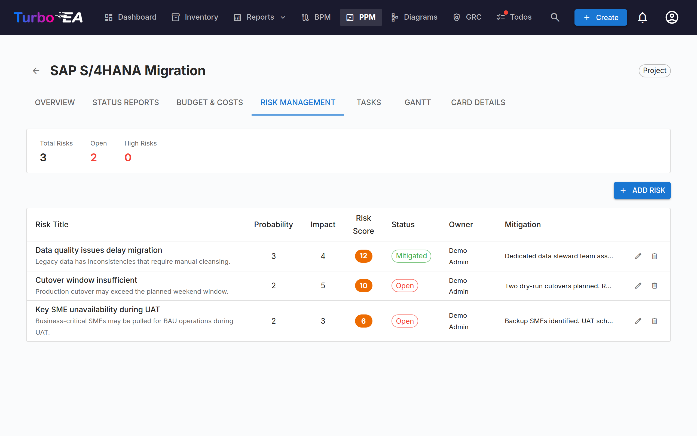
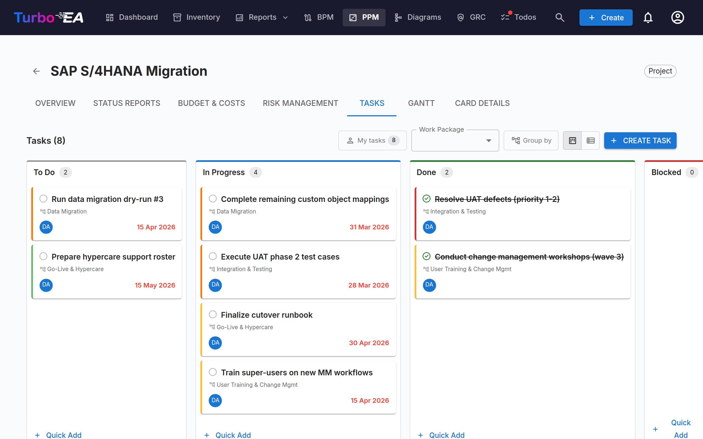
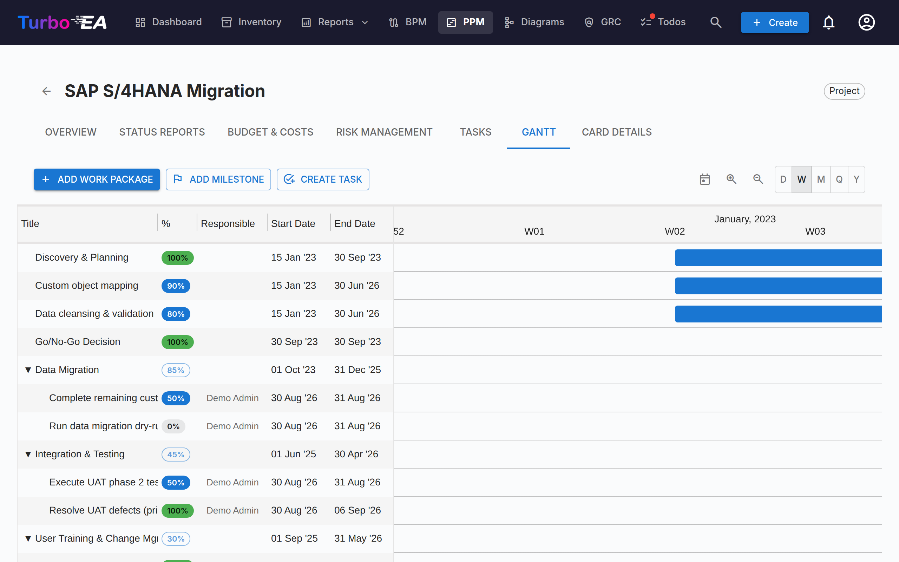

# Project Portfolio Management (PPM)

The **PPM** module provides a complete project portfolio management solution for tracking initiatives, budgets, risks, tasks, and timelines. It integrates directly with the Initiative card type to enrich each project with status reporting, cost tracking, and Gantt visualization.

!!! note
    The PPM module can be enabled or disabled by an administrator in [Settings](../admin/settings.md). When disabled, PPM navigation and features are hidden.

## Portfolio Dashboard

The **Portfolio Dashboard** is the main entry point for PPM. It provides:

- **KPI Cards** — Total initiatives, total budget, total actual cost, and health status summaries
- **Health Pie Charts** — Distribution of schedule, cost, and scope health (On Track / At Risk / Off Track)
- **Status Distribution** — Breakdown by initiative subtype and status
- **Gantt Overview** — Timeline bars showing each initiative's start and end dates, with RAG health indicators

### Grouping & Filtering

Use the toolbar to:

- **Group by** any related card type (e.g., Organization, Platform) to see initiatives grouped by business unit or technology platform
- **Group by** an Initiative subtype (e.g., Program), listed in a second section of the same menu, to see each program with every initiative beneath it (see below)
- **Filter by subtype** (Idea, Program, Project, Epic)
- **Search** by initiative name
- **Show hierarchy** to nest the initiatives of each group under their parent Initiative (see below)
- **Sub-group by subtype** to split each group by subtype (see below)

These filters persist in the URL, so refreshing the page retains your current view. The hierarchy, its display depth and the sub-grouping are kept in the URL too.

#### Showing the Initiative hierarchy

When some initiatives on the board have a parent Initiative that is on the board too, the toolbar offers **Show hierarchy**. Switched on, each group lists its initiatives as a tree: a child sits indented under its parent, the chevron before a parent's name folds or unfolds its subtree, and every row shows its subtype, so the role of each level (for example Program → Project → Epic) stays visible. **Display depth** limits the tree to its first levels (*Level 1*, *Level 2*, … or *All levels*).

The grouping stays primary: the hierarchy nests **inside each group**, so a child whose parent belongs to another group is shown as a top-level row of its own group. The filters apply first and the tree shows what remains: when the search or the subtype filter leaves a parent out, its children move up to the top level rather than the parent being kept as context.

#### Sub-grouping by subtype

**Sub-group by subtype** splits every group into one sub-group per subtype, in the order the subtypes are defined on the Initiative type, with the initiatives that have no subtype last. Each sub-group has its own header, collapses on its own and carries its own totals row; the group's totals still cover all of its initiatives. The switch is unavailable while the hierarchy is shown, because the tree already spans the subtypes.

#### Grouping by an Initiative subtype

The **Group by** menu has two sections: **Related card types** and **Initiative subtypes**, the subtypes defined on the Initiative type. Picking a subtype — say **Program** — shows one group per Program initiative. The program names its group and is its **header only, never a row**; the group holds **every initiative beneath it, at any depth** and whatever its subtype, so a program nested under another program is a row in the top-most program's group.

The group's bottom line takes the place of the totals row: labelled with the subtype, it shows the program's **own** budget, actuals and dates, or — where it has none of its own — the figures **derived** from the initiatives beneath it, drawn outlined, dashed and italic as described under *Rolling figures up to parent initiatives*. Initiatives with no program above them are listed under **Ungrouped**. An initiative in between that you cannot see, that is archived or that a portal does not publish **breaks the chain**: what sits beneath it is no longer grouped under the program above. **Show hierarchy** appears only when something nests below a program's direct children, and the subtype filter does not offer the grouping subtype, because its initiatives are headers rather than rows.

#### Rolling figures up to parent initiatives

Each initiative shows its own figures whenever it has any: a parent's CapEx and OpEx bars cover the budget and cost lines recorded on the parent, and its Gantt bar its own start and end dates. A parent with **no budget lines of its own** shows the budget of the initiatives beneath it instead, and a parent with **no cost lines of its own** their actuals; either way the bar is drawn **outlined** with italic figures, and its tooltip says which half comes from beneath. A parent with **neither a start nor an end date** spans from the earliest start to the latest end beneath it, drawn as a **dashed** bar with italic quarters. A tooltip on each says how many initiatives it covers. The three rules are independent — a program that holds the budget while its projects record the spend shows its own budget against their actuals, and a program may carry its own dates and still show its projects' costs — and recording one budget line, one cost line or one date on the parent switches that part back to its own figures. Only the initiatives you can see count, and on a portal only those the portal publishes. The group totals and the KPI bar keep adding up recorded lines only, so every figure is counted once.

The derived figures exist only on the PPM board and on the initiative's own **Overview** and **Budget & Costs** tabs. To carry a rolled-up total into the Inventory, reports or a portal, define a calculated field that adds each level's own budget to its children's totals — see [Rolling PPM figures up the Initiative hierarchy](../admin/calculations.md#rolling-ppm-figures-up-the-initiative-hierarchy). A PPM change on a child re-runs the calculations of every Initiative above it, so the parent's total moves straight away.

### Printing & exporting

The portfolio offers the same title-bar actions as the reports:

- **Print / Save as PDF** — the printer icon prints the portfolio the way it looks on screen. The tab strip, the filter toolbar and hover popovers are dropped, the active grouping / subtype / search are printed as a compact parameter line, and the timeline grid is unclipped so every column fits the page instead of being cut off at the scroll edge. When the hierarchy or the sub-grouping is switched on, the parameter line names it too, with the display depth.
- **Export to PowerPoint (.pptx)** — from the **⋮** menu. The first slide carries the title, the generation timestamp and the active filters together with the portfolio at presentation quality; long portfolios continue onto further slides, split only between initiatives — never through a row, a group header or a totals line.
- **Export to Excel (.xlsx)** — also from the **⋮** menu. One row per initiative with its group, subtype, project manager, start and end dates, the three health ratings, CapEx / OpEx planned vs. actual, and the date of the latest status report. The rows follow the order on screen; while the hierarchy is shown, a **Parent** column names each initiative's parent. Three columns, **Budget from**, **Costs from** and **Dates from**, say whether a row's budget, actuals and dates are its own or the total of the initiatives beneath it. When the board is grouped by an Initiative subtype, the grouping initiative is the **first row of its group**, with the figures its bottom line shows.

## Initiative Detail View

Click any initiative to open its detail page with seven tabs:

### Overview Tab

The overview shows a summary of the initiative's health and financials:

- **Health Summary** — Schedule, cost, and scope indicators from the latest status report
- **Budget vs. Actual** — Combined KPI card showing total budget and actual spend with variance
- **Figures from beneath** — When the initiative has no budget lines of its own, its total budget, its budget bars and the variance show the budget of the initiatives beneath it instead: in italic, marked with a ↳ arrow, with the budget track outlined and a tooltip saying how many initiatives they cover. When it has no cost lines of its own, its actuals come from beneath the same way, with the spend bars outlined. The two sides are decided separately, and recording a first line of its own switches that side back to the initiative's own figures.
- **Beneath this initiative** — When the initiative has initiatives beneath it, a line under the budget bars names how many there are, their summed budget and actual spend, and the span of their dates. It is shown beside the initiative's own figures and never added to them. When both the budget and the actuals already come from beneath, the line keeps only the count and the date span.
- **Recent Activity** — Latest status report summary

### Status Reports Tab

Monthly status reports track project health over time. Each report includes:

| Field | Description |
|-------|-------------|
| **Report Date** | The reporting period date |
| **Schedule Health** | On Track, At Risk, or Off Track |
| **Cost Health** | On Track, At Risk, or Off Track |
| **Scope Health** | On Track, At Risk, or Off Track |
| **Summary** | Executive summary of current status |
| **Accomplishments** | What was achieved this period |
| **Next Steps** | Planned activities for the next period |

### Budget & Costs Tab

Track financial data with two types of line items:

- **Budget Lines** — Planned budget by fiscal year and category (CapEx / OpEx), with an optional description. A fiscal year and category can hold as many lines as you need — one per licence, implementation partner or hardware lot — and the description tells them apart; the totals add them all up. Budget lines are grouped according to the **fiscal year start month** configured in [Settings](../admin/settings.md#fiscal-year-start). For example, if the fiscal year begins in April, a budget line dated June 2026 belongs to FY 2026–2027
- **Cost Lines** — Actual expenditures with date, description, and category

Both tables are grouped by fiscal year. Each year has a header row with its CapEx, OpEx and total subtotals and the number of lines it holds; select the arrow on the header to show or hide that year's lines. When the tab opens, only the current fiscal year is expanded (or the latest year with lines, if the current one has none). Amounts sit in separate **CapEx** and **OpEx** columns, and a **Total, all fiscal years** row under each table adds every year up. Select **+** on a budget year's header to add a budget line with that fiscal year already filled in. Cost lines are grouped by the fiscal year their date falls in and listed by date within it; cost lines without a date are collected in an **Undated** group at the end, and they count towards the cost totals like any other line.

When the initiative has **no budget lines of its own**, the budget table shows the budget of the initiatives beneath it in place of its empty state: a caption names how many initiatives it comes from, one read-only row per fiscal year gives the CapEx, OpEx and total in italic, and the **Total, all fiscal years** row adds them up. The cost table does the same with their actuals when the initiative has **no cost lines of its own**, with an **Undated** row for their cost lines without a date. The summary bar marks those figures in italic, with a tooltip. Each table decides on its own, nothing is stored or added to the initiative's own figures, and only the initiatives you can see count. Recording a first line with **Add Budget Line** or **Add Cost Item** switches that table back to the initiative's own lines; the spend charts always show the initiative's own lines.

Budget and cost totals automatically roll up to the Initiative card's `costBudget` and `costActual` attributes. When PPM cost lines exist, these card fields are marked as auto-computed and become read-only in the card detail view.

#### Spend Over Time

Above the budget and cost tables, three charts plot how spend has accumulated month by month:

- **Cumulative spend by category** — cumulative CapEx and OpEx for the selected fiscal year, with dotted horizontal lines marking the CapEx and OpEx budget for that year
- **Cumulative total spend** — the same fiscal year with both categories combined, against a dotted total-budget line
- **Project to date** — cumulative CapEx and OpEx across every month of the project, against the total budget for all fiscal years

The fiscal-year selector applies to the first two charts and offers the current year, any other year with data, and **All fiscal years**. Your fiscal-year and expand/collapse choices are remembered between visits.

Two things to be aware of when reading the charts:

- Lines stop at the current month rather than running flat to the end of the year, so an unfinished year is not mistaken for one where spending has stopped
- Cost lines with no date cannot be placed on a timeline and are left out. A note below the charts reports how many were excluded, so the chart totals can be reconciled with the summary bar

### Risk Management Tab

The risk register tracks project risks with:

| Field | Description |
|-------|-------------|
| **Title** | Brief description of the risk |
| **Probability** | Likelihood score (1–5) |
| **Impact** | Impact score (1–5) |
| **Risk Score** | Auto-calculated as probability x impact |
| **Status** | Open, Mitigating, Mitigated, Closed, or Accepted |
| **Mitigation** | Planned mitigation actions |
| **Owner** | User responsible for managing the risk |

### Tasks Tab

The task manager supports both **Kanban board** and **list** views with four status columns:

- **To Do** — Tasks not yet started
- **In Progress** — Tasks currently being worked on
- **Done** — Completed tasks
- **Blocked** — Tasks that cannot proceed

Tasks can be filtered and grouped by Work Breakdown Structure (WBS) item. When grouped, every work package appears as a group — including one that holds no tasks yet, which shows a hint and an **Add Task** button that opens the task dialog with that package preselected. Milestones appear only once they hold a task. Drag and drop cards between columns to update status. Each task supports:

- Priority levels (Critical, High, Medium, Low)
- Assignee (with notification on assignment)
- Start and due dates
- Tags for categorization
- Comments for discussion

Display filters (view mode, WBS filter, group-by toggle) persist in the URL across page refreshes.

### Gantt Tab

The Gantt chart visualizes the project timeline with:

- **Work Packages (WBS)** — Hierarchical work breakdown structure items with start/end dates
- **Tasks** — Individual task bars linked to work packages
- **Milestones** — Key dates marked with diamond indicators
- **Progress Bars** — Visual completion percentage. A task has no percentage of its own: its fill follows its status — **To Do (0%)**, **In Progress (50%)**, **Done (100%)**. Click the percentage chip on a task to open a slider whose three stops are labelled with those statuses; choosing a stop changes the status, and dragging the fill on the task's bar does the same. A leaf work package has a free slider in 5% steps. Work packages that have child work packages **or tasks** show a read-only chip whose value is rolled up automatically from the subtree.
- **Quarterly Ticks** — Timeline grid for orientation

Interact with the Gantt chart using:

- **Drag** bars to reschedule items
- **Resize** bar edges to change duration (1-day granularity)
- **Right-click** for context menu (edit, add task, mark done, delete)
- **Today button** to scroll to the current date
- **View scale picker** — choose between Day, Week, Month, Quarter, and Year scales; the choice is remembered in your browser
- **Zoom in / Zoom out buttons** — step through the same five scales one notch at a time
- **Drag the dot on the right edge of one bar onto the dot on the left edge of another** to create a finish-to-start dependency arrow. Dependencies work between any combination of work packages and tasks. Cycles are rejected automatically. **Double-click an arrow** to remove it.
- **The + row** at the bottom of the list asks what to create — a work package, a milestone or a task — so a task typed there lands on the Tasks tab.

### Card Details Tab

The last tab shows the full card detail view, including all standard sections (description, lifecycle, attributes, relations, stakeholders, comments, history).

## Work Breakdown Structure (WBS)

The WBS provides a hierarchical decomposition of project scope:

- **Work Packages** — Logical groupings of tasks with start/end dates and completion tracking
- **Milestones** — Significant events or completion points
- **Hierarchy** — Parent-child relationships between WBS items
- **Auto-completion** — Completion is calculated automatically from the tasks in a work package's subtree: each task counts as 0% (To Do, Blocked), 50% (In Progress) or 100% (Done), weighted by its duration in days (one day when a date is missing), then rolled up recursively to parent items. A work package with no tasks anywhere below it keeps the value typed by hand. The average of the top-level work packages is the initiative's overall progress — the number on the Overview tab, and the `ppm.completion` variable a [calculated field](../admin/calculations.md#ppm-data-on-initiative-cards) can show on the card and in a portal

## Card Detail Integration

When PPM is enabled, **Initiative** cards display a **PPM** tab as the last tab in the [card detail view](card-details.md). Clicking this tab navigates directly to the PPM Initiative Detail View (Overview tab). This provides a quick entry point from any Initiative card to its full PPM project page.

Conversely, the **Card Details** tab within the PPM Initiative Detail View shows the standard card detail sections without the PPM tab, avoiding circular navigation.

## Permissions

| Permission | Description |
|-----------|-------------|
| `ppm.view` | View the PPM dashboard, Gantt chart, and initiative reports, and read Initiative cards. Granted to all roles by default |
| `ppm.manage` | Create and manage status reports, tasks, costs, risks, and WBS items. Granted to Admin, BPM Admin, and Member roles |
| `reports.ppm_dashboard` | View the PPM portfolio dashboard. Granted to all roles by default |
