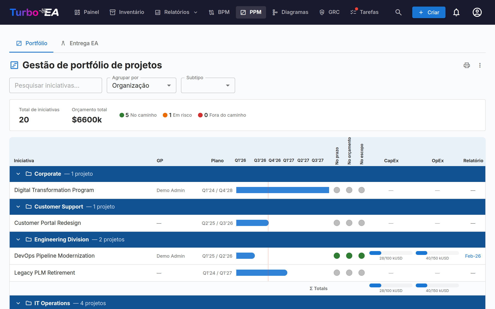
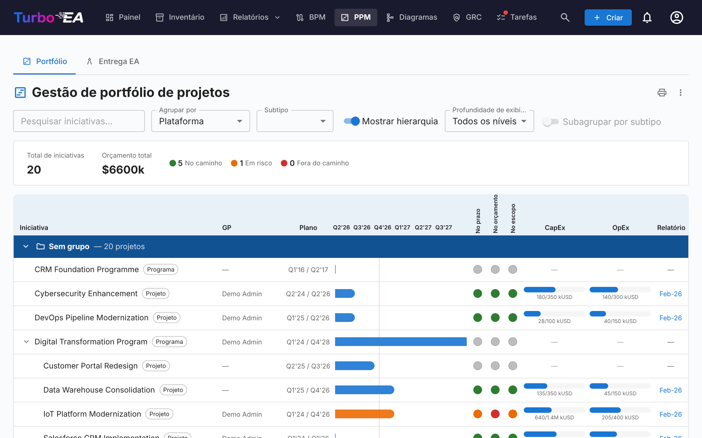
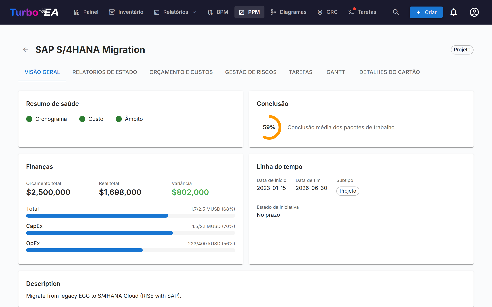
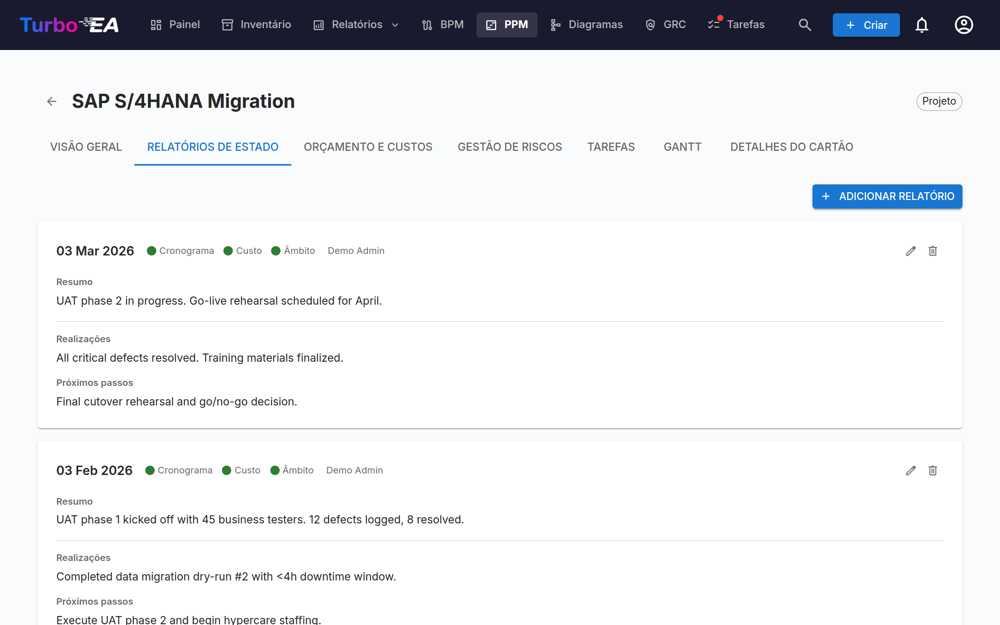
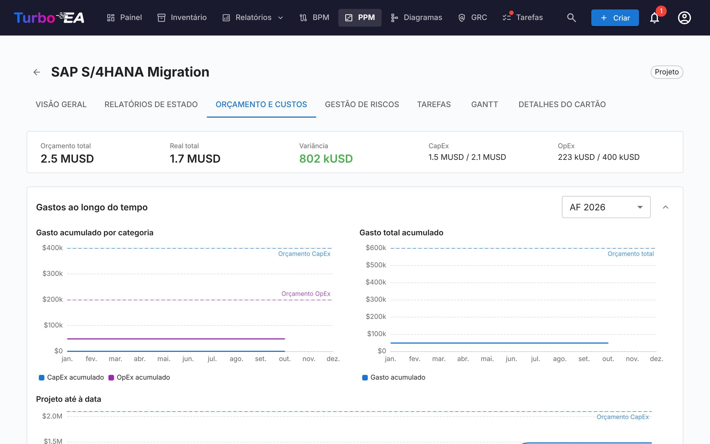
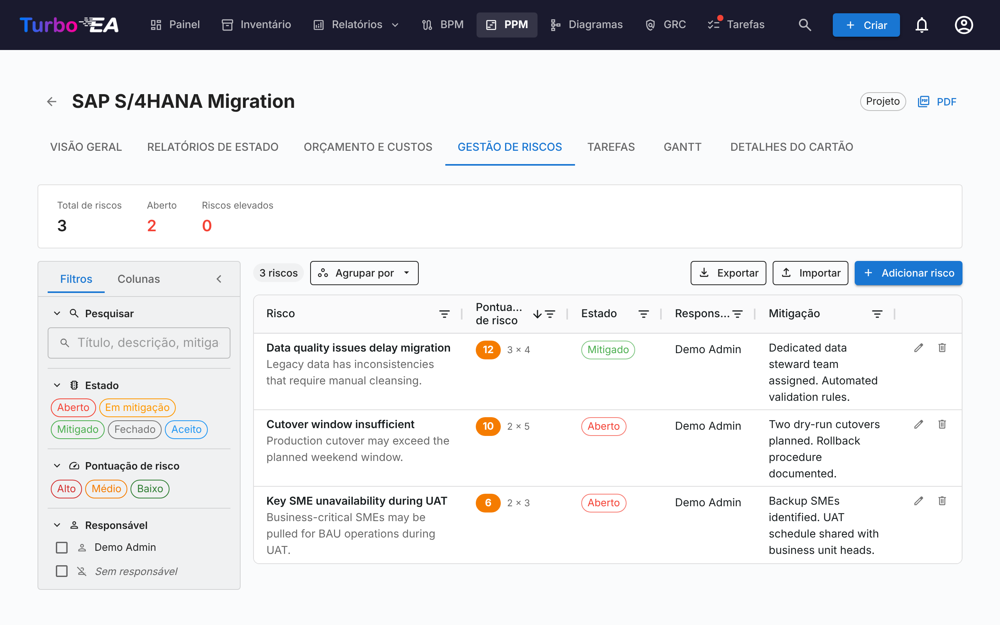
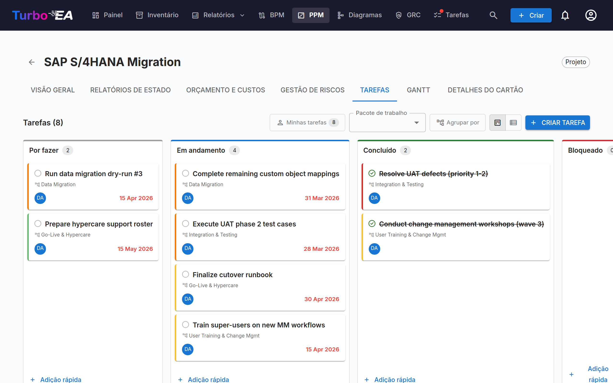
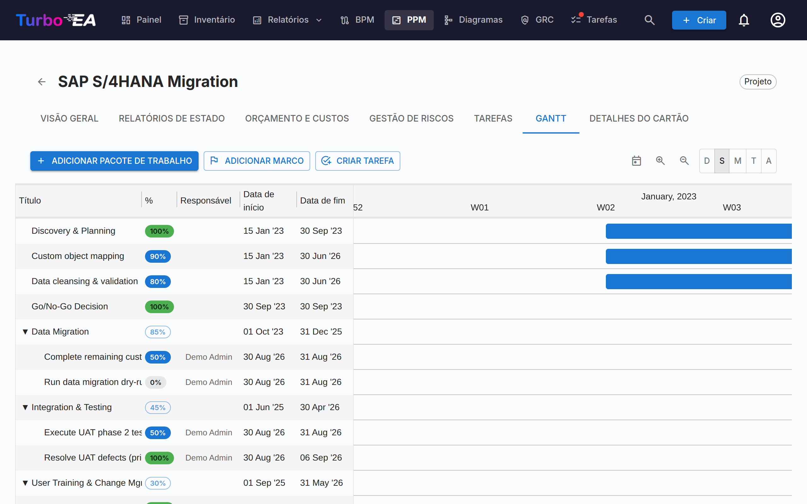

# Gerenciamento de Portfólio de Projetos (PPM)

O módulo **PPM** fornece uma solução completa de gerenciamento de portfólio de projetos para rastreamento de iniciativas, orçamentos, riscos, tarefas e cronogramas. Integra-se diretamente com o tipo de card Iniciativa para enriquecer cada projeto com relatórios de status, acompanhamento de custos e visualização Gantt.

!!! note
    O módulo PPM pode ser habilitado ou desabilitado por um administrador nas [Configurações](../admin/settings.md). Quando desabilitado, a navegação e funcionalidades do PPM ficam ocultas.

## Painel do Portfólio

O **Painel do Portfólio** é o ponto de entrada principal para o PPM. Ele fornece:

- **Cards de KPI** — Total de iniciativas, orçamento total, custo real total e resumos de status de saúde
- **Gráficos circulares de saúde** — Distribuição de saúde de cronograma, custos e escopo (No Caminho / Em Risco / Fora do Caminho)
- **Distribuição de status** — Detalhamento por subtipo de iniciativa e status
- **Visão geral Gantt** — Barras de cronograma mostrando as datas de início e fim de cada iniciativa, com indicadores de saúde RAG

### Agrupamento e filtragem

Use a barra de ferramentas para:

- **Agrupar por** qualquer tipo de card relacionado (ex., Organização, Plataforma)
- **Agrupar por** um subtipo de iniciativa (ex., Programa), listado numa segunda secção do mesmo menu, para ver cada programa com todas as iniciativas abaixo dele (veja abaixo)
- **Filtrar por subtipo** (Ideia, Programa, Projeto, Épico)
- **Pesquisar** por nome de iniciativa
- **Mostrar hierarquia** para aninhar as iniciativas de cada grupo sob a iniciativa pai (veja abaixo)
- **Subagrupar por subtipo** para dividir cada grupo por subtipo (veja abaixo)

Esses filtros são mantidos na URL, então atualizar a página preserva sua visualização atual. A hierarquia, sua profundidade de exibição e o subagrupamento também são mantidos na URL.

#### Mostrar a hierarquia de iniciativas

Quando algumas iniciativas do portfólio têm uma iniciativa pai que também está no portfólio, a barra de ferramentas oferece **Mostrar hierarquia**. Ao ativá-la, cada grupo lista suas iniciativas como uma árvore: uma iniciativa filha aparece recuada sob a iniciativa pai, a seta antes do nome de uma iniciativa pai recolhe ou expande sua subárvore, e cada linha mostra seu subtipo, para que o papel de cada nível (por exemplo Programa → Projeto → Épico) continue visível. **Profundidade de exibição** limita a árvore aos seus primeiros níveis (*Nível 1*, *Nível 2*, … ou *Todos os níveis*).

O agrupamento continua sendo o principal: a hierarquia é montada **dentro de cada grupo**, então uma iniciativa cuja iniciativa pai pertence a outro grupo aparece como linha de primeiro nível do seu próprio grupo. Os filtros são aplicados primeiro e a árvore mostra o que resta: quando a pesquisa ou o filtro de subtipo deixam uma iniciativa pai de fora, as filhas dela sobem para o primeiro nível, em vez de a iniciativa pai ser mantida como contexto.

#### Subagrupar por subtipo

**Subagrupar por subtipo** divide cada grupo em um subgrupo por subtipo, na ordem em que os subtipos estão definidos no tipo Iniciativa, com as iniciativas sem subtipo por último. Cada subgrupo tem seu próprio cabeçalho, pode ser recolhido separadamente e tem sua própria linha de totais; os totais do grupo continuam abrangendo todas as suas iniciativas. A chave fica indisponível enquanto a hierarquia é exibida, porque a árvore já abrange todos os subtipos.

#### Agrupar por um subtipo de iniciativa

O menu **Agrupar por** tem duas secções: **Tipos de cartão relacionados** e **Subtipos de iniciativa**, os subtipos definidos no tipo Iniciativa. Ao escolher um subtipo — por exemplo **Programa** — o painel mostra um grupo por cada iniciativa do tipo Programa. O programa dá nome ao seu grupo e é **apenas o seu cabeçalho, nunca uma linha**; o grupo contém **todas as iniciativas abaixo dele, em qualquer profundidade** e de qualquer subtipo, pelo que um programa aninhado sob outro programa é uma linha no grupo do programa mais acima.

A linha final do grupo substitui a linha de totais: leva o nome do subtipo e mostra o orçamento, o realizado e as datas **próprios** do programa ou, quando não os tem, os valores **derivados** das iniciativas abaixo dele, desenhados com contorno, tracejado e em itálico como descrito em *Consolidar valores nas iniciativas pai*. As iniciativas sem nenhum programa acima delas aparecem em **Sem grupo**. Uma iniciativa intermédia que não pode ver, que está arquivada ou que um portal não publica **quebra a cadeia**: o que está abaixo dela deixa de ser agrupado sob o programa acima. **Mostrar hierarquia** só aparece quando algo está aninhado abaixo dos filhos diretos de um programa, e o filtro de subtipo não oferece o subtipo de agrupamento, porque as suas iniciativas são cabeçalhos e não linhas.

#### Consolidar valores nas iniciativas pai

Cada iniciativa mostra os próprios valores sempre que os tiver: as barras de CapEx e OpEx de uma iniciativa pai cobrem as linhas de orçamento e de custo registradas nela, e a barra de Gantt as próprias datas de início e término. Uma iniciativa pai **sem linhas de orçamento próprias** mostra, em vez disso, o orçamento das iniciativas abaixo dela, e uma **sem linhas de custo próprias** o realizado delas; em ambos os casos a barra é desenhada **contornada** com valores em itálico, e a dica de ferramenta indica qual metade vem de baixo. Uma iniciativa pai **sem data de início nem de término** abrange do início mais cedo ao término mais tardio abaixo dela, desenhada como uma barra **tracejada** com trimestres em itálico. Uma dica de ferramenta informa, em cada caso, quantas iniciativas estão incluídas. As três regras são independentes — um programa que detém o orçamento enquanto os projetos registram o gasto mostra o próprio orçamento diante do realizado deles, e um programa pode ter datas próprias e ainda assim mostrar os custos dos projetos — e basta registrar uma linha de orçamento, uma linha de custo ou uma data na iniciativa pai para que essa parte volte aos valores próprios. Só contam as iniciativas que você pode ver e, em um portal, as que o portal publica. Os totais de grupo e a barra de KPIs continuam somando apenas as linhas registradas, de modo que cada valor é contado uma única vez.

Os valores derivados existem apenas no quadro de PPM e nas abas **Visão geral** e **Orçamento e custos** da própria iniciativa. Para levar um total consolidado ao inventário, aos relatórios ou a um portal, defina um campo calculado que some o orçamento próprio de cada nível aos totais das filhas — veja [Consolidar valores de PPM ao longo da hierarquia de iniciativas](../admin/calculations.md#rolling-ppm-figures-up-the-initiative-hierarchy). Uma alteração de PPM em uma filha executa novamente os cálculos de todas as iniciativas acima dela, de modo que o total da iniciativa pai é atualizado na hora.

### Impressão e exportação

O portfólio oferece as mesmas ações na barra de título que os relatórios:

- **Imprimir / Salvar como PDF** — o ícone de impressora imprime o portfólio como ele aparece na tela. A barra de abas, a barra de filtros e os balões exibidos ao passar o mouse são ocultados, o agrupamento, o subtipo e a busca ativos são impressos como uma linha compacta de parâmetros, e a grade de cronograma deixa de ser cortada, para que todas as colunas caibam na página. Quando a hierarquia ou o subagrupamento estão ativados, a linha de parâmetros também os indica, com a profundidade de exibição.
- **Exportar para PowerPoint (.pptx)** — pelo menu **⋮**. O primeiro slide traz o título, o carimbo de data/hora de geração e os filtros ativos junto com o portfólio em qualidade de apresentação; portfólios longos continuam em outros slides, divididos apenas entre iniciativas — nunca no meio de uma linha, de um cabeçalho de grupo ou de uma linha de totais.
- **Exportar para Excel (.xlsx)** — também pelo menu **⋮**. Uma linha por iniciativa com seu grupo, subtipo, gerente de projeto, datas de início e término, os três indicadores de saúde, CapEx/OpEx planejado e realizado, e a data do último relatório de status. As linhas seguem a ordem da tela; enquanto a hierarquia é exibida, uma coluna **Pai** indica a iniciativa pai de cada iniciativa. Três colunas, **Origem do orçamento**, **Origem dos custos** e **Origem das datas**, indicam se o orçamento, o realizado e as datas de uma linha são os próprios ou o total das iniciativas abaixo dela. Quando o painel está agrupado por um subtipo de iniciativa, a iniciativa que agrupa é a **primeira linha do seu grupo**, com os valores que a sua linha final mostra.

## Visão Detalhada da Iniciativa

Clique em qualquer iniciativa para abrir sua página de detalhes com sete abas:

### Aba Visão Geral

A visão geral mostra um resumo da saúde e finanças da iniciativa:

- **Resumo de saúde** — Indicadores de cronograma, custos e escopo do último relatório de status
- **Orçamento vs. Real** — Card de KPI combinado mostrando orçamento total e gasto real com variação
- **Valores vindos de baixo** — Quando a iniciativa não tem linhas de orçamento próprias, o orçamento total, as barras de orçamento e a variação mostram, em vez disso, o orçamento das iniciativas abaixo dela: em itálico, marcados com uma seta ↳, com a faixa do orçamento contornada e uma dica de ferramenta que indica quantas iniciativas abrangem. Quando não tem linhas de custo próprias, o realizado vem de baixo da mesma forma, com as barras de gasto contornadas. Os dois lados são decididos separadamente, e registrar uma primeira linha própria faz esse lado voltar aos valores próprios da iniciativa.
- **Abaixo desta iniciativa** — Quando a iniciativa tem iniciativas abaixo dela, uma linha sob as barras de orçamento indica quantas são, o orçamento e o gasto real somados e o período coberto pelas datas delas. Ela aparece ao lado dos valores próprios da iniciativa e nunca é somada a eles. Quando o orçamento e o realizado já vêm ambos de baixo, a linha mantém apenas a quantidade e o período das datas.
- **Atividade recente** — Resumo do último relatório de status

### Aba Relatórios de Status

Relatórios de status mensais acompanham a saúde do projeto ao longo do tempo. Cada relatório inclui:

| Campo | Descrição |
|-------|-----------|
| **Data do relatório** | A data do período de reporte |
| **Saúde do cronograma** | No Caminho, Em Risco ou Fora do Caminho |
| **Saúde dos custos** | No Caminho, Em Risco ou Fora do Caminho |
| **Saúde do escopo** | No Caminho, Em Risco ou Fora do Caminho |
| **Resumo** | Resumo executivo do status atual |
| **Realizações** | O que foi alcançado neste período |
| **Próximos passos** | Atividades planejadas para o próximo período |

### Aba Orçamento e Custos

Acompanhamento de dados financeiros com dois tipos de itens:

- **Linhas de orçamento** — Orçamento planejado por ano fiscal e categoria (CapEx / OpEx), com uma descrição opcional. Um mesmo ano fiscal e categoria podem ter quantas linhas forem necessárias — uma por licença, parceiro de implementação ou lote de hardware — e a descrição as distingue; os totais somam todas. As linhas de orçamento são agrupadas de acordo com o **mês de início do ano fiscal** configurado nas [Configurações](../admin/settings.md#início-do-ano-fiscal). Por exemplo, se o ano fiscal começa em abril, uma linha de orçamento de junho de 2026 pertence ao AF 2026–2027
- **Linhas de custo** — Despesas reais com data, descrição e categoria

As duas tabelas são agrupadas por ano fiscal. Cada ano tem uma linha de cabeçalho com os subtotais de CapEx, OpEx e total e o número de linhas que contém; a seta do cabeçalho mostra ou oculta as linhas desse ano. Ao abrir a aba, apenas o ano fiscal atual fica expandido (ou o último ano com linhas, se o atual não tiver nenhuma). Os valores ficam em colunas **CapEx** e **OpEx** separadas, e uma linha **Total, todos os anos fiscais** abaixo de cada tabela soma todos os anos. O botão **+** no cabeçalho de um ano de orçamento adiciona uma linha de orçamento com esse ano fiscal já preenchido. As linhas de custo são agrupadas pelo ano fiscal da sua data e ordenadas por data dentro dele; as que não têm data ficam reunidas no final, no grupo **Sem data**, e contam para os totais de custos como qualquer outra linha.

Quando a iniciativa **não tem linhas de orçamento próprias**, a tabela de orçamento mostra, no lugar do estado vazio, o orçamento das iniciativas abaixo dela: uma legenda indica de quantas iniciativas ele vem, uma linha somente leitura por ano fiscal apresenta CapEx, OpEx e total em itálico, e a linha **Total, todos os anos fiscais** os soma. A tabela de custos faz o mesmo com o realizado delas quando a iniciativa **não tem linhas de custo próprias**, com uma linha **Sem data** para as linhas de custo sem data. A barra de resumo marca esses valores em itálico, com uma dica de ferramenta. Cada tabela decide por si, nada é armazenado nem somado aos valores próprios da iniciativa, e só contam as iniciativas que você pode ver. Registrar uma primeira linha com **Adicionar linha de orçamento** ou **Adicionar item de custo** faz essa tabela voltar às linhas próprias da iniciativa; os gráficos de gasto mostram sempre as linhas próprias da iniciativa.

Os totais de orçamento e custos são automaticamente acumulados nos atributos `costBudget` e `costActual` do card de Iniciativa. Estes campos do cartão são **totais de todos os exercícios fiscais**. O [relatório de custos](reports.md) e os mosaicos de custos do painel, que mostram o exercício fiscal atual, contam apenas as linhas de orçamento do ano em curso e as linhas de custo datadas nele; as linhas de custo sem data não contam em nenhum ano.

#### Gastos ao longo do tempo

Acima das tabelas de orçamento e custos, três gráficos mostram como os gastos se acumulam mês a mês:

- **Gasto acumulado por categoria** — CapEx e OpEx acumulados do ano fiscal selecionado, com linhas horizontais tracejadas a marcar o orçamento CapEx e OpEx desse ano
- **Gasto total acumulado** — o mesmo ano fiscal com ambas as categorias combinadas, face a uma linha tracejada de orçamento total
- **Projeto até à data** — CapEx e OpEx acumulados ao longo de todos os meses do projeto, face ao orçamento total de todos os anos fiscais

O seletor de ano fiscal aplica-se aos dois primeiros gráficos e oferece o ano atual, qualquer outro ano com dados e **Todos os anos fiscais**. As suas escolhas de ano fiscal e estado recolhido ou expandido são memorizadas entre visitas.

Dois aspetos a ter em conta ao ler os gráficos:

- As linhas param no mês atual em vez de seguirem planas até ao fim do ano, para que um ano em curso não seja confundido com um em que os gastos pararam
- Os itens de custo sem data não podem ser colocados numa linha temporal e são excluídos. Uma nota por baixo dos gráficos indica quantos foram excluídos, permitindo conciliar os totais do gráfico com a barra de resumo

### Aba Gestão de Riscos

O registo de riscos acompanha os riscos da iniciativa. Cada risco tem:

| Campo | Descrição |
|-------|-----------|
| **Título** | Breve descrição do risco |
| **Descrição** | O risco por extenso |
| **Probabilidade** | Pontuação de probabilidade (1–5) |
| **Impacto** | Pontuação de impacto (1–5) |
| **Pontuação de risco** | Calculada automaticamente como probabilidade × impacto |
| **Status** | Aberto, Mitigando, Mitigado, Fechado ou Aceito |
| **Mitigação** | Ações de mitigação planejadas |
| **Responsável** | Usuário responsável pelo gerenciamento do risco |

Uma faixa de resumo acima da grelha conta o **Total de riscos**, os que estão em estado **Aberto** e os **Riscos elevados**.

#### A grelha de riscos

Os riscos são listados numa grelha construída como o [Inventário](inventory.md) e o [Registo de riscos](risks.md#grelha-do-registo). O texto nunca é cortado: cada linha mostra o título do risco a negrito com a sua **descrição completa** por baixo, e a **mitigação completa**, que ocupam tantas linhas quantas forem necessárias. Os endereços web na descrição e na mitigação são clicáveis.

| Coluna | Mostra |
|--------|--------|
| **Risco** | O título, com a descrição por baixo |
| **Pontuação de risco** | A pontuação como chip colorido, com *probabilidade × impacto* ao lado (por exemplo **20** *4 × 5*) |
| **Estado** | O chip do estado |
| **Responsável** | O responsável pelo risco, ou um traço |
| **Mitigação** | A mitigação planeada, ou um traço |
| *(botões)* | **Editar** e **Excluir** |

**Probabilidade** e **Impacto** também estão disponíveis como colunas separadas; estão ocultas por predefinição — ative-as no separador **Colunas** do painel de filtros.

- **Ordenar** — clique no cabeçalho de uma coluna. Até escolher uma ordenação própria, a pontuação mais alta aparece primeiro.
- **Filtrar uma coluna** — use os filtros dos cabeçalhos, como nas outras grelhas.
- **Fixar uma coluna** — clique no pino do respetivo cabeçalho para a manter na margem esquerda enquanto desloca a tabela lateralmente; clique novamente para a libertar.
- **Reordenar colunas** — arraste o cabeçalho de uma coluna.
- **Menu da célula** — clique com o botão direito numa célula (toque prolongado num dispositivo tátil) para o mesmo menu de célula das outras grelhas.

#### Painel de filtros

O painel à esquerda tem dois separadores:

- **Filtros**
    - **Pesquisar** — procura no título, na descrição, na mitigação e no responsável.
    - **Estado** — assinale um ou mais chips de estado.
    - **Pontuação de risco** — as faixas de pontuação **Alto** (15 ou mais), **Médio** (de 6 a 14) e **Baixo** (abaixo de 6).
    - **Responsável** — os responsáveis presentes na lista, mais **Sem responsável**.
    - **Limpar todos os filtros** repõe todos os filtros de uma só vez.
- **Colunas** — a lista **Ordem das colunas** (arraste uma linha para mover uma coluna, use o seu pino para a fixar, **Repor ordem** para restaurar a ordem predefinida) e a lista **Colunas visíveis** para mostrar ou ocultar colunas, com **Selecionar tudo** para mostrar todas as colunas. A coluna Risco e os botões são sempre mostrados. Quando as colunas visíveis diferem das predefinidas, **Redefinir** volta a elas: todas as colunas exceto Probabilidade e Impacto.

O painel recolhe-se numa barra estreita, que mostra quantos filtros estão ativos, e a sua margem pode ser arrastada para o redimensionar. Num telemóvel o painel é uma gaveta, aberta com o botão de filtros na barra de ferramentas.

#### Barra de ferramentas

A barra de ferramentas mostra quantos riscos estão listados e oferece:

- **Agrupar por** — agrupa as linhas por **Estado**, **Responsável** ou **Faixa de pontuação**.
- **Exportar** — transfere os riscos atualmente mostrados como `.xlsx` (ver abaixo).
- **Importar** — carrega riscos a partir de um `.xlsx` (ver abaixo).
- **Adicionar risco** — abre a caixa de diálogo para registar um novo risco.

A ordenação, as colunas fixadas, a ordem das colunas, as colunas visíveis, a largura do painel e o agrupamento são memorizados no seu navegador.

#### Exportar riscos para Excel

**Exportar** transfere os riscos que a grelha mostra nesse momento — após os filtros do painel, pela ordem da grelha — como `.xlsx` com uma linha por risco e as colunas **ID do risco**, **Título do risco**, **Descrição**, **Probabilidade**, **Impacto**, **Pontuação de risco**, **Estado**, **Responsável** e **Mitigação**. O ficheiro é também um ficheiro de importação válido: exporte, edite no Excel e importe-o novamente.

#### Importar riscos a partir do Excel {: #importing-risks }

**Importar** carrega um `.xlsx` para adicionar ou atualizar os riscos da iniciativa. **Descarregar modelo** na caixa de diálogo fornece um livro com os cabeçalhos corretos e uma linha de exemplo.

- Uma linha com um **ID do risco** proveniente de uma exportação **atualiza** esse risco, e apenas os campos que mudaram.
- Uma linha **sem ID do risco** **cria** um novo risco.
- Um ID do risco que a iniciativa não tem, ou um usado duas vezes no ficheiro, **rejeita** a linha.
- Os riscos ausentes do ficheiro ficam como estão: **a importação nunca elimina**.

Antes de algo ser escrito, uma pré-visualização lista cada linha como **Novo**, **Atualização** (com os campos que mudam), **Sem alterações** ou **Rejeitado** (com o motivo), e conta os avisos. As linhas rejeitadas são ignoradas; o botão importa as restantes alterações. Um resultado mostra depois quantos riscos foram criados, atualizados e falharam.

| Coluna | Regra |
|--------|-------|
| **Título do risco** | Obrigatório |
| **Probabilidade**, **Impacto** | Um número inteiro de 1 a 5. Vazio significa 3 numa linha nova e deixa o valor inalterado numa atualização |
| **Estado** | Aberto, Em mitigação, Mitigado, Fechado ou Aceito. Vazio significa Aberto numa linha nova e deixa o estado inalterado numa atualização |
| **Responsável** | Associado por e-mail e depois por nome. Um responsável que não corresponde a ninguém, ou a várias pessoas, gera um aviso: a linha é importada na mesma e o responsável fica inalterado |
| **Descrição**, **Mitigação**, **Responsável** | Uma célula vazia limpa o campo numa atualização |
| **Pontuação de risco**, qualquer outra coluna | Ignorada — a pontuação é sempre calculada |

As colunas são reconhecidas pelo seu cabeçalho no seu idioma ou em inglês. Uma coluna que o ficheiro omite fica inalterada em todos os riscos que atualiza.

### Aba Tarefas

O gerenciador de tarefas suporta as visualizações **quadro Kanban** e **lista** com quatro colunas de status:

- **A fazer** — Tarefas ainda não iniciadas
- **Em progresso** — Tarefas sendo trabalhadas atualmente
- **Concluído** — Tarefas concluídas
- **Bloqueado** — Tarefas que não podem prosseguir

As tarefas podem ser filtradas e agrupadas por item da Estrutura Analítica do Projeto (EAP/WBS). Quando agrupadas, cada pacote de trabalho aparece como um grupo — inclusive um que ainda não contém tarefas, que mostra uma dica e um botão **Adicionar tarefa** que abre o diálogo de tarefa com esse pacote pré-selecionado. Os marcos aparecem apenas quando contêm uma tarefa. Arraste e solte cards entre as colunas para atualizar o status.

Os filtros de exibição (modo de visualização, filtro WBS, alternância de agrupamento) são mantidos na URL entre atualizações de página.

### Aba Gantt

O diagrama de Gantt visualiza o cronograma do projeto com:

- **Pacotes de trabalho (WBS)** — Itens hierárquicos da estrutura analítica do projeto com datas de início/fim
- **Tarefas** — Barras de tarefas individuais vinculadas a pacotes de trabalho
- **Marcos** — Datas-chave marcadas com indicadores de diamante
- **Barras de progresso** — Porcentagem de conclusão visual. Uma tarefa não tem porcentagem própria: seu preenchimento segue o status — **A fazer (0%)**, **Em progresso (50%)**, **Concluído (100%)**. Clique no chip de porcentagem de uma tarefa para abrir um controle deslizante cujas três posições levam o nome desses status; escolher uma posição muda o status, e arrastar o preenchimento na barra da tarefa faz o mesmo. Um pacote de trabalho folha tem um controle deslizante livre em passos de 5%. Os pacotes de trabalho que têm pacotes de trabalho filhos **ou tarefas** exibem um chip somente leitura cujo valor é calculado automaticamente a partir da subárvore.
- **Marcas trimestrais** — Grade de cronograma para orientação

Interaja com o diagrama de Gantt:

- **Clique no cabeçalho de uma coluna** (Título, %, Responsável, Data de início ou Data de término) para ordenar a lista por ela: crescente no primeiro clique, decrescente no segundo e de volta à ordem planejada no terceiro. Uma seta ao lado do cabeçalho indica a ordenação ativa. Os itens são ordenados entre seus irmãos, de modo que um pacote de trabalho ou uma tarefa aninhados permanecem sob o seu pai. Os itens sem responsável ou sem data própria ficam por último nos dois sentidos, e a linha **+** permanece no fim. A escolha é lembrada no seu navegador. Em um celular, onde apenas Título e % são exibidos, somente essas duas colunas podem ser ordenadas
- **Seletor de escala** — Escolha entre Dia, Semana, Mês, Trimestre e Ano; a escolha é lembrada no seu navegador
- **Botões de zoom +/−** — Avance um nível por vez nas mesmas cinco escalas
- **Pontos nas extremidades das barras** — Arraste do ponto direito de uma barra até o ponto esquerdo de outra para criar uma dependência «finish-to-start». Funciona entre pacotes de trabalho e tarefas em qualquer combinação. Os ciclos são rejeitados automaticamente. **Dê um clique duplo em uma seta** para removê-la.
- **A linha +** no fim da lista pergunta o que criar — um pacote de trabalho, um marco ou uma tarefa — de modo que uma tarefa digitada ali vai parar na aba Tarefas.

### Aba Detalhes do Card

A última aba mostra a visualização completa de detalhes do card, incluindo todas as seções padrão.

### Exportar uma iniciativa como PDF

O botão **PDF** no cabeçalho da iniciativa, ao lado do chip do subtipo, imprime a iniciativa como documento (num telemóvel é um ícone PDF). Abre uma caixa de diálogo com uma caixa de verificação por secção; da primeira vez estão todas assinaladas, **Selecionar tudo** e **Desmarcar tudo** definem-nas de uma só vez, e a sua última escolha é memorizada no navegador:

| Secção | O que imprime |
|--------|---------------|
| **Visão geral** | O subtipo, o estado da iniciativa, as datas de início e de fim e a conclusão; os indicadores de saúde do relatório de estado mais recente; orçamento, real e desvio por CapEx, OpEx e total — os valores obtidos das iniciativas subordinadas aparecem em itálico, com uma nota que o indica; e a descrição |
| **Relatórios de estado** | O relatório mais recente completo e, depois, os relatórios anteriores numa tabela com data, relator e os três indicadores de saúde |
| **Orçamento e custos** | As linhas de orçamento e os itens de custo, agrupados por ano fiscal com subtotais e totais |
| **Gestão de riscos** | Uma linha com o total de riscos, os abertos e os elevados e, depois, cada risco com a descrição completa, a pontuação (com probabilidade × impacto), o estado, o responsável e a mitigação completa, da pontuação mais alta para a mais baixa |
| **Tarefas e cronograma** | A estrutura analítica do trabalho como tabela indentada — pacotes de trabalho com as suas datas, responsável e conclusão, marcos assinalados e, por baixo de cada pacote, as suas tarefas com estado e prioridade — e depois as tarefas sem pacote de trabalho. O gráfico de Gantt propriamente dito não é impresso |

**Exportar PDF** abre um documento pronto a imprimir num novo separador, juntamente com a caixa de diálogo de impressão do navegador; escolha *Guardar como PDF* para o conservar. Se nada abrir, permita janelas pop-up para este site. A capa mostra o nome da iniciativa e a data e hora da impressão, as secções seguem pela ordem acima e uma secção assinalada sem conteúdo indica *Nada registado.*

Para distribuir um **relatório de riscos**, assinale apenas **Gestão de riscos**.

## Estrutura Analítica do Projeto (EAP / WBS)

A EAP fornece uma decomposição hierárquica do escopo do projeto:

- **Pacotes de trabalho** — Agrupamentos lógicos de tarefas com datas de início/fim e acompanhamento de conclusão
- **Marcos** — Eventos significativos ou pontos de conclusão
- **Hierarquia** — Relações pai-filho entre itens da EAP
- **Auto-conclusão** — A conclusão é calculada automaticamente a partir das tarefas na subárvore de um pacote de trabalho: cada tarefa conta como 0% (A fazer, Bloqueado), 50% (Em progresso) ou 100% (Concluído), ponderada pela sua duração em dias (um dia quando falta uma data), e depois acumulada recursivamente até os itens pai. Um pacote de trabalho sem nenhuma tarefa abaixo dele mantém o valor digitado à mão. A média dos pacotes de trabalho de nível superior é o progresso geral da iniciativa — o número da aba Visão Geral e a variável `ppm.completion` que um [campo calculado](../admin/calculations.md#ppm-data-on-initiative-cards) pode mostrar no card e em um portal

## Integração com os detalhes do card

Quando o PPM está ativado, os cards de **Iniciativa** exibem uma aba **PPM** como última aba na [visualização de detalhes do card](card-details.md). Ao clicar nesta aba, você é direcionado diretamente à visualização detalhada PPM da iniciativa (aba Visão Geral). Isso fornece um ponto de acesso rápido de qualquer card de Iniciativa à sua página completa do projeto PPM.

Por outro lado, a aba **Detalhes do Card** dentro da visualização detalhada PPM da iniciativa mostra as seções padrão do card sem a aba PPM, evitando navegação circular.

## Permissões

| Permissão | Descrição |
|-----------|-----------|
| `ppm.view` | Visualizar o painel PPM, diagrama de Gantt e relatórios de iniciativas, e ler os cartões de iniciativa. Concedido a todos os papéis por padrão |
| `ppm.manage` | Criar e gerenciar relatórios de status, tarefas, custos, riscos e itens WBS. Concedido aos papéis Admin, Admin BPM e Membro |
| `reports.ppm_dashboard` | Visualizar o painel do portfólio PPM. Concedido a todos os papéis por padrão |
