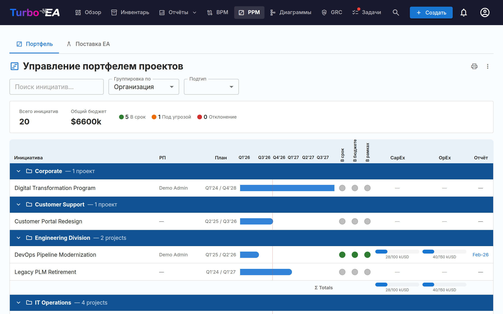
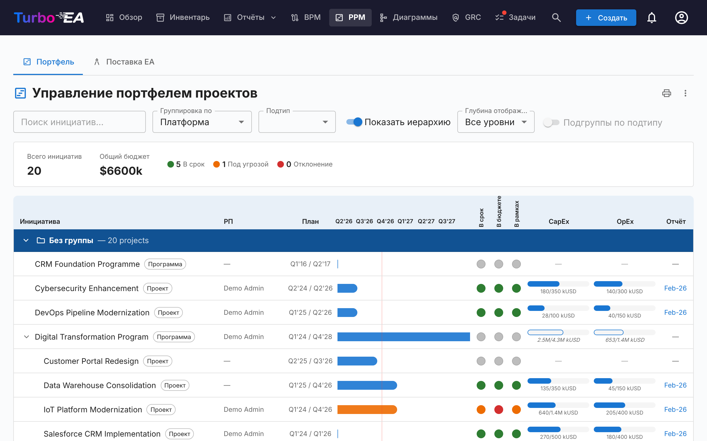
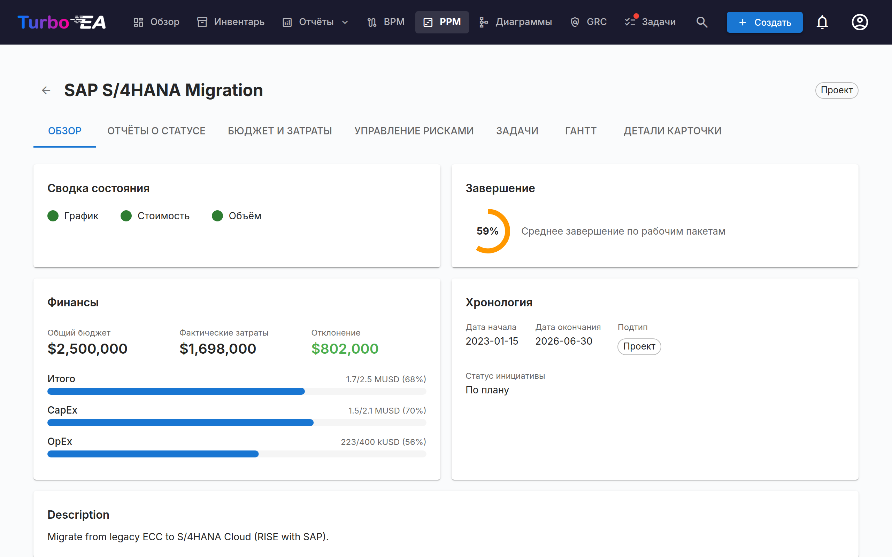
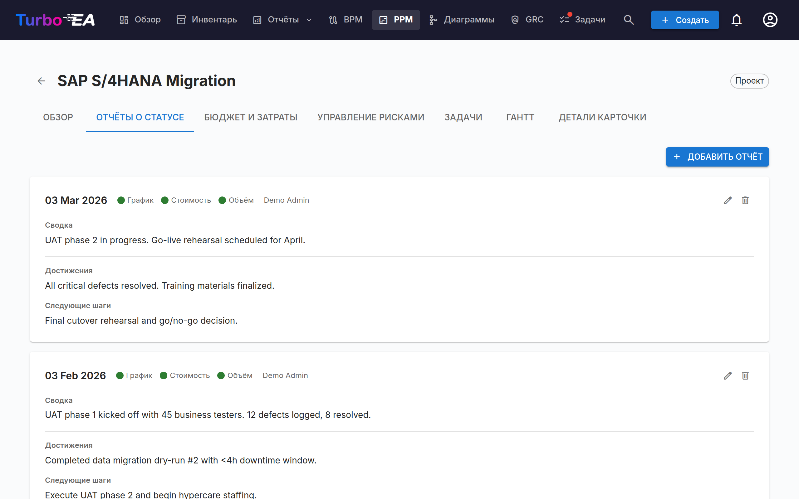
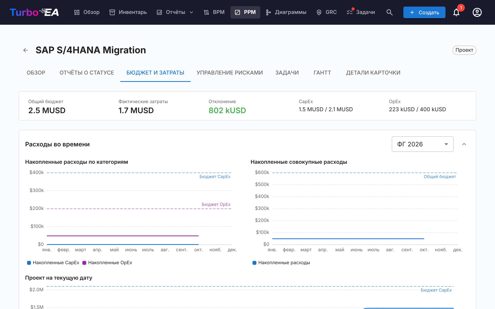
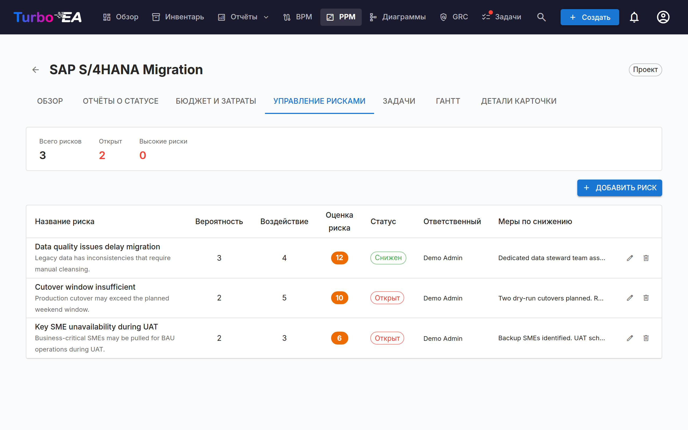
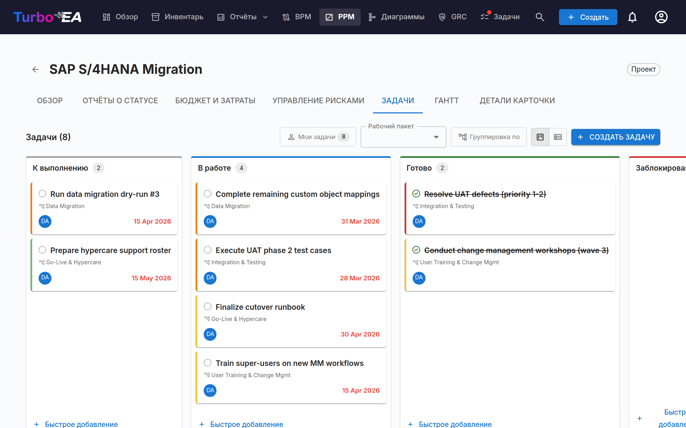
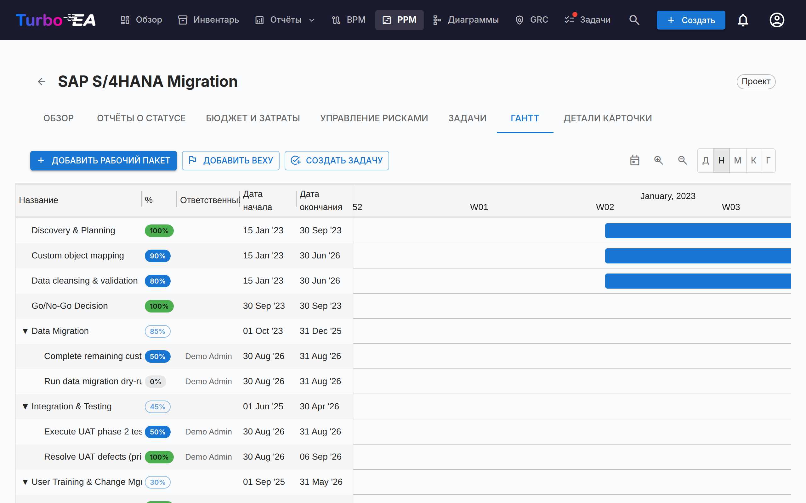

# Управление портфелем проектов (PPM)

Модуль **PPM** предоставляет полноценное решение для управления портфелем проектов, включающее отслеживание инициатив, бюджетов, рисков, задач и сроков. Он интегрируется непосредственно с типом карточки «Инициатива» для обогащения каждого проекта отчётами о статусе, отслеживанием затрат и визуализацией Ганта.

!!! note
    Модуль PPM может быть включён или отключён администратором в [Настройках](../admin/settings.md). В отключённом состоянии навигация и функции PPM скрыты.

## Панель портфеля

**Панель портфеля** — основная точка входа в PPM. Она предоставляет:

- **Карточки KPI** — Общее количество инициатив, общий бюджет, общие фактические затраты и сводки состояния здоровья
- **Круговые диаграммы здоровья** — Распределение здоровья по расписанию, затратам и объёму (В норме / Под угрозой / Отклонение)
- **Распределение статусов** — Разбивка по подтипу инициативы и статусу
- **Обзор Ганта** — Временные полосы, показывающие даты начала и окончания каждой инициативы, с индикаторами здоровья RAG

### Группировка и фильтрация

Используйте панель инструментов для:

- **Группировки по** любому связанному типу карточки (например, Организация, Платформа)
- **Группировки по** подтипу инициативы (например, Программа), перечисленному во втором разделе того же меню, чтобы видеть каждую программу со всеми инициативами под ней (см. ниже)
- **Фильтрации по подтипу** (Идея, Программа, Проект, Эпик)
- **Поиска** по названию инициативы
- **Показа иерархии**, чтобы вложить инициативы каждой группы под их родительскую инициативу (см. ниже)
- **Разбиения на подгруппы по подтипу**, чтобы разделить каждую группу по подтипу (см. ниже)

Эти фильтры сохраняются в URL, поэтому обновление страницы сохраняет текущий вид. Иерархия, её глубина отображения и разбиение на подгруппы также сохраняются в URL.

#### Показ иерархии инициатив

Если у некоторых инициатив в портфеле есть родительская инициатива, которая тоже находится в портфеле, на панели инструментов появляется переключатель **Показать иерархию**. Когда он включён, каждая группа показывает свои инициативы в виде дерева: дочерняя инициатива выводится с отступом под родительской, стрелка перед названием родительской инициативы сворачивает или разворачивает её поддерево, а каждая строка показывает свой подтип, чтобы роль каждого уровня (например, Программа → Проект → Эпик) оставалась видимой. **Глубина отображения** ограничивает дерево первыми уровнями (*Уровень 1*, *Уровень 2*, … или *Все уровни*).

Группировка остаётся главной: иерархия строится **внутри каждой группы**, поэтому инициатива, родитель которой относится к другой группе, показывается как строка верхнего уровня своей группы. Сначала применяются фильтры, и дерево показывает то, что осталось: если поиск или фильтр по подтипу исключает родительскую инициативу, её дочерние инициативы поднимаются на верхний уровень, а родитель не сохраняется как контекст.

#### Подгруппы по подтипу

Переключатель **Подгруппы по подтипу** делит каждую группу на подгруппы по подтипам — в том порядке, в котором подтипы определены у типа Initiative; инициативы без подтипа идут последними. У каждой подгруппы есть свой заголовок, она сворачивается отдельно и имеет собственную строку итогов; итоги группы по-прежнему охватывают все её инициативы. Пока показана иерархия, переключатель недоступен, поскольку дерево и так охватывает все подтипы.

#### Группировка по подтипу инициативы

Меню **Группировка по** состоит из двух разделов: **Связанные типы карточек** и **Подтипы инициатив** — подтипы, определённые для типа «Инициатива». Если выбрать подтип, например **Программа**, доска покажет по одной группе на каждую инициативу-программу. Программа даёт группе имя и служит **только её заголовком, но никогда не строкой**; в группу входят **все инициативы под ней на любой глубине** и любого подтипа, так что программа, вложенная в другую программу, — это строка в группе самой верхней программы.

Итоговая строка группы заменяет строку сумм: она подписана названием подтипа и показывает **собственные** бюджет, фактические затраты и даты программы, а если своих нет — значения, **выведенные** из инициатив под ней, с контуром, пунктиром и курсивом, как описано в разделе *Суммирование показателей на родительских инициативах*. Инициативы, над которыми нет ни одной программы, перечислены в группе **Без группы**. Промежуточная инициатива, которую вы не можете видеть, которая архивирована или которую портал не публикует, **разрывает цепочку**: всё, что под ней, больше не относится к программе выше. Переключатель **Показать иерархию** появляется, только когда что-то вложено ниже прямых потомков программы, а фильтр по подтипу не предлагает подтип группировки, поскольку его инициативы — заголовки, а не строки.

#### Суммирование показателей на родительских инициативах

Каждая инициатива показывает собственные показатели, если они у неё есть: полосы CapEx и OpEx родительской инициативы отражают строки бюджета и затрат, внесённые в неё саму, а её полоса на диаграмме Ганта — её собственные даты начала и окончания. Родительская инициатива **без собственных строк бюджета** показывает вместо этого бюджет нижестоящих инициатив, а **без собственных строк затрат** — их фактические затраты; в обоих случаях полоса рисуется **контурной** с показателями курсивом, а её подсказка сообщает, какая половина взята снизу. Инициатива **без даты начала и без даты окончания** охватывает период от самого раннего начала до самого позднего окончания нижестоящих инициатив и рисуется **пунктирной** полосой с кварталами курсивом. Всплывающая подсказка сообщает, сколько инициатив учтено. Эти три правила независимы — программа, которая держит бюджет, пока её проекты учитывают расходы, показывает собственный бюджет против их фактических затрат, а у программы могут быть собственные даты и при этом затраты её проектов, — и достаточно одной строки бюджета, одной строки затрат или одной даты на родительской инициативе, чтобы эта часть снова показывала её собственные данные. Учитываются только инициативы, которые вы можете видеть, а на портале — только опубликованные порталом. Итоги групп и панель KPI по-прежнему суммируют только внесённые строки, поэтому каждая сумма учитывается один раз.

Производные показатели есть только на доске PPM и на вкладках **Обзор** и **Бюджет и затраты** самой инициативы. Чтобы перенести суммарный итог в инвентарь, отчёты или портал, задайте вычисляемое поле, которое прибавляет собственный бюджет каждого уровня к итогам его дочерних инициатив, — см. [Суммирование показателей PPM по иерархии инициатив](../admin/calculations.md#rolling-ppm-figures-up-the-initiative-hierarchy). Изменение данных PPM в дочерней инициативе заново запускает вычисления всех инициатив выше неё, поэтому итог родительской инициативы обновляется сразу.

### Печать и экспорт

Портфель предлагает те же действия в строке заголовка, что и отчёты:

- **Печать / Сохранить как PDF** — значок принтера печатает портфель в том виде, в каком он выглядит на экране. Панель вкладок, панель фильтров и всплывающие подсказки скрываются, активная группировка, подтип и поиск печатаются компактной строкой параметров, а сетка временной шкалы больше не обрезается, поэтому все столбцы помещаются на страницу. Если включены иерархия или подгруппы, строка параметров указывает и их, вместе с глубиной отображения.
- **Экспорт в PowerPoint (.pptx)** — из меню **⋮**. Первый слайд содержит заголовок, отметку времени создания и активные фильтры вместе с портфелем в презентационном качестве; длинные портфели продолжаются на следующих слайдах и разбиваются только между инициативами — никогда посреди строки, заголовка группы или строки итогов.
- **Экспорт в Excel (.xlsx)** — также из меню **⋮**. По одной строке на инициативу с её группой, подтипом, руководителем проекта, датами начала и окончания, тремя оценками состояния, плановыми и фактическими CapEx/OpEx и датой последнего отчёта о статусе. Строки идут в том порядке, что и на экране; пока показана иерархия, столбец **Родитель** называет родительскую инициативу каждой инициативы. Три столбца, **Источник бюджета**, **Источник затрат** и **Источник дат**, показывают, собственные ли это бюджет, фактические затраты и даты строки или сумма нижестоящих инициатив. Когда доска сгруппирована по подтипу инициативы, группирующая инициатива становится **первой строкой своей группы** с теми значениями, которые показывает её итоговая строка.

## Детальный просмотр инициативы

Нажмите на любую инициативу, чтобы открыть страницу деталей с семью вкладками:

### Вкладка «Обзор»

Обзор показывает сводку здоровья и финансов инициативы:

- **Сводка здоровья** — Индикаторы расписания, затрат и объёма из последнего отчёта о статусе
- **Бюджет vs. Факт** — Комбинированная карточка KPI, показывающая общий бюджет и фактические расходы с отклонением
- **Показатели снизу** — Если у инициативы нет собственных строк бюджета, её общий бюджет, полосы бюджета и отклонение показывают вместо этого бюджет нижестоящих инициатив: курсивом, со стрелкой ↳, с контурной дорожкой бюджета и подсказкой, сколько инициатив учтено. Если у неё нет собственных строк затрат, её фактические затраты так же берутся снизу, а полосы расходов становятся контурными. Обе стороны решаются отдельно, и первая собственная строка возвращает эту сторону к собственным показателям инициативы.
- **Под этой инициативой** — Если под инициативой есть другие инициативы, строка под полосами бюджета называет их число, их суммарный бюджет и фактические расходы, а также период их дат. Она показывается рядом с собственными показателями инициативы и никогда к ним не прибавляется. Если и бюджет, и фактические затраты уже взяты снизу, строка сохраняет только число инициатив и период дат.
- **Последняя активность** — Сводка последнего отчёта о статусе

### Вкладка «Отчёты о статусе»

Ежемесячные отчёты о статусе отслеживают здоровье проекта с течением времени. Каждый отчёт включает:

| Поле | Описание |
|------|----------|
| **Дата отчёта** | Дата отчётного периода |
| **Здоровье расписания** | В норме, Под угрозой или Отклонение |
| **Здоровье затрат** | В норме, Под угрозой или Отклонение |
| **Здоровье объёма** | В норме, Под угрозой или Отклонение |
| **Сводка** | Краткое изложение текущего статуса |
| **Достижения** | Что было достигнуто за этот период |
| **Следующие шаги** | Запланированные действия на следующий период |

### Вкладка «Бюджет и затраты»

Отслеживание финансовых данных с двумя типами строк:

- **Строки бюджета** — Запланированный бюджет по финансовому году и категории (CapEx / OpEx) с необязательным описанием. Для одного финансового года и категории можно завести сколько угодно строк — по одной на лицензию, партнёра по внедрению или партию оборудования, — а описание позволяет их различать; итоги суммируют их все. Бюджетные строки группируются по **месяцу начала финансового года**, настроенному в [Настройках](../admin/settings.md#начало-финансового-года). Например, если финансовый год начинается в апреле, бюджетная строка за июнь 2026 относится к ФГ 2026–2027
- **Строки затрат** — Фактические расходы с датой, описанием и категорией

Обе таблицы сгруппированы по финансовым годам. У каждого года есть строка-заголовок с промежуточными итогами CapEx, OpEx и общим итогом, а также числом строк; стрелка в заголовке показывает или скрывает строки этого года. При открытии вкладки развёрнут только текущий финансовый год (или последний год, в котором есть строки, если в текущем их нет). Суммы стоят в отдельных столбцах **CapEx** и **OpEx**, а строка **Итого за все финансовые годы** под каждой таблицей суммирует все годы. Кнопка **+** в заголовке года бюджета добавляет строку бюджета с уже заполненным финансовым годом. Строки затрат группируются по финансовому году их даты и внутри года упорядочены по дате; строки без даты собраны в конце в группе **Без даты** и входят в итоги затрат, как и любые другие строки.

Если у инициативы **нет собственных строк бюджета**, таблица бюджета вместо пустого состояния показывает бюджет нижестоящих инициатив: подпись сообщает, из скольких инициатив он взят, по одной строке только для чтения на финансовый год показывает CapEx, OpEx и итог курсивом, а строка **Итого за все финансовые годы** их суммирует. Таблица затрат делает то же с их фактическими затратами, если у инициативы **нет собственных строк затрат**, со строкой **Без даты** для их строк затрат без даты. Сводная панель отмечает эти показатели курсивом и подсказкой. Каждая таблица решает сама, ничего не сохраняется и не прибавляется к собственным показателям инициативы, а учитываются только инициативы, которые вы можете видеть. Первая собственная строка, добавленная через **Добавить строку бюджета** или **Добавить статью затрат**, возвращает таблицу к собственным строкам инициативы; графики расходов всегда показывают собственные строки инициативы.

Итоги бюджета и затрат автоматически агрегируются в атрибуты `costBudget` и `costActual` карточки Инициативы.

#### Расходы во времени

Над таблицами бюджета и затрат три диаграммы показывают, как расходы накапливаются месяц за месяцем:

- **Накопленные расходы по категориям** — накопленные CapEx и OpEx за выбранный финансовый год с пунктирными горизонтальными линиями, отмечающими бюджет CapEx и OpEx этого года
- **Накопленные совокупные расходы** — тот же финансовый год с объединёнными категориями на фоне пунктирной линии общего бюджета
- **Проект на текущую дату** — накопленные CapEx и OpEx за все месяцы проекта на фоне общего бюджета всех финансовых лет

Выбор финансового года применяется к первым двум диаграммам и предлагает текущий год, любой другой год с данными, а также **Все финансовые годы**. Выбранный финансовый год и свёрнутое или развёрнутое состояние сохраняются между визитами.

При чтении диаграмм следует учитывать два момента:

- Линии заканчиваются на текущем месяце, а не тянутся ровной чертой до конца года, чтобы незавершённый год не выглядел как год с прекращёнными расходами
- Статьи затрат без даты невозможно разместить на временной шкале, поэтому они исключаются. Примечание под диаграммами сообщает, сколько статей исключено, чтобы итоги диаграммы можно было сверить с панелью сводки

### Вкладка «Управление рисками»

Реестр рисков отслеживает проектные риски:

| Поле | Описание |
|------|----------|
| **Заголовок** | Краткое описание риска |
| **Вероятность** | Оценка вероятности (1–5) |
| **Воздействие** | Оценка воздействия (1–5) |
| **Оценка риска** | Автоматически рассчитывается как вероятность x воздействие |
| **Статус** | Открыт, Смягчается, Смягчён, Закрыт или Принят |
| **Смягчение** | Запланированные действия по смягчению |
| **Ответственный** | Пользователь, ответственный за управление риском |

### Вкладка «Задачи»

Менеджер задач поддерживает виды **Kanban-доска** и **список** с четырьмя столбцами статуса:

- **К выполнению** — Задачи, которые ещё не начаты
- **В процессе** — Задачи, над которыми ведётся работа
- **Выполнено** — Завершённые задачи
- **Заблокировано** — Задачи, которые не могут продолжаться

Задачи могут фильтроваться и группироваться по элементу Иерархической структуры работ (ИСР/WBS). При группировке каждый рабочий пакет отображается как группа — в том числе тот, в котором пока нет задач: он показывает подсказку и кнопку **Добавить задачу**, открывающую диалог задачи с уже выбранным пакетом. Вехи появляются только после того, как в них есть задача.

Фильтры отображения (режим просмотра, фильтр WBS, переключатель группировки) сохраняются в URL между обновлениями страницы.

### Вкладка «Гант»

Диаграмма Ганта визуализирует временную шкалу проекта:

- **Рабочие пакеты (WBS)** — Иерархические элементы структуры декомпозиции работ с датами начала/окончания
- **Задачи** — Отдельные полосы задач, связанные с рабочими пакетами
- **Вехи** — Ключевые даты, отмеченные ромбовидными индикаторами
- **Полосы прогресса** — Визуальный процент завершения. У задачи нет собственного процента: её заполнение следует за статусом — **К выполнению (0%)**, **В работе (50%)**, **Выполнено (100%)**. Щёлкните по плашке с процентом задачи, чтобы открыть ползунок, три деления которого подписаны этими статусами; выбор деления меняет статус, и перетаскивание заполнения на полосе задачи делает то же самое. У конечного рабочего пакета — свободный ползунок с шагом 5%. Рабочие пакеты, у которых есть дочерние рабочие пакеты **или задачи**, отображают плашку только для чтения, значение которой автоматически вычисляется из поддерева.
- **Квартальные отметки** — Временная сетка для ориентации

Взаимодействие с диаграммой Ганта:

- **Селектор масштаба** — Выберите между «День», «Неделя», «Месяц», «Квартал» и «Год»; выбор сохраняется в браузере
- **Кнопки +/− масштабирования** — Перемещайтесь по тем же пяти шкалам по одному шагу
- **Точки на концах полос** — Перетащите от правой точки одной полосы к левой точке другой, чтобы создать зависимость «finish-to-start». Работает между рабочими пакетами и задачами в любой комбинации. Циклы отклоняются автоматически. **Двойной клик по стрелке** удаляет её.
- **Строка «+»** внизу списка спрашивает, что создать — рабочий пакет, веху или задачу, — поэтому введённая там задача попадает на вкладку «Задачи».

### Вкладка «Детали карточки»

Последняя вкладка отображает полное представление деталей карточки, включая все стандартные разделы.

## Иерархическая структура работ (ИСР / WBS)

ИСР обеспечивает иерархическую декомпозицию объёма проекта:

- **Рабочие пакеты** — Логические группировки задач с датами начала/окончания и отслеживанием завершения
- **Вехи** — Значимые события или точки завершения
- **Иерархия** — Отношения родитель-потомок между элементами ИСР
- **Авто-завершение** — Процент завершения рассчитывается автоматически из задач в поддереве рабочего пакета: каждая задача считается как 0% (К выполнению, Заблокировано), 50% (В процессе) или 100% (Выполнено), с весом по её длительности в днях (один день, если дата отсутствует), затем рекурсивно суммируется вверх до родительских элементов. Рабочий пакет, под которым нет ни одной задачи, сохраняет значение, введённое вручную. Среднее по рабочим пакетам верхнего уровня — это общий прогресс инициативы: число на вкладке «Обзор» и переменная `ppm.completion`, которую [вычисляемое поле](../admin/calculations.md#ppm-data-on-initiative-cards) может показать на карточке и в портале

## Интеграция с деталями карточки

Когда PPM включён, карточки **Инициатива** отображают вкладку **PPM** как последнюю вкладку в [представлении деталей карточки](card-details.md). Нажатие на эту вкладку переводит непосредственно к детальному представлению PPM инициативы (вкладка «Обзор»). Это обеспечивает быстрый доступ от любой карточки Инициативы к её полной странице проекта PPM.

В свою очередь, вкладка **Детали карточки** в детальном представлении PPM инициативы показывает стандартные разделы карточки без вкладки PPM, что предотвращает циклическую навигацию.

## Разрешения

| Разрешение | Описание |
|-----------|----------|
| `ppm.view` | Просмотр панели PPM, диаграммы Ганта и отчётов инициатив, а также чтение карточек инициатив. Предоставляется всем ролям по умолчанию |
| `ppm.manage` | Создание и управление отчётами о статусе, задачами, затратами, рисками и элементами WBS. Предоставляется ролям Администратор, Администратор BPM и Участник |
| `reports.ppm_dashboard` | Просмотр панели портфеля PPM. Предоставляется всем ролям по умолчанию |
