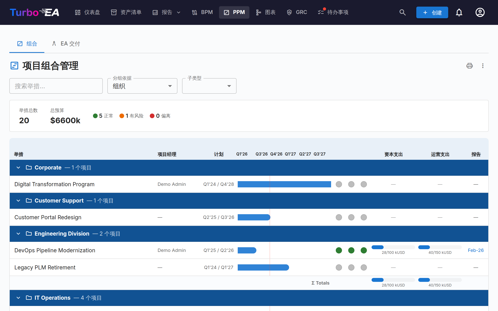
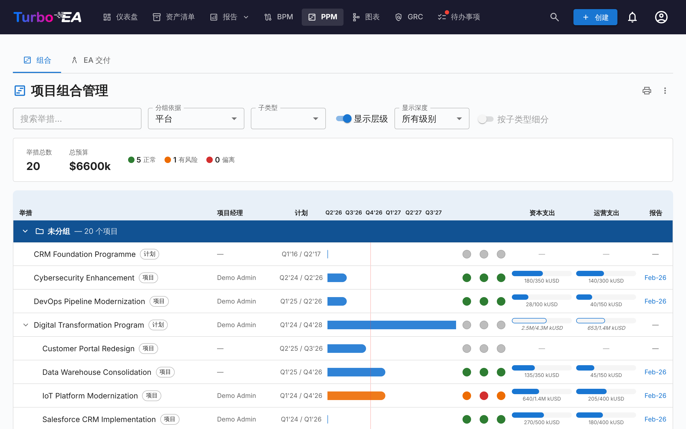
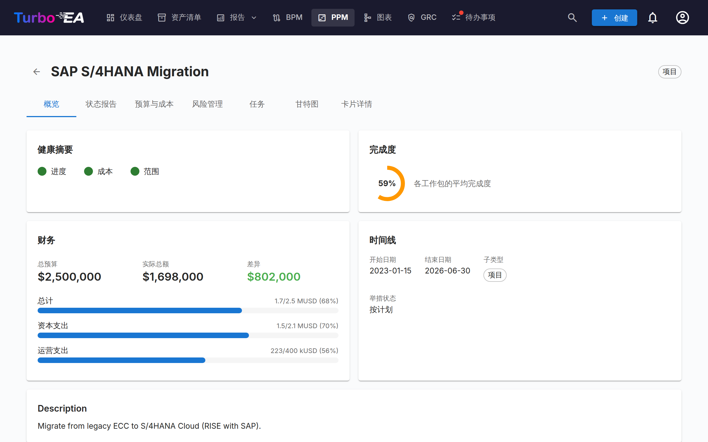
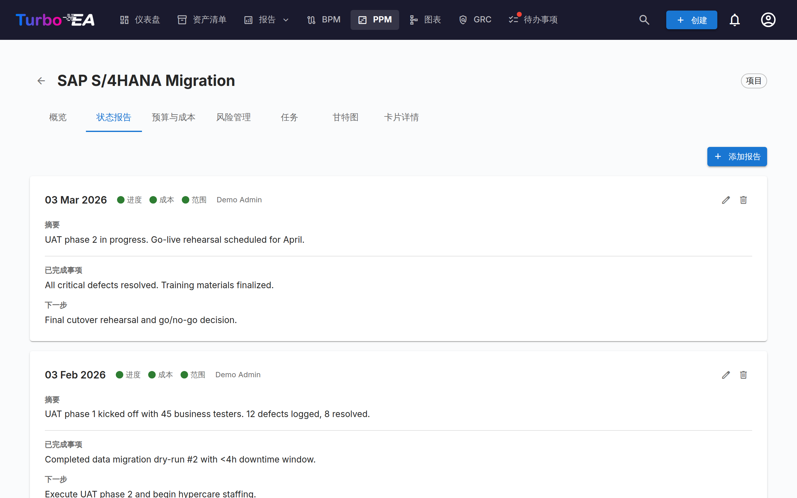
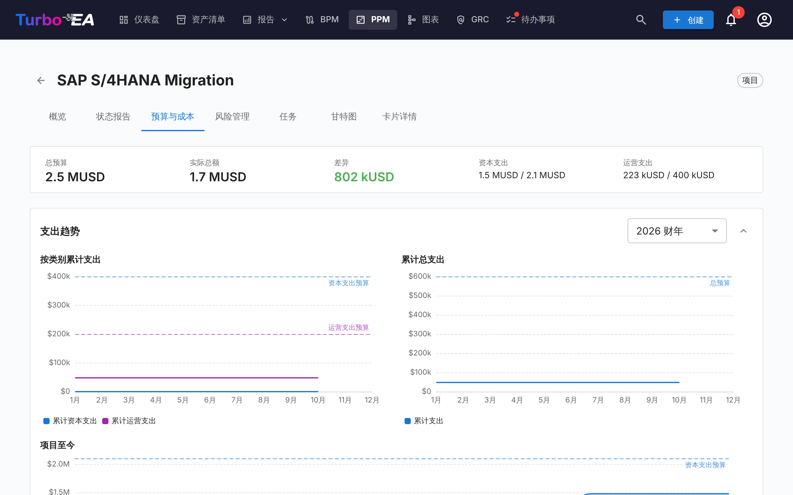
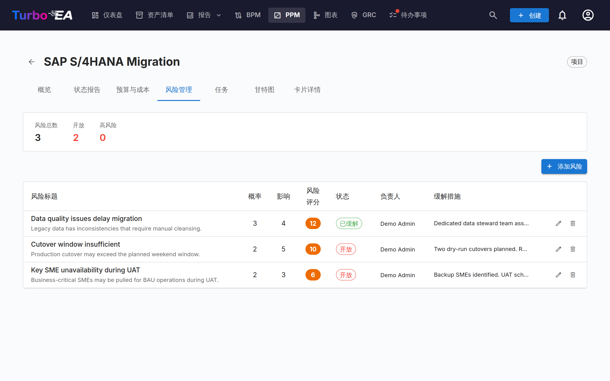
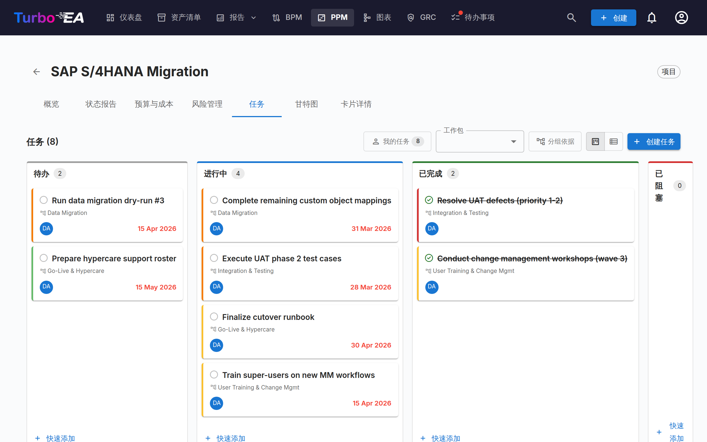
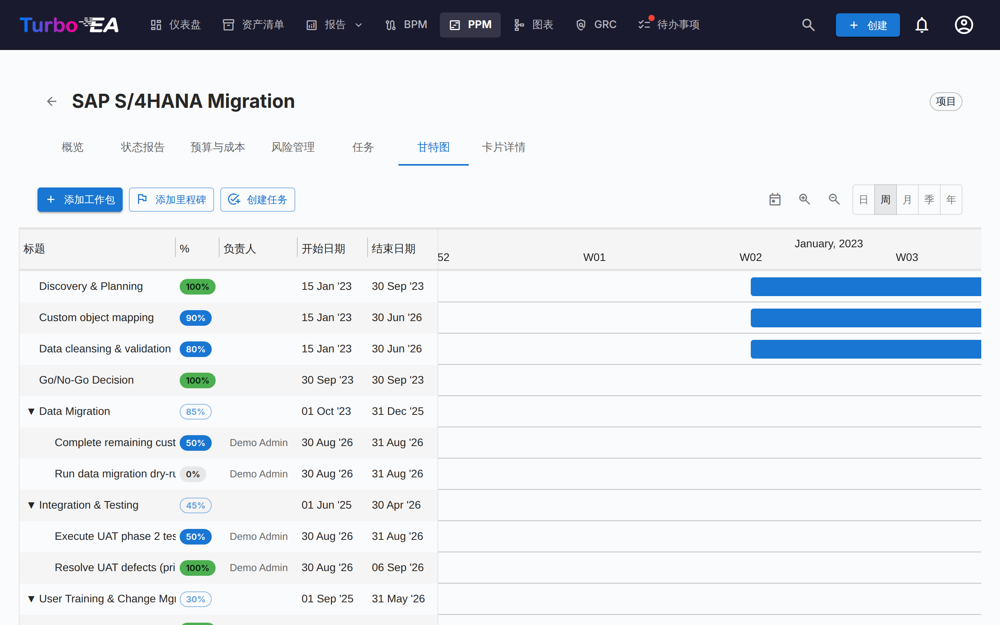

# 项目组合管理 (PPM)

**PPM** 模块提供完整的项目组合管理解决方案，用于跟踪计划、预算、风险、任务和时间表。它直接与计划卡片类型集成，通过状态报告、成本跟踪和甘特图可视化来丰富每个项目。

!!! note
    PPM 模块可以由管理员在[设置](../admin/settings.md)中启用或禁用。禁用时，PPM 导航和功能将被隐藏。

## 组合仪表盘

**组合仪表盘**是 PPM 的主要入口。它提供：

- **KPI 卡片** — 计划总数、总预算、实际总成本和健康状态摘要
- **健康饼图** — 进度、成本和范围健康分布（正常 / 有风险 / 偏离）
- **状态分布** — 按计划子类型和状态的细分
- **甘特图概览** — 显示每个计划的开始和结束日期的时间线条，带有 RAG 健康指标

### 分组与筛选

使用工具栏可以：

- **按**任何相关卡片类型**分组**（例如组织、平台）
- **按**举措子类型**分组**（例如计划），列于同一菜单的第二部分，可查看每个计划及其下的所有举措（见下文）
- **按子类型筛选**（创意、项目群、项目、史诗）
- **按**计划名称**搜索**
- **显示层级**，将每个分组中的计划嵌套在其上级举措之下（见下文）
- **按子类型细分**，将每个分组按子类型拆分（见下文）

这些筛选条件保存在 URL 中，因此刷新页面会保留当前视图。层级、其显示深度以及子类型细分也会保存在 URL 中。

#### 显示举措层级

当投资组合中的某些计划拥有同样位于投资组合中的上级举措时，工具栏会提供**显示层级**开关。开启后，每个分组会以树形列出其计划：下级计划缩进显示在上级之下，上级名称前的箭头可折叠或展开其子树，每一行都会显示其子类型，因此每个层级的角色（例如项目群 → 项目 → 史诗）始终清晰可见。**显示深度**可将树限制在前几个层级（*第 1 级*、*第 2 级*……或*所有级别*）。

分组始终优先：层级只在**每个分组内部**嵌套，因此如果某个计划的上级属于另一个分组，它会作为自己分组中的顶层行显示。筛选条件先生效，树只显示剩下的内容：当搜索或子类型筛选排除了某个上级时，其下级会上移到顶层，而不会把该上级作为上下文保留。

#### 按子类型细分

**按子类型细分**会把每个分组拆分为每个子类型一个子分组，顺序与 Initiative 类型上定义子类型的顺序一致，没有子类型的计划排在最后。每个子分组都有自己的标题，可以单独折叠，并带有自己的合计行；分组的合计仍涵盖其全部计划。显示层级时该开关不可用，因为层级树本身已经涵盖所有子类型。

#### 按举措子类型分组

**分组依据**菜单分为两部分：**关联的卡片类型**和**举措子类型**（即在举措类型上定义的子类型）。选择一个子类型（例如**计划**）后，看板会为每个「计划」举措显示一个分组。该计划为其分组命名，**只作为分组标题，绝不作为一行**；分组包含**其下任意层级的所有举措**，无论其子类型为何，因此嵌套在另一个计划之下的计划，是最上层计划分组中的一行。

分组的底行取代合计行：它以子类型命名，显示该计划**自身**的预算、实际成本和日期；若其自身没有，则显示由其下举措**推导**的数值，并按「将数值汇总到上级举措」中所述以描边、虚线和斜体绘制。上方没有任何计划的举措列于**未分组**下。中间若有您无权查看、已归档或门户未发布的举措，**链条即被打断**：其下的举措不再归入上方的计划。只有当计划的直接子级之下还有嵌套时，才会出现**显示层级**；子类型筛选也不再提供用于分组的子类型，因为这些举措是标题而不是行。

#### 将数值汇总到上级举措

只要举措有自己的数据，就显示自己的数据：上级的资本支出和运营支出条只包含记录在上级本身的预算行和成本行，其甘特条使用其自身的开始和结束日期。**没有自己的预算行**的上级会改为显示其下所有举措的预算，**没有自己的成本行**的上级则显示其下举措的实际成本；两种情况下该条都以**空心轮廓**和斜体数字绘制，其提示会说明哪一半来自下级。**既没有开始日期也没有结束日期**的上级则从其下最早的开始日期跨到最晚的结束日期，以**虚线**条和斜体季度绘制。悬停时，提示会说明涵盖了多少项举措。这三条规则相互独立——持有预算、由其项目记录支出的项目群会以自己的预算对照其项目的实际成本，项目群也可以有自己的日期，同时仍显示其项目的成本——只要在上级上记录一条预算行、一条成本行或一个日期，该部分就会切换回其自身的数据。只有您可以查看的举措才会计入；在门户上，只计入该门户发布的举措。分组合计和 KPI 栏仍只累加已记录的行，因此每个数值只计算一次。

派生数值只存在于 PPM 看板以及举措自身的**概览**和**预算与成本**选项卡上。要把汇总值带到清单、报表或门户中，请定义一个计算字段，把每个层级自身的预算与其下级的汇总值相加 —— 参见[沿举措层级汇总 PPM 数值](../admin/calculations.md#rolling-ppm-figures-up-the-initiative-hierarchy)。下级的 PPM 变更会重新运行其上方所有举措的计算，因此上级的汇总值会立即更新。

### 打印与导出

投资组合提供与报表相同的标题栏操作：

- **打印 / 另存为 PDF** — 打印机图标会按屏幕上的样子打印投资组合。标签栏、筛选工具栏和悬停弹出框会被隐藏，当前的分组、子类型和搜索条件会打印为一行紧凑的参数摘要，时间轴网格不再被裁剪，因此所有列都能完整地放进页面，而不会在滚动边缘被截断。开启层级或子类型细分时，参数摘要中也会注明，并附上显示深度。
- **导出为 PowerPoint (.pptx)** — 位于 **⋮** 菜单中。第一张幻灯片包含标题、生成时间戳和当前筛选条件，并以演示质量呈现投资组合；较长的投资组合会延续到后续幻灯片，且只在计划之间分页 — 绝不会从某一行、分组标题或合计行中间截断。
- **导出为 Excel (.xlsx)** — 同样位于 **⋮** 菜单中。每个计划一行，包含其分组、子类型、项目经理、开始与结束日期、三项健康度评级、资本支出/运营支出的计划值与实际值，以及最新状态报告的日期。各行的顺序与屏幕上一致；显示层级时，**上级**列会列出每个计划的上级举措。**预算来源**、**成本来源**和**日期来源**三列说明每行的预算、实际成本和日期是其自身的，还是其下举措的合计。看板按举措子类型分组时，用于分组的举措是**其分组的第一行**，所带数值与其底行所示一致。

## 计划详情视图

点击任何计划以打开其包含七个选项卡的详情页面：

### 概览选项卡

概览显示计划的健康和财务摘要：

- **健康摘要** — 来自最新状态报告的进度、成本和范围指标
- **预算 vs. 实际** — 组合 KPI 卡片，显示总预算和实际支出及差异
- **来自下级的数值** — 当举措没有自己的预算行时，其总预算、预算条和差异会改为显示其下举措的预算：以斜体显示，带有 ↳ 箭头标记，预算轨道为空心轮廓，提示会说明涵盖了多少项举措。当举措没有自己的成本行时，其实际成本以同样方式来自下级，支出条为空心轮廓。两侧分别判断，只要记录第一条自己的行，该侧就会切换回举措自身的数值。
- **此举措下级** — 当举措下有其他举措时，预算条下方会有一行显示其数量、汇总的预算与实际支出以及其日期跨度。该行显示在举措自身数值旁边，绝不会与之相加。当预算和实际成本都已来自下级时，该行只保留数量和日期跨度。
- **最近活动** — 最新状态报告摘要

### 状态报告选项卡

月度状态报告跟踪项目健康随时间的变化。每份报告包括：

| 字段 | 描述 |
|------|------|
| **报告日期** | 报告期间的日期 |
| **进度健康** | 正常、有风险或偏离 |
| **成本健康** | 正常、有风险或偏离 |
| **范围健康** | 正常、有风险或偏离 |
| **摘要** | 当前状态的执行摘要 |
| **成就** | 本期取得的成果 |
| **下一步** | 下一期计划的活动 |

### 预算与成本选项卡

通过两种类型的行项目跟踪财务数据：

- **预算行** — 按财年和类别（资本支出 / 运营支出）的计划预算，可附带描述（可选）。同一财年和类别下可以有任意多条预算行（例如每项许可、实施合作伙伴或硬件批次各一条），以描述加以区分；合计金额会将它们全部相加。预算行根据在[设置](../admin/settings.md#财年起始月份)中配置的**财年起始月份**进行分组。例如，如果财年从四月开始，2026 年六月的预算行属于 2026–2027 财年
- **成本行** — 带有日期、描述和类别的实际支出

两张表格都按财年分组。每个财年有一个标题行，显示该年的资本支出、运营支出和合计小计以及所含条目数；点击标题行上的箭头可显示或隐藏该年的条目。打开该选项卡时，只展开当前财年（如果当前财年没有条目，则展开有条目的最近一年）。金额分列在 **资本支出** 和 **运营支出** 两列中，每张表格下方的 **合计（所有财政年度）** 行汇总所有年份。点击预算年份标题行上的 **+** 可添加一条已填好该财年的预算行。成本行按其日期所在的财年分组，并在年内按日期排列；没有日期的成本行归入末尾的 **无日期** 组，并与其他条目一样计入成本合计。

当举措**没有自己的预算行**时，预算表会在原本的空状态处显示其下举措的预算：一行说明文字指出数据来自多少项举措，每个财政年度一行只读行以斜体给出资本支出、运营支出和合计，**合计（所有财政年度）**行将其相加。当举措**没有自己的成本行**时，成本表以同样方式显示其下举措的实际成本，并用一行**无日期**列出其没有日期的成本行。摘要栏以斜体并附提示标出这些数值。两张表各自判断，不会存储任何数据，也不会与举措自身的数值相加，且只计入您可以查看的举措。通过**添加预算行**或**添加成本项**记录第一条行后，该表即切换回举措自身的行；支出图表始终显示举措自身的行。

预算和成本总额自动汇总到计划卡片的 `costBudget` 和 `costActual` 属性中。

#### 支出趋势

在预算和成本表格上方，三张图表展示支出如何按月累计：

- **按类别累计支出** — 所选财年的累计资本支出与运营支出，并以水平虚线标示该财年的资本支出与运营支出预算
- **累计总支出** — 同一财年内两类支出合并后的累计值，并对照总预算虚线
- **项目至今** — 项目所有月份的累计资本支出与运营支出，并对照所有财年的总预算

财年选择器适用于前两张图表，可选择当前财年、任何存在数据的其他财年，以及**所有财年**。您选择的财年以及展开或折叠状态会在多次访问之间保留。

阅读图表时需注意两点：

- 曲线在当前月份结束，而不会平直延伸到财年末，以免将进行中的财年误读为支出已经停止
- 未填日期的成本条目无法定位到时间轴上，因此被排除在外。图表下方的说明会给出被排除的条目数量，便于将图表合计与摘要栏对账

### 风险管理选项卡

风险登记册跟踪项目风险：

| 字段 | 描述 |
|------|------|
| **标题** | 风险的简要描述 |
| **概率** | 可能性评分（1-5） |
| **影响** | 影响评分（1-5） |
| **风险评分** | 自动计算为概率 x 影响 |
| **状态** | 开放、缓解中、已缓解、已关闭或已接受 |
| **缓解措施** | 计划的缓解行动 |
| **负责人** | 负责管理风险的用户 |

### 任务选项卡

任务管理器支持**看板**和**列表**视图，有四个状态列：

- **待办** — 尚未开始的任务
- **进行中** — 当前正在进行的任务
- **已完成** — 已完成的任务
- **已阻塞** — 无法继续的任务

任务可以按工作分解结构 (WBS) 项目进行筛选和分组。分组时，每个工作包都会显示为一个分组 —— 包括尚未包含任何任务的工作包，它会显示一条提示和一个**添加任务**按钮，点击后打开任务对话框并预选该工作包。里程碑仅在包含任务后才会出现。

显示筛选条件（视图模式、WBS 筛选、分组切换）在页面刷新之间保持在 URL 中。

### 甘特图选项卡

甘特图可视化项目时间表：

- **工作包 (WBS)** — 带有开始/结束日期的分层工作分解结构项目
- **任务** — 与工作包关联的单个任务条
- **里程碑** — 以菱形指示器标记的关键日期
- **进度条** — 可视化的完成百分比。任务本身没有独立的百分比：其填充随状态而定 — **待办 (0%)**、**进行中 (50%)**、**已完成 (100%)**。点击任务上的百分比标签可打开一个滑块，其三个档位以这些状态标注；选择一个档位即会更改状态，拖动任务条上的填充部分效果相同。叶级工作包则有一个以 5% 为步长的自由滑块。含有子工作包**或任务**的工作包显示只读标签，其值由子树自动汇总计算。
- **季度标记** — 用于定向的时间线网格

与甘特图交互：

- **比例尺选择器** — 在「日」、「周」、「月」、「季度」、「年」之间切换；选择会保存在浏览器中
- **+/− 缩放按钮** — 沿同样的五个比例尺逐级缩放
- **每个甘特条两端的圆点** — 从一个条形的右侧圆点拖到另一个条形的左侧圆点，即可创建一条「完成—开始」依赖关系。可在工作包与任务之间任意组合。系统会自动拒绝形成循环。**双击一条箭头**即可删除。
- **列表底部的 + 行**会询问要创建什么 —— 工作包、里程碑还是任务 —— 因此在那里输入的任务会出现在「任务」选项卡中。

### 卡片详情选项卡

最后一个选项卡显示完整的卡片详情视图，包括所有标准部分。

## 工作分解结构 (WBS)

WBS 提供项目范围的分层分解：

- **工作包** — 带有开始/结束日期和完成跟踪的任务逻辑分组
- **里程碑** — 重要事件或完成点
- **层级结构** — WBS 项目之间的父子关系
- **自动完成** — 完成率根据工作包子树中的任务自动计算：每个任务按 0%（待办、已阻塞）、50%（进行中）或 100%（已完成）计入，并按其持续天数加权（缺少日期时按一天计），然后递归向上汇总到父级项目。下方完全没有任务的工作包保留手动输入的值。顶层工作包的平均值即为倡议的整体进度 —— 也就是「概览」选项卡上的数字，以及[计算字段](../admin/calculations.md#ppm-data-on-initiative-cards)可在卡片和门户中显示的 `ppm.completion` 变量

## 卡片详情集成

当 PPM 启用时，**计划**卡片在[卡片详情视图](card-details.md)中会显示一个 **PPM** 标签页作为最后一个标签页。点击此标签页将直接导航到 PPM 计划详情视图（概览标签页）。这为从任何计划卡片快速访问其完整的 PPM 项目页面提供了便捷入口。

反过来，PPM 计划详情视图中的**卡片详情**标签页显示标准卡片详情部分，但不包含 PPM 标签页，以避免循环导航。

## 权限

| 权限 | 描述 |
|------|------|
| `ppm.view` | 查看 PPM 仪表盘、甘特图和计划报告，并可读取计划卡片。默认授予所有角色 |
| `ppm.manage` | 创建和管理状态报告、任务、成本、风险和 WBS 项目。授予管理员、BPM 管理员和成员角色 |
| `reports.ppm_dashboard` | 查看 PPM 组合仪表盘。默认授予所有角色 |
